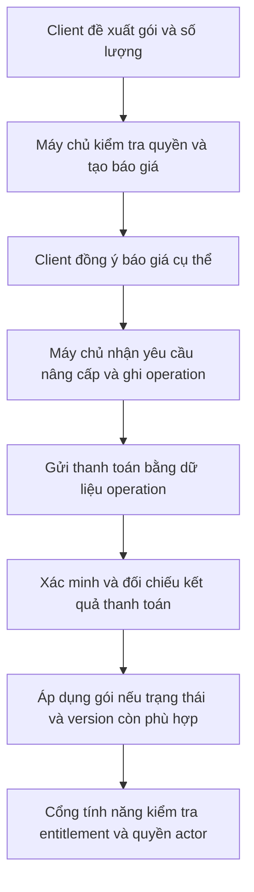

# Server authoritative decisions: quyết định nghiệp vụ có thẩm quyền ở máy chủ

Trong chương **Client Trust**, server authoritative decisions có nghĩa là máy chủ chịu trách nhiệm xác lập những kết quả nghiệp vụ có hiệu lực: ai được thao tác, số tiền nào được chấp nhận, trạng thái nào được ghi và tài nguyên hoặc tính năng nào được cấp. Client gửi ý định, tham chiếu và dữ liệu được phép đề xuất; máy chủ kiểm chứng chúng theo nguồn dữ liệu và chính sách có thẩm quyền.

Trong module bảo vệ logic nghiệp vụ, nguyên tắc này giúp ngăn sửa giá, tự cấp quyền, bỏ qua phê duyệt hoặc gửi lại yêu cầu để tạo thêm hiệu ứng. Chỉ chuyển mã JavaScript sang backend chưa đủ nếu backend vẫn tin trực tiếp những kết luận do client khai.

Bài học dùng ví dụ nâng cấp gói dịch vụ trả phí cho một tenant. Quy trình được giản lược để tập trung vào quyền quản lý, báo giá, thanh toán, cập nhật gói và kiểm tra quyền sử dụng tính năng.

Sau bài này, bạn có thể:

- Phân biệt ý định client với kết luận mà máy chủ phải xác lập.
- Chỉ ra nguồn có thẩm quyền cho từng dữ liệu tham gia quyết định.
- Tách nhận yêu cầu, xác nhận kết quả bên ngoài và áp dụng quyền sử dụng.
- Đặt quyết định trong ranh giới transaction, version và idempotency phù hợp.
- Kiểm thử server không tin cờ, giá, quyền hoặc trạng thái do client tự gửi.

## 1. Máy chủ có thẩm quyền không có nghĩa mọi dữ liệu tới backend đều đáng tin

Một endpoint có thể chạy hoàn toàn ở backend nhưng vẫn mắc lỗi:

```text
nhận plan = TEAM_PRO, amount = 1, paid = true từ client
kiểm tra các trường đúng kiểu
lưu subscription thành TEAM_PRO
cấp tính năng nâng cao
```

Backend đã thực hiện việc lưu, nhưng client lại quyết định giá và bằng chứng thanh toán. Nơi chạy câu lệnh không thay thế việc kiểm chứng căn cứ quyết định.

Tương tự, dữ liệu trong database không tự đáng tin nếu trước đó được ghi từ một API mass assignment. Message trong hàng đợi không tự có thẩm quyền chỉ vì consumer là một service nội bộ.

Cần hỏi với từng kết luận:

> Ai hoặc hệ thống nào được phép xác lập kết luận này, dữ liệu được kiểm chứng như thế nào và nó còn áp dụng cho đối tượng hiện tại không?

Ví dụ nhà cung cấp thanh toán có thể cung cấp bằng chứng giao dịch đã thành công. Việc tenant được nhận gói nào từ giao dịch đó vẫn do hệ thống đối chiếu operation và chính sách sản phẩm, không lấy tùy ý một tên gói từ callback.

## 2. Ví dụ sai: dùng kết quả giao diện làm quyết định cấp gói

Giả sử ứng dụng cho người quản lý chọn gói và chuyển tới bước thanh toán. Khi quay lại, client gọi:

```http
POST /subscriptions/sub-17/complete-upgrade
Content-Type: application/json

{
  "tenantId": "tenant-a",
  "targetPlan": "TEAM_PRO",
  "seats": 50,
  "amountMinor": 1,
  "currency": "VND",
  "paymentStatus": "SUCCEEDED",
  "enabledFeatures": ["ADVANCED_EXPORT", "UNLIMITED_PROJECTS"]
}
```

Nếu máy chủ dùng body để xác lập subscription, caller có thể:

- Chọn giá không tương ứng gói và số lượng.
- Tự khai thanh toán thành công.
- Đổi tenant hoặc subscription đích.
- Bật tính năng không thuộc gói.
- Gửi lại để ghi đè một thay đổi gói mới hơn.

Ngay cả caller đã đăng nhập và có quyền quản lý thanh toán cũng không có quyền tự quyết định nhà cung cấp đã thu tiền hay không. Quyền yêu cầu một hành động và thẩm quyền xác nhận kết quả của hành động là hai việc khác nhau.

## 3. Xây dựng bảng nguồn có thẩm quyền

Với ví dụ nâng cấp gói:

| Dữ liệu hoặc kết luận | Nguồn có thẩm quyền | Client được làm gì? |
| --- | --- | --- |
| Danh tính actor | Cơ chế xác thực được máy chủ kiểm chứng | Cung cấp credential theo giao thức |
| Tenant đang được dùng | Lựa chọn scope đã xác minh membership và policy | Đề xuất tenant làm việc theo hợp đồng |
| Quyền quản lý subscription | Policy và quan hệ với subscription cụ thể | Yêu cầu hành động, không tự khai role để được phép |
| Gói và định nghĩa tính năng | Danh mục sản phẩm và version được quản lý | Chọn một gói được cung cấp |
| Giá và loại tiền | Báo giá được máy chủ xác lập theo chính sách | Đề xuất số lượng, mã hoặc lựa chọn hợp lệ |
| Kết quả thanh toán | Bằng chứng từ nguồn thanh toán đã xác thực và đối chiếu | Điều hướng hoặc yêu cầu đọc kết quả |
| Gói đang có hiệu lực | Trạng thái subscription được áp dụng hợp lệ | Hiển thị và gửi điều kiện version đã xem |
| Hạn mức còn dùng | Dữ liệu sử dụng và cơ chế nhận tài nguyên có thẩm quyền | Gửi ý định sử dụng một lượng tài nguyên |
| Thời điểm quyết định | Nguồn thời gian máy chủ phù hợp | Gửi timestamp chỉ với ý nghĩa metadata nếu cần |

Không nhất thiết mọi nguồn nằm trong cùng một database. Điều cần thiết là biết phạm vi thẩm quyền, phiên bản, hiệu lực và cách xác minh khi kết hợp các nguồn đó.

Một giá trị có nguồn đúng nhưng dùng sai đối tượng vẫn có thể nguy hiểm. Báo giá thật của tenant B không phải báo giá được tenant A sử dụng; kết quả thanh toán thật của operation cũ không cấp quyền cho operation mới.

## 4. Thiết kế chuỗi quyết định thay vì một endpoint công nhận mọi kết quả

Quy trình ví dụ có các bước:



Các đối tượng có trách nhiệm riêng:

- `subscription`: gói và trạng thái sử dụng hiện tại của tenant.
- `quote`: nội dung giá được chốt cho một lựa chọn, chủ thể và thời hạn cụ thể.
- `upgrade_request`: yêu cầu nâng cấp có snapshot và version nguồn.
- `payment_operation`: một ý định thanh toán được định danh ổn định.
- `payment_result`: kết quả đã được xác thực và gắn đúng operation.
- Dữ liệu entitlement: những tính năng hoặc hạn mức được hệ thống công nhận theo gói đã áp dụng.

Không dùng một trường `isPro` từ client để thay thế cả chuỗi này. Cũng không dùng `HTTP 200` từ bước tạo yêu cầu làm bằng chứng mọi bước sau đã hoàn tất.

## 5. Hợp đồng đầu vào chỉ thể hiện ý định và điều kiện

Ví dụ:

```http
POST /subscriptions/sub-17/upgrade-requests
Idempotency-Key: upgrade-sub17-quote9-01
Content-Type: application/json

{
  "targetPlanId": "plan-team-pro",
  "seats": 3,
  "quoteId": "quote-9",
  "expectedSubscriptionVersion": 12
}
```

Theo hợp đồng này:

- `targetPlanId` là lựa chọn sản phẩm, không phải quyền được cấp ngay.
- `seats` là số lượng được đề xuất, phải khớp báo giá và giới hạn áp dụng.
- `quoteId` là tham chiếu phải kiểm tra quyền, quan hệ và hiệu lực.
- `expectedSubscriptionVersion` là điều kiện đối chiếu, không phải version mới client được ghi.

Không có `paid`, `amountMinor`, `enabledFeatures`, người duyệt hoặc role quản trị trong lệnh này. Danh tính actor và tenant lấy từ ngữ cảnh đã được xác minh, không bị body ghi đè.

Hợp đồng có thể chỉ nhận quote nếu mọi lựa chọn đã nằm trong quote. Nếu nhận cả lựa chọn và quote như ví dụ, máy chủ phải đối chiếu chúng khớp nhau, không chọn từng giá trị thuận lợi từ hai nguồn khác nhau.

Các trường không được hỗ trợ cần được xử lý nhất quán theo schema. Không để một mapper tổng quát nhận thêm thuộc tính và đưa trực tiếp vào subscription hoặc payment operation.

## 6. Minh họa Java: nhận một ý định nâng cấp trả phí

Đoạn mã dùng record của Java 16 trở lên. `VerifiedActor`, `SubscriptionSnapshot` và `TrustedQuote` là dữ liệu phía máy chủ đã xác minh; chúng không được bind từ body của client. Ví dụ chỉ tạo ý định nâng cấp, chưa công nhận đã thanh toán hoặc cấp tính năng.

```java
import java.time.Instant;
import java.util.Objects;
import java.util.UUID;

record VerifiedActor(
        UUID tenantId,
        UUID principalId,
        boolean active,
        boolean mayManageThisSubscription) {
}

record SubscriptionSnapshot(
        UUID id,
        UUID tenantId,
        long version,
        boolean changeAllowed) {
}

record UpgradeCommand(
        UUID targetPlanId,
        int seats,
        UUID quoteId,
        long expectedSubscriptionVersion) {
}

record TrustedQuote(
        UUID id,
        UUID tenantId,
        UUID subscriptionId,
        UUID targetPlanId,
        long planVersion,
        int seats,
        long amountMinor,
        String currency,
        Instant validUntil) {
}

record UpgradeIntent(
        UUID tenantId,
        UUID subscriptionId,
        long sourceSubscriptionVersion,
        UUID actorPrincipalId,
        UUID quoteId,
        UUID targetPlanId,
        long targetPlanVersion,
        int seats,
        long amountMinor,
        String currency) {
}

final class UpgradeDecisionPolicy {
    private UpgradeDecisionPolicy() {
    }

    static UpgradeIntent requestPaidUpgrade(
            VerifiedActor actor,
            SubscriptionSnapshot current,
            TrustedQuote quote,
            UpgradeCommand command,
            Instant serverNow) {
        Objects.requireNonNull(actor);
        Objects.requireNonNull(current);
        Objects.requireNonNull(quote);
        Objects.requireNonNull(command);
        Objects.requireNonNull(serverNow);

        UUID tenant = Objects.requireNonNull(actor.tenantId());
        require(actor.active() && actor.mayManageThisSubscription(),
                "BILLING_ACTION_NOT_ALLOWED");
        require(tenant.equals(current.tenantId())
                && tenant.equals(quote.tenantId()), "TENANT_MISMATCH");
        require(Objects.requireNonNull(current.id())
                .equals(quote.subscriptionId()), "SUBSCRIPTION_MISMATCH");
        require(Objects.requireNonNull(quote.id())
                .equals(command.quoteId()), "QUOTE_MISMATCH");
        require(Objects.requireNonNull(quote.targetPlanId())
                .equals(command.targetPlanId()), "PLAN_MISMATCH");
        require(command.seats() > 0 && command.seats() == quote.seats(),
                "SEAT_SELECTION_MISMATCH");
        require(current.changeAllowed(), "CHANGE_NOT_ALLOWED");
        require(current.version() == command.expectedSubscriptionVersion(),
                "SUBSCRIPTION_VERSION_CONFLICT");
        require(serverNow.isBefore(quote.validUntil()), "QUOTE_EXPIRED");
        require(quote.amountMinor() > 0, "PAID_QUOTE_REQUIRED");
        require(quote.currency() != null && !quote.currency().isBlank(),
                "CURRENCY_REQUIRED");

        return new UpgradeIntent(tenant, current.id(), current.version(),
                Objects.requireNonNull(actor.principalId()), quote.id(),
                quote.targetPlanId(), quote.planVersion(), quote.seats(),
                quote.amountMinor(), quote.currency());
    }

    private static void require(boolean valid, String code) {
        if (!valid) {
            throw new IllegalStateException(code);
        }
    }
}
```

`mayManageThisSubscription` phải là kết quả kiểm tra có thẩm quyền cho chính subscription đang xử lý, không phải một cờ hoặc role client tự gửi. Báo giá phải được tạo theo danh mục, hạn mức sản phẩm, loại tiền và chính sách đúng trước khi được dùng như `TrustedQuote`.

Đoạn mã lược bỏ validation đầy đủ của các record, việc xác minh quyền hiện hành và kiểm soát đồng thời. Nó không tự chứng minh quote được phát hành đúng hoặc operation đã được ghi. Tên lớp có chữ `Trusted` không thay thế quy trình tải và xác minh nguồn.

Nếu có luồng gói miễn phí hoặc thay đổi không thu tiền, mô hình hóa quyết định đó riêng theo policy. Không giả một kết quả thanh toán thành công để ép mọi loại thay đổi qua cùng một nhánh.

## 7. Nhận yêu cầu không đồng nghĩa cấp tính năng

Sau khi có ý định hợp lệ, máy chủ cần nhận nó một cách bền vững:

```text
BEGIN TRANSACTION
  nhận quyền xử lý idempotency key theo tenant, actor và loại lệnh
  tải và bảo vệ subscription trong phạm vi được phép
  kiểm tra quyền, version, trạng thái và quote
  kiểm tra quy tắc không có thay đổi đang chờ xung đột
  ghi upgrade request với snapshot giá và version nguồn
  tạo payment operationId ổn định
  ghi outbox yêu cầu thanh toán, audit và kết quả tiếp nhận
COMMIT
```

Kết quả lúc này có thể là `AWAITING_PAYMENT`. Tenant chưa được cấp gói chỉ vì request đã được nhận hoặc frontend đã chuyển sang màn hình tiếp theo.

Giá trị gửi sang nhà cung cấp lấy từ operation đã chốt. Không nhận lại một số tiền do client gửi ở bước sau rồi dùng nó thay thế snapshot.

Chính sách giữ giá cần rõ ràng. Nếu quote cam kết một giá đến thời hạn nhất định, có thể dùng giá đó khi đúng điều kiện. Nếu chính sách yêu cầu báo giá lại, người dùng phải được xử lý theo hợp đồng đó; không âm thầm tính một giá mới rồi coi người dùng đã đồng ý.

Thuế, phí, điều chỉnh kỳ hoặc phân bổ theo thời gian nếu có phải được mô hình hóa trong pricing engine và snapshot tương ứng. Không để các khoản chưa mô hình hóa được bù bằng một `total` tùy ý từ client.

## 8. Xác nhận thanh toán từ nguồn có thẩm quyền

Các dữ liệu sau không tự chứng minh đã thanh toán:

- Query string `paymentStatus=success` trên trang quay lại.
- Một cờ thành công do SDK hoặc bộ nhớ client gửi lên mà chưa được đối chiếu.
- Ảnh chụp màn hình giao dịch.
- Một transaction ID thật nhưng thuộc operation hoặc tài khoản khác.
- Một message có tên `PaymentSucceeded` từ nguồn không được phép xác nhận.

Máy chủ cần kiểm tra theo giao thức của nguồn thanh toán:

```text
nguồn và tính xác thực của bằng chứng
đúng loại sự kiện và tài khoản nhận tương ứng
đúng operation đã được máy chủ tạo
đúng số tiền và loại tiền cần xác nhận
trạng thái giao dịch đáp ứng chính sách công nhận thanh toán
định danh giao dịch chưa được dùng cho một hậu quả khác trái quy tắc
cách xử lý sự kiện lặp, cũ hoặc mâu thuẫn
```

Tenant và gói được tra từ operation có thẩm quyền, không lấy tùy ý một `tenantId` hoặc `planCode` do callback khai mà không đối chiếu.

Việc nhận và áp dụng một kết quả cục bộ cần chống lặp bằng transaction hoặc cơ chế tương đương. Nếu có inbox sự kiện, ghi nhận đã xử lý và cập nhật kết quả cần có ranh giới nhất quán phù hợp.

Timeout không chứng minh chưa thu tiền. Khi chưa biết kết quả, giữ operation và đối soát; không tạo một lần thanh toán mới chỉ vì client thử lại.

## 9. Áp dụng gói và kiểm tra entitlement là các quyết định riêng

Một kết quả thanh toán đúng là điều kiện quan trọng, nhưng bước áp dụng vẫn phải bảo đảm nó thuộc đúng thay đổi hiện tại.

Các kiểm tra có thể gồm:

- Upgrade request và payment operation liên kết đúng nhau.
- Snapshot gói, số lượng và giá là bản đã được chấp nhận.
- Subscription vẫn ở version hoặc điều kiện nguồn phù hợp.
- Không có thay đổi mới hơn đã được áp dụng theo một quy trình khác.
- Operation chưa được dùng để áp dụng gói thêm lần nữa.
- Những guard hiện tại mà policy yêu cầu vẫn đúng.

Trong transaction áp dụng, cập nhật gói và dữ liệu entitlement cục bộ bắt buộc, tăng version, ghi kết quả cùng outbox liên quan. Không chỉ đặt `isPro=true` mà bỏ qua số lượng, thời hạn và định nghĩa tính năng.

Khi một người gọi tính năng, cổng thực thi cần kiểm tra thêm:

```text
tenant có entitlement đang có hiệu lực cho tính năng
AND actor có membership và permission phù hợp
AND đối tượng thuộc phạm vi được phép
AND trạng thái và hạn mức sử dụng còn cho phép
```

Một tenant mua gói nâng cao không làm mọi thành viên trở thành quản trị viên. Ngược lại, có role quản trị không tự chứng minh tenant đã có entitlement trả phí mà policy yêu cầu.

Nếu tính năng có quota dùng chung, việc nhận tài nguyên phải được bảo vệ ở máy chủ. Bộ đếm hiển thị trên trình duyệt hoặc điện thoại không ngăn hai request đồng thời cùng vượt hạn mức.

## 10. Quyết định phải còn đúng tại ranh giới có hiệu lực

Lỗi kiểm tra trước, sử dụng sau có thể xảy ra ngay trong backend:

```text
đọc subscription version 12
kiểm tra có thể nâng cấp
                    request khác áp dụng một thay đổi và lên version 13
ghi gói dựa trên kết luận của version 12 mà không kiểm tra lại
```

Cần khóa, version hoặc cập nhật có điều kiện để quyết định không được dùng sai trên trạng thái mới. Các bước ghi liên quan phải tham gia cùng giao thức nhất quán.

Nếu quyền quản lý bị thu hồi đồng thời, hệ thống cần định nghĩa thời điểm quyền được tiêu thụ để nhận yêu cầu. Một cờ lấy từ cache cũ không đủ nếu hợp đồng đòi hiệu lực tại ranh giới hiện hành.

Kết quả bên ngoài làm tình huống phức tạp hơn. Nếu đã thu tiền nhưng subscription đổi version trước khi áp dụng, không được tùy tiện bỏ qua khoản thu hoặc ghi đè gói mới. Cần trạng thái xử lý ngoại lệ hoặc đối soát với quy tắc điều chỉnh, áp dụng lại có thẩm quyền hay hoàn tiền phù hợp.

Một transaction cục bộ không tạo transaction nguyên tử với nhà cung cấp. Nguồn quyền, payment operation và subscription phải có những ranh giới được mô tả chính xác, không chỉ một hàm tên `upgradeAtomically`.

## 11. Bằng chứng do client mang theo vẫn có thể sử dụng nếu được xác minh đúng

Server authoritative không có nghĩa mọi dữ liệu hợp lệ bắt buộc phải nằm trong một bảng trên cùng máy chủ. Client có thể mang một token, ticket hoặc báo giá được phát hành qua cơ chế có tính toàn vẹn phù hợp.

Điểm nhận vẫn phải xác minh:

- Bên phát hành và loại bằng chứng được chấp nhận.
- Mục đích và API hoặc đối tượng nhận được phép sử dụng.
- Tenant, actor hoặc tài nguyên mà bằng chứng ràng buộc theo thiết kế.
- Nội dung, version, thời hạn và trạng thái hiệu lực liên quan.
- Cơ chế chống dùng lại nếu nghiệp vụ yêu cầu một lần sử dụng.

Chữ ký hợp lệ không tự cấp quyền cho người cầm một báo giá của người khác. Một bằng chứng còn nguyên vẹn cũng có thể đã cũ hoặc không còn áp dụng cho nội dung hiện tại.

Không đặt bí mật phát hành quyền chung trong client rồi coi client là bên có thẩm quyền ký mọi quyết định. Việc bảo vệ credential thiết bị, xác thực môi trường hoặc kênh truyền cần được hiểu theo đúng bảo đảm của từng cơ chế.

CSRF token, CORS hoặc kiểm tra nguồn request có mục đích riêng. Chúng không tự xác lập giá, entitlement hoặc bằng chứng đã thanh toán. Request hợp lệ theo cơ chế phiên vẫn cần kiểm tra nghiệp vụ đầy đủ.

## 12. Idempotency và xử lý bất đồng bộ giữ nguyên một ý định

Một lần nâng cấp có thể đi qua nhiều lần gửi:

```text
client gửi → mất phản hồi
client retry cùng lệnh
outbox gửi lại yêu cầu
nhà cung cấp gửi lại callback
worker áp dụng chạy lại sau restart
```

Mỗi ranh giới cần có định danh và invariant tương ứng:

| Ranh giới | Điều cần bảo vệ |
| --- | --- |
| Nhận lệnh client | Cùng key và cùng ý định không tạo thêm upgrade request |
| Tạo payment operation | Một yêu cầu không tạo nhiều lần thu tiền trái policy |
| Gửi ra ngoài | Tiếp tục cùng operation, dùng cơ chế chống lặp hoặc đối soát phù hợp |
| Nhận kết quả | Một giao dịch không bị ghi nhận hoặc dùng cấp quyền nhiều lần |
| Áp dụng subscription | Callback hoặc worker lặp không áp dụng lại một thay đổi cũ |

Idempotency key không phải credential và không cấp quyền. Phạm vi cần gắn với tenant, actor và loại thao tác phù hợp; dấu vân tay phải phản ánh đúng quote, lựa chọn và điều kiện của lệnh.

Sự kiện cũ không được ghi đè một gói mới hơn chỉ vì nó có tên `PaymentConfirmed`. Consumer cần đối chiếu operation, version và trạng thái. Nếu có tiền thật đã thu, giữ bằng chứng để đối soát thay vì xóa sự kiện như thể chưa từng xảy ra.

Không dùng quy tắc “gói cao hơn luôn thắng” hoặc timestamp từ client để giải quyết mọi xung đột. Chúng có thể trái ý định hoặc chính sách của một thay đổi mới đã được chấp nhận.

## 13. Nguồn dữ liệu phân tán, cache và lỗi phụ thuộc

Một hệ thống có thể dùng dịch vụ danh tính, policy, pricing và thanh toán riêng. Quyết định có thẩm quyền cần biết thông tin nào được đọc từ nguồn gốc, thông tin nào là bản chiếu và độ cũ nào được chấp nhận.

Ví dụ:

- Bản sao danh mục có version có thể đủ để hiển thị lựa chọn.
- Báo giá đã chốt có thể có hiệu lực trong một khoảng thời gian theo cam kết giữ giá.
- Bản chiếu subscription cập nhật chậm có thể dùng cho giao diện, nhưng chưa chắc đủ cho cổng tạo một hậu quả nhạy cảm.
- Cache quyền cần đáp ứng chính sách thu hồi tại ranh giới hành động.

Cache key phải phân biệt tenant, đối tượng và các chiều quyền phù hợp. Một kết quả cho phép hoặc báo giá của tenant A không được trả cho B chỉ vì cùng tên gói hoặc ID cục bộ.

Nếu không lấy được dữ liệu bắt buộc để xác lập thẩm quyền, không mặc định cho phép bằng quyền rộng của service. Với hành động nhạy cảm, có thể trả lỗi tạm thời hoặc giữ tiến trình chờ theo hợp đồng, nhưng không tự tạo kết quả thành công.

Các điều kiện hiệu lực cần thực tế với kiến trúc. Nếu nhiều nguồn không chia sẻ một transaction, phải xác định snapshot, version, lease hoặc ranh giới chấp nhận tương ứng. Gọi một nguồn là “source of truth” không tự giải quyết độ trễ giữa đọc và thực hiện.

## 14. Preview và giao diện hỗ trợ người dùng, quyết định cuối nằm ở đường thực thi

API preview có thể trả:

```json
{
  "canRequestUpgrade": true,
  "quoteId": "quote-9",
  "amountMinor": 300000,
  "currency": "VND"
}
```

Phản hồi giúp giao diện hiển thị giá và trạng thái nút. Khi người dùng xác nhận, backend vẫn phải kiểm tra request theo hiệu lực của quote, quyền và dữ liệu liên quan.

Không yêu cầu client gửi lại `canRequestUpgrade=true` để chứng minh đã preview. Nếu cần chứng minh người dùng đang đồng ý một báo giá, dùng tham chiếu hoặc bằng chứng được ràng buộc đúng nội dung và kiểm tra tại máy chủ.

Các trạng thái phản hồi phải đúng mức kết quả:

- Đã nhận yêu cầu không phải đã thu tiền.
- Đã xác nhận thanh toán không phải mọi thay đổi subscription đã hoàn tất.
- Đã cập nhật gói cục bộ không tự chứng minh mọi hệ thống ngoài đã đồng bộ.
- Lỗi tạm thời chưa chắc là thất bại nghiệp vụ cuối cùng.

Lỗi như quote cũ, xung đột version hoặc không có quyền cần mã ổn định theo hợp đồng. Không lộ dữ liệu của tenant khác để giải thích tại sao một quote không được dùng, và không trả entity đầy đủ khi một bước kiểm tra thất bại.

## 15. Mọi đường tạo hiệu ứng phải đi qua cùng nguyên tắc

Một luồng web an toàn có thể bị đi vòng qua mobile, API cũ, công cụ hỗ trợ hoặc worker. Cần lập danh mục các đường có thể tạo cùng kết quả.

| Đường | Điểm cần kiểm tra |
| --- | --- |
| Web và mobile | Không tin giá, role, trạng thái hoặc entitlement cục bộ |
| API trực tiếp | Cùng policy và invariant dù caller không qua giao diện |
| Import và hàng loạt | Không biến cột hoặc thuộc tính thành kết quả có thẩm quyền |
| Worker | Phân biệt quyền kỹ thuật với căn cứ nghiệp vụ của operation |
| Callback | Chỉ nguồn được phép xác nhận và chỉ đúng operation |
| Công cụ quản trị | Quyền và điều kiện ngoại lệ cụ thể, không ghi tùy ý toàn entity |
| Cấu hình sản phẩm và policy | Thay đổi được quản lý vì chúng là nguồn của quyết định |

Nếu nhân viên hỗ trợ được cấp gói ngoại lệ, đó là hành động riêng có phạm vi, thời hạn và audit phù hợp. Không giả một payment result để hệ thống tưởng khách đã thanh toán.

Danh mục gói, định nghĩa tính năng, mapping tenant và credential của executor thuộc ranh giới tin cậy. Một người có thể tự sửa giá thành 0 hoặc bật mọi feature trong policy có thể làm mất bảo đảm nếu những thay đổi đó không được kiểm soát tương xứng.

Nguyên tắc cũng áp dụng cho quyền theo trường và quan hệ: một command hợp lệ không được mang thêm `ownerId`, `tenantId`, cờ duyệt hoặc metadata để mapper gán ngoài ý định đã được kiểm tra.

## 16. Ma trận kiểm thử quyết định có thẩm quyền

| Ca kiểm thử | Kết quả cần giữ |
| --- | --- |
| Actor hợp lệ gửi lựa chọn và quote đúng | Chỉ tạo ý định thanh toán cho đúng snapshot |
| Thêm `paid=true` hoặc `paymentStatus=SUCCEEDED` | Không công nhận thanh toán hay cấp gói |
| Thêm số tiền thấp hơn hoặc danh sách feature tùy ý | Không thay dữ liệu có thẩm quyền của operation |
| Quote đúng định dạng nhưng thuộc tenant khác | Không dùng được ngoài scope |
| Chọn gói hoặc số lượng khác quote | Bị chặn hoặc yêu cầu báo giá mới theo hợp đồng |
| Actor có role ở tenant khác | Không quản lý subscription ngoài phạm vi |
| Actor là thành viên nhưng không có quyền billing | Không được tạo thay đổi chỉ vì có quyền sử dụng app |
| Có quyền billing nhưng tenant chưa có entitlement | Không tự được dùng tính năng trả phí ngoài quy trình |
| Redirect hoặc client SDK báo thành công | Không áp dụng gói khi chưa có bằng chứng được xác minh |
| Giao dịch thật nhưng sai operation, số tiền hoặc loại tiền | Không dùng làm căn cứ cấp gói tương ứng |
| Quyền hoặc quote hết hiệu lực trước ranh giới chấp nhận | Xử lý theo chính sách thời gian và thu hồi đã chọn |
| Dịch vụ bắt buộc không khả dụng | Không mặc định cho phép hoặc tạo thành công giả |

Mỗi nhóm cần ca đối chứng thành công. Một request bị chặn bởi schema sai chưa chứng minh quyền tenant hoạt động; một token hết hạn chưa chứng minh hệ thống không tin `paid=true` khi token hợp lệ.

Oracle nên dựa trên hợp đồng nghiệp vụ và fixture có thẩm quyền độc lập, không lấy chính hàm production tính expected rồi tự so với kết quả của nó.

## 17. Kiểm thử cạnh tranh, tác dụng phụ và khả năng giải thích

Các lịch thực thi cần quan sát:

| Kịch bản | Invariant hoặc hành vi cần giữ |
| --- | --- |
| Hai request nâng cấp cùng subscription version | Không tạo thay đổi đang chờ xung đột trái policy |
| Retry sau mất phản hồi | Không tạo thêm operation hoặc lần thu tiền |
| Callback lặp và worker chạy lại | Không cấp entitlement hoặc áp dụng gói nhiều lần |
| Thanh toán xác nhận sau một thay đổi gói mới | Không ghi đè version mới; giữ tiền và operation để xử lý đúng |
| Thu hồi quyền đồng thời với nhận yêu cầu | Kết quả theo ranh giới hiệu lực đã định |
| Cache có dữ liệu cũ hoặc sai tenant | Không cho phép hành động ngoài hợp đồng |
| Hai request cùng dùng phần quota còn lại | Hạn mức vẫn đúng sau mọi commit |
| Lỗi giữa lưu operation và ghi outbox | Không để ý định thiếu độ bền hoặc được gửi ngoài commit |
| Nhà cung cấp thành công nhưng response timeout | Không giả định chưa thu tiền và tạo lại tùy ý |

Kiểm tra cả subscription, quote, upgrade request, payment operation, entitlement, outbox, sổ quota và lời gọi tới fake provider. Một response lỗi không chứng minh an toàn nếu hiệu ứng ngoài đã được gửi.

Audit cần chỉ ra actor thực tế, tenant, hành động, snapshot, các version, căn cứ quyền, operation và kết quả đã commit. Phân biệt request bị từ chối, operation được tiếp nhận, thanh toán được xác nhận và quyền sử dụng đã áp dụng.

Không log token, credential hoặc toàn bộ dữ liệu thanh toán. Lưu định danh và bằng chứng cần thiết tại nơi có quyền truy cập phù hợp để giải thích quyết định mà không tạo nguồn rò rỉ mới.

Các kiểm thử transaction và concurrency cần cơ chế lưu trữ cùng lịch đồng bộ phù hợp. Mock một kết quả cho phép hoặc gửi hai request tuần tự không chứng minh cửa sổ giữa kiểm tra và commit đã được bảo vệ.

## 18. Cách áp dụng server authoritative decisions vào một tính năng

1. Liệt kê các kết quả có hậu quả: đổi quyền, đổi trạng thái, nhận tiền, cấp tài nguyên hoặc sử dụng quota.
2. Xác định nguồn có thẩm quyền, phạm vi và hiệu lực của từng dữ liệu tham gia quyết định.
3. Thiết kế lệnh client chỉ chứa ý định, tham chiếu và các điều kiện phù hợp.
4. Xác minh actor, tenant, quyền đối tượng và quyền trường trước khi tạo hiệu ứng.
5. Dùng dữ liệu máy chủ hoặc bằng chứng đã được xác minh để tính và kiểm tra kết quả.
6. Đặt ranh giới nhận quyết định với transaction, version và invariant chống cạnh tranh.
7. Tách ý định, kết quả bên ngoài và bước áp dụng; dùng operation ổn định, chống lặp và đối soát.
8. Thực thi quyền sử dụng tại các cổng tính năng, không chỉ dựa vào trạng thái giao diện.
9. Bao phủ mọi kênh gọi, cấu hình nguồn, lỗi phụ thuộc và các lịch retry hoặc concurrency trong kiểm thử.

Quyết định có thẩm quyền đến từ căn cứ đúng nguồn, đúng đối tượng và còn hiệu lực tại ranh giới được hệ thống chấp nhận. Máy chủ cần biến ý định thành kết quả bằng quy tắc được thực thi và dữ liệu bền vững, rồi để client hiển thị kết quả đó thay vì tự xác lập nó.
