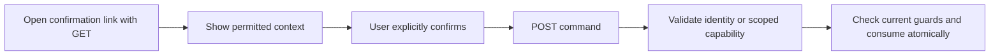

# Safe method assumptions: hiểu đúng giả định an toàn của HTTP method

## 1. Một đường dẫn đọc dữ liệu có thể vô tình thực hiện nghiệp vụ

Một ứng dụng dùng liên kết sau để phê duyệt đề nghị chi trả:

```http
GET /expense-requests/expense-17/approve
```

Người phát triển nghĩ rằng chỉ người có quyền mới nhìn thấy nút nên liên kết sẽ chỉ được gọi khi người đó muốn duyệt. Nhưng trình duyệt, công cụ xem trước, bộ quét liên kết hoặc một trang khác có thể làm request được gửi trong những điều kiện mà người dùng chưa chủ động xác nhận hành động.

Nếu server thực hiện phê duyệt bằng GET, nó đã đặt một hành động thay đổi nghiệp vụ vào method mà các thành phần HTTP có lý do để xử lý như một thao tác an toàn.

Trong HTTP, **safe method** mô tả ngữ nghĩa của yêu cầu: client không yêu cầu một thay đổi trạng thái có tác dụng gây biến đổi như hành động nghiệp vụ đó. Khái niệm này không có nghĩa response công khai, request không tốn tài nguyên hoặc server tuyệt đối không ghi dữ liệu nào.

Trong bảo vệ logic nghiệp vụ, điều quan trọng là không để các giả định quanh method làm mất các bất biến như không tự duyệt, không thu tiền ngoài ý định, không tiêu thụ quyền một lần khi chỉ mở liên kết và không bỏ qua authorization.

## 2. Phân biệt safe, idempotent và authorized

Ba thuộc tính trả lời ba câu hỏi khác nhau:

| Thuộc tính | Câu hỏi | Ví dụ |
|---|---|---|
| Safe | Request có yêu cầu một hành động làm thay đổi trạng thái theo nghĩa đó không? | Đọc chi tiết hồ sơ khác với phê duyệt hồ sơ |
| Idempotent | Lặp cùng request có cùng tác động được chủ ý lên trạng thái như một lần không? | Xóa cùng một tài nguyên không có nghĩa tạo thêm một lần xóa nghiệp vụ |
| Authorized | Chủ thể có được thực hiện thao tác trên đối tượng này không? | Được xem hồ sơ của phòng mình nhưng không được xem tenant khác |

### 2.1. Safe không có nghĩa không tồn tại mọi tác dụng phụ

Server có thể ghi access log, cập nhật metrics hoặc tạo cache phục vụ biểu diễn được yêu cầu. Những tác dụng phụ phụ trợ đó không tự biến một truy vấn đọc thành một lệnh nghiệp vụ không an toàn.

Điều cần phân biệt là tác dụng được client yêu cầu theo hợp đồng. Phê duyệt, chuyển tiền, hủy đơn, đổi owner hoặc tiêu thụ một quyền lợi không thể được ngụy trang thành “chỉ ghi log khi mở trang”.

Nếu “đã xem” là một xác nhận nghiệp vụ có hệ quả, như xác nhận đã kiểm tra chứng từ, cần lệnh rõ ràng cho ý định đó. Không dùng access log của một GET để thay chữ chấp nhận của người có trách nhiệm.

### 2.2. Idempotent không có nghĩa safe

Một lệnh hủy có thể được thiết kế sao cho gọi lại không tạo thêm tác động. Nó vẫn là yêu cầu thay đổi trạng thái và không trở thành thao tác đọc.

Tương tự, thêm idempotency key cho một lệnh thanh toán giúp kiểm soát gửi lại, không biến lệnh thanh toán thành safe.

### 2.3. Safe không có nghĩa không cần phân quyền

Đọc số dư, hồ sơ nhân sự hoặc tài liệu phê duyệt có thể không đổi trạng thái nghiệp vụ nhưng vẫn làm lộ dữ liệu nhạy cảm. GET cần authentication/authorization phù hợp như mọi đường đọc khác.

Không được đặt quy tắc “method là GET thì bỏ kiểm tra tenant/owner”. Tính an toàn về tác động và quyền được biết thông tin là hai ranh giới độc lập.

## 3. Ngữ nghĩa của các method thường gặp

| Method | Safe theo ngữ nghĩa HTTP | Idempotent theo ngữ nghĩa method | Lưu ý khi bảo vệ nghiệp vụ |
|---|---|---|---|
| `GET` | Có | Có | Không gắn lệnh duyệt, mua, hủy hoặc thay quyền vào đường đọc |
| `HEAD` | Có | Có | Không có response body không chứng minh không có mutation |
| `OPTIONS` | Có | Có | Khám phá khả năng/giao thức không được thực thi lệnh nghiệp vụ |
| `TRACE` | Có | Có | Chức năng chẩn đoán không đồng nghĩa phải được bật trong mọi hệ thống |
| `PUT` | Không | Có | Vẫn là thay đổi tài nguyên, cần quyền và guards |
| `DELETE` | Không | Có | Tác động chủ ý có thể idempotent dù response lần sau khác |
| `POST` | Không | Không được mặc định | Có thể xây idempotency ở ứng dụng nhưng vẫn là lệnh có khả năng thay đổi |
| `PATCH` | Không | Không được mặc định | Tính idempotent phụ thuộc nội dung patch và hợp đồng |

Bảng mô tả ngữ nghĩa, không khẳng định mọi triển khai đã tuân thủ. Một handler GET sửa trạng thái không làm GET đổi định nghĩa; nó tạo ra một ứng dụng mà các thành phần khác không thể dùng đúng giả định về method.

### 3.1. Response không cần giống nhau qua các lần gọi

GET có thể trả dữ liệu mới khi tài nguyên đã được thay đổi bởi hoạt động khác. DELETE lần đầu có thể thành công, lần sau báo không còn tài nguyên. Idempotency nói về tác động chủ ý của việc lặp request, không yêu cầu response luôn giống từng byte.

Ghi một access log cho mỗi lần gọi cũng không có nghĩa mọi method lập tức mất tính idempotent theo ngữ nghĩa HTTP.

### 3.2. Một POST chỉ đọc không đổi phân loại mặc định của method

Ứng dụng có thể chọn POST cho một truy vấn phức tạp. Handler đó có thể chỉ đọc dữ liệu, nhưng không vì vậy mà các thành phần HTTP được mặc định đối xử mọi POST như safe.

Ngược lại, tên đường dẫn `/view`, `/preview` hoặc `/status` không chứng minh handler là safe nếu bên trong nó phát lệnh nghiệp vụ.

## 4. Vì sao hệ thống khác có thể gọi safe method ngoài dự kiến?

### 4.1. Điều hướng, xem trước và tự động hóa

Client có thể theo liên kết, tải trước nội dung, xem trước tài liệu hoặc kiểm tra khả dụng. Công cụ quét liên kết email cũng có thể mở URL trước người nhận.

Nếu URL chứa capability đủ để thực hiện một hành động, việc không có cookie người dùng chưa chắc ngăn được tác động. Không thiết kế liên kết phê duyệt theo cách chỉ cần một lần tải GET là quyết định được ghi.

Không phải mọi công cụ tự động đều có credential hoặc chạy giống trình duyệt. Điều cần bảo vệ là request safe không được thực hiện hành động nguy hiểm ngay cả khi nó đến trong một ngữ cảnh đã được phép đọc.

### 4.2. Retry, cache và các lớp trung gian

Các thành phần có thể dựa trên tính safe/idempotent để xử lý việc lặp, lưu hoặc lấy biểu diễn mà không hỏi lại người dùng theo cách một giao diện thanh toán cần hỏi.

Nếu GET tạo payment operation, lặp request hoặc một cache miss có thể làm lệnh phát sinh thêm. Cache hit lại có thể khiến handler không chạy, làm client tưởng hành động đã được thực hiện trong khi thực tế chỉ nhận một response cũ.

Không dùng cơ chế cache để quyết định một lệnh phải chạy hay không. Idempotency và trạng thái nghiệp vụ phải nằm ở đường command thích hợp.

### 4.3. Kiểm tra sức khỏe và công cụ quan sát

Một script vận hành có thể gọi URL để kiểm tra trạng thái. Nếu endpoint mang tên đọc nhưng có nhánh `autoApprove`, `getOrCreatePayment` hoặc hủy công việc quá hạn, script có thể gây tác động không chủ ý.

Rà soát hành vi thực tế của handler và dependency, không chỉ tên endpoint hoặc mô tả trên UI.

## 5. Những mẫu thiết kế vi phạm giả định safe

### 5.1. Tham số query biến GET thành command

```http
GET /orders/order-17?action=cancel
GET /expense-requests/expense-81?approve=true
GET /users/user-9?role=ADMIN&save=true
```

Thêm cờ vào query không làm mutation phù hợp với safe method. Handler cần từ chối hoặc không hỗ trợ các hành động đó trên GET theo hợp đồng; không dispatch chúng như lệnh đặc quyền.

Một bộ lọc tìm kiếm trong query có thể hoàn toàn hợp lệ. Khác biệt nằm ở ý nghĩa được thực hiện, không phải việc URL có dấu hỏi hay không.

### 5.2. Body của GET chứa lệnh

Không dùng body của GET làm nơi giấu state, giá hoặc command. Nội dung GET không có ngữ nghĩa ứng dụng chung để mọi thành phần HTTP có thể suy ra lệnh đó, và các lớp có thể xử lý khác nhau.

Quan trọng hơn, đặt payload trong body không biến yêu cầu thay đổi nghiệp vụ thành thao tác safe. Dùng hợp đồng method và command rõ ràng.

### 5.3. Read handler tự sửa trạng thái có ý nghĩa

Các ví dụ cần xem xét:

- Đọc hồ sơ thì đánh dấu đã phê duyệt hoặc đã kiểm tra đầy đủ.
- Đọc checkout thì tự giữ tiền, tiêu thụ coupon hoặc tạo lệnh thanh toán.
- Đọc lời mời thì dùng hết token và cấp quyền.
- Xem trạng thái job thì tự khởi động một operation mới.

Việc tạo cache biểu diễn hoặc tính toán một báo cáo đọc không tự là sai. Nếu có hành động tạo job/operation nghiệp vụ hoặc tiêu thụ một quyền có ý nghĩa, cần tách đúng ý định và hợp đồng.

### 5.4. Tiến trình thời gian không nên phụ thuộc vào việc ai mở trang

Nếu quote hoặc reservation hết hạn, đường sử dụng phải kiểm tra deadline theo nguồn thời gian phù hợp. Không chờ một GET ngẫu nhiên mới quyết định quyền còn hiệu lực hay không.

Một view có thể biểu diễn trạng thái hết hạn dựa trên deadline mà không tự phát tác động bên ngoài. Các cập nhật vòng đời hoặc giải phóng tài nguyên cần workflow/job được kiểm soát, không là nhánh mutation bất ngờ của đường xem.

## 6. HEAD, OPTIONS và method override

### 6.1. HEAD có thể đi qua logic gần GET

Một số stack triển khai HEAD bằng cách dùng đường xử lý tương ứng GET rồi không gửi body. Nếu GET có mutation, HEAD có thể kích hoạt cùng tác động dù response không chứa nội dung.

Không kiểm thử HEAD chỉ bằng assertion body rỗng. Kiểm tra state, operation và event liên quan cũng không bị thay đổi trái ngữ nghĩa.

### 6.2. OPTIONS không phải bước xác nhận nghiệp vụ

OPTIONS có thể phục vụ khám phá khả năng hoặc cơ chế giao thức như preflight. Không được dựa vào việc nó chạy để tạo order, tiêu thụ nonce phê duyệt hoặc xác nhận người dùng đã đồng ý.

Cấu hình route chung không nên đưa mọi method vào cùng một handler mutation. Danh sách method hỗ trợ cần đúng với hành vi thực tế của tài nguyên.

### 6.3. Override phải được xử lý nhất quán và có giới hạn

Nếu hệ thống hỗ trợ `_method` hoặc header override, cần biết method nào được phép override và các lớp router, authorization, CSRF, audit hiểu request ra sao.

Không cho một request dùng safe method biến thành mutation qua override. Nếu có luồng POST biểu đạt một method khác theo hợp đồng, các lớp kiểm soát phải cùng dùng cách diễn giải đã được xác minh đó.

Một lỗi điển hình là security middleware coi request là GET nên bỏ qua kiểm soát, trong khi controller đọc override và thực hiện DELETE. Sửa riêng policy ở controller chưa đủ nếu ngữ nghĩa method vẫn mâu thuẫn giữa các lớp.

### 6.4. Từ chối method không hỗ trợ

Một route command chỉ hỗ trợ POST không nên rơi về một GET handler có cùng khả năng mutation. Với method được hiểu nhưng không hỗ trợ tại tài nguyên, API thường dùng `405 Method Not Allowed` và thông tin `Allow` phù hợp.

Chỉ liệt kê các method thực sự hỗ trợ theo hợp đồng. Không trả thành công giả hoặc chuyển sang một đường ít kiểm soát hơn để “giúp client chạy tiếp”.

## 7. Authentication, CSRF và quyền theo đối tượng vẫn cần riêng

### 7.1. Cookie có thể đi cùng request không xuất phát từ nút của ứng dụng

Trong những ngữ cảnh mà trình duyệt tự gửi credential, một request không cần do mã frontend hợp lệ tạo ra mới có danh tính phiên. Nếu GET làm mutation, việc chỉ kiểm tra đã đăng nhập không chứng minh ý định của người dùng.

Các chính sách cookie có thể hạn chế một số ngữ cảnh, nhưng không thay authorization, ngữ nghĩa method và cơ chế chống yêu cầu giả mạo phù hợp mô hình xác thực.

### 7.2. CORS không phải bằng chứng không có request

Hạn chế đọc response xuyên origin không đồng nghĩa mọi request có tác động đều bị ngăn trước khi gửi. Nếu mutation đã xảy ra, người tạo request không cần đọc response mới gây được hậu quả.

Không dùng CORS làm hàng rào duy nhất cho một command xác thực bằng credential mà browser có thể tự gửi.

### 7.3. Đổi GET sang POST là cần thiết cho ngữ nghĩa nhưng chưa đủ

POST vẫn cần kiểm tra:

- Danh tính, tenant và quyền trên đối tượng cụ thể.
- Những bảo vệ chống request giả mạo phù hợp cơ chế credential.
- DTO/allowlist, nguồn giá và dữ liệu có thẩm quyền.
- Trạng thái nguồn, approval, ownership và các bất biến.
- Version, transaction và idempotency khi cần.

Một POST có `isApproved = true` do client khai vẫn có thể bỏ qua workflow. Method đúng chỉ làm rõ hợp đồng, không tự thực thi toàn bộ nghiệp vụ.

### 7.4. Safe read vẫn cần bảo vệ dữ liệu riêng tư

Trước khi trả dữ liệu, HEAD, response có điều kiện như `304`, hoặc redirect tải tài liệu, kiểm tra quyền tương ứng. ETag hay URL khó đoán không thay quyền owner/tenant.

Cache response phải đúng phạm vi người gọi. Không trả biểu diễn riêng tư của A cho B chỉ vì cùng đường dẫn hoặc cùng ETag.

## 8. Tách query và command: ví dụ Java

Ví dụ sau dùng đơn nháp chưa phát sinh tác động tài chính. Hủy đơn đã thanh toán cần workflow điều kiện và bù trừ riêng. Các dependency là hợp đồng minh họa của ứng dụng.

### 8.1. Đọc đơn không quyết định hủy hoặc duyệt

```java
OrderView getOrder(UUID tenantId, UUID orderId) {
    ActorContext actor = identity.requireTenantActor(tenantId);

    OrderSnapshot order = orders
            .findByTenantAndId(actor.tenantId(), orderId)
            .orElseThrow(NotFound::new);

    orderReadPolicy.requireCanView(actor, order);
    return orderPresenter.toView(order, clock.instant());
}
```

Presenter có thể tính dữ liệu hiển thị được phép từ snapshot/deadline. Nó không gọi payment, tạo approval, thay owner hoặc chuyển trạng thái nghiệp vụ như tác dụng phụ của việc dựng view.

Ghi access log hoặc metrics phù hợp là một vấn đề khác với các command trên. Một cờ “read only” của framework không tự chứng minh toàn bộ dependency không phát tác động; cần rà soát và kiểm thử hành vi thật.

### 8.2. Hủy bản nháp là command rõ ràng

```http
POST /tenants/{tenantId}/orders/{orderId}/cancel-draft
Content-Type: application/json
Idempotency-Key: client-command-key

{
  "expectedVersion": 12,
  "reason": "Không tiếp tục đặt hàng"
}
```

Ví dụ phần xử lý lệnh mới:

```java
CancelReceipt cancelDraft(
        UUID tenantId,
        UUID orderId,
        CancelDraftCommand command) {

    ActorContext actor = identity.requireTenantActor(tenantId);
    validateShape(command);

    return transactions.required(() -> {
        OrderDraft order = orders
                .lockDraftByTenantAndId(actor.tenantId(), orderId)
                .orElseThrow(NotFound::new);

        cancellationPolicy.requireCanCancel(actor, order);
        order.requireState(OrderState.DRAFT);
        order.requireVersion(command.expectedVersion());
        cancellationRules.requireNoConflictingOperation(order);

        int changed = orders.cancelDraftIfUnchanged(
                actor.tenantId(), order.id(), order.version(),
                command.validatedReason());

        if (changed != 1) {
            throw new Conflict("CONCURRENT_MODIFICATION");
        }

        CancelReceipt result = new CancelReceipt(
                order.id(), order.version() + 1, "CANCELLED");

        audit.appendDraftCancelled(actor, order, result);
        outbox.appendDraftOrderCancelled(actor.tenantId(), order, result);
        return result;
    });
}
```

Các hợp đồng cần được thực thi:

- Query và command được route bằng method đúng, không có GET alias để hủy.
- Actor/tenant và quyền đối tượng được xác minh phía server.
- Cập nhật giữ trạng thái nguồn, version và tenant trong điều kiện, đồng thời kiểm tra số dòng thay đổi.
- Các ghi bắt buộc cùng transaction và rollback khi lỗi theo hợp đồng.
- Nhánh idempotency xử lý gửi lại trước khi thực hiện một lệnh mới theo thiết kế, không tạo thêm nghĩa vụ.
- Outbox ghi ý định sau quyết định hợp lệ; không có lời gọi tác động bên ngoài trước kiểm tra.

Đổi method mà vẫn dùng một service “đọc và tự sửa” cho cả hai route sẽ không đạt sự tách biệt này.

## 9. Liên kết một lần, màn hình xác nhận và tác vụ tạo báo cáo

### 9.1. GET mở màn hình không nên dùng hết quyền xác nhận

Liên kết email có thể mang token để người dùng mở một trang xác nhận. Nếu việc GET dùng luôn token và phê duyệt, trình quét link có thể tiêu thụ quyết định trước chủ thể.

Một luồng có thể là:



Trang GET không được tiết lộ vượt phạm vi token/danh tính được phép. Token cần đúng mục đích, đối tượng, thời hạn và quy tắc dùng lại; việc có token không tự cho mọi khả năng.

### 9.2. Tự POST khi trang vừa tải vẫn không chứng minh ý định

Nếu trang GET lập tức chạy JavaScript gửi POST mutation mà không có bước xác nhận phù hợp, vấn đề tác động ngoài ý định có thể vẫn còn. Tách hai method về mặt cú pháp chưa đủ.

Thiết kế cần thể hiện hành động mà người dùng thực sự chấp nhận và kiểm tra căn cứ khi command thực hiện. Không dựa vào “trang đã được mở” để suy ra mọi chấp thuận.

### 9.3. Render biểu diễn khác với tạo một job nghiệp vụ

GET có thể tính hoặc cache một biểu diễn, kể cả tính toán tốn chi phí. Điều đó không tự yêu cầu mọi trang động phải chuyển sang POST.

Nhưng nếu người dùng yêu cầu tạo một export job có vòng đời, artifact riêng, giới hạn hoặc thông báo, có thể tách thành POST tạo job và GET đọc trạng thái/tải kết quả theo quyền.

Tính safe không loại bỏ nhu cầu giới hạn tài nguyên. Một truy vấn đọc đắt vẫn cần kiểm soát chi phí và lạm dụng phù hợp.

## 10. Retry, idempotency và trạng thái chưa rõ kết quả

### 10.1. Method idempotent không thay bất biến domain

PUT hoặc DELETE có ngữ nghĩa idempotent không cho phép bỏ authorization, sai tenant hoặc gây thêm khoản thu mỗi lần handler chạy.

Với lệnh ứng dụng cần chống gửi lại, idempotency key phải có scope và fingerprint phù hợp. Key không phải credential và không tự cấp quyền nhận response cũ.

### 10.2. Không dùng GET như nút retry một command

Sau timeout thanh toán, một GET trạng thái nên trả kết quả được phép biết từ operation, hoặc cho biết đang chờ/đối soát. Không âm thầm tạo payment mới mỗi lần client hỏi.

Nếu cần retry hoặc bắt đầu một lần xử lý mới, dùng command rõ và kiểm tra trạng thái operation cũ. Timeout không chứng minh tác động ngoài hệ thống đã thất bại.

### 10.3. Trạng thái trả về có thể thay đổi mà không có mutation do query

Một GET lần đầu trả `PENDING`, lần sau trả `SUCCEEDED` vì worker đã xử lý. Điều đó không làm GET mất tính safe.

Ngược lại, một GET luôn trả cùng body nhưng mỗi lần đều phát một lệnh thu tiền không phải safe chỉ vì response ổn định.

### 10.4. Không bù trừ tác động bằng nhánh đọc

Khi phát hiện dữ liệu không khớp hoặc operation mắc kẹt, GET không nên tự hoàn tiền, cấp lại quyền hoặc xóa lịch sử để “sửa trạng thái”. Các hành động đó cần workflow có quyền và kiểm soát riêng.

Query có thể hiển thị trạng thái cần xử lý trong phạm vi được phép. Việc khắc phục phải được thực hiện bởi chủ thể có thẩm quyền và được truy vết đúng bản chất.

## 11. Kiểm thử các giả định quanh safe method

### 11.1. Kiểm thử bằng chủ thể có đủ quyền

Để chứng minh GET không phê duyệt, dùng một actor vốn được phép duyệt bằng command hợp lệ. Nếu test chỉ dùng người không có role, request có thể bị chặn vì thiếu quyền trong khi handler GET mutation vẫn tồn tại.

Tương tự, kiểm tra HEAD/OPTIONS dưới ngữ cảnh có thể đi tới handler thực tế, không chỉ một request bị middleware từ chối sớm vì fixture sai.

### 11.2. Ma trận tình huống

| Tình huống | Kỳ vọng |
|---|---|
| GET vào route command chỉ hỗ trợ POST | Không mutation; lỗi method theo hợp đồng |
| GET có `approve=true`, `action=cancel` hoặc body chứa command | Không dispatch hành động không safe qua GET |
| HEAD tới đường đọc có logic gần GET | Không chuyển trạng thái/tạo operation dù body rỗng |
| OPTIONS/preflight vào route nghiệp vụ | Không tiêu thụ token hoặc thực hiện command |
| Override cố biến safe method thành mutation | Bị chặn, không có khác biệt diễn giải giữa các lớp |
| Lặp GET do tải trước/xem trước/retry | Chỉ đọc theo hợp đồng, không phát tác động nghiệp vụ mới |
| GET liên kết phê duyệt một lần trước khi người dùng xác nhận | Không dùng hết quyền xác nhận như một command |
| Trang xác nhận được mở tự động | Không coi việc mở trang là sự chấp thuận nghiệp vụ |
| GET riêng tư từ sai owner/tenant | Không lộ dữ liệu dù method là safe |
| HEAD, ETag hoặc conditional request từ người không được xem | Không bỏ authorization trước response hoặc 304 |
| GET trạng thái khi operation chưa rõ kết quả | Không tự tạo operation thay thế |
| POST command hợp lệ | Thành công với đúng quyền, guards và version |
| Gửi lại command đã commit sau mất response | Không thêm tác động cho cùng ý định trái contract |
| Access log/metrics được ghi khi đọc | Không nhầm ghi quan sát với mutation nghiệp vụ |

### 11.3. Kiểm tra business projection và cổng tác động

Với safe request, kiểm tra trạng thái, owner, approval, quyền lợi, operation và outbox nghiệp vụ không bị thay đổi ngoài ngữ nghĩa được phép. Có thể vẫn có log hoặc cache phụ trợ hợp lệ.

Quan sát các cổng gọi payment, cấp quyền hoặc gửi lệnh thực thi để phát hiện tác động đã xảy ra dù DB không đổi hoặc body không có nội dung.

Không chỉ assert HTTP status hay method annotation. Một middleware hoặc helper dùng chung có thể tạo tác động trước khi handler trả kết quả.

### 11.4. Không yêu cầu response đọc giống hệt mọi lần

Cho một worker hợp lệ cập nhật trạng thái giữa hai GET và xác nhận query vẫn phản ánh dữ liệu đúng quyền. Test không nên đánh đồng safe/idempotent với nội dung bất biến.

Với command, kiểm thử transaction và race bằng lịch chạy có điều khiển. Với route, HEAD fallback và method override, kiểm thử qua HTTP stack thật của ứng dụng thay vì chỉ gọi trực tiếp hàm service.

## 12. Tự rà soát safe method assumptions

Trước khi cho một route được xử lý như safe, hãy trả lời:

1. Hành động client yêu cầu thực sự chỉ đọc, hay có một quyết định/thay đổi nghiệp vụ bên trong?
2. Có query flag, body, override hoặc helper nào biến đường đọc thành command không?
3. HEAD và OPTIONS có thể đi qua logic mutation hoặc tiêu thụ capability không?
4. Tải trước, quét liên kết và retry có tạo tác động ngoài ý định không?
5. Authentication, tenant/owner authorization và quyền tiết lộ có được giữ cho đường đọc không?
6. Các bảo vệ request giả mạo có dựa trên giả định method safe nhưng handler lại thay đổi trạng thái không?
7. Liên kết một lần có cần màn hình và bước xác nhận chủ động trước mutation không?
8. Command đã tách có đủ validation, state guards, transaction và idempotency cần thiết không?
9. GET trạng thái có vô tình retry, bù trừ hoặc tạo operation mới không?
10. Test có kiểm tra tác động thực tế bằng actor đủ quyền, thay vì chỉ kiểm tra response không có body hoặc trả lỗi không?

Giả định safe chỉ có giá trị khi hành vi của route giữ đúng ý nghĩa đó. Đường đọc không được âm thầm thay người dùng đưa ra quyết định nghiệp vụ; còn đường command phải thể hiện rõ ý định và thực thi đầy đủ các điều kiện bảo vệ của nó.
