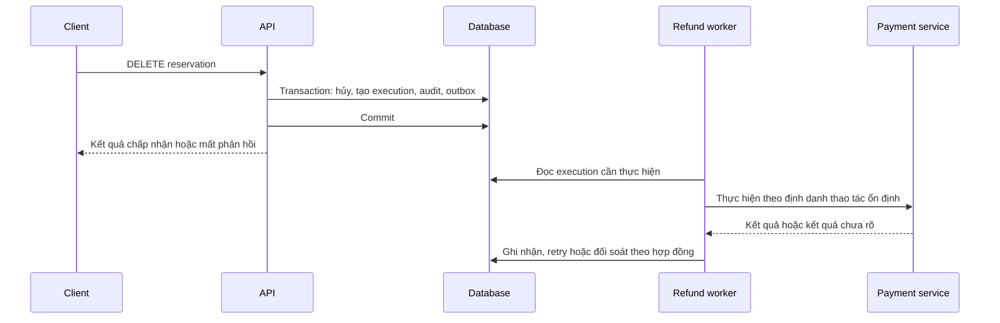

# Các giả định về phương thức idempotent (Idempotent method assumptions)

Một API dùng PUT hoặc DELETE vẫn có thể hoàn tiền hai lần, cấp quyền lặp hoặc làm mất cập nhật của người khác nếu ứng dụng chỉ dựa vào tên method. Ngược lại, một thao tác dùng POST có thể được thiết kế để nhận retry an toàn khi server nhận diện được đúng một ý định nghiệp vụ.

Bài học thuộc chương **HTTP Method Semantics** trong bảo mật logic nghiệp vụ. Trọng tâm là phân biệt ngữ nghĩa HTTP với cơ chế thực thi, nhận ra những giả định dễ gây lạm dụng và thiết kế kiểm soát phù hợp cho state machine, transaction, quyền đối tượng và idempotency.

Các tình huống, mô hình dữ liệu và mã giả dưới đây là phân tích thiết kế cho ứng dụng minh họa; chúng không phải hành vi tự động mà framework hoặc mạng cung cấp.

## 1. Idempotent mô tả điều gì?

Idempotent mô tả tác dụng được yêu cầu giữ nguyên khi lặp. PUT, DELETE và các method safe thuộc nhóm này; response có thể khác. [RFC 9110, mục 9.2.2](https://www.rfc-editor.org/rfc/rfc9110.html#section-9.2.2).

Một mô hình tư duy:

```text
apply(apply(S, R), R) ≈ apply(S, R)
```

Ở đây, phép tương đương xét phần trạng thái và tác dụng có ý nghĩa đối với yêu cầu R. Mô hình không nói rằng handler chỉ chạy một lần hoặc mọi byte của response phải giống nhau.

Nó cũng không chứng minh kết quả khi xen thêm một lệnh độc lập khác giữa hai lần R. Thứ tự và dữ liệu cũ là vấn đề cần bảo vệ riêng.

### 1.1. Một bảng định hướng ngắn

| Method | Safe theo ngữ nghĩa chuẩn? | Idempotent theo ngữ nghĩa chuẩn? |
|---|---|---|
| GET, HEAD, OPTIONS | Có | Có |
| PUT, DELETE | Không | Có |
| POST | Không | Không có bảo đảm chung |

Bảng dựa trên [RFC 9110, các thuộc tính method](https://www.rfc-editor.org/rfc/rfc9110.html#section-9.2).

PATCH không mặc nhiên safe hoặc idempotent; một request PATCH cụ thể có thể được thiết kế idempotent. [RFC 5789, mục 2](https://www.rfc-editor.org/rfc/rfc5789.html#section-2).

### 1.2. Tác dụng nghiệp vụ và dấu vết request

Mỗi request idempotent vẫn có thể có log hoặc revision riêng. [RFC 9110, mục 9.2.2](https://www.rfc-editor.org/rfc/rfc9110.html#section-9.2.2).

Trong thiết kế ứng dụng, cần phân biệt:

```text
đã nhận request lần 2
    khác với
đã hủy lần thứ 2 hoặc đã chấp nhận thêm một khoản hoàn tiền
```

Có thể có hai access log cho hai lần truyền. Nhưng nếu yêu cầu chỉ có ý nghĩa hủy một đặt chỗ, ứng dụng cần kiểm soát để retry không trở thành một lần hoàn tiền độc lập khác.

Một timestamp hoặc bộ đếm cũng cần được phân loại theo ý nghĩa. Nếu nó chỉ phục vụ quan sát, cách xử lý khác với trường làm kéo dài quyền, phát sinh phí hoặc đặt lại hạn phê duyệt.

## 2. Những giả định dễ gây sai

| Giả định | Vì sao không đủ | Điều phải thiết kế thêm |
|---|---|---|
| Dùng PUT là server tự khử trùng lặp | Method không tạo kho nhận diện lệnh hoặc ràng buộc dữ liệu | Handler và persistence phải giữ đúng tác dụng |
| DELETE lặp bao nhiêu cũng không có tác dụng mới | Mã hủy có thể phát hoàn tiền hoặc trả tồn kho mỗi lần | Chỉ tạo tác dụng từ một chuyển trạng thái hợp lệ |
| Idempotent nghĩa là response giống hệt | Trạng thái, quyền và dữ liệu quan sát có thể thay đổi | Hợp đồng phản hồi và replay rõ ràng |
| POST luôn không thể retry an toàn | API có thể định nghĩa định danh lệnh và dedup bền vững | Client cần biết đúng hợp đồng |
| Có Idempotency-Key là đủ | Header không tự lưu kết quả hoặc xử lý cạnh tranh | Scope, fingerprint, transaction và vòng đời key |
| Cùng body là cùng ý định | Target, tenant, precondition hoặc lần thực thi có thể khác | Liên kết đầy đủ ngữ cảnh nghiệp vụ |
| Không nhận response nghĩa là chưa chạy | Có thể server đã commit rồi kết nối đứt | Đối soát hoặc replay đúng lệnh |
| Tính idempotent ngăn ghi đè dữ liệu mới | Retry có thể mang một representation cũ | Version hoặc điều kiện ghi phù hợp |
| Khử trùng lặp thay cho phân quyền | Key không phải credential | Kiểm tra quyền của lệnh mới và quyền đọc kết quả |
| Outbox bảo đảm bên ngoài chỉ chạy một lần | Event có thể được giao lại | Định danh execution và khử trùng lặp phía nhận |

Các cơ chế cần phối hợp theo phạm vi thực tế. Một khóa trong bộ nhớ của một instance không tự bảo vệ những instance khác hoặc kết quả sau restart.

## 3. Safe, idempotent và quyền nghiệp vụ là các chiều khác nhau

Safe nghĩa là client không yêu cầu đổi trạng thái. [RFC 9110, mục 9.2.1](https://www.rfc-editor.org/rfc/rfc9110.html#section-9.2.1).

Trong API minh họa, các URL sau có vấn đề nếu chúng thực sự thực hiện hành động như tên gọi:

```http
GET /purchase-requests/PR-410/approve
GET /reservations/RES-410/cancel
```

Một crawler, công cụ xem trước liên kết hoặc cơ chế tải trước có thể truy cập đường dẫn mà không có ý định phê duyệt hoặc hủy của người dùng.

Nên thể hiện hành động bằng hợp đồng phù hợp và thực thi quyền ở handler. Đổi GET thành POST hoặc DELETE mới chỉ sửa cách biểu đạt; nó chưa tự tạo thẩm quyền, transaction hoặc chống xử lý trùng.

### 3.1. Một thao tác có thể thay đổi dữ liệu nhưng lặp không tăng tác dụng

Ví dụ, yêu cầu xóa một liên kết đặt chỗ đang hoạt động có thể làm tài nguyên không còn tồn tại tại URI đó. Đó là thay đổi được yêu cầu, không phải một thao tác đọc.

Lặp yêu cầu không nên được dùng làm cơ hội tạo thêm các khoản hoàn tiền cho cùng một lần hủy. Tuy nhiên, server vẫn có thể ghi nhận từng lần gọi để quan sát theo chính sách.

### 3.2. Hợp đồng sai không được sửa bằng nhãn method

Nếu handler dùng PUT nhưng thực tế cộng thêm một khoản tiền vào mỗi lần gọi, cần sửa thiết kế hoặc chọn hợp đồng thể hiện đúng ý định.

Ngược lại, nếu body có trạng thái APPROVED do client tự khai, tính lặp của việc ghi cùng trạng thái không chứng minh người gọi được phép phê duyệt.

Một hành động trái quyền chỉ chạy một lần vẫn là trái quyền. Mục tiêu là đúng quyền, đúng quy trình và đúng số lần tác dụng, không chỉ một trong ba điều đó.

## 4. PUT, PATCH và cập nhật cũ

### 4.1. Đặt giá trị khác với cộng thêm

Xét hai ý định trong một API giả định:

```text
Đặt số lượng của dòng L thành 3

Cộng thêm 3 vào số lượng của dòng L
```

Lặp ý định thứ nhất có thể giữ giá trị 3. Lặp ý định thứ hai có thể lần lượt tạo 3, 6, 9 nếu không có cơ chế nhận diện lệnh.

Điều cần kiểm tra là handler thực sự làm gì. Không suy từ body có cùng con số hoặc tên endpoint rằng hai ý định này có cùng tính chất.

Với PATCH, định dạng và thao tác quyết định cách thay đổi; các rủi ro va chạm cần được xét theo hợp đồng cụ thể. [RFC 5789, mục 2](https://www.rfc-editor.org/rfc/rfc5789.html#section-2).

### 4.2. Retry cũ có thể ghi đè cập nhật mới

Ví dụ:

```text
A gửi nội dung "địa chỉ X", server đã lưu nhưng mất phản hồi.
B cập nhật thành "địa chỉ Y".
A retry representation cũ "địa chỉ X".
```

Việc một lệnh đặt giá trị có thể lặp không có nghĩa nó biết rằng Y cần được giữ. Đây là vấn đề xung đột và ý định dựa trên dữ liệu cũ.

If-Match kết hợp ETag giúp hạn chế ghi đè representation đã đổi. [RFC 9110, mục 13.1.1](https://www.rfc-editor.org/rfc/rfc9110.html#section-13.1.1).

Ví dụ hợp đồng:

```http
PUT /purchase-requests/PR-410/draft-content
If-Match: "draft-v17"
Content-Type: application/json

{
  "purpose": "Thiết bị cho nhóm triển khai",
  "lines": [
    { "productId": "PRD-10", "quantity": 2 }
  ]
}
```

ETag ở đây là giá trị minh họa được server liên kết với representation thích hợp. Nó không phải role, ownership hoặc bằng chứng được phép sửa.

### 4.3. Precondition không phải idempotency key

| Cơ chế | Câu hỏi chính |
|---|---|
| Điều kiện version hoặc representation | Dữ liệu hiện tại còn khớp nền mà lệnh dựa vào không? |
| Idempotency của command | Đây có phải bản gửi lại của cùng một ý định đã được xử lý không? |
| Ràng buộc nghiệp vụ | Kết quả này có được phép xuất hiện thêm lần nữa không? |

Một retry có thể nhận lỗi điều kiện sau lần đầu đã làm version thay đổi, mà không tạo thêm tác dụng. Điều đó không tự chứng minh endpoint đã mất tính lặp của tác dụng.

Không tự thay If-Match hoặc expectedVersion bằng giá trị mới nhất rồi gửi lại một quyết định nhạy cảm. Nếu nội dung đã đổi, người dùng có thể cần xem và xác nhận lại.

## 5. DELETE: trạng thái cuối đúng nhưng tác dụng có thể lặp

API minh họa dùng:

```http
DELETE /reservations/RES-410
```

để loại bỏ một đặt chỗ đang hoạt động. Hệ thống vẫn có thể giữ bản ghi lịch sử nội bộ, trạng thái hủy và căn cứ hoàn tiền theo mô hình dữ liệu.

Một cách triển khai nguy hiểm:

```java
// Mã giả: mỗi lần gọi có thể tạo một khoản hoàn tiền mới.
Reservation reservation = repository.find(id);
reservation.setState(CANCELLED);
refunds.createNewRefund(reservation.capturedAmount());
repository.save(reservation);
```

Sau hai request, reservation vẫn là CANCELLED nhưng có hai khoản hoàn tiền. Chỉ kiểm tra trạng thái cuối không phát hiện đủ tác dụng nghiệp vụ.

### 5.1. Gắn hoàn tiền với một chuyển trạng thái

Thiết kế cần nhận diện lần chuyển được chấp nhận:

```text
ACTIVE → CANCELLED
    → tạo cancellationId
    → nếu đủ điều kiện, tạo refundExecutionId
    → ghi ý định hoàn tiền theo execution đó
```

Một request đến sau thấy đã hủy không được tạo cancellation hoặc refundExecution mới cho cùng lần hủy.

Việc hoàn tiền có thể bất đồng bộ. Lệnh hủy được chấp nhận không tự chứng minh tiền đã được hoàn; kết quả thực thi cần được theo dõi riêng.

### 5.2. Response có thể khác theo hợp đồng API

API có thể chọn trả thành công khi đã không còn đặt chỗ hoạt động, hoặc trả trạng thái không tìm thấy ở lần sau. Đây là lựa chọn cần mô tả rõ trong hợp đồng ứng dụng.

Điều cần kiểm tra là không xuất hiện lần hoàn tiền, trả tồn kho hoặc cấp lợi ích mới chỉ vì request được gửi lại.

Nếu response nói cùng một cancellation đã được chấp nhận, nó phải tham chiếu căn cứ phù hợp. Không ghi người gọi lần hai như thể họ là tác nhân đã thực hiện lần chuyển ban đầu.

### 5.3. Không bỏ phân quyền ở nhánh đã hủy

Nhánh xử lý đã đạt trạng thái đích vẫn có thể làm lộ dữ liệu hoặc kết quả.

Cần kiểm tra tenant và quyền tương ứng trước khi trả thông tin như cancellationId, số tiền hay trạng thái hoàn tiền. Key hoặc ID khó đoán không thay credential.

Nếu bản ghi không còn tồn tại, không chạy truy vấn toàn cục rồi tiết lộ nó từng thuộc tenant nào. Biên nhận hoặc tombstone, nếu được giữ, cũng cần policy đọc riêng.

## 6. Retry sau timeout: không suy kết quả từ việc thiếu response

Một request có thể rơi vào các tình huống:

| Tình huống | Điều có thể đã xảy ra |
|---|---|
| Bị chặn trước xử lý | Chưa tạo tác dụng nghiệp vụ |
| Transaction rollback | Thay đổi cục bộ tương ứng không được commit |
| Commit xong, response bị mất | Lệnh đã được chấp nhận dù client chưa biết |
| Đã xếp hàng tác dụng ngoài | Có ý định bền vững, kết quả ngoài chưa chắc đã xong |
| Gọi hệ thống ngoài bị timeout | Tác dụng có thể đã xảy ra nhưng chưa xác nhận được |
| Lỗi tại mốc commit | Ứng dụng có thể chưa biết transaction đã commit hay chưa |

Không thể gom mọi dòng thành “chưa thực hiện, gửi lại lệnh mới”.

Client không nên tự retry method không idempotent nếu chưa biết request có thể lặp an toàn hoặc chưa được áp dụng. [RFC 9110, mục 9.2.2](https://www.rfc-editor.org/rfc/rfc9110.html#section-9.2.2).

### 6.1. Retry cùng ý định khác với tạo ý định mới

Nếu API có contract nhận diện lệnh, client cần giữ định danh phù hợp cho lần gửi lại.

Tạo key mới sau mỗi timeout có thể khiến server coi đó là lệnh mới, đặc biệt ở endpoint thanh toán hoặc tạo yêu cầu. Ngược lại, dùng mã cũ cho một giao dịch thật sự khác cũng có thể trả nhầm kết quả hoặc bị từ chối.

Định danh ý định cần ổn định trong phạm vi và thời gian đã định nghĩa. Nó không nhất thiết là requestId của access log.

### 6.2. Không chỉ so body

Hai lần gửi cùng body có thể khác:

- Đối tượng ở path.
- Tenant hoặc chủ thể được đại diện.
- Precondition và revision.
- Khoảng nghiệp vụ như kỳ thanh toán.
- Loại command hoặc nguồn thao tác.

Hai lần gửi khác một số byte cũng có thể là cùng ý định, ví dụ thứ tự key hoặc credential được làm mới, nếu hợp đồng không coi những khác biệt đó là nội dung nghiệp vụ.

Fingerprint cần dựa trên ngữ nghĩa được xác định, không bỏ các trường quan trọng hoặc gộp mọi payload trông giống nhau.

### 6.3. Trạng thái hiện tại không luôn chứng minh lệnh nào thắng

Thấy reservation đã hủy có thể đủ để kết luận không còn đặt chỗ hoạt động theo một contract. Nhưng nó chưa chứng minh chính request đang được đối soát là tác nhân hủy.

Tương tự, thấy đơn APPROVED không chứng minh caller hiện tại đã duyệt hay mọi precondition của lệnh họ gửi đã đạt.

Khi cần biên nhận chính xác, dùng commandId, cancellationId, decisionId hoặc executionId có liên kết. Không suy từ một trường trạng thái chung rồi tạo audit hoặc quyền lợi không có căn cứ.

## 7. Ba lớp kiểm soát ở cấp ứng dụng

| Lớp | Vai trò | Giới hạn |
|---|---|---|
| Trạng thái hoặc tài nguyên có tác dụng ổn định | Ví dụ chỉ có một liên kết đặt chỗ hoạt động cần loại bỏ | Không tự giải quyết mọi tác dụng ngoài hoặc ý định khác |
| Nhật ký command và idempotency key | Nhận diện retry cùng scope và nội dung | Cần transaction, xử lý tranh chấp và vòng đời |
| Ràng buộc nghiệp vụ bền vững | Ngăn một kết quả trái quy tắc dù request dùng key khác | Phải chọn đúng phạm vi nghiệp vụ |

Không phải mọi endpoint đều cần cùng một schema. Nhưng phải giải thích được lớp nào ngăn lặp ở từng ranh giới.

### 7.1. Hợp đồng idempotency key cần đủ rõ

Cần quy định:

- Scope của key: tenant, actor hoặc chủ thể phù hợp, loại action.
- Fingerprint: target, input, precondition và thuộc tính có ý nghĩa.
- Cùng key nhưng khác fingerprint.
- Lần đầu còn đang thực hiện.
- Lưu những kết quả nào và trong bao lâu.
- Cách bảo vệ quyền đọc kết quả đã lưu.
- Hành vi sau khi key hết thời gian giữ.
- Cách đối soát lỗi hoặc commit chưa rõ.

Tên header Idempotency-Key trong ví dụ chỉ thể hiện API có một cơ chế nhận diện lệnh. Gửi header không tự kích hoạt chức năng đó nếu server chưa thực hiện contract tương ứng.

### 7.2. Tính duy nhất không chỉ dựa trên key

Giả sử cùng một cancellation nhưng caller gửi hai key khác nhau. Nếu nghiệp vụ chỉ cho hoàn tiền một lần theo lần hủy, ràng buộc dữ liệu và execution phải bảo vệ điều đó.

Một phạm vi có thể dựa vào tenant, cancellationId và loại tác dụng. Phạm vi chính xác phụ thuộc việc hoàn một lần, hoàn từng phần hoặc các trường hợp hợp lệ khác của nghiệp vụ.

Không đặt một quy tắc duy nhất trên paymentId nếu nghiệp vụ cho nhiều lần hoàn từng phần hợp lệ, rồi lại dùng code vòng tránh constraint. Cần mô hình đúng cùng kiểm soát tổng tiền và các execution có ý nghĩa.

### 7.3. Hết thời gian giữ key không xóa bất biến

Sau khi bản ghi key được dọn, một request cũ có thể không còn được nhận diện bằng lớp command log.

Reservation đã hủy, cancellation và ràng buộc execution vẫn cần ngăn tác dụng mới trái quy tắc. Không tự cho hoàn lại vì “key chưa có”.

Nếu ID hoặc URI được tái sử dụng cho một vòng tài nguyên mới, cần cân nhắc generation, version hoặc định danh vòng đời. Một DELETE rất cũ không nên được vô tình diễn giải thành hủy một đối tượng mới mà caller chưa có ý định xử lý.

### 7.4. Không dùng memory lock làm bảo đảm toàn hệ thống

Hai instance hoặc hai worker có thể cùng xử lý request. Restart cũng làm mất trạng thái trong bộ nhớ.

Nếu cần bảo đảm bền vững, dùng trạng thái và phép ghi có điều kiện, ràng buộc duy nhất hoặc giao thức phối hợp tương ứng. Transaction phải bao phủ những thay đổi cục bộ liên quan.

Một cơ chế chọn người thắng nhưng để hai nhánh đã gọi thanh toán bên ngoài trước đó vẫn không giải quyết được vấn đề.

## 8. Ví dụ Java: hủy đặt chỗ mà không tạo hoàn tiền mới khi lặp

Mã giả dưới đây minh họa một nghiệp vụ trong đó mỗi vòng đặt chỗ chỉ có một lần hủy được chấp nhận. Bản ghi lịch sử có thể được giữ dù tài nguyên đặt chỗ hoạt động đã bị loại bỏ khỏi URI tương ứng.

Đây là mã khung theo cú pháp Java, chưa bao gồm triển khai HTTP condition, repository hoặc tích hợp thanh toán.

```java
CancellationResult cancel(
        CancelReservationCommand command,
        ActorContext actor) {

    return transactions.required(() -> {
        Reservation reservation = reservations
                .findForUpdate(actor.tenantId(), command.reservationId())
                .orElseThrow(ResourceNotFound::new);

        accessPolicy.requireMayAccessCancellationContext(
                actor, reservation);

        // Dùng trạng thái representation của HTTP target, không giả định
        // bản ghi lịch sử còn tồn tại nghĩa là tài nguyên vẫn đang hoạt động.
        httpConditions.requireSatisfied(
                command.conditions(),
                targetViews.currentReservation(reservation));

        if (reservation.isCancelled()) {
            resultPolicy.requireMayReadCancellation(
                    actor, reservation);
            return CancellationResult.existing(reservation);
        }

        authorizer.requireMayCancel(actor, reservation);
        cancellationPolicy.requireCancellable(reservation);

        CancellationChange change = cancellations.plan(
                reservation, actor, clock.instant());

        int changed = reservations.cancelIfActiveAndVersionMatches(
                reservation, change.cancellationId());

        if (changed != 1) {
            throw new ConcurrentChange();
        }

        cancellations.insert(change);

        if (change.refundRequired()) {
            refundExecutions.insertForCancellation(
                    change.refundExecution());

            outbox.appendRefundRequested(
                    change.refundExecution().id());
        }

        audit.appendReservationCancelled(
                actor, reservation, change);

        return CancellationResult.accepted(change);
    });
}
```

Các hợp đồng cần có:

- Actor, tenant và quan hệ đại diện đến từ nguồn xác thực, phân quyền đã kiểm chứng.
- `findForUpdate` giới hạn tenant và giữ cơ chế phối hợp với các đường ghi liên quan.
- HTTP condition, nếu có, được đánh giá trên target phù hợp và không bị nhánh đã hủy âm thầm bỏ qua.
- Lệnh không có condition vẫn phải qua các kiểm tra quyền và nghiệp vụ.
- `plan` dùng số tiền, tiền tệ, khoản đã thu và quy tắc hoàn từ nguồn máy chủ; body không tự quyết định tiền được hoàn.
- `cancelIfActiveAndVersionMatches` kiểm soát trạng thái nguồn và version; đúng một hàng mới giành quyền chuyển.
- Cancellation, refundExecution, audit thành công và outbox cùng transaction cục bộ trong thiết kế này.
- `transactions.required` chỉ trả kết quả sau commit. Lỗi phải rollback các thay đổi liên quan.
- Handler không gọi thanh toán bên ngoài trong đoạn kiểm tra và ghi này.
- Result accepted thể hiện việc hủy đã được chấp nhận và ý định hoàn tiền, nếu có; không nói tiền đã về tài khoản.

Trong contract minh họa, condition không đạt làm request không được thực hiện. Vì vậy, một retry có condition cũ có thể không nhận cùng kết quả như lần đầu, nhưng vẫn không tạo tác dụng mới.

Nếu có thêm command log hoặc chính sách nhận diện một lần thành công trước, phải thiết kế tương tác với HTTP condition theo hợp đồng. Không mặc định nhánh cache được quyền bỏ mọi precondition.

### 8.1. Cập nhật có điều kiện tại nguồn

Một phép ghi minh họa:

```sql
UPDATE reservation
SET state = 'CANCELLED',
    cancellation_id = :cancellation_id,
    row_version = row_version + 1
WHERE tenant_id = :authorized_tenant_id
  AND id = :reservation_id
  AND lifecycle_generation = :expected_generation
  AND row_version = :expected_row_version
  AND state = 'ACTIVE';
```

Các placeholder là tham số bind. Những giá trị kỳ vọng phải liên kết với đối tượng và ngữ cảnh đã kiểm tra.

Không hàng nào được cập nhật có thể do version, generation hoặc state không còn khớp. Nó không tự có nghĩa “đã hủy nên cứ hoàn tiền”.

Nếu cần phân loại lại, đọc trạng thái trong phạm vi được phép và áp dụng đúng policy. Không tạo refundExecution khi lệnh không giành được chuyển trạng thái.

### 8.2. Không chỉ kiểm tra tuần tự

Hai request có thể cùng đọc ACTIVE nếu không có khóa hoặc cơ chế điều kiện thích hợp.

Cả hai nhánh có thể cùng thấy được hủy và cùng chuẩn bị hoàn tiền. Một câu if đúng khi chạy một luồng chưa chứng minh bất biến trước cạnh tranh.

Cần kiểm tra người thắng tại persistence và rollback nhánh không thắng. Các ràng buộc cancellation hoặc execution giúp củng cố mô hình, không nên bị bỏ qua như một lỗi có thể bắt rồi tiếp tục gửi hoàn tiền.

## 9. Tác dụng ngoài và giới hạn của transaction

Một transaction local không bao phủ hệ thống thanh toán chỉ vì method là DELETE hoặc PUT.

Nếu gọi hoàn tiền trước commit rồi transaction rollback, tiền có thể đã được hoàn nhưng reservation vẫn chưa được ghi nhận hủy. Nếu gọi lại, ứng dụng có thể tạo thêm tác dụng.

Một luồng dùng outbox có thể là:



Outbox bảo đảm ý định cục bộ được lưu cùng thay đổi trong thiết kế đó. Nó không tự tạo bảo đảm một lần thực hiện trên toàn hệ thống.

### 9.1. Worker nhận lại không tạo ý định mới

Event có thể được giao lại. Worker cần nhận diện cùng executionId và không đổi mỗi lần thành một yêu cầu hoàn tiền độc lập.

Nếu hệ thống đích hỗ trợ một contract nhận diện thao tác, cách gọi phải giữ đúng định danh và các điều kiện của contract đó. Nếu không, cần một chiến lược đối soát và kiểm soát phù hợp, thay vì giả định method hoặc header tự giải quyết.

Timeout từ hệ thống ngoài cần trạng thái chưa rõ. Không tự đánh dấu chắc chắn thất bại, bỏ dấu vết rồi tạo một execution mới.

### 9.2. Đừng làm lại chuyển trạng thái để retry thông báo

Sau khi cancellation đã commit, lỗi email hoặc lỗi phát thông báo cần retry phần công việc đó.

Không chuyển reservation về ACTIVE rồi hủy lại để gửi email. Cách làm này có thể mở lại điều kiện tạo refund, trả tồn kho hoặc cấp lợi ích.

Nếu cần bù trừ, phải mô hình hóa hành động bù trừ cùng quyền, trạng thái và căn cứ của nó.

### 9.3. Phạm vi tác dụng phải được kiểm tra đầy đủ

Một nghiệp vụ hủy có thể tác động tới:

- Tiền hoàn và ledger liên quan.
- Số lượng tồn kho được trả.
- Điểm thưởng hoặc voucher.
- Quyền sử dụng đã cấp.
- Thông báo và các workflow theo sau.

Không chỉ đếm số lần gọi handler hoặc kiểm tra state của reservation. Cần xác định tác dụng nào là kết quả nghiệp vụ duy nhất và tác dụng nào được phép lặp vì mục đích quan sát.

## 10. Phân quyền, routing và dữ liệu cũ vẫn phải được bảo vệ

### 10.1. Method không tạo quyền đối tượng

Một request PUT hoặc DELETE vẫn cần xác thực, tenant scope, quyền trên tài nguyên và các guard phù hợp.

Cùng một path cục bộ có thể xuất hiện trong nhiều tenant. Truy vấn, command log và kết quả lưu phải giữ đúng tenant để không dùng key hoặc kết quả của người khác.

Request bị chặn không được trả cancellationId hoặc kết quả thanh toán ngoài quyền chỉ vì server tìm thấy một bản ghi trùng key.

### 10.2. Bảo vệ replay theo action đọc kết quả

Người từng có quyền có thể đã bị thu hồi, chuyển nhóm hoặc không còn sở hữu đối tượng.

Một bản replay hoàn tất không thực hiện lại chuyển trạng thái, nhưng vẫn trả dữ liệu. Cần kiểm tra quyền truy cập kết quả theo policy hiện tại hoặc grant biên nhận đã được định nghĩa riêng.

Không dùng idempotency key như một bearer credential không được thiết kế. Scope của key giúp phân vùng nhận diện; nó không thay thế xác thực.

### 10.3. Không có đường method khác bỏ qua cùng policy

Một lỗi có thể xuất hiện khi chỉ POST đi qua kiểm tra phê duyệt, còn PUT hoặc một route cũ gọi cùng logic mà không kiểm tra.

Nên xác định action nghiệp vụ ở ranh giới ứng dụng và thực thi policy tương ứng trên mọi adapter. Chỉ nhận các method mà hợp đồng hỗ trợ.

Nếu kiến trúc có method override, cách xác định method hiệu lực phải nhất quán giữa router và lớp bảo vệ. Một field hoặc header không được dùng để khiến tầng kiểm tra thấy một action còn handler thực hiện action khác.

Không sửa lỗi xử lý trùng bằng cách mở thêm method vào một handler chưa có contract đầy đủ.

### 10.4. DTO và state machine không được bỏ qua

Một PUT gửi representation đầy đủ không có nghĩa được ghi mọi field entity. Owner, tenant, role, giá và các dấu mốc phê duyệt vẫn cần nguồn cùng thẩm quyền riêng.

Chỉ đặt lại state thành cùng giá trị có thể che việc thiếu các bước bắt buộc. Cần dùng lệnh hoặc policy miền để chứng minh chuyển trạng thái được phép.

Nếu payload chứa field ngoài hợp đồng, xung đột alias hoặc lỗi binding, xử lý chúng trước khi biến phần còn lại thành một lệnh được chấp nhận.

### 10.5. Cache response khác với dedup command

Một cache lưu representation phục vụ đọc và một kho kết quả command có mục đích khác nhau.

Không dùng một cache chung theo URL hoặc key thô để trả kết quả nhạy cảm giữa các actor hoặc tenant. Quyền, scope và ngữ nghĩa của dữ liệu được trả phải được giữ rõ.

Tương tự, cache MISS không chứng minh lệnh chưa từng thực hiện. Cache bị xóa hoặc hết hạn không được trở thành lý do tạo thêm tác dụng mà bất biến nghiệp vụ cấm.

## 11. Phản hồi và quan sát đúng số lần

Một hệ thống cần phân biệt ít nhất:

| Đại lượng | Ý nghĩa |
|---|---|
| Số request nhận được | Số lần truyền tới API |
| Số command được chấp nhận | Số ý định nghiệp vụ đã được ghi nhận theo contract |
| Số chuyển trạng thái | Số lần đối tượng thực sự qua cạnh hợp lệ |
| Số execution | Số thao tác ngoài có định danh được tạo |
| Số lần giao hoặc gọi ra ngoài | Có thể bao gồm retry kỹ thuật |
| Số tác dụng được xác nhận | Kết quả nghiệp vụ thực tế cần đối soát |

Có nhiều access log không tự chứng minh hủy nhiều lần. Có một response thành công cũng không chứng minh tác dụng ngoài chỉ xảy ra một lần.

### 11.1. Phản hồi phải nói đúng điều đã biết

Một hợp đồng có thể trả cancellation đã được chấp nhận cùng trạng thái refund đang chờ. Sau đó client theo dõi execution qua đường được phép.

Không dùng một chữ “thành công” để gộp việc nhận request, commit hủy và hoàn tiền đã xác nhận.

Nếu kết quả chưa rõ, giao diện và API cần một cách đối soát. Không hướng người dùng tạo liên tiếp các ý định mới chỉ vì chưa thấy response.

Nếu API lưu nguyên kết quả ban đầu cho replay, cần nói rõ đó là biên nhận của command. Nếu API trả trạng thái hiện tại, cũng cần giữ đúng hợp đồng và quyền đọc. Hai lựa chọn có thể cho dữ liệu khác nhau theo thời gian.

### 11.2. Gắn các lần truyền với cùng căn cứ

Audit và log có thể liên kết tenant, actor, resource, commandId, cancellationId, executionId, request correlation và fingerprint hoặc tham chiếu phù hợp.

Không ghi nguyên credential hoặc dữ liệu nhạy cảm chỉ để nhận diện retry. Một giá trị do client gửi phục vụ correlation không tự là căn cứ quyền.

Nhánh đã hủy không nên tạo thêm sự kiện nghiệp vụ nói rằng caller mới đã thực hiện lại lần chuyển. Có thể ghi nhận đó là một lần truy cập hoặc một lần lặp theo chính sách quan sát.

### 11.3. Retry cần giới hạn và phối hợp giữa các lớp

SDK, gateway, API và worker có thể có các chính sách retry riêng. Khi không phối hợp, số lần truyền hoặc lượng tải có thể tăng mạnh.

Cần xác định nơi chịu trách nhiệm, điều kiện lặp, giới hạn, khoảng chờ và cách giữ định danh ổn định. Không giả định mọi công cụ có cùng mặc định chỉ vì cùng thấy tên method.

Idempotence không thay thế quota hoặc bảo vệ tài nguyên. Một lệnh không tạo thêm lợi ích vẫn có thể tốn khóa, CPU, dung lượng log hoặc truy vấn.

Các giới hạn bảo vệ phải lấy tenant và chủ thể có thẩm quyền; không dùng một tham số tùy ý để chuyển chi phí sang phạm vi khác.

## 12. Kiểm thử các giả định idempotent

### 12.1. Ma trận tình huống

| Tình huống | Kết quả cần kiểm chứng |
|---|---|
| Lặp cùng lệnh hủy hợp lệ nhiều lần | Chỉ một lần chuyển và tác dụng mới theo mô hình |
| State luôn CANCELLED nhưng mỗi lần có refund mới | Test phải phát hiện qua execution và ledger |
| Lần đầu response thành công, lần sau phản hồi khác | Đánh giá tác dụng, không chỉ so status code |
| POST có contract dedup, mất phản hồi rồi gửi lại | Cùng kết quả lệnh hoặc đường đối soát, không thêm ý định |
| Gửi Idempotency-Key tới endpoint chưa có contract tương ứng | Không suy ra bảo đảm từ sự hiện diện của header |
| Hai key khác nhau cho cùng cancellation | Ràng buộc nghiệp vụ vẫn ngăn tác dụng trái quy tắc |
| Cùng key nhưng khác target, amount hoặc precondition | Không nhận nhầm là cùng command |
| Cùng key ở tenant hoặc actor khác | Không lẫn kết quả, scope hoặc quyền đọc |
| Key hết thời gian giữ, request hủy cũ xuất hiện | Không tạo hoàn tiền mới chỉ vì command log không còn |
| Retry PUT cũ sau cập nhật mới | Cơ chế điều kiện hoặc version giữ đúng hợp đồng chống ghi đè |
| Condition của retry không còn đạt | Không bỏ qua điều kiện để cố trả cùng response |
| Một thao tác patch đặt giá trị và một thao tác tăng thêm | Test theo ý nghĩa thực tế của từng contract |
| Tái sử dụng ID cho vòng tài nguyên mới | Không dùng lệnh hoặc grant cũ ngoài generation được cấp |
| Retry sau khi người gọi mất quyền | Không lộ kết quả hoặc tạo tác dụng ngoài policy |
| Event outbox bị giao lại | Giữ execution ổn định và cơ chế xử lý lặp phù hợp |
| Lỗi gửi thông báo sau commit | Không mở lại rồi hủy nghiệp vụ để retry |
| Đổi method hoặc dùng route cũ | Không bỏ qua policy của cùng action |
| Cache bị xóa hoặc restart instance | Bất biến không phụ thuộc riêng vào memory |
| Log request hoặc revision kỹ thuật tăng | Không kết luận sai nếu đó là thay đổi được phép và không tạo tác dụng trái quy tắc |

### 12.2. Kiểm thử cạnh tranh có đồng bộ

Chạy hai request hủy trên cùng reservation, có cả trường hợp cùng key và khác key.

Cần buộc chúng tranh chấp thật sự tại ranh giới dữ liệu, rồi kiểm tra:

1. Chỉ một lần chuyển ACTIVE sang CANCELLED được chấp nhận cho vòng đang xét.
2. Chỉ có cancellation hợp lệ tương ứng.
3. RefundExecution hoặc tác dụng khác có đúng số lượng theo policy.
4. Nhánh không thắng không tạo tác dụng riêng.
5. Kết quả và audit không gán sai người thực hiện.
6. Không có liên kết sai tenant hoặc generation.

Kiểm thử nhiều luồng tuần tự trong một mock không chứng minh được tính đúng của khóa, version hoặc constraint.

Cần đọc lại trạng thái đã commit từ nguồn phù hợp và quan sát các bản ghi liên quan, không chỉ object trong bộ nhớ của handler.

### 12.3. Chèn lỗi ở ranh giới quan trọng

Các điểm đáng kiểm tra:

- Trước khi ghi thay đổi đầu tiên.
- Sau cập nhật reservation nhưng trước tạo cancellation hoặc refundExecution.
- Sau ghi outbox nhưng trước commit.
- Commit thành công nhưng kết nối trả response bị mất.
- Worker gửi yêu cầu ngoài nhưng mất phản hồi.
- Hệ thống đích đã thực hiện, worker chưa ghi nhận kết quả.
- Event được giao lại sau restart.
- Bản ghi key hết hạn trước khi request cũ được phát lại.

Với lỗi trước commit, các thay đổi local liên quan phải rollback. Với lỗi sau commit, retry hoặc đối soát phải nhận diện kết quả đã được chấp nhận. Với tác dụng ngoài chưa rõ, không tự tạo một ý định mới.

Số lần gọi ra ngoài có thể nhiều hơn một trong một giao thức cho phép retry. Điều cần chứng minh là định danh và cơ chế xử lý giữ đúng tác dụng nghiệp vụ, không chỉ một con số call count trong test.

### 12.4. Định nghĩa tập dữ liệu cần so sánh

Với nghiệp vụ hủy trong bài, cần kiểm tra:

```text
trạng thái và vòng đời reservation
cancellation được chấp nhận
refundExecution và kết quả đối soát
ledger hoặc dữ liệu ghi nhận tiền hoàn
tồn kho hoặc quyền lợi được trả lại
sự kiện nghiệp vụ cùng outbox
audit lần chuyển và log các lần truyền
scope và quyền đọc kết quả
```

Không bắt mọi timestamp hoặc revision kỹ thuật phải giống hệt nếu contract cho phép chúng thay đổi. Ngược lại, nếu một timestamp làm gia hạn quyền hoặc thay đổi lợi ích, nó cần nằm trong tập tác dụng nghiệp vụ được kiểm tra.

### 12.5. Một tính chất kiểm thử cho fixture cố định

Với một reservation hợp lệ, không xen một ý định độc lập khác và giữ ngữ cảnh phù hợp:

```text
n >= 1 lần gửi lại cùng ý định hủy

    → nhiều nhất một cancellation được chấp nhận cho vòng đó
    → không tăng số tác dụng tài chính trái policy
    → không vượt số tiền hoặc quyền lợi được phép trả
```

Tính chất này không có nghĩa mọi request trong mọi thời điểm là cùng một ý định. Thay tenant, target, generation hoặc nội dung có thể là thao tác khác và cần hợp đồng riêng.

## 13. Bài tập áp dụng

Thiết kế API hủy đặt chỗ có thể hoàn tiền bất đồng bộ.

1. Chọn method và mô tả tác dụng được yêu cầu, không chỉ tên endpoint.
2. Phân biệt access log, chuyển trạng thái, execution và kết quả hoàn tiền.
3. Xác định ràng buộc ngăn lặp khi request dùng cùng key và khi dùng key khác.
4. Thiết kế tương tác giữa condition, version, replay và trạng thái đã hủy.
5. Chỉ ra transaction local bao phủ những bản ghi nào.
6. Mô tả cách worker xử lý giao lại và timeout ở hệ thống thanh toán.
7. Định nghĩa hành vi khi key hết hạn, quyền bị thu hồi hoặc ID được tái sử dụng.
8. Viết ca retry PUT cũ ghi đè cập nhật mới và ca DELETE tạo refund lặp.
9. Xác định các dữ liệu phải đọc lại để chứng minh tác dụng đúng sau lỗi commit hoặc mất response.

Một thiết kế đúng phải giải thích được tác dụng nào được giữ ổn định, căn cứ nào nhận diện cùng một ý định và lớp nào bảo vệ từng ranh giới. Tên method giúp biểu đạt hợp đồng HTTP; việc giữ đúng quy tắc nghiệp vụ vẫn cần dữ liệu, quyền, state machine và cơ chế thực thi phù hợp.
