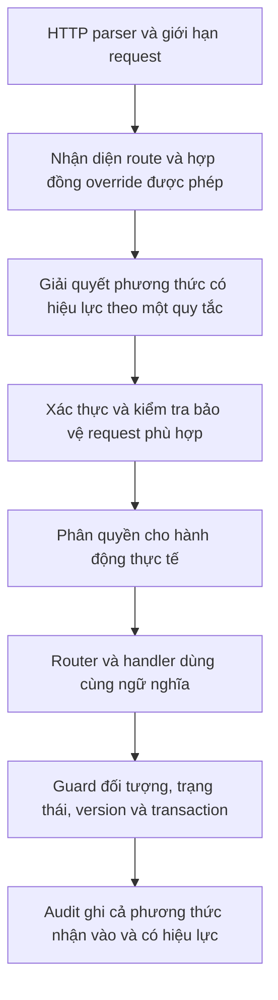

# Method override risks: rủi ro khi ghi đè phương thức HTTP

Trong chương **HTTP Method Semantics**, method override là cơ chế ứng dụng diễn giải một request được gửi bằng một phương thức thành một phương thức khác. Ví dụ một form gửi `POST` kèm `_method=DELETE`, sau đó middleware định tuyến nó như `DELETE`.

Trong module bảo vệ logic nghiệp vụ, rủi ro xuất hiện khi các lớp không thống nhất request đang yêu cầu hành động nào. Gateway có thể cho phép theo `POST`, lớp chống CSRF dùng một cách hiểu khác, còn handler cuối thực hiện thao tác xóa hoặc thay đổi dữ liệu với phương thức đã ghi đè.

Các tên như `_method` hoặc `X-HTTP-Method-Override` là những quy ước có thể được thư viện hoặc ứng dụng hỗ trợ; không mặc định mọi framework đều xử lý chúng giống nhau. Bài học mô tả nguyên tắc và một hợp đồng minh họa, không khẳng định cấu hình mặc định của một sản phẩm cụ thể.

Sau bài này, bạn có thể:

- Phân biệt phương thức trên request nhận vào với phương thức có hiệu lực khi định tuyến.
- Nhận diện điểm bất đồng giữa gateway, middleware, phân quyền, CSRF và handler.
- Giới hạn nguồn, phương thức và route được phép override.
- Thiết kế chuẩn hóa nhất quán mà vẫn giữ kiểm tra quyền theo hành động nghiệp vụ.
- Kiểm thử request mâu thuẫn, tham số trùng và tác dụng phụ trước khi kết luận an toàn.

## 1. Vì sao ứng dụng có method override?

Một số client hoặc giao diện form cần gửi ý định cập nhật hay xóa qua một đường `POST`. Ứng dụng có thể thêm lớp tương thích:

```http
POST /purchase-requests/pr-123
Content-Type: application/x-www-form-urlencoded

_method=DELETE&expectedVersion=7&csrfToken=example-token
```

Middleware đọc `_method`, xác định phương thức có hiệu lực là `DELETE`, rồi chuyển tới handler tương ứng.

Cần phân biệt:

```text
wire method      = POST
override source  = form parameter
effective method = DELETE
business action  = xóa bản nháp đề nghị mua hàng
```

Phương thức trên đường truyền không tự thay đổi. Một hoặc nhiều thành phần đang chọn diễn giải request theo cơ chế của ứng dụng.

Cơ chế này có thể phục vụ nhu cầu tương thích hợp lệ. Nó vẫn phải giữ đúng quyền, trạng thái, tenant, đối tượng và các invariant của hành động cuối cùng.

## 2. Một đường vượt kiểm tra hình thành như thế nào?

Giả sử một API cũ có các quy tắc:

| Phương thức và route | Ý nghĩa trong ví dụ | Quyền cần thiết |
| --- | --- | --- |
| `GET /purchase-requests/{id}` | Đọc đề nghị | Quyền đọc đúng đối tượng |
| `POST /purchase-requests/{id}` | Cập nhật ghi chú nháp qua đường tương thích cũ | Quyền sửa ghi chú |
| `DELETE /purchase-requests/{id}` | Xóa bản nháp theo điều kiện nghiệp vụ | Quyền xóa và trạng thái cho phép |

Một chuỗi xử lý sai:

```text
gateway thấy POST → cho qua theo quyền sửa ghi chú
middleware phía sau đọc _method=DELETE
router chọn handler DELETE
handler tin gateway đã kiểm tra đầy đủ → xóa bản nháp
```

Caller chỉ được sửa ghi chú đã đi vào thao tác cần quyền khác. Lỗ hổng hình thành từ việc các lớp sử dụng hai cách hiểu khác nhau, kết hợp với việc handler không thực thi quyền của hành động thật.

Ngay cả khi handler chặn được, bất đồng vẫn có thể làm sai quota, audit, chính sách cache hoặc báo cáo hành động. Do đó cần sửa cả hợp đồng phương thức lẫn kiểm tra nghiệp vụ tại điểm thực thi.

## 3. Các nguồn override và điểm mơ hồ

Ứng dụng có thể có một hoặc nhiều quy ước:

| Nguồn có thể được hỗ trợ | Ví dụ | Điều cần xác định |
| --- | --- | --- |
| Header | `X-HTTP-Method-Override: DELETE` | Ai được gửi, header nào được chấp nhận và các proxy có giữ nó không |
| Form field | `_method=DELETE` | Chỉ content type nào được đọc và giá trị xuất hiện bao nhiêu lần |
| Query parameter | `?_method=DELETE` | Có được phép không, đặc biệt với phương thức chỉ đọc |
| Header hoặc tên khác do hệ thống tự quy định | Một alias nội bộ | Thành phần nào có thể diễn giải nó |
| Metadata do gateway tạo | Phương thức đã chuẩn hóa | Cách xác thực nguồn và loại bỏ giá trị caller tự gửi |

Không hỗ trợ một quy ước ở controller không có nghĩa thư viện hoặc proxy khác không đọc nó. Cần biết toàn bộ các thành phần có thể thay đổi cách định tuyến hoặc phân quyền.

Một request có cả header chỉ `DELETE` và form chỉ `PATCH` không nên được các lớp tự chọn theo những thứ tự khác nhau. Quy tắc xử lý phải rõ và nhất quán; hợp đồng minh họa trong bài từ chối các nguồn mâu thuẫn hoặc không được hỗ trợ.

Đừng hiểu một header tự đặt tên giống dữ liệu nội bộ là đáng tin. Nếu gateway phát một header phương thức có hiệu lực, nó phải loại bỏ hoặc ghi đè dữ liệu cùng tên do caller bên ngoài gửi, và backend cần có ranh giới tin cậy phù hợp với nguồn đó.

## 4. Phương thức chỉ đọc không được trở thành đường tạo hiệu ứng

Cho phép request `GET` hoặc `HEAD` biến thành `DELETE` có thể làm một đường tưởng chỉ đọc tạo thay đổi dữ liệu.

Ví dụ không nên được chấp nhận trong hợp đồng của bài:

```http
GET /purchase-requests/pr-123?_method=DELETE
```

Những thành phần như trình duyệt, công cụ xem trước hoặc crawler có thể xử lý đường GET theo ngữ nghĩa đọc. Nếu backend diễn giải lại thành hành động ghi, kỳ vọng an toàn của cả chuỗi bị phá vỡ.

Tương tự, không cho một override thành `GET` được dùng để né bảo vệ của request có thể tạo hiệu ứng. Hợp đồng phải chỉ ra chính xác phương thức nguồn và tập đích được phép, không phải “nếu có một chuỗi method thì dùng chuỗi đó”.

Nếu framework dùng chung một phần định tuyến giữa GET và HEAD, handler liên quan vẫn phải giữ tính chất không tạo thay đổi nghiệp vụ được yêu cầu bởi luồng đọc. Không đặt hành động duyệt, xóa hoặc nhận thanh toán vào một handler đọc chỉ vì nó tiện để mở bằng liên kết.

Header `Access-Control-Request-Method` của CORS preflight có mục đích riêng; nó không phải chỉ thị để thực hiện hành động nghiệp vụ trong request OPTIONS.

## 5. Chuẩn hóa một lần trước các quyết định phụ thuộc phương thức

Một pipeline rõ ràng có thể là:



Xác thực danh tính có thể diễn ra ở vị trí phù hợp với kiến trúc. Điều quan trọng ở đây là những quyết định phụ thuộc phương thức không được dùng một cách hiểu rồi để một lớp phía sau đổi nó thành hành động khác.

Không để nhiều middleware độc lập override lại request. Sau chuẩn hóa, các lớp phải dùng một ngữ cảnh đã thống nhất; handler không đọc lại raw form để tự chọn một method thứ ba.

Gateway có thể chặn sớm theo hợp đồng giới hạn, nhưng quyền nghiệp vụ cuối vẫn cần được thực thi ở nơi biết đối tượng và hành động. Không giả định gateway luôn có đủ dữ liệu về owner, tenant, trạng thái và bằng chứng phê duyệt.

Việc phân tích form cũng phải có giới hạn kích thước, số lượng trường và tài nguyên phù hợp. Chuẩn hóa sớm không có nghĩa được bỏ mọi giới hạn trước khi đọc body.

## 6. Hợp đồng minh họa: chỉ một cơ chế tương thích hẹp

Trong ví dụ, ứng dụng chọn:

- Chỉ nhận override qua form field `_method`.
- Chỉ cho wire method `POST`.
- Chỉ cho media type đã phân tích là `application/x-www-form-urlencoded`.
- Chỉ bật trên các route đã được cấu hình rõ ràng.
- Tập đích tối đa là `PUT`, `PATCH`, `DELETE`; từng route có thể cho ít hơn.
- Một request chỉ có đúng một giá trị `_method` khi sử dụng cơ chế này.
- Giá trị method dùng đúng token viết hoa trong hợp đồng, không có khoảng trắng thêm.
- Header override và query override không được hỗ trợ và bị từ chối theo hợp đồng.
- Không có override thì giữ nguyên phương thức nhận vào.

Đây là một lựa chọn thiết kế để minh họa cách giảm mơ hồ, không phải yêu cầu mọi hệ thống phải dùng form override. Một hệ thống chỉ cần phương thức native có thể không cần bật cơ chế này.

Phương thức HTTP là token phân biệt chữ hoa–thường. Nếu ứng dụng chọn quy tắc riêng cho giá trị override, phải công bố và áp dụng thống nhất. Không tự chuyển mọi phương thức nhận vào sang chữ hoa ở một lớp trong khi router hoặc gateway hiểu khác.

Tham số trên URL không được dùng để mở tính năng hoặc mở rộng tập đích. Chính sách route đến từ cấu hình máy chủ có thẩm quyền.

## 7. Minh họa Java: giải quyết phương thức theo hợp đồng

Đoạn mã dùng record của Java 16 trở lên. Nó làm việc trên metadata do HTTP parser đáng tin cậy của máy chủ cung cấp. Media type đã được phân tích, không còn tham số như charset; danh sách form phải giữ được giá trị trùng trước khi binder rút gọn.

```java
import java.util.List;
import java.util.Objects;
import java.util.Set;

enum OverrideSource {
    NONE, FORM
}

record RawMethodInput(
        String wireMethod,
        String parsedMediaType,
        List<String> formOverrideValues,
        boolean headerOverridePresent,
        boolean queryOverridePresent) {
    RawMethodInput {
        Objects.requireNonNull(wireMethod);
        formOverrideValues = List.copyOf(formOverrideValues);
    }
}

record OverridePolicy(boolean formEnabled, Set<String> allowedTargets) {
    OverridePolicy {
        allowedTargets = Set.copyOf(allowedTargets);
    }
}

record ResolvedMethod(
        String wireMethod,
        String effectiveMethod,
        OverrideSource source) {
}

final class MethodOverrideResolver {
    private static final Set<String> MUTATING_TARGETS =
            Set.of("PUT", "PATCH", "DELETE");

    private MethodOverrideResolver() {
    }

    static ResolvedMethod resolve(
            RawMethodInput input, OverridePolicy routePolicy) {
        Objects.requireNonNull(input);
        Objects.requireNonNull(routePolicy);

        require(!input.headerOverridePresent()
                && !input.queryOverridePresent(),
                "UNSUPPORTED_OVERRIDE_SOURCE");

        List<String> values = input.formOverrideValues();
        if (values.isEmpty()) {
            return new ResolvedMethod(input.wireMethod(),
                    input.wireMethod(), OverrideSource.NONE);
        }

        require("POST".equals(input.wireMethod()),
                "OVERRIDE_REQUIRES_POST");
        require(routePolicy.formEnabled(), "OVERRIDE_DISABLED_FOR_ROUTE");
        require("application/x-www-form-urlencoded"
                .equals(input.parsedMediaType()), "UNSUPPORTED_MEDIA_TYPE");
        require(values.size() == 1, "REPEATED_METHOD_OVERRIDE");

        String target = values.get(0);
        require(MUTATING_TARGETS.contains(target)
                && routePolicy.allowedTargets().contains(target),
                "METHOD_TARGET_NOT_ALLOWED");

        return new ResolvedMethod(input.wireMethod(),
                target, OverrideSource.FORM);
    }

    private static void require(boolean valid, String code) {
        if (!valid) {
            throw new IllegalArgumentException(code);
        }
    }
}
```

Theo hợp đồng đầu vào của ví dụ, danh sách rỗng nghĩa là không có form field; một field rỗng được biểu diễn bằng danh sách chứa chuỗi rỗng và sẽ không khớp tập đích. Parser cần phát hiện tham số trùng trước khi chuyển về một map chỉ có một giá trị cho mỗi tên.

`headerOverridePresent` phải phản ánh các tên hoặc alias mà hệ thống thực sự có thể diễn giải. Resolver không tự quét request hoặc vô hiệu hóa một thư viện phía sau. Cần cấu hình để không còn một lớp khác tiếp tục đọc header hoặc query override theo quy tắc riêng.

Kết quả `ResolvedMethod` không cấp quyền. Nó chỉ xác định ngữ nghĩa phương thức để các lớp định tuyến, bảo vệ request và phân quyền sử dụng thống nhất.

## 8. Handler vẫn phải kiểm tra hành động nghiệp vụ thực tế

Giả sử effective method là DELETE. Handler xóa bản nháp cần kiểm tra ít nhất:

```text
actor được xác thực và được dùng tenant hiện tại
đề nghị thuộc phạm vi đối tượng được phép
actor có quyền xóa, không chỉ quyền đọc hoặc sửa ghi chú
đề nghị đang ở trạng thái cho phép xóa
version còn phù hợp
không có nghĩa vụ hoặc operation làm việc xóa trở nên trái chính sách
```

Một DELETE được truyền trực tiếp và một DELETE qua cơ chế tương thích hợp lệ cần chịu cùng chính sách hành động.

Ví dụ SQL minh họa giới hạn cập nhật dữ liệu:

```sql
DELETE FROM purchase_request
WHERE tenant_id = :authorized_tenant_id
  AND id = :request_id
  AND state = 'DRAFT'
  AND version = :expected_version;
```

Câu lệnh không tự kiểm tra đầy đủ quyền actor và nghĩa vụ liên quan. Service phải thực thi các guard cần thiết, kiểm tra số hàng tác động và xử lý dữ liệu phụ trong ranh giới nhất quán.

Nếu nghiệp vụ cần hủy thay vì xóa vật lý, dùng hành động hủy cùng state machine phù hợp. Method override không phải lý do bỏ qua sự khác nhau đó.

Không cho một verb khác hoặc một tên route khác làm phát sinh trạng thái đích mà thiếu phê duyệt. Quyền theo phương thức chỉ hỗ trợ ánh xạ tới hành động; nó không thay business invariants.

## 9. CSRF phải áp dụng cho tác dụng thực tế của request

Một form khác nguồn có thể gửi POST trong những điều kiện cookie và chính sách trình duyệt tương ứng. Việc bên gửi không đọc được response không chứng minh dữ liệu chưa bị thay đổi.

Nếu ứng dụng diễn giải form POST thành DELETE, cơ chế bảo vệ request cần bao phủ đường đó. Đặc biệt nguy hiểm khi lớp CSRF và lớp routing dùng hai cách hiểu khác nhau hoặc một lớp cho rằng request chỉ đọc trong khi handler tạo thay đổi.

Các điểm cần thống nhất:

- Những request nào có thể tạo hiệu ứng và cần bảo vệ theo mô hình xác thực.
- Middleware CSRF nhìn thấy phương thức hoặc ngữ cảnh nào.
- Override được giải quyết trước hay sau quyết định đó.
- Nếu token được ràng buộc với hành động hoặc phương thức, bên tạo và bên kiểm tra dùng cùng ngữ nghĩa nào.

CSRF token hợp lệ vẫn không cấp quyền DELETE cho người chỉ được sửa ghi chú. Token phục vụ bảo vệ request; quyền hành động và quyền đối tượng là các điều kiện khác.

CORS, SameSite và các tín hiệu nguồn request có mục đích bảo vệ riêng. Không dùng một cấu hình CORS như bằng chứng rằng mọi client đều chỉ có thể gọi đúng hành động dự kiến hoặc không thể gửi dữ liệu có tác dụng phụ.

## 10. Gateway, bộ lọc và chính sách theo method cần cùng hợp đồng

Một hệ thống có thể áp dụng các quy tắc ở nhiều nơi:

| Thành phần | Rủi ro khi hiểu method khác handler |
| --- | --- |
| Gateway hoặc reverse proxy | Cho qua theo quyền của wire method yếu hơn |
| Bộ lọc bảo mật | Bỏ kiểm tra hoặc áp dụng nhầm policy |
| Rate limiter | Dùng hạn mức POST thay cho hạn mức của hành động xóa |
| Cơ chế chống lặp | Tạo hai danh tính operation cho cùng hành động |
| Access log | Ghi POST khiến điều tra không thấy hành động DELETE thực tế |
| Router | Chọn handler ngoài tập dự kiến của lớp kiểm tra trước |

Cần kiểm thử request đi qua cùng chuỗi thành phần như môi trường sử dụng thực tế. Một test gọi trực tiếp controller có thể không thấy lớp override hoặc policy ở gateway.

Nếu lớp ngoài không đủ thông tin để áp dụng quyền cuối cùng, nó có thể giữ vai trò giới hạn đầu vào và chặn sớm theo hợp đồng. Backend vẫn cần kiểm tra hành động thực tế, không mặc định mọi request tới được nó đều có đầy đủ thẩm quyền.

Các metadata nội bộ về phương thức chỉ đáng tin khi nguồn và đường truyền của chúng nằm trong ranh giới tin cậy. Không để caller tự gửi `effectiveMethod` rồi được coi như gateway đã xác nhận.

## 11. Tham số trùng và xung đột nguồn phải có kết quả xác định

Những request cần có trong kiểm thử:

```text
_method=DELETE&_method=PATCH
header override = DELETE, form override = PATCH
query override = DELETE, form override = PATCH
giá trị override rỗng hoặc có khoảng trắng không được hợp đồng chấp nhận
```

Một số lớp có thể ghép nhiều header thành một chuỗi, còn lớp khác chọn giá trị đầu hoặc cuối. Không tách một chuỗi mơ hồ rồi âm thầm chọn một token thuận lợi.

Trong hợp đồng ví dụ, nguồn không được hỗ trợ bị từ chối, field form chỉ có một giá trị và target phải khớp chính xác tập cho phép. Mọi thành phần tiêu thụ cùng kết quả, không tự phân tích lại.

Với JSON có thuộc tính `_method`, không mặc định nó được diễn giải như form. Nếu schema không hỗ trợ trường đó thì xử lý theo schema; không để một binder khác vô tình mở một nguồn override mới.

Tên header có quy tắc so sánh riêng của HTTP, còn giá trị method có ngữ nghĩa khác. Dùng HTTP parser và cơ chế truy cập header phù hợp, không tự suy rằng việc viết tên header khác hoa–thường tạo một cơ chế độc lập được phép đi qua.

## 12. Cache và thành phần chỉ đọc có thể bị ảnh hưởng bởi bất đồng phương thức

Rủi ro cache phụ thuộc cấu hình thực tế. Không nên kết luận mọi POST đều được cache hoặc mọi override chắc chắn gây cache poisoning.

Điểm cần xem là liệu một lớp quyết định lưu hoặc trả kết quả theo wire method trong khi lớp khác tạo hiệu ứng theo effective method hay không. Ví dụ nếu cho GET chuyển thành thao tác ghi, một thành phần xử lý GET theo kỳ vọng đọc có thể hoạt động sai về cả tác dụng lẫn response.

Định nghĩa cache key hoặc chính sách lưu tùy chỉnh cũng có thể sai nếu bỏ các chiều ngữ nghĩa cần thiết. Phản hồi riêng tư còn cần tenant, actor hoặc ngữ cảnh quyền phù hợp; method thống nhất không tự giải quyết quyền đọc dữ liệu.

Các lệnh tạo thay đổi không nên đi vào đường cache hoặc prefetch được thiết kế cho hoạt động đọc. Chính sách của route cần khớp hành động đã chuẩn hóa.

HEAD, OPTIONS và các điểm kiểm tra chỉ đọc phải không âm thầm thực hiện thao tác thay đổi. Một status HTTP thành công ở các route đó không phải lý do để backend chạy hành động đặc quyền kèm theo.

## 13. Retry, idempotency và transaction không phụ thuộc hình thức tunneling

DELETE có ngữ nghĩa idempotent đối với hiệu ứng được yêu cầu lên tài nguyên, nhưng không có nghĩa mọi đoạn mã xóa đều tự chống được việc trả tài nguyên hoặc gửi thông báo nghiệp vụ nhiều lần. Kết quả HTTP của lần đầu và lần sau cũng có thể khác nhau.

PATCH không mặc nhiên idempotent; POST có thể được thiết kế chống lặp bằng hợp đồng riêng. Việc đổi nhãn effective method không tự tạo các bảo đảm lưu trữ đó.

Nếu cùng một hành động được gọi bằng native DELETE và POST override hợp lệ, chúng không nên trở thành hai cơ hội thực hiện cùng hiệu ứng ngoài invariant. Cần nhận diện hành động, đối tượng và operation theo chính sách nghiệp vụ.

Ví dụ xóa bản nháp có phần giữ tài nguyên:

```text
BEGIN TRANSACTION
  tải đối tượng trong scope và bảo vệ version
  kiểm tra quyền xóa và trạng thái
  giải phóng đúng các reservation còn được giữ
  xóa hoặc đóng bản nháp theo mô hình
  ghi audit, outbox và kết quả chống lặp khi cần
COMMIT
```

Không giải phóng cùng reservation lần nữa chỉ vì request đi qua một phương thức trên đường truyền khác. Nếu phải gọi hệ thống ngoài, dùng ý định bền vững và cơ chế đối soát phù hợp; transaction cục bộ không tự hoàn tác lời gọi đã gửi.

## 14. Giới hạn tính năng và kiểm soát thay đổi cấu hình

Trước khi bật method override, xác định client nào thực sự cần nó, route nào hỗ trợ và nguồn nào được phép. Nếu không có nhu cầu, không cần mở thêm một cách diễn giải request.

Khi phải giữ tương thích:

- Dùng một hợp đồng nguồn và target rõ ràng.
- Chỉ bật trên phạm vi route cần thiết.
- Tắt các bộ lọc hoặc alias khác có thể override lại.
- Giữ cùng quyền và guard giữa đường native và đường tương thích.
- Xử lý request không được hỗ trợ một cách rõ ràng, tránh âm thầm rơi sang một hành động khác.
- Ghi nhận và kiểm thử thứ tự middleware khi thay đổi cấu hình.

Không chỉ cấu hình ở frontend. Client khác hoặc một request được gửi trực tiếp có thể không dùng lớp giao diện đó.

Nếu thay đổi cơ chế tương thích, kiểm thử cả client đang dùng và backend phía sau proxy. Một chỉnh sửa thứ tự filter có thể đổi method mà lớp phân quyền nhìn thấy dù controller không thay đổi.

Các thao tác quản trị hoặc ngoại lệ không nên dựa vào method override làm căn cứ tăng quyền. Chúng cần hành động, quyền và audit riêng giống các đường nghiệp vụ khác.

## 15. Ma trận kiểm thử phương thức và nguồn override

Cần có fixture và ca đối chứng chứng minh hành động hợp lệ thực sự chạy được. Ví dụ chủ thể có quyền xóa xóa một bản nháp phù hợp, còn người chỉ được sửa ghi chú không xóa được cùng loại fixture.

| Request | Kết quả mong đợi theo hợp đồng minh họa |
| --- | --- |
| Native DELETE hợp lệ | Đi qua đầy đủ quyền xóa và guard nghiệp vụ |
| POST form `_method=DELETE` ở route cho phép | Cùng chính sách hành động với native DELETE |
| POST không có override | Giữ POST và đúng handler của nó |
| GET hoặc HEAD có override | Không tạo hành động ghi; bị xử lý theo hợp đồng từ chối |
| POST override thành GET hoặc OPTIONS | Không thuộc tập đích cho phép |
| POST form ở route không bật override | Không tự mở khả năng tunneling |
| Header hoặc query override | Bị từ chối trong hợp đồng chỉ hỗ trợ form |
| Hai giá trị `_method` | Không chọn giá trị đầu hoặc cuối tùy lớp |
| Header, query và form mâu thuẫn | Không có nhiều cách hiểu về hành động thực tế |
| Target rỗng, khác case hoặc có khoảng trắng ngoài hợp đồng | Không tự suy thành một method hợp lệ khác |
| JSON chứa `_method` | Không được biến thành nguồn override ngoài hợp đồng |
| POST override DELETE nhưng actor chỉ có quyền sửa | Bị chặn theo quyền DELETE thực tế |

Kiểm tra cả route và handler đã được chọn trong instrumentation của môi trường test. Một response lỗi từ sai route chưa chứng minh policy của hành động đích đã hoạt động.

Nếu API trả `405 Method Not Allowed` cho phương thức không được hỗ trợ ở tài nguyên, kiểm tra hợp đồng phản hồi và header liên quan như `Allow` khi áp dụng. Với dữ liệu override không hợp lệ, mã lỗi cụ thể cần nhất quán với thiết kế API; không chấp nhận mọi lỗi bất kỳ làm bằng chứng an toàn.

## 16. Kiểm thử CSRF, chuỗi middleware và hiệu ứng phụ

Các ca tích hợp cần bao phủ:

- Request xác thực bằng cookie nhưng thiếu bằng chứng bảo vệ request mà đường đó yêu cầu.
- Bằng chứng CSRF hợp lệ nhưng actor không có quyền cho effective method.
- Gateway thấy POST còn backend giải quyết DELETE; hành động cuối vẫn được kiểm tra đúng.
- Một middleware cũ cố override lần thứ hai bằng một nguồn khác.
- Request qua proxy, route rewrite và backend có cùng cách hiểu về tài nguyên cùng phương thức.
- Hai request native và tunneled chạy đồng thời trên cùng version.
- Retry thao tác có phần giữ tài nguyên hoặc outbox.
- HEAD, OPTIONS hoặc link đọc không tạo mutation.

Oracle cần kiểm tra:

```text
đối tượng và version trước–sau
reservation, quota hoặc liên kết bị tác động
operation và outbox
lời gọi tới fake provider nếu có biên ngoài
audit thành công và nhật ký từ chối
handler, wire method và effective method quan sát được
```

Một response `403` hoặc `400` không đủ nếu một handler đã tạo hiệu ứng trước khi lớp sau báo lỗi. Tương tự, kiểm thử trực tiếp controller không thay thế kiểm thử pipeline có đúng thứ tự filter thực tế.

Với contention và rollback, dùng điểm đồng bộ và cơ chế lưu trữ phù hợp để tạo đúng cửa sổ cần kiểm tra. Không chỉ đổi chuỗi method trong một unit test rồi kết luận toàn bộ hệ thống đã nhất quán.

## 17. Audit để không mất dấu hành động thật

Một audit hoặc bản ghi điều tra nên liên kết được:

```text
actor, tenant và tài nguyên đã xác minh
wire method
effective method
nguồn override hoặc không có override
route và hành động nghiệp vụ thực tế
version, operation hoặc idempotency liên quan
kết quả đã commit hoặc lý do từ chối
thời điểm máy chủ và mã tương quan
```

Không chỉ ghi POST rồi bỏ mất việc handler đã thực hiện DELETE. Cũng không ghi DELETE như thể caller gửi trực tiếp mà không giữ thông tin về cơ chế tương thích khi thông tin đó cần cho điều tra.

Các lần dùng nguồn override không hỗ trợ, method mâu thuẫn hoặc target ngoài policy có thể là dấu hiệu lỗi client, lỗi cấu hình hoặc hành vi lạm dụng. Giữ dữ liệu đủ để phân biệt, không kết luận ý đồ chỉ từ một request lỗi.

Không log toàn bộ body, cookie hay CSRF token để theo dõi override. Tên nguồn, các giá trị method phù hợp để ghi, route và định danh thường đủ cho phân tích này.

Method override là sự thay đổi ngữ nghĩa xử lý request, không đồng nghĩa một lỗi phân khung HTTP như request smuggling. Hai vấn đề có thể cùng cần kiểm tra ở hệ thống nhiều lớp, nhưng nguyên nhân và bằng chứng khắc phục phải được phân biệt.

## 18. Cách đánh giá một luồng có method override

1. Liệt kê những thành phần có thể đọc hoặc thay đổi phương thức, gồm gateway, filter, router và handler.
2. Xác định rõ wire method, nguồn override, effective method và hành động nghiệp vụ cuối.
3. Chọn một hợp đồng hẹp về nguồn, route, content type và target; từ chối input mơ hồ theo hợp đồng.
4. Đặt việc chuẩn hóa trước các quyết định phụ thuộc method và không cho override lại ở lớp sau.
5. Thực thi quyền đối tượng, tenant, trạng thái và invariant tại hành động thực tế.
6. Kiểm tra CSRF, quota, cache và audit không dùng một cách hiểu khác với router.
7. Giữ transaction và chống lặp nhất quán giữa đường native với đường tương thích.
8. Kiểm thử qua đúng pipeline, có ca đối chứng, request mâu thuẫn và oracle hiệu ứng phụ.
9. Rà soát lại khi đổi framework, thứ tự middleware, proxy hoặc client tương thích.

Method override chỉ nên đổi cách vận chuyển một ý định đã được định nghĩa, không làm thay đổi thẩm quyền cần cho ý định đó. Một phương thức có hiệu lực thống nhất và các guard nghiệp vụ đầy đủ giúp request không đi từ quyền của POST sang hiệu ứng của DELETE qua một khoảng trống giữa các lớp.
