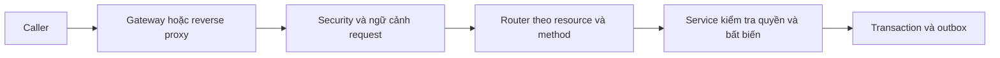

# Unexpected method rejection — Từ chối HTTP method ngoài hợp đồng

## 1. Sai method không được trở thành một đường đi khác vào nghiệp vụ

Giả sử ứng dụng công bố action phê duyệt bằng:

```text
POST /payment-requests/{id}/approvals
```

Người gọi không được dùng `GET`, `PUT`, `PATCH` hoặc `DELETE` trên cùng đường dẫn để làm ứng dụng gọi một nhánh phê duyệt ít kiểm tra hơn. Một request sai method cũng không được tạo approval, giữ chỗ tiền hoặc phát command trước khi server trả lỗi.

**Unexpected method rejection** là việc xác định method hợp lệ cho từng resource hoặc action và chặn những method ngoài hợp đồng tại đường nhận request, trước khi chúng tạo hiệu ứng nghiệp vụ bị cấm.

Rủi ro xuất hiện khi:

- Handler chỉ khai báo đường dẫn mà không giới hạn method.
- Security kiểm tra một method nhưng router xử lý một method khác.
- Một endpoint đọc gọi chung hàm vừa đọc vừa thay đổi trạng thái.
- Middleware cho đổi method sau khi đã ra quyết định bảo mật.
- Gateway chặn đúng nhưng origin hoặc endpoint cũ vẫn nhận method khác.
- Test chỉ thấy response lỗi mà không kiểm tra dữ liệu và command đã phát sinh.

Việc chặn method là một lớp bảo vệ hợp đồng HTTP. Nó bổ sung cho quyền theo đối tượng, state machine, transaction và idempotency; không thay thế các lớp đó.

## 2. Phân biệt method ngoài hợp đồng với những lỗi khác

Với method đã được server triển khai nhưng resource không chấp nhận, phản hồi phù hợp là `405 Method Not Allowed`, kèm `Allow`. Method chưa được hiểu hoặc chưa được triển khai thuộc trường hợp `501 Not Implemented`. Token method phân biệt hoa và thường. [RFC 9110, mục 9.1 và 15.5.6](https://www.rfc-editor.org/rfc/rfc9110.html#section-9.1)

Không gom mọi trường hợp sau thành cùng một lỗi:

| Tình huống trong ví dụ | Nhận định |
| --- | --- |
| `PUT` vào action chỉ nhận `POST` | Method ngoài hợp đồng resource |
| `POST` đúng route nhưng caller không có quyền | Lỗi phân quyền |
| `POST` đúng route nhưng hồ sơ đã thanh toán | Xung đột điều kiện nghiệp vụ hoặc trạng thái |
| `POST` đúng route nhưng sai kiểu nội dung | Lỗi hợp đồng media type |
| Method token hoặc request bị lỗi cú pháp ở tầng HTTP | Lỗi cú pháp hoặc giao thức, không tự là trường hợp resource từ chối method |
| Route không tồn tại trong phạm vi công bố | Không cùng tình huống với một route có thật nhưng sai method |

Thứ tự các lớp có thể làm request bị từ chối sớm hơn, chẳng hạn chưa xác thực hoặc vi phạm chính sách biên mạng. Cần mô tả đúng hành vi của đường vào, không ép mọi request bất kỳ đều phải đi đến router để nhận `405`.

### 2.1. Không dùng method error để che lỗi state machine

Nếu `POST` là method đúng của action phê duyệt, hồ sơ không còn được duyệt không làm `POST` trở thành một method lạ. Hãy trả lỗi trạng thái hoặc điều kiện theo hợp đồng nghiệp vụ đã chọn.

Ngược lại, biết caller có role approver không có nghĩa server nên chấp nhận mọi method trên action đó.

## 3. Lập hợp đồng method theo từng resource

Một ma trận minh họa:

| Resource hoặc action | Method được thiết kế | Điều có thể xảy ra |
| --- | --- | --- |
| `/payment-requests/{id}` | `GET`, `HEAD` theo chính sách đọc | Đọc thông tin trong phạm vi được cấp |
| `/payment-requests/{id}/draft-inputs` | `PUT` | Thay phần input draft được phép |
| `/payment-requests/{id}/submissions` | `POST` | Nhận ý định gửi duyệt |
| `/payment-requests/{id}/approvals` | `POST` trong ví dụ này | Nhận quyết định phê duyệt |
| `/payment-requests/{id}/cancellations` | `POST` | Nhận yêu cầu hủy theo trạng thái |
| `OPTIONS` trên những route có hỗ trợ | Do cấu hình hạ tầng hoặc ứng dụng xác định | Trả metadata thích hợp, không thực hiện action phê duyệt |

Nếu sản phẩm còn thiết kế `GET /payment-requests/{id}/approvals` để đọc danh sách quyết định, `GET` đó là hợp lệ nhưng phải chỉ làm action đọc. Không được mặc định mọi `GET` trên đường dẫn có chữ “approvals” đều phải bị chặn.

Điểm quan trọng là không có một method ngoài hợp đồng được tự chuyển thành action ghi. OWASP cũng khuyến nghị dùng danh sách method được phép và kiểm tra quyền caller trên action cùng bản ghi cụ thể. [OWASP REST Security Cheat Sheet](https://cheatsheetseries.owasp.org/cheatsheets/REST_Security_Cheat_Sheet.html#restrict-http-methods)

### 3.1. Đừng dùng một allowlist chung thay hợp đồng từng route

Cho phép `GET`, `POST`, `PUT`, `PATCH`, `DELETE` ở gateway chỉ nói đây là những method có thể dùng trong API. Nó không có nghĩa cả năm method được phép trên mọi resource.

Cần phân biệt giới hạn tổng quát ở biên với mapping cụ thể của ứng dụng. Một API đọc và một action chuyển tiền không có cùng tập method chỉ vì cùng host.

### 3.2. `Allow` không phải một quyền nghiệp vụ

`Allow` mô tả method của resource; nó không thay quyết định quyền cho mọi caller. Không tạo header này từ dữ liệu client hoặc từ danh sách method của toàn bộ ứng dụng. [RFC 9110, mục 10.2.1](https://www.rfc-editor.org/rfc/rfc9110.html#section-10.2.1)

## 4. Method, quyền và điều kiện nghiệp vụ là ba hàng rào khác nhau

```text
Đúng resource và method
  → danh tính hợp lệ
  → đúng tenant và có quyền trên đối tượng
  → đủ điều kiện trạng thái, nội dung và bằng chứng
  → nhận thay đổi nguyên tử và chống trùng
```

Sơ đồ thể hiện các điều kiện phải có, không áp đặt một thứ tự middleware duy nhất cho mọi hệ thống. Ví dụ xác thực có thể diễn ra trước bước router công bố chi tiết route.

Các lỗi cần tránh:

- Chỉ bảo vệ `POST` bằng permission rồi để method khác gọi cùng handler mà không có rule tương ứng.
- Cho rằng mọi request không phải `GET` đều là cùng một loại ghi với cùng quyền.
- Cho rằng đúng method tự chứng minh có quyền phê duyệt.
- Cho rằng một endpoint “nội bộ” được bỏ kiểm tra đối tượng vì gateway đã chặn method lạ.

Với action phê duyệt, service vẫn cần biết actor chuẩn hóa, tenant, hồ sơ, expected version, vòng duyệt và nội dung thực sự được quyết định. Client không được đổi actor hoặc state bằng payload chỉ vì đã dùng `POST`.

## 5. Không để đường đọc trở thành lệnh ghi

Trong thiết kế của bài, `GET` và `HEAD` không được dùng để yêu cầu phê duyệt, hủy, nhận thanh toán hoặc tiêu thụ một quyền dùng một lần. `HEAD` không trả content; response rỗng không chứng minh backend không có hiệu ứng. [RFC 9110, mục 9.2.1 và 9.3.2](https://www.rfc-editor.org/rfc/rfc9110.html#section-9.2.1)

Một đường nguy hiểm:

```text
GET /payment-requests/123?approve=true
```

Nếu nó làm phê duyệt, một link preview, bộ quét hoặc thành phần xử lý đường đọc có thể kích hoạt nghiệp vụ ngoài ý định. Đổi tên query thành `action=approve` không thay bản chất.

### 5.1. Hiệu ứng vận hành khác với thay đổi nghiệp vụ được yêu cầu

Access log, metric hoặc cache có thể thay đổi khi đọc. Assertion không nhất thiết cấm mọi byte dữ liệu được ghi trong hệ thống.

Điều phải cấm là những hiệu ứng nghiệp vụ mà caller không được phép yêu cầu qua đường đó: tạo approval, gửi lệnh chi, cộng trả số dư, đóng hồ sơ hoặc phát command hủy.

### 5.2. HEAD cần được kiểm tra thực tế

Trong Spring MVC, mapping đọc có thể hỗ trợ `HEAD` qua handler `GET`; framework cũng có xử lý `OPTIONS` theo metadata mapping. Vì vậy cần kiểm tra tác động của handler chứ không chỉ body response. [Spring MVC: HTTP HEAD, OPTIONS](https://docs.spring.io/spring-framework/reference/web/webmvc/mvc-controller/ann-requestmapping.html)

Nếu một handler đọc đã gọi hàm phê duyệt, việc bỏ body cho HEAD không làm lời gọi nghiệp vụ biến mất. Ngược lại, với route chỉ nhận POST trong ví dụ, HEAD không được đi vào action phê duyệt.

## 6. OPTIONS và CORS không phải lối đi vào action

Preflight CORS có thể dùng `OPTIONS` với metadata về method dự định gửi. Đây là kiểm tra của cơ chế trình duyệt, không phải quyết định quyền phê duyệt trên payment request. [MDN: CORS](https://developer.mozilla.org/en-US/docs/Web/HTTP/Guides/CORS)

Ví dụ:

```http
OPTIONS /payment-requests/123/approvals
Origin: https://portal.example.test
Access-Control-Request-Method: POST
Access-Control-Request-Headers: content-type,idempotency-key
```

Header `Access-Control-Request-Method: POST` không được dùng để dispatch request hiện tại như một POST phê duyệt. Nó vẫn là yêu cầu OPTIONS cần được đường CORS hoặc metadata xử lý đúng.

### 6.1. Danh sách CORS không thay mapping server

Một client ngoài trình duyệt không bị cơ chế trình duyệt ngăn gửi request trực tiếp. Vì vậy giới hạn method chỉ trong cấu hình CORS không thay thế việc route từ chối method ngoài hợp đồng và kiểm tra quyền thực sự.

Tương tự, preflight được chấp nhận không có nghĩa actual request được bỏ authentication, tenant check hoặc điều kiện nghiệp vụ.

### 6.2. Không chặn OPTIONS một cách tùy tiện để làm test xanh

Nếu frontend có hợp đồng CORS hợp lệ, từ chối mọi OPTIONS có thể làm hỏng luồng sử dụng mà không tăng bảo vệ nghiệp vụ. Hãy thiết kế rõ OPTIONS nào được hỗ trợ, nó trả gì và chứng minh nó không gọi service ghi.

Không mở một handler mọi method chỉ để OPTIONS không báo lỗi. Cơ chế metadata phải tách khỏi action thay đổi trạng thái.

## 7. Method override và việc thống nhất method có hiệu lực

Một số stack có thể hỗ trợ header override, tham số form như `_method` hoặc middleware tương tự. Đây là hành vi triển khai phải được khai báo rõ, không phải một quyền ngầm cho caller đổi ý nghĩa request tùy nơi.

Một cuộc đua về cách hiểu, không cần concurrency:

```text
Gateway kiểm tra method A.
Security chọn rule theo A.
Middleware đổi thành method B.
Router gọi handler của B.
```

Nếu quyết định bảo mật phụ thuộc method mà không được kiểm tra lại sau biến đổi, request có thể đi tới một action ngoài phạm vi đã được xét.

### 7.1. Khi không cần override

Tắt cơ chế biến đổi hoặc từ chối những dấu hiệu override theo hợp đồng. Nếu chọn bỏ qua, cần chứng minh chúng không đổi routing hoặc quyền ở bất kỳ lớp nào.

Ví dụ một GET kèm `X-HTTP-Method-Override: POST` không được biến thành phê duyệt nếu API không hỗ trợ đường đó.

### 7.2. Khi phải hỗ trợ một trường hợp tương thích

Cần xác định:

- Những wire method nào được phép yêu cầu override.
- Tập method đích nào được hỗ trợ.
- Nguồn metadata nào được chấp nhận.
- Thời điểm biến đổi so với mọi quyết định phụ thuộc method.
- Cách authentication, CSRF, authorization, router và audit cùng hiểu request.

Mỗi biến đổi phải đi tới cùng kiểm tra nghiệp vụ của action đích. Không dùng nó để bỏ quyền hoặc tạo một action song song ít kiểm tra hơn.

### 7.3. Test phải theo đúng lựa chọn

Một POST hợp lệ kèm một header override bị hệ thống bỏ qua có thể vẫn được xử lý như POST. Không tự assert mọi request có header đó đều không được tạo hiệu ứng nếu hợp đồng là bỏ qua.

Ngược lại, nếu chính sách là từ chối metadata override, phải từ chối trước khi nhận action. Hai lựa chọn có kỳ vọng kiểm thử khác nhau.

## 8. Tính nhất quán từ gateway đến origin



Những câu hỏi cần trả lời:

- Method được giữ nguyên hay được biến đổi có chủ ý giữa các lớp?
- Gateway và ứng dụng có hiểu cùng path sau rewrite không?
- Origin có một đường truy cập khác mà không qua lớp chặn dự kiến không?
- Endpoint phiên bản cũ hoặc alias có cùng hợp đồng an toàn không?
- Một catch-all hoặc fallback có nhận method mà route chính đã từ chối không?

Không tự chuyển một method lạ về GET hoặc POST để “tương thích”. Cũng không chuẩn hóa tùy tiện token khác chữ hoa thường thành một command hợp lệ.

### 8.1. Không coi redirect là cách hợp thức hóa method sai

Nếu cần chuyển client sang endpoint mới, hành vi redirect và mapping đích phải được kiểm tra trong hợp đồng triển khai. Không dùng một đường chuyển tiếp tự làm action ghi từ request đọc.

Endpoint cũ nên bị loại bỏ hoặc giữ đúng các điều kiện cần thiết. Chặn ở URL mới không sửa được một alias cũ vẫn phê duyệt bằng mọi method.

### 8.2. Global policy và resource policy khác nhau

Có thể chặn những năng lực giao thức không cần thiết ở biên. Tuy nhiên, một rule toàn cục không thay thế mapping từng resource và cũng không có nghĩa toàn ứng dụng chỉ được dùng POST.

Các resource đọc, health endpoint và hành động nghiệp vụ phải được thiết kế theo mục đích riêng, trong phạm vi được công bố.

## 9. Ví dụ Java: mapping cụ thể cho action phê duyệt

Một mapping nguy hiểm nếu không có giới hạn bổ sung tương ứng:

```java
// Chỉ minh họa rủi ro: method không được khai báo ở handler này.
@RequestMapping("/payment-requests/{id}/approve")
public ApprovalReceipt approve(@PathVariable UUID id) {
    return approvals.approve(id);
}
```

Trong Spring MVC, mapping không giới hạn HTTP method có thể khớp nhiều method. Dùng annotation theo method hoặc khai báo method tường minh để thể hiện hợp đồng. [Spring MVC: Mapping Requests](https://docs.spring.io/spring-framework/reference/web/webmvc/mvc-controller/ann-requestmapping.html)

Ví dụ mapping hẹp:

```java
@RestController
@RequestMapping("/payment-requests")
public class PaymentApprovalController {
    private final PaymentApprovalService approvals;
    private final VerifiedActorFactory actors;

    // Constructor injection được lược bỏ.

    @PostMapping(
            path = "/{requestId}/approvals",
            consumes = MediaType.APPLICATION_JSON_VALUE,
            produces = MediaType.APPLICATION_JSON_VALUE)
    public ResponseEntity<ApprovalReceipt> approve(
            @PathVariable("requestId") UUID requestId,
            @RequestBody ApprovePaymentInput input,
            @RequestHeader("Idempotency-Key") String idempotencyKey,
            @AuthenticationPrincipal ApplicationPrincipal principal) {

        VerifiedActor actor = actors.requireAuthenticated(principal);
        ApprovePaymentCommand command = new ApprovePaymentCommand(
                requestId, input.expectedVersion(),
                input.approvalRound(), idempotencyKey);

        ApprovalReceipt receipt = approvals.approve(actor, command);
        return ResponseEntity.status(HttpStatus.CREATED).body(receipt);
    }
}
```

Các kiểu input, command, principal và service là thành phần cần triển khai. Các trường `final` phải được khởi tạo qua constructor; ví dụ không phải một ứng dụng hoàn chỉnh có thể chạy độc lập.

Mapping ở class chỉ chia sẻ prefix. Hợp đồng method của action được khai báo ở method handler. Service không được chỉ dựa vào annotation này để bỏ kiểm tra tenant, đối tượng hoặc điều kiện phê duyệt.

DTO cũng không nhận `approvedBy`, `state=APPROVED` hoặc một tenant tùy ý như nguồn thẩm quyền. Actor đến từ ngữ cảnh xác thực được kiểm tra.

## 10. Phản hồi 405 không được làm mất metadata cần thiết

Một response minh họa cho resource được thiết kế hỗ trợ POST và OPTIONS:

```http
HTTP/1.1 405 Method Not Allowed
Allow: POST, OPTIONS
Cache-Control: no-store
Content-Type: application/json

{
  "code": "METHOD_NOT_ALLOWED",
  "message": "Phương thức không được hỗ trợ cho tài nguyên này."
}
```

Tập method phải theo resource thật, không sao chép nguyên ví dụ. Framework hoặc hạ tầng có thể xử lý OPTIONS riêng; cần xác minh metadata cuối cùng tương ứng cấu hình đang dùng.

### 10.1. Tùy biến lỗi trong Spring

Spring cung cấp metadata response trong `HttpRequestMethodNotSupportedException`; khi tùy biến body cần giữ các header phù hợp của exception thay vì tự đoán từ danh sách toàn ứng dụng. [Spring API: HttpRequestMethodNotSupportedException](https://docs.spring.io/spring-framework/docs/current/javadoc-api/org/springframework/web/HttpRequestMethodNotSupportedException.html)

```java
@RestControllerAdvice
public class MethodErrorHandler {
    @ExceptionHandler(HttpRequestMethodNotSupportedException.class)
    public ResponseEntity<?> unsupportedMethod(
            HttpRequestMethodNotSupportedException ex,
            HttpServletRequest request) {

        ResponseEntity.BodyBuilder response = ResponseEntity
                .status(HttpStatus.METHOD_NOT_ALLOWED)
                .headers(ex.getHeaders())
                .cacheControl(CacheControl.noStore());

        if ("HEAD".equals(request.getMethod())) {
            return response.build();
        }

        return response.body(new PublicApiError(
                "METHOD_NOT_ALLOWED",
                "Phương thức không được hỗ trợ cho tài nguyên này."));
    }
}
```

`PublicApiError` và import tương ứng cần được định nghĩa. Ví dụ áp dụng cho exception do MVC phân loại; nó không bắt mọi lỗi phát sinh ở gateway hoặc security filter.

Cần kiểm tra `Allow` thực sự có giá trị phù hợp khi dùng cấu hình framework của dự án. Nếu một đường tự tạo exception thiếu metadata, sửa đường phân loại hoặc nguồn route metadata; không bịa một tập method không đúng.

### 10.2. Không lộ nghiệp vụ qua lỗi method

Lỗi này không cần đọc rồi trả số tiền, owner, trạng thái duyệt hoặc sự tồn tại của đối tượng tenant khác. Phản hồi và thứ tự kiểm tra phải tuân theo chính sách tiết lộ của hệ thống.

Không catch mọi exception rồi đổi thành 405. Một lỗi quyền, lỗi dữ liệu hoặc lỗi commit có ngữ nghĩa và hướng phục hồi khác.

## 11. Service nghiệp vụ vẫn phải tự bảo vệ

Method hợp lệ chỉ đưa request tới đúng action. Bên trong action phê duyệt, vẫn cần những điều kiện như:

```text
actor còn quyền trên đúng hồ sơ và tenant
AND actor không thuộc nhóm chủ thể xung đột
AND hồ sơ đang chờ duyệt
AND expected version và approval round khớp
AND nội dung, hạn mức và bằng chứng đáp ứng policy
AND quyết định không bị ghi trùng trái quy tắc
```

Một consumer queue hoặc công cụ hỗ trợ có thể gọi service mà không đi qua HTTP controller. Nếu service chỉ dựa vào method matcher ở web, những đường này có thể trở thành lối đi tắt.

### 11.1. Chặn trước hiệu ứng, không kiểm tra sau cùng

Thiết kế sai:

```text
gọi service approve
kiểm tra request method
nếu không đúng thì trả 405
```

Trả response lỗi không tự rollback những transaction đã commit hoặc tác động bên ngoài. Phải chặn trước khi gọi action ghi.

Ngay cả khi code định rollback, không nên đưa một request ngoài hợp đồng vào service tạo hiệu ứng rồi hy vọng mọi tầng sẽ hủy được. Lời gọi ngoài transaction hoặc event phát sớm có thể đã xảy ra.

### 11.2. Audit từ chối khác với command thành công

Request sai method có thể tạo access log, metric hoặc audit an ninh theo chính sách. Nó không được tạo một success audit phê duyệt hoặc một command mà worker sẽ thực hiện sau.

Các assertion cần phân biệt hai loại dữ liệu đó, thay vì cấm mọi hoạt động ghi log hoặc chỉ nhìn bảng hồ sơ chính.

## 12. Idempotency và request sai method

### 12.1. Không tiêu thụ ý định nghiệp vụ trước khi xác định đúng action

Một request sai method không nên tạo command hoặc chiếm một idempotency record được mô tả là action đã được nhận.

Nếu một cache idempotency dùng key quá rộng và lưu lỗi GET như kết quả của POST phê duyệt, request hợp lệ sau đó có thể bị trả nhầm lỗi hoặc kết quả không đúng ý định.

Cần ràng buộc key với tenant, chủ thể hoặc phạm vi được chọn, resource và action nghiệp vụ theo hợp đồng. Method hoặc alias không được vô tình đổi ý nghĩa của một command đã lưu.

### 12.2. Method khác không phải cách retry

Khi POST timeout, client không được chuyển sang GET hoặc PUT trên action phê duyệt để “thử cách khác”. Nó cần tra cứu hoặc retry cùng ý định theo cơ chế idempotency được hỗ trợ.

Nếu có nhiều route tương thích cùng biểu diễn một action, ràng buộc nghiệp vụ phải ngăn cùng ý định tạo hai quyết định qua hai alias. Không chỉ thêm method vào cache key rồi coi đã giải quyết mọi hiệu ứng trùng.

### 12.3. 405 sau hiệu ứng là một lỗi nghiêm trọng của hợp đồng

Một request có thể bị client coi là chưa được nhận vì lỗi method. Nếu thực tế đã tạo approval, người dùng có thể thao tác lại và gây trạng thái khó giải thích.

Do đó kiểm thử cần chứng minh cả không có hiệu ứng trái phép và receipt hoặc lỗi phản ánh đúng việc action đã được nhận hay chưa.

## 13. Ma trận kiểm thử trước khi viết code test

Với route phê duyệt chỉ có action POST trong ví dụ:

| Request | Kỳ vọng cần kiểm tra |
| --- | --- |
| POST hợp lệ từ actor đúng quyền | Nhận đúng một quyết định theo policy |
| GET vào action không có mapping đọc | Không gọi action phê duyệt; lỗi đúng đường phân loại |
| HEAD vào action không hỗ trợ HEAD | Không có content và không có hiệu ứng phê duyệt |
| PUT, PATCH, DELETE ngoài hợp đồng | Không có quyết định, transition hoặc command mới |
| OPTIONS được cấu hình hỗ trợ | Metadata phù hợp, không thực hiện POST được nêu trong header |
| Method mở rộng chưa được triển khai | Xử lý đúng tầng giao thức và chính sách, không rơi vào fallback ghi |
| Token method khác chữ hoa thường | Không tự được diễn giải thành action hợp lệ ngoài hợp đồng |
| Override không được hỗ trợ | Không đổi method hoặc bị từ chối theo chính sách đã chọn |
| Đúng method nhưng sai tenant hoặc SoD | Hàng rào nghiệp vụ vẫn chặn độc lập |

Không bắt mọi trường hợp ở bảng nhận cùng một status. Riêng nhóm đã đi đến router, có route mục tiêu và bị phân loại method không được phép cần kiểm tra response 405 cùng metadata của nó.

### 13.1. Có request đối chứng hợp lệ

Nếu POST nền đã lỗi authentication, CSRF, DTO hoặc version, các request đổi method chưa chứng minh được hàng rào mong muốn.

Chuẩn bị actor đúng quyền, hồ sơ đang chờ duyệt, version đúng và payload đúng. Sau đó chỉ đổi method trong nhóm test đang nhắm vào router.

### 13.2. Không dùng lỗi body để thay bằng chứng method

Một handler rộng có thể nhận GET nhưng báo thiếu body. Điều đó chưa chứng minh mapping đã giới hạn method.

Với những method và kênh kiểm thử cho phép gửi nội dung, có thể dùng payload đúng để tránh parser che mất lỗi routing. Với HEAD hoặc các đường có giới hạn giao thức riêng, kiểm tra đúng hợp đồng và tác động thực tế; không dựa riêng vào response rỗng.

## 14. Ví dụ kiểm thử Java qua HTTP

Ví dụ sau giả định trong cấu hình được kiểm tra, caller đã được xác thực và các request tương ứng đi đến MVC để nhận phân loại 405. Nếu một lớp an ninh có chủ ý chặn sớm hơn, cần test riêng mapping và test đầu cuối theo đúng hợp đồng đó; không nới bảo vệ production chỉ để ép status cho test.

```java
@SpringBootTest
@AutoConfigureMockMvc
class UnexpectedApprovalMethodIT {
    @Autowired MockMvc mvc;
    @Autowired ApprovalFixtures fixtures;
    @Autowired ApprovalBusinessProbe probe;

    @ParameterizedTest
    @ValueSource(strings = {"GET", "PUT", "PATCH", "DELETE", "HEAD"})
    void unsupportedMethodCannotApprove(String method) throws Exception {
        ApprovalFixture f = fixtures.eligibleIndependentApprover();
        ApprovalSnapshot before = probe.capture(f);

        MockHttpServletRequestBuilder request = request(
                HttpMethod.valueOf(method),
                "/payment-requests/{id}/approvals", f.requestId())
            .with(f.approverAuthentication())
            .with(csrf())
            .header("Idempotency-Key", f.freshIdempotencyKey());

        if (!"HEAD".equals(method)) {
            request.contentType(MediaType.APPLICATION_JSON)
                .content(f.validApprovalBody());
        }

        ResultActions result = mvc.perform(request)
            .andExpect(status().isMethodNotAllowed())
            .andExpect(header().exists(HttpHeaders.ALLOW));

        if ("HEAD".equals(method)) {
            result.andExpect(content().string(""));
        } else {
            result.andExpect(jsonPath("$.code")
                    .value("METHOD_NOT_ALLOWED"));
        }

        probe.assertAllowMatchesResourceContract(result, f);
        probe.assertNoAcceptedBusinessChange(f, before);
    }
}
```

Các fixture, probe, helper và import cần được triển khai. Ví dụ giả định cơ chế session có CSRF; điều chỉnh cách xác thực theo hệ thống thực tế nhưng không tắt lớp bảo vệ cần được kiểm tra.

`assertAllowMatchesResourceContract()` phải so tập method theo metadata đã thiết kế, không phụ thuộc thứ tự chuỗi header hoặc một danh sách toàn hệ thống.

`assertNoAcceptedBusinessChange()` nên kiểm tra state, version, approval, reservation hoặc execution command liên quan và outbox thành công. Audit từ chối được phép không bị nhầm với một action đã được nhận.

### 14.1. Kiểm tra POST hợp lệ riêng

Một test đối chứng phải chứng minh actor đó tạo được quyết định hợp lệ bằng POST. Kiểm tra cả version, canonical subject và vòng duyệt, không chỉ status thành công.

Nếu POST cũng không vào được service, test sai method có thể đang xanh nhờ một hàng rào không phải mục tiêu.

### 14.2. Kiểm tra trạng thái sau transaction thật

Không dựa vào transaction test bao ngoài toàn request để kết luận rollback đúng. Chuẩn bị fixture đã commit và đọc lại bằng ngữ cảnh phù hợp sau response.

Nếu có worker, quan sát command bền vững hoặc thực thi worker bằng cơ chế test có điều khiển. Không dùng một khoảng sleep tùy ý để kết luận không có tác động về sau.

## 15. Những nhóm test cần bổ sung ngoài controller

### 15.1. Preflight và HEAD

Gửi OPTIONS có `Access-Control-Request-Method: POST` rồi chứng minh không có approval. Kiểm tra actual request vẫn phải có quyền và dữ liệu phù hợp sau preflight.

Gửi HEAD tới resource đọc được hỗ trợ và tới action chỉ nhận POST theo hợp đồng tương ứng. Kiểm tra không có hiệu ứng ghi nghiệp vụ ở cả hai, thay vì coi mọi HEAD đều phải có cùng status.

### 15.2. Override và fallback

Kiểm tra những header hoặc form parameter thực sự có thể được stack xử lý. Chứng minh chúng bị từ chối, bị bỏ qua hoặc được biến đổi theo đúng contract đã chọn, với security và router thống nhất method có hiệu lực.

Thử route cũ, alias, trailing slash hoặc path qua rewrite nếu chúng tồn tại trong triển khai. Không biến đổi path vô hạn; chọn những đường có thể đi đến cùng action hoặc một fallback đáng quan tâm.

### 15.3. Đường qua gateway và đường origin

MockMvc không chứng minh cấu hình reverse proxy. Cần test ở tầng phù hợp cho rule biên, rewrite, method được chuyển tiếp và khả năng đi vòng tới origin trong mô hình triển khai.

Không kết luận chặn method đã hoàn chỉnh chỉ vì gateway trả lỗi trong khi một đường nội bộ được caller khác truy cập vẫn nhận mọi method.

### 15.4. Method lạ và request không hợp lệ

Các request bị container hoặc HTTP server từ chối có thể không tới controller advice. Test status hoặc hành vi theo đúng tầng và bảo đảm không tạo hiệu ứng nghiệp vụ.

Một lỗi 500, connection bị đóng hoặc lỗi parse không tự là bằng chứng một resource allowlist được cấu hình đúng. Cần phân biệt nguyên nhân và phạm vi kết luận.

### 15.5. Tương tác với idempotency

Có thể thử một method ngoài hợp đồng với một key chưa dùng, rồi gửi POST hợp lệ với key đó theo contract của action. Request sai không được tạo command thành công hoặc trả một receipt giả cho POST sau.

Kiểm tra retry của POST đã commit vẫn trả đúng kết quả cũ theo quyền phù hợp, không để thay method hoặc alias trở thành cách tạo lại quyết định.

## 16. Audit, lỗi phản hồi và dấu hiệu cần điều tra

Log từ chối có thể lưu method nhìn thấy ở từng ranh giới cần thiết, method có hiệu lực nếu có biến đổi hợp lệ, route template, actor khi đã xác định, tenant scope, correlation ID và lớp đã từ chối.

Không ghi credential hoặc toàn bộ body phê duyệt chỉ để phân tích method. Những header override hoặc path không đáng tin phải được xử lý để không phá cấu trúc log.

| Tín hiệu | Điều cần xem xét |
| --- | --- |
| Nhiều method khác nhau vào cùng action nhạy cảm | Có thể dò verb hoặc client đang dùng sai hợp đồng |
| Gateway và origin ghi method khác nhau | Có biến đổi hợp lệ cần giải thích hoặc cấu hình không nhất quán |
| 405 nhưng có approval hay command cùng correlation | Có thể đã kiểm tra quá muộn hoặc phát event trước khi từ chối |
| OPTIONS làm tăng version nghiệp vụ | Metadata path có thể đang dùng nhầm handler ghi |
| HEAD làm phát sinh thanh toán hoặc hủy | Đường đọc có thể chứa side effect nghiệp vụ |
| POST hợp lệ tăng lỗi sau đổi allowlist | Cần kiểm tra drift hợp đồng hoặc client cũ |
| Route cũ vẫn nhận GET thực hiện action | Có đường tương thích chưa được bảo vệ |

Không coi mọi method bị từ chối là một cuộc tấn công. Có thể là lỗi client, proxy hoặc tài liệu cũ. Điều cần giữ là không có request ngoài hợp đồng tạo hiệu ứng và đủ bằng chứng để phân biệt nguyên nhân.

## 17. Triển khai và những lỗi thiết kế cần tránh

Khi siết một API đã tồn tại, cần xác định client nào đang dùng method cũ, cung cấp hợp đồng thay thế và kiểm thử đường chuyển tiếp. Không giữ một fallback mở mọi method chỉ để tránh phản hồi lỗi.

Tài liệu, route metadata, security matcher, gateway và test cần diễn đạt cùng một action. Có thể kiểm tra drift bằng cách so tập mapping được công bố với cấu hình thực và các case đã được chấp nhận, nhưng không xem tài liệu là bằng chứng server tự thực thi đúng.

| Cách làm | Vì sao có vấn đề | Hướng thay thế |
| --- | --- | --- |
| Mapping chỉ có URL cho action ghi | Có thể nhận những method ngoài dự kiến | Mapping method tường minh |
| Chặn method sau khi gọi service | Response lỗi không lấy lại hiệu ứng | Từ chối trước action ghi |
| Chỉ security POST, bỏ method còn lại | Có thể đi vào cùng handler qua nhánh ít kiểm tra | Hợp đồng route và kiểm tra nghiệp vụ đầy đủ |
| GET có query làm approve hoặc cancel | Đường đọc trở thành lệnh ghi | Action ghi riêng có thẩm quyền |
| HEAD body rỗng nên coi đã an toàn | Handler vẫn có thể chạy logic nghiệp vụ | Kiểm tra dữ liệu và command sau request |
| CORS là hàng rào method duy nhất | Không bảo vệ mọi loại client | Router từ chối độc lập |
| Override chạy sau quyết định phụ thuộc method | Các lớp hiểu khác action thực tế | Biến đổi có kiểm soát và kiểm tra nhất quán |
| Allow chứa mọi method của ứng dụng | Metadata sai cho resource | Sinh theo hợp đồng resource thực |
| Catch mọi lỗi thành 405 | Mất nghĩa quyền, trạng thái hoặc kết quả commit | Phân loại lỗi theo nguyên nhân |
| Test sai method khi POST nền đã lỗi | Kết quả xanh không chứng minh hàng rào cần kiểm tra | Đối chứng hợp lệ và mutation có mục tiêu |
| Chỉ kiểm tra gateway | Origin hoặc alias có thể vẫn mở | Bao phủ các đường truy cập trong mô hình triển khai |
| Method đúng thì bỏ service guard | Consumer hoặc caller khác có thể vượt nghiệp vụ | Quyền theo đối tượng và invariant ở service |

## 18. Bài tập thiết kế

Thiết kế việc từ chối method ngoài hợp đồng cho một API có các action đọc hồ sơ, sửa draft, gửi duyệt, phê duyệt và yêu cầu hủy. Frontend dùng CORS, một client cũ có nhu cầu tương thích và command được xử lý qua outbox.

Hãy mô tả:

1. Mỗi resource hỗ trợ method nào, kể cả HEAD hoặc OPTIONS khi có?
2. Request nào nhận 405, request nào là lỗi quyền hoặc trạng thái, và `Allow` được lấy từ đâu?
3. Có hỗ trợ method override không? Nếu có, những lớp nào cần thống nhất method có hiệu lực?
4. Điều gì chứng minh request sai method chưa tạo approval, command hoặc hiệu ứng bên ngoài?
5. Service còn phải kiểm tra tenant, chủ thể, version và bằng chứng nào dù request đã dùng POST đúng?
6. Test đối chứng và test biến đổi method được xây thế nào để không bị CSRF, parser hoặc version cũ che mất kết quả?
7. Gateway, origin, alias và endpoint phiên bản cũ được kiểm tra ở tầng nào?
8. OPTIONS, HEAD và retry cùng idempotency key có những assertion riêng nào?

Một thiết kế đạt yêu cầu phải bảo đảm method ngoài hợp đồng không trở thành một đường thay thế vào nghiệp vụ, còn method hợp lệ vẫn đi qua đầy đủ quyền theo đối tượng, state machine và cơ chế nhận hiệu ứng an toàn.
