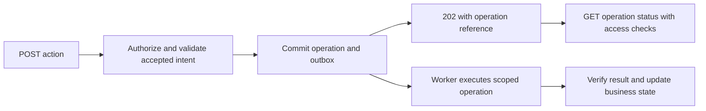

# Action endpoint semantics: ngữ nghĩa của endpoint hành động nghiệp vụ

## 1. Endpoint hành động phải diễn đạt một ý định cụ thể

Một hệ thống cho phép cập nhật đề nghị chi phí bằng:

```http
PATCH /expense-requests/expense-17
Content-Type: application/json

{
  "state": "APPROVED",
  "approvedBy": "manager-9",
  "amount": 1
}
```

Nếu backend chỉ ánh xạ các field vào entity, người gọi có thể vừa sửa số tiền vừa tự khai người duyệt và trạng thái đích. Đúng kiểu dữ liệu hoặc đúng tên enum không chứng minh được phép thực hiện quyết định đó.

Một **action endpoint** biểu đạt một hành động nghiệp vụ như gửi duyệt, duyệt, từ chối, rút yêu cầu hoặc bắt đầu chi trả. Hợp đồng cần nêu rõ ai được làm, trên đối tượng nào, với căn cứ gì và kết quả thành công thực sự có nghĩa gì.

Ví dụ:

```http
POST /tenants/{tenantId}/expense-requests/{expenseId}/approve
```

Tên `approve` giúp biểu đạt ý định nhưng không tự bảo vệ hệ thống. Endpoint vẫn cần authorization theo đối tượng, state machine, business invariants, transaction và kiểm soát gửi lại.

Mục tiêu là để một lệnh có ý nghĩa xác định, không biến request thành quyền tùy ý sửa trạng thái nội bộ.

## 2. Action khác với cập nhật biểu diễn và tạo tài nguyên

### 2.1. Chọn hợp đồng theo điều nghiệp vụ cần thể hiện

| Cách biểu diễn | Ví dụ | Điều cần làm rõ |
|---|---|---|
| Cập nhật dữ liệu được phép | Sửa ghi chú bản nháp | Field nào được ghi và ở trạng thái nào |
| Endpoint hành động | `POST .../approve` | Hành động, quyền, guards và outcome |
| Tạo tài nguyên quyết định | `POST .../approval-decisions` | Quyết định mới thuộc vòng/căn cứ nào và được tính thế nào |
| Operation bất đồng bộ | Tạo yêu cầu chi trả rồi theo dõi operation | Đã tiếp nhận hay đã hoàn tất tác động |

Không có quy tắc rằng mọi URI phải tránh động từ hoặc mọi workflow phải dùng endpoint action. Một tài nguyên quyết định có thể phù hợp khi cần định danh, lịch sử và trạng thái riêng.

Điều quan trọng là hợp đồng giữ được ý nghĩa và điều kiện bảo vệ, bất kể cách đặt tên được dự án chọn.

### 2.2. PATCH không tự là lỗ hổng

Một PATCH có thể được triển khai an toàn nếu mọi thay đổi được ánh xạ thành lệnh hợp lệ, kiểm tra đúng quyền và invariants. Vấn đề là cho client gán trạng thái hoặc field đặc quyền mà không thực hiện các điều kiện cần thiết.

Ngược lại, đổi URL thành `/approve` nhưng bên trong vẫn bind toàn bộ entity sẽ không khắc phục mass assignment hoặc bỏ bước duyệt.

### 2.3. Cùng trạng thái đích có thể là những action khác nhau

`withdraw` do người lập thực hiện và `returnForCorrection` do người kiểm tra thực hiện có thể cùng đưa hồ sơ về `DRAFT`. Quyền, lý do và tác động lên các phiếu duyệt có thể khác nhau.

Không chỉ phân quyền bằng cặp `fromState → toState`. Action cần giữ ý định để policy kiểm tra đúng chủ thể và hệ quả.

Một workflow engine tổng quát vẫn có thể dùng action có tên và policy rõ. Không nên thay nó bằng một API cho phép gửi bất kỳ `toState` nào miễn cạnh tồn tại trong sơ đồ.

## 3. Hợp đồng action cần những thành phần nào?

Với mỗi hành động, hãy xác định:

1. **Mục tiêu:** aggregate/đối tượng nào và trong tenant nào.
2. **Ý định:** gửi duyệt, ghi một phiếu duyệt, hủy bản nháp hay tạo payment operation.
3. **Chủ thể:** danh tính thực tế và căn cứ đại diện nếu có.
4. **Đầu vào:** những lựa chọn hoặc điều kiện client được phép cung cấp.
5. **Preconditions:** version, basis, vòng duyệt và trạng thái nguồn.
6. **Authorization:** quyền hành động, phạm vi đối tượng, hạn mức và phân tách nhiệm vụ.
7. **Business guards:** chứng từ, quota, số dư, approval hoặc các điều kiện domain cần thiết.
8. **Outcome:** dữ liệu đã commit, trạng thái workflow và tác động còn chờ.
9. **Retry:** cách nhận diện gửi lại và hành vi khi chưa rõ kết quả.

### 3.1. Không lấy danh tính và quyết định server từ body

Một DTO duyệt có thể chỉ gồm:

```json
{
  "expectedVersion": 12,
  "basisPackageId": "basis-4",
  "note": "Đã đối chiếu chứng từ"
}
```

Actor, role hiệu lực, tenant của bản ghi, người duyệt và thời điểm quyết định được xác định phía server. Không dùng `approvedBy`, `isManager`, `state` hoặc hạn mức client khai làm bằng chứng quyền.

`expectedVersion` và `basisPackageId` biểu thị dữ liệu mà client muốn thao tác. Chúng là điều kiện để đối chiếu, không tự chứng minh actor được phép duyệt.

### 3.2. Action phải có một cách diễn giải nhất quán

Nếu route là `/approve` nhưng query/body lại chỉ định `action=reject`, không để router, security middleware và service mỗi nơi chọn một nghĩa.

Chọn nguồn biểu đạt action rõ, giới hạn enum nếu có và từ chối mâu thuẫn theo hợp đồng. Không dùng một field tùy ý để chọn hàm nội bộ hoặc bypass policy đã gắn cho route khác.

### 3.3. Tham chiếu vẫn cần được kiểm tra

Basis, quote, approval round, payee hoặc operation phải thuộc đúng đối tượng và phạm vi được phép. ID tồn tại hoặc khó đoán không tạo quyền sử dụng.

Một người có role duyệt tại tenant A không được duyệt đối tượng B bằng việc đặt ID của B vào URL. Role trong tenant khác cũng không được gộp thành quyền chung cho action.

## 4. HTTP method và trạng thái phản hồi

### 4.1. Không đưa mutation nghiệp vụ vào safe method

GET, HEAD hoặc OPTIONS không phải đường xác nhận duyệt, hủy hoặc chi trả. Link preview, prefetch và thao tác giao thức không được tạo quyết định nghiệp vụ.

POST thường phù hợp cho một action xử lý theo ngữ nghĩa riêng của tài nguyên. Điều đó không tự cung cấp authorization, chống request giả mạo hoặc idempotency.

Nếu một route không hỗ trợ method được gửi, xử lý theo hợp đồng, chẳng hạn `405 Method Not Allowed` với `Allow` phù hợp. Không fallback từ GET sang command chỉ để client nhận một response thành công.

### 4.2. Thành công của command khác trạng thái cuối của workflow

Giả sử một hồ sơ cần hai người duyệt độc lập. Lệnh `approve` của người thứ nhất ghi một quyết định hợp lệ nhưng hồ sơ vẫn ở `IN_REVIEW`.

Một response có thể là:

```http
HTTP/1.1 200 OK
Content-Type: application/json

{
  "decisionId": "decision-81",
  "decisionRecorded": true,
  "workflowState": "IN_REVIEW",
  "requestVersion": 13,
  "basisPackageId": "basis-4"
}
```

Hợp đồng cần nói rõ `approve` là ghi quyết định của actor hay đảm bảo toàn bộ hồ sơ lập tức thành `APPROVED`. Không để UI suy từ HTTP `200` rằng mọi cấp duyệt đã xong.

### 4.3. Các response thường gặp

| Response | Ý nghĩa có thể dùng trong hợp đồng |
|---|---|
| `200` | Action đã được xử lý và có kết quả trong body |
| `201` | Đã tạo một tài nguyên như approval decision; có thể trả `Location` của tài nguyên mới |
| `204` | Action hoàn tất theo hợp đồng, không có body |
| `202` | Đã tiếp nhận để xử lý, chưa khẳng định hoàn tất tác động |
| `400` hoặc `422` | Đầu vào không đáp ứng hợp đồng/rule được API quy định |
| `401` | Hành động cần danh tính nhưng credential chưa hợp lệ |
| `403` hoặc `404` theo chính sách tiết lộ | Không có quyền hoặc không có tài nguyên trong phạm vi được biết |
| `409` | Xung đột trạng thái, version, basis hoặc ý định theo hợp đồng |
| `412` | Precondition HTTP như `If-Match` không được thỏa mãn |
| Lỗi dịch vụ phù hợp | Chưa thể đánh giá/thực hiện vì dependency hoặc lỗi nội bộ |

Không cần dùng mọi mã cho mọi API. Chọn cách nhất quán và trả nội dung đúng ý nghĩa nghiệp vụ.

### 4.4. Từ chối nghiệp vụ không đồng nghĩa từ chối authorization

`POST .../reject` do người có quyền thực hiện có thể trả thành công trong khi workflow chuyển sang `REJECTED`. Ngược lại, `403` cho một người không được duyệt không được tự ghi quyết định từ chối hồ sơ thay họ.

Tách rõ “lệnh ghi quyết định từ chối đã thành công” với “request không được cấp quyền thực hiện”. Nhầm hai nghĩa có thể làm một người ngoài quyền gây ảnh hưởng hồ sơ chỉ bằng cách gọi endpoint.

## 5. Authorization và domain guards của từng action

### 5.1. Quyền ghi chung không đủ

Các khả năng sau thường cần policy riêng:

```text
editDraft
submitForReview
recordApproval
recordRejection
withdraw
startPayment
confirmPaymentResult
```

Người được sửa bản nháp không tự được duyệt. Người được duyệt không tự được thay người nhận. Service xác nhận kết quả thanh toán không tự được tạo approval.

Một permission như `expense:write` dùng làm điều kiện duy nhất dễ gom các quyền khác bản chất vào cùng một cửa.

### 5.2. Giữ bất biến dù action hợp lệ về hình dạng

Một lệnh approve cần kiểm tra trạng thái nguồn, nhưng state machine đúng chưa đủ. Còn phải xét người duyệt có đúng phạm vi, trong hạn mức, không tự duyệt và quyết định có gắn với nội dung được xem hay không.

Một lệnh startPayment cần approval đúng basis, số tiền và người nhận được chấp nhận, cùng điều kiện chống chi trùng. Đường dẫn chuyên biệt không tự tạo các bảo đảm đó.

### 5.3. Căn cứ phải được bảo vệ khỏi thay đổi

Nếu người dùng duyệt phiên bản có số tiền nhỏ nhưng cập nhật áp lên phiên bản đã đổi số tiền, policy có thể bị vô hiệu.

Action cần ràng buộc quyết định với snapshot/version hoặc basis bất biến. Mọi đường sửa dữ liệu ảnh hưởng phải tham gia cùng cơ chế khóa/version hoặc quy tắc vô hiệu hóa quyết định.

Đọc authority trong transaction cũng không tự đồng bộ với thu hồi quyền ở hệ thống khác. Cam kết về độ mới và thứ tự phải được thiết kế thực tế, không suy ra từ việc endpoint dùng POST.

## 6. Minh họa Java: ghi phiếu duyệt và đánh giá quorum

Ví dụ chọn mô hình một action approve ghi phiếu của một danh tính; hồ sơ chỉ `APPROVED` khi đủ quorum. Các dependency là hợp đồng ứng dụng, không phải API thư viện có sẵn.

Nhánh idempotency đã xác định đây là lệnh mới.

```java
record ApproveExpenseCommand(
        long expectedVersion,
        UUID basisPackageId,
        String note) {}

ApprovalResult approve(
        UUID tenantId,
        UUID expenseId,
        ApproveExpenseCommand command) {

    ActorContext actor = identity.requireTenantActor(tenantId);
    validateShape(command);

    return transactions.required(() -> {
        ExpenseRequest expense = expenses
                .lockByTenantAndId(actor.tenantId(), expenseId)
                .orElseThrow(NotFound::new);

        approvalPolicy.requireCanRecordApproval(actor, expense);
        expense.requireState(ExpenseState.IN_REVIEW);
        expense.requireVersion(command.expectedVersion());
        expense.requireBasis(command.basisPackageId());

        ApprovalBasis basis = bases.requireFrozenFor(expense);
        evidenceRules.requireReadyForDecision(expense, basis);

        ApprovalDecision decision = decisions.appendUniqueApproval(
                actor, expense, basis, command.note());

        QuorumResult quorum = quorumPolicy.evaluate(
                expense, basis, decisions.acceptedForCurrentRound(expense));

        ExpenseState next = quorum.satisfied()
                ? ExpenseState.APPROVED
                : ExpenseState.IN_REVIEW;

        int changed = expenses.advanceDecisionProgress(
                actor.tenantId(), expense.id(), expense.version(),
                expense.approvalRoundId(), basis.id(), next);

        if (changed != 1) {
            throw new Conflict("CONCURRENT_MODIFICATION");
        }

        ApprovalResult result = new ApprovalResult(
                decision.id(), next, expense.version() + 1, basis.id());

        audit.appendApprovalDecision(actor, expense, decision, result);
        outbox.appendDecisionRecorded(expense, decision, result);
        if (quorum.satisfied()) {
            outbox.appendExpenseApproved(expense, basis, result);
        }
        return result;
    });
}
```

Các hợp đồng quan trọng:

- Policy kiểm tra tenant, quyền theo đối tượng, hạn mức, maker–checker và quan hệ đại diện cần thiết.
- `appendUniqueApproval` không đếm một người nhiều lần trái policy, kể cả qua tài khoản phụ khi mô hình có liên kết danh tính.
- Quorum chỉ xét quyết định có hiệu lực của đúng vòng và basis, đủ người độc lập và vai trò cần thiết.
- `advanceDecisionProgress` tăng version cho một quyết định mới dù chưa đủ quorum; cập nhật có điều kiện theo trạng thái nguồn và các căn cứ đã kiểm tra.
- Audit, decision, cập nhật và outbox bắt buộc cùng transaction; lỗi làm rollback theo hợp đồng.
- Sự kiện `DecisionRecorded` không được consumer mặc định hiểu là `ExpenseApproved` hoặc được phép chi tiền.
- Không có lời gọi thanh toán trước quyết định hợp lệ hoặc trong nhánh từ chối.

Đây là ví dụ phối hợp trách nhiệm. Tên hàm không thay thế triển khai constraint, khóa hoặc kiểm tra nguồn authority thực tế.

## 7. Idempotency và hành vi khi action đã được thực hiện

### 7.1. POST không tự bảo đảm chỉ thực hiện một lần

Client có thể gửi lại vì mất response. Nếu mỗi lần approve lại tạo một phiếu, cùng một người có thể bị đếm nhiều lần. Với payment, hậu quả có thể là thêm khoản thu/chi.

Idempotency cần phạm vi phù hợp, chẳng hạn:

```text
tenant + chủ thể + action + đối tượng + client key
```

Kèm fingerprint của nội dung có ý nghĩa như basis, version và ghi chú theo hợp đồng. Key là dữ liệu client cung cấp, không phải bằng chứng được phép làm action.

### 7.2. Replay khác với thực hiện một lệnh mới

Sau một approve thành công, hồ sơ có thể đã sang `APPROVED`. Nếu cùng key/nội dung được gửi lại, nhánh replay có thể trả kết quả đã commit mà không yêu cầu trạng thái nguồn vẫn là `IN_REVIEW`.

Nhưng trước khi trả kết quả, vẫn kiểm tra quyền hiện tại để nhận dữ liệu theo chính sách. Không trả biên nhận của người hoặc tenant khác chỉ vì biết key.

Nếu client đổi nội dung trong cùng key, xử lý xung đột theo hợp đồng. Một ý định mới sau khi đọc lại căn cứ cần được nhận diện đúng, không lén sửa payload của lệnh cũ đã ghi nhận.

### 7.3. Action đã hoàn tất bởi một request khác

Khi một người khác đã hoàn tất workflow, request mới có thể nhận xung đột hoặc một kết quả không tạo thêm tác động nếu hợp đồng cho phép. Cần quy định rõ.

Không tự ghi rằng actor mới cũng đã duyệt chỉ vì trạng thái hiện là `APPROVED`. Cũng không dùng trạng thái đó để trả kết quả nhạy cảm trước kiểm tra truy cập.

### 7.4. Khác key vẫn phải giữ bất biến

Client có thể sinh key mới cho mỗi lần gọi. Uniqueness theo vòng/danh tính, điều kiện trạng thái và logical operation vẫn cần ngăn phiếu hoặc tác động trùng.

Không coi idempotency là cơ chế duy nhất để bảo vệ số người độc lập, số lần sử dụng quyền lợi hoặc một nghĩa vụ chi trả.

## 8. Action bất đồng bộ và ý nghĩa của 202

### 8.1. Đã tiếp nhận chưa phải đã hoàn tất

Một action như tạo báo cáo lớn hoặc bắt đầu chi trả có thể trả `202` và một tham chiếu operation. Client cần biết cách xem trạng thái, kết quả và lỗi theo quyền hiện tại.

Không dùng `202` chỉ vì workflow còn chờ người duyệt thứ hai trong khi phiếu đầu đã được ghi hoàn tất đồng bộ. Đó có thể là thành công của lệnh ghi phiếu, dù workflow chưa tới trạng thái cuối.

Hợp đồng cần chỉ ra công việc nào thực sự đang được xử lý bất đồng bộ.

### 8.2. State operation khác state đối tượng nghiệp vụ

Một operation có thể `ACCEPTED`, `RUNNING`, `SUCCEEDED` hoặc `FAILED`, trong khi expense/order có state machine riêng.

Không gán đối tượng thành `PAID` chỉ vì công việc đã vào queue. Cũng không coi operation thành công nếu chỉ hoàn tất bước gửi lệnh mà chưa có bằng chứng kết quả theo yêu cầu workflow.



### 8.3. Worker phải có thẩm quyền đúng, không chỉ credential rộng

Xác định quyền cần còn ở lúc nhận hay lúc worker thực hiện. Nếu xử lý theo ủy nhiệm đã chấp nhận, lưu phạm vi, căn cứ và thời hạn cần thiết. Nếu yêu cầu quyền hiện hành, phải kiểm tra theo cam kết đó.

Không để service account rộng thay cho việc người dùng không có quyền trên đối tượng. Thông điệp cũng phải giữ tenant, aggregate, operation và nguồn khởi xướng đáng tin.

### 8.4. Polling không thực hiện lại action

GET trạng thái operation phải là đường quan sát theo quyền, không tạo một lần thực thi mới khi operation chưa xong.

Timeout không chứng minh tác động ngoài hệ thống thất bại. Tiếp tục cùng operation bằng giao thức chống trùng/đối soát phù hợp; không tạo khoản thanh toán thay thế tùy ý.

Transaction cục bộ và outbox không rollback được tiền đã chuyển, cũng không tự bảo đảm tác động mạng đúng một lần.

## 9. Cạnh tranh, batch và các đường ghi khác

### 9.1. Hai action cùng tranh một căn cứ

Approve và withdraw có thể chạy đồng thời. Khóa hoặc cập nhật có điều kiện phải bảo đảm không vừa rút thành công vừa giữ quyết định có hiệu lực trên vòng đã bị vô hiệu theo policy.

Với hai người duyệt hợp lệ dùng cùng expected version, một hợp đồng version chặt có thể buộc một request nhận xung đột rồi xử lý lại. Thiết kế khác có thể tuần tự hóa và nhận cả hai nếu điều kiện cho phép.

Không áp quy tắc “mọi hai request đồng thời chỉ một được thành công” cho tất cả action. Điều cần giữ là không mất quyết định đã commit và không tính quorum sai.

### 9.2. Batch là tập action, không phải một quyền chung

Mỗi phần tử cần kiểm tra tenant, đối tượng, quyền, basis và trạng thái. Role chung không đủ nếu một batch có cả hồ sơ của người gọi và hồ sơ ngoài phạm vi.

Chọn rõ toàn bộ hoặc không phần nào, hay outcome từng phần tử. Không commit các phần đầu rồi trả một lỗi chung khiến client tưởng tất cả chưa chạy.

Với từng phần, retry cần không lặp tác động ở phần đã thành công. Chi tiết lỗi vẫn phải tuân thủ quyền tiết lộ.

### 9.3. Generic update, admin và import không được bỏ qua invariants

Một action endpoint đúng vẫn có thể bị vượt nếu endpoint PATCH tổng quát cho đặt `state`, công cụ admin ghi trực tiếp hoặc import chấp nhận `approvedBy` tùy ý.

Đưa các đường thay đổi cùng ý nghĩa qua lệnh/domain policy chung hoặc một quy trình ngoại lệ được thiết kế rõ. Không coi mọi đường nội bộ là đáng tin vô điều kiện.

### 9.4. Một action mới không được vô tình mở rộng action cũ

Khi thêm `forceApprove`, `approveWithOverride` hoặc khả năng sửa giá lúc duyệt, phải xác định thẩm quyền, căn cứ và audit riêng. Không thêm một boolean vào DTO chung rồi để mọi người có quyền approve dùng nó.

Field đặc quyền mới không nên tự trở thành đầu vào của các endpoint cũ qua mapper hoặc entity dùng chung.

## 10. Hành vi lỗi và audit theo đúng ý nghĩa action

### 10.1. Không có thành công giả hoặc mutation sau deny

Nếu thiếu quyền, không ghi decision, không đổi state và không phát event cho phép thực thi. Audit từ chối hoặc bộ đếm quan sát có thể được ghi theo hợp đồng riêng.

Không trả `200` cùng kết quả trống cho một action đơn lẻ bị cấm mà không có outcome rõ. Không biến lỗi đánh giá policy thành permit hoặc tự retry bằng token có quyền cao hơn.

### 10.2. Chỉ tiết lộ chi tiết sau kiểm tra truy cập

Thông báo basis cũ, owner thật, số tiền hoặc người đã duyệt có thể làm lộ dữ liệu. Kiểm tra quyền nhận thông tin trước khi trả chi tiết xung đột hoặc kết quả cũ.

Dependency lỗi là chưa đánh giá/thực hiện được, không nhất thiết là actor chắc chắn thiếu quyền. Phân loại nội bộ rõ và không thực hiện hành động khi điều kiện bắt buộc chưa được xác lập.

### 10.3. Audit phân biệt các outcome

Các kết quả nên có ý nghĩa riêng:

```text
bị từ chối authorization
xung đột căn cứ/trạng thái
quyết định phê duyệt đã ghi
quyết định từ chối nghiệp vụ đã ghi
đã tiếp nhận operation, còn chờ xử lý
operation hoàn tất hoặc thất bại
```

Ghi actor thực tế, đại diện nếu có, tenant, action đã được server xác định, đối tượng, basis/vòng, version trước–sau và operation/idempotency reference cần thiết.

Không log credential, token hoặc toàn bộ payload nhạy cảm. Sự kiện deny cần cơ chế lưu phù hợp để không mất khi transaction nghiệp vụ rollback.

### 10.4. Tên sự kiện không được gây hiểu sai downstream

Nếu phiếu đầu chỉ được ghi nhận, không phát một sự kiện mà consumer hiểu là toàn bộ hồ sơ đã được duyệt. Hợp đồng event cần nói rõ điều gì đã commit và điều gì còn chờ.

Consumer vẫn cần kiểm tra operation/căn cứ phù hợp trước tác động. Một tên event không thay thế thẩm quyền và trạng thái ở ranh giới thực thi.

## 11. Kiểm thử action endpoint semantics

| Tình huống | Kỳ vọng |
|---|---|
| Action hợp lệ với actor, trạng thái và basis phù hợp | Ghi đúng quyết định/tác động theo hợp đồng |
| Phiếu đầu trong workflow cần hai người | Command thành công nhưng không báo sai toàn bộ workflow đã APPROVED |
| Action reject của người có quyền | Ghi quyết định nghiệp vụ REJECTED theo policy, không nhầm với lỗi authorization |
| Người ngoài quyền gọi approve/reject | Không tạo decision hoặc đổi trạng thái hồ sơ |
| Body giả actor, state, giá, tenant hoặc cờ override | Không thay căn cứ server hoặc mở field đặc quyền |
| Hai action cùng trạng thái đích nhưng khác thẩm quyền | Không dùng quyền của action này cho action kia |
| GET/HEAD/OPTIONS vào đường command | Không thực hiện mutation qua safe method |
| Basis/vòng/version đã cũ | Xử lý xung đột đúng, không tự chấp nhận nội dung mới |
| Người lập tự duyệt hoặc một người dùng nhiều account | Không vượt maker–checker/quorum theo mô hình danh tính |
| Gửi lại cùng lệnh sau commit nhưng mất response | Trả kết quả phù hợp, không thêm decision/operation |
| Cùng key nhưng khác payload | Phát hiện xung đột theo hợp đồng |
| Khác key nhưng cùng nghĩa vụ chỉ cho một lần | Invariants/constraint vẫn ngăn tác động trùng |
| Replay sau khi mất quyền nhận kết quả | Không lộ response cũ vượt quyền hiện tại |
| Hai action chạy đồng thời | State, basis và quyết định được commit nhất quán |
| Lỗi ở audit/outbox bắt buộc sau ghi decision | Không commit một phần trái hợp đồng transaction |
| 202 rồi worker thất bại | Client quan sát được outcome thật, không có thành công nghiệp vụ giả |
| GET polling operation nhiều lần | Không tạo thêm lần thực thi |
| Generic PATCH, admin, import hoặc batch | Không là đường bỏ qua cùng bất biến |

### 11.1. Assertion phải theo ý nghĩa, không chỉ status

Kiểm tra decision ID, người thực hiện, basis/vòng, state và version đã ghi. Với action bất đồng bộ, kiểm tra operation được tạo đúng và không đánh dấu tác động cuối trước bằng chứng cần thiết.

Sau deny hoặc conflict, kiểm tra dữ liệu và cổng tác động không đổi trái hợp đồng. Một response `403` không đủ nếu outbox đã ghi lệnh chi trả.

### 11.2. Positive test ngăn chặn quá mức

Cần có actor độc lập, đủ quyền và đúng scope hoàn thành được action. Với nhiều cấp duyệt, kiểm tra cả kết quả trung gian và đủ quorum.

Nếu chỉ có test từ chối, một implementation luôn trả lỗi có thể trông an toàn nhưng không đáp ứng nghiệp vụ.

### 11.3. Kiểm thử tại ranh giới gây lỗi

Qua HTTP stack để kiểm tra method, DTO và error mapping. Qua cơ sở dữ liệu phù hợp để kiểm tra constraint, khóa và rollback. Dùng fake/quan sát ở ranh giới hệ thống ngoài để kiểm tra operation thực sự được gửi.

Điều khiển lịch đọc–ghi trong test cạnh tranh và lưu phản ví dụ có thể tái hiện. Không chỉ kiểm tra một hàm mang tên `authorize` đã được gọi.

## 12. Tự rà soát hợp đồng action

Trước khi thêm một endpoint hành động, hãy trả lời:

1. Action biểu đạt ý định gì, khác với sửa field hoặc action gần giống ở đâu?
2. Thành công là ghi một quyết định, đổi toàn bộ workflow hay chỉ tiếp nhận operation?
3. Actor, tenant, căn cứ và trạng thái được xác định từ nguồn nào?
4. DTO có loại bỏ các field server phải quyết định không?
5. Quyền có được xét theo action và đối tượng, cùng maker–checker/hạn mức không?
6. Basis và dữ liệu ảnh hưởng có được bảo vệ tới lúc commit không?
7. Retry, action đã hoàn tất và idempotency replay có hợp đồng rõ không?
8. Nếu bất đồng bộ, quyền thực thi và cách nhận kết quả được xác định ở thời điểm nào?
9. Batch, endpoint tổng quát, admin và import có cùng giữ invariants không?
10. Response, audit và event có cùng nói đúng điều đã thực sự xảy ra không?

Một action endpoint có ngữ nghĩa tốt làm rõ điều người gọi yêu cầu và điều server đã chấp nhận, rồi giữ mối liên kết đó qua quyền, trạng thái, dữ liệu và tác động. Đặt tên endpoint đúng chỉ là điểm bắt đầu; hợp đồng phải được thực thi nhất quán tới kết quả cuối cùng.
