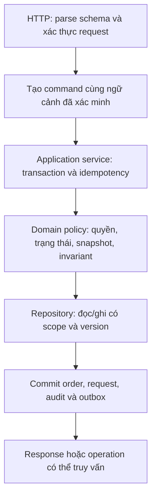

# Business command endpoint: thiết kế API theo ý định nghiệp vụ

Trong chương **API Business Rules**, business command endpoint là endpoint nhận một ý định thay đổi nghiệp vụ cụ thể, chẳng hạn gửi duyệt, phê duyệt, phát hành đơn hoặc yêu cầu hoàn tiền. Máy chủ quyết định có chấp nhận ý định đó hay không bằng cách kiểm tra quyền, đối tượng, trạng thái, bằng chứng và các business invariants liên quan.

Trong module bảo vệ logic nghiệp vụ, cách thiết kế này giúp tránh biến API thành một công cụ cho client tự đặt giá, trạng thái hay kết quả phê duyệt. Một endpoint tên `approve` hoặc `issue-order` không tự an toàn; bảo đảm nằm ở hợp đồng lệnh và cách thực thi các điều kiện trước khi tạo hiệu ứng.

Bài học sử dụng ví dụ phát hành một đơn mua hàng nội bộ từ một đề nghị đã được duyệt. Quy trình minh họa cho phép một đề nghị tạo đúng một đơn; nếu nghiệp vụ cho phép chia đơn, cần định nghĩa lại phạm vi chống trùng và các invariant tương ứng.

Sau bài này, bạn có thể:

- Chuyển một thay đổi dữ liệu mơ hồ thành một lệnh có ý nghĩa nghiệp vụ.
- Thiết kế input, quyền, tiền điều kiện, kết quả và lỗi của lệnh.
- Tách command, quyết định miền, dữ liệu lưu và sự kiện đã xảy ra.
- Bảo vệ việc thực thi bằng transaction, version và idempotency.
- Xử lý lệnh bất đồng bộ và kiểm thử các đường đi tắt hoặc thực hiện trùng.

## 1. Vì sao một API sửa trạng thái thường không đủ?

Giả sử client gửi:

```http
PATCH /purchase-requests/pr-123
Content-Type: application/json

{
  "status": "ORDER_ISSUED",
  "approved": true,
  "total": 1000
}
```

Nếu máy chủ chỉ kiểm tra caller được sửa đề nghị rồi lưu các trường, client có thể tự khẳng định đã duyệt và đã phát hành. Hệ thống chưa biết đơn nào được tạo, nội dung nào được duyệt hay ngân sách nào đã được sử dụng.

Một lệnh cụ thể đặt câu hỏi khác:

```text
Hãy phát hành đơn từ đề nghị PR-123,
dựa trên phiên bản và snapshot đã chỉ rõ,
nếu mọi điều kiện nghiệp vụ còn đúng.
```

Kết quả có thể là tạo một đơn và chuyển đề nghị sang trạng thái mới, hoặc từ chối mà không tạo hiệu ứng nghiệp vụ.

API cập nhật dữ liệu vẫn phù hợp với những thao tác như sửa ghi chú hoặc đổi tên trong phạm vi cho phép. Không cần biến mọi thay đổi nhỏ thành một quy trình phức tạp. Điểm cần tách rõ là những hành động có quyền, thứ tự, bằng chứng hoặc hiệu ứng đặc thù.

## 2. Command là ý định, không phải sự thật đã xảy ra

| Khái niệm | Ý nghĩa | Ví dụ |
| --- | --- | --- |
| Command | Yêu cầu hệ thống thực hiện một hành động có thể bị từ chối | `IssuePurchaseOrder` |
| Quyết định miền | Kết luận rằng hành động được phép trên dữ liệu và điều kiện cụ thể | Đủ quyền, đúng snapshot, còn ngân sách |
| Thay đổi dữ liệu | Các cập nhật cần lưu nếu lệnh được thực hiện | Tạo order, tăng version, đổi trạng thái đề nghị |
| Event | Một sự thật đã được ghi nhận theo ranh giới của hệ thống | `PurchaseOrderIssued` |
| Query | Đọc thông tin mà không yêu cầu tạo hiệu ứng nghiệp vụ | Xem đơn hoặc trạng thái xử lý lệnh |

Client không được gửi một event tên `PurchaseOrderIssued` vào API thông thường rồi làm máy chủ tin rằng việc phát hành đã xảy ra. Nếu hệ thống tiếp nhận báo cáo từ nguồn ngoài, phải xác minh thẩm quyền và bằng chứng trước khi tạo kết luận miền tương ứng.

Một command thành công không nhất thiết có quan hệ một–một với một câu SQL. Nó có thể cập nhật nhiều dữ liệu bắt buộc trong cùng transaction và tạo ý định gửi sự kiện.

Thiết kế command cũng không bắt buộc dùng CQRS, event sourcing hay microservices. Một ứng dụng nguyên khối có service và database vẫn có thể nhận, kiểm tra và thực thi lệnh rõ ràng.

## 3. Ví dụ nghiệp vụ và các invariant

Giả sử đề nghị mua hàng có các trạng thái:

```text
DRAFT → PENDING_APPROVAL → APPROVED → ORDER_ISSUED
                         ↘ REJECTED
```

Các cạnh hủy hoặc sửa đổi nếu được hỗ trợ phải được định nghĩa riêng. Trong phạm vi lệnh phát hành, các quy tắc là:

- Chủ thể có quyền phát hành trên đúng tenant và bộ phận của đề nghị.
- Đề nghị đang `APPROVED`, không chỉ từng được duyệt trong lịch sử.
- Quyết định duyệt còn hiệu lực theo chính sách và gắn với snapshot hiện tại.
- Người phát hành khác người duyệt theo yêu cầu phân tách trách nhiệm của ví dụ.
- Nội dung đơn được tạo từ snapshot đã duyệt, không từ giá hoặc số lượng tùy ý ở body.
- Ngân sách hoặc tài nguyên bắt buộc được nhận bằng một cơ chế nhất quán.
- Một đề nghị chỉ có một đơn theo mô hình đã chọn.
- Tạo đơn, cập nhật đề nghị và các dữ liệu cục bộ bắt buộc được commit nguyên tử.

`ORDER_ISSUED` ở đây có nghĩa đơn nội bộ đã được tạo hợp lệ. Nó không khẳng định nhà cung cấp bên ngoài đã nhận đơn, chấp nhận đơn hay giao hàng.

Nếu hệ thống cần các bước đó, chúng có operation, trạng thái và bằng chứng riêng. Không gộp mọi kết quả vào một cờ `completed` không rõ phạm vi.

## 4. Hợp đồng endpoint diễn đạt đúng ý định

Ví dụ:

```http
POST /purchase-requests/pr-123/issue-order
Idempotency-Key: issue-pr123-snapshot4-01
Content-Type: application/json

{
  "expectedRequestVersion": 12,
  "expectedApprovedSnapshotId": "snapshot-4",
  "operatorNote": "Phát hành theo nội dung đã duyệt"
}
```

Các thành phần của hợp đồng:

| Thành phần | Vai trò |
| --- | --- |
| ID trên route | Đối tượng mà client muốn thao tác; vẫn cần kiểm tra quyền |
| Ý định `issue-order` | Loại hành động mà máy chủ sẽ đánh giá |
| `expectedRequestVersion` | Điều kiện về phiên bản client đã xem |
| `expectedApprovedSnapshotId` | Nội dung mà client định dùng; phải khớp bằng chứng thật |
| `operatorNote` | Dữ liệu được phép đề xuất, có validation riêng |
| Idempotency key | Nhận diện lại cùng ý định theo phạm vi được định nghĩa |
| Ngữ cảnh actor và tenant | Được máy chủ xác thực hoặc xác minh, không do body tự quyết |

Không nhận `status`, `approvedBy`, đơn giá, tổng tiền hoặc tenant để client tự ghi đè căn cứ nghiệp vụ. Số đơn và ID đơn được tạo theo chính sách máy chủ.

Một thiết kế theo tài nguyên như tạo một bản ghi yêu cầu phát hành cũng có thể phù hợp. Điều quan trọng là giữ đúng ý nghĩa và điều kiện của command, không phải bắt buộc mọi URL có một động từ.

## 5. Quyền được yêu cầu và điều kiện được thực hiện phải tách rõ

Một request cần vượt nhiều lớp:

```text
danh tính và credential hợp lệ
AND actor được dùng tenant đang chọn
AND actor có quyền phát hành trên chính đề nghị
AND input chỉ chứa dữ liệu được phép đề xuất
AND trạng thái, version và snapshot phù hợp
AND bằng chứng duyệt và các guard còn hiệu lực
AND invariant sau thực hiện được bảo đảm
```

Một số nhầm lẫn cần tránh:

- Có quyền đọc đề nghị không có nghĩa được phát hành.
- Có role phát hành ở bộ phận A không cấp quyền cho bộ phận B.
- Có quyền duyệt không thay bằng chứng rằng đề nghị cụ thể đã được duyệt.
- Client gửi snapshot hợp lệ về định dạng không chứng minh snapshot thuộc đề nghị.
- CSRF token hoặc chữ ký hợp lệ không tự tạo mọi quyền nghiệp vụ cần thiết.

Nếu quyền phụ thuộc dữ liệu đang thay đổi, xác định ranh giới hiệu lực. Một lần `canIssue()` trước transaction có thể không còn đủ khi quyền bị thu hồi hoặc đề nghị đổi nội dung trước commit.

## 6. Giữ controller mỏng và trách nhiệm miền rõ ràng

Một luồng có thể tổ chức:



Controller không nên gán entity từ body hoặc tự đặt `ORDER_ISSUED`. Application service điều phối ranh giới ghi; policy và mô hình miền quyết định hành động có hợp lệ hay không.

Repository cần scope tường minh và cách cập nhật có điều kiện phù hợp. Không để một hàm tiện ích toàn cục bỏ tenant hoặc version chỉ vì service đã kiểm tra trước đó.

Các endpoint web, mobile, import và worker nên dùng cùng quy tắc miền khi tạo cùng hiệu ứng. Không cần mọi đường có cùng HTTP adapter, nhưng không được có một đường bỏ qua guard cốt lõi.

Một dispatcher command chung cũng có thể dùng được nếu tập loại lệnh, schema và handler được định nghĩa rõ. Không nhận một tên lớp hoặc tên hàm tùy ý từ client rồi dùng reflection để chọn hành động có thẩm quyền.

## 7. Minh họa Java: từ command đến kế hoạch phát hành

Đoạn mã dùng record của Java 16 trở lên. `IssuingAuthority` và `IssuableRequest` là dữ liệu máy chủ đã xác minh. Kết quả chỉ là kế hoạch nội bộ; chưa có đơn được tạo cho tới khi transaction ghi thành công.

```java
import java.util.Objects;
import java.util.UUID;

enum RequestState {
    DRAFT, PENDING_APPROVAL, APPROVED,
    REJECTED, CANCELLED, ORDER_ISSUED
}

record IssueOrderCommand(
        UUID requestId,
        long expectedRequestVersion,
        UUID expectedApprovedSnapshotId,
        String operatorNote) {
}

record IssuingAuthority(
        UUID tenantId,
        UUID departmentId,
        UUID issuerPersonId,
        boolean active) {
}

record IssuableRequest(
        UUID id,
        UUID tenantId,
        UUID departmentId,
        RequestState state,
        long version,
        UUID contentSnapshotId,
        UUID approvedSnapshotId,
        UUID approvedByPersonId,
        boolean approvalEffective) {
}

record OrderIssuePlan(
        UUID tenantId,
        UUID requestId,
        long sourceVersion,
        UUID snapshotId,
        UUID issuedByPersonId,
        String operatorNote) {
}

final class IssueOrderPolicy {
    private IssueOrderPolicy() {
    }

    static OrderIssuePlan prepare(
            IssuingAuthority authority,
            IssuableRequest current,
            IssueOrderCommand command) {
        Objects.requireNonNull(authority);
        Objects.requireNonNull(current);
        Objects.requireNonNull(command);

        UUID issuer = Objects.requireNonNull(authority.issuerPersonId());
        UUID approvedSnapshot = Objects.requireNonNull(
                current.approvedSnapshotId());
        UUID reviewer = Objects.requireNonNull(current.approvedByPersonId());

        require(authority.active(), "ISSUING_AUTHORITY_INACTIVE");
        require(Objects.requireNonNull(authority.tenantId())
                .equals(current.tenantId()), "TENANT_MISMATCH");
        require(Objects.requireNonNull(authority.departmentId())
                .equals(current.departmentId()), "OUT_OF_SCOPE");
        require(Objects.requireNonNull(current.id())
                .equals(command.requestId()), "REQUEST_MISMATCH");
        require(current.state() == RequestState.APPROVED,
                "REQUEST_NOT_APPROVED");
        require(current.version() == command.expectedRequestVersion(),
                "VERSION_CONFLICT");
        require(current.approvalEffective(), "APPROVAL_NOT_EFFECTIVE");
        require(approvedSnapshot.equals(current.contentSnapshotId())
                && approvedSnapshot.equals(command.expectedApprovedSnapshotId()),
                "SNAPSHOT_MISMATCH");
        require(!issuer.equals(reviewer), "ISSUER_REVIEWER_CONFLICT");

        String note = command.operatorNote();
        require(note == null || note.length() <= 500, "NOTE_TOO_LONG");

        return new OrderIssuePlan(current.tenantId(), current.id(),
                current.version(), approvedSnapshot, issuer, note);
    }

    private static void require(boolean valid, String code) {
        if (!valid) {
            throw new IllegalStateException(code);
        }
    }
}
```

`approvalEffective` phải là kết quả kiểm chứng bằng chứng duyệt theo chính sách, gồm các điều kiện hiệu lực cần thiết; không phải một cờ client gửi hoặc một cột boolean được tin mà không xét nguồn gốc.

Đoạn mã chưa kiểm tra ngân sách, supplier, nội dung từng dòng hoặc thực thi transaction. Các phần đó thuộc service và dữ liệu liên quan. Nếu thiếu bằng chứng, thực tế nên trả lỗi miền có mã và ngữ nghĩa rõ; ngoại lệ trong ví dụ chỉ minh họa cách chặn tạo kế hoạch.

Không bind request trực tiếp thành authority, request snapshot hoặc plan. Tên kiểu dữ liệu không thay thế thẩm quyền của nguồn đã tạo ra nó.

## 8. Thực hiện kế hoạch và hiệu ứng cục bộ trong transaction

Một luồng thực thi đầy đủ có thể là:

```text
BEGIN TRANSACTION
  nhận quyền xử lý idempotency key
  nếu cùng lệnh đã thành công:
    kiểm tra quyền đọc kết quả và trả kết quả đã lưu

  tải và bảo vệ đề nghị trong tenant được phép
  tải snapshot và quyết định duyệt đúng quan hệ
  kiểm tra quyền hiện tại, trạng thái, version và invariant
  tạo kế hoạch phát hành từ dữ liệu có thẩm quyền
  bảo vệ ngân sách hoặc tài nguyên dùng chung cần thiết
  nhận phần ngân sách nếu còn đủ theo policy
  tạo order từ đúng snapshot đã duyệt
  cập nhật đề nghị sang ORDER_ISSUED có điều kiện
  ghi audit, outbox và kết quả idempotency
COMMIT
```

Một cập nhật đề nghị có thể có dạng:

```sql
UPDATE purchase_request
SET state = 'ORDER_ISSUED',
    issued_order_id = :server_created_order_id,
    version = version + 1
WHERE tenant_id = :authorized_tenant_id
  AND id = :request_id
  AND state = 'APPROVED'
  AND version = :source_version
  AND content_snapshot_id = :approved_snapshot_id;
```

Phải kiểm tra đúng một hàng được cập nhật. Nếu tạo order trước rồi câu lệnh này không khớp, transaction cần rollback phần cục bộ bắt buộc, không để một order không có căn cứ nguồn phù hợp.

Ràng buộc duy nhất như `(tenant_id, purchase_request_id)` trên order có thể bảo vệ invariant một đề nghị–một đơn của ví dụ. Nó không thay thế quyền hoặc bằng chứng duyệt, nhưng giúp chặn tạo trùng khi có cạnh tranh hoặc một đường mã khác xử lý cùng đối tượng.

Gửi email hoặc gọi nhà cung cấp trước commit có thể tạo hiệu ứng cho một lệnh sau đó rollback. Ghi ý định bền vững rồi xử lý sau commit theo giao thức phù hợp.

## 9. Idempotency là một phần của hợp đồng command

Client có thể không biết lệnh đã thành công nếu kết nối bị đứt sau commit. Command cần hỗ trợ retry mà không tạo một đơn mới.

Một phạm vi có thể là:

```text
(tenantId, actorId, commandType, idempotencyKey)
```

Dấu vân tay cần bao gồm các dữ liệu có ý nghĩa như request ID, version, snapshot và ghi chú nếu ghi chú thuộc ý định được ghi nhận.

| Tình huống | Hành vi theo hợp đồng ví dụ |
| --- | --- |
| Cùng key, cùng command đã commit | Trả kết quả tương ứng, không tạo lại order hoặc nhận ngân sách thêm |
| Cùng key nhưng đổi request, snapshot hoặc nội dung lệnh | Từ chối tái sử dụng key cho ý định khác |
| Hai request cùng key đến đồng thời | Chỉ một request nhận quyền thực thi; request còn lại nhận trạng thái hoặc kết quả theo hợp đồng |
| Key khác nhưng đề nghị đã phát hành | Không tạo đơn thứ hai; ví dụ trả lỗi miền `ORDER_ALREADY_ISSUED` |
| Lần trước rollback | Không trả thành công giả từ một kết quả chưa commit |

Nhận diện replay đã thành công cần diễn ra trước khi áp dụng lại guard version cũ. Nếu cứ kiểm tra version trước, retry sau thành công sẽ gặp version đã tăng và bị báo xung đột dù ý định ban đầu đã hoàn tất.

Nhánh trả kết quả cũ vẫn phải xác thực và kiểm tra quyền đọc hiện tại. Key không phải token cấp quyền.

Idempotency key có thời gian lưu không thay thế các ràng buộc lâu dài. Sau khi bản ghi key hết hạn, trạng thái đề nghị và uniqueness nghiệp vụ vẫn phải chặn tạo thêm đơn.

## 10. Version và tài nguyên dùng chung giải quyết vấn đề khác nhau

`expectedRequestVersion` giúp phát hiện người gọi đang hành động trên một bản đã cũ. Nó không tự bảo vệ mọi tài nguyên mà command sử dụng.

Ví dụ hai đề nghị khác nhau cùng phát hành đơn từ một ngân sách bộ phận. Cả hai có version hợp lệ nhưng tổng số tiền có thể vượt ngân sách nếu cùng đọc số dư cũ.

Cần bảo vệ dữ liệu dùng chung bằng khóa, cập nhật có điều kiện hoặc cơ chế nhất quán phù hợp:

```text
newCommitment <= availableBudget
tổng phần được nhận không vượt giới hạn ngân sách
```

Mọi đường nhận, giải phóng hoặc điều chỉnh ngân sách phải tham gia cùng giao thức. Khóa riêng đề nghị không tự khóa hạn mức chung.

Không tự đọc version mới rồi thử lại một lệnh trên snapshot khác mà người dùng chưa định dùng. Nếu nội dung thay đổi làm mất ý nghĩa ban đầu, cần người dùng xem lại và tạo ý định mới theo hợp đồng.

Việc có nhiều role hoặc gửi từ một thiết bị khác cũng không làm tăng số lần phát hành hoặc đặt lại quota. Các invariant gắn với đối tượng, cá nhân hoặc tổ chức cần được lưu ở đúng cấp đó.

## 11. Chọn phản hồi đồng bộ hay operation bất đồng bộ

Nếu order nội bộ được tạo và commit ngay trong request, có thể trả:

```http
HTTP/1.1 201 Created
Location: /purchase-orders/po-456
Content-Type: application/json

{
  "orderId": "po-456",
  "sourceRequestId": "pr-123",
  "requestState": "ORDER_ISSUED",
  "requestVersion": 13
}
```

Chỉ trả kết quả phát hành thành công sau commit. Body được tạo từ kết quả máy chủ, không phản chiếu input như thể đã lưu.

Nếu lệnh cần xử lý nền, có thể trả `202 Accepted` với một operation có thể truy vấn:

```json
{
  "operationId": "op-789",
  "state": "PENDING",
  "statusUrl": "/operations/op-789"
}
```

`202` không khẳng định hành động cuối đã thành công. Operation cần trạng thái, kết quả, lỗi và quyền đọc phù hợp. Trạng thái của operation cũng không phải trạng thái của đề nghị hoặc trạng thái chấp nhận của nhà cung cấp.

Với tác vụ chạy sau, phải chọn rõ ranh giới hiệu lực quyền. Nếu bước đầu chỉ lưu ý định, worker cần kiểm tra theo policy tại lúc nhận thực hiện; việc enqueue trước thu hồi quyền không mặc nhiên đủ thẩm quyền. Nếu hệ thống đã nhận một operation có hiệu lực trước đó, cách tiếp tục hoặc dừng phải theo hợp đồng operation đã định.

## 12. Sự kiện và hệ thống ngoài không được biến command thành kết quả tự khai

Sau khi order nội bộ đã tạo, hệ thống có thể phát `PurchaseOrderIssued`. Sự kiện nên tham chiếu tenant, order, đề nghị nguồn, snapshot và operation phù hợp.

Một outbox giúp ý định phát sự kiện được ghi cùng commit dữ liệu cục bộ. Nó không tự bảo đảm consumer hoặc nhà cung cấp chỉ tạo hiệu ứng đúng một lần.

Các consumer cần chống lặp, đối chiếu đúng đối tượng và áp dụng trạng thái theo version hoặc quan hệ nhân quả được thiết kế. Không để một sự kiện cũ ghi đè một tiến trình mới.

Nếu gửi đơn tới nhà cung cấp, tách rõ:

```text
đã phát hành đơn nội bộ
đã ghi ý định gửi
đã gửi, chưa rõ kết quả
đã được hệ thống ngoài xác nhận
```

Timeout không chứng minh chưa gửi thành công. Dùng cùng operation và cơ chế đối soát phù hợp thay vì tự tạo một lần phát hành mới.

Callback hợp lệ cần được xác thực và khớp operation đã lưu. Client không được gọi một endpoint kết quả với `acceptedBySupplier=true` để tự xác nhận giai đoạn bên ngoài.

## 13. Lỗi phải biểu diễn đúng lý do command chưa được chấp nhận

Một hợp đồng có thể phân biệt:

| Tình huống | Cách biểu diễn thường dùng theo hợp đồng API |
| --- | --- |
| Sai schema, thiếu dữ liệu hoặc trường không hỗ trợ | Lỗi input có mã ổn định |
| Chưa xác thực hoặc credential không hợp lệ | Lỗi xác thực |
| Không có quyền hành động | Lỗi quyền, với chính sách tiết lộ tài nguyên phù hợp |
| Đối tượng không tìm thấy trong scope | Không tìm thấy theo hợp đồng |
| Version cũ, sai trạng thái hoặc đã phát hành | Xung đột và mã miền cụ thể |
| Nội dung không thỏa quy tắc nghiệp vụ | Mã lỗi miền để caller biết cần xử lý gì |
| Phụ thuộc bắt buộc tạm thời không khả dụng | Lỗi tạm thời hoặc trạng thái chờ, không giả thành thành công |

Ví dụ dùng `409 Conflict` cho version trong body không khớp là một lựa chọn hợp đồng. Nếu dùng cơ chế tiền điều kiện HTTP khác, cần áp dụng ngữ nghĩa của cơ chế đó nhất quán thay vì trộn các cách diễn giải.

Không trả toàn bộ entity, snapshot nhạy cảm hoặc thông tin ngoài tenant để giải thích một lỗi quyền. Không ánh xạ mọi ngoại lệ thành `200` với một cờ mà client phải tự đoán.

Request bị từ chối quyền không được làm đề nghị chuyển sang `REJECTED`. Một lỗi kỹ thuật khi phát hành cũng không tự là quyết định từ chối nghiệp vụ; trạng thái phản ánh đúng những gì đã được commit hoặc còn cần đối soát.

## 14. Preview, command mới và phiên bản API

Một endpoint preview có thể giúp hiển thị khả năng phát hành, ngân sách dự kiến hoặc các điều kiện còn thiếu. Kết quả đó không phải giấy phép vĩnh viễn cho lần thực thi sau.

Command vẫn cần kiểm tra dữ liệu hiện hành tại ranh giới phù hợp. Nếu cần bảo lưu một phần kết quả, phải có snapshot, thời hạn và cơ chế nhận tài nguyên được định nghĩa rõ.

Không dùng `dryRun=false` hoặc `skipValidation=true` do client gửi để chọn nhánh bỏ guard. Preview và execute có thể dùng chung policy, nhưng quyền, hiệu ứng và kết quả của từng loại request phải rõ.

Khi thêm một trường vào command, đánh giá xem nó có mở rộng thẩm quyền không. Một trường như `overrideAmount`, `targetTenantId` hoặc `approvedSnapshot` có thể làm thay đổi ranh giới bảo mật dù trông giống tham số tiện dụng.

Một endpoint generic nhận `action` vẫn cần schema riêng theo loại lệnh, tập hành động cho phép và policy đầy đủ. Đổi tên `update` thành `executeCommand` mà vẫn merge toàn bộ payload không giải quyết vấn đề.

API cũ, mobile, import và công cụ quản trị cần được xem trong kế hoạch tương thích. Không giữ một endpoint sửa trạng thái trực tiếp có thể tạo cùng kết quả mà không qua command mới.

## 15. Command endpoint không tự chống mọi lạm dụng

Một command được cấp quyền vẫn có thể bị gọi nhiều lần trên nhiều đối tượng hoặc gây chiếm tài nguyên. Ngoài quyền và state machine, cần xét hạn mức, tốc độ, phần giữ và phạm vi công việc theo nghiệp vụ.

Các giới hạn không nên chỉ dựa vào session hoặc tên endpoint nếu một người có thể dùng nhiều thiết bị, nhiều role hoặc nhiều đường gọi cùng hiệu ứng.

Quyền trường cũng cần được giữ: input chỉ chứa dữ liệu được phép đề xuất, trường do máy chủ quản lý không xuất hiện qua một cấu trúc lồng nhau hoặc alias khác. Tenant và actor được kiểm chứng riêng, không lấy từ một command object do client tự khai đầy đủ.

Nếu dùng method override hoặc middleware tương thích, phương thức có hiệu lực và route cuối phải cùng ngữ nghĩa với lớp phân quyền. Dù request được vận chuyển thế nào, handler vẫn kiểm tra hành động phát hành thật.

Các ngoại lệ quản trị cần hành động có giới hạn, lý do và audit phù hợp. Quyền kỹ thuật rộng của worker hoặc script không nên trở thành cách bỏ qua mọi business invariant.

## 16. Ma trận kiểm thử hợp đồng và đường đi tắt

| Ca kiểm thử | Kết quả cần giữ |
| --- | --- |
| Chủ thể hợp lệ phát hành đề nghị đã duyệt đúng snapshot | Một order được tạo, trạng thái và version đổi nhất quán |
| Người chỉ có quyền đọc hoặc sửa ghi chú gọi command | Không tạo order, operation hoặc phần nhận ngân sách |
| Người phát hành ở bộ phận hoặc tenant khác | Không thao tác ngoài phạm vi |
| Gửi thêm `status`, giá hoặc `approvedBy` | Không điều khiển dữ liệu có thẩm quyền |
| Đề nghị còn nháp, chờ duyệt hoặc đã bị từ chối | Không bỏ qua bước duyệt |
| Snapshot kỳ vọng không khớp nội dung đã duyệt | Không tạo đơn từ một tổ hợp chưa được duyệt |
| Người phát hành cũng là người duyệt | Bị chặn theo chính sách độc lập của ví dụ |
| Có role duyệt nhưng không có bằng chứng duyệt cho đối tượng | Không coi role là thay thế quyết định |
| Tài nguyên liên quan thuộc tenant khác | Không gắn dữ liệu chéo phạm vi |
| Gọi endpoint cũ, import hoặc worker tạo cùng hiệu ứng | Cùng giữ các invariant hoặc đi đúng ngoại lệ được cấp quyền |

Mỗi ca âm cần fixture và ca đối chứng phù hợp. Nếu request sai schema hoặc đề nghị không tồn tại, lỗi nhận được chưa chứng minh guard quyền hoặc trạng thái đang hoạt động.

Đối chiếu với đặc tả nghiệp vụ độc lập, không chỉ đọc chính map trạng thái hoặc policy trong mã rồi lặp lại nó thành expected.

## 17. Kiểm thử transaction, retry và khả năng giải thích kết quả

| Kịch bản | Invariant hoặc hành vi cần giữ |
| --- | --- |
| Cùng key gửi hai lần sau commit | Cùng kết quả, không tạo order hoặc tiêu ngân sách thêm |
| Cùng key nhưng đổi snapshot hoặc request | Bị từ chối là ý định khác |
| Key khác nhưng cùng đề nghị đã phát hành | Uniqueness và trạng thái ngăn tạo đơn thứ hai |
| Hai command cùng version chạy đồng thời | Chỉ một quyết định loại trừ được commit |
| Hai đề nghị tranh phần ngân sách cuối | Không vượt hạn mức dùng chung |
| Quyền bị thu hồi hoặc đề nghị thay đổi giữa kiểm tra và ghi | Hành vi đúng ranh giới hiệu lực và version đã thiết kế |
| Lỗi sau tạo order nhưng trước đổi trạng thái | Phần cục bộ bắt buộc rollback nhất quán |
| Commit thành công nhưng response bị mất | Caller có thể retry hoặc truy vấn kết quả an toàn |
| Outbox hoặc callback bị gửi lại | Không lặp hiệu ứng ngoài chính sách |
| Nhà cung cấp đã nhận nhưng kết nối timeout | Đối soát cùng operation, không giả định chưa có hiệu ứng |

Quan sát dữ liệu trước–sau gồm request, snapshot, order, ngân sách, operation, outbox và audit thành công. Nếu có biên ngoài, thu lời gọi bằng một fake provider hoặc cơ chế kiểm thử độc lập phù hợp.

Các test concurrency cần lịch thực thi có kiểm soát và cơ chế lưu trữ thực tế phù hợp. Mock repository hoặc hai request tuần tự không chứng minh khóa, uniqueness và rollback có hiệu lực khi cạnh tranh.

Audit nên nối được actor, tenant, loại command, key hoặc command ID, đối tượng, snapshot, version, order, operation và event liên quan. Command ID giải thích ý định; event ID nhận diện sự kiện đã phát sinh. Không dùng hai khái niệm thay nhau làm bằng chứng kết quả.

Không log credential, token hoặc toàn bộ payload nhạy cảm chỉ để theo dõi một lần thực thi. Phân biệt request bị chặn, ý định được tiếp nhận và hiệu ứng đã commit.

## 18. Cách thiết kế một business command endpoint

1. Đặt tên ý định theo hành động nghiệp vụ và xác định chính xác kết quả có hiệu lực của nó.
2. Liệt kê actor, quyền theo đối tượng, trạng thái nguồn, guard và invariant sau thao tác.
3. Thiết kế input hẹp với các tham chiếu và điều kiện cần thiết; tách actor context và entity khỏi body.
4. Chọn ranh giới transaction, version và cách bảo vệ tài nguyên dùng chung.
5. Định nghĩa phạm vi idempotency, dấu vân tay, replay và hành vi khi key khác nhưng đối tượng đã xử lý.
6. Tạo dữ liệu kết quả và event từ thay đổi đã commit, không từ kết luận client tự khai.
7. Chọn phản hồi đồng bộ hoặc operation bất đồng bộ với ngữ nghĩa trạng thái rõ ràng.
8. Thiết kế lỗi, preview, tác dụng ngoài và đối soát theo cùng hợp đồng.
9. Kiểm thử đi tắt, sai scope, sai snapshot, retry, tranh chấp và các đường tạo cùng hiệu ứng.

Business command endpoint có giá trị khi một ý định được chuyển thành kết quả qua những điều kiện có thể kiểm chứng. Hợp đồng rõ, quyền đúng đối tượng và ranh giới commit nhất quán giúp client không thể tự biến một cập nhật dữ liệu thành phê duyệt hoặc thực hiện nghiệp vụ ngoài thẩm quyền.
