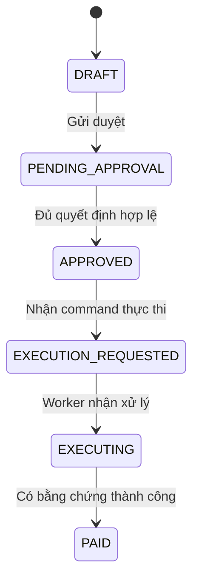

# Action endpoint authorization — Cấp quyền cho endpoint hành động nghiệp vụ

## 1. Quyền trên dữ liệu chưa phải quyền thực hiện mọi hành động

Một người được đọc lệnh chi không vì thế được phê duyệt nó. Người được sửa bản nháp không tự có quyền yêu cầu chuyển tiền. Quản trị viên tenant cũng không mặc nhiên là người có thẩm quyền xử lý mọi bước tài chính.

**Action endpoint authorization** là việc kiểm tra chủ thể có được thực hiện đúng hành động nghiệp vụ trên đúng đối tượng trong điều kiện hiện tại hay không, trước khi hệ thống nhận hiệu ứng của hành động đó.

Các endpoint như sau thường cần quyền riêng:

```text
POST /payment-requests/{id}/submissions
POST /payment-requests/{id}/approvals
POST /payment-requests/{id}/execution-requests
POST /payment-requests/{id}/cancellations
POST /orders/{id}/refunds
POST /documents/{id}/ownership-transfers
```

Không thể suy quyền của chúng chỉ từ `READ`, `UPDATE`, tên controller hoặc việc người gọi biết URL. OWASP mô tả việc gọi được chức năng ngoài thẩm quyền là một dạng broken function level authorization; đường dẫn có vẻ thông thường hay có chữ `admin` không tự xác định quyền. [OWASP API5: Broken Function Level Authorization](https://github.com/OWASP/API-Security/blob/master/editions/2023/en/0xa5-broken-function-level-authorization.md)

Bài học dùng action yêu cầu thực thi lệnh chi làm ví dụ để kết hợp quyền chức năng, quyền theo đối tượng, state machine, transaction và idempotency.

## 2. Phân biệt ba câu hỏi cấp quyền

| Câu hỏi | Ví dụ thất bại nếu bỏ qua |
| --- | --- |
| Chủ thể có được dùng chức năng này không? | Người chỉ xem hồ sơ gọi endpoint yêu cầu chuyển tiền |
| Chủ thể có được tác động đối tượng này không? | Người có năng lực thực thi ở A gọi lệnh chi thuộc B |
| Chủ thể có được yêu cầu thay đổi nội dung hoặc trường này không? | Payload thêm số tiền, người nhận hoặc cờ bỏ phê duyệt |

Ba lớp cần phối hợp. Một endpoint đúng role nhưng lấy đối tượng theo ID toàn cục không kiểm tra scope vẫn có thể bị truy cập ngang. Một endpoint kiểm tra owner nhưng mở mọi action vẫn có thể cho chủ hồ sơ tự duyệt trái chính sách.

Một quyết định đầy đủ có thể biểu diễn:

```text
được_nhận_action =
    danh_tính_hợp_lệ
    AND có_năng_lực_cho_action
    AND có_quyền_trên_đối_tượng_và_phạm_vi
    AND nội_dung_yêu_cầu_nằm_trong_hợp_đồng
    AND thỏa_điều_kiện_nghiệp_vụ_hiện_tại
```

Không có một điều kiện đơn lẻ nào trong đó thay thế tất cả phần còn lại.

## 3. Mô hình action bằng ý định nghiệp vụ

Một danh mục action nên có ý nghĩa rõ ràng:

| Action | Ý định | Không tự bao gồm |
| --- | --- | --- |
| `PAYMENT_READ` | Xem dữ liệu được phép | Sửa hoặc phê duyệt |
| `PAYMENT_EDIT_DRAFT` | Sửa những input draft được cho phép | Chọn trạng thái bất kỳ |
| `PAYMENT_SUBMIT` | Gửi nội dung vào vòng duyệt | Tự tạo quyết định duyệt |
| `PAYMENT_APPROVE` | Ghi quyết định theo thẩm quyền | Thay số tiền hoặc yêu cầu thực thi |
| `PAYMENT_EXECUTION_REQUEST` | Nhận một command thực thi đủ điều kiện | Bỏ kiểm tra approval hoặc sửa người nhận |
| `PAYMENT_CANCEL_REQUEST` | Yêu cầu hủy theo mốc nghiệp vụ | Xóa lịch sử hoặc hoàn tiền ngầm |
| `PAYMENT_RECONCILE` | Xử lý kết quả chưa rõ bằng bằng chứng phù hợp | Tự đánh dấu đã trả tiền không có chứng cứ |

Tên permission là lựa chọn của hệ thống. Điều quan trọng là nó biểu diễn đúng quyền và không che nhiều hành động có rủi ro khác nhau trong một nhãn `PAYMENT_UPDATE`.

### 3.1. Route phải được gắn với action phía server

Endpoint yêu cầu thực thi phải được ánh xạ vào action đã đăng ký. Không để client gửi `action=read` để được kiểm tra quyền đọc rồi handler lại thực hiện chuyển tiền.

Nếu có endpoint tổng quát như `/actions`, cần một tập action được đăng ký rõ, schema input riêng và policy riêng cho từng action. Không dispatch tùy ý theo tên method hoặc tên class do caller gửi.

### 3.2. Không có policy không có nghĩa được phép

Action mới hoặc rule không xác định phải có hành vi từ chối an toàn. OWASP khuyến nghị mặc định từ chối và kiểm tra permission trên từng request, thay vì coi các đường chưa khai báo là được phép. [OWASP Authorization Cheat Sheet](https://cheatsheetseries.owasp.org/cheatsheets/Authorization_Cheat_Sheet.html#deny-by-default)

Nếu nguồn policy lỗi hoặc timeout, không tự đổi thành `PERMIT` để luồng chạy tiếp. Lỗi không thể đánh giá khác với một quyền đã được cấp.

## 4. Ví dụ xuyên suốt: yêu cầu thực thi lệnh chi

State machine minh họa:



Các nhánh hủy, lỗi, từ chối và đối soát cần được bổ sung khi triển khai. Sơ đồ chỉ tập trung vào ranh giới nhận thực thi.

Một ma trận quyền minh họa:

| Chủ thể hoặc năng lực | Đọc | Sửa draft | Duyệt | Yêu cầu thực thi |
| --- | --- | --- | --- | --- |
| Reader | Theo scope | Không | Không | Không |
| Maker | Theo scope | Theo trạng thái và quan hệ | Không mặc định | Không mặc định |
| Approver | Theo scope | Không mặc định | Theo policy | Không mặc định |
| Releaser | Theo scope | Không mặc định | Không mặc định | Theo policy |
| Tenant administrator | Theo quyền được cấp riêng | Không mặc định | Không mặc định | Không mặc định |
| Execution worker | Theo command được giao | Không | Không | Không nhận ý định tùy ý thay người dùng |

Nếu tenant admin có khả năng tự gán role releaser, đó là một đường quyền gián tiếp cần được quản trị. Chỉ bỏ permission thực thi khỏi role admin không đủ để hứa rằng người quản trị không thể tiếp cận nó qua các chức năng cấp quyền hoặc quản lý danh tính.

## 5. Ngữ cảnh chủ thể và đối tượng phải đến từ nguồn có thẩm quyền

### 5.1. Chủ thể

Server cần xác định actor đã xác thực, tenant đang thao tác, membership và quyền hiệu lực theo cơ chế của hệ thống. Với dịch vụ gọi thay, giữ cả service principal và chủ thể được quy trách nhiệm.

Không lấy các field sau từ body làm nguồn cấp quyền:

```text
actorId
tenantAdmin
effectiveRole
approvedBy
onBehalfOf không được kiểm tra
skipAuthorization
```

Nếu hỗ trợ thao tác thay hoặc ủy nhiệm, đó là một cơ chế có scope và bằng chứng riêng, không phải quyền được tạo bởi một tham số tự khai.

### 5.2. Đối tượng

Lệnh chi cần được lấy trong phạm vi tenant đã kiểm tra. Sau đó policy còn phải xét đơn vị, quan hệ xử lý hoặc những điều kiện đối tượng khác; cùng tenant không có nghĩa được tác động mọi hồ sơ.

Một hợp đồng repository có thể là:

```java
requests.findByTenantAndId(verifiedTenantId, paymentRequestId);
```

Tên method phải khớp SQL thực tế. Một lần tra bằng ID toàn cục rồi quên kiểm tra phạm vi không được sửa bằng việc URL có thêm tenant ID.

### 5.3. Nhiều đối tượng trong cùng action

Với đường dẫn như:

```text
POST /orders/{orderId}/payments/{paymentId}/refunds
```

phải kiểm tra payment thuộc đúng order và cùng miền được phép. Quyền trên order không tự bao phủ một payment bất kỳ do client thay ID.

Với action chuyển hoặc gắn tài nguyên, cần policy cho nguồn và đích theo đúng nghiệp vụ. Không nhất thiết mọi loại đích đều yêu cầu cùng quyền đọc hoặc quyền sở hữu như nguồn, nhưng không được bỏ qua điều kiện đích được phép sử dụng.

## 6. Quyền hành động phải kết hợp trạng thái và phân tách nhiệm vụ

Trong ví dụ, quyền `PAYMENT_EXECUTION_REQUEST` chỉ là một điều kiện. Hồ sơ còn cần:

1. Đang ở `APPROVED`, chưa có command thực thi được nhận.
2. Expected version và approval round khớp.
3. Các quyết định phê duyệt thuộc đúng nội dung và còn đủ hiệu lực tại gate.
4. Chủ thể đáp ứng giới hạn thẩm quyền trên số tiền, đơn vị hoặc loại giao dịch.
5. Không vi phạm phân tách nhiệm vụ theo chính sách được chọn.
6. Những kiểm soát tài nguyên hoặc hạn mức bắt buộc đã được đáp ứng.

### 6.1. Không mặc định cùng một chính sách độc lập cho mọi tổ chức

Một quy trình có thể cấm maker nhận thực thi nhưng cho approver thực hiện bước release. Quy trình khác có thể cần một releaser độc lập với cả maker và người duyệt.

Cần mô tả rõ rule của hệ thống và đánh giá theo chủ thể chuẩn hóa. Không tự coi hai account hoặc hai role của cùng một người là hai người độc lập.

Lịch sử tham gia không biến mất khi một role bị gỡ. Nếu rule cấm tự xử lý công việc đã tạo, thay role hoặc đổi phiên không xóa xung đột đó.

### 6.2. Approval phải chứng minh đúng nội dung

Kiểm tra `state=APPROVED` không đủ nếu số tiền hoặc người nhận đã thay đổi sau quyết định. Bằng chứng cần ràng buộc content version, digest hoặc cấu trúc tương đương theo mô hình.

Với nhiều người duyệt, cần kiểm tra đủ vai trò, số chủ thể độc lập và hiệu lực của tập quyết định được dùng. Một người giữ nhiều role không tạo nhiều phiếu độc lập.

## 7. Thiết kế request theo ý định, không theo trạng thái đích

Ví dụ request:

```http
POST /payment-requests/request-123/execution-requests
Authorization: Bearer <access-token>
Idempotency-Key: 0a529216-c489-4a10-9beb-6c70fcf310d2
Content-Type: application/json

{
  "expectedVersion": 18,
  "approvalRound": 3
}
```

Request không cần gửi `state=EXECUTING`, số tiền, người nhận, tenant hay người phê duyệt. Server lấy dữ liệu từ đối tượng và snapshot có thẩm quyền, rồi tự quyết định transition.

`expectedVersion` và `approvalRound` là tiền đề cần kiểm tra, không phải giá trị client được quyền ghi vào hồ sơ để làm nó khớp.

Một response bất đồng bộ có thể chứa:

```json
{
  "executionRequestId": "exec-456",
  "paymentRequestId": "request-123",
  "stateAfterAcceptance": "EXECUTION_REQUESTED",
  "versionAfterAcceptance": 19,
  "acceptedAt": "2026-12-01T09:00:00Z"
}
```

Đó là biên nhận command đã được nhận sau commit, không phải chứng minh tiền đã chuyển. Client cần đọc trạng thái operation theo hợp đồng nếu muốn biết kết quả tiếp theo.

### 7.1. UI chỉ gợi ý, server vẫn quyết định

Một danh sách `allowedActions` trong response có thể giúp hiển thị nút đúng hơn, nhưng nó là snapshot giao diện. Quyền, trạng thái hoặc thời hạn có thể đổi trước khi người dùng bấm.

Không chấp nhận lại `allowedActions` từ client như bằng chứng. Nếu hệ thống dùng một permit có bảo vệ, permit cần ràng buộc chủ thể, action, đối tượng, nội dung, thời hạn và nghĩa vụ bằng giao thức riêng.

## 8. Đặt điểm thực thi quyền gần dữ liệu được bảo vệ

Có thể dùng gateway hoặc middleware cho các điều kiện chung, nhưng quyền theo đối tượng và điều kiện nghiệp vụ phải được thực thi ở nơi có đủ dữ liệu cần thiết. OWASP mô tả kiểm tra tại service như một cách giữ action, object và tenant gần tài nguyên được bảo vệ. [OWASP Authorization Patterns](https://cheatsheetseries.owasp.org/cheatsheets/Authorization_Patterns_Cheat_Sheet.html#service-level-authorization)

Một pipeline minh họa:

```text
Parse input theo hợp đồng
  → xác thực và xác định tenant
  → khóa hoặc lấy snapshot quyền và đối tượng theo giao thức
  → kiểm tra quyền đọc kết quả cũ nếu có
  → nhận diện retry đã được nhận
  → kiểm tra tiền đề của action mới
  → đánh giá policy theo ngữ cảnh có thẩm quyền
  → thực hiện các nghĩa vụ bắt buộc
  → ghi command, transition, audit và outbox
  → commit
```

Việc tách bộ đánh giá policy khỏi service không chuyển trách nhiệm thực thi sang bộ đánh giá. Nếu nó trả một nghĩa vụ bắt buộc mà caller không hỗ trợ, caller không được bỏ qua rồi tiếp tục như một quyết định cho phép hoàn chỉnh.

### 8.1. Phân biệt điều kiện quyền với dữ liệu cần ghi

Một kết quả policy có thể cho phép nhận command, yêu cầu giữ chỗ tài nguyên cục bộ hoặc audit bắt buộc. Các bước đó phải thực sự được bảo đảm trong giao thức nhận command.

Một cờ `authorized=true` không thay việc thực hiện nghĩa vụ. Cũng không tự có nghĩa server được dùng một số tiền khác hoặc một đối tượng khác với input đã được đánh giá.

## 9. Ví dụ Java: nhận command thực thi có kiểm tra action

### 9.1. Giả định

Ví dụ dùng Spring transaction và một cơ sở dữ liệu cho hồ sơ, approval, command, dữ liệu quyền cục bộ cần thiết, audit và outbox.

- Guard quyết định bảo vệ những dữ liệu quyền và policy cục bộ theo một giao thức tương thích với đường thay đổi chúng.
- Mọi thay đổi approval và nội dung liên quan khóa cùng payment request hoặc dùng cơ chế nhất quán tương đương.
- Policy đánh giá ở một mốc gate server lấy sau các điểm chờ khóa cần thiết.
- Ví dụ chọn hợp đồng cấp quyền lúc nhận command; công việc đã được nhận được theo dõi bằng command riêng.
- Những reservation trong ví dụ, nếu cần, chỉ là dữ liệu cục bộ cùng transaction. Tài nguyên ở dịch vụ khác cần giao thức bổ sung.
- Không gọi nhà cung cấp chuyển tiền trong transaction nhận command.

Các giả định này cần được hiện thực hóa. Annotation transaction không tự tạo chúng và không làm IAM hoặc dịch vụ tài nguyên bên ngoài thành một phần của cùng transaction.

### 9.2. Service minh họa

Các repository, policy và kiểu dữ liệu cần được triển khai; constructor injection được lược bỏ. Đây không phải ứng dụng thanh toán hoàn chỉnh có thể chạy độc lập.

```java
@Service
public class PaymentExecutionRequestService {
    private final AuthorizationDecisionGuard decisionGuard;
    private final PaymentRequestRepository requests;
    private final ApprovalRepository approvals;
    private final ExecutionAuthorizationSnapshotLoader authorizationSnapshots;
    private final ExecutionRequestPolicy policy;
    private final ExecutionObligationSupport obligations;
    private final ExecutionCommandRepository commands;
    private final IdempotencyRepository idempotency;
    private final DatabaseTimeSource databaseTime;
    private final WorkflowAuditRepository audits;
    private final OutboxRepository outbox;
    private final CommandFingerprint fingerprints;

    @Transactional(rollbackFor = Exception.class)
    public ExecutionRequestReceipt requestExecution(
            VerifiedActor actor,
            RequestPaymentExecutionCommand command) {

        actor.requireAuthenticated();
        command.validateSyntaxAndBounds();

        decisionGuard.lockForDecision(actor.tenantId());

        PaymentRequest current = requests.lockForUpdate(
                actor.tenantId(), command.paymentRequestId())
            .orElseThrow(PaymentRequestNotFoundException::new);

        // Quyền đọc biên nhận không đồng nghĩa quyền tạo command mới.
        policy.requireCurrentReceiptAccess(actor, current);

        CommandScope keyScope = new CommandScope(
                actor.tenantId(), current.id(),
                actor.canonicalSubjectId(),
                "PAYMENT_EXECUTION_REQUEST", command.idempotencyKey());
        String fingerprint = fingerprints.forExecutionRequest(command);

        var previous = idempotency.find(keyScope);
        if (previous.isPresent()) {
            if (!previous.get().fingerprint().equals(fingerprint)) {
                throw new IdempotencyConflictException();
            }
            return previous.get().receipt();
        }

        current.requireApprovedAtVersion(
                command.expectedVersion(), command.approvalRound());

        ApprovalSet approvalSet = approvals.loadForGateUnderParentLock(
                actor.tenantId(), current.id());
        ExecutionAuthorizationSnapshot authorization =
                authorizationSnapshots.loadComplete(actor, current);
        authorization.requireValidAndComplete();

        Instant checkedAt = databaseTime.currentInstant();

        ExecutionAuthorizationDecision decision = policy.evaluate(
                actor, current, approvalSet, authorization, checkedAt);
        if (!decision.isPermit()) {
            throw decision.toDomainException();
        }

        obligations.requireSupported(decision.obligations());
        obligations.reserveRequiredLocalResources(
                actor, current, decision, checkedAt);

        UUID executionId = UUID.randomUUID();
        commands.insertAccepted(
                executionId, current.paymentIntentId(),
                current.immutableExecutionSnapshot(),
                actor.canonicalSubjectId(), decision, checkedAt);

        int changed = requests.claimApprovedForExecution(
                actor.tenantId(), current.id(), current.version(),
                current.approvalRound(), current.contentDigest(),
                executionId, checkedAt);
        if (changed != 1) {
            throw new ConcurrentPaymentTransitionException();
        }

        audits.appendExecutionRequestAccepted(
                actor, current, executionId, decision, checkedAt);
        outbox.appendExecutePayment(
                UUID.randomUUID(), actor.tenantId(), executionId);

        ExecutionRequestReceipt receipt = new ExecutionRequestReceipt(
                executionId, current.id(),
                PaymentState.EXECUTION_REQUESTED,
                current.version() + 1, checkedAt);
        idempotency.insert(keyScope, fingerprint, receipt);
        return receipt;
    }
}
```

Các dependency `final` phải được khởi tạo bằng constructor. Với Spring transaction qua proxy thông thường, lời gọi phải đi qua bean được quản lý và các repository phải dùng đúng transaction manager.

`policy.evaluate()` phải kiểm tra permission đúng action, scope đối tượng, thẩm quyền trên giao dịch, phân tách nhiệm vụ và tập approval theo policy. Nó không chỉ kiểm tra người dùng đã đăng nhập hoặc có một role chung.

`toDomainException()` cần giữ loại thất bại để lớp API phân biệt thiếu thẩm quyền, không đủ bằng chứng, trạng thái không phù hợp và không thể đánh giá policy. Không đổi mọi tình huống thành một lỗi quyền chung hoặc mặc định cho phép khi có exception.

### 9.3. Cập nhật transition có điều kiện

```sql
UPDATE payment_request
SET state = 'EXECUTION_REQUESTED',
    execution_ref = :executionId,
    execution_requested_at = :checkedAt,
    version = version + 1
WHERE tenant_id = :tenantId
  AND id = :paymentRequestId
  AND state = 'APPROVED'
  AND version = :expectedVersion
  AND approval_round = :approvalRound
  AND content_digest = :contentDigest
  AND execution_ref IS NULL;
```

Các dấu `:` là tham số bind của lớp truy cập dữ liệu. Thành công phải cập nhật đúng một dòng.

Câu lệnh này không tự kiểm tra toàn bộ quyền và approval. Nó là phần bảo vệ ghi trong giao thức đã khóa đối tượng và đánh giá policy. Không sao chép SQL rồi bỏ các giả định bảo vệ ở service.

Trong mẫu, command được ghi trước khi hồ sơ tham chiếu nó; nếu cập nhật thất bại, transaction phải rollback command, reservation và những bản ghi bắt buộc liên quan.

## 10. Điểm cấp quyền, thời gian và cuộc đua

### 10.1. Chọn rõ mốc hiệu lực

Ví dụ dùng `checkedAt` làm gate sau khi đã có các khóa và snapshot cần thiết. Chỉ transaction commit thành công mới nhận command.

Nếu approval phải còn hiệu lực tại gate, policy kiểm tra khoảng thời gian ở mốc đó. Không lấy `clientTime`, thời điểm người dùng mở màn hình hoặc mốc trước khi chờ khóa làm quyền thực thi.

Gate không đồng nghĩa thời điểm nhà cung cấp nhận lệnh. Nếu hợp đồng yêu cầu hiệu lực đến dispatch hoặc đến bên ngoài chấp nhận, cần kiểm soát bổ sung phù hợp ở ranh giới đó.

### 10.2. Những thay đổi cạnh tranh cần xét

| Thay đổi cạnh tranh | Điều phải bảo vệ |
| --- | --- |
| Sửa số tiền hoặc người nhận | Không nhận command bằng approval của nội dung cũ |
| Thu hồi approval | Không dùng snapshot đã mất hiệu lực ngoài hợp đồng |
| Thu hồi quyền releaser | Quyết định tuân theo nguồn có thẩm quyền tại gate và độ trễ được chấp nhận |
| Yêu cầu hủy | Không cùng nhận hủy trước thực thi và nhận lệnh chi trái giao thức |
| Hai request thực thi | Không tạo hai nghĩa vụ chi cho cùng intent bị giới hạn |

Các đường thay đổi phải dùng giao thức tương thích. Khóa ở service thực thi không đủ nếu một script hoặc endpoint khác có thể sửa dữ liệu liên quan mà không tuân theo quy tắc.

### 10.3. Quyền ngoài hệ thống cục bộ

Nếu role hoặc membership đến từ IAM ngoài, cần xác định snapshot nào được chấp nhận và độ trễ thu hồi. Một token cũ không tự biết có quyền vừa bị thu hồi.

Nếu không đáp ứng được mức nhất quán mà action yêu cầu, không nên tự suy ra vẫn có quyền. Có thể cần kiểm tra trực tiếp, permit giới hạn hoặc một quy trình khác được thiết kế rõ ràng.

## 11. Idempotency không được trở thành một đường cấp quyền

### 11.1. Đọc kết quả cũ khác với nhận một action mới

Mẫu code cho phép đọc receipt đã lưu sau khi kiểm tra quyền đọc hiện tại trên đối tượng. Lần đọc đó không tạo command mới và không dùng lại permission cũ để thực hiện một khoản chi khác.

Một hệ thống có thể yêu cầu quyền chặt hơn khi đọc receipt; điều đó cần được nêu trong hợp đồng. Trong mọi trường hợp, idempotency key không tự là credential.

### 11.2. Cùng key nhưng khác nội dung

Fingerprint cần ràng buộc action, đối tượng và những dữ liệu xác định ý định, gồm expected version hoặc approval round theo hợp đồng ví dụ.

Cùng key nhưng đổi nội dung phải bị xử lý như xung đột, không tái diễn giải command cũ. Không tự đổi key khi kết quả lần trước chưa rõ chỉ để endpoint chấp nhận lại.

### 11.3. Key mới không vượt bất biến nghĩa vụ

Nếu một payment intent chỉ được thực hiện một lệnh thanh toán chính, cần ràng buộc phù hợp theo intent và loại hiệu ứng. Chỉ unique theo idempotency key hoặc approval round là chưa đủ.

Nếu nghiệp vụ cho thanh toán nhiều phần, phải mô hình hóa các nghĩa vụ phần và số tiền đã nhận xử lý. Không áp dụng một unique constraint đơn giản rồi khẳng định nó đúng cho mọi loại thanh toán.

Các lần thử, retry và đối soát của cùng hiệu ứng phải dùng định danh bền vững phù hợp, không tạo một nghĩa vụ mới chỉ vì approval hoặc key đã đổi.

## 12. Worker phải xử lý đúng quyền đã được nhận

Một service account có thể có quyền kỹ thuật gọi nhà cung cấp, nhưng không được dùng nó để chấp nhận tùy ý những payment ID trong queue.

Message nên tham chiếu execution command đã được nhận bền vững. Worker kiểm tra nguồn message, tenant, trạng thái command và nội dung được ràng buộc trước khi thực hiện.

Không để payload message thay người nhận, số tiền hoặc payment intent khác với snapshot mà policy đã đánh giá.

### 12.1. Hai hợp đồng về quyền sau khi xếp hàng

| Hợp đồng | Ý nghĩa |
| --- | --- |
| Quyền xác lập khi nhận command | Command hợp lệ trở thành công việc hệ thống, tiếp tục theo trạng thái và điều kiện riêng |
| Bắt buộc đánh giá lại trước bước nhạy cảm | Worker phải lấy quyền hoặc ngữ cảnh mới trước bước đó, theo giao thức được thiết kế |

Ví dụ trong bài chọn hợp đồng đầu cho điểm nhận. Một sản phẩm có thể cần thêm hạn gửi lệnh hoặc kiểm tra lại, nhưng phải mô hình hóa rõ chứ không giả định session còn sống đến lúc worker chạy.

Nếu đã gửi nhà cung cấp và chưa biết kết quả, việc mất quyền hoặc hết hạn approval không chứng minh lệnh thất bại. Không đưa hồ sơ về trạng thái cho phép chi lại; phải đối soát command gốc.

### 12.2. Dịch vụ gọi thay cần giữ chuỗi trách nhiệm

Quyền kết quả phải phù hợp cả năng lực kỹ thuật được giao và thẩm quyền của ý định đã nhận. Không lấy hợp toàn bộ quyền người dùng với toàn bộ quyền service account để tạo một quyền rộng hơn.

Audit cần giữ người khởi tạo, người yêu cầu action, những chủ thể phê duyệt và service thực thi theo đúng trách nhiệm của từng bước.

## 13. Mọi đường vào cùng action phải giữ cùng ngữ nghĩa

### 13.1. HTTP method và URL

Mapping phải giới hạn method của action và từ chối đường ngoài hợp đồng trước khi tạo hiệu ứng. Tuy nhiên, đúng POST hoặc có `/admin/` trong URL không thay kiểm tra quyền.

GET phục vụ đọc không được gọi một helper vừa đọc vừa tự phê duyệt hoặc nhận thực thi. Alias, phiên bản API cũ và đường hỗ trợ phải được xem như những điểm vào thật sự.

### 13.2. Endpoint tổng quát và tham số điều khiển

Những field như `force`, `mode=admin`, `skipApproval` hoặc `actionOverride` không được làm policy bỏ một điều kiện mà caller không có quyền thay đổi.

Nếu có một action phục hồi đặc biệt, hãy mô hình hóa nó thành năng lực có scope và bằng chứng riêng. Không coi quyền sửa trạng thái là quyền giả lập thành công một khoản chi.

### 13.3. Batch và import

Batch cần kiểm tra action và đối tượng cho từng phần tử. Quyền trên phần tử đầu không bao phủ toàn bộ danh sách, kể cả khi tất cả ID đều đúng kiểu.

Nếu có tài nguyên hoặc hạn mức tổng, những phần tử hợp lệ riêng lẻ vẫn cần được nhận theo một giao thức bảo vệ tổng. Kết quả toàn bộ hoặc từng phần phải phản ánh đúng những command thực sự được nhận.

Import nội bộ không được chèn trực tiếp trạng thái `EXECUTION_REQUESTED` để bỏ service nhận command. Nếu có đường đặc biệt, nó cần bảo đảm tương đương và bằng chứng riêng.

### 13.4. Callback và webhook

Nhà cung cấp được phép báo kết quả cho một execution command không có nghĩa được gọi mọi action nội bộ. Event type phải được ánh xạ vào chức năng được hỗ trợ, không dispatch theo action tùy ý trong payload.

Nguồn hợp lệ, quan hệ command, tenant và nội dung vẫn phải được kiểm tra. Một timestamp hoặc cờ `authorized` do bên gửi khai không tự tạo quyền mới.

## 14. Phản hồi và audit phải giữ đúng sự thật về action

Những nhóm kết quả cần phân biệt:

| Tình huống | Ý nghĩa |
| --- | --- |
| Không xác thực được | Chưa có danh tính hợp lệ cho action cần xác thực |
| Không có quyền action hoặc đối tượng | Không được tạo hiệu ứng; hạn chế chi tiết theo quyền đọc |
| Đúng quyền nhưng version hoặc state không phù hợp | Client cần đọc lại hoặc đi theo transition khác |
| Không đủ approval hoặc bằng chứng | Chưa đạt điều kiện nhận thực thi |
| Nguồn policy không dùng được | Không thể đánh giá đủ, không mặc định cho phép |
| Command đã được nhận | Trả receipt hoặc trạng thái theo hợp đồng, không gọi là chưa làm gì |
| Kết quả thực thi chưa rõ | Theo dõi hoặc đối soát, không hướng client tạo khoản chi mới |

Có thể dùng 403, 404, 409 hoặc các mã lỗi thích hợp theo chính sách API, nhưng mã HTTP không tự bảo đảm không có hiệu ứng. Một response từ chối sau khi đã phát command vẫn là hành vi sai.

### 14.1. Không làm lộ đối tượng ngoài phạm vi

Caller thiếu quyền không cần biết số tiền, người nhận, owner hoặc người duyệt đang thiếu của hồ sơ khác. Error code công khai có thể tổng quát, còn reason nội bộ được lưu theo quyền điều tra.

### 14.2. Audit một lần nhận action

Audit nên liên kết actor chuẩn hóa, tenant, action, đối tượng, version, content digest, policy revision, approval ID được dùng, thời điểm gate và execution command.

Không chỉ ghi `allowed=true`. Cần đủ dữ liệu để giải thích quyền đến từ đâu và điều kiện nào đã được đánh giá, nhưng không ghi token, secret hoặc toàn bộ dữ liệu thanh toán nhạy cảm vào log.

Audit thành công và outbox bắt buộc phải commit cùng lần nhận command cục bộ. Các lần thử bị từ chối có thể cần đường ghi riêng vì transaction rollback không giữ bản ghi cùng transaction đó.

## 15. Policy thay đổi, cache và giới hạn quyết định được dùng lại

### 15.1. Cache phải ràng buộc đúng action

Một kết quả `canAccess(payment)=true` quá rộng không đủ cho approve, cancel và execute. Cache cần ngữ nghĩa về chủ thể, action, resource, tenant cùng những phiên bản hoặc giới hạn hiệu lực cần thiết.

Không tái dùng một permit của số tiền nhỏ hoặc content version cũ cho nội dung đã thay đổi. Quyết định đã ký cũng không tự mở rộng sang một action khác.

### 15.2. Quyền mới hoặc endpoint mới cần cấu hình rõ

Khi thêm action, cần xác định chủ thể, scope, điều kiện và test trước khi mở đường gọi. Không để nó kế thừa một rule controller quá chung như “đã đăng nhập là được”.

Một người có quyền tạo hoặc sửa role cũng có thể mở năng lực mới gián tiếp. Thay permission, hierarchy hoặc mapping nhóm cần được xem xét theo trần quản trị và tổ hợp nhiệm vụ.

### 15.3. Độ trễ thu hồi phải được công bố đúng

Token tự chứa, cache hoặc replica có thể tiếp tục mang dữ liệu cũ. Cần cơ chế đáp ứng yêu cầu thu hồi của action; không chỉ giảm TTL rồi mô tả là tức thời.

Khi dùng snapshot ở gate, lưu revision và bằng chứng cần thiết để giải thích quyết định. Không dùng cấu hình hiện tại để diễn giải lại như thể nó đã áp dụng cho mọi command trong quá khứ.

## 16. Kiểm thử quyền endpoint hành động

### 16.1. Đối chứng hợp lệ và ma trận chủ thể

Chuẩn bị một hồ sơ đủ điều kiện, approval dùng được, version đúng và actor releaser độc lập theo policy. Trước tiên chứng minh action hợp lệ được nhận đúng một lần.

Sau đó giữ các tiền đề còn lại hợp lệ và thay từng yếu tố:

| Tình huống | Kết quả cần chứng minh |
| --- | --- |
| Reader gọi execution-request | Quyền đọc không biến thành quyền nhận thực thi |
| Maker hoặc approver không có năng lực releaser | Không được phép chỉ vì đã tham gia workflow |
| Tenant admin không có quyền nghiệp vụ tương ứng | Không có đường bỏ kiểm tra theo tên admin |
| Releaser đúng tenant nhưng sai đơn vị | Action bị giới hạn theo đối tượng |
| Releaser A dùng ID hồ sơ B | Không đọc hoặc tác động ngoài tenant |
| Actor có role nhưng vi phạm SoD | Không nhận command trái quy tắc độc lập |
| Actor dùng tài khoản thứ hai cùng chủ thể | Không tạo sự độc lập giả |
| Caller tự gửi role hoặc `authorized=true` | Không thay ngữ cảnh tin cậy |

Nếu request nền đã bị chặn bởi CSRF, parser, thiếu body hoặc version sai, test chưa chứng minh hàng rào quyền action. Các lỗi đó cần test riêng.

### 16.2. Trạng thái, nội dung và bằng chứng

1. Gọi thẳng action thực thi từ DRAFT hoặc PENDING_APPROVAL.
2. Dùng approval của vòng cũ hoặc nội dung khác.
3. Thay số tiền hoặc người nhận rồi giữ nguyên trạng thái APPROVED.
4. Dùng approval đã bị thu hồi hoặc hết hạn theo mốc gate.
5. Một người có nhiều role được đếm thành nhiều người duyệt.
6. Đổi nested resource ID để dùng payment hoặc bằng chứng của hồ sơ khác.
7. Gửi thêm field trạng thái, người nhận hoặc số tiền ngoài hợp đồng.
8. Policy không xác định hoặc có obligation bắt buộc không hỗ trợ.

Trong mọi trường hợp bị từ chối, kiểm tra không có execution command, reservation hay sự kiện thành công trái phép. Audit an ninh của lần thử có thể được phép theo policy riêng.

### 16.3. Concurrency và transaction

Dùng transaction độc lập cùng barrier hoặc latch để tạo lịch cụ thể, không dựa vào `sleep`.

```text
A. Hai request thực thi cạnh tranh cùng hồ sơ.
   Kết quả: không tạo hai command hoặc hai nghĩa vụ trái quy tắc.

B. Một request nhận thực thi, một transaction thu hồi approval.
   Kết quả: quyết định theo thứ tự và gate được bảo vệ,
   không dùng snapshot ngoài hợp đồng nhất quán.

C. Maker sửa nội dung trong lúc releaser chờ khóa.
   Kết quả: không nhận command của nội dung mới bằng approval cũ.

D. Quyền releaser bị thu hồi hoặc scope đổi trong lúc request chạy.
   Kết quả: bảo đảm đúng theo nguồn quyền và điểm quyết định đã định nghĩa.
```

Chèn lỗi tại bước audit hoặc outbox bắt buộc để kiểm tra rollback cả command và tài nguyên cục bộ đã giữ. Test phải đọc lại trạng thái sau ranh giới transaction thực, không chỉ xem entity còn trong cache test.

### 16.4. Retry, worker và các điểm vào khác

| Tình huống | Kết quả cần chứng minh |
| --- | --- |
| Mất response sau commit | Cùng key trả command cũ, không nhận hiệu ứng mới |
| Cùng key nhưng đổi version, vòng hoặc đối tượng theo phạm vi key | Xung đột theo fingerprint của hợp đồng |
| Key mới trên intent đã có lệnh bị giới hạn duy nhất | Không vượt ràng buộc nghĩa vụ |
| Quyền tạo action mất nhưng còn quyền đọc receipt | Chỉ đọc kết quả cũ theo policy, không tạo quyền mới |
| Quyền đọc receipt cũng mất | Key không thành credential |
| Worker nhận message thay amount hoặc tenant | Không thực hiện khác command được ràng buộc |
| Provider timeout | Không mở đường tạo lệnh chi mới trước đối soát |
| Alias, batch, import hoặc công cụ hỗ trợ | Không có đường action ít kiểm tra hơn |

Mock policy trả `PERMIT` cho mọi request không chứng minh phân quyền đã đúng. Giữ logic cấp quyền và những dữ liệu cần kiểm tra ở tầng phù hợp; chỉ stub các ranh giới không phải mục tiêu như provider bên ngoài.

## 17. Các lỗi thiết kế cần tránh

| Cách làm | Vì sao gây lỗ hổng nghiệp vụ | Hướng thay thế |
| --- | --- | --- |
| Có READ hoặc UPDATE thì được dùng mọi action | Gộp những thẩm quyền khác nhau | Permission theo ý định nghiệp vụ |
| Biết URL là đủ để gọi | Endpoint có thể bị gọi trực tiếp | Kiểm tra phía server trên mỗi action |
| Role đúng nhưng không kiểm tra đối tượng | Có thể dùng quyền ở scope khác | Tenant, quan hệ và thuộc tính có thẩm quyền |
| Owner được tự duyệt hoặc tự thực thi | Phá rule độc lập nếu policy cấm | SoD theo chủ thể và lịch sử |
| State APPROVED là đủ | Approval có thể cũ, hết hạn hoặc không khớp | Đánh giá tập bằng chứng tại gate |
| Client gửi state đích, actor hoặc cờ bypass | Người gọi tự tạo điều kiện được phép | Command hẹp và dữ liệu server quản lý |
| Controller đã có annotation nên service không cần guard | Queue và đường khác có thể đi vòng | Thực thi quyền gần action được bảo vệ |
| Policy lỗi thì cho tiếp tục | Không đánh giá được biến thành đủ quyền | Từ chối thực thi và phân loại lỗi phù hợp |
| Permit cho đối tượng A được dùng cho B | Quyết định không còn đúng phạm vi | Ràng buộc action, subject, resource và nội dung |
| Key mới là quyền thực hiện lại | Có thể tạo nghĩa vụ trùng | Idempotency cùng ràng buộc nghiệp vụ |
| Service account được tin mọi payload | Dịch vụ thành trung gian vượt quyền | Command bền vững và chuỗi quy trách nhiệm |
| Báo lỗi sau khi phát lệnh | Response không phản ánh hiệu ứng thật | Kiểm tra trước nhận, transaction và outbox |

## 18. Bài tập thiết kế

Thiết kế action yêu cầu thực thi lệnh chi cho hệ thống nhiều tenant có maker, approver, releaser, tenant admin và execution worker. Lệnh chi phải có đủ approval đúng nội dung, được nhận một lần theo payment intent và có thể được xử lý bất đồng bộ.

Hãy mô tả:

1. Action có permission riêng nào và vì sao READ, UPDATE hoặc APPROVE không tự bao gồm nó?
2. Tenant, đối tượng và mọi tham chiếu liên quan được kiểm tra từ nguồn nào?
3. SoD dựa trên chủ thể và lịch sử nào, kể cả khi một người có nhiều account?
4. Tập approval, version và content digest được kiểm tra tại gate nào?
5. Command, transition, reservation cục bộ, audit và outbox commit ra sao?
6. Retry đọc receipt khác với nhận một action mới thế nào?
7. Worker sử dụng quyền đã được nhận hay phải đánh giá lại, và xử lý mất quyền hoặc timeout theo hợp đồng nào?
8. Những test nào chứng minh không có đường qua alias, batch, import hoặc quyền admin để bỏ các điều kiện đó?

Một thiết kế đạt yêu cầu phải giải thích được ai được yêu cầu hành động nào, trên đối tượng nào và trong điều kiện nào, đồng thời bảo đảm chỉ những ý định đã được cấp quyền đúng mới trở thành hiệu ứng nghiệp vụ bền vững.
