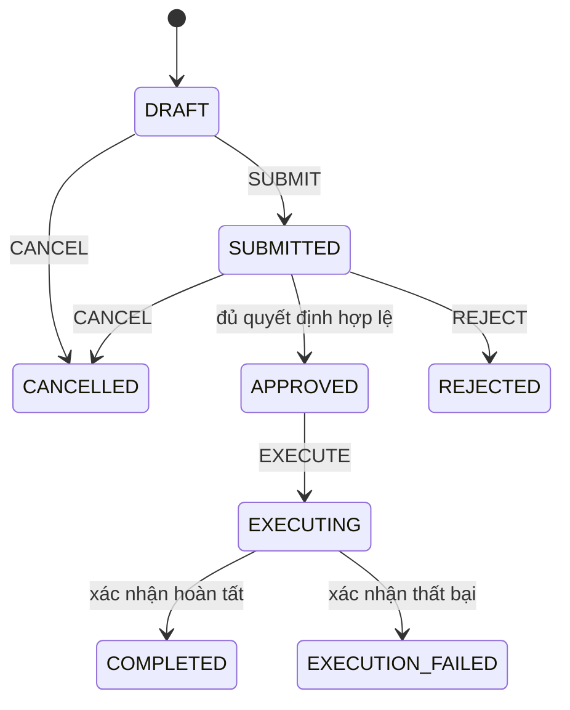
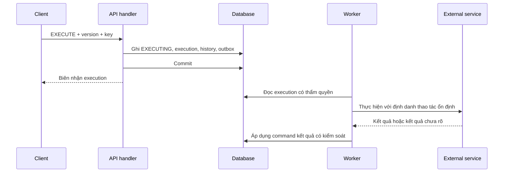

# Chuyển trạng thái nghiệp vụ qua API (API state transition)

Một API thay đổi trạng thái có thể làm phát sinh phê duyệt, mua hàng, thanh toán hoặc cấp quyền. Nếu nó chỉ nhận một chuỗi status rồi lưu, người gọi có thể bỏ qua bước, tự khai đã được duyệt hoặc ghi đè kết quả của một lệnh khác.

Vấn đề không được giải quyết chỉ bằng cách đặt tên endpoint là approve hay execute. Máy chủ cần xác định ai được thực hiện lệnh nào trên đối tượng nào, từ trạng thái nào, với phiên bản nội dung và bằng chứng gì; sau đó ghi nhận kết quả cùng các tác dụng liên quan một cách nhất quán.

Bài học thuộc chương **API Business Rules** trong bảo mật logic nghiệp vụ. Trọng tâm là thiết kế hợp đồng API gắn với state machine và bảo vệ nó trước gọi thẳng endpoint, sửa tham số, dữ liệu cũ, yêu cầu trùng và xử lý bất đồng bộ.

## 1. Bắt đầu từ ý định và chuyển trạng thái

Một chuyển trạng thái nghiệp vụ không chỉ là phép gán:

```text
request.state = input.state
```

Nó có thể được mô tả:

```text
Transition:
    command
    sourceState
    actor và quyền
    dữ kiện, bằng chứng và guard
    targetState
    thay đổi đi kèm
    tác dụng phải điều phối
```

Ví dụ, thực thi đề nghị mua hàng đã được duyệt cần kiểm tra nội dung vẫn khớp quyết định, người thực hiện có quyền và chưa có execution được chấp nhận cho vòng nghiệp vụ đó.

### 1.1. Command khác với trạng thái đích

| Dữ kiện | Ý nghĩa |
|---|---|
| Command APPROVE | Người gọi đề nghị ghi một quyết định phê duyệt |
| Trạng thái APPROVED | Quy trình đã đáp ứng điều kiện để được coi là duyệt xong |
| Command EXECUTE | Đề nghị bắt đầu một hành động sau phê duyệt |
| Trạng thái EXECUTING | Execution đã được chấp nhận và chưa có kết quả cuối |
| Trạng thái COMPLETED | Các bằng chứng hoàn tất theo hợp đồng đã được xác nhận |

Trong quy trình nhiều người duyệt, một command APPROVE có thể ghi quyết định nhưng vẫn để trạng thái SUBMITTED. Chỉ khi đủ điều kiện tổng hợp mới chuyển thành APPROVED.

Tương tự, endpoint nhận lệnh thực thi không được nói đã hoàn tất chỉ vì đã đưa message vào hàng đợi.

### 1.2. Cùng trạng thái vẫn có thay đổi có ý nghĩa

Sửa bản nháp hoặc ghi thêm một quyết định chưa đủ quorum có thể không đổi tên state, nhưng vẫn làm thay đổi version, nội dung hoặc bằng chứng.

Không dùng điều kiện “state trước bằng state sau” để bỏ qua quyền, audit hoặc kiểm soát cạnh tranh cho những hành động đó.

## 2. Mô hình quy trình minh họa

Xét một đề nghị mua hàng nội bộ:

| Trạng thái | Ý nghĩa |
|---|---|
| DRAFT | Đang soạn nội dung |
| SUBMITTED | Nội dung đã chốt để xét duyệt |
| APPROVED | Đã đủ phê duyệt cho nội dung cụ thể |
| EXECUTING | Đã chấp nhận một execution sau phê duyệt |
| COMPLETED | Đã xác nhận kết quả cuối theo hợp đồng |
| REJECTED | Đề nghị bị từ chối theo quy trình |
| CANCELLED | Được hủy ở giai đoạn chính sách cho phép |
| EXECUTION_FAILED | Có kết quả thất bại xác định của execution theo chính sách |



Đây là quy trình ví dụ, không phải state machine bắt buộc của mọi hệ thống. Nó chưa định nghĩa mở lại, thu hồi phê duyệt hoặc thực thi lại sau thất bại; nếu cần, phải thêm lệnh và điều kiện rõ ràng.

### 2.1. Một cạnh cần cả guard và thẩm quyền

Ví dụ:

| Command | Nguồn | Đích trong ví dụ | Một số điều kiện |
|---|---|---|---|
| SUBMIT | DRAFT | SUBMITTED | Người gửi có quyền, nội dung hợp lệ, chốt snapshot |
| APPROVE | SUBMITTED | APPROVED khi đủ điều kiện | Đúng người, hạn mức, revision và tính độc lập |
| REJECT | SUBMITTED | REJECTED | Quyền ra quyết định, lý do theo hợp đồng |
| CANCEL | DRAFT hoặc SUBMITTED | CANCELLED | Đúng phạm vi và chính sách hủy |
| EXECUTE | APPROVED | EXECUTING | Quyền thực thi, phê duyệt còn phù hợp, chưa có execution xung đột |
| CONFIRM_COMPLETION | EXECUTING | COMPLETED | Nguồn kết quả có thẩm quyền, đúng execution và nội dung |

Một vai trò mạnh không tự tạo cạnh DRAFT → COMPLETED. Một lệnh hợp lệ về cấu trúc không tự có guard hoặc quyền tương ứng.

### 2.2. Timeout không phải một cạnh thành công hoặc thất bại chắc chắn

Một execution timeout có thể đã xảy ra ở bên ngoài nhưng chưa xác nhận được. Không tự chuyển COMPLETED hoặc EXECUTION_FAILED chỉ để kết thúc trạng thái chờ.

Cần lưu trạng thái thao tác như chưa rõ kết quả trong mô hình execution và đối soát theo định danh ổn định. Chỉ dùng cạnh cuối khi có bằng chứng đáp ứng hợp đồng.

## 3. Thiết kế hợp đồng API theo lệnh

Một nhóm endpoint có thể là:

```text
POST  /purchase-requests
PATCH /purchase-requests/{id}/draft-content
POST  /purchase-requests/{id}/submit
POST  /purchase-requests/{id}/approve
POST  /purchase-requests/{id}/reject
POST  /purchase-requests/{id}/cancel
POST  /purchase-requests/{id}/execute
```

Các đường dẫn chỉ là lựa chọn biểu đạt của API minh họa. Quy tắc phải được thực thi tại ranh giới ứng dụng hoặc miền dùng chung, không phụ thuộc tên route.

### 3.1. Đầu vào thể hiện ý định, không tự khai kết quả

Ví dụ lệnh thực thi:

```http
POST /purchase-requests/PR-410/execute
Idempotency-Key: execute-pr410-attempt-01
Content-Type: application/json

{
  "expectedVersion": 12
}
```

Máy chủ xác định actor, tenant, trạng thái nguồn, nội dung được duyệt, executionId và trạng thái đích.

Những dữ kiện sau không được tự nhận làm thẩm quyền:

```json
{
  "fromState": "APPROVED",
  "toState": "COMPLETED",
  "approvedBy": "director-01",
  "role": "EXECUTOR",
  "skipApproval": true,
  "amount": 1
}
```

Nếu API thật sự nhận một số thông tin này cho mục đích khác, cần schema cùng quyền rõ. Chúng không được ghi đè nguồn quyết định của lệnh thực thi.

### 3.2. Vì sao cập nhật status tổng quát dễ sai?

Một endpoint PATCH cho mọi field entity có thể cho phép người gọi gửi status APPROVED hoặc sửa approvedContentRevision.

Kiểm tra giá trị thuộc enum chỉ xác nhận tên state được biết. Nó không chứng minh:

- Có cạnh từ trạng thái hiện tại.
- Người gọi có thẩm quyền thực hiện cạnh.
- Nội dung đã được xét đúng.
- Không có execution hoặc quyết định xung đột.
- Các tác dụng đi kèm đã được điều phối.

Nếu phải duy trì một API tổng quát cũ, cần ánh xạ thay đổi trạng thái thành các lệnh được kiểm soát và chạy đủ policy. Không để status setter trở thành đường riêng bỏ qua state machine.

### 3.3. Phản hồi nói đúng mốc được chấp nhận

Sau khi chấp nhận EXECUTE, một payload có thể là:

```json
{
  "requestId": "PR-410",
  "state": "EXECUTING",
  "version": 13,
  "executionId": "EXE-820",
  "executionStatus": "PENDING_DISPATCH"
}
```

Payload này không nói mua hàng hoặc thanh toán bên ngoài đã xong. Client cần theo dõi kết quả theo contract.

Nếu API trả biên nhận command, cần phân biệt nó với trạng thái hiện tại của toàn quy trình. Biên nhận cũ vẫn là kết quả của mốc xử lý trước dù state hiện tại đã tiến thêm.

## 4. Tập trung policy ở nơi mọi đường ghi phải đi qua

Một quyết định chuyển có thể được mô tả:

```text
AllowTransition(actor, request, command, input) =

    đúng tenant và phạm vi đối tượng
    AND actor có quyền cho action
    AND trạng thái nguồn thực tế cho phép command
    AND version hoặc precondition còn khớp
    AND dữ liệu và bằng chứng nghiệp vụ phù hợp
    AND các guard của cạnh được đáp ứng
    AND có cơ chế bảo vệ tới lúc ghi
```

Tất cả điều kiện phải cùng đạt. Việc một lớp cho phép không bù cho một lớp còn thiếu.

### 4.1. Controller không phải điểm bảo vệ duy nhất

Cùng hành động có thể đến từ:

```text
HTTP controller ─────┐
Consumer ────────────┼──> Application command handler / domain policy
Admin tool ──────────┤                 ↓
Batch adapter ───────┘           Persistence có kiểm soát
```

Nếu chỉ controller mới kiểm tra state, một consumer gọi repository trực tiếp có thể tạo cạnh trái quy tắc.

Repository nên cung cấp phép ghi có ý nghĩa hoặc điều kiện đủ chặt. Một hàm công khai `setAnyStatus` có thể làm state machine bị bỏ qua khi code khác dùng cho tiện.

### 4.2. Không dùng trạng thái client làm nguồn chân lý

Một màn hình có thể đang giữ SUBMITTED trong khi server đã REJECTED hoặc APPROVED.

Client có thể gửi expectedState như một precondition nếu contract cho phép. Máy chủ phải so nó với trạng thái có thẩm quyền; giá trị đó không tự làm đối tượng trở thành trạng thái nguồn mong muốn.

Tương tự, một allowedActions trả ở lần đọc trước không phải grant cho tương lai. Quyền, nội dung và guard có thể đổi trước khi người dùng gửi lệnh.

### 4.3. Đánh giá quyền trên chính đối tượng được thay đổi

Một role APPROVER chưa chứng minh được duyệt mọi đề nghị. Cần tenant, đơn vị, phân công, hạn mức và các quan hệ theo policy.

Không kiểm tra quyền với ID ở path rồi cập nhật ID khác trong body hoặc message. Mọi tầng phải giữ cùng target và context đã được kiểm tra.

Nhánh quản trị hoặc ngoại lệ cũng phải có lệnh, phạm vi và căn cứ rõ. Không dùng cờ admin để bỏ toàn bộ guard của cạnh.

### 4.4. Enum và transaction không tự tạo state machine

Một constraint chỉ cho các giá trị state thuộc danh sách không ngăn được DRAFT → COMPLETED, vì cả hai có thể đều là giá trị hợp lệ.

Một transaction chứa phép gán sai vẫn có thể commit sai một cách nguyên tử. Cần cả quy tắc miền lẫn kiểm soát nhất quán.

Với bất biến nhiều đối tượng như tổng hạn mức hoặc chỉ một yêu cầu đang hoạt động, phạm vi phối hợp phải bao phủ tài nguyên liên quan. Khóa mỗi request riêng không tự bảo vệ tổng mức dùng chung.

## 5. Gắn chuyển trạng thái với đúng nội dung và vòng quy trình

Một API chuyển trạng thái thường cần nhiều loại phiên bản:

| Giá trị | Mục đích |
|---|---|
| rowVersion | Phát hiện lần ghi cạnh tranh trên đối tượng |
| contentRevision | Xác định nội dung nghiệp vụ được xét hoặc thực thi |
| workflowGeneration | Phân biệt các vòng xử lý khi có gửi lại hoặc mở lại hợp lệ |
| policyVersion | Tham chiếu bộ quy tắc áp dụng theo hợp đồng |
| activeExecutionId | Liên kết kết quả bên ngoài với execution đang có hiệu lực |

Không nên dùng một trường status thay cho mọi dữ kiện này.

### 5.1. Bằng chứng duyệt phải khớp nội dung

Ví dụ:

```text
DRAFT, contentRevision 7
    → SUBMIT, chốt snapshot revision 7
    → APPROVE, quyết định đủ điều kiện cho revision 7
    → EXECUTE, kế hoạch dùng đúng snapshot revision 7
```

Nếu một đường khác sửa số tiền hoặc người thụ hưởng thành revision 8 nhưng giữ APPROVED, lệnh thực thi phải phát hiện thiếu căn cứ cho nội dung mới.

Một lựa chọn là đóng băng các trường cần xét từ khi gửi duyệt. Nếu cho sửa, phải có lệnh và quy trình vô hiệu hoặc thay thế bằng chứng, giữ lịch sử và gửi lại theo policy.

Không tự đặt approvedContentRevision bằng revision mới chỉ để vượt phép kiểm tra khớp.

### 5.2. Hiệu lực quyết định và quyền hiện tại cần ngữ nghĩa rõ

Quyền của người ra quyết định tại lúc duyệt và chính sách giữ hiệu lực của quyết định tới lúc thực thi là hai dữ kiện liên quan nhưng khác nhau.

Không tự dùng role hiện tại để viết lại lịch sử đã hợp lệ; cũng không mặc định mọi quyết định cũ đều đủ dùng bất chấp hết hạn hoặc thay đổi nội dung.

Guard thực thi phải áp dụng đúng chính sách về bằng chứng, thời hạn và thay đổi quyền mà hệ thống chọn.

### 5.3. Dữ liệu cũ không nên được sửa hộ người dùng

Khi expectedVersion không còn khớp, API cần trả kết quả xung đột theo hợp đồng. Client tải lại và xác nhận nếu cần.

Không tự thay version bằng bản mới nhất rồi duyệt hoặc thực thi. Điều đó có thể chấp nhận nội dung mà người gọi chưa xem.

Với retry đúng lệnh đã hoàn tất, nhánh replay có thể trả biên nhận đã lưu theo quyền truy cập phù hợp. Nó cần được phân biệt với một lần thực hiện mới dựa trên version cũ.

## 6. Ví dụ Java: APPROVED → EXECUTING

Lệnh ví dụ chỉ chứa target, version kỳ vọng và thông tin nhận diện retry:

```java
record ExecuteCommand(
        String requestId,
        long expectedVersion,
        String idempotencyKey) {}
```

Các đoạn tiếp theo là mã giả theo cú pháp Java. Các cổng transaction, phân quyền và persistence cần được triển khai theo hợp đồng thực tế.

```java
ExecuteAccepted execute(
        ExecuteCommand command,
        VerifiedRequest verifiedRequest) {

    ActorContext actor =
            actorContexts.fromVerifiedRequest(verifiedRequest);

    return transactions.required(() -> {
        PurchaseRequest request = requests
                .findForUpdate(actor.tenantId(), command.requestId())
                .orElseThrow(ResourceNotFound::new);

        accessPolicy.requireMayInspectCommandContext(actor, request);

        CommandClaim claim = commandLog.claimOrReplay(
                actor, "EXECUTE_PURCHASE_REQUEST",
                command.idempotencyKey(), fingerprintOf(command));

        if (claim.isCompletedReplay()) {
            resultPolicy.requireMayRead(actor, claim.savedResult());
            return claim.savedResult();
        }

        PermissionSnapshot permissions =
                permissionResolver.resolve(actor, request);

        authorizer.requireMayExecute(actor, permissions, request);

        request.requireVersion(command.expectedVersion());
        request.requireState(RequestState.APPROVED);

        executionPolicy.requireEligible(
                actor, permissions, request);

        ExecutionPlan plan = executionPlanner.fromApprovedSnapshot(
                request, actor, clock.instant());

        int changed = requests.startExecutionIfUnchanged(
                request, plan);

        if (changed != 1) {
            throw new ConcurrentChange();
        }

        executions.insert(plan);

        transitionHistory.appendExecutionStarted(
                actor, request, plan);

        outbox.appendExecutionRequested(
                plan.executionId(), plan.eventId());

        ExecuteAccepted result = ExecuteAccepted.from(plan);
        commandLog.complete(claim, result);
        return result;
    });
}
```

Các hợp đồng quan trọng:

- VerifiedRequest được tạo từ nguồn xác thực đã kiểm chứng, không deserialize từ body.
- Actor context xác định tenant và đại diện hợp lệ; role hoặc actorId tự khai không được ghi đè.
- Query tải đúng tenant và giữ cơ chế khóa hoặc phối hợp tới hết transaction.
- Quyền đọc context hoặc biên nhận không được nhầm với quyền mở một execution mới.
- PermissionResolver dùng assignment và policy có thẩm quyền. Những nguồn có thể thay đổi độc lập cần cơ chế hiệu lực phù hợp.
- ExecutionPolicy kiểm tra bằng chứng, tính độc lập, hạn mức và các điều kiện không được bỏ qua chỉ vì state đã là APPROVED.
- Planner dùng nội dung đã được duyệt và nguồn máy chủ, tạo executionId cùng giới hạn cần thiết. Nó không gọi hệ thống ngoài.
- Phép ghi bảo vệ trạng thái nguồn, version, generation và revision đã được xét.
- Đối tượng, execution, lịch sử chuyển, outbox và kết quả idempotency cùng transaction cục bộ minh họa.
- Transactions.required chỉ trả kết quả sau commit; lỗi phải rollback thay đổi tương ứng.
- Biên nhận EXECUTING không tự chứng minh execution đã hoàn tất bên ngoài.

Nhánh replay được đặt trước các guard chỉ dành cho một lần thực hiện mới. Lần thành công đầu có thể đã tăng version và đổi state; retry không được tạo thêm execution vì những dữ kiện đó đã đổi.

Nếu endpoint dùng thêm một cơ chế điều kiện ở tầng giao thức, phải thiết kế tương tác với replay theo hợp đồng tương ứng. Không mặc định cache có thể bỏ mọi precondition.

## 7. Ghi nguyên tử và xử lý cạnh tranh

Một câu lệnh cập nhật có điều kiện có thể củng cố những giả định của handler:

```sql
UPDATE purchase_request
SET state = 'EXECUTING',
    active_execution_id = :execution_id,
    row_version = row_version + 1
WHERE tenant_id = :authorized_tenant_id
  AND id = :request_id
  AND state = 'APPROVED'
  AND row_version = :expected_row_version
  AND workflow_generation = :expected_workflow_generation
  AND content_revision = :expected_content_revision
  AND approved_content_revision = content_revision;
```

Các placeholder là tham số bind. Những giá trị kỳ vọng phải liên kết với dữ kiện đã được kiểm tra, không phải lời khai chưa xác minh.

- Đúng một hàng: phép ghi vượt điều kiện này; vẫn chờ toàn bộ transaction commit.
- Không có hàng: không giành được quyền chuyển theo snapshot và điều kiện hiện tại; không tiếp tục tạo tác dụng như thể đã thắng.
- Nhiều hơn một hàng: giả định định danh hoặc truy vấn sai; rollback và điều tra.

Câu lệnh không tự kiểm tra mọi role, quorum hoặc bằng chứng ở nguồn khác. Các dữ kiện liên quan vẫn cần ranh giới nhất quán phù hợp.

### 7.1. APPROVE cạnh tranh với CANCEL

Giả sử cả hai lệnh dựa trên SUBMITTED, version 8.

Nếu APPROVE thắng và chuyển APPROVED, CANCEL không được ghi đè thành CANCELLED khi policy chỉ cho hủy từ DRAFT hoặc SUBMITTED.

Nếu CANCEL thắng, APPROVE không được tạo quyết định làm yêu cầu trở thành APPROVED từ CANCELLED.

Khóa hàng hoặc version giúp xác định một thứ tự hợp lệ. Đặt hai câu lệnh trong transaction nhưng không bảo vệ điều kiện có thể vẫn để xảy ra ghi đè.

### 7.2. Hai lệnh EXECUTE

Hai request dùng cùng key cần được xử lý theo cơ chế idempotency. Hai request dùng key khác vẫn phải chịu trạng thái nguồn và ràng buộc nghiệp vụ.

Trong mô hình ví dụ, một vòng quy trình chỉ có một execution logic cho action thực thi. Có thể củng cố bằng ràng buộc duy nhất trên tenant, request, workflowGeneration và loại action.

Các lần thử giao lệnh kỹ thuật dùng lại execution đó. Chúng không tự là các execution nghiệp vụ mới.

Nếu nghiệp vụ cho phép thực thi lại sau một thất bại xác định, cần lệnh, căn cứ và mô hình thế hệ hoặc attempt được định nghĩa. Không tăng generation tùy ý chỉ để né ràng buộc.

### 7.3. Lỗi ở bước sau phải rollback cả chuyển trạng thái

Nếu root đã chuyển EXECUTING nhưng insert execution hoặc ghi outbox thất bại, transaction minh họa phải rollback root.

Không bắt lỗi constraint rồi tiếp tục trả thành công với một execution khác chưa được kiểm chứng. Nếu cần trả một kết quả đã tồn tại, phải đối soát trong trạng thái transaction phù hợp và kiểm tra quyền.

Tương tự, audit “đã thực thi” không được tồn tại như một kết quả thành công nếu transaction mở execution đã rollback.

## 8. Idempotency cho command thay đổi trạng thái

State machine và idempotency giải quyết các câu hỏi khác nhau:

| Cơ chế | Câu hỏi |
|---|---|
| State machine | Từ dữ liệu hiện tại, command này có được thực hiện không? |
| Idempotency của command | Đây có phải bản gửi lại của cùng một lệnh đã được xử lý không? |
| Version hoặc precondition | Lệnh còn dựa trên nền dữ liệu phù hợp không? |
| Ràng buộc nghiệp vụ | Có được tạo thêm một kết quả logic như thế này không? |

Không dùng một cơ chế để thay cho mọi cơ chế còn lại.

### 8.1. Scope và fingerprint

Scope khóa có thể gồm tenant, actor hoặc chủ thể thích hợp và loại command.

Fingerprint cần giữ target, expectedVersion và các trường ảnh hưởng ý nghĩa. Nếu contract nhận precondition generation, lựa chọn đích hoặc nội dung khác, chúng cũng cần được ràng buộc tương ứng.

Không chỉ băm body rồi bỏ ID đường dẫn. Cũng không đưa một role tự khai vào fingerprint rồi coi nó là nguồn thẩm quyền.

Cùng key nhưng khác nội dung phải có phản hồi rõ. Khi lần đầu còn thực hiện, lần sau cần chờ có giới hạn hoặc nhận trạng thái theo contract, không tự chạy độc lập thêm một lần.

### 8.2. Nhận diện replay trước guard của lần chạy mới

Lần EXECUTE đầu có thể đã đổi state sang EXECUTING và tăng version. Nếu luôn kiểm tra APPROVED trước khi nhận diện replay, retry hợp lệ có thể bị trả lỗi không đúng ý nghĩa lệnh.

Nhánh replay cần được bảo vệ quyền đọc kết quả, rồi trả kết quả đã lưu theo hợp đồng. Nó không chạy lại transition hoặc thêm lịch sử chuyển thành công.

Một biên nhận EXECUTING đã lưu vẫn có thể là biên nhận đúng của lệnh trước dù quy trình hiện đã COMPLETED. Nếu client cần trạng thái hiện tại, dùng action đọc được phân quyền phù hợp.

### 8.3. Các kiểu thất bại có hành vi khác nhau

- Parse hoặc binding thất bại: chưa có command hợp lệ để thực hiện.
- Quyền hoặc guard không đạt: không tạo thay đổi nghiệp vụ thành công.
- Transaction rollback: retry cần dữ kiện hiện tại và chính sách xử lý tương ứng.
- Commit thành công nhưng mất phản hồi: đối soát hoặc replay cùng lệnh.
- Tác dụng ngoài timeout: giữ execution và giải quyết kết quả chưa rõ.

Việc lưu kết quả lỗi theo key là một lựa chọn hợp đồng riêng. Không tự ghi lỗi như một thành công hoặc dùng cùng key cho một lệnh khác mà không kiểm tra.

Hết thời gian giữ command log không xóa bất biến workflow. Một request cũ quay lại vẫn không được tạo execution mới trái quy tắc chỉ vì key không còn trong kho.

## 9. Chuyển trạng thái bất đồng bộ và callback

Một quy trình có thể có hai state machine liên quan:

```text
Yêu cầu nghiệp vụ:
    APPROVED → EXECUTING → COMPLETED hoặc EXECUTION_FAILED

Execution:
    chờ gửi → đã gửi → xác nhận, chưa rõ hoặc thất bại xác định
```

Không cần mọi hệ thống dùng đúng tên trên. Điều cần giữ là trạng thái tiến độ của hạ tầng không tự thay cho kết quả nghiệp vụ.

### 9.1. Outbox chỉ ghi ý định đã được chấp nhận

Một luồng có thể là:



Worker có thể retry hoặc nhận lại event. Cần giữ executionId và các cơ chế khử trùng lặp theo hợp đồng tích hợp.

Không gọi hệ thống ngoài trước commit rồi kỳ vọng rollback local sẽ thu hồi tác dụng. Nếu ngoài đã thành công nhưng chưa ghi nhận được, cần đối soát thay vì tạo một execution nghiệp vụ mới.

### 9.2. Kết quả phải khớp execution đang có hiệu lực

Một callback hoặc message cần được kiểm tra:

- Nguồn gửi có thẩm quyền và dữ kiện đã được xác minh theo hợp đồng.
- Định danh thao tác ánh xạ tới đúng tenant và request.
- ExecutionId khớp lần thực thi có hiệu lực.
- WorkflowGeneration và nội dung liên quan khớp.
- Kết quả có đủ ý nghĩa để đi qua cạnh tương ứng.
- Event chưa được áp dụng như một tác dụng mới.

Chỉ có một chữ SUCCESS từ body không đủ chuyển mọi request sang COMPLETED.

Tenant hoặc requestId trong callback là dữ liệu cần đối chiếu với mapping phía máy chủ. Không dùng chúng để tự gắn một kết quả ngoài vào đối tượng bất kỳ.

### 9.3. Callback muộn hoặc mâu thuẫn

Kết quả của execution cũ không được làm hoàn tất một vòng workflow mới.

Nếu một kết quả thất bại đến sau COMPLETED, hoặc thành công đến sau một thất bại đã được ghi nhận, không dùng quy tắc “message cuối thắng” để đổi trạng thái tùy ý. Cần lưu bằng chứng và xử lý theo cơ chế đối soát, sửa kết quả hoặc bù trừ có thẩm quyền.

Không làm mất kết quả có ý nghĩa chỉ vì nó đến muộn, nhưng cũng không biến nó thành quyền bỏ qua state machine.

### 9.4. Quyền và deadline của execution

Cần xác định quyền được chốt tại lúc chấp nhận hay phải kiểm tra lại trước tác dụng quan trọng. Nếu execution có deadline hoặc điều kiện thu hồi, worker phải thực thi đúng hợp đồng đó.

ExecutionPlan không nên là một quyền chung để worker lấy thêm ID, đổi người nhận hoặc dùng giá mới nhất ngoài snapshot đã được duyệt.

Nếu điều kiện giá hoặc bằng chứng không còn dùng được, cần đi theo luồng đánh giá lại phù hợp. Không âm thầm đổi nội dung rồi giữ quyết định cũ.

## 10. Nhiều phiên bản API, batch và đường quản trị

### 10.1. Mọi phiên bản dùng cùng bất biến

Một route cũ cập nhật status không được trở thành đường bỏ qua guard của route command mới.

Có thể cần adapter ánh xạ input cũ thành command, nhưng nguồn quyền, state machine và điều kiện ghi phải còn đủ. Tương thích không nên được thực hiện bằng cách bỏ version hoặc phê duyệt cho client cũ.

Nếu một phiên bản không thể diễn đạt điều kiện bắt buộc, cần chính sách chuyển đổi hoặc từ chối phù hợp, thay vì tự lấy dữ liệu mới nhất rồi làm thay.

### 10.2. Trạng thái công khai và trạng thái nội bộ

API có thể trình bày một state công khai tổng quát hơn mô hình nội bộ. Mapping cần rõ và không làm client hiểu sai điều đã hoàn tất.

Client cũ gặp một state chưa biết không nên tự coi đó là DRAFT hoặc APPROVED rồi bật hành động nguy hiểm. Máy chủ vẫn là nơi kiểm tra command.

Tương tự, server gặp dữ liệu state không hiểu không được đoán một cạnh được phép. Cần lỗi hoặc cơ chế xử lý tương thích có thẩm quyền.

### 10.3. Batch không phải setStatus cho mọi ID

Mỗi đối tượng trong batch cần đúng tenant, quyền, trạng thái nguồn và version theo contract.

Nếu batch nguyên tử, một phần tử không hợp lệ phải ngăn toàn bộ thay đổi liên quan. Nếu cho kết quả từng phần tử, mỗi phần tử vẫn là một đơn vị có kiểm soát, không lưu nửa một transition.

Cần thứ tự khóa phù hợp khi chạm nhiều đối tượng. Không kiểm tra quyền hoặc state của phần tử đầu rồi áp cho phần còn lại.

### 10.4. Quản trị và sửa dữ liệu đặc biệt

Một nhu cầu sửa lỗi có thể cần hành động đặc biệt, nhưng phải xác định phạm vi, thẩm quyền, căn cứ và audit.

Không gắn role quản trị với khả năng đặt mọi state mà không có bằng chứng. Nếu cần xác nhận hoặc sửa một kết quả ngoài, đó là một command có ý nghĩa riêng, không phải ghi một chuỗi COMPLETED để hết cảnh báo.

Các công cụ nhập dữ liệu, migration và tác vụ định kỳ cũng có thể phá bất biến nếu ghi trực tiếp. Cần quy trình rõ cho những đường này, thay vì giả định chúng an toàn vì không phải API công khai.

## 11. Phản hồi, giao diện và lịch sử chuyển trạng thái

API cần nói rõ lệnh đã bị từ chối, được chấp nhận hay đã có kết quả cuối. Không dùng một thông báo chung khiến client hiểu việc nhận command là hoàn tất workflow.

Các mã lỗi miền có thể gồm:

| Mã minh họa | Ý nghĩa |
|---|---|
| TRANSITION_NOT_ALLOWED | Không có cạnh được phép từ trạng thái hiện tại |
| STALE_VERSION | Lệnh dựa trên phiên bản không còn khớp |
| APPROVAL_CONTENT_MISMATCH | Bằng chứng không khớp nội dung cần thực thi |
| EXECUTION_ALREADY_EXISTS | Đã có execution logic theo phạm vi bị giới hạn |
| EXECUTION_RESULT_UNVERIFIED | Chưa đủ căn cứ dùng kết quả để chuyển trạng thái |
| OUTDATED_EXECUTION_RESULT | Kết quả thuộc lần thực thi không còn phù hợp |

Cách ánh xạ sang phản hồi HTTP cần nhất quán với contract. Chi tiết trạng thái và nguyên nhân chỉ được trả ở mức caller có quyền biết.

### 11.1. Không dùng lỗi để dò đối tượng

Nếu caller ngoài tenant hoặc không có quyền đọc, không trả state, người duyệt, số tiền hoặc executionId của đối tượng chỉ để giải thích tại sao không thực hiện được.

Truy vấn và kết quả replay đều phải giữ scope. Một key trùng không phải lý do tiết lộ biên nhận của người khác.

### 11.2. allowedActions là hướng dẫn giao diện

API có thể trả state, version và danh sách action được phép theo actor hiện tại.

Giao diện dùng chúng để hiển thị nút phù hợp, nhưng máy chủ vẫn kiểm tra lại khi nhận lệnh. Quyền, quota hoặc dữ liệu có thể đổi giữa hai request.

Nếu lệnh xung đột, client có thể tải lại. Không tự gửi lại APPROVE hoặc EXECUTE trên một nội dung mới mà không có xác nhận cần thiết.

Một projection chậm có thể dùng cho hiển thị tiến độ theo contract. Không dùng state cache cũ làm nguồn duy nhất cho phép ghi nhạy cảm.

### 11.3. Audit phải gắn với lần chuyển thực tế

Lịch sử thành công nên liên kết:

```text
tenant, requestId và workflowGeneration
commandId và action
actor thực cùng subject được đại diện nếu có
state trước và sau
version, contentRevision và policy liên quan
decisionId hoặc executionId
mốc quyết định và correlation
```

Một action không đổi tên state vẫn có thể cần lịch sử vì đã ghi quyết định hoặc thay nội dung.

Audit thành công phải nhất quán với transaction. Lần thử bị chặn có đường quan sát phù hợp, không được biến thành sự kiện chuyển đã thành công.

Với callback, audit cần giữ nguồn và căn cứ kết quả. Không ghi như người dùng đã bấm một hành động mà thực tế do hệ thống tích hợp xác nhận.

Không ghi nguyên credential hoặc toàn bộ payload nhạy cảm khi một tham chiếu được bảo vệ đã đủ cho mục đích kiểm chứng.

## 12. Kiểm thử API theo cạnh, quyền và cạnh tranh

### 12.1. Ma trận các đường gọi sai

| Tình huống | Kết quả cần kiểm chứng |
|---|---|
| Gọi APPROVE khi còn DRAFT | Không bỏ qua SUBMIT |
| Gọi EXECUTE khi chưa đủ phê duyệt | Không chuyển EXECUTING |
| Client gửi fromState hoặc toState giả | Không thay nguồn quyết định của server |
| Caller có role nhưng sai tenant hoặc scope | Không đọc hoặc chuyển đối tượng ngoài quyền |
| Owner tự duyệt trái phân tách nhiệm vụ | Quyền sở hữu không làm mất guard độc lập |
| ExpectedVersion cũ | Không áp dụng lên nội dung mới ngoài contract |
| State trên giao diện cũ | Handler dùng dữ liệu có thẩm quyền |
| Nội dung đổi sau quyết định duyệt | Không thực thi bằng phê duyệt không khớp |
| Một quyết định chưa đủ quorum | Không coi toàn yêu cầu là APPROVED |
| Cùng key phát lại EXECUTE đã hoàn tất xử lý | Trả biên nhận được phép, không thêm execution |
| Cùng key nhưng đổi target hoặc nội dung | Phát hiện lệnh khác |
| Key khác nhưng cùng vòng thực thi đã được chấp nhận | Bất biến nghiệp vụ vẫn ngăn thực thi trùng |
| APPROVE và CANCEL cạnh tranh | Chỉ có diễn tiến hợp lệ theo thứ tự được bảo vệ |
| Callback SUCCESS tự khai | Không chuyển COMPLETED nếu chưa xác minh |
| Callback đúng nguồn nhưng sai execution hoặc generation | Không hoàn tất vòng hiện tại |
| Callback mâu thuẫn hoặc đến muộn | Không áp dụng quy tắc message cuối thắng |
| Timeout chưa rõ kết quả | Không tự chốt thành công hoặc thất bại xác định |
| Route cũ hoặc method khác gọi cùng nghiệp vụ | Không bỏ qua policy |
| Batch trộn trạng thái hoặc tenant | Xử lý đúng đơn vị nguyên tử và quyền từng đối tượng |
| Công cụ quản trị đặt status tùy ý | Không tạo cạnh không có căn cứ trong luồng thông thường |
| Action ghi quyết định nhưng state không đổi | Vẫn kiểm tra quyền, version và lịch sử đúng |

### 12.2. Kiểm thử cạnh tranh có đồng bộ

Các cặp lệnh đáng kiểm tra:

1. APPROVE với CANCEL trên cùng SUBMITTED và version.
2. Hai EXECUTE với key khác nhau trên cùng vòng APPROVED.
3. Sửa nội dung với SUBMIT.
4. Chuyển ownership với action phụ thuộc owner hiện tại.
5. Hai kết quả trái ngược của cùng execution.
6. Replay command trong khi callback làm state tiến thêm.

Dùng điểm đồng bộ để tạo tranh chấp thật, rồi đọc lại nguồn đã commit. Test tuần tự hoặc mock trả một state cố định không chứng minh được tính đúng của khóa và điều kiện ghi.

Nếu dữ kiện quyền hoặc policy nằm ngoài transaction local, test cần bám vào bảo đảm nhất quán đã công bố. Không tự coi việc khóa request là đã giải quyết mọi thay đổi đồng thời.

### 12.3. Chèn lỗi giữa các bước

Các điểm lỗi cần xem xét:

- Sau cập nhật root nhưng trước insert execution.
- Sau insert execution nhưng trước lịch sử hoặc outbox.
- Sau ghi outbox nhưng trước commit.
- Commit thành công nhưng mất phản hồi.
- Worker gọi hệ thống ngoài nhưng chưa biết kết quả.
- Kết quả ngoài đã có nhưng callback hoặc consumer bị giao lại.
- Command log đã hết thời gian giữ nhưng request cũ quay lại.

Với lỗi trước commit, dữ liệu local liên quan phải rollback. Với mất phản hồi sau commit, không mở thêm execution. Với kết quả ngoài chưa rõ, giữ căn cứ để đối soát.

Không kiểm tra duy nhất response. Cần xem root, decision, execution, outbox, lịch sử và tác dụng thực tế liên quan.

### 12.4. Dữ liệu phải giữ nguyên khi transition bị chặn

```text
state không đổi bởi lệnh thất bại
version và generation không tăng dở dang
nội dung, giá, owner và tenant không bị sửa để hợp thức hóa lệnh
không có decision hoặc execution mới trái quy tắc
không có lịch sử báo chuyển thành công giả
không có outbox yêu cầu tác dụng từ lệnh bị chặn
không gọi hệ thống ngoài trước cổng chấp nhận
không xóa dữ liệu hợp lệ đã tồn tại từ lệnh trước
```

Log từ chối và các chỉ số bảo vệ có thể được ghi theo chính sách. Chúng không được nhầm với một transition đã commit.

### 12.5. Kiểm thử theo chuỗi lệnh

Ngoài từng cạnh, nên có chuỗi như:

```text
SUBMIT → CANCEL → APPROVE
SUBMIT → sửa nội dung trái quy tắc → APPROVE
APPROVE → EXECUTE → retry EXECUTE
EXECUTE → timeout → nhận lại callback
mở vòng mới hợp lệ → nhận callback của vòng cũ
```

Sau từng bước, kiểm tra bất biến và những tác dụng đã được tạo. Một bước bị chặn không nên làm các bước sau nhìn thấy dữ liệu dở dang.

Cần giữ đúng lịch sử: request đã từng được duyệt, bị từ chối hay có execution chưa rõ không được xóa dấu vết chỉ để tạo một tuyến happy path mới.

## 13. Bài tập áp dụng

Thiết kế API cho đề nghị mua hàng có gửi duyệt, phê duyệt độc lập và thực thi bất đồng bộ.

1. Viết bảng command, nguồn, đích, quyền và guard cho từng cạnh.
2. Phân biệt action không đổi state với action thật sự chuyển cạnh.
3. Thiết kế DTO để client không tự đặt actor, trạng thái duyệt, giá hoặc executionId.
4. Chọn version, contentRevision và workflowGeneration cần dùng.
5. Vẽ transaction mở execution và các bản ghi phải cùng commit.
6. Định nghĩa scope, fingerprint và replay của idempotency.
7. Mô tả cách callback được xác minh và gắn với execution hiện tại.
8. Chỉ ra cách giữ cùng bất biến qua route cũ, batch và công cụ quản trị.
9. Viết ca APPROVE cạnh tranh với CANCEL và callback cũ đến sau khi mở vòng mới.
10. Xác định phản hồi, audit và dữ liệu cần kiểm chứng khi một cạnh bị từ chối.

Một API chuyển trạng thái an toàn phải biến ý định của người gọi thành một quyết định có quyền, có nguồn trạng thái và có căn cứ nghiệp vụ. Kết quả cần được ghi nhận nhất quán với các tác dụng liên quan để gọi thẳng endpoint, đổi thứ tự bước, gửi trùng hoặc nhận kết quả muộn đều không tạo được một đường đi trái quy tắc.
