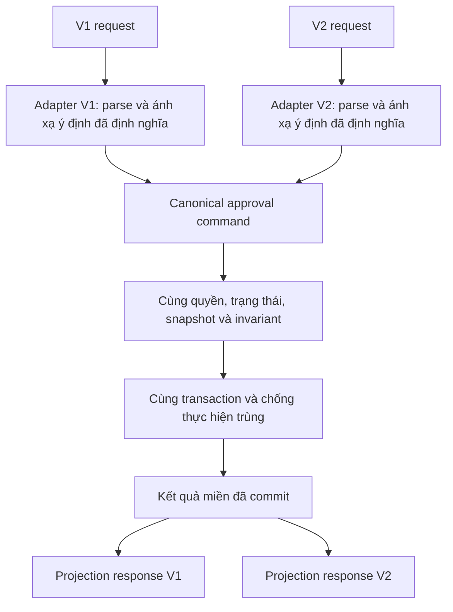

# API compatibility rules: tương thích API mà vẫn giữ đúng quy tắc nghiệp vụ

Trong chương **API Business Rules**, API compatibility là khả năng thay đổi một hợp đồng API mà các client và thành phần liên quan vẫn hoạt động theo những cam kết đã định. Tương thích không chỉ là JSON còn phân tích được; nó còn bao gồm ý nghĩa của dữ liệu, quyền thao tác, trạng thái, lỗi, retry và hậu quả nghiệp vụ.

Trong module bảo vệ logic nghiệp vụ, một API mới an toàn vẫn có thể bị đi vòng nếu API cũ tiếp tục cho sửa giá, tự đặt trạng thái hoặc bỏ qua quyền theo đối tượng. Quy tắc tương thích cần giữ các business invariants trên mọi phiên bản đang được hỗ trợ, đồng thời có cách xử lý rõ khi một yêu cầu bảo mật làm thay đổi hành vi trước đây.

Bài học dùng ví dụ chuyển từ API cập nhật trạng thái đề nghị mua hàng sang endpoint phê duyệt theo hành động. Trọng tâm là giữ đúng căn cứ phê duyệt và chống thực hiện trùng, không bảo lưu một đường cập nhật trái quyền chỉ vì client cũ từng gọi được.

Sau bài này, bạn có thể:

- Phân biệt tương thích cấu trúc với tương thích ngữ nghĩa và hiệu ứng.
- Xác định những thay đổi tưởng nhỏ nhưng ảnh hưởng quyền, tiền, trạng thái hoặc bằng chứng.
- Dùng adapter chuyển hợp đồng cũ sang command chung có đầy đủ guard.
- Thiết kế idempotency và kết quả khi một ý định đi qua nhiều phiên bản.
- Lập kế hoạch chuyển đổi dữ liệu, client, worker và API cũ mà không tạo đường yếu hơn.
- Kiểm thử tương thích cùng các invariant bảo mật xuyên phiên bản.

## 1. Những lớp tương thích cần đánh giá

| Lớp | Câu hỏi | Ví dụ lỗi |
| --- | --- | --- |
| Cấu trúc request | Client cũ còn gửi đúng schema được hỗ trợ không? | Thêm một field bắt buộc mà client chưa biết |
| Cấu trúc response | Client còn đọc được kết quả không? | Đổi kiểu số thành object hoặc thêm enum làm client xử lý sai |
| Ngữ nghĩa dữ liệu | Cùng giá trị có còn cùng ý nghĩa không? | `amount` đổi đơn vị nhưng giữ tên |
| Quyền và phạm vi | Ai được làm gì trên đối tượng nào? | V1 bỏ tenant hoặc kiểm tra role yếu hơn v2 |
| Trạng thái và quy trình | Một kết quả có còn đại diện cùng sự kiện không? | V1 hiểu thành công là đã duyệt, v2 chỉ mới xếp hàng |
| Lỗi và retry | Client có biết nên thử lại hay cần ý định mới không? | Mất nhận diện idempotency khi đổi URL |
| Dữ liệu và sự kiện | Các thành phần cũ và mới có cùng hiểu dữ liệu không? | Worker cũ ghi đè trạng thái hoặc bỏ version mới |

Một thay đổi thêm field có thể không làm parser lỗi nhưng vẫn làm lộ dữ liệu nhạy cảm. Một phản hồi vẫn là `200` có thể đã đổi từ kết quả hoàn tất sang tiếp nhận xử lý, khiến client thực hiện sai bước tiếp theo.

Cần đánh giá hành vi mà client hợp lệ dựa vào, và riêng biệt xác định các invariant bảo mật mà mọi đường đang hoạt động phải giữ.

## 2. Ví dụ chuyển một API cũ sang business command

Giả sử v1 có hợp đồng sau cho ý định duyệt:

```http
PATCH /v1/purchase-requests/pr-123
Idempotency-Key: approve-pr123-s3-01
Content-Type: application/json

{
  "status": "APPROVED",
  "expectedVersion": 7,
  "expectedSnapshotId": "snapshot-3",
  "comment": "Đồng ý theo nội dung đã xem"
}
```

Trong ví dụ, version và snapshot của v1 đã có nghĩa là tiền điều kiện. Vấn đề của cài đặt cũ là đường cập nhật quá rộng, có thể gán trạng thái mà không thực thi đầy đủ quyền và bằng chứng.

V2 diễn đạt hành động rõ hơn:

```http
POST /v2/purchase-requests/pr-123/approve
Idempotency-Key: approve-pr123-s3-01
Content-Type: application/json

{
  "expectedRequestVersion": 7,
  "expectedContentSnapshotId": "snapshot-3",
  "note": "Đồng ý theo nội dung đã xem"
}
```

Hai hình dạng có thể cùng biểu diễn một ý định. V1 cần một adapter ánh xạ nó sang cùng command duyệt mà v2 dùng, rồi chạy cùng policy và transaction.

Không nên giữ hai implementation độc lập, trong đó v2 có guard mới còn v1 vẫn gọi hàm `setStatus`. Caller có thể chỉ cần chọn route cũ để tránh quy tắc.

Nếu v1 thực tế chưa có dữ liệu đủ để chứng minh nội dung người dùng đã xem, không được tự giả định nó có. Trường hợp đó cần kế hoạch tương thích hoặc nâng cấp client riêng, thay vì dùng snapshot mới nhất để tạo ra sự đồng ý chưa từng được đưa ra.

## 3. Đặt baseline invariant chung cho mọi phiên bản

Với hành động duyệt trong ví dụ, mọi phiên bản hỗ trợ hành động phải giữ:

```text
actor và tenant được xác minh
actor có quyền duyệt trên đúng đối tượng và phạm vi
không tự duyệt theo chính sách phân tách trách nhiệm
đề nghị đang ở trạng thái được duyệt
version và snapshot khớp ý định được gửi
quyết định gắn với nội dung và chính sách hợp lệ
cập nhật trạng thái và bằng chứng nhất quán
retry không tạo quyết định hoặc hiệu ứng trùng
```

API version là lựa chọn hợp đồng, không phải quyền chọn một mức kiểm tra yếu hơn. Những cờ như `legacy=true`, `compatibilityMode` hoặc tên client không được tự tắt guard bắt buộc.

Một bản sửa quyền đúng có thể làm một số request trước đây thành công bị từ chối. Cần ghi nhận tác động, cập nhật client và truyền đạt cách xử lý. Việc đã từng có hành vi đó không tự biến nó thành quyền nghiệp vụ hợp lệ phải duy trì.

Đồng thời, không dùng lý do bảo mật để tùy tiện làm mất hành vi hợp lệ không liên quan. Cần xác định chính xác ranh giới nào thay đổi và kiểm thử những luồng được phép vẫn hoạt động.

## 4. Phân biệt các loại version

| Loại version | Điều nó xác định | Không được dùng để làm gì |
| --- | --- | --- |
| API version | Hình dạng và ý nghĩa hợp đồng được chọn | Chọn policy quá khứ để né quyền hiện tại |
| Resource version | Phiên bản phục vụ kiểm soát cập nhật cạnh tranh | Tự tạo bằng chứng đã xem nội dung mới |
| Content snapshot hoặc revision | Nội dung nghiệp vụ đã được xem hoặc duyệt | Thay thế quyền của người ra quyết định |
| Policy version | Bộ quy tắc áp dụng theo chính sách hiệu lực | Do caller tùy ý chọn một bản dễ hơn |
| Authorization epoch hoặc version quyền | Phát hiện căn cứ quyền đã thay đổi | Thay thế mọi kiểm tra đối tượng và trạng thái |

Một request v1 vẫn có thể cần quyền hiện hành. Ngược lại, một bằng chứng nghiệp vụ hợp lệ theo policy đã được chốt không nhất thiết tự mất hiệu lực chỉ vì API có v2. Quan hệ đó phải do chính sách nghiệp vụ quy định.

Không gộp tất cả thành một field `version` rồi để các lớp hiểu khác nhau. Adapter phải biết đang chuyển đổi phiên bản hợp đồng hay một tiền điều kiện của đối tượng.

## 5. Phân loại thay đổi trước khi triển khai

| Thay đổi | Rủi ro cần đánh giá |
| --- | --- |
| Thêm field response | Client parser nghiêm ngặt có thể lỗi; field mới có thể làm lộ dữ liệu |
| Thêm enum response | Client có thể không có nhánh xử lý và mặc định sai |
| Thêm field input tùy chọn | Giá trị mặc định có thể làm rộng quyền hoặc đổi ý định |
| Thêm field input bắt buộc | Client cũ thiếu dữ liệu; adapter không phải lúc nào cũng bổ sung được |
| Đổi ý nghĩa null hoặc không gửi | Có thể xóa dữ liệu, giữ dữ liệu hoặc nhận mặc định khác |
| Đổi đơn vị tiền hoặc thời gian | Số vẫn hợp lệ nhưng hậu quả khác lớn |
| Siết quyền đối tượng hoặc trạng thái | Request cũ có thể bị chặn; cần baseline bảo mật và kế hoạch chuyển đổi |
| Đổi xử lý đồng bộ sang bất đồng bộ | Thành công của HTTP không còn cùng ý nghĩa hoàn tất |
| Đổi namespace idempotency | Cùng ý định có thể bị thực hiện lại qua phiên bản khác |

Không có quy tắc đơn giản rằng “chỉ thêm field thì luôn tương thích”. Cần xét cả client, quyền đọc, default, luồng nghiệp vụ và thành phần xử lý sau API.

Nếu một thay đổi không thể giữ ngữ nghĩa cũ an toàn, cần một hợp đồng mới và đường chuyển đổi rõ ràng. Không âm thầm diễn giải lại request cũ thành một hành động mạnh hơn hoặc một sự đồng ý khác.

## 6. Adapter chỉ chuyển hợp đồng, không tạo quyền hoặc bằng chứng

Một kiến trúc có thể là:



Adapter có thể đổi tên field, biểu diễn hoặc chuyển một selector đã được định nghĩa thành command cụ thể. Nó không được:

- Đặt `approvedBy` thay người dùng chưa được xác thực.
- Lấy tenant từ body rồi coi là scope đã được cấp phép.
- Tự tạo phiếu đồng ý để bù cho một field mới.
- Thay version cũ bằng version hiện tại rồi giữ nguyên ý định duyệt.
- Gọi một đường lưu entity bỏ qua policy chung.

Nếu API cũ cho phép gửi lại field chỉ đọc, cần xử lý theo hợp đồng cụ thể: từ chối hoặc bỏ qua một cách được xác định, không nhận chúng làm thay đổi. Một field `status` không đổi trong bản echo cũng không tự trở thành yêu cầu duyệt mới.

Không ánh xạ mọi giá trị trạng thái qua một nhánh mặc định `UPDATE_ANY_STATE`. Mỗi ý định được hỗ trợ cần hành động, schema và policy tương ứng.

## 7. Minh họa Java: hai input, một command có nghĩa thống nhất

Ví dụ dùng record của Java 16 trở lên. Nó chỉ minh họa nhánh duyệt của v1; không phải một mapper tổng quát cho mọi trạng thái.

```java
import java.util.Objects;
import java.util.UUID;

record V1ApprovalInput(
        String status,
        long expectedVersion,
        UUID expectedSnapshotId,
        String comment) {
}

record V2ApprovalInput(
        long expectedRequestVersion,
        UUID expectedContentSnapshotId,
        String note) {
}

record ApproveRequestCommand(
        UUID requestId,
        long expectedRequestVersion,
        UUID expectedContentSnapshotId,
        String note) {
    ApproveRequestCommand {
        Objects.requireNonNull(requestId);
        Objects.requireNonNull(expectedContentSnapshotId);
        if (expectedRequestVersion < 0) {
            throw new IllegalArgumentException("INVALID_VERSION");
        }
        if (note != null && note.length() > 1000) {
            throw new IllegalArgumentException("NOTE_TOO_LONG");
        }
    }
}

record VerifiedActor(UUID tenantId, UUID principalId) {
}

record ApprovalResult(
        UUID requestId,
        UUID decisionId,
        long requestVersion) {
}

interface ApprovalCommands {
    ApprovalResult approve(
            VerifiedActor actor,
            ApproveRequestCommand command,
            String idempotencyKey);
}

final class ApprovalApiAdapters {
    private ApprovalApiAdapters() {
    }

    static ApproveRequestCommand fromV1(UUID requestId, V1ApprovalInput input) {
        Objects.requireNonNull(input);
        if (!"APPROVED".equals(input.status())) {
            throw new IllegalArgumentException("UNSUPPORTED_V1_INTENT");
        }
        return new ApproveRequestCommand(requestId, input.expectedVersion(),
                input.expectedSnapshotId(), input.comment());
    }

    static ApproveRequestCommand fromV2(UUID requestId, V2ApprovalInput input) {
        Objects.requireNonNull(input);
        return new ApproveRequestCommand(requestId,
                input.expectedRequestVersion(),
                input.expectedContentSnapshotId(), input.note());
    }
}
```

Cả hai adapter đưa kết quả vào cùng `ApprovalCommands.approve`. Handler chung phải tải đối tượng có scope, xác minh actor và quyền hiện tại, kiểm tra snapshot, trạng thái, version, phân tách trách nhiệm và commit quyết định.

`status=APPROVED` của v1 ở đây là selector của ý định theo hợp đồng đã nêu, không phải bằng chứng đề nghị đã được duyệt. Adapter không đổi trạng thái hoặc tạo decision ID.

Tầng HTTP vẫn phải kiểm tra schema, trường không hỗ trợ, alias và tham số trùng theo hợp đồng từng phiên bản. `VerifiedActor` được dựng từ cơ chế xác thực và scope đã xác minh, không bind từ body.

## 8. Trường lạ, null, default và enum cần quy tắc riêng

“Đọc linh hoạt” ở client không có nghĩa server nên tự động gán mọi thuộc tính mới vào entity. Input của lệnh cần tập trường cho phép để tránh mass assignment.

Các trường hợp cần quyết định rõ:

```text
không gửi field
gửi field = null
gửi false, 0 hoặc chuỗi rỗng
gửi field chỉ đọc đã được response phiên bản cũ trả về
gửi hai cách biểu diễn hoặc hai giá trị cho cùng thuộc tính
```

Nếu v1 coi không gửi là giữ nguyên còn v2 coi không gửi là xóa hoặc đặt mặc định, một mapper dùng chung không phân biệt sự hiện diện có thể làm mất dữ liệu hoặc mở khóa ngoài ý muốn.

Default phải là quyết định nghiệp vụ. Không dùng `skipApproval=true`, phạm vi toàn tenant hoặc một giá trị hạn mức rộng để giúp client cũ đi qua schema mới.

Với enum response mới, client cần một cách xử lý giá trị chưa biết không tạo kết quả giả. Ví dụ không nhận ra `RECONCILING` thì không mặc định coi là `SUCCEEDED` hoặc tự retry một giao dịch mới. Nếu client cũ không thể xử lý an toàn, cần projection có ngữ nghĩa đúng hoặc nâng cấp hợp đồng, không chỉ đổi tên cho vừa enum cũ.

## 9. Phân quyền phải tương thích với mọi đường đang hoạt động

Một lỗi thường gặp là v2 có kiểm tra đúng tenant và owner nhưng v1 chỉ kiểm tra đăng nhập. Gateway hoặc tài liệu mới không bảo vệ được route cũ còn truy cập được.

Cần kiểm tra đồng đều:

- Credential và danh tính actor thực tế.
- Tenant hoặc phạm vi được phép sử dụng.
- Quyền trên đối tượng, hành động và các trường.
- Quan hệ cha–con, người tạo, người duyệt và người hưởng quyền khi policy yêu cầu.
- Nguồn quyền trực tiếp, kế thừa hoặc ủy quyền cùng hiệu lực tương ứng.

Nếu v1 dùng một API key chung không xác định được cá nhân, nó có thể không đủ căn cứ cho quy tắc không tự duyệt theo người. Adapter không thể tự tạo ra danh tính đó; cần cơ chế xác thực phù hợp hoặc hạn chế hành động trên đường cũ.

Response compatibility cũng có ranh giới quyền. Thêm `internalCost`, ghi chú điều tra hoặc dữ liệu của tenant khác là vấn đề ngay cả khi client cũ bỏ qua field mới. Phải tạo response theo quyền đọc, không serialize toàn bộ entity để mọi phiên bản cùng dùng.

Không để client tự khai API cũ, tên ứng dụng hoặc chế độ tương thích nhằm chọn bộ quyền rộng hơn. Những metadata đó có thể phục vụ định tuyến hoặc hỗ trợ, không phải bằng chứng thẩm quyền.

## 10. Giữ ý nghĩa dữ liệu và xử lý bằng chứng đang tồn tại

Một số thay đổi không làm schema lỗi nhưng làm kết quả khác:

| Thay đổi | Hậu quả có thể có |
| --- | --- |
| Tiền từ đơn vị chính sang đơn vị nhỏ nhất mà giữ tên | Thu hoặc hoàn sai số tiền |
| Thời gian từ giây sang mili giây | Lease hoặc quyền có hiệu lực sai khoảng |
| Tỷ lệ từ `0.10` sang `10` | Giảm giá hoặc giới hạn sai hệ số |
| Đổi cách hiểu trạng thái duyệt | Một quyết định chưa hoàn tất bị coi là đủ điều kiện thực hiện |
| Đổi phạm vi role từ bộ phận sang toàn tenant | Mở rộng quyền ngoài ý định cấp ban đầu |

Đơn vị, rounding, timezone và ranh giới thời hạn cần nằm trong hợp đồng hoặc kiểu dữ liệu rõ ràng. Không tự đoán đơn vị theo kích thước con số để giữ tương thích.

Với dữ liệu đang chờ, cần quyết định policy nào áp dụng. Ví dụ chính sách mới cần hai nhóm duyệt thay vì một. Hệ thống có thể yêu cầu đánh giá lại hoặc có quy tắc chuyển tiếp được phê duyệt cho các quyết định hợp lệ trước mốc nhất định.

Quy tắc chuyển tiếp phải dựa trên đối tượng, thời điểm có thẩm quyền, trạng thái và bằng chứng. Việc caller dùng `/v1/` không tự là bằng chứng được áp dụng policy cũ.

Không backfill một phiếu duyệt thứ hai, `approvedBy` hoặc snapshot đã đồng ý khi không có nguồn chứng minh. Chuyển đổi schema không được biến dữ liệu thiếu thành một sự kiện nghiệp vụ chưa từng xảy ra.

## 11. Idempotency cần nhận diện ý định xuyên phiên bản

Giả sử một ý định duyệt được gửi qua v1, commit thành công nhưng mất phản hồi. Client được nâng cấp hoặc chuyển sang v2 rồi retry cùng ý định.

Nếu key chỉ có phạm vi theo URL nguyên văn, `/v1/...` và `/v2/...` có thể bị coi là hai thao tác khác nhau. Hệ thống cần quyết định cách nhận diện canonical operation và tiếp tục giữ invariant không tạo quyết định trùng.

Một phạm vi logic có thể là:

```text
(tenantId, actorId, APPROVE_PURCHASE_REQUEST, idempotencyKey)
```

Dấu vân tay dùng command đã chuẩn hóa khi hai hợp đồng thực sự có cùng ngữ nghĩa. Khác tên `comment` và `note` không nên tự làm ý định khác; khác snapshot hoặc version vẫn là thay đổi có ý nghĩa theo hợp đồng.

Không bỏ API version khỏi mọi hash một cách máy móc. Nếu v2 thực sự thay ý nghĩa hành động, cần namespace hoặc cách phân biệt đúng. Các invariant đối tượng vẫn phải ngăn một lần “retry” biến thành một phê duyệt thứ hai trái policy.

Khi namespace idempotency đã tồn tại, kế hoạch chuyển đổi phải xử lý bản ghi cũ hoặc có cầu nối phù hợp. Chỉ sửa công thức key ở code mới có thể làm mất khả năng nhận diện lệnh đã commit.

Kết quả logic và response theo phiên bản cũng cần tách. Cùng một `decisionId` có thể được trình bày bằng schema v1 hoặc v2 theo hợp đồng replay, nhưng không được thực hiện lại hành động chỉ để tạo một body mới. Kiểm tra quyền đọc hiện tại trước khi trả kết quả, không trả raw entity hoặc response nội bộ sai phạm vi.

## 12. Thành công, lỗi và bất đồng bộ cũng là hợp đồng

Nếu v1 trả thành công chỉ khi quyết định đã commit, không thể giữ nguyên ý nghĩa bằng cách trả một response giống cũ ngay khi message được enqueue.

Cần phân biệt:

- Lệnh đã được tiếp nhận để xử lý.
- Quyết định nghiệp vụ đã commit.
- Tác dụng bên ngoài đã được xác nhận.
- Dữ liệu đã đồng bộ tới các điểm đọc khác.

Chuyển sang bất đồng bộ có thể cần operation resource, cách truy vấn trạng thái và logic client mới. Không giả `APPROVED` hoặc `COMPLETED` để client cũ tiếp tục như thể đã xong.

Một adapter có thể giữ đường đồng bộ nếu hệ thống thực sự còn thực thi được hợp đồng đó. Nó không nên chờ vô hạn hoặc bịa kết quả khi operation chưa hoàn tất.

Các mã lỗi và trường lỗi cũng cần được xem xét. Đổi xung đột version thành lỗi tạm thời có thể khiến client retry tự động một ý định cũ; đổi lỗi quyền thành một mã kích hoạt fallback sang API yếu hơn có thể tạo đường đi vòng.

Fallback giữa phiên bản không được biến một request bị chặn bởi policy thành hành động được phép. Các đường cùng tạo hiệu ứng phải dùng chung baseline; client cần phân biệt lỗi nghiệp vụ, lỗi input và sự cố tạm thời theo hợp đồng đã công bố.

## 13. Chuyển đổi schema và triển khai nhiều phiên bản cùng lúc

Trong một đợt triển khai, code cũ, code mới và worker có thể cùng chạy. Cần tính tới khả năng đọc, ghi và bảo vệ dữ liệu trong giai đoạn đó.

Một trình tự có thể là:

1. Định nghĩa baseline invariant và command chung.
2. Mở rộng schema để hỗ trợ dữ liệu mới mà không tự cấp quyền mặc định.
3. Chuyển các đường cũ sang thực thi policy và writer có kiểm soát.
4. Triển khai adapter hoặc endpoint mới và kiểm thử đồng thời.
5. Chuyển client, theo dõi luồng còn dùng hợp đồng cũ.
6. Dừng hỗ trợ đường cũ theo kế hoạch rồi mới loại cột hoặc cấu trúc không còn dùng.

Trong giai đoạn chuyển tiếp, một worker cũ ghi entity toàn phần có thể làm mất version, epoch quyền hoặc dữ liệu bằng chứng mới. Cần bảo vệ writer, không chỉ bảo đảm câu SELECT cũ còn chạy được.

Backfill chỉ được lấy dữ liệu từ nguồn có thẩm quyền. Nếu không thể tái dựng một bằng chứng, giữ trạng thái cần xử lý hoặc yêu cầu bước nghiệp vụ phù hợp thay vì điền giá trị để vượt constraint.

Nếu dùng so sánh shadow, chỉ chạy những phần không tạo hiệu ứng ngoài hoặc có cơ chế quan sát an toàn. Không gửi cùng command tới hai handler ghi thật rồi so kết quả, vì có thể tạo hai tác dụng phụ.

Kế hoạch rollback phải giữ baseline bảo mật. Quay lại một mapper cũ ghi trạng thái tùy ý không phải rollback an toàn chỉ vì response của nó hợp với client cũ.

## 14. API cũ, client offline và thông điệp sống lâu

Lưu lượng không xuất hiện trong vài giờ không chứng minh không còn caller cũ. Ứng dụng mobile có thể offline, job định kỳ chưa tới lịch và message cũ vẫn đang chờ.

Cần xem cả:

- Client được định danh hợp lệ và version hợp đồng chúng đang dùng.
- Hàng đợi, retry, outbox hoặc operation chưa kết thúc.
- Token, link hoặc capability có thời hạn còn tồn tại.
- Tệp import hoặc tích hợp gửi chậm.
- Script vận hành, công cụ hỗ trợ và API nội bộ.

Khi nhận lệnh cũ sau chuyển đổi, xác định có thể ánh xạ đúng ngữ nghĩa hay phải trả lỗi yêu cầu cập nhật. Không đổi một lệnh duyệt snapshot cũ thành lệnh duyệt snapshot mới chỉ để tránh thất bại đồng bộ.

Thông điệp event cũng có hợp đồng. Consumer cần hiểu sự kiện mô tả sự thật gì, version dữ liệu nào và cách bỏ qua bản sao hoặc sự kiện lỗi thời. Không dùng một field trạng thái mới mà consumer cũ mặc định diễn giải là thành công.

Khi hết hỗ trợ một API version, từ chối theo hợp đồng rõ ràng thay vì tự fallback sang một phiên bản khác có ý nghĩa khác. Đường cũ nếu còn tồn tại vẫn phải giữ policy, tenant scope và quyền đối tượng như các đường khác.

## 15. Ma trận kiểm thử tương thích và quyền

| Ca kiểm thử | Kết quả cần giữ |
| --- | --- |
| Client v1 hợp lệ gọi ý định duyệt được hỗ trợ | Có cùng quyết định miền hợp lệ như v2 |
| Client v2 hợp lệ gọi cùng ý định | Không bỏ sót dữ liệu hoặc điều kiện của command chung |
| Caller không có quyền dùng v1 và v2 | Cả hai đều không tạo quyết định hoặc hiệu ứng trái phép |
| Đối tượng khác tenant, owner hoặc bộ phận | Không có phiên bản nào cho phép đi vòng |
| Gửi field chỉ đọc hoặc nhạy cảm ở hợp đồng cũ | Không gán vào entity ngoài thẩm quyền |
| Field mới bị bỏ, gửi null hoặc gửi giá trị mặc định | Ngữ nghĩa đúng hợp đồng từng phiên bản |
| Response thêm trường | Không làm lộ dữ liệu ngoài quyền dù parser client vẫn đọc được |
| Response có enum mới | Client hoặc projection xử lý mà không tạo kết quả giả |
| Gọi v1 để chọn policy duyệt yếu hơn | Không được chọn policy lịch sử chỉ bằng API version |
| Version hoặc snapshot không còn khớp | Không tự nâng tiền điều kiện rồi áp dụng ý định cũ |
| Đơn vị tiền hoặc thời gian khác giữa hợp đồng | Chuyển đổi tường minh, không đoán hoặc nhân sai hệ số |
| V1 dùng kiểu credential không đủ căn cứ cho hành động | Không giả lập actor để vượt phân tách trách nhiệm |

Expected phải được viết từ hợp đồng và quy tắc nghiệp vụ độc lập. Snapshot response giúp phát hiện thay đổi hình dạng, nhưng không tự chứng minh đúng quyền, transaction hoặc số lần tạo hiệu ứng.

Có cả ca đối chứng được phép để không nhầm lỗi route, fixture hoặc parser với thành công của cơ chế bảo vệ.

## 16. Kiểm thử xuyên phiên bản, retry và trạng thái đang xử lý

| Kịch bản | Điều cần xác minh |
| --- | --- |
| V1 commit rồi mất phản hồi, retry qua v2 | Cùng ý định không tạo thêm quyết định hoặc tác dụng phụ |
| V2 thành công rồi retry qua v1 | Kết quả logic và projection đúng hợp đồng, không mở lại trạng thái |
| Cùng key nhưng đổi snapshot hoặc nội dung có ý nghĩa | Không bị gộp thành replay của lệnh cũ |
| Hai phiên bản gửi đồng thời trên cùng đối tượng | Version, uniqueness và invariant vẫn đúng |
| Adapter bỏ hoặc thêm field khi tính dấu vân tay | Không ghép hai ý định khác hoặc tách một ý định thành hai lần thực hiện |
| Worker cũ chạy cùng writer mới | Không ghi đè bằng chứng, version hoặc epoch mới |
| Đối tượng đang chờ khi policy thay đổi | Xử lý đúng quy tắc chuyển tiếp, không tạo phiếu duyệt giả |
| V1 chờ đồng bộ nhưng v2 xử lý nền | Mỗi response phản ánh đúng mức kết quả, không giả hoàn tất |
| Callback cũ tới sau một thay đổi mới | Không ghi đè tiến trình mới hoặc lặp hiệu ứng |
| Rollback phiên bản triển khai | Không khôi phục một đường ghi bỏ guard đã bị sửa |

Oracle cần quan sát quyết định, trạng thái, version, snapshot, idempotency, operation, outbox và lời gọi tới biên ngoài nếu có. Một response đúng schema không đủ nếu ngân sách hoặc giao dịch đã bị xử lý hai lần.

Các ca cạnh tranh phải tạo lịch thực thi có kiểm soát với cơ chế lưu trữ phù hợp. Gọi hai adapter trên cùng một object mock chỉ chứng minh mapping, không chứng minh tương thích khi commit và retry.

## 17. Quan sát, audit và tài liệu chuyển đổi

Một bản ghi điều tra nên liên kết được:

```text
API version và adapter đã dùng
actor, client được xác minh và tenant scope
canonical command type cùng đối tượng
resource version, snapshot và policy liên quan
idempotency hoặc command ID
quyết định, operation và event phát sinh
kết quả đã commit hoặc lý do từ chối
```

Nhờ đó có thể biết request v1 và v2 có thực sự đi qua cùng logic hay không, hoặc một lỗi tập trung ở client cũ, mapping hay writer phía sau.

Theo dõi lỗi schema, unknown enum, mismatch dấu vân tay, xung đột version, request bị chặn bởi guard mới và lưu lượng trên route cũ. Tên hoặc version client tự khai có thể hỗ trợ thống kê, nhưng không thay thế danh tính hoặc quyền được xác minh.

Tài liệu chuyển đổi nên nêu rõ field đổi tên, đơn vị, default, null, mã lỗi, trạng thái bất đồng bộ, phạm vi retry và mốc ngừng hỗ trợ. Nêu hành vi nào được giữ và điều kiện bảo mật nào bắt buộc áp dụng cho mọi phiên bản.

Không ghi token, credential hoặc raw payload nhạy cảm để theo dõi tương thích. Giữ định danh và dữ liệu tối thiểu đủ đối chiếu theo quyền truy cập audit.

## 18. Cách thiết kế API compatibility rules cho một thay đổi

1. Liệt kê hợp đồng và những client, worker, dữ liệu hoặc thông điệp còn phụ thuộc vào nó.
2. Định nghĩa baseline invariant về quyền, scope, trạng thái, bằng chứng và chống thực hiện trùng.
3. Phân loại thay đổi cấu trúc, ngữ nghĩa, quyền, lỗi, thời gian và hiệu ứng.
4. Ánh xạ các hợp đồng tương đương sang command chung, không tạo quyền hoặc bằng chứng trong adapter.
5. Giữ ý nghĩa version, snapshot, policy, null, default và đơn vị một cách tường minh.
6. Thiết kế idempotency và projection kết quả cho những ý định đi qua nhiều phiên bản.
7. Lập kế hoạch schema, writer, dữ liệu đang chờ, rollout và rollback không làm mất guard.
8. Kiểm thử các cặp client–server cùng những lịch retry, concurrency và event cũ.
9. Quan sát phạm vi sử dụng, hỗ trợ chuyển đổi và đóng đường cũ theo hợp đồng rõ ràng.

Tương thích API có giá trị khi client hợp lệ tiếp tục hiểu và thực hiện đúng ý định, trong khi mọi phiên bản còn hoạt động đều giữ các ranh giới nghiệp vụ bắt buộc. Một lớp chuyển đổi tốt giữ hình dạng cần thiết nhưng đưa quyết định có hiệu lực về cùng nguồn policy, bằng chứng và cơ chế commit được kiểm soát.
