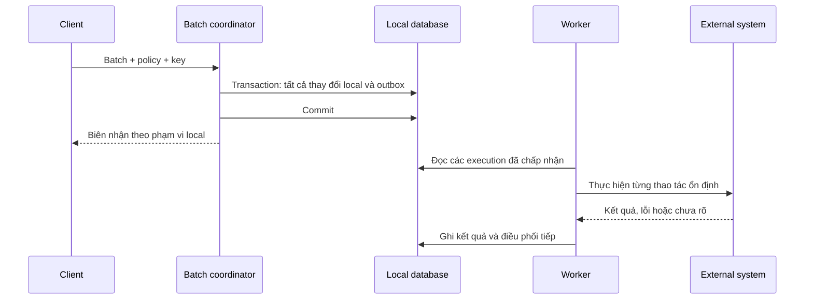

# Chính sách nguyên tử cho thao tác hàng loạt (Batch atomicity policy)

Một API nhận nhiều phần tử cần nói rõ điều gì xảy ra khi một phần tử thất bại. Tất cả bị hủy, chỉ phần tử đó bị chặn, hay những nhóm trước đã được commit? Nếu hợp đồng không rõ, client có thể hiểu sai kết quả, retry các phần đã thành công hoặc chọn một chế độ yếu hơn để vượt quy tắc nghiệp vụ.

Trong bảo mật logic nghiệp vụ, batch còn có thể được dùng để trộn đối tượng ngoài quyền, chia nhỏ hạn mức, gửi trùng ID hoặc tận dụng lỗi giữa các lần ghi. Một vòng lặp gọi hàm đơn lẻ không tự tạo ra chính sách nguyên tử đúng.

Bài học thuộc chương **Batch Operations**. Trọng tâm là xác định đơn vị commit, xử lý lỗi và retry theo chính sách có thẩm quyền, đồng thời giữ tenant, quyền đối tượng, state machine, phê duyệt và các bất biến tổng hợp.

Ví dụ chính là duyệt hàng loạt đề nghị mua hàng cùng tenant. Mô hình minh họa dùng một cấp phê duyệt; mỗi đề nghị hợp lệ chuyển từ SUBMITTED sang APPROVED.

## 1. Nguyên tử cần được định nghĩa theo phạm vi

Một đơn vị nguyên tử tại nguồn transaction có nghĩa các thay đổi thuộc đơn vị đó được commit cùng nhau hoặc rollback cùng nhau theo hợp đồng của nguồn.

Cần chỉ rõ những thay đổi nào nằm trong đơn vị:

```text
các đề nghị được duyệt
quyết định của người duyệt
mức sử dụng hạn mức
lịch sử thay đổi
outbox
kết quả idempotency
```

Nếu chỉ trạng thái đơn được rollback nhưng hạn mức hoặc quyết định vẫn được lưu, hợp đồng nguyên tử của nghiệp vụ chưa được giữ.

### 1.1. Phân biệt với các thuộc tính khác

| Thuộc tính | Câu hỏi |
|---|---|
| Atomicity | Những thay đổi nào cùng commit hoặc cùng rollback? |
| Isolation và kiểm soát cạnh tranh | Điều gì xảy ra khi các transaction cùng đọc, ghi dữ kiện liên quan? |
| Authorization | Ai được tác động tới từng đối tượng và loại hành động? |
| Idempotency | Retry có tạo thêm kết quả nghiệp vụ không? |
| Durability và khả năng đối soát | Sau lỗi hoặc restart, kết quả đã commit được xác định thế nào? |

Một transaction nguyên tử vẫn có thể lưu một lệnh trái quyền hoặc vi phạm hạn mức nếu kiểm tra sai. Một batch có idempotency vẫn có thể để lại nửa kết quả nếu các phần được commit riêng.

Một người đọc nhiều bản ghi qua các thời điểm khác nhau cũng có thể thấy dữ liệu trước và sau một commit. Nếu cần một ảnh đọc nhất quán, phải có cơ chế đọc phù hợp; không suy mọi bảo đảm quan sát từ tên “atomic”.

### 1.2. Ví dụ ba đề nghị

```text
Batch:
    PR-A: người gọi được duyệt, dữ liệu hợp lệ
    PR-B: người gọi được duyệt, dữ liệu hợp lệ
    PR-C: không đủ quyền hoặc state không cho phép
```

Với chính sách cả batch nguyên tử, A và B không được giữ trạng thái APPROVED do lệnh này.

Với chính sách từng phần tử, A và B có thể commit nếu hợp đồng cho phép; C thất bại riêng. Response phải phản ánh đúng điều đó.

Không thể dùng cùng một chữ “thất bại” rồi để client tự đoán A và B đã đổi hay chưa.

## 2. Các chính sách phổ biến và giới hạn

| Chính sách | Đơn vị commit | Khi một phần lỗi |
|---|---|---|
| ALL_OR_NOTHING | Toàn bộ batch trong phạm vi transaction đã công bố | Rollback mọi thay đổi nghiệp vụ của batch |
| PER_ITEM | Mỗi phần tử | Các phần khác có thể commit theo hợp đồng |
| PER_CHUNK | Mỗi nhóm đã xác định | Chunk lỗi rollback, chunk trước có thể đã commit |
| SAGA hoặc luồng có bù trừ | Nhiều bước hoặc hệ thống commit riêng | Điều phối tiếp, bù trừ hoặc đối soát; có thể có trạng thái một phần |

Tên chính sách là ví dụ hợp đồng, không phải chức năng mà một field JSON tự kích hoạt.

### 2.1. Cả batch nguyên tử

Phù hợp khi ý nghĩa nghiệp vụ yêu cầu mọi phần cùng được chấp nhận hoặc không phần nào.

Nếu cùng cơ sở dữ liệu và phạm vi phù hợp, một transaction local có thể bao phủ các thay đổi cần thiết. Các tác dụng ngoài transaction vẫn cần được điều phối riêng.

Không gửi email, cấp quyền ngoài hoặc giải ngân trên từng vòng lặp rồi hy vọng rollback database sẽ thu hồi được chúng.

### 2.2. Từng phần tử

Phù hợp khi các phần thật sự có thể độc lập về kết quả. Mỗi phần tử vẫn phải được kiểm tra và lưu nguyên vẹn.

Partial success không có nghĩa được bỏ field lỗi, bỏ quyền trên một phần tử hoặc chỉ lưu vài thuộc tính của phần tử đó.

Bất biến dùng chung như tổng hạn mức vẫn phải được bảo vệ. Việc chia transaction nhỏ không làm giới hạn tổng tự biến mất.

### 2.3. Từng chunk

Chunk có thể là lựa chọn cần thiết cho khối lượng lớn, nhưng làm thay đổi phạm vi nguyên tử.

Nếu chunk 1 đã commit và chunk 2 lỗi, không được mô tả toàn batch như chưa tạo tác dụng. Cần giữ tiến độ và kết quả đủ để retry phần còn lại mà không lặp phần trước.

Không tự đổi sang chunk trong một tối ưu hiệu năng nếu API vẫn hứa ALL_OR_NOTHING.

### 2.4. Bù trừ không phải rollback

Khi nhiều hệ thống có kết quả riêng, một bước đã thực hiện có thể cần một hành động bù trừ mới.

Bù trừ có quyền, trạng thái, lỗi và lịch sử riêng. Nó có thể thất bại hoặc chưa rõ kết quả, và không bảo đảm xóa mọi dấu vết hay khôi phục được tất cả tác dụng.

Không gắn nhãn “atomic” chỉ vì có code gọi hàm hoàn tác sau lỗi.

## 3. Chính sách do máy chủ kiểm soát

Một request có thể đề nghị:

```http
POST /purchase-request-approval-batches
Idempotency-Key: approval-batch-attempt-01
Content-Type: application/json

{
  "requestedPolicy": "ALL_OR_NOTHING",
  "items": [
    {
      "itemKey": "row-1",
      "requestId": "PR-A",
      "expectedVersion": 7
    },
    {
      "itemKey": "row-2",
      "requestId": "PR-B",
      "expectedVersion": 9
    }
  ]
}
```

Máy chủ phải quyết định policy được chấp nhận cho action, actor và ngữ cảnh. Một tham số allowPartial không được dùng để bỏ yêu cầu nguyên tử mà nghiệp vụ bắt buộc.

Nếu client chọn một policy không hỗ trợ, cần phản hồi rõ. Không âm thầm hạ từ ALL_OR_NOTHING xuống PER_ITEM sau khi thấy lỗi.

### 3.1. Manifest của batch cần ổn định

Manifest có thể giữ:

```text
tenant và actor có thẩm quyền
batchId
action
acceptedPolicy
các itemKey và target
precondition của từng item
thứ tự nếu có ý nghĩa
phiên bản hợp đồng hoặc workflow liên quan
fingerprint
```

Body không tự quyết định tenant, quyền duyệt, số tiền cần tính hạn mức hoặc người phê duyệt.

Nếu tạo job nền, phạm vi và các item phải được chốt theo hợp đồng. Không để worker đọc một danh sách có thể sửa thành target mới sau khi đã được cấp phép.

### 3.2. ItemKey và target trùng là hai vấn đề

ItemKey giúp liên kết kết quả với đầu vào. RequestId xác định đối tượng nghiệp vụ.

Hai itemKey khác nhau vẫn có thể trỏ cùng một request. Nếu action chỉ được áp một lần trên một đối tượng, nên từ chối target trùng hoặc có quy tắc hợp nhất rõ ràng.

Không âm thầm loại bản sao rồi vẫn dùng số phần tử đầu vào để tính hạn mức hoặc kết luận đã xử lý đủ.

Việc phát hiện cần theo định danh chuẩn của hệ thống. Hai cách biểu diễn trỏ cùng một target không được trở thành cách duyệt hoặc tính lợi ích hai lần.

### 3.3. Thứ tự xử lý khác với thứ tự lấy khóa

Một batch độc lập có thể không cần thứ tự nghiệp vụ. Một batch gồm các hành động phụ thuộc có thể cần thứ tự hoặc đồ thị phụ thuộc rõ ràng.

Thứ tự lấy khóa nhằm phối hợp cạnh tranh có thể được chọn riêng, miễn không làm đổi ý nghĩa command. Sắp ID để khóa không có nghĩa được phép đảo thứ tự các lệnh có phụ thuộc.

Trong ví dụ chính, batch chỉ có một action và mỗi target xuất hiện một lần để tránh nhập nhằng này.

## 4. Bất biến từng đối tượng và bất biến toàn phạm vi

Mỗi đề nghị vẫn cần:

- Đúng tenant và scope người duyệt.
- State SUBMITTED và version khớp.
- Nội dung được chốt hợp lệ.
- Người duyệt đủ hạn mức, độc lập theo policy.
- Chưa có quyết định hoặc kết quả xung đột.

Ngoài ra có thể có giới hạn tổng, ví dụ tổng giá trị mà một người được chấp thuận trong ngày hoặc tổng ngân sách dự án.

Các con số và giới hạn trong bài là quy tắc minh họa, không phải yêu cầu chung cho mọi nghiệp vụ.

### 4.1. Không chia nhỏ để né mức kiểm soát

Nếu một tổng giá trị cần phê duyệt bổ sung, việc gửi từng dòng, đổi chunk hoặc chọn PER_ITEM không được tự làm mất quy tắc đó.

Cần xác định phạm vi tổng hợp đúng: batch, kỳ, dự án hoặc một quan hệ nghiệp vụ khác. Chỉ cộng số tiền trong request hiện tại có thể không đủ nếu người dùng chia thành nhiều batch.

Số tiền và tiền tệ phải lấy từ nguồn máy chủ; tổng cần cách tính, đơn vị và kiểm soát tràn phù hợp.

### 4.2. Khóa từng request không bảo vệ tổng dùng chung

Hai transaction duyệt hai tập request khác nhau có thể cùng đọc một hạn mức còn lại rồi cùng vượt giới hạn.

Nếu bất biến dựa trên tài nguyên dùng chung, cần khóa, cập nhật có điều kiện hoặc cơ chế cô lập phù hợp cho chính tài nguyên đó.

Atomicity của từng transaction không tự giải quyết cuộc đua này.

## 5. ALL_OR_NOTHING trong một transaction local

Một luồng có thể gồm:

1. Kiểm tra cấu trúc toàn envelope và các item, giới hạn kích thước, key và target trùng.
2. Xác định manifest cùng policy được máy chủ chấp nhận.
3. Mở transaction và kiểm tra quyền batch có thẩm quyền.
4. Nhận diện replay hoặc nhận quyền xử lý command.
5. Khóa các tài nguyên dùng chung và target theo giao thức nhất quán.
6. Kiểm tra đủ target, quyền, state, version và bất biến tổng.
7. Lập các thay đổi mà chưa thực hiện tác dụng ngoài.
8. Ghi tất cả thay đổi, quyết định, hạn mức, lịch sử, outbox và kết quả lệnh.
9. Commit rồi mới trả kết quả áp dụng thành công.

Preflight ngoài transaction có thể giúp phát hiện lỗi sớm, nhưng không chứng minh dữ liệu vẫn đúng khi ghi. Những điều kiện có thể đổi cần được kiểm tra hoặc bảo vệ tại ranh giới thích hợp.

### 5.1. Ví dụ Java

Đây là mã giả theo cú pháp Java. Ví dụ dùng một hạn mức ngày chung của người duyệt, trong một tiền tệ được chính sách chọn. Các cổng dữ liệu và transaction chưa phải triển khai chạy độc lập.

```java
BatchApprovalResult approveAtomicBatch(
        BatchApprovalCommand command,
        ActorContext actor) {

    BatchManifest manifest = inputPlanner.prepare(command);

    return transactions.required(() -> {
        memberships.requireActiveTenantAccess(actor);

        atomicityPolicy.requireAllowed(
                actor, manifest, Atomicity.ALL_OR_NOTHING);

        authorizer.requireBatchApprovalCapability(actor);

        CommandClaim claim = commandLog.claimOrReplay(
                actor, "APPROVE_PURCHASE_REQUEST_BATCH",
                command.idempotencyKey(), fingerprintOf(manifest));

        if (claim.isCompletedReplay()) {
            receiptPolicy.requireMayRead(actor, claim.savedResult());
            return claim.savedResult();
        }

        // Mọi đường dùng cùng budget và request cần cùng giao thức khóa.
        DailyApprovalBudget budget = dailyBudgets.lockFor(actor);

        List<PurchaseRequestSnapshot> requests =
                requestRepository.lockInCanonicalOrder(
                        actor.tenantId(), manifest.targetIds());

        accessPolicy.requireExactAccessibleTargets(
                actor, manifest, requests);

        // Kiểm tra mọi item và trả kế hoạch, chưa mutate domain.
        List<ApprovalChange> changes = approvalPlanner.planAll(
                actor, manifest, requests, budget);

        Money charge = budgetCharges.totalOf(changes);
        budget.requireAvailable(charge);

        for (ApprovalChange change : changes) {
            int changed = requestRepository.approveIfUnchanged(change);

            if (changed != 1) {
                throw new BatchRejected(
                        "CONCURRENT_ITEM_CHANGE", change.itemKey());
            }

            decisions.insert(change.decision());
            transitionHistory.append(change.transition());
            outbox.append(change.event());
        }

        int charged = dailyBudgets.consumeIfVersionMatches(
                budget, charge);

        if (charged != 1) {
            throw new BatchRejected("BUDGET_CHANGED");
        }

        BatchApprovalResult result =
                BatchApprovalResult.allApplied(manifest, changes);

        commandLog.complete(claim, result);
        return result;
    });
}
```

Hợp đồng cần giữ:

- Actor và tenant đến từ nguồn xác thực, không từ mỗi item tự khai.
- InputPlanner kiểm tra schema, trường được nhận, itemKey, target trùng và những yếu tố tĩnh; không sửa domain.
- AtomicityPolicy không tin requestedPolicy như một quyền nới lỏng quy tắc.
- LockInCanonicalOrder phải có cơ chế lấy khóa thực sự phù hợp; chỉ sắp danh sách sau khi đã khóa không tạo bảo đảm thứ tự khóa.
- RequireExactAccessibleTargets đối chiếu tập target đúng phạm vi, không chỉ kiểm tra phần tử đầu hoặc một count thiếu ngữ nghĩa.
- PlanAll kiểm tra từng item, version, state, bằng chứng, hạn mức riêng và khả năng dùng cùng budget. Nó không chấp nhận một danh sách đã âm thầm bỏ các item lỗi.
- Nếu có nhiều budget hoặc tiền tệ, phải lập và bảo vệ đúng phạm vi tương ứng. Không cộng những đại lượng không cùng nghĩa.
- Mọi phép ghi local trong ví dụ cùng transaction. Transactions.required chỉ trả kết quả ra ngoài sau commit.
- Exception được dùng cho đường từ chối phải thực sự dẫn đến rollback theo cấu hình và hợp đồng transaction.
- Không gọi hệ thống ngoài trong vòng ghi. Outbox chỉ lưu ý định đã được chấp nhận.
- Dữ liệu quyền hoặc chính sách ngoài transaction cần quy tắc hiệu lực phù hợp; khóa budget không tự khóa hệ thống danh tính.

### 5.2. Phép ghi từng item cần giữ điều kiện

Một câu lệnh minh họa:

```sql
UPDATE purchase_request
SET state = 'APPROVED',
    approved_content_revision = content_revision,
    row_version = row_version + 1
WHERE tenant_id = :authorized_tenant_id
  AND id = :request_id
  AND state = 'SUBMITTED'
  AND row_version = :expected_row_version
  AND content_revision = :submitted_content_revision;
```

Các placeholder là tham số bind. Câu lệnh chỉ củng cố một số điều kiện; nó không thay thế quyền theo đối tượng hoặc kiểm tra người duyệt độc lập.

Nếu một item không cập nhật đúng một hàng, lệnh nguyên tử phải làm rollback những thay đổi trước đó của batch.

Không trả một danh sách ghi A thành công, B thành công, C lỗi từ bên trong transaction rồi để adapter coi đó là return bình thường và commit A, B. Đó là thay đổi policy nếu API đang hứa ALL_OR_NOTHING.

### 5.3. Count đúng chưa chứng minh nghiệp vụ đúng

Một phép UPDATE theo danh sách ID có thể không biểu đạt version riêng, scope riêng hoặc guard riêng của từng item.

Ngay cả affectedRows bằng số target duy nhất cũng chưa chứng minh:

- Tất cả target đúng những đối tượng caller được phép duyệt.
- Mỗi version và revision đều khớp.
- Người duyệt độc lập với từng người lập.
- Hạn mức tổng đã được bảo vệ.
- Những quyết định và sự kiện đi kèm được lưu đủ.

Nếu dùng thao tác bulk tối ưu, cần bảo toàn ngữ nghĩa tương đương đã được thiết kế, không chỉ so một con số.

### 5.4. Lỗi known rollback và kết quả chưa rõ

Khi chắc chắn transaction rollback, không item nào của transaction đó được báo là đã commit.

Khi lỗi ở mốc commit làm kết quả chưa rõ, không tự báo toàn batch chưa áp dụng rồi khuyên client tạo lệnh mới. Cần đối soát qua commandId hoặc key có scope trước khi quyết định.

Một báo cáo lỗi có thể phân biệt item gây lỗi, item chưa áp dụng và phần ghi tạm đã rollback nếu caller được biết. Không dùng trạng thái SUCCESS cho một item chỉ vì câu UPDATE của nó từng chạy trước rollback.

## 6. PER_ITEM và PER_CHUNK cần hợp đồng khác

### 6.1. Từng item là một transaction độc lập

Một luồng PER_ITEM có thể là:

```text
envelope hợp lệ
    → item 1: kiểm tra và commit riêng
    → item 2: kiểm tra và rollback riêng
    → item 3: kiểm tra và commit riêng
    → lưu kết quả phản ánh từng đơn vị
```

Cần xác minh transaction thật sự độc lập. Nếu các lời gọi chỉ tham gia một transaction bao ngoài, chúng chưa tạo ra đơn vị commit riêng như hợp đồng mong muốn.

Ngược lại, dùng transaction riêng cho từng item trong một API ALL_OR_NOTHING cũng không đúng dù từng item tự an toàn.

### 6.2. Bất biến tổng vẫn phải được kiểm tra

Mỗi item có thể cần khóa hoặc cập nhật một budget dùng chung. Hai item ở hai transaction khác nhau không được cùng tiêu một phần hạn mức còn lại mà không phối hợp.

Nếu quy tắc yêu cầu cả tập phải được duyệt ở cấp cao hơn, PER_ITEM không thể tự bỏ nó. Policy cần kiểm tra phạm vi nghiệp vụ phù hợp, không chỉ mỗi giá trị riêng.

Có những thao tác nhìn như nhiều item nhưng thực chất là một hành động có các chân phụ thuộc. Khi đó nên chọn đơn vị nguyên tử hoặc một workflow điều phối đúng ý nghĩa, không tách vì tiện vòng lặp.

### 6.3. Chunk phải được nhận diện ổn định

Với PER_CHUNK, cần xác định chunk và item nào đã được chấp nhận. Retry không nên tạo cách chia mới làm một item bị xử lý lại hoặc mất precondition.

Manifest, itemKey, chunkId và kết quả bền vững cần đủ để tiếp tục phần còn lại theo contract.

Chunk đã commit không được bị báo là rollback toàn batch khi chunk sau lỗi. Nếu cần đảo tác dụng trước, đó là hành động bù trừ mới và phải được mô hình hóa riêng.

### 6.4. Không chỉ có hai trạng thái thành công và thất bại

Từng item hoặc chunk có thể ở:

```text
chưa bắt đầu
đang xử lý
đã commit hoặc đã chấp nhận
bị từ chối
đã rollback
chưa rõ kết quả
```

Nếu có tác dụng ngoài, cần thêm trạng thái execution phù hợp. Một item đã commit ý định local chưa chắc đã hoàn tất tác dụng bên ngoài.

Kết quả phải giữ itemKey đầu vào và căn cứ xử lý. Không bỏ các dòng lỗi rồi đánh lại vị trí khiến client ghép nhầm kết quả với target.

## 7. Tác dụng ngoài và workflow có bù trừ

Một batch có thể commit nguyên tử các quyết định local rồi phát nhiều công việc bên ngoài. Điều đó không có nghĩa các hệ thống ngoài cùng thực hiện một cách nguyên tử.

Ví dụ, ba ý định tạo đơn bên ngoài đã được ghi cùng transaction. Worker có thể thực hiện được hai ý định, còn ý định thứ ba chưa rõ kết quả. Hệ thống cần thể hiện đúng tình huống này.

### 7.1. Outbox bảo vệ ý định local, không tạo rollback toàn cục



Nếu contract chỉ hứa nguyên tử việc chấp nhận local, cần nói rõ. Không dùng một nhãn thành công để gộp việc mọi bên ngoài đã hoàn tất.

Event có thể được giao lại, nên worker và bên nhận cần cơ chế nhận diện execution cùng contract xử lý lặp. Method hoặc header tự có mặt không tạo bảo đảm này.

### 7.2. Bù trừ là một workflow mới

Với saga hoặc cơ chế tương tự, cần giữ:

- Những bước đã được xác nhận thực hiện.
- Những bước đang chờ hoặc chưa rõ.
- Các hành động bù trừ được phép.
- Quyền và điều kiện của từng hành động bù.
- Idempotency của cả thực hiện lẫn bù trừ.
- Trạng thái cần đối soát khi không thể kết luận.

Nếu bước ngoài timeout, chưa chắc nó chưa chạy. Tự bù hoặc thực hiện lại mà không đối soát có thể tạo thêm sai lệch.

Không xóa audit gốc hoặc đổi mọi item thành ROLLED_BACK khi thực tế có phần đã xảy ra bên ngoài. Những trạng thái như COMPENSATING hoặc NEEDS_RECONCILIATION có thể cần thiết theo mô hình.

### 7.3. Chuẩn bị và công bố có thể tách, nhưng cần bảo vệ

Một số nghiệp vụ có thể chuẩn bị dữ liệu ở vùng staging rồi công bố qua một điểm commit có kiểm soát.

Cách đó chỉ giữ đúng hợp đồng nếu dữ liệu chưa công bố không được đường khác dùng như dữ liệu đã có hiệu lực, và điều kiện cần thiết được kiểm tra tại mốc thích hợp.

Một cờ công bố không thu hồi được tiền hoặc quyền đã cấp bên ngoài trong giai đoạn chuẩn bị. Không dùng kỹ thuật staging để gọi mọi tác dụng là chưa xảy ra.

## 8. Idempotency ở cấp batch và phần tử

### 8.1. Nhận diện đúng manifest

Key cấp batch cần scope có thẩm quyền, chẳng hạn tenant, actor hoặc chủ thể phù hợp và loại action.

Fingerprint cần giữ acceptedPolicy, target, itemKey, precondition và mọi nội dung có ý nghĩa. Thứ tự chỉ được chuẩn hóa nếu contract thật sự coi nó không có ý nghĩa.

Cùng key nhưng thay policy, bỏ item lỗi, thêm target hoặc đổi version không được âm thầm coi là một bản replay giống trước.

Nếu muốn sửa manifest, cần lệnh mới hoặc cơ chế được định nghĩa rõ, không chỉnh batch đã chấp nhận trong lúc worker đang chạy.

### 8.2. Partial result cần nhận diện từng item

Với PER_ITEM hoặc PER_CHUNK, một lần gửi lại toàn batch phải biết phần nào đã commit.

Có thể dùng định danh theo tenant, batchId, itemKey cùng fingerprint phù hợp. Dữ liệu lưu phải đủ để không thực hiện lại item đã áp dụng chỉ vì response tổng trước đó bị mất.

Một cơ chế resume có thể lấy phần chưa xong từ manifest đã lưu. Nếu tạo batch mới để retry một phần, cần giữ đúng ý nghĩa nguồn và ràng buộc nghiệp vụ; không tự tạo quyết định hoặc lợi ích mới cho item cũ.

ItemKey do client đặt chỉ là định danh liên kết đầu vào. Nó không chứng minh quyền hoặc đối tượng thuộc người gọi.

### 8.3. Key không thay ràng buộc nghiệp vụ

Một người có thể gửi cùng target bằng batch khác hoặc key khác. State machine, version và ràng buộc quyết định vẫn phải ngăn tác dụng trái quy tắc.

Với phê duyệt nhiều người, retry của cùng một người không được tăng quorum như một người độc lập mới.

Phạm vi ràng buộc phải đúng vòng quy trình, revision và loại action. Không dùng một constraint quá rộng chặn các vòng gửi lại hợp lệ rồi mở đường bỏ qua kiểm tra để khắc phục.

### 8.4. Kết quả lỗi và kết quả chưa rõ

Có thể phân biệt:

```text
đã từ chối trước tác dụng
đã rollback đơn vị transaction
đã commit một phần theo policy
đang xử lý
chưa rõ kết quả commit hoặc tác dụng ngoài
```

Không biến tất cả thành cùng một trạng thái FAILED rồi để client retry bằng một key mới.

Nếu lần đầu đã commit và chỉ mất response, replay phải liên kết kết quả đã có. Nếu transaction chắc chắn rollback, việc thử lại cần dữ liệu hiện tại và precondition đúng.

Sau khi kho key hết thời gian giữ, bất biến domain vẫn cần bảo vệ các kết quả đã xảy ra. Cache MISS không chứng minh chưa từng duyệt hoặc thực hiện.

### 8.5. Quyền đọc biên nhận vẫn cần kiểm tra

Batch result có thể chứa thông tin về nhiều đối tượng. Người tạo batch không mặc nhiên được đọc mãi nếu policy yêu cầu quyền hiện tại hoặc scope đã đổi.

Cần action đọc receipt phù hợp, có thể giới hạn nội dung theo contract. Không dùng key như một credential cho bất kỳ ai biết nó.

Nếu một item không được truy cập, lỗi trả về không nên làm lộ owner, số tiền hoặc tenant thật của đối tượng.

## 9. Cạnh tranh, timeout và hủy batch

### 9.1. Giao thức khóa phải dùng chung giữa đường đơn và batch

Một đường đơn khóa request rồi budget, trong khi batch khóa budget rồi request, có thể tạo chu trình chờ.

Cần chọn thứ tự hoặc cơ chế phối hợp phù hợp trên mọi đường liên quan. Việc có thứ tự không có nghĩa không bao giờ còn deadlock; cần phân loại lỗi và retry có giới hạn theo contract.

Sau rollback vì xung đột, phải đọc và kiểm tra lại quyền, state, version và budget liên quan. Không dùng kết quả guard của lần đã thất bại hoặc tự thay expectedVersion bằng bản mới nhất.

### 9.2. Dừng chờ không chứng minh đã rollback

Client ngừng chờ hoặc kết nối bị đứt không đủ để kết luận transaction hoặc worker đã dừng.

Cần định danh lệnh và đường đối soát. Nếu trạng thái chưa rõ, không khuyến khích gửi lại một batch mới mà bỏ căn cứ của lần trước.

Các timeout ở API, hàng đợi và hệ thống ngoài có ý nghĩa khác nhau. Tác vụ cần giữ trạng thái đủ chi tiết để xử lý đúng.

### 9.3. Hủy phải có mốc hiệu lực rõ

| Thời điểm | Điều cần xác định |
|---|---|
| Chưa bắt đầu | Có thể chặn nhận việc theo giao thức |
| Transaction đang chạy | Có cơ chế yêu cầu dừng và xác nhận rollback hay không |
| Đơn vị đã commit | Không tự coi như chưa có tác dụng |
| PER_ITEM hoặc PER_CHUNK đã commit một phần | Dừng phần còn lại không xóa phần trước |
| Tác dụng ngoài đang thực hiện | Cần trạng thái, khả năng dừng hoặc bù trừ riêng |

Chỉ bật một cờ trong bộ nhớ không bảo đảm worker hoặc transaction cuối sẽ thấy nó.

Nếu contract cấm item mới commit sau khi hủy có hiệu lực, bước nhận việc hoặc commit cần phối hợp với version, lease hay trạng thái batch theo đúng phạm vi. Không chỉ kiểm tra cờ một lần ở đầu vòng lặp.

### 9.4. Giới hạn khối lượng không được âm thầm đổi policy

Có thể cần giới hạn số item, kích thước, thời gian giữ khóa và số batch đồng thời.

Nếu batch quá lớn cho chính sách nguyên tử được hỗ trợ, API có thể từ chối hoặc dùng một luồng nền có cùng contract phù hợp. Chạy nền không tự làm transaction nhỏ hơn và không tự cho phép đổi sang chunk.

Quota cũng cần đúng tenant và actor. Nếu quota phải chặt trước cạnh tranh, bộ đếm hoặc cơ chế chiếm suất cần nhất quán, không chỉ kiểm tra trước rồi tăng riêng.

Một tập item rỗng hoặc bị lọc hết không được tự coi là đã thực hiện đủ yêu cầu ban đầu. No-op chỉ hợp lệ nếu contract định nghĩa rõ.

## 10. Response và audit phải phản ánh đơn vị commit thật

Một phản hồi PER_ITEM có thể là:

```json
{
  "batchId": "BATCH-410",
  "acceptedPolicy": "PER_ITEM",
  "status": "PARTIAL",
  "items": [
    {
      "itemKey": "row-1",
      "status": "APPLIED",
      "receiptId": "REC-810"
    },
    {
      "itemKey": "row-2",
      "status": "REJECTED",
      "code": "ITEM_NOT_APPLICABLE"
    }
  ]
}
```

Mã lỗi cụ thể chỉ được trả ở mức caller có quyền biết. Định danh và trạng thái trong ví dụ là kết quả phía máy chủ, không phải dữ kiện để client tự khai thành công.

### 10.1. Không báo rollback khi chỉ ngừng xử lý

ALL_OR_NOTHING đã rollback chắc chắn có ý nghĩa khác với PER_CHUNK đã commit hai chunk rồi dừng.

Một trường appliedCount cần đếm kết quả đã được xác nhận theo contract, không phải số item đã đi qua vòng lặp hoặc đã preflight.

Nếu còn item UNKNOWN, tổng kết không được trình bày như mọi item đều có kết quả cuối. Tiến độ xử lý và trạng thái nghiệp vụ là các đại lượng khác nhau.

### 10.2. Audit cấp batch và cấp item

Có thể liên kết:

```text
batchId, acceptedPolicy và manifest
actor, tenant và quyền có thẩm quyền
itemKey, target, version và revision
đơn vị transaction hoặc chunk
decisionId, executionId và eventId
kết quả commit, rollback hoặc chưa rõ
```

Audit nghiệp vụ thành công cần nhất quán với đơn vị commit. Log lần thử bị chặn có thể được giữ qua đường quan sát riêng, không bị nhầm là item đã áp dụng.

Replay có thể tạo dấu vết truy cập hoặc retry, nhưng không nên thêm quyết định nghiệp vụ giả cho một item đã được xử lý.

Không ghi toàn bộ dữ liệu nhạy cảm của các item ngoài scope vào lỗi hoặc log chỉ để giải thích batch bị từ chối.

## 11. Giữ policy qua các tầng triển khai

Một coordinator nguyên tử cần các hàm domain và persistence có thể tham gia đúng đơn vị làm việc. Nếu hàm approveOne luôn tự mở và commit transaction độc lập, gọi nó trong vòng lặp của batch không tự tạo ALL_OR_NOTHING.

Có thể tách phần lập thay đổi và áp dụng trong unit of work, rồi để coordinator chọn ranh giới theo policy được phép. Điều đó không làm mất kiểm tra quyền hoặc guard của hàm đơn.

Các route cũ, công cụ quản trị, import và consumer cũng phải giữ cùng bất biến. Không để một tham số mode hoặc một adapter khác tạo đường bớt kiểm tra.

Khi đổi policy giữa các phiên bản, cần coi đó là thay đổi ý nghĩa API. Client phải biết phần nào có thể đã commit, cách đối soát và cách retry.

Không tối ưu bằng cách tắt lịch sử, bỏ version hoặc gửi tác dụng ngoài sớm mà vẫn giữ nguyên lời hứa nguyên tử. Tối ưu cần bảo toàn contract hoặc thay contract một cách rõ ràng.

## 12. Kiểm thử chính sách nguyên tử theo dữ liệu thực

### 12.1. Ma trận tình huống

| Tình huống | Kết quả cần kiểm chứng |
|---|---|
| ALL_OR_NOTHING có item cuối sai state | Không item nào của batch giữ thay đổi nghiệp vụ |
| ALL_OR_NOTHING có target ngoài quyền | Không duyệt phần hợp lệ rồi báo thất bại toàn bộ |
| Caller chọn PER_ITEM khi action bắt buộc nguyên tử | Không hạ policy theo tham số |
| PER_ITEM có hai item hợp lệ và một item lỗi | Đúng kết quả từng transaction theo contract |
| PER_CHUNK lỗi ở chunk sau | Giữ sự thật chunk trước đã commit, retry không lặp chúng |
| Saga đã có tác dụng ngoài nhưng bù trừ lỗi | Không báo mọi tác dụng đã rollback |
| Hai itemKey khác nhau trỏ cùng target | Phát hiện hoặc xử lý theo quy tắc trùng được định nghĩa |
| Hai item dùng cùng itemKey | Không tạo kết quả nhập nhằng |
| Count khớp nhưng target hoặc version sai | Kiểm tra danh tính và precondition vẫn chặn |
| Từng giá trị dưới hạn nhưng tổng vượt | Không bỏ bất biến tổng |
| Chia cùng nghiệp vụ thành nhiều batch hoặc chunk | Giới hạn theo phạm vi thật vẫn được bảo vệ |
| Hai batch tiêu cùng budget còn lại | Không cùng vượt tổng giới hạn |
| Hai request cùng key | Nhận diện cùng command, không thêm quyết định |
| Cùng key nhưng đổi policy hoặc manifest | Không nhận nhầm replay |
| Retry batch đã commit một phần | Không lặp item thành công |
| Lỗi binding ở dòng cuối | Không lưu phần đã đọc theo lệnh nguyên tử |
| Hàm đơn tự commit độc lập trong batch nguyên tử | Kiểm thử phải phát hiện mất ALL_OR_NOTHING |
| PER_ITEM vô tình tham gia outer transaction | Không báo các item đã commit riêng khi thực tế chưa có |
| Hủy cạnh tranh với commit đơn vị tiếp theo | Đúng mốc hiệu lực đã công bố |
| Response mất sau commit | Đối soát hoặc replay, không báo chắc chắn chưa áp dụng |
| Worker nhận lại execution | Không tạo tác dụng mới ngoài contract |
| Batch quá lớn | Không âm thầm đổi thành PER_CHUNK |
| Manifest rỗng hoặc bị lọc mất item | Không báo đã áp dụng đủ yêu cầu ban đầu |

### 12.2. Fixture phát hiện ghi dở dang

Chuẩn bị ba đề nghị cùng tenant với state SUBMITTED, nội dung và version đã biết; budget đủ dùng.

Cho phép người duyệt xử lý A và B, nhưng khiến C không đáp ứng một guard. Gọi endpoint với ALL_OR_NOTHING.

Sau khi request kết thúc, đọc lại:

```text
state và version của A, B, C
các quyết định mới
mức sử dụng budget
lịch sử chuyển
outbox
kết quả command đã lưu
```

Kỳ vọng không có thay đổi nghiệp vụ đã commit của batch thất bại. Không chỉ kiểm tra status code hoặc một danh sách lỗi.

Với PER_ITEM, dùng fixture tương tự nhưng kỳ vọng theo đơn vị đã công bố: phần hợp lệ có thể commit, phần lỗi không có thay đổi dở dang.

### 12.3. Kiểm thử cạnh tranh có đồng bộ

Các ca tích hợp quan trọng:

1. Hai batch khác target nhưng cùng budget.
2. Batch và API duyệt đơn chạm cùng request.
3. Hai batch trùng một phần target và cùng version.
4. Hủy job trong lúc một đơn vị đang chuẩn bị commit.
5. Role hoặc scope thay đổi giữa preflight và bước có hiệu lực.
6. Retry hoặc resume trong khi worker trước chưa kết thúc.
7. Hai attempt cùng ghi kết quả cho cùng item hoặc chunk.

Cần tạo tranh chấp thật và dùng cơ sở dữ liệu với đặc tính phù hợp triển khai. Chạy hai lời gọi tuần tự không chứng minh khả năng chống race.

Nếu dùng khóa theo thứ tự, kiểm tra cả đường đơn và đường batch. Không chỉ kiểm tra một method có tên sorted trong mock.

### 12.4. Chèn lỗi tại ranh giới commit

Những điểm nên thử:

- Sau khi ghi item đầu, trước item tiếp theo.
- Sau ghi quyết định nhưng trước cập nhật budget.
- Sau cập nhật budget nhưng trước outbox hoặc command log.
- Sau tất cả phép ghi nhưng trước commit.
- Commit thành công rồi mất response.
- Bên ngoài đã thực hiện nhưng worker chưa ghi nhận.
- Bù trừ được gửi nhưng chưa rõ kết quả.

Mỗi ca phải kiểm tra đúng đơn vị nguyên tử. Với ALL_OR_NOTHING local, phần local tương ứng rollback cùng nhau trước commit. Với PER_ITEM hoặc PER_CHUNK, các đơn vị đã commit trước đó vẫn là kết quả thật.

Không để transaction tự rollback của bộ test che lỗi mà handler thực tế đã commit. Cần đọc lại nguồn sau ranh giới xử lý phù hợp, không chỉ nhìn object đang giữ trong bộ nhớ.

### 12.5. Dữ liệu không được thay đổi khi rollback nguyên tử đã xác nhận

```text
không có request được duyệt bởi batch thất bại
không tăng version hoặc revision dở dang
không có quyết định mới của batch
không tiêu hạn mức nghiệp vụ của batch
không có lịch sử thành công giả
không có outbox thành công từ đơn vị rollback
không có execution hoặc tác dụng ngoài được khởi chạy sớm
không xóa kết quả hợp lệ có từ lệnh trước
```

Log từ chối, số lần thử hoặc bộ đếm bảo vệ có thể thay đổi theo chính sách vận hành. Chúng phải được phân biệt với mức sử dụng nghiệp vụ.

Với kết quả chưa rõ, không khẳng định các dòng trên chỉ vì client nhận lỗi. Cần đối soát trước khi kết luận.

### 12.6. Kiểm thử hợp đồng kết quả

Xác nhận response và dữ liệu lưu thống nhất về:

- Policy thật sự được chấp nhận.
- Đơn vị đã commit.
- Item gây từ chối và mức chi tiết được phép.
- Item chưa bắt đầu, rollback hoặc chưa rõ.
- Số item đã chấp nhận khác với số tác dụng ngoài đã hoàn tất.
- Biên nhận dùng để replay hoặc resume.
- Kết quả khi cùng key được dùng với manifest khác.

Một response PARTIAL không tự là lỗi thiết kế nếu contract cho phép partial. Ngược lại, một response báo lỗi chung không làm việc đã commit một phần trở thành nguyên tử.

## 13. Bài tập áp dụng

Thiết kế batch duyệt đề nghị mua hàng có quyền theo đối tượng và hạn mức ngày của người duyệt.

1. Chọn policy cho từng loại batch và giải thích vì sao client không được tự nới lỏng.
2. Xác định manifest, itemKey, target trùng và precondition.
3. Phân biệt bất biến từng item với giới hạn dùng chung qua nhiều batch.
4. Vẽ transaction ALL_OR_NOTHING bao phủ quyết định, budget, lịch sử, outbox và kết quả lệnh.
5. Chỉ ra cách tái dùng logic đơn mà không tự commit các item bên trong.
6. Thiết kế kết quả PER_ITEM và PER_CHUNK, gồm lỗi và trạng thái chưa rõ.
7. Mô tả replay, resume và hành vi sau khi mất response.
8. Xác định mốc hủy và cách đối soát phần đã commit hoặc đã xảy ra bên ngoài.
9. Viết test item cuối lỗi, hai batch tranh budget và hàm đơn tự commit trái contract.
10. Chọn audit và dữ liệu cần đọc lại để chứng minh policy thực sự được giữ.

Một chính sách nguyên tử có giá trị khi client và server cùng hiểu phần nào được chấp nhận, phần nào có thể đã xảy ra và cách tiếp tục an toàn sau lỗi. Ranh giới commit cần đi cùng quyền, state machine, bất biến tổng và nhận diện lệnh để batch không trở thành đường bỏ qua những kiểm soát đã có ở thao tác đơn.
