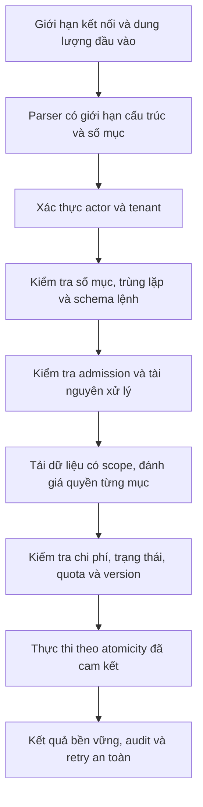

# Batch size restriction: giới hạn kích thước lô theo chi phí và quy tắc nghiệp vụ

Trong chương **Batch Operations**, batch size restriction là việc giới hạn lượng công việc mà một yêu cầu hoặc một tác vụ hàng loạt được phép đưa vào hệ thống. Kích thước không chỉ là số ID trong JSON; nó còn có thể là dung lượng đầu vào, số đối tượng thực sự bị tác động, số quan hệ mở rộng và chi phí gọi các hệ thống khác.

Trong module bảo vệ logic nghiệp vụ, một lô quá lớn có thể làm cạn tài nguyên, giữ khóa lâu, chiếm quota hoặc khiến quy trình bỏ sót kiểm tra quyền và trạng thái. Chia một yêu cầu thành nhiều lô cũng có thể làm vượt giới hạn cộng dồn nếu hệ thống chỉ kiểm tra từng request riêng lẻ.

Bài học sử dụng ví dụ duyệt hàng loạt đề nghị chi. Các con số giới hạn chỉ minh họa hợp đồng, không phải kết quả đo hiệu năng hoặc khuyến nghị áp dụng nguyên trạng cho mọi hệ thống.

Sau bài này, bạn có thể:

- Phân biệt giới hạn số mục với giới hạn dung lượng, chi phí và quota nghiệp vụ.
- Đặt kiểm tra ở đúng giai đoạn, trước khi cấp tài nguyên hoặc tạo hiệu ứng.
- Giữ quyền theo từng đối tượng, version và snapshot trong một batch.
- Xác định rõ atomicity khi chia chunk hoặc xử lý nền.
- Thiết kế retry và idempotency không làm lặp các mục đã hoàn tất.
- Kiểm thử lô trùng, lô trộn tenant, request đồng thời và giới hạn xuyên nhiều lô.

## 1. Batch hợp lệ về cú pháp vẫn có thể gây hậu quả lớn

Giả sử endpoint nhận một mảng đề nghị cần duyệt. Mỗi mục chỉ có một ID và vài điều kiện phiên bản, nhưng một request có thể chứa hàng chục nghìn mục.

Nếu hệ thống tải toàn bộ graph dữ liệu, kiểm tra quyền, giữ khóa và ghi audit trong một transaction dài, request đó có thể:

- Tiêu thụ nhiều bộ nhớ và kết nối cơ sở dữ liệu.
- Giữ khóa khiến các thao tác hợp lệ khác phải chờ.
- Gây nhiều lời gọi policy hoặc dịch vụ phụ thuộc.
- Tạo số lượng lớn sự kiện, thông báo hoặc công việc tiếp theo.
- Làm việc phục hồi, retry và giải thích kết quả trở nên khó kiểm soát.

Rủi ro nghiệp vụ cũng quan trọng. Một implementation có thể kiểm tra quyền cho mục đầu, bỏ qua mục không tìm thấy hoặc tiếp tục sau lỗi rồi báo cả lô thành công. Kích thước lớn thường làm những đường xử lý tắt này khó phát hiện hơn.

Giới hạn batch giúp ràng buộc phạm vi một lần thực thi. Nó không thay thế quyền từng mục, transaction hay quota tổng.

## 2. Có nhiều loại giới hạn độc lập

| Giới hạn | Bảo vệ điều gì? | Ví dụ minh họa |
| --- | --- | --- |
| Dung lượng request | Tài nguyên nhận và phân tích đầu vào | Body được giải mã không quá 64 KiB |
| Số mục thô | Số phần tử phải tiếp nhận và kiểm tra | Từ 1 đến 50 mục |
| Số đối tượng phân biệt | Phạm vi công việc nghiệp vụ thực sự | Không nhận hai mục cho cùng đề nghị trong lô |
| Độ sâu và dữ liệu lồng nhau | Tài nguyên parser và graph xử lý | Chỉ nhận schema lệnh hẹp, có giới hạn cấu trúc |
| Chi phí có trọng số | Công việc không đồng đều giữa các mục | Tổng chi phí dự kiến không vượt ngân sách xử lý |
| Số lô đang chờ hoặc chạy | Công bằng và năng lực xử lý | Hạn mức theo actor, tenant và hệ thống |
| Phạm vi toàn job | Tổng công việc dù được chia nhiều chunk | Job có số mục và thời hạn tối đa |
| Quota nghiệp vụ | Giá trị hoặc tài nguyên được phép sử dụng | Tổng giá trị duyệt trong kỳ theo policy |

Một body nhỏ vẫn có thể tham chiếu một đối tượng có rất nhiều phần tử con. Một lô chỉ có vài mục vẫn có thể dùng hết ngân sách nếu mỗi mục có giá trị lớn.

Các giới hạn cần được đặt từ dữ liệu cấu hình có thẩm quyền. Client có thể đề xuất kích thước hoặc trang làm việc, nhưng không tự nâng trần bằng `limit`, `adminMode` hay `unlimited=true`.

## 3. Hợp đồng ví dụ cho duyệt hàng loạt

Giả sử endpoint chọn:

- Tối đa 50 mục cho một request.
- Mỗi mục là một ý định duyệt trên một đề nghị và snapshot cụ thể.
- Không cho lặp request ID hoặc client item ID trong cùng lô.
- Actor phải có quyền và đủ điều kiện trên mọi đề nghị.
- Lô này dùng ngữ nghĩa toàn bộ thành công hoặc không có quyết định duyệt nào được commit.
- Những giới hạn về giá trị và quota vẫn được kiểm tra bằng dữ liệu máy chủ.

```http
POST /expense-requests/batch-approve
Idempotency-Key: batch-approve-20261122-01
Content-Type: application/json

{
  "items": [
    {
      "clientItemId": "item-1",
      "requestId": "expense-17",
      "expectedVersion": 7,
      "expectedSnapshotId": "snapshot-3"
    },
    {
      "clientItemId": "item-2",
      "requestId": "expense-18",
      "expectedVersion": 4,
      "expectedSnapshotId": "snapshot-2"
    }
  ]
}
```

Ví dụ HTTP dùng ID dễ đọc; code Java ở phần sau dùng UUID làm biểu diễn minh họa. Hợp đồng thực tế phải thống nhất một định dạng.

Không nhận `itemCount` do client khai làm căn cứ duy nhất. Máy chủ đếm mảng thực tế. Không nhận trạng thái đích, người duyệt, số tiền hoặc hạn mức tùy ý trong từng mục.

Giới hạn 50 mục của ví dụ không cho biết một transaction 50 mục luôn đủ nhanh. Cần đo với số truy vấn, quan hệ và hiệu ứng thực tế rồi điều chỉnh chính sách phù hợp.

## 4. Kiểm tra sớm, nhưng không bỏ kiểm tra tại điểm thực thi

Một pipeline có thể là:



Header dung lượng có thể hỗ trợ từ chối sớm, nhưng cần giới hạn số byte thực sự đọc theo cơ chế HTTP của hệ thống. Không tin một giá trị khai nhỏ trong khi luồng dữ liệu tiếp tục vượt trần.

Nếu hỗ trợ nén, giới hạn kích thước trên đường truyền và sau giải nén cần được xem riêng. Giới hạn chỉ ở dữ liệu nén không bảo vệ parser khỏi một nội dung giải mã quá lớn.

Kiểm tra số mục sau khi đã dựng một mảng khổng lồ vẫn chặn được phần nghiệp vụ nhưng chưa bảo vệ giai đoạn parse. Cần trần body và giới hạn parser, hoặc xử lý có giới hạn khi đọc nếu nền tảng hỗ trợ.

Ở tầng service vẫn kiểm tra lại hợp đồng batch. Một lời gọi từ worker, import hoặc test nội bộ có thể không đi qua đúng gateway HTTP, nên không dựa vào một lớp ngoài làm bảo đảm duy nhất.

## 5. Minh họa Java: giới hạn số mục trước khi mở rộng công việc

Đoạn mã dùng record của Java 16 trở lên. Nó chỉ kiểm tra cấu trúc batch đã được parser giới hạn; không thay thế trần dung lượng, quyền đối tượng hoặc transaction.

```java
import java.util.ArrayList;
import java.util.HashSet;
import java.util.List;
import java.util.Objects;
import java.util.Set;
import java.util.UUID;

record ApprovalItem(
        UUID clientItemId,
        UUID requestId,
        long expectedVersion,
        UUID expectedSnapshotId) {
}

final class BatchApprovalInput {
    private static final int MAX_ITEMS = 50;

    private BatchApprovalInput() {
    }

    static List<ApprovalItem> validateAndCopy(List<ApprovalItem> rawItems) {
        Objects.requireNonNull(rawItems);
        require(!rawItems.isEmpty(), "BATCH_EMPTY");
        require(rawItems.size() <= MAX_ITEMS, "BATCH_ITEM_LIMIT_EXCEEDED");

        Set<UUID> requestIds = new HashSet<>();
        Set<UUID> clientItemIds = new HashSet<>();
        List<ApprovalItem> accepted = new ArrayList<>(rawItems.size());

        for (ApprovalItem item : rawItems) {
            require(item != null, "NULL_BATCH_ITEM");
            require(item.clientItemId() != null
                    && item.requestId() != null
                    && item.expectedSnapshotId() != null,
                    "MISSING_ITEM_REFERENCE");
            require(item.expectedVersion() >= 0, "INVALID_VERSION");
            require(clientItemIds.add(item.clientItemId()),
                    "DUPLICATE_CLIENT_ITEM_ID");
            require(requestIds.add(item.requestId()),
                    "DUPLICATE_REQUEST_ID");
            accepted.add(item);
        }

        return List.copyOf(accepted);
    }

    private static void require(boolean valid, String code) {
        if (!valid) {
            throw new IllegalArgumentException(code);
        }
    }
}
```

Số phần tử thô được kiểm tra trước khi xây các tập ID. Nếu client gửi hàng nghìn bản sao cùng ID, việc chỉ đếm sau deduplicate sẽ không phản ánh chi phí tiếp nhận và kiểm tra đầu vào.

Ví dụ giả định danh sách do parser của request tạo và không bị luồng khác sửa đồng thời. Khi đưa command sang xử lý nền, giữ bản sao bất biến và dữ liệu nhận diện ổn định thay vì chia sẻ một collection có thể tiếp tục bị thay đổi.

`expectedVersion` và snapshot chỉ là tiền điều kiện được đề xuất. Chúng không chứng minh đề nghị thuộc tenant hoặc actor được phép duyệt. Các ngoại lệ minh họa cần được ánh xạ sang lỗi API đúng hợp đồng.

## 6. Trùng lặp, mở rộng ngầm và chi phí có trọng số

Giới hạn số mục cần đi cùng một quy tắc về đối tượng thực sự bị tác động.

Ví dụ một mục có thể chứa:

```text
customerId → toàn bộ hồ sơ của khách hàng
folderId → mọi tài liệu bên trong
filter = tất cả đề nghị đang chờ
includeChildren = true
```

Một mảng có 10 mục có thể dẫn tới hàng chục nghìn đối tượng. Nếu endpoint chỉ hỗ trợ ID cụ thể, schema phải từ chối những cơ chế mở rộng không được định nghĩa. Nếu nghiệp vụ cần chúng, phải giới hạn tập kết quả mở rộng và chi phí tương ứng.

Có thể mô hình hóa:

```text
cost(batch) = tổng estimatedCost(item)
cost(batch) <= processingBudget
```

Chi phí được tính từ mô hình máy chủ, không từ `estimatedCost=1` do client khai. Nó có thể phản ánh số dòng, số quan hệ, số lần kiểm tra quyền hoặc lời gọi phụ thuộc.

Ước tính không phải bảo đảm chi phí thực tế. Cần trần mở rộng, số lời gọi và tài nguyên khi thực thi; nếu phải dừng, kết quả phải giữ đúng atomicity và trạng thái đã cam kết, không báo mọi mục đã xong.

Với đối tượng con có thể tăng đồng thời, cần snapshot, version hoặc cơ chế đọc phù hợp để tập thực hiện không vượt khỏi tập đã được tính giới hạn ngoài ý muốn.

## 7. Hạn chế kích thước không thay quyền từng mục

Một batch nhỏ vẫn có thể chứa:

- Một đề nghị của tenant khác.
- Một mục ngoài bộ phận được phép.
- Đề nghị do chính reviewer tạo.
- Một đối tượng đã bị hủy hoặc đã duyệt.
- Snapshot không còn khớp nội dung hiện tại.

Các query tải dữ liệu phải giữ tenant và quan hệ phù hợp:

```sql
SELECT id, department_id, requested_by_person_id,
       state, version, content_snapshot_id, amount, currency
FROM expense_request
WHERE tenant_id = :authorized_tenant_id
  AND id IN (:bound_request_ids);
```

Danh sách ID cần được bind bằng cơ chế tham số phù hợp. Sau khi tải, kiểm tra từng đối tượng theo policy; không lấy quyền của mục đầu tiên áp dụng cho cả lô.

Nếu số bản ghi không khớp tập yêu cầu, không tự bỏ qua mục thiếu rồi báo thành công cả lô. Theo hợp đồng toàn bộ hoặc không gì cả của ví dụ, lô không được tạo quyết định khi còn mục chưa xác lập được thẩm quyền.

Không truy vấn toàn cục để tiết lộ chính xác mục nào tồn tại ở tenant khác cho caller không được biết. Lỗi và kết quả từng mục nếu có phải giữ chính sách tiết lộ tài nguyên.

## 8. Chọn atomicity trước khi chia chunk

Có hai hợp đồng phổ biến:

| Hợp đồng | Ý nghĩa | Điều cần bảo đảm |
| --- | --- | --- |
| Toàn bộ hoặc không gì cả | Mọi mục hợp lệ và cùng được commit, hoặc không có thay đổi nghiệp vụ trong lô | Ranh giới transaction và dữ liệu bắt buộc phù hợp |
| Thành công từng phần | Mỗi mục hoặc nhóm được commit độc lập theo hợp đồng | Kết quả bền vững từng mục và retry không lặp mục đã xong |

Với batch duyệt trong ví dụ:

```text
BEGIN TRANSACTION
  tải và bảo vệ tập đề nghị có scope theo thứ tự khóa thống nhất
  xác minh đủ mọi mục, quyền, trạng thái, version và snapshot
  kiểm tra giới hạn giá trị cùng quota liên quan
  ghi các quyết định và cập nhật trạng thái có điều kiện
  ghi audit, outbox và kết quả batch
COMMIT
```

Nếu chia 1.000 mục thành 20 transaction rồi từng phần commit, kết quả không còn là một transaction toàn bộ hoặc không gì cả cho 1.000 mục. Một response cuối cùng không làm các commit trước đó tự rollback khi chunk sau lỗi.

Vì vậy, giới hạn nhỏ có thể giúp giữ một hợp đồng nguyên tử khả thi. Nếu cần tác vụ lớn, phải thiết kế hợp đồng job và kết quả từng phần rõ ràng, hoặc một cơ chế nghiệp vụ khác phù hợp.

Bù trừ cũng không đồng nghĩa rollback: một thông báo hoặc tác dụng bên ngoài đã xảy ra có thể không được thu hồi chỉ bằng cách đảo lại cột trạng thái.

## 9. Chia nhiều lô không được đặt lại quota nghiệp vụ

Chia một lô lớn thành nhiều lô nhỏ là cách sử dụng hợp lệ khi client cần tuân thủ giới hạn kỹ thuật. Nó trở thành đường vượt quy tắc nếu mỗi lô làm hệ thống quên một giới hạn đáng lẽ áp dụng xuyên nhiều lần gọi.

Ví dụ:

```text
mỗi request tối đa 50 mục
khác với
một actor chỉ được duyệt tổng giá trị nhất định trong kỳ
```

Nếu chỉ kiểm tra tổng tiền trong từng batch, actor có thể gửi nhiều batch liên tiếp hoặc đồng thời để vượt mức cộng dồn. Số tiền phải lấy từ đề nghị và loại tiền được xác minh, không lấy tổng tự khai trong body.

Các giới hạn có thể cần ở nhiều cấp:

- Số request hoặc công việc theo actor.
- Công việc đang chờ và đang chạy theo tenant.
- Tổng giá trị được xử lý trong kỳ theo policy.
- Tài nguyên dùng chung như ngân sách, reservation hoặc quota tổ chức.
- Các nhóm ý định liên quan nếu nghiệp vụ có quy tắc chống chia nhỏ giao dịch.

Việc kiểm tra và tiêu thụ giới hạn cần có cơ chế nhất quán giữa các request và instance. Hai batch cùng đọc “còn đủ quota” không được cùng vượt mức khi commit.

Tách quota nghiệp vụ của hiệu ứng đã chấp nhận với giới hạn chống lạm dụng tính theo nỗ lực hoặc chi phí kiểm tra. Một lô toàn mục không hợp lệ có thể không tiêu thụ hạn mức duyệt nhưng vẫn cần giới hạn tần suất và tài nguyên xử lý.

## 10. Idempotency của batch và của từng mục

Nếu server commit nhưng client mất phản hồi, retry không được tạo thêm các quyết định hoặc tính lại quota như một batch mới.

Phạm vi key có thể gồm tenant, actor và loại thao tác. Dấu vân tay phải ràng buộc tập mục, version, snapshot cùng những dữ liệu có ý nghĩa của lệnh.

Thứ tự có thuộc ý định hay không cần được định nghĩa. Nếu các mục độc lập và thứ tự không có ý nghĩa, có thể chuẩn hóa theo một quy tắc ổn định. Nếu thứ tự quyết định phân bổ tài nguyên hoặc kết quả, không tự sắp xếp lại khi đối chiếu.

| Tình huống | Hành vi cần giữ |
| --- | --- |
| Cùng key, cùng batch đã commit | Trả kết quả tương ứng theo quyền hiện tại, không chạy lại |
| Cùng key nhưng đổi mục, snapshot hoặc atomicity có ý nghĩa | Từ chối tái sử dụng key cho ý định khác |
| Key khác có các đối tượng đã được duyệt | State machine và ràng buộc quyết định ngăn hiệu ứng trùng |
| Job thành công từng phần rồi restart | Nhận diện mục đã commit, không thực hiện lại phần đó |
| Batch chưa commit và bị rollback | Không trả thành công từ một kết quả chưa có hiệu lực |

Với xử lý từng phần, cần định danh và kết quả bền vững từng mục, thường liên kết qua batch ID và client item ID hoặc operation tương ứng. Chỉ lưu một cờ batch đã nhận không đủ để biết 15 mục đã commit trước khi worker dừng.

Idempotency key không cho phép vượt batch size hoặc quyền. Các ràng buộc lâu dài trên đối tượng vẫn phải giữ sau khi bản ghi key hết thời gian lưu.

## 11. Job bất đồng bộ cần giới hạn toàn bộ công việc

Đưa batch vào hàng đợi không làm chi phí biến mất. Nếu chỉ giới hạn chunk đang chạy mà không giới hạn tổng job, một actor vẫn có thể nạp một lượng công việc rất lớn.

Một job cần quy định:

```text
tổng số mục hoặc phạm vi công việc được chấp nhận
kích thước và mức song song của chunk
thời gian sống hoặc deadline
số job đang chờ và đang chạy
ngân sách xử lý, số lần retry và điều kiện dừng
quyền đọc kết quả, hủy hoặc tiếp tục
```

Nếu nhận file, cần giới hạn dung lượng và số dòng thực tế, kiểm tra cấu trúc và các định dạng giải nén được hỗ trợ. Muốn giữ hợp đồng toàn bộ hoặc không gì cả thì không được bắt đầu commit các dòng đầu trong khi chưa biết cuối file có vượt giới hạn hoặc không hợp lệ hay không, trừ khi đã có một thiết kế nguyên tử phù hợp khác.

Với lựa chọn bằng filter, cần xác định tập mục cố định hay động. Một job “mọi đề nghị đang chờ” có thể tiếp tục thu nhận dữ liệu mới ngoài dự kiến nếu query được chạy lại không có ranh giới.

Có thể chốt một tập ID hoặc snapshot có giới hạn, đồng thời vẫn kiểm tra quyền và trạng thái theo ranh giới hiệu lực của job. Không để việc phân trang trở thành một cách xử lý vô hạn từ một request nhỏ.

`202 Accepted` chỉ cho biết công việc đã được tiếp nhận theo hợp đồng, không chứng minh mọi mục đã thành công. Job cần trạng thái và kết quả có thể truy vấn trong đúng scope.

## 12. Fan-out và giới hạn của hệ thống phụ thuộc

Một mục có thể tạo nhiều công việc tiếp theo: ghi audit, gửi thông báo, kiểm tra policy, tạo tài liệu hoặc gọi hệ thống ngoài. Cần tính cả fan-out đó khi chọn trần batch.

Không tạo một future hoặc thread không giới hạn cho mọi mục chỉ vì request đã qua kiểm tra số lượng. Mức song song cần có trần phù hợp với connection pool, worker và giới hạn bên nhận.

Các lớp kiểm soát có thể gồm:

- Giới hạn số lời gọi đang chạy cùng lúc.
- Giới hạn công việc được xếp hàng cho mỗi tenant và toàn hệ thống.
- Timeout và retry có kiểm soát theo loại phụ thuộc.
- Cơ chế áp lực ngược để không tiếp nhận vượt năng lực đã cam kết.
- Outbox và consumer có chống lặp cho hiệu ứng sau commit.

Không giữ khóa cơ sở dữ liệu trong lúc chờ một loạt API ngoài trả lời. Nếu nghiệp vụ cần tác dụng phân tán, thiết kế operation và trạng thái trung gian thay vì giả định một transaction cục bộ bao trùm mọi hệ thống.

Một timeout không chứng minh phía ngoài chưa thực hiện. Retry phải tiếp tục đúng operation và không nhân thêm tác dụng phụ chỉ vì batch được chia lại.

## 13. Phản hồi giới hạn và kết quả không được mơ hồ

Với batch vượt số mục, có thể trả mã lỗi miền như:

```json
{
  "code": "BATCH_ITEM_LIMIT_EXCEEDED",
  "maxItems": 50
}
```

Giới hạn số mục công khai trong hợp đồng có thể giúp client chia lô. Không cần tải đối tượng của tenant khác hoặc trả dữ liệu riêng tư để giải thích một lỗi kích thước.

Phân biệt các loại lỗi:

| Loại | Ý nghĩa cần truyền đạt |
| --- | --- |
| Dung lượng quá lớn | HTTP `413` có thể phù hợp với hợp đồng payload |
| Quá nhiều mục hoặc cấu trúc batch sai | Mã input hoặc mã miền nhất quán của API |
| Vượt tần suất hoặc quota tiếp nhận | Kết quả giới hạn tương ứng, có hướng dẫn retry khi xác định được |
| Mục không có quyền hoặc không tìm thấy trong scope | Không tiết lộ dữ liệu ngoài phạm vi |
| Version hoặc trạng thái không phù hợp | Xung đột nghiệp vụ cần xử lý, không chỉ retry mù |
| Lỗi tạm thời sau khi tiếp nhận | Có định danh để truy vấn hoặc retry cùng ý định |

Không âm thầm cắt còn 50 mục đầu rồi báo thành công cho toàn bộ input. Nếu endpoint hỗ trợ xử lý từng phần, phải có kết quả và định danh rõ cho từng mục theo hợp đồng.

Số mục thành công, thất bại và còn chờ phải phản ánh đúng phần công việc đã được nhận và commit. Một lô bị từ chối ngay ở schema không cần giả tạo hàng trăm kết quả mục như thể đã kiểm tra quyền từng đối tượng.

## 14. Cấu hình, đo chi phí và audit

Giới hạn cần dựa trên công việc thực tế, không chỉ một con số thuận tiện trên giao diện. Đo với các trường hợp có số quan hệ, truy vấn và hiệu ứng cao trong phạm vi được hỗ trợ.

Các số liệu hữu ích:

- Số mục thô và số đối tượng phân biệt.
- Byte nhận vào, byte sau giải mã và độ sâu dữ liệu nếu liên quan.
- Số truy vấn, lời gọi phụ thuộc và công việc fan-out.
- Thời gian chờ khóa, thời gian transaction và độ dài hàng đợi.
- Batch bị từ chối, lô thành công từng phần và job quá deadline.
- Chi phí theo actor, tenant và loại thao tác.

Không lấy việc một lần thử 50 mục chạy nhanh làm bằng chứng cho mọi dữ liệu. Các mục có cùng hình dạng input có thể có chi phí xử lý rất khác nhau.

Nếu có mức giới hạn khác cho tenant hoặc công việc quản trị, lấy từ policy máy chủ và giữ trần tài nguyên hữu hạn. Không cho client tự khai role hoặc tier để tăng giới hạn.

Audit nên nối được actor, tenant, batch ID, loại lệnh, số mục, chính sách giới hạn, từng operation và kết quả đã commit khi cần. Không log toàn bộ payload, credential hoặc dữ liệu đối tượng ngoài quyền chỉ để đếm batch.

## 15. Kiểm thử giới hạn đầu vào và mở rộng công việc

| Ca kiểm thử | Kết quả cần giữ |
| --- | --- |
| Mảng rỗng | Từ chối theo hợp đồng, không tạo job vô nghĩa |
| Một mục hợp lệ | Có ca đối chứng thực sự thành công |
| Đúng mức tối đa | Xử lý đúng khi mọi điều kiện khác hợp lệ |
| Vượt mức một mục | Từ chối trước phần công việc không được phép |
| Nhiều bản sao cùng ID | Không giảm chi phí được tính chỉ nhờ deduplicate sau nhận |
| Client item ID trùng nhưng request ID khác | Không làm kết quả hoặc retry ánh xạ nhầm |
| Body nhỏ nhưng tham chiếu nhiều đối tượng con | Trần mở rộng hoặc chi phí vẫn có hiệu lực |
| Body vượt dung lượng hoặc metadata khai thấp hơn thực tế | Không vượt trần đọc và parser của hệ thống |
| Dữ liệu nén giải mã quá lớn nếu được hỗ trợ | Trần sau giải mã giữ được hiệu lực |
| Payload sâu hoặc có trường mở rộng không hỗ trợ | Không tạo graph công việc ngoài schema |
| Client gửi `limit` lớn hoặc cờ bỏ giới hạn | Không thay policy máy chủ |
| Endpoint nhận filter thay danh sách ID | Phạm vi tổng job và dữ liệu mở rộng được kiểm soát |

Quan sát việc parser, repository và worker đã thực hiện đến giai đoạn nào. Chỉ kiểm tra cuối cùng trả lỗi không chứng minh request quá lớn đã được chặn trước khi tiêu thụ tài nguyên không được phép.

Các kiểm thử về bộ nhớ hoặc thời gian cần tiêu chí phù hợp môi trường. Ưu tiên bằng chứng cấu trúc như trần byte, số mục, số lời gọi và mức song song; không dùng một ngưỡng thời gian ngẫu nhiên làm oracle duy nhất.

## 16. Kiểm thử quyền, trạng thái và quota trên từng mục

Chuẩn bị một lô gồm các mục có trạng thái và quyền được kiểm soát độc lập:

| Ca kiểm thử | Kết quả cần giữ |
| --- | --- |
| Mọi mục đúng tenant, đúng quyền, snapshot và version | Batch hợp lệ theo atomicity đã chọn |
| Một mục ở tenant khác | Không xử lý mục đó hoặc làm lộ dữ liệu ngoài quyền |
| Mục đầu hợp lệ, mục sau ngoài bộ phận | Không kế thừa quyền của mục đầu |
| Một đề nghị do chính reviewer tạo | Quy tắc không tự duyệt vẫn áp dụng |
| Một mục đã bị hủy hoặc đã được quyết định | Không bỏ qua rồi báo cả lô thành công |
| Một snapshot không khớp | Không duyệt nội dung mới bằng bằng chứng cũ |
| Tổng giá trị vượt quota dù từng mục dưới hạn mức | Chặn theo giới hạn tổng có thẩm quyền |
| Chia thành nhiều batch dưới trần số mục | Quota xuyên batch không bị đặt lại |
| Cùng actor qua nhiều thiết bị hoặc instance | Giới hạn cấp actor không bị nhân theo client |
| Job lớn được chia thành nhiều chunk | Tổng phạm vi và atomicity phản ánh đúng hợp đồng |

Với lô toàn bộ hoặc không gì cả, xác minh mọi đối tượng và phần quota vẫn không đổi khi một điều kiện bắt buộc thất bại. Với lô từng phần, xác minh chính xác mục nào đã commit và phần nào có thể retry.

Expected phải dựa trên quy tắc nghiệp vụ và fixture độc lập, không chỉ đếm những gì production handler trả về rồi coi đó là kết quả đúng.

## 17. Kiểm thử concurrency, retry và lỗi giữa các bước

| Kịch bản | Invariant hoặc hành vi cần giữ |
| --- | --- |
| Hai batch cùng dùng phần quota còn lại | Tổng sử dụng không vượt mức sau commit |
| Hai batch có các mục giao nhau | Không ghi hai quyết định trái invariant cho cùng nhiệm vụ |
| Cùng key đến đồng thời | Chỉ một lần nhận quyền thực hiện cùng ý định |
| Mất phản hồi sau commit | Replay không trừ quota hoặc tạo hiệu ứng thêm |
| Worker dừng sau một số mục ở chế độ từng phần | Restart không thực hiện lại mục đã commit |
| Lỗi giữa batch nguyên tử | Dữ liệu cục bộ bắt buộc rollback đầy đủ |
| Lỗi gửi outbox hoặc thông báo sau commit | Retry phần gửi không chạy lại quyết định nghiệp vụ |
| Quyền hoặc trạng thái thay đổi trong khi job chờ | Hành vi đúng ranh giới hiệu lực đã định |
| Dữ liệu con tăng sau lúc tính chi phí | Không mở rộng công việc vượt hợp đồng mà không kiểm soát |
| Nhiều job cùng được nhận trên nhiều instance | Trần công việc chờ và đang chạy vẫn đúng policy |

Oracle cần quan sát quyết định, trạng thái, version, sổ quota, reservation nếu có, job, từng item result, outbox và lời gọi tới fake provider. Một response lỗi không đủ nếu hiệu ứng đã xảy ra trước đó.

Dùng lịch thực thi có điểm đồng bộ và cơ chế lưu trữ phù hợp để tạo tranh chấp thật. Mock một số dư quota hoặc gọi hai batch tuần tự không chứng minh thao tác nhận quota là nguyên tử.

Phân biệt log của một lần thử bị từ chối với audit thành công. Không để số liệu tổng kết batch làm các mục chưa chạy trông như đã được xử lý hợp lệ.

## 18. Cách đặt batch size restriction cho một thao tác

1. Xác định đơn vị công việc, đối tượng thực sự bị tác động và các đường mở rộng ngầm.
2. Đặt trần dung lượng, parser, số mục thô, đối tượng phân biệt và dữ liệu lồng nhau.
3. Định nghĩa chi phí xử lý, fan-out, mức song song và giới hạn toàn job.
4. Chọn atomicity trước khi quyết định chia chunk hoặc đưa vào hàng đợi.
5. Kiểm tra quyền, tenant, trạng thái, version và snapshot của từng mục.
6. Bảo vệ quota nghiệp vụ xuyên request bằng dữ liệu có thẩm quyền và cơ chế nhất quán.
7. Thiết kế key, item identity và kết quả bền vững để retry không chạy lại hiệu ứng.
8. Trả lỗi hoặc trạng thái rõ ràng, không cắt lô hay bỏ mục âm thầm.
9. Đo công việc thực tế, audit đủ phạm vi và kiểm thử ranh giới cùng các lịch chạy đồng thời.

Giới hạn batch có hiệu quả khi nó ràng buộc đúng lượng công việc và hậu quả nghiệp vụ, không chỉ độ dài một mảng. Các trần đầu vào, quyền từng mục, quota cộng dồn và ranh giới commit cần cùng giữ hiệu lực dù caller chia lô, retry hoặc chuyển công việc sang xử lý nền.
