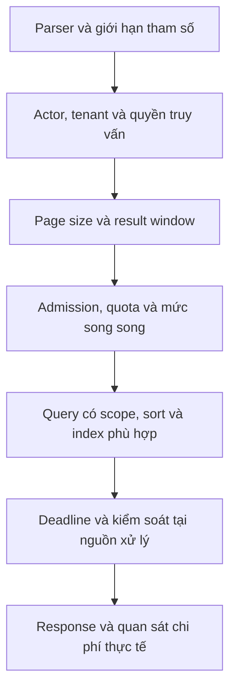

# Offset abuse: ngăn lạm dụng vị trí phân trang để vượt giới hạn xử lý

Trong chương **Pagination Security**, offset abuse là việc lợi dụng tham số vị trí phân trang để buộc hệ thống xử lý quá nhiều dữ liệu, dò tìm kết quả ngoài phạm vi dự kiến hoặc làm sai một hành động phụ thuộc vào trang dữ liệu. Một request chỉ trả một vài bản ghi vẫn có thể gây chi phí lớn nếu máy chủ phải tìm, sắp xếp hoặc bỏ qua một lượng dữ liệu đáng kể trước đó.

Trong module bảo vệ logic nghiệp vụ, phân trang cần giữ quyền theo đối tượng, tenant scope, giới hạn tài nguyên và ý nghĩa của những dữ liệu người dùng định xử lý. `offset` là vị trí trong một tập kết quả, không phải quyền truy cập, snapshot đã được duyệt hay định danh của một ý định nghiệp vụ.

Bài học dùng ví dụ danh sách đề nghị chi có bộ lọc và quyền theo bộ phận. Các giới hạn số chỉ minh họa hợp đồng, không phải kết quả đo hay ngưỡng an toàn chung cho mọi cơ sở dữ liệu.

Sau bài này, bạn có thể:

- Giải thích vì sao `limit` nhỏ không tự giới hạn chi phí của một offset lớn.
- Kiểm tra số học và cửa sổ kết quả trước khi chạy truy vấn.
- Giữ tenant, quyền và bộ lọc trong đúng tập dữ liệu được phân trang.
- Đánh giá khi nào dùng offset có giới hạn, khi nào cần cursor hoặc job xuất riêng.
- Ngăn việc dùng trang động làm bằng chứng cho hành động duyệt hoặc xử lý hàng loạt.
- Kiểm thử chi phí, response, metadata và tác dụng phụ của các request phân trang bất thường.

## 1. Kích thước phản hồi không đại diện cho toàn bộ chi phí truy vấn

Một endpoint có thể nhận:

```http
GET /expense-requests?offset=9000000&limit=1&status=PENDING_APPROVAL
```

SQL minh họa:

```sql
SELECT id, created_at, amount, currency
FROM expense_request
WHERE tenant_id = :authorized_tenant_id
  AND state = 'PENDING_APPROVAL'
ORDER BY created_at DESC, id DESC
LIMIT :limit OFFSET :offset;
```

Cú pháp và kế hoạch thực thi phụ thuộc hệ quản trị. Với nhiều kiểu truy vấn, offset sâu làm tăng lượng công việc tìm hoặc bỏ qua kết quả, đặc biệt khi còn có sort, join và bộ lọc không chọn lọc.

Không nên kết luận mọi engine luôn đọc chính xác `offset + limit` hàng. Index, thống kê, bộ lọc và optimizer có thể làm chi phí khác nhau. Nhưng cũng không được suy rằng trả một hàng chỉ tốn công của một hàng.

Một caller có credential hợp lệ có thể lặp nhiều truy vấn như vậy để chiếm tài nguyên dùng chung, ngay cả khi không cố đọc dữ liệu ngoài quyền.

## 2. Ranh giới cần giữ khi phân trang

Với mỗi request, cần xác định:

```text
actor và tenant được xác minh
tập dữ liệu đã áp dụng đầy đủ quyền và bộ lọc được phép
offset, limit và số học nằm trong hợp đồng
chi phí truy vấn và mức sử dụng cộng dồn được kiểm soát
response cùng metadata không lộ dữ liệu ngoài quyền
không tạo thay đổi nghiệp vụ từ một vị trí trang tự khai
```

Phân biệt ba giới hạn:

| Giới hạn | Ý nghĩa |
| --- | --- |
| Page size | Số mục được yêu cầu trả trong một trang |
| Result window | Khoảng vị trí được phép truy cập qua cơ chế phân trang này |
| Quota sử dụng | Tổng request, công việc hoặc dữ liệu được phép đọc theo phạm vi và thời gian |

Page size bằng 20 không có nghĩa caller chỉ có thể lấy 20 bản ghi. Result window hữu hạn cũng không bảo đảm caller không thu thập nhiều dữ liệu qua các bộ lọc khác nhau. Nếu sản phẩm có giới hạn trích xuất, phải mô hình hóa và thực thi giới hạn đó riêng.

## 3. Các biến thể offset abuse thường gặp

| Biến thể | Ví dụ | Rủi ro |
| --- | --- | --- |
| Offset rất lớn, limit nhỏ | Bỏ qua hàng triệu vị trí để trả một hàng | Chi phí tìm, sort hoặc scan lớn |
| Offset âm | `offset=-1` | Fallback hoặc ép kiểu tạo ngữ nghĩa ngoài hợp đồng |
| Tràn số khi đổi page sang offset | `(page - 1) * pageSize` vượt miền | Offset bị wrap, sai trang hoặc vô tình bỏ giới hạn |
| Giá trị đặc biệt | `limit=0`, `limit=-1`, `all=true` | Một nhánh coi là không giới hạn |
| Nhiều nguồn mâu thuẫn | Hai offset hoặc vừa offset vừa cursor | Validation và truy vấn dùng giá trị khác nhau |
| Dò nhiều vị trí hoặc bộ lọc | Quét nhiều trang hợp lệ liên tiếp | Thu thập hoặc tiêu thụ vượt quota sử dụng |
| Gọi xử lý theo trang | “Duyệt mọi mục tại offset 100” | Tập được xử lý có thể khác tập người dùng đã xem |

Không phải mọi request trang sâu đều có ý đồ xấu. Client cũ, lỗi tính page hoặc yêu cầu báo cáo hợp lệ cũng có thể tạo chúng. Hệ thống vẫn cần giới hạn và một cách phản hồi rõ ràng thay vì để chi phí không bị ràng buộc.

## 4. Thiết kế giới hạn số học và cửa sổ kết quả

Giả sử endpoint chọn:

```text
1 <= limit <= 100
offset >= 0
offset + limit <= 10.000
```

Đây là giới hạn phần cuối của đoạn yêu cầu, không chỉ trần riêng của offset. Một request `offset=9.999, limit=100` vượt cửa sổ dù offset còn dưới 10.000.

Kiểm tra phép cộng cần tránh tràn số. Khi `limit` đã được giới hạn, có thể diễn đạt tương đương:

```text
offset <= MAX_RESULT_WINDOW - limit
```

Với page đánh số từ 1:

```text
offset = (page - 1) × pageSize
```

Cần xác minh page và page size trước, đồng thời phát hiện tràn phép nhân. Không ép một số lớn xuống kiểu nhỏ trước khi kiểm tra hoặc biến số âm thành 0 để request tiếp tục.

Không dùng `abs` để sửa offset âm. Không biến lỗi phân tích số thành một query không phân trang. Giá trị ngoài hợp đồng cần lỗi có kiểm soát trước khi tạo công việc cơ sở dữ liệu.

## 5. Minh họa Java: một kiểu phân trang có ràng buộc

Đoạn mã dùng record của Java 16 trở lên. Nó kiểm tra giới hạn của ví dụ trên mọi lần dựng `BoundedPage` và có đường chuyển từ page index theo hợp đồng đánh số từ 1.

```java
record BoundedPage(long offset, int limit) {
    private static final int MAX_LIMIT = 100;
    private static final long MAX_RESULT_WINDOW = 10_000;

    BoundedPage {
        require(limit >= 1 && limit <= MAX_LIMIT, "INVALID_PAGE_SIZE");
        require(offset >= 0, "NEGATIVE_OFFSET");
        require(offset <= MAX_RESULT_WINDOW - limit,
                "RESULT_WINDOW_EXCEEDED");
    }

    static BoundedPage fromPage(long pageNumber, int pageSize) {
        require(pageNumber >= 1, "INVALID_PAGE_NUMBER");
        require(pageSize >= 1 && pageSize <= MAX_LIMIT,
                "INVALID_PAGE_SIZE");

        final long offset;
        try {
            offset = Math.multiplyExact(
                    Math.subtractExact(pageNumber, 1), pageSize);
        } catch (ArithmeticException overflow) {
            throw new IllegalArgumentException("PAGE_RANGE_OVERFLOW", overflow);
        }
        return new BoundedPage(offset, pageSize);
    }

    private static void require(boolean valid, String code) {
        if (!valid) {
            throw new IllegalArgumentException(code);
        }
    }
}
```

Parser HTTP vẫn phải kiểm tra định dạng số, độ dài chuỗi, tham số trùng và các nguồn đầu vào. Một số vượt khả năng biểu diễn cần bị từ chối trước khi dựng kiểu, không bị cắt bớt hoặc ép kiểu thành giá trị khác.

Ví dụ chỉ giới hạn vị trí và số mục. Nó không kiểm tra tenant, quyền đối tượng, chi phí sort hoặc quota giữa nhiều request. Repository cần nhận cả ngữ cảnh có thẩm quyền lẫn phân trang đã kiểm tra, không nhận lại raw offset từ một nguồn khác.

Các giới hạn trong production cần cấu hình hoặc mô hình hóa theo workload thực tế. Nếu có nhiều tier, giá trị phải lấy từ policy máy chủ, không từ cờ caller tự khai.

## 6. Quyền và tenant phải xác định tập kết quả trước phân trang

Truy vấn phải phân trang trên dữ liệu được phép, không tải toàn cục rồi lọc sau trong ứng dụng.

```sql
SELECT id, created_at, amount, currency
FROM expense_request
WHERE tenant_id = :authorized_tenant_id
  AND department_id IN (:authorized_department_ids)
  AND state = :requested_state
ORDER BY created_at DESC, id DESC
LIMIT :validated_limit OFFSET :validated_offset;
```

Danh sách bộ phận cần được bind và xử lý theo cơ chế phù hợp. Tập quyền rỗng không có nghĩa bỏ điều kiện bộ phận để trả mọi dữ liệu trong tenant.

Với bộ lọc OR, giữ tenant và quyền ở ngoài nhóm điều kiện do caller đề xuất:

```sql
WHERE tenant_id = :authorized_tenant_id
  AND department_id IN (:authorized_department_ids)
  AND (state = 'PENDING_APPROVAL' OR priority = 'HIGH')
```

Offset không tự cấp quyền đọc. Tuy nhiên, nếu backend chỉ bảo vệ các mục xuất hiện trên màn hình đầu hoặc tin ID do giao diện đưa ra, caller có thể dùng vị trí khác để tiếp cận dữ liệu mà luồng thông thường không hiển thị. Quyền phải được giữ trên mọi trang.

Các trường được dùng để sort hoặc filter cũng cần chính sách phù hợp. Cho caller điều khiển vị trí hoặc thứ tự theo một thuộc tính bí mật có thể tạo kênh suy luận dù thuộc tính không xuất hiện trong JSON.

## 7. Count, join và dữ liệu phụ cũng có chi phí và phạm vi

Một query trả 20 mục có thể đi kèm `COUNT(*)`, tổng theo nhóm và nhiều lần tải quan hệ. Chỉ giới hạn query chính chưa đủ.

Cần kiểm tra:

- Count và thống kê dùng cùng tenant, quyền và bộ lọc.
- Không có subquery hoặc nhánh hợp nhất dữ liệu bỏ scope.
- Quan hệ được tải cùng tenant và đúng đối tượng cha.
- Số mục con và kích thước response không mở rộng ngoài trần dự kiến.
- Không thực hiện một phép đếm rất đắt ở mọi lần lật trang khi hợp đồng không cần nó.

Một join có thể tạo nhiều hàng cho một đề nghị. Nếu `LIMIT` đang áp lên hàng join nhưng API báo đó là số đề nghị, kết quả có thể trùng, thiếu hoặc kéo theo chi phí không phản ánh page size.

Thiết kế truy vấn cần xác định đơn vị phân trang: đề nghị, dòng hàng hay nhóm kết quả. Có thể chọn tập ID được phép trước rồi tải các quan hệ có giới hạn, nhưng các truy vấn sau vẫn phải giữ scope và quan hệ đúng.

Nếu bỏ tổng số hoặc dùng số ước tính, hợp đồng phải nói rõ. Một số ước tính cũng không được chứa dữ liệu ngoài quyền chỉ vì nó không chính xác tuyệt đối.

## 8. Thứ tự ổn định và dữ liệu thay đổi giữa các trang

Offset phụ thuộc thứ tự của tập kết quả. Không có một thứ tự xác định, cùng offset có thể không đại diện cùng những bản ghi ở hai lần gọi.

Ngay cả khi có `ORDER BY created_at`, nhiều bản ghi có thể cùng timestamp. Thêm một khóa phân xử ổn định như ID trong tập kết quả giúp thứ tự rõ ràng hơn:

```sql
ORDER BY created_at DESC, id DESC
```

Tuy nhiên, insert, delete hoặc cập nhật trường sort giữa hai request vẫn có thể làm bản ghi dịch vị trí. Caller có thể thấy trùng hoặc bỏ qua một mục dù không thay tham số.

Một mốc thời gian tạo tối đa có thể loại bớt bản ghi mới được thêm sau mốc đó, nhưng không tự đóng băng mọi thay đổi hoặc xóa. Nếu cần snapshot chính xác cho một báo cáo, phải thiết kế cơ chế snapshot hoặc job phù hợp.

Không giữ một transaction mở trong lúc người dùng đọc và lật trang trong thời gian không xác định chỉ để cố bảo toàn vị trí. Yêu cầu nhất quán dài hạn cần một mô hình và giới hạn riêng.

Đặc biệt, vị trí trang không phải bằng chứng nội dung người dùng đã đồng ý duyệt hoặc thực hiện. Phần hành động hàng loạt cần xử lý riêng ở mục sau.

## 9. Cursor hoặc keyset có thể giảm nhu cầu bỏ qua sâu

Khi nhu cầu chính là đi tiếp theo một thứ tự ổn định, có thể truy vấn dựa trên khóa cuối đã thấy thay vì offset lớn.

Ví dụ thứ tự giảm dần:

```sql
SELECT id, created_at, amount, currency
FROM expense_request
WHERE tenant_id = :authorized_tenant_id
  AND department_id IN (:authorized_department_ids)
  AND state = :requested_state
  AND (
       created_at < :last_created_at
       OR (created_at = :last_created_at AND id < :last_id)
  )
ORDER BY created_at DESC, id DESC
LIMIT :validated_limit;
```

Predicate phù hợp cùng index có thể tránh kiểu công việc bỏ qua nhiều kết quả trước đó. Nó không tự làm mọi query rẻ: filter, quyền, join và phân bố dữ liệu vẫn ảnh hưởng kế hoạch thực thi.

Cursor cần có cách hiểu rõ về sort, bộ lọc và scope. Nếu mang metadata mà máy chủ cần bảo vệ tính toàn vẹn, có thể dùng tham chiếu lưu ở server hoặc bằng chứng được xác minh theo cơ chế phù hợp. Base64 tự nó không bảo vệ nội dung.

Không dùng cursor của tenant A cho tenant B hoặc bỏ kiểm tra quyền vì cursor có chữ ký hợp lệ. Nếu phải tải một anchor, không lookup toàn cục rồi dùng nó làm căn cứ mở phạm vi.

Cursor cũng không chống thu thập hàng loạt hay quota abuse. Caller vẫn có thể gọi nhiều trang liên tiếp; giới hạn sử dụng và quyền dữ liệu vẫn cần tồn tại.

## 10. Giới hạn cộng dồn không được đặt lại theo mỗi offset

Một caller có thể dùng nhiều request đều hợp lệ về `offset` và `limit` để tạo lượng công việc lớn. Rate limit đơn giản theo số request có thể chưa phản ánh sự khác nhau giữa trang đầu nhẹ và trang sâu đắt.

Có thể kết hợp:

- Giới hạn tần suất theo actor, tenant và loại truy vấn.
- Trần request đang chạy hoặc đang chờ.
- Ngân sách xử lý theo các yếu tố đã được máy chủ kiểm tra.
- Giới hạn dữ liệu được đọc hoặc xuất theo chính sách nếu nghiệp vụ yêu cầu.
- Kiểm soát các mẫu quét lặp hoặc thay bộ lọc liên tục để làm tăng công việc.

Một mô hình chi phí có thể cân nhắc độ sâu, page size, sort và filter, nhưng phải được đo và hiệu chỉnh. Không coi một công thức tuyến tính theo offset là định luật của mọi cơ sở dữ liệu.

Các giới hạn cấp actor hoặc tenant cần có hiệu lực qua nhiều session, thiết bị và instance nếu đó là phạm vi chính sách. Không để một `deviceId` hoặc idempotency key mới đặt lại ngân sách truy vấn.

Tách quyền đọc một bản ghi với chính sách trích xuất tập dữ liệu nếu sản phẩm cần sự phân biệt đó. Chỉ giới hạn page size hoặc giao diện không tạo ra một giới hạn xuất dữ liệu có thể tin cậy.

## 11. Timeout và bảo vệ năng lực ở nhiều lớp

Giới hạn offset là một lớp bảo vệ, không phải bằng chứng mọi truy vấn được nhận đều rẻ.



Các lớp cần xem xét gồm số kết nối, thời gian chờ, mức song song, giới hạn công việc DB và timeout phụ thuộc phù hợp.

HTTP request timeout không tự chứng minh query phía DB đã ngừng chạy. Cần hiểu cơ chế timeout hoặc hủy thực tế của driver, pool và database đang dùng, rồi kiểm thử trên môi trường tương ứng.

Nếu query bị từ chối vì giới hạn hoặc quá tải, đừng để client tự nhảy sang offset khác và retry không ngừng. Phản hồi cần đủ thông tin để phân biệt input ngoài hợp đồng với lỗi tạm thời.

Tham số hóa offset và limit không tự chống lạm dụng chi phí, nhưng vẫn cần để tránh trộn raw input vào SQL. Sort nên được ánh xạ từ tập lựa chọn được phép sang cấu trúc truy vấn có kiểm soát.

## 12. Cache và parser phải giữ cùng một cách hiểu

Một request có thể chứa hai offset hoặc cả offset lẫn cursor. Nếu lớp validation chọn giá trị đầu còn repository dùng giá trị cuối, trần đã kiểm tra không còn bảo vệ query thực tế.

Cần quy định:

- Mỗi tham số scalar xuất hiện bao nhiêu lần.
- Dùng offset hay cursor trên một request; nếu không hỗ trợ kết hợp thì từ chối.
- Ý nghĩa của field vắng mặt, giá trị rỗng, dấu âm và lỗi phân tích số.
- Các alias cũ nếu có và cách chuyển về một lệnh chuẩn.
- Mọi lớp tiêu thụ cùng một đối tượng phân trang đã được xác thực.

Cache key cần phản ánh tenant, phạm vi quyền và các dữ liệu ảnh hưởng kết quả như filter, sort, offset hoặc cursor, page size và projection phù hợp.

Một phản hồi cache không được làm mất kiểm tra quyền. Đồng thời, không coi cache là biện pháp duy nhất cho offset sâu: caller có thể tạo nhiều tổ hợp chưa có cache, hoặc một lần nạp cache vẫn quá đắt.

Nếu dùng cache cho count, phải giữ đúng scope và ngữ nghĩa độ cũ của metadata. Trả count toàn hệ thống kèm danh sách đã lọc tenant vẫn là rò rỉ.

## 13. Không dùng vị trí trang làm đối tượng của một quyết định nghiệp vụ

Một thiết kế nguy hiểm:

```http
POST /expense-requests/approve-page
Content-Type: application/json

{
  "offset": 100,
  "limit": 20,
  "status": "PENDING_APPROVAL"
}
```

Người dùng có thể đã xem 20 đề nghị ở thời điểm trước, nhưng khi POST được xử lý, insert hoặc cập nhật làm trang 100 chứa những đề nghị khác. Client cũng có thể tự đổi offset để chọn một tập chưa từng xem.

Máy chủ cần nhận một ý định gắn với đối tượng và nội dung cụ thể, chẳng hạn:

```text
danh sách request ID
expected version của từng mục
snapshot nội dung được định duyệt
hoặc một selection snapshot có thẩm quyền, phạm vi và thời hạn rõ ràng
```

Sau đó vẫn kiểm tra quyền, tenant, không tự duyệt, trạng thái và giới hạn batch trên từng mục. Selection snapshot không tự thay thế những guard cần có tại ranh giới áp dụng.

Idempotency cũng phải gắn với ý định thật. Cùng `offset=100` vào hai thời điểm không nhất thiết là cùng tập đối tượng; không dùng cặp offset–limit làm định danh duy nhất để suy rằng người dùng đang retry một quyết định cũ.

## 14. Truy cập sâu và xuất dữ liệu cần đường có giới hạn riêng

Một số nhu cầu hợp lệ cần nhiều dữ liệu: đối soát, kiểm toán hoặc báo cáo. Không nên giải quyết bằng một giá trị `limit=all` hoặc một ngoại lệ không giới hạn ở endpoint danh sách tương tác.

Có thể thiết kế job xuất có:

- Quyền tạo và tải báo cáo phù hợp.
- Phạm vi tenant, bộ lọc và tập dữ liệu rõ ràng.
- Snapshot hoặc hợp đồng nhất quán phù hợp nhu cầu.
- Tổng số mục, dung lượng, thời gian và mức song song tối đa.
- Trạng thái và kết quả bền vững, có thể tiếp tục hoặc hủy theo policy.
- Kiểm soát dữ liệu nhạy cảm trong tệp và thời hạn truy cập.

Chia export thành nhiều chunk chỉ giới hạn từng phần xử lý. Tổng job và quota sử dụng vẫn phải có trần để caller không đưa công việc vô hạn vào hàng đợi bằng một request nhỏ.

Offset vẫn có thể phù hợp với tập nhỏ, nhu cầu nhảy trang và chi phí đã được kiểm soát. Quyết định dùng offset, keyset hay export cần dựa trên hợp đồng và workload, không phải mặc định một kiểu luôn an toàn cho mọi trường hợp.

Khi thay giới hạn của API đang tồn tại, thông báo rõ cách client thu hẹp truy vấn hoặc dùng đường khác được phép. Không âm thầm cắt dữ liệu rồi để client tưởng đã nhận toàn bộ kết quả.

## 15. Hợp đồng lỗi và ranh giới cửa sổ kết quả

Một lỗi ngoài cửa sổ có thể là:

```json
{
  "code": "RESULT_WINDOW_EXCEEDED",
  "maxResultWindow": 10000,
  "maxPageSize": 100
}
```

Các giới hạn công khai của endpoint có thể giúp client điều chỉnh. Không cần chạy query hoặc tra tài nguyên ngoài quyền để tạo phản hồi này.

Phân biệt:

- Offset không có dữ liệu trong phạm vi hợp lệ.
- Offset nằm ngoài cửa sổ API cho phép.
- Query bị hạn chế bởi quota hoặc mức tải.
- Query có filter hoặc sort không được hỗ trợ.
- Quyền hoặc scope không hợp lệ.

Không trả mảng rỗng như thể hết dữ liệu khi thực tế request bị chặn bởi result window. Client cần biết đây là giới hạn cơ chế truy cập, không phải bằng chứng rằng toàn bộ tập kết quả đã được duyệt hết.

Nếu dùng `limit + 1` để tính còn trang tiếp theo, tính cả phần đọc thêm vào trần xử lý và định nghĩa rõ hành vi tại cuối cửa sổ. Không để metadata hứa một trang mà API sẽ từ chối, hoặc khẳng định dữ liệu đã hoàn toàn kết thúc khi chỉ hết phần được phép truy cập bằng offset.

Lỗi tạm thời và lỗi input cần khác nhau đủ để client không retry một offset không hợp lệ vô hạn. Mã HTTP và schema lỗi cụ thể phải nhất quán với hợp đồng API của hệ thống.

## 16. Ma trận kiểm thử số học và input

Với chính sách page size tối đa 100 và cửa sổ 10.000 của ví dụ:

| Input | Kỳ vọng |
| --- | --- |
| `offset=0, limit=1` | Hợp lệ nếu các điều kiện truy vấn khác đúng |
| `offset=9900, limit=100` | Đúng ranh giới cửa sổ |
| `offset=9901, limit=100` | Bị chặn vì cuối đoạn vượt cửa sổ |
| `offset=9999, limit=1` | Hợp lệ tại vị trí cuối được phép |
| `offset=10000, limit=1` | Ngoài cửa sổ |
| Offset âm | Bị từ chối, không chuyển thành 0 hoặc query toàn cục |
| Limit bằng 0, âm hoặc trên 100 | Bị từ chối theo hợp đồng |
| Page 100, size 100 với đánh số từ 1 | Offset 9.900, còn trong cửa sổ |
| Page 101, size 100 | Ngoài cửa sổ |
| Page rất lớn làm phép nhân tràn | Lỗi có kiểm soát, không wrap thành offset nhỏ |
| Chuỗi số vượt kiểu, rỗng hoặc không đúng định dạng | Không chạy query với giá trị fallback nguy hiểm |
| Hai offset hoặc vừa cursor vừa offset trái hợp đồng | Không có hai cách hiểu giữa validation và truy vấn |

Kiểm tra repository không được gọi với request bị từ chối ở ranh giới đầu vào phù hợp. Đồng thời có ca đối chứng query hợp lệ thành công để không nhầm mọi lỗi route hoặc fixture thành cơ chế bảo vệ đúng.

Expected cần tính từ hợp đồng độc lập, không gọi chính hàm production để tạo expected rồi tự so kết quả của nó.

## 17. Kiểm thử scope, chi phí, thay đổi dữ liệu và audit

Các ca tích hợp cần có:

| Kịch bản | Điều cần xác minh |
| --- | --- |
| User A đổi offset để tới vị trí có dữ liệu B nếu query thiếu scope | Mọi trang vẫn chỉ có dữ liệu được phép |
| Danh sách đúng tenant nhưng count không đúng | Metadata không chứa số liệu ngoài quyền |
| Filter OR, join hoặc subquery phức tạp | Scope không bị bỏ ở một nhánh |
| Insert hoặc delete giữa hai trang | Hành vi nhất quán với hợp đồng, không dùng trang động để quyết định thay người dùng |
| Một parent có nhiều child | Trần response và chi phí không bị fan-out không kiểm soát |
| Lặp offset sâu trong giới hạn từ nhiều session | Quota và mức song song có hiệu lực ở cấp đã định |
| Cache có response của tenant khác hoặc quyền khác | Không trả nhầm dữ liệu hoặc bỏ bước phân quyền |
| HTTP timeout trong lúc DB đang xử lý | Cơ chế giới hạn công việc thực tế được kiểm chứng |
| Cursor được đổi scope, filter hoặc sort | Không dùng ngoài hợp đồng và không bỏ quyền hiện tại |
| Lệnh duyệt nhận tập ID sau khi người dùng xem trang | Chỉ xử lý đúng đối tượng, version và snapshot được xác nhận |

Đánh giá query với dữ liệu đủ đại diện và công cụ quan sát phù hợp: kế hoạch, số hàng xử lý khi đo được, thời gian, bộ nhớ, lời gọi phụ và thời gian chờ. Không suy kế hoạch từ con số offset hoặc một lần chạy trên bảng rất nhỏ.

Audit và metric nên gắn actor, tenant đã xác minh, loại query, offset, limit, sort hoặc nhóm filter phù hợp, kết quả giới hạn và mã tương quan. Tránh ghi token hoặc toàn bộ điều kiện chứa dữ liệu riêng tư.

Với endpoint đọc, kỳ vọng không có mutation nghiệp vụ chỉ vì caller đổi vị trí trang. Nếu có công việc phụ bắt buộc như log truy cập, phân biệt nó với quyết định duyệt, nhận tài nguyên hoặc tạo operation.

Các phép thử đồng thời cần lịch thực thi có kiểm soát và môi trường lưu trữ phù hợp. Một unit test giới hạn số không chứng minh query thực tế có scope, index hoặc timeout đúng.

## 18. Cách bảo vệ một endpoint dùng offset

1. Xác định tập kết quả được phép và đơn vị phân trang thực sự.
2. Đặt giới hạn page size, cửa sổ kết quả và định dạng số một cách tường minh.
3. Phát hiện tràn số trước ép kiểu hoặc xây query; không dùng fallback bỏ phân trang.
4. Áp dụng tenant, quyền đối tượng, filter và sort được phép trong chính tập dữ liệu được phân trang.
5. Kiểm soát count, join, dữ liệu con và metadata đi kèm.
6. Dùng thứ tự xác định và mô tả ảnh hưởng của dữ liệu thay đổi giữa các request.
7. Kết hợp quota cộng dồn, mức song song và giới hạn công việc thực tế tại nguồn xử lý.
8. Chọn cursor hoặc job xuất riêng khi nhu cầu vượt hợp đồng offset tương tác.
9. Tách trang dữ liệu khỏi ý định duyệt hoặc xử lý hàng loạt, rồi kiểm thử cả chi phí và tác dụng phụ.

Offset an toàn cần được giới hạn trong đúng tập dữ liệu và đúng ngân sách xử lý. Một vị trí do client gửi không thể thay quyền truy cập, bằng chứng đã xem nội dung hoặc cơ chế kiểm soát tài nguyên mà nghiệp vụ yêu cầu.
