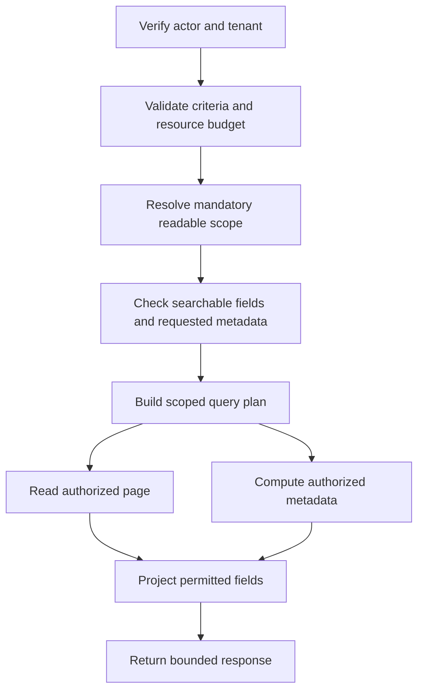

# Search result filtering: lọc kết quả tìm kiếm theo quyền và quy tắc nghiệp vụ

## 1. Kết quả tìm kiếm là một bề mặt truy cập dữ liệu

Một API lọc danh sách hồ sơ để người dùng chỉ thấy item được phép, nhưng `totalCount` vẫn tính toàn hệ thống. Một endpoint khác che tài liệu riêng tư khỏi danh sách, trong khi autocomplete vẫn gợi ý tiêu đề của tài liệu đó.

Không trả item gốc chưa đủ để giữ bí mật. Tìm kiếm có thể làm lộ sự tồn tại, trạng thái, tên chủ thể hoặc giá trị nhạy cảm qua nhiều phần của response.

**Search result filtering** là việc giới hạn tập kết quả và mọi dữ liệu dẫn xuất theo phạm vi người gọi được phép biết, đồng thời áp dụng đúng điều kiện tìm kiếm nghiệp vụ.

Trong bảo vệ logic nghiệp vụ, cần tránh các tình huống:

- Người dùng sửa filter để mở rộng tenant, owner hoặc phòng ban.
- Một nhánh OR bỏ qua predicate quyền bắt buộc.
- Count, facet, snippet hoặc gợi ý tìm kiếm dùng dữ liệu ngoài scope.
- Index/cache cũ tiếp tục công bố tài liệu sau khi thu hồi quyền.
- Client dùng kết quả tìm kiếm như giấy phép duyệt hoặc xử lý hàng loạt.

Mục tiêu không chỉ là trả đúng vài dòng trên UI. Mọi thông tin có thể quan sát phải tuân thủ hợp đồng dữ liệu và quyền tương ứng.

## 2. Phân biệt bộ lọc tìm kiếm với phạm vi quyền

### 2.1. Bộ lọc người dùng chỉ thu hẹp tập đã được phép

Có thể mô hình hóa:

```text
tập kết quả = phạm vi đọc được server cho phép
              giao với điều kiện tìm kiếm hợp lệ
```

Người dùng có thể chọn trạng thái, khoảng ngày hoặc loại hồ sơ được hỗ trợ. Họ không được dùng filter để tự tạo membership, quyền phòng ban hay quyền xem tài liệu bị hạn chế.

| Thành phần | Nguồn có thẩm quyền |
|---|---|
| Actor thực tế | Kết quả xác thực đã kiểm chứng |
| Tenant được dùng | Ngữ cảnh tenant đã xác minh |
| Phạm vi owner/phòng ban/chia sẻ | Policy và dữ liệu quyền phía server |
| Từ khóa, trạng thái, khoảng ngày | Ý định client, cần validation và giới hạn |
| Field tìm kiếm, sort, facet | Lựa chọn nằm trong danh mục và quyền được phép |

`ownerId` hoặc `scope=all` trong query không phải bằng chứng actor được xem phạm vi đó.

### 2.2. Thiếu filter không được bỏ scope

Nếu người dùng không truyền `departmentId`, hệ thống vẫn chỉ tìm trong những phòng họ được phép xem. Không diễn giải thiếu field thành toàn tenant hoặc toàn nền tảng khi policy không cho phép.

Tương tự, không tải được scope không có nghĩa scope rỗng theo nghĩa “không có điều kiện hạn chế”. Với điều kiện truy cập bắt buộc chưa xác lập, phải dừng hoặc xử lý lỗi phù hợp.

### 2.3. Một người có nhiều tenant vẫn cần scope từng request

Quyền quản trị ở tenant A không được gộp với membership chỉ xem ở B để tạo khả năng tìm kiếm rộng tại B. Request phải có tenant mục tiêu rõ và dùng đúng quyền trong ngữ cảnh đó.

Dữ liệu toàn cục hoặc chia sẻ xuyên tenant có thể tồn tại nếu được mô hình hóa rõ. Không coi mọi tài nguyên có nhãn public hoặc mọi ID tồn tại là ngoại lệ tự động cho tenant isolation.

## 3. Ghép điều kiện đúng để không mở rộng quyền

### 3.1. Đặt predicate bắt buộc ở ngoài biểu thức người dùng

Một cấu trúc hợp lý có thể là:

```text
tenant hợp lệ
AND (owner phù hợp OR có grant đọc hợp lệ)
AND (điều kiện tìm kiếm A OR điều kiện tìm kiếm B)
```

Một cấu trúc sai dễ gặp:

```text
(tenant hợp lệ AND owner phù hợp)
OR điều kiện tìm kiếm do client cung cấp
```

Nhánh sau có thể làm một điều kiện nghiệp vụ như trạng thái hoặc phòng ban trở thành đường bỏ qua quyền.

Không cho client thay toàn bộ root query rồi hy vọng một filter bảo mật được merge đúng. Planner cần giữ scope bắt buộc trong cấu trúc không bị payload ghi đè.

### 3.2. Boolean logic cần có nghĩa rõ với filter rỗng

Danh sách trạng thái rỗng nghĩa là không chọn trạng thái nào, không lọc trạng thái hay input không hợp lệ? Một mảng phòng ban chứa ID ngoài quyền được từ chối hay giao với scope? Cần chọn hợp đồng.

Dù chọn cách nào, filter rỗng hoặc có giá trị ngoài phạm vi không được biến thành phép mở rộng quyền. Không dùng những quy tắc mặc định khác nhau giữa đường list, count và export.

### 3.3. Trường hệ thống và trạng thái hạn chế

Các cờ như `includeDeleted`, `includeArchived`, `includePending` hoặc `includeInternal` có thể ảnh hưởng dữ liệu được biết. Chúng không chỉ là lựa chọn tiện ích nếu dữ liệu đó có policy riêng.

Người gọi phải được phép dùng khả năng tương ứng. Giữ tenant, owner và quyền field ngay cả khi một trạng thái được mở rộng hợp lệ.

### 3.4. Tìm theo ID chính xác không được có fast path thiếu quyền

Một endpoint có thể tối ưu truy vấn bằng cách nhận ra từ khóa là ID rồi gọi `findById`. Nếu fast path không giữ tenant và policy, tìm theo ID sẽ vượt qua hàng rào của tìm toàn văn.

Tương tự với mã hóa đơn, email hoặc tham chiếu operation: tồn tại và khớp chính xác không tạo quyền xem.

## 4. Lọc ở cấp đối tượng và cấp field

### 4.1. Được thấy hồ sơ không có nghĩa được thấy mọi nội dung

Một người có thể được xem tiêu đề và trạng thái nhưng không được tải chứng từ gốc hoặc thấy tài khoản người nhận. Search projection cần phản ánh quyền dữ liệu đó.

Không serialize toàn bộ entity hoặc tài liệu index chỉ vì item qua được một kiểm tra owner. Chọn field cần trả và áp dụng quyền ở nơi phù hợp.

### 4.2. Field không trả về vẫn có thể làm lộ thông tin qua điều kiện tìm

Nếu người dùng không được biết một thuộc tính nhạy cảm nhưng có thể lọc theo giá trị của nó và quan sát số kết quả, họ có thể suy đoán thuộc tính đó.

Vì vậy, quyền **tìm kiếm/lọc/sort/facet** trên field cần được xem xét, không chỉ quyền hiển thị field. Ẩn cột lương nhưng cho thử mọi khoảng lương có thể không đáp ứng chính sách bí mật mong muốn.

### 4.3. Allowlist cho field, operator và expansion

Giới hạn các field tìm kiếm, toán tử, sort và quan hệ mở rộng theo hợp đồng. Không chuyển trực tiếp một biểu thức tùy ý từ request thành query hoặc cho truy cập mọi field trong index.

Tham số hóa giá trị giúp tránh một nhóm lỗi ở tầng truy vấn, nhưng không tự giải quyết việc client chọn một field không được phép hoặc dùng OR để bỏ scope.

### 4.4. Highlight chỉ dùng nội dung được phép đọc

Một snippet có thể chứa phần nhạy cảm mà summary bình thường không trả. Không tạo highlight từ toàn văn bí mật rồi coi việc chỉ trả vài ký tự là an toàn.

Chọn field được phép, giới hạn độ dài và xử lý nội dung theo ngữ cảnh hiển thị. Không để raw HTML hoặc dữ liệu debug trở thành một đường rò rỉ khác.

## 5. Pipeline truy vấn có scope bắt buộc

Một luồng có thể là:



### 5.1. Ví dụ SQL cho owner hoặc grant trực tiếp

Ví dụ chọn một mô hình đơn giản: cùng tenant, hồ sơ đang được tìm kiếm theo policy, actor là owner hoặc có grant đọc trực tiếp còn hiệu lực.

```sql
SELECT d.id, d.title, d.state, d.version
FROM expense_document d
WHERE d.tenant_id = :authorized_tenant_id
  AND d.deleted_at IS NULL
  AND (
      d.owner_membership_id = :verified_membership_id
      OR EXISTS (
          SELECT 1
          FROM document_read_grant g
          WHERE g.tenant_id = d.tenant_id
            AND g.document_id = d.id
            AND g.grantee_membership_id = :verified_membership_id
            AND g.state = 'ACTIVE'
            AND (g.expires_at IS NULL OR g.expires_at > :server_now)
      )
  )
  AND (:validated_state IS NULL OR d.state = :validated_state)
  AND d.title LIKE :bound_search_pattern
ORDER BY d.created_at DESC, d.id DESC
LIMIT :bounded_fetch_limit;
```

Cú pháp và cách xây pattern cụ thể phụ thuộc nguồn truy vấn. Nếu `%` hoặc `_` được hiểu là wildcard, phải định nghĩa client có được dùng chúng hay pattern được escape theo hợp đồng; tham số hóa không tự quyết định điều đó.

Ví dụ không bao phủ mọi policy nhóm, phân cấp, field hay chia sẻ xuyên tenant. Khi mô hình có thêm quan hệ, scope cần được biểu diễn đầy đủ thay vì xem đoạn SQL này là giải pháp chung.

Các phép count/facet phải bắt đầu từ cùng tập đã được phép, không chỉ dùng phần keyword ở cuối.

### 5.2. Minh họa Java với nguồn dữ liệu cục bộ nhất quán

Ví dụ giả định scope và dữ liệu liên quan có thể được đọc theo một snapshot cục bộ phù hợp. Các dependency là hợp đồng ứng dụng, không phải API thư viện cụ thể.

```java
SearchResult search(UUID tenantId, SearchInput input) {
    ActorContext actor = identity.requireTenantActor(tenantId);
    SearchCriteria criteria = criteriaRules.validateAndBound(input);

    return transactions.readSnapshot(() -> {
        ReadScope scope = readScopes.requireForSearch(actor);

        fieldPolicy.requireAllowedSearchOperations(actor, criteria);
        SearchPlan plan = plans.andMandatoryScope(scope, criteria);

        VisiblePage page = searchRepository.findVisiblePage(plan);
        VisibleFacets facets = searchRepository.aggregateVisible(
                plan.withoutPagination());

        return searchPresenter.projectPermittedResult(
                actor, page, facets, plan);
    });
}
```

Các hợp đồng quan trọng:

- Scope được tạo từ nguồn có thẩm quyền, không deserialize từ filter client.
- `andMandatoryScope` không cho tiêu chí người dùng ghi đè các predicate truy cập.
- `withoutPagination` chỉ bỏ phần phân trang cần thiết cho aggregate, không bỏ tenant, visibility hoặc business filter mà hợp đồng yêu cầu giữ.
- `aggregateVisible` không dùng một đường query thiếu kiểm soát chỉ vì nó không trả document.
- Presenter chỉ trả field và metadata được phép, không tự lấy entity/index source đầy đủ để serialize.
- `readSnapshot` phải được triển khai đúng bảo đảm cần thiết; tên hàm không tạo snapshot nguyên tử cho nguồn ngoài hệ thống.
- Không có mutation như duyệt, giao owner hoặc tạo payment trong search.

Truyền một biến tên `ReadScope` chưa đủ. Cần kiểm thử rằng repository thực sự áp dụng nó ở các đường đọc và tổng hợp.

## 6. Count, facet, autocomplete và metadata

### 6.1. Total count phải đếm đúng tập nhìn thấy

Nếu item đã lọc nhưng count còn toàn tenant, người gọi có thể biết số hồ sơ bí mật hoặc suy đoán theo các query khác nhau.

Nếu không thể tính count chính xác trong phạm vi quyền/độ mới cần thiết, có thể bỏ count, dùng cách diễn đạt được cho phép hoặc trả trạng thái phù hợp theo hợp đồng. Không trình bày một tổng toàn cục như tổng kết quả người gọi được phép xem.

### 6.2. Facet phải có ngữ nghĩa filter rõ

Facet theo trạng thái, phòng ban, người tạo hoặc nhãn có thể chứa tên và số lượng nhạy cảm. Scope quyền phải áp dụng trước khi tạo bucket/nhãn/số lượng.

Có giao diện muốn facet giữ hoặc bỏ riêng filter của chính facet đó. Cả hai có thể được thiết kế, nhưng chỉ được thay business filter theo hợp đồng, không được bỏ authorization scope.

Không mặc định một filter áp lên hit cũng áp lên aggregate. Cần kiểm tra pipeline/engine thực tế.

### 6.3. Autocomplete và sửa lỗi từ không được dùng corpus bí mật tùy tiện

Một tiêu đề có thể bị ẩn khỏi kết quả nhưng vẫn xuất hiện trong gợi ý. Nguồn gợi ý cần cùng phạm vi dữ liệu được phép hoặc là một từ điển công khai/được kiểm soát có chủ ý.

Lịch sử truy vấn cũng có thể chứa dữ liệu nhạy cảm. Không chia sẻ gợi ý từ query riêng của tenant khác chỉ vì chúng phổ biến.

### 6.4. Debug, score và thông tin thống kê

Không trả raw index document, explain output hoặc danh sách ID nội bộ mà chưa xét quyền dữ liệu. Các chi tiết này có thể tiết lộ field, giá trị hoặc quan hệ không có trong response chuẩn.

Một mô hình ranking có thể dùng thống kê corpus rộng hơn tập hit. Nếu yêu cầu isolation bao gồm những kênh suy đoán đó, cần đánh giá cách lập index/tính score; không hứa chỉ thêm một filter là loại bỏ mọi side channel.

## 7. Pagination phải chạy trên tập được phép

### 7.1. Lọc sau LIMIT làm sai cả kết quả và metadata

Nếu lấy 25 hit toàn cục rồi xóa những hit ngoài quyền, người dùng có thể nhận trang thiếu dù vẫn còn nhiều kết quả hợp lệ. Count hoặc `hasNext` còn có thể phản ánh tài liệu mà họ không được biết.

Đưa predicate scope vào tập nguồn trước phân trang khi có thể. Nếu bắt buộc có bước kiểm tra cuối, cần một chiến lược continuation và ngân sách rõ, không quét vô hạn để lấp đầy trang.

### 7.2. Không công bố số tài liệu bị loại vì quyền

Các field như `hiddenCount`, “đã loại 17 hồ sơ của người khác” hoặc tổng candidate trước lọc có thể làm lộ sự tồn tại ngoài quyền.

Nếu vì giới hạn xử lý chưa xác định được còn item nhìn thấy hay không, không khẳng định `hasMoreVisible = true` chỉ vì nguồn còn candidate. Thiết kế outcome/continuation phù hợp mà không biến nó thành báo cáo về tài liệu ẩn.

### 7.3. Cursor không giữ quyền cũ

Cursor có thể lưu vị trí, filter, sort và snapshot reference. Nó vẫn cần kiểm tra binding và quyền đọc hiện hành theo hợp đồng ở trang sau.

Không nhận scope được đóng trong một cursor cũ như quyền vĩnh viễn sau khi actor mất membership hoặc grant. Cursor có chữ ký bảo vệ tính toàn vẹn theo cơ chế đó, không tự chứng minh mọi điều kiện còn hiệu lực.

### 7.4. Sort cần quyền field và thứ tự xác định

Không cho sort theo field bí mật nếu thứ tự làm lộ thông tin mà policy không cho biết. Dùng lựa chọn sort được hỗ trợ, tiebreaker phù hợp và ngân sách query.

Page size, độ sâu expansion và count có giới hạn riêng. Một trang ít hit vẫn có thể cần scan/sort nhiều dữ liệu hoặc trích snippet rất lớn.

## 8. Search index, thu hồi quyền và cache

### 8.1. Metadata ACL trong index là một bản sao

Index có thể giữ tenant, owner, group hoặc grant nhằm lọc nhanh. Những thuộc tính đó phải được tạo từ dữ liệu có thẩm quyền, không lấy từ một field tài liệu mà người dùng tùy ý sửa.

Thay owner, thu hồi chia sẻ, đổi group hoặc khóa membership có thể làm index cũ không còn đủ an toàn. Xóa/cập nhật một document theo event không tự tạo thu hồi tức thời ở mọi replica.

### 8.2. Chọn bảo đảm độ mới rõ ràng

Tùy rủi ro, có thể cần lọc theo index đã bắt kịp một phiên bản, kiểm tra quyền từ nguồn hiện hành, recheck candidate trước trả nội dung hoặc dùng nguồn đọc có bảo đảm khác.

Một lần recheck ở ứng dụng có thể chặn hit không còn được phép, nhưng không tự sửa count, facet hoặc gợi ý mà engine đã tính trên ACL cũ. Phải xử lý tất cả phần response theo cùng bảo đảm.

Không tuyên bố đủ isolation chỉ vì item cuối cùng được xóa khỏi mảng response.

### 8.3. Recheck trước khi công bố nội dung nhạy cảm

Nếu cần kiểm tra cuối ở nguồn hiện hành, có thể đọc candidate tối thiểu gồm định danh/version cần thiết rồi xác minh trước khi nạp hoặc trả các field riêng tư.

Count/facet chính xác khi đó cần nguồn và chiến lược riêng đáp ứng quyền hiện hành, hoặc được bỏ/giới hạn theo hợp đồng. Không dùng thống kê toàn index như thể đã qua recheck.

Nếu không thể đáp ứng mức độ mới bắt buộc, dừng hoặc trả outcome thích hợp. Không fallback sang scope rộng để giữ search luôn có kết quả.

### 8.4. Cache response phải được phân vùng đúng

Kết quả có thể phụ thuộc tenant, actor/read scope, quyền field, filter, sort, cursor và phiên bản policy/nguồn. Cache chỉ theo keyword là một đường rò rỉ rõ ràng.

Thu hồi quyền, chuyển owner và đổi field visibility cần làm kết quả cũ không được dùng ngoài cam kết. Cache hit không miễn authorization và không làm metadata cũ tự trở nên hợp lệ.

## 9. Kết quả tìm kiếm không cấp quyền cho command sau

### 9.1. Được liệt kê không có nghĩa được duyệt hoặc xóa

Search có thể trả một hồ sơ để người dùng theo dõi, trong khi họ không có quyền approve. Một action được UI hiển thị chỉ là hỗ trợ trải nghiệm tại snapshot.

Command phải kiểm tra lại actor, tenant, đối tượng, trạng thái, basis và các bất biến tương ứng. Không nhận danh sách ID từ search rồi chạy update hàng loạt chỉ vì chúng từng xuất hiện trong response.

### 9.2. Select all matching cần hợp đồng rõ

Người dùng có thể chọn tất cả kết quả theo filter. Cần xác định đó là tập tại snapshot nào hay tập khớp tại lúc command thực hiện.

Nếu filter được chạy lại sau khi dữ liệu đổi, có thể xuất hiện hồ sơ người dùng chưa từng thấy. Nếu cần giữ một tập xác định, có thể dùng selection reference phía server với binding và vòng đời phù hợp.

Dù có selection reference, vẫn phải kiểm tra quyền action và các điều kiện hiện hành bắt buộc cho từng item. Một receipt tìm kiếm không tự thành capability để duyệt mọi đối tượng bên trong.

### 9.3. Export và tải chi tiết là các ranh giới riêng

Quyền thấy snippet không tự cho quyền tải chứng từ gốc. Đường đọc chi tiết, file, export status và tải artifact phải áp policy phù hợp.

Nếu quyền đổi sau khi tạo export, xử lý việc tải theo hợp đồng. Không coi artifact hoặc URL khó đoán là cơ chế thay quyền dữ liệu.

## 10. Hành vi lỗi, quan sát và giới hạn tài nguyên

### 10.1. Phân biệt tập rỗng với chưa thể lọc an toàn

Không có item khớp trong scope là kết quả rỗng hợp lệ. Không đọc được scope, ACL hoặc nguồn bắt buộc là chưa thể đánh giá, không phải bằng chứng tập kết quả bằng 0.

Hệ thống có thể trả lỗi dịch vụ phù hợp nếu không bảo đảm điều kiện đọc. Không được bỏ filter khi policy lỗi, hoặc trả con số chắc chắn gây hiểu sai khi nguồn chưa được đọc đủ.

### 10.2. Validation tiêu chí không được mở field đặc quyền

Giới hạn độ dài query, số clause, range, page size, sort và expansion. Các operator chỉ được dùng trên field phù hợp quyền và hợp đồng.

Một truy vấn chỉ đọc vẫn có thể bị dùng để tiêu tốn CPU, I/O hoặc băng thông. Ngân sách và rate/quota cần phù hợp phạm vi actor/tenant, không chỉ một cap item cuối response.

### 10.3. Audit không sao chép toàn bộ corpus riêng tư

Có thể ghi actor, tenant, loại truy vấn, field/operator được yêu cầu, policy/source version, outcome và correlation ID theo nhu cầu.

Query text có thể chứa thông tin cá nhân hoặc bí mật nghiệp vụ. Không mặc định log nguyên văn mọi từ khóa, snippet, token hoặc response. Áp dụng giới hạn, quyền xem và vòng đời dữ liệu quan sát phù hợp.

### 10.4. Không dùng cảnh báo thay cho bộ lọc

Phát hiện người dùng thử `includeAll` hoặc nhiều ID ngoài quyền có thể hỗ trợ vận hành, nhưng request vẫn phải bị giới hạn đúng ngay từ đầu.

Nếu dữ liệu đã bị trả ra, một log “suspicious search” không khôi phục được bí mật. Kiểm soát scope và field phải thực thi độc lập với việc có người xem cảnh báo hay không.

## 11. Kiểm thử search result filtering

### 11.1. Fixture phải có dữ liệu nằm ngoài quyền

Tạo nhiều tenant, nhiều owner, grant trực tiếp, một số tài liệu chia sẻ, field hạn chế và tài liệu đã thu hồi quyền. Có người thuộc hai tenant với quyền khác nhau.

Nếu tất cả dữ liệu test đều nhìn thấy được, một query thiếu predicate quyền có thể vẫn cho kết quả trông đúng.

### 11.2. Ma trận tình huống

| Tình huống | Kỳ vọng |
|---|---|
| Bỏ filter owner/phòng ban | Không mở rộng ngoài scope server |
| OR do client gửi khớp tài liệu ngoài quyền | Predicate bắt buộc vẫn được giữ |
| Tenant route và filter tenant mâu thuẫn | Không trộn scope hoặc dùng quyền tenant khác |
| Tìm ID/mã chính xác của đối tượng riêng tư | Fast path không bỏ authorization |
| `includeDeleted`, `includeInternal` hoặc field đặc quyền | Chỉ hoạt động với khả năng được cấp |
| Item đã lọc nhưng count/facet toàn cục | Test phát hiện rò rỉ metadata |
| Autocomplete/sửa lỗi từ có tiêu đề riêng tư | Không gợi ý dữ liệu ngoài phạm vi nguồn được phép |
| Highlight trích field bị hạn chế | Không lộ nội dung qua snippet |
| Filter/sort theo field không được phép biết | Không mở kênh suy đoán ngoài policy |
| Join grant hoặc dữ liệu con sai tenant | Không đưa dữ liệu khác tenant vào response |
| Phân trang trước lọc quyền | Không tạo page/hasNext/count theo tập ngoài quyền |
| Cursor hoặc cache dùng sang actor khác | Không khôi phục phạm vi của actor trước |
| Thu hồi grant nhưng index còn cũ | Toàn bộ hit/metadata theo đúng cam kết độ mới |
| Recheck loại hit nhưng engine vẫn có facet cũ | Không công bố facet như đã được kiểm tra hiện hành |
| Scope/policy dependency lỗi | Không fallback tìm toàn bộ hoặc khẳng định số giả |
| ID từ search được gửi sang batch approve | Command vẫn kiểm tra quyền và basis từng đối tượng |
| Người hợp lệ tìm tài liệu riêng và được chia sẻ đúng quyền | Trả kết quả có ích, không chặn quá mức |

### 11.3. Kiểm tra mọi phần response

Assertion cần bao gồm item, field, total count, facet, label, suggestion, highlight, debug metadata và continuation theo hợp đồng.

Có thể thêm tài liệu ngoài quyền rồi kiểm tra không xuất hiện ID/term riêng tư và các tổng hợp chỉ dành cho tập được phép không đổi. Nếu ranking dùng thống kê rộng, đánh giá ảnh hưởng riêng theo cam kết; không tự khẳng định thứ tự tuyệt đối độc lập khi mô hình không bảo đảm.

### 11.4. Kiểm thử độ mới và ranh giới thực tế

Điều khiển việc index chậm hơn nguồn, thu hồi chia sẻ giữa hai trang và đổi account khi cache còn sống. Không chỉ mock một danh sách đã được lọc đúng.

Integration test cần kiểm tra query/pipeline thực sự dùng trong cơ sở dữ liệu hoặc search engine. Test API kiểm tra field/operator có thể được client gửi qua parser thật, cùng lỗi và dữ liệu bị tiết lộ.

### 11.5. Positive test và không có mutation ẩn

Người có grant hợp lệ phải tìm được tài liệu trong phạm vi grant. Người có quyền rộng hơn theo policy phải nhận đúng tập được cấp, không bị filter owner-only chặn nhầm.

Sau search, kiểm tra không có approval, reservation hoặc operation nghiệp vụ mới ngoài hợp đồng. Access log/cache phụ trợ không phải sự chấp thuận hành động.

## 12. Tự rà soát thiết kế lọc kết quả

Trước khi công bố endpoint tìm kiếm, hãy trả lời:

1. Scope bắt buộc được lấy từ đâu và có thể bị filter client thay thế không?
2. Biểu thức AND/OR, filter rỗng và nhánh fast path theo ID có giữ scope không?
3. Field được tìm/lọc/sort/facet có quyền riêng phù hợp mức bí mật không?
4. Count, facet, autocomplete và highlight có cùng bảo vệ dữ liệu như item không?
5. Scope có áp trước pagination và mọi phép tổng hợp cần thiết không?
6. Index/cache cũ sau thu hồi được xử lý theo cam kết nào?
7. Nếu recheck ở ứng dụng, metadata đã tính trước có còn bị lộ không?
8. Cursor, export và batch command có kiểm tra quyền ở ranh giới riêng không?
9. Khi không đủ căn cứ lọc an toàn, có đường fallback mở rộng dữ liệu không?
10. Test có dữ liệu ngoài quyền và kiểm tra toàn bộ response thay vì chỉ mảng item không?

Lọc kết quả tìm kiếm đúng nghĩa là giữ quyền trên cả tập dữ liệu lẫn thông tin dẫn xuất. Keyword, filter và cursor chỉ biểu đạt điều người dùng muốn tìm; server phải quyết định họ được biết gì và giữ ranh giới đó qua truy vấn, index, cache và các thao tác tiếp theo.
