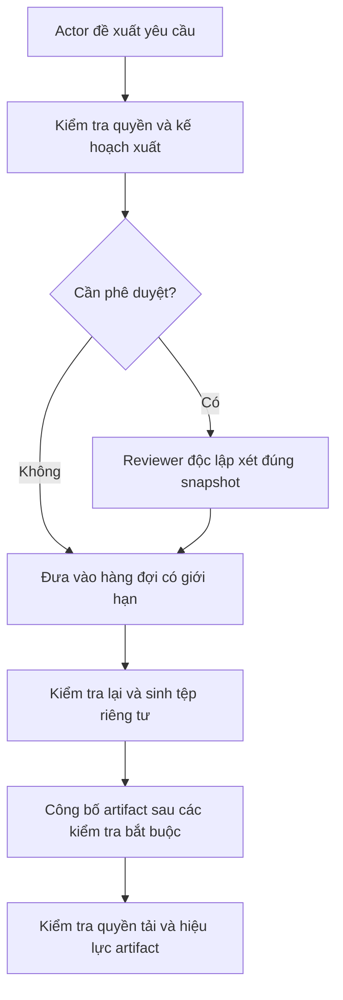

# Export eligibility: xác định điều kiện được xuất dữ liệu

Trong chương **Export Security**, export eligibility là tập điều kiện quyết định một chủ thể có được yêu cầu xuất một tập dữ liệu cụ thể, hệ thống có được sinh tệp đó và ai được tải kết quả. Quyết định phụ thuộc vào đối tượng, trường dữ liệu, mục đích, trạng thái, giới hạn và thời điểm thực hiện; không chỉ là một role có tên `EXPORT`.

Trong module bảo vệ logic nghiệp vụ, chức năng xuất có thể biến quyền đọc từng hồ sơ thành khả năng lấy một tập dữ liệu lớn, giữ bản sao hoặc gửi tới nơi khác. Nếu job nền chỉ tin cờ `eligible=true` hoặc dùng quyền kỹ thuật rộng của worker, caller có thể vượt tenant, lấy thêm cột nhạy cảm hoặc tiếp tục tải sau khi quyền liên quan đã mất hiệu lực.

Bài học dùng ví dụ xuất báo cáo đề nghị chi trong một tenant. Chính sách minh họa chỉ cung cấp tải tệp riêng tư; chia sẻ cho người khác hoặc gửi sang hệ thống ngoài là các hành động cần chính sách riêng.

Sau bài này, bạn có thể:

- Phân biệt quyền xem với quyền xuất theo phạm vi và mục đích.
- Thiết kế điều kiện tại lúc tạo yêu cầu, sinh tệp và tải tệp.
- Gắn phê duyệt với đúng kế hoạch xuất và không tự tạo bằng chứng từ client.
- Kiểm soát số dòng, cột, dung lượng, đích nhận và các giới hạn cộng dồn.
- Xử lý thay đổi quyền, snapshot, retry và worker cũ.
- Kiểm thử nội dung tệp cùng các đường cấp quyền truy cập kết quả.

## 1. Được đọc một hồ sơ chưa xác định toàn bộ quyền xuất

Giả sử một người được xem các đề nghị trong bộ phận A. Một endpoint xuất toàn bộ dữ liệu có thể gây khác biệt về:

- Số đối tượng được lấy trong một lần và tổng lượng dữ liệu qua nhiều lần.
- Tập cột: giao diện chỉ hiện dữ liệu cơ bản nhưng tệp chứa cả tài khoản nhận tiền.
- Thời gian lưu bản sao và khả năng tải lại.
- Người nhận hoặc hệ thống đích.
- Mục đích và quy trình phê duyệt bổ sung.

Vì vậy, không nên suy từ quyền đọc một dòng thành quyền xuất toàn bộ tenant hoặc toàn bộ cột của entity.

Đồng thời, giới hạn export không thể tự ngăn mọi cách sao chép dữ liệu đã được phép đọc. Nếu người dùng hợp lệ đã nhận nội dung, một thay đổi permission phía máy chủ không lấy lại được bản sao họ lưu cục bộ. Mục tiêu cần được mô tả chính xác: kiểm soát đường xuất, lượng dữ liệu, quyền truy cập mới và các hậu quả mà hệ thống còn quản lý.

Không lấy việc giao diện có hoặc không có nút xuất làm nguồn quyết định cuối. API và worker phải thực thi cùng các ranh giới có thẩm quyền.

## 2. Eligibility gồm nhiều chiều của cùng một yêu cầu

| Chiều đánh giá | Câu hỏi |
| --- | --- |
| Chủ thể | Actor thực tế là ai, có hoạt động và đủ mức bảo đảm xác thực không? |
| Tenant và đối tượng | Tập hồ sơ nào nằm trong phạm vi được phép? |
| Trường dữ liệu | Những cột nào được phép xuất cho nhiệm vụ này? |
| Mục đích | Công việc hoặc case có hợp lệ và actor có được xử lý không? |
| Trạng thái | Hồ sơ, job và các bằng chứng đang ở trạng thái phù hợp không? |
| Khối lượng | Số dòng, byte, thời gian và quota có nằm trong giới hạn không? |
| Phê duyệt | Kế hoạch này có cần reviewer độc lập và đã đủ bằng chứng chưa? |
| Định dạng, đích nhận | Có được xuất dạng này và chuyển tới nơi này không? |
| Thời gian | Quyền, bằng chứng, snapshot và tệp còn hiệu lực đến lúc nào? |

Các chiều phải cùng khớp một kế hoạch. Không lấy scope của một grant, tập cột của grant khác và hạn mức lớn nhất ở nơi khác để tạo ra một khả năng mà không căn cứ nào thực sự cho phép.

Những con số giới hạn cần dựa trên chính sách và năng lực hệ thống. Ví dụ tối đa 500 dòng ở một luồng chỉ là hợp đồng minh họa, không phải khẳng định 500 dòng luôn ít nhạy cảm hoặc luôn rẻ.

## 3. Xác định ba quyết định tại ba thời điểm

Một job có thể sống lâu hơn request ban đầu. Cần tách:

```text
mayRequestExport  → có được mở yêu cầu xuất theo kế hoạch này không?
mayGenerateFile   → tại lúc chạy, có đủ điều kiện sinh đúng tệp này không?
mayDownloadFile   → tại lúc tải, caller có được nhận toàn bộ nội dung tệp không?
```

Loại quyền ở từng điểm có thể khác nhau. Người được tạo job chưa chắc được chia sẻ tệp; người được xem một artifact theo policy cũng không nhất thiết được tạo một job mới có cùng phạm vi.

Trong ví dụ, hệ thống kiểm tra hiệu lực tại cả ba ranh giới. Quyền tải phải bao phủ nội dung artifact theo hợp đồng quyền hiện hành; một bản ghi `READY` không tự là quyền đọc vĩnh viễn.

Nếu sản phẩm chọn một mô hình capability hoặc quyền trên snapshot lịch sử khác, cần nêu rõ thời hạn và cách thu hồi. Không để ngữ nghĩa đó xuất hiện vô tình vì worker lưu một cờ cho phép rồi dùng mãi.



## 4. Chính sách ví dụ cho báo cáo đề nghị chi

Giả sử luồng xuất cơ bản có quy tắc:

- Actor có quyền xuất trong tenant và các bộ phận được giao.
- Chỉ xuất hồ sơ ở những trạng thái được phép cho loại báo cáo; ví dụ này dùng hồ sơ đã chốt theo policy.
- Cột cơ bản có thể gồm mã đề nghị, ngày gửi, số tiền, loại tiền và trạng thái.
- Tài khoản nhận tiền hoặc định danh thuế cần quyền xuất nhạy cảm và phê duyệt độc lập.
- Có giới hạn số dòng cho từng yêu cầu cùng quota tổng theo actor hoặc tenant.
- Chỉ định dạng được hỗ trợ và hình thức tải riêng tư được chấp nhận.
- Người nhận dữ liệu trong đường này là chính caller được phép tải artifact.
- Hết hạn, bị hủy hoặc không còn chứng minh đủ quyền thì không cấp một lượt tải mới ngoài hợp đồng.

Đây là các lựa chọn minh họa. Một hệ thống khác có thể cho xuất bản nháp trong một nghiệp vụ riêng, hoặc không cho xuất một số field dù có reviewer. Phải xác định policy thật thay vì mặc định mọi dữ liệu đều xuất được nếu có đủ role.

Client không được tự đặt nhãn hồ sơ thành exportable, tự khai reviewer hoặc chọn `includeSensitive=true` để biến một kế hoạch cơ bản thành kế hoạch có thẩm quyền rộng hơn.

## 5. Tạo một kế hoạch xuất được xác định rõ

Kế hoạch nên bao phủ các dữ liệu quyết định phạm vi:

```text
tenant, actor thực tế và ngữ cảnh quyền
loại báo cáo
bộ lọc đã chuẩn hóa và phạm vi đối tượng được phép
tập cột cùng định nghĩa projection
snapshot, selection hoặc ngữ nghĩa dữ liệu hiện hành
định dạng và cách giao kết quả
mục đích và case đã được xác minh nếu cần
trần số dòng, byte và tài nguyên liên quan
phiên bản chính sách, thời hạn và yêu cầu phê duyệt
```

Một filter của client không tự là scope có thẩm quyền. Máy chủ phải đối chiếu hoặc kết hợp nó với tập được phép theo hợp đồng, không dùng một `departmentId` bất kỳ để truy vấn bằng credential rộng của worker.

Nếu việc thu hẹp scope làm thay đổi ý nghĩa báo cáo, cần từ chối hoặc thể hiện rõ kế hoạch thực sự được chấp nhận. Không báo “toàn bộ dữ liệu theo yêu cầu” trong khi đã âm thầm bỏ những phần quan trọng.

Client chọn một khoảng lịch sử cũng không chứng minh họ có quyền đọc dữ liệu tại thời điểm đó. Quyền đối với dữ liệu hoặc snapshot lịch sử cần được xác định riêng.

## 6. Hợp đồng API chỉ nhận ý định được phép đề xuất

Ví dụ:

```http
POST /expense-export-jobs
Idempotency-Key: expense-export-close-202611-01
Content-Type: application/json

{
  "reportType": "CLOSED_EXPENSES",
  "filters": {
    "departmentId": "department-a",
    "period": "2026-11"
  },
  "columns": ["REQUEST_CODE", "AMOUNT", "CURRENCY", "STATE"],
  "format": "CSV",
  "requestedRowLimit": 500,
  "purposeCode": "MONTHLY_RECONCILIATION",
  "caseId": "case-17"
}
```

Máy chủ xác thực actor, tenant, case, khoảng thời gian, quyền cột, trạng thái nguồn và các giới hạn. `purposeCode` chỉ biểu đạt mục đích đề xuất; không phải lời cấp phép do client tự viết.

Không nhận `eligible`, `approved`, `approvedBy`, `requesterId` hoặc một storage path tùy ý làm căn cứ quyền. Không nhận SQL, một tên bảng hay graph điều kiện không giới hạn để worker thực thi.

Job cần phê duyệt có thể được tạo ở `PENDING_APPROVAL`. Job không cần phê duyệt có thể vào `QUEUED`. Trong cả hai trường hợp, tiếp nhận request chưa có nghĩa tệp đã được sinh hoặc caller đã được cấp URL tải.

## 7. Minh họa Java: kiểm tra cột và giới hạn trước khi tạo kế hoạch

Đoạn mã dùng record của Java 16 trở lên. `ExportCapabilities` là kết quả policy máy chủ đã xác lập cho đúng actor, tenant và nhiệm vụ; không được bind từ body. Ví dụ chỉ chuẩn bị projection và giới hạn, chưa cấp quyền sinh hoặc tải artifact.

```java
import java.util.Objects;
import java.util.Set;
import java.util.UUID;

enum ExportColumn {
    REQUEST_CODE,
    SUBMITTED_AT,
    AMOUNT,
    CURRENCY,
    STATE,
    REQUESTER_NAME,
    BANK_ACCOUNT_NUMBER,
    TAX_IDENTIFIER
}

enum ExportFormat {
    CSV, XLSX
}

enum PreparationDecision {
    ELIGIBLE_TO_REQUEST,
    NEEDS_INDEPENDENT_APPROVAL
}

record ExportInput(
        Set<ExportColumn> columns,
        ExportFormat format,
        int requestedRowLimit) {
}

record ExportCapabilities(
        boolean requestAllowed,
        boolean purposeValidated,
        Set<UUID> departmentScope,
        Set<ExportColumn> allowedColumns,
        Set<ExportFormat> allowedFormats,
        int maxRows) {
}

record PreparedProjection(
        Set<UUID> departmentScope,
        Set<ExportColumn> columns,
        ExportFormat format,
        int rowLimit,
        PreparationDecision decision) {
}

final class ExportProjectionPolicy {
    private static final Set<ExportColumn> REVIEW_REQUIRED = Set.of(
            ExportColumn.BANK_ACCOUNT_NUMBER,
            ExportColumn.TAX_IDENTIFIER);

    private ExportProjectionPolicy() {
    }

    static PreparedProjection prepare(
            ExportCapabilities capabilities, ExportInput input) {
        Objects.requireNonNull(capabilities);
        Objects.requireNonNull(input);
        require(capabilities.requestAllowed(), "EXPORT_NOT_ALLOWED");
        require(capabilities.purposeValidated(), "PURPOSE_NOT_VALIDATED");

        Set<UUID> scope = Set.copyOf(capabilities.departmentScope());
        Set<ExportColumn> columns = Set.copyOf(input.columns());
        Set<ExportColumn> allowed = Set.copyOf(capabilities.allowedColumns());
        Set<ExportFormat> formats = Set.copyOf(capabilities.allowedFormats());

        require(!scope.isEmpty(), "NO_EXPORT_SCOPE");
        require(!columns.isEmpty() && allowed.containsAll(columns),
                "EXPORT_COLUMN_NOT_ALLOWED");
        require(input.format() != null && formats.contains(input.format()),
                "EXPORT_FORMAT_NOT_ALLOWED");
        require(capabilities.maxRows() > 0
                && input.requestedRowLimit() >= 1
                && input.requestedRowLimit() <= capabilities.maxRows(),
                "EXPORT_ROW_LIMIT_EXCEEDED");

        boolean needsReview = columns.stream().anyMatch(REVIEW_REQUIRED::contains);
        PreparationDecision decision = needsReview
                ? PreparationDecision.NEEDS_INDEPENDENT_APPROVAL
                : PreparationDecision.ELIGIBLE_TO_REQUEST;

        return new PreparedProjection(scope, columns, input.format(),
                input.requestedRowLimit(), decision);
    }

    private static void require(boolean valid, String code) {
        if (!valid) {
            throw new SecurityException(code);
        }
    }
}
```

Một cột cần review vẫn phải nằm trong `allowedColumns`. Reviewer không tự biến một field bị cấm xuất thành field được phép chỉ bằng một phiếu đồng ý.

`purposeValidated` phải đến từ việc kiểm tra case, quyền actor và chính sách liên quan. Nó không phải bản sao của `purposeCode` hoặc một boolean client khai.

Ví dụ không kiểm tra trạng thái từng hồ sơ, dữ liệu nguồn, quota cộng dồn, phê duyệt hoặc quyền download. Kết quả cần được gắn vào kế hoạch đầy đủ có tenant, actor, version và snapshot phù hợp. Tên `ELIGIBLE_TO_REQUEST` chỉ nói về bước tiếp nhận sau những kiểm tra đã mô tả, không có nghĩa đã được xuất mọi dữ liệu ngay.

## 8. Phê duyệt phải gắn với đúng kế hoạch xuất

Nếu cần reviewer độc lập, bằng chứng nên trỏ tới một bản kế hoạch bất biến hoặc revision có ý nghĩa rõ ràng. Nội dung bao gồm scope, cột, mục đích, định dạng, đích giao và giới hạn quan trọng.

Không cho phép:

```text
duyệt xuất cột cơ bản của bộ phận A
  → sau đó đổi sang toàn tenant và thêm tài khoản nhận tiền
  → vẫn dùng cùng approved = true
```

Reviewer phải có quyền phê duyệt loại dữ liệu và phạm vi đó, đồng thời đáp ứng điều kiện độc lập theo chính sách. Hai tài khoản của cùng cá nhân không mặc nhiên là hai người.

Khi sửa kế hoạch ảnh hưởng quyết định, tạo revision và đánh giá lại các bằng chứng phụ thuộc. Không cập nhật digest hoặc snapshot dưới cùng một approval như thể người duyệt đã xem nội dung mới.

Nếu policy dùng ngưỡng khối lượng, không chỉ kiểm tra một estimate rồi cho xuất thực tế vượt ngưỡng. Quyền thực thi cần giới hạn tối đa được duyệt; vượt kế hoạch phải dừng, yêu cầu kế hoạch mới hoặc xử lý theo một hợp đồng đã định trước.

Timeout chờ reviewer không tạo sự đồng ý. Worker và quản trị viên cũng không được tự điền `approvedBy` để làm job sẵn sàng.

## 9. Sinh tệp phải giữ scope ở mọi truy vấn và mọi trang

Worker cần tải kế hoạch và ngữ cảnh hợp lệ từ dữ liệu bền vững. Credential của worker cho phép truy cập kỹ thuật không thay thế quyền nghiệp vụ của yêu cầu xuất.

Query nguồn có thể có cấu trúc:

```sql
SELECT request_code, amount, currency, state
FROM expense_request
WHERE tenant_id = :authorized_tenant_id
  AND department_id IN (:approved_department_scope)
  AND state IN (:allowed_report_states)
  AND submitted_at >= :validated_period_start
  AND submitted_at < :validated_period_end
ORDER BY submitted_at ASC, id ASC;
```

Đây là SQL minh họa cho projection cơ bản. Tập cột, trạng thái và điều kiện được tạo từ plan và policy, không nối raw tên field hoặc SQL do client gửi.

Nếu xuất theo nhiều trang, từng trang phải giữ cùng phạm vi và ngữ nghĩa snapshot. Count, tổng hợp, dữ liệu lồng nhau và lookup phụ cũng cần scope tương ứng.

Một preflight count đúng không bảo vệ được query xuất thiếu tenant. Ngược lại, query hàng đúng nhưng một sheet hoặc phần summary dùng dữ liệu toàn cục vẫn có thể làm lộ thông tin.

## 10. Dữ liệu snapshot và quyền hiệu lực là hai vấn đề riêng

Một báo cáo có thể cần dữ liệu cố định tại thời điểm chốt. Snapshot giúp giữ nội dung nhất quán, nhưng không tự quyết định ai được đọc snapshot đó về sau.

Cần chọn rõ:

- Quyền đối với dữ liệu hiện hành hay một quyền riêng đối với artifact lịch sử.
- Cách xử lý khi hồ sơ đổi bộ phận, owner hoặc mức hạn chế.
- Khi nào quyền cột hoặc mục đích đã được duyệt không còn hiệu lực.
- Bằng chứng hoặc security version nào đủ để xác minh scope còn bao phủ tệp.

Trong mô hình kiểm tra quyền hiện hành, chỉ thấy actor vẫn có role export là chưa đủ. Artifact có thể chứa những dòng hoặc cột mà actor không còn được nhận.

Có thể cần manifest hoặc thông tin phạm vi và version an ninh đủ để đánh giá lại toàn bộ nội dung. Nếu không chứng minh được quyền tải bao phủ artifact, không cấp quyền nhận toàn tệp; có thể vô hiệu hóa hoặc sinh lại theo policy.

Không dùng một hash chung của plan như bằng chứng tự động rằng mọi quyền đối tượng vẫn còn. Nó bảo vệ hoặc nhận diện nội dung theo thiết kế, không thay thế việc cập nhật các dữ liệu quyền đã thay đổi.

## 11. Giới hạn khối lượng và quota cần được thực thi thực tế

Một yêu cầu nhỏ có thể tạo tệp lớn do nhiều dòng, dữ liệu con, ảnh hoặc một khoảng thời gian rộng. Eligibility cần xét cả công việc thật và lượng dữ liệu được cấp.

Các trần có thể gồm:

```text
số dòng và đối tượng thực sự
số cột hoặc nhóm dữ liệu nhạy cảm
số byte và phần tử lồng nhau
thời gian và mức song song
số job đang chờ hoặc đang chạy
tổng lượng xuất theo actor, tenant hoặc nghiệp vụ trong kỳ
```

Các số ước tính cần được kiểm tra cùng trần thực thi. Nếu số dòng thực tế vượt giới hạn đã chấp nhận, không âm thầm xuất toàn bộ hoặc cắt bớt rồi báo một báo cáo đầy đủ.

Có thể từ chối, yêu cầu thu hẹp hoặc hỗ trợ một báo cáo bị giới hạn được đánh dấu rõ theo hợp đồng. Nếu cần phê duyệt phạm vi lớn hơn, đó là kế hoạch hoặc revision mới chứ không phải cờ bỏ trần do client gửi.

Chia cùng nhu cầu thành nhiều job không được đặt lại một quota được định nghĩa ở cấp actor hay tenant. Kiểm tra và nhận phần quota cần nhất quán giữa nhiều request và instance; phân biệt phần đang giữ với phần đã sử dụng theo policy.

## 12. Job, retry và công bố artifact cần có trạng thái rõ

Một vòng đời có thể là:

```text
PENDING_APPROVAL → QUEUED → RUNNING → READY
                               ↘ FAILED

các nhánh hủy, hết hạn hoặc mất điều kiện được xử lý theo trạng thái
```

`READY` chỉ nên được ghi sau khi artifact đã được lưu riêng tư và mọi kiểm tra bắt buộc của bước sinh được hoàn tất. Tệp tạm chưa kiểm tra không được có đường tải dành cho người dùng.

Ghi nhận request, quota hoặc approval reference cần transaction phù hợp. Không giữ transaction cơ sở dữ liệu mở trong toàn bộ thời gian tạo tệp; dùng trạng thái bền vững, operation và các ranh giới ngắn.

Worker restart hoặc nhận lại message phải tiếp tục đúng job. Một worker cũ không được công bố file sau khi job đã bị hủy hoặc một attempt mới đã thay thế. Version hoặc generation cần được kiểm tra tại điểm cập nhật có thẩm quyền.

Idempotency khi tạo yêu cầu cần ràng buộc tenant, actor, loại báo cáo và plan có ý nghĩa. Retry không tạo thêm job hoặc tính quota lần nữa. Key mới cũng không tự cho phép vượt giới hạn cộng dồn.

Nếu có artifact hoặc intent gửi ra hệ thống ngoài, xử lý lặp và kết quả chưa rõ theo giao thức tương ứng. Một transaction cục bộ không tự tạo bảo đảm đúng một lần trên mọi dịch vụ.

## 13. Quyền tải không được suy từ việc biết job ID hoặc URL

Đường tải cần kiểm tra:

```text
caller được xác thực hoặc có capability được chấp nhận theo hợp đồng
job và artifact thuộc đúng tenant cùng quan hệ
caller được nhận artifact này theo policy
nội dung và tập cột còn được bao phủ bởi quyền tương ứng
artifact ở trạng thái cho phép, chưa hết hạn hoặc bị vô hiệu hóa
```

Storage key phải được tra từ job đã được cấp quyền. Không để caller đưa một path, bucket hoặc artifact ID khác rồi service đọc bằng credential rộng của mình.

URL được ký có thể là một capability riêng và vẫn có hiệu lực theo cơ chế của nơi lưu trữ. Nó không tự mất hiệu lực khi bảng permission của ứng dụng thay đổi. Nếu yêu cầu kiểm tra hiện hành ở mỗi lần tải, thiết kế đường kiểm tra hoặc khả năng vô hiệu hóa phải đáp ứng đúng yêu cầu đó.

Thời hạn ngắn có thể giảm cửa sổ sử dụng nhưng không đồng nghĩa thu hồi tức thời. Trạng thái tệp trong ứng dụng cũng phải khớp cách bên lưu trữ hoặc điểm phân phối thực sự cho truy cập.

Không hứa thu hồi dữ liệu đã được tải và sao chép cục bộ. Kiểm soát khả năng tải mới, phạm vi nội dung ban đầu và cách chia sẻ trong giới hạn hệ thống quản lý được.

## 14. Định dạng và đích giao cũng là điều kiện nghiệp vụ

Quyền xuất CSV không tự cấp quyền chuyển một báo cáo nhạy cảm tới bất kỳ email, URL hoặc kho lưu trữ nào.

Nếu hỗ trợ nhiều đích, cần xác định:

- Người nhận hoặc hệ thống đích được phép và đã được xác minh theo policy.
- Scope, tập cột và mục đích mà đích đó được nhận.
- Có cần approval riêng cho chia sẻ hoặc chuyển ra ngoài không.
- Thời hạn, quyền tải và audit của bản sao được tạo.
- Cách xử lý lỗi, retry và kết quả gửi chưa rõ.

Trong luồng ví dụ chỉ tải riêng tư, API không nhận một `destinationUrl` tùy ý. Mở thêm kênh giao là thay đổi hợp đồng cần đánh giá, không chỉ thêm một trường tùy chọn.

Eligibility cũng không thay thế an toàn định dạng. Khi xuất bảng tính hoặc văn bản có cấu trúc, nội dung từ người dùng cần được xử lý phù hợp với định dạng và ứng dụng đọc; được phép xuất không đồng nghĩa mọi giá trị thô đều an toàn để chèn vào tệp.

Không serialize toàn bộ entity rồi xóa vài cột ở bước cuối. Dùng projection được duyệt ngay trên đường đọc và tạo tệp, kể cả phần summary hoặc dữ liệu phụ.

## 15. Preview, lỗi và cache của quyết định eligibility

Một preview có thể cho biết cột được phép, giới hạn và việc cần approval. Nó hỗ trợ giao diện nhưng không phải giấy phép vĩnh viễn cho lần sinh tệp sau.

Preview count cũng là một phép đọc cần scope. Không đếm toàn tenant hoặc trả chi tiết hồ sơ bị cấm chỉ để giải thích vì sao actor chưa đủ điều kiện.

Cần phân biệt:

- Không có quyền xuất loại dữ liệu.
- Kế hoạch sai schema hoặc vượt giới hạn.
- Mục đích hoặc case chưa được xác lập hợp lệ.
- Có quyền yêu cầu nhưng đang chờ approval.
- Job chưa chạy, đang chạy hoặc chưa có artifact.
- Artifact đã hết hạn hoặc không còn được phép tải.
- Phụ thuộc bắt buộc đang lỗi nên chưa thể xác lập kết quả.

Không biến lỗi dịch vụ policy thành `eligible=true`. Không coi thiếu approval là lỗi kỹ thuật để worker tự bỏ bước.

Nếu cache quyết định, key và hiệu lực cần bao phủ actor, tenant, plan, field set, mục đích, phạm vi và các version liên quan theo thiết kế. Một kết quả eligibility của plan cơ bản không được dùng cho plan đã thêm cột nhạy cảm.

## 16. Ma trận kiểm thử điều kiện được xuất

Chuẩn bị dữ liệu tổng hợp của nhiều tenant, bộ phận, trạng thái và mức nhạy cảm. Có ca đối chứng xuất hợp lệ để chứng minh route, fixture và worker thực sự hoạt động.

| Ca kiểm thử | Kết quả cần giữ |
| --- | --- |
| Actor có quyền đọc nhưng không có quyền xuất | Không tự được tạo job xuất toàn tập |
| Actor xuất cơ bản trong scope hợp lệ | Tệp chỉ chứa đúng dòng và cột được phép |
| Gửi tenant, requester hoặc cờ eligibility tự khai | Không ghi đè ngữ cảnh có thẩm quyền |
| Chọn bộ phận, ID hoặc dữ liệu tenant khác | Không mở rộng scope query hoặc artifact |
| Thêm cột tài khoản không có quyền | Không xuất field dù các cột khác hợp lệ |
| Có quyền cột nhạy cảm nhưng thiếu approval bắt buộc | Chỉ ở trạng thái chờ theo hợp đồng, không sinh tệp được tải |
| Reviewer là requester hoặc cùng cá nhân qua tài khoản khác | Không đáp ứng điều kiện độc lập khi policy cấm |
| Plan đổi field, scope, đích hoặc giới hạn sau duyệt | Không dùng lại approval cũ ngoài phạm vi |
| Client tự khai purpose hoặc case không phù hợp | Không tự tăng quyền hoặc bỏ guard |
| Hồ sơ chưa ở trạng thái được báo cáo hỗ trợ | Không bị đưa vào bằng một filter tùy ý |
| Estimate nhỏ nhưng thực tế vượt trần | Không công bố artifact vượt kế hoạch hoặc giả đầy đủ |
| Chia nhiều job dưới trần riêng lẻ | Quota cấp actor hoặc tenant vẫn được giữ |

Kiểm tra nội dung tệp bằng công cụ phù hợp với định dạng, không chỉ tên tệp, kích thước hoặc metadata job. Field bị cấm phải có giá trị trong fixture để test không vượt qua chỉ vì nó đang null.

Expected cần từ policy và fixture độc lập. Không dùng chính hàm production chọn cột làm nguồn duy nhất để khẳng định tệp không thừa cột.

## 17. Kiểm thử vòng đời, retry và hiệu lực quyền

| Kịch bản | Điều cần xác minh |
| --- | --- |
| Quyền tương ứng bị thu hồi sau tạo job nhưng trước sinh | Bước chạy áp dụng đúng hợp đồng hiệu lực |
| Quyền cột hoặc đối tượng thay đổi sau khi file READY | Không tải một artifact vượt phạm vi hiện được phép theo mô hình đã chọn |
| Caller biết job ID hoặc storage key của người khác | Không nhận bytes, link hoặc metadata ngoài quyền |
| Job bị hủy trong khi worker đang tạo file | Worker cũ không công bố kết quả trái trạng thái |
| Hai worker hoặc retry cùng job | Không tạo hiệu ứng, kết quả hoặc quota sử dụng trùng |
| Mất phản hồi sau tạo job thành công | Replay trả job phù hợp, không nhận thêm quota ngoài policy |
| Dữ liệu được phân trang khi sinh báo cáo | Mọi trang, count và summary giữ cùng scope và snapshot |
| URL ký hoặc cache tồn tại sau thay đổi quyền | Hành vi thực tế khớp bảo đảm hiệu lực đã công bố |
| Tệp tạm tồn tại sau lỗi | Không truy cập được như một artifact READY |
| Dịch vụ bắt buộc không khả dụng | Không mặc định cho qua bằng quyền rộng của worker |

Quan sát job, approval, plan revision, quota, manifest, artifact, outbox và các lần truy cập ở biên lưu trữ hoặc gửi ngoài. Một HTTP lỗi không đủ nếu tệp nhạy cảm đã được công bố trước đó.

Audit nên ghi actor, tenant đã xác minh, loại báo cáo, plan và field set, mục đích hoặc case, giới hạn áp dụng, approval, snapshot, operation và kết quả. Phân biệt đã yêu cầu, đã duyệt, đã sinh tệp và đã cấp một lượt tải.

Không log token tải, credential, raw query nhạy cảm hoặc nội dung báo cáo. Giữ dữ liệu tối thiểu đủ điều tra trong nơi có quyền xem phù hợp.

Các ca concurrency và transaction cần cơ chế lưu trữ cùng lịch thực thi có kiểm soát. Mock một kết quả `eligible=true` không chứng minh worker và đường tải áp dụng đúng quyền thực tế.

## 18. Cách thiết kế export eligibility cho một báo cáo

1. Xác định dữ liệu và hậu quả của việc tạo, lưu, tải hoặc chuyển bản sao.
2. Tách quyền yêu cầu, sinh tệp và nhận artifact cùng ranh giới hiệu lực của từng bước.
3. Chốt plan gồm scope, field set, mục đích, định dạng, đích, snapshot và giới hạn.
4. Kiểm tra các điều kiện bằng dữ liệu có thẩm quyền; không nhận cờ eligibility hoặc approval từ client.
5. Gắn phê duyệt độc lập với đúng revision của plan khi policy yêu cầu.
6. Giữ scope ở mọi query, trang, dữ liệu phụ và worker; kiểm soát khối lượng thực tế cùng quota tổng.
7. Công bố artifact riêng tư sau khi hoàn tất kiểm tra bắt buộc, có version và chống lặp.
8. Kiểm tra quyền tải bao phủ nội dung tệp, thời hạn và cơ chế truy cập thực tế.
9. Kiểm thử nội dung artifact cùng vòng đời quyền, retry, hủy, cache và các đường giao kết quả.

Một yêu cầu đủ điều kiện xuất phải mô tả chính xác ai được nhận dữ liệu nào, cho mục đích gì và trong giới hạn nào. Khi quyết định được kiểm chứng ở cả lúc tiếp nhận, sinh và tải, job nền không thể tự biến một quyền đọc có giới hạn thành khả năng lấy một tập dữ liệu rộng hơn.
