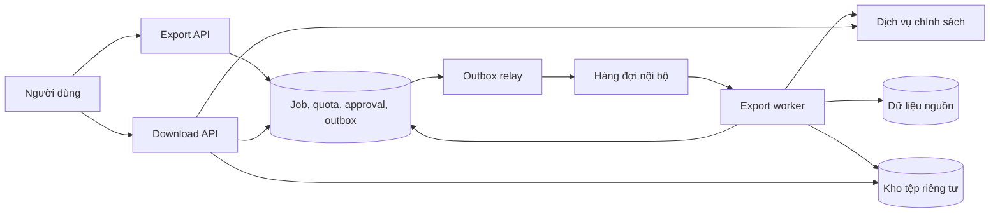
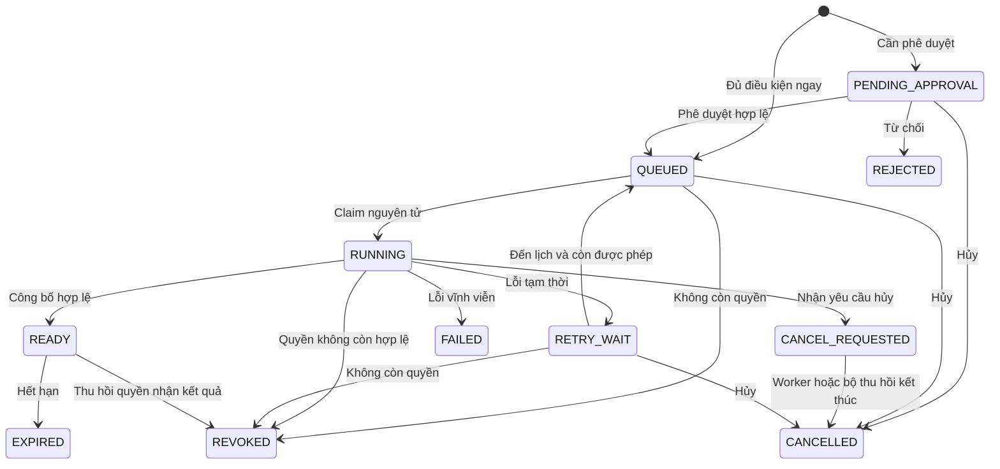

# Export asynchronous processing — Bảo vệ luồng xuất dữ liệu bất đồng bộ

## 1. Mục tiêu và phạm vi

Xuất dữ liệu bất đồng bộ tách yêu cầu tạo báo cáo khỏi công việc đọc dữ liệu, dựng tệp và cung cấp tệp tải xuống. API thường trả về mã công việc ngay, còn worker xử lý sau qua hàng đợi. Cách tổ chức này giúp phục vụ báo cáo lớn, nhưng cũng kéo dài khoảng thời gian mà quyền truy cập, dữ liệu nguồn, phê duyệt và trạng thái công việc có thể thay đổi.

Trong chương **Export Security**, bài học này thuộc phạm vi **bảo mật logic nghiệp vụ** của module `SECURITY_APPLICATION_SECURITY_BUSINESS_LOGIC_SECURITY`. Vấn đề cốt lõi là giữ đúng các quy tắc nghiệp vụ khi một thao tác được thực hiện qua nhiều tiến trình và nhiều thời điểm: ai được yêu cầu export, dữ liệu nào được xuất, khi nào được chạy, một yêu cầu được tính bao nhiêu lần và ai còn được nhận kết quả.

Sau bài học, người học có thể:

- Phát biểu các business invariants của một luồng export bất đồng bộ.
- Thiết kế state machine để chống bỏ qua phê duyệt, chạy lại job đã hủy hoặc công bố kết quả của worker hết quyền sở hữu.
- Gắn quyền theo đối tượng và tenant vào job, truy vấn nguồn, tệp và endpoint tải xuống.
- Kết hợp transaction, outbox, idempotency và giới hạn tài nguyên để xử lý retry an toàn.
- Kiểm thử các tình huống đổi quyền, yêu cầu trùng và cạnh tranh giữa worker với thao tác hủy.

Các đoạn Java và SQL dưới đây minh họa hợp đồng thiết kế. Chúng không phải một ứng dụng chạy độc lập; repository, policy service, cơ chế transaction và dialect SQL cần được triển khai theo hệ thống thực tế.

## 2. Vì sao chuyển sang background job làm thay đổi bài toán bảo mật?

Xét một hệ thống quản lý đơn hàng nhiều tenant. Nhân viên Lan thuộc tenant A, được xuất báo cáo doanh thu cho chi nhánh HCM. Báo cáo chứa các cột đã duyệt; tài khoản ngân hàng khách hàng cần quyền riêng. Export trên 100.000 dòng phải được quản lý phê duyệt.

Luồng mong muốn:

1. Lan gửi yêu cầu xuất dữ liệu với bộ lọc và danh sách cột.
2. Máy chủ xác định tenant, người yêu cầu, phạm vi chi nhánh và điều kiện phê duyệt.
3. Job được lưu bền vững; khi đủ điều kiện, một sự kiện yêu cầu xử lý được đưa vào hàng đợi.
4. Worker đọc lại job và kiểm tra điều kiện thực thi trước khi đọc dữ liệu.
5. Worker tạo tệp trong vùng lưu trữ riêng tư, sau đó công bố kết quả bằng một chuyển trạng thái có kiểm soát.
6. Khi Lan tải tệp, máy chủ kiểm tra quyền hiện tại và thời hạn kết quả.

Một triển khai yếu thường chỉ thực hiện bước kiểm tra quyền ở bước 1. Trong khi job chờ, Lan có thể bị thu hồi quyền hoặc chuyển chi nhánh. Worker có thể nhận cùng message hai lần. Một quản lý có thể hủy phê duyệt khi tệp đang được tạo. Mã job có thể bị người khác dùng để xem số dòng hoặc lấy đường dẫn tải.

Đây là lỗi logic ngay cả khi mọi truy vấn đã được parameterize, mọi kết nối đều dùng TLS và không có lỗi injection.

### 2.1. Dòng thời gian của một lỗi điển hình

| Thời điểm | Sự kiện | Sai lầm nếu chỉ kiểm tra ở lúc tạo |
|---|---|---|
| 09:00 | Lan có quyền xuất dữ liệu HCM, tạo job J1 | API cho phép là đúng tại thời điểm này |
| 09:02 | Lan bị thu hồi quyền export | Job vẫn mang quyết định cho phép cũ |
| 09:05 | Worker bắt đầu chạy bằng tài khoản dịch vụ có quyền rộng | Worker xuất toàn bộ dữ liệu nếu không ràng buộc phạm vi |
| 09:08 | J1 hoàn tất | Tệp tồn tại dù quyền đã thay đổi |
| 09:10 | Người có mã J1 gọi endpoint download | Dữ liệu bị lộ nếu chỉ cần biết mã job |

Cần quy định rõ quyền được đánh giá tại những mốc nào, thay vì coi lần kiểm tra ban đầu là một giấy phép vĩnh viễn. OWASP khuyến nghị kiểm tra quyền cho từng yêu cầu và từng đối tượng được truy cập; áp dụng vào export đòi hỏi bảo vệ cả các endpoint phụ như status, cancel và download. [OWASP Authorization Cheat Sheet](https://cheatsheetseries.owasp.org/cheatsheets/Authorization_Cheat_Sheet.html)

## 3. Chốt các business invariants trước khi thiết kế queue

Một invariant là điều phải luôn đúng, kể cả khi có timeout, retry, message trùng hoặc thao tác đồng thời. Các invariant sau là **thiết kế được đề xuất cho tình huống minh họa**, không phải một chính sách bắt buộc cho mọi sản phẩm.

| Invariant | Ý nghĩa và điểm thực thi |
|---|---|
| Job có một tenant và một người yêu cầu xác định | Suy ra từ ngữ cảnh đã xác thực, lưu bất biến; không lấy danh tính thực thi từ message |
| Phạm vi dữ liệu không được tự mở rộng | Mọi dòng, cột và quan hệ join phải nằm trong phạm vi đã chấp thuận và quyền hiện hành |
| Job cần phê duyệt không được chạy trước phê duyệt | Kiểm tra cả chuyển trạng thái và nội dung request đã được duyệt |
| Chỉ worker đang giữ lease hợp lệ được công bố kết quả | Kiểm tra trạng thái, lease token, hạn lease và version trong cập nhật nguyên tử |
| Yêu cầu trùng không tạo hiệu ứng nghiệp vụ trùng | Một idempotency key hợp lệ gắn với một job và một nội dung request xác định |
| Hủy hoặc thu hồi có hiệu lực không bị worker cũ đảo ngược | Worker cũ không thể chuyển job sang trạng thái có thể tải |
| Tệp tải xuống thuộc đúng job, tenant và artifact đã công bố | Máy chủ tra cứu liên kết; client không truyền object key để máy chủ ký |
| Tài nguyên luôn có giới hạn | Áp dụng quota lúc nhận yêu cầu và giới hạn thực tế lúc chạy |
| Quyền tải tệp được đánh giá lại | Có quyền tạo job trước đây chưa đủ để tải kết quả hiện tại |
| Job không hoàn tất chỉ vì message đã được ACK | Trạng thái nghiệp vụ trong kho dữ liệu mới quyết định tiến độ |

Đặc biệt, quyền đọc một màn hình danh sách không tự động đồng nghĩa với quyền xuất hàng triệu bản ghi. Export có thể cần action riêng như `order.export`, giới hạn trường nhạy cảm và phê duyệt theo mức rủi ro.

## 4. Xác định ranh giới tin cậy

Một kiến trúc điển hình gồm:



API chịu trách nhiệm xác thực người gọi, chuẩn hóa request và tạo job hợp lệ. Queue chỉ vận chuyển yêu cầu xử lý. Worker phải chứng minh rằng job vẫn được phép thực thi; việc message xuất hiện trong queue không thay thế quyết định này.

Kho tệp cũng là một ranh giới độc lập. Mã hóa tệp khi lưu không ngăn một endpoint ký URL cho nhầm người. Tương tự, tài khoản dịch vụ có quyền đọc mọi tenant không cho phép worker sử dụng toàn bộ quyền đó cho mọi job.

Payload queue nên nhỏ:

```json
{
  "eventId": "evt-7f9c",
  "jobId": "exp-91ab",
  "dispatchVersion": 3,
  "schemaVersion": 1
}
```

`dispatchVersion` giúp phát hiện một lượt điều phối đã cũ, chẳng hạn message từ lần retry trước. Đây là giá trị máy chủ quản lý và đối chiếu với job, không phải quyền hạn do message tự khai.

Không đưa SQL, access token của người dùng, danh sách role, URL tải hoặc một cờ `approved=true` vào queue rồi tin trực tiếp. Bảo vệ broker bằng danh tính dịch vụ và quyền publish/consume phù hợp; chữ ký message, nếu có, bảo vệ nguồn gốc và tính toàn vẹn chứ không tự bảo đảm quyền nghiệp vụ hiện tại.

## 5. Mô hình dữ liệu của một export job

Nên coi export job là một đối tượng nghiệp vụ riêng, không chỉ là một dòng trạng thái kỹ thuật.

| Nhóm | Trường minh họa | Quy tắc |
|---|---|---|
| Định danh | `job_id`, `tenant_id`, `requested_by` | Máy chủ cấp hoặc suy ra; không cho client sửa sau khi tạo |
| Nội dung yêu cầu | `report_type`, `canonical_request`, `request_hash` | Lưu bộ lọc, cột, định dạng đã chuẩn hóa |
| Phạm vi được chấp thuận | `accepted_scope`, `approved_fields`, `approval_id` | Chỉ mô tả giới hạn; worker vẫn phải đánh giá điều kiện hiện hành |
| Chính sách | `policy_version_at_request`, `approval_version` | Dùng đối chiếu và audit; version cũ không tự tạo quyền |
| Nhất quán dữ liệu | `data_mode`, `snapshot_ref`, `cutoff_time` | Phải định nghĩa chính xác báo cáo dùng dữ liệu thời điểm nào |
| Trạng thái | `state`, `version`, `dispatch_version` | Mọi chuyển trạng thái quan trọng phải có điều kiện |
| Thực thi | `attempt_count`, `lease_token`, `lease_until` | Phân biệt lần chạy và quyền sở hữu đang có hiệu lực |
| Kết quả | `artifact_id`, `row_count`, `byte_count`, `expires_at` | Chỉ gắn vào job qua thao tác công bố được chấp thuận |
| Kiểm soát tài nguyên | `reservation_id`, `max_rows`, `max_bytes`, `deadline` | Giới hạn là quyết định máy chủ, không tin giá trị client |
| Truy vết | `created_at`, `finished_at`, `reason_code`, `correlation_id` | Không lưu bí mật hoặc toàn bộ dữ liệu xuất vào log |

Một request công khai chỉ nên chứa đầu vào nghiệp vụ:

```json
{
  "reportType": "ORDER_REVENUE",
  "filters": {
    "branchIds": ["HCM"],
    "from": "2026-10-01",
    "toExclusive": "2026-11-01"
  },
  "columns": ["orderId", "paidAt", "netAmount"],
  "format": "CSV"
}
```

Máy chủ kiểm tra `branchIds` có nằm trong quyền của người gọi. Không đưa các trường `tenantId`, `requestedBy`, `state`, `approvedBy`, `maxRows` hoặc `objectKey` vào DTO mà client được phép gán.

Nếu hệ thống cho người dùng chọn tenant, tenant được chọn vẫn phải được kiểm tra với membership hiện hành. Không coi một header do client gửi là ngữ cảnh đáng tin cậy chỉ vì header có tên nội bộ.

## 6. State machine: bảo vệ thứ tự và hiệu lực của từng bước

Một state machine đủ dùng cho ví dụ:



Với job `RUNNING` mất lease do worker chết, một bộ thu hồi thực hiện chuyển sang `RETRY_WAIT`, hoặc `FAILED` nếu hết số lần thử. Việc thu hồi phải cập nhật có điều kiện trên đúng token và lease hết hạn; không ghi đè một lease vừa được gia hạn.

Các nguyên tắc cần giữ:

- Client yêu cầu một hành động như approve hoặc cancel; client không được gửi trạng thái đích tùy ý.
- Chỉ `QUEUED` được claim; một message cũ không làm sống lại `CANCELLED`, `REVOKED` hoặc `EXPIRED`.
- Chỉ `READY` với artifact còn hạn và đủ quyền mới có thể tải.
- Approval gắn với `request_hash` và phạm vi cụ thể. Sửa cột, bộ lọc hoặc người nhận sau khi duyệt phải tạo yêu cầu mới hoặc quay lại quy trình duyệt được định nghĩa.
- Nếu yêu cầu tách người tạo và người duyệt, kiểm tra `approved_by != requested_by` ở máy chủ.
- Yêu cầu hủy một job đã `READY` cần hợp đồng riêng, ví dụ trả xung đột và yêu cầu thao tác thu hồi kết quả. Không báo “đã hủy” khi tệp vẫn tải được.

Thao tác hủy và công bố phải cạnh tranh qua cùng cơ chế khóa hoặc compare-and-set. Nếu hủy thắng, worker không thể công bố. Nếu công bố thắng, hệ thống xử lý theo chính sách dành cho kết quả đã sẵn sàng. Đây là một kết quả cạnh tranh được quy định rõ, không phải cập nhật trạng thái theo thời điểm ghi cuối cùng.

## 7. Phân quyền theo thời gian, đối tượng và tenant

### 7.1. Các mốc cần đánh giá

| Mốc | Câu hỏi phải trả lời |
|---|---|
| Tạo job | Người này có được export loại báo cáo, phạm vi và trường dữ liệu này không? |
| Phê duyệt | Người duyệt có quyền trên chính request này và có thỏa điều kiện tách nhiệm vụ không? |
| Bắt đầu hoặc retry | Người yêu cầu còn hoạt động, còn thuộc tenant và còn đủ quyền không? Approval còn hiệu lực không? |
| Đọc từng phần dữ liệu | Predicate tenant, phạm vi hàng và danh sách cột có được áp dụng trong đường truy vấn thực tế không? |
| Công bố kết quả | Job còn được phép hoàn tất, worker còn lease và dữ liệu tạo ra còn phù hợp chính sách không? |
| Xem trạng thái, hủy, tải | Người gọi hiện tại có được thực hiện action trên chính job này không? |

Endpoint xem trạng thái cũng có thể làm lộ tên khách hàng, số đơn, bộ lọc, số dòng hoặc lý do bị từ chối. Cần bảo vệ nó như một tài nguyên có dữ liệu, kể cả khi chưa có tệp.

### 7.2. Chọn chính sách khi quyền thay đổi

Có hai cách hiểu cần phân biệt:

- **Quyền hiện hành:** việc thực thi và tải xuống phụ thuộc quyền hiện tại. Đây là lựa chọn mặc định của ví dụ này.
- **Ủy quyền nghiệp vụ có thời hạn:** hệ thống chủ động phát hành một grant độc lập, giới hạn loại báo cáo, phạm vi, người nhận, thời hạn và khả năng thu hồi. Job có thể dùng grant theo chính sách riêng ngay cả khi phiên đăng nhập ban đầu kết thúc.

Một bản sao role hoặc JWT cũ trong message không phải một grant nghiệp vụ được thiết kế đầy đủ. Với phương án ủy quyền, vẫn phải quy định điều gì xảy ra khi người yêu cầu bị khóa hoặc tenant bị đình chỉ.

Trong chính sách quyền hiện hành, có thể biểu diễn giới hạn của lần chạy bằng:

```text
phạm_vi_thực_thi =
    phạm_vi_đã_chấp_thuận
    ∩ phạm_vi_còn_được_phép_hiện_tại
    ∩ phạm_vi_dữ_liệu_của_tenant
```

Phép giao tránh mở rộng khi người dùng được cấp thêm quyền sau lúc tạo job. Tuy nhiên, tự âm thầm thu hẹp báo cáo có thể làm sai ý nghĩa nghiệp vụ. Ví dụ, báo cáo đối soát thiếu một chi nhánh có thể cho tổng tiền sai. Với báo cáo cần đầy đủ, nên chuyển `REVOKED` hoặc yêu cầu tạo lại job thay vì xuất một phần mà không báo rõ.

### 7.3. Khoảng trống TOCTOU cần được mô tả trung thực

Kiểm tra quyền trước khi chạy và trước khi công bố giúp giảm rủi ro, nhưng không tự tạo tính nguyên tử giữa một policy service từ xa, cơ sở dữ liệu và object storage.

Với yêu cầu thu hồi nghiêm ngặt, có thể dùng một `security_epoch` lưu cùng nơi điều phối job. Mọi thay đổi quyền liên quan phải cập nhật epoch đó; thao tác công bố khóa hoặc kiểm tra epoch trong cùng transaction với chuyển trạng thái. Nếu quyền đến từ hệ thống khác, phải quy định độ trễ đồng bộ và cơ chế fail closed khi không xác định được quyền.

Nếu chỉ kiểm tra mỗi chunk, quyền bị thu hồi có thể chưa được nhận biết cho đến chunk kế tiếp. Tệp đang dựng phải riêng tư; khi phát hiện đổi quyền, dừng và bỏ kết quả thay vì cho tải phần đã tạo. Nếu chính sách cấm cả việc tiếp tục đọc ngay sau thu hồi, cần cơ chế chặn ở tầng truy cập dữ liệu hoặc đồng bộ chặt hơn, không chỉ thêm một lệnh kiểm tra trong worker.

Không thể thu hồi những byte người dùng đã tải về. Hợp đồng bảo mật phải phân biệt “chặn yêu cầu tải mới”, “ngắt luồng đang truyền” và “thu hồi dữ liệu đã nhận”.

## 8. Transaction và outbox: không để job và sự kiện lệch nhau

Một cặp thao tác đơn giản chứa lỗi dual write:

```java
jobRepository.insert(job);
queue.publish(job.id());
```

Nếu cơ sở dữ liệu commit rồi tiến trình chết trước publish, job bị kẹt. Nếu publish trước commit, worker có thể chạy một job chưa tồn tại hoặc một transaction sau đó bị rollback.

Transactional outbox lưu job và ý định gửi sự kiện trong cùng transaction. Relay chỉ gửi các bản ghi đã commit, đồng thời phải chấp nhận khả năng gửi trùng. Đây là mục đích của outbox và lý do consumer vẫn cần idempotency. [AWS — Transactional outbox pattern](https://docs.aws.amazon.com/prescriptive-guidance/latest/cloud-design-patterns/transactional-outbox.html)

```text
BEGIN
  kiểm tra quyền tạo và chuẩn hóa request
  kiểm tra/ràng buộc idempotency key
  giữ chỗ quota bằng cập nhật nguyên tử
  INSERT export_job
  nếu job được chạy ngay:
      INSERT outbox_event
  lưu ánh xạ idempotency key -> job_id
COMMIT
```

Nếu job cần phê duyệt, chỉ lưu `PENDING_APPROVAL`. Chuyển `PENDING_APPROVAL -> QUEUED` và ghi outbox diễn ra trong transaction phê duyệt sau đó. Nhờ vậy, worker không nhận một yêu cầu chạy trước khi approval đã commit.

Không giữ transaction mở suốt nhiều phút xuất dữ liệu. Transaction ngắn dùng cho tạo job, claim, gia hạn lease, hủy, công bố và quyết toán quota. Việc đọc dữ liệu báo cáo có chiến lược snapshot hoặc phân trang riêng.

Relay không được đánh dấu một event đã gửi trước khi broker xác nhận. Nếu relay gửi thành công rồi chết trước khi ghi nhận kết quả, lần chạy sau có thể gửi lại; đây là tình huống bình thường mà thiết kế consumer phải chịu được.

## 9. Idempotency ở API và worker là hai bài toán khác nhau

### 9.1. API: retry của một ý định tạo export

Client có thể không biết request đầu tiên đã thành công vì mất kết nối. `Idempotency-Key` cho phép gửi lại cùng ý định mà không tạo thêm job, trừ quota hoặc phát thêm lượt tính phí.

Khóa nên có phạm vi rõ:

```text
UNIQUE (tenant_id, requested_by, operation, idempotency_key)
```

Mỗi bản ghi idempotency lưu thêm `request_hash`, `job_id`, trạng thái tạo và thời hạn lưu. Hash được tính từ nội dung đã chuẩn hóa: loại báo cáo, bộ lọc, cột, định dạng, lựa chọn snapshot và phiên bản ngữ nghĩa liên quan. Quy tắc chuẩn hóa phải xử lý ổn định ngày giờ, giá trị mặc định và thứ tự chỉ khi thứ tự không có ý nghĩa.

| Tình huống | Hành vi |
|---|---|
| Cùng key, cùng nội dung, cùng ngữ cảnh | Trả lại job cũ; kiểm tra người gọi còn được xem job |
| Cùng key, khác nội dung | Từ chối xung đột, ví dụ HTTP 409 |
| Hai request cùng key đến đồng thời | Unique constraint và transaction quyết định một job duy nhất |
| Key của người khác hoặc tenant khác | Không cho đọc kết quả của họ |
| Hết thời gian lưu key | Hành vi tạo lại phải được tài liệu hóa; không hứa chống trùng vô thời hạn |

Không chỉ “SELECT xem key tồn tại chưa rồi INSERT”. Hai request có thể cùng đọc thấy chưa tồn tại. Cũng không bắt một lỗi unique rồi tiếp tục dùng transaction đã bị cơ sở dữ liệu đánh dấu thất bại; phải dùng upsert phù hợp hoặc rollback và đọc kết quả trong transaction mới.

Idempotency key không phải chống lạm dụng tổng thể. Người dùng có thể gửi một nghìn key khác nhau, vì vậy quota và rate limit vẫn cần thiết.

### 9.2. Worker: delivery trùng và retry sau lỗi

Broker có thể giao lại message sau timeout, hoặc worker có thể chết sau khi công bố kết quả nhưng trước ACK. Cần bảo đảm một job chỉ có một kết quả nghiệp vụ đang hiệu lực, dù công việc kỹ thuật có thể bị thực hiện nhiều lần.

Không đánh dấu `eventId` là “đã xử lý” ngay khi bắt đầu chạy một export dài. Nếu worker chết giữa chừng, message giao lại sẽ bị bỏ qua và job không bao giờ hoàn tất. Hãy dùng trạng thái job, lease và bản ghi hoàn tất bền vững; chỉ đánh dấu hiệu ứng đã hoàn thành khi hiệu ứng tương ứng đã được commit.

Một message có thể được xử lý như sau:

| Trạng thái đã đọc lại | Cách xử lý |
|---|---|
| `QUEUED`, đúng dispatch version | Thử claim nguyên tử |
| `RUNNING`, lease còn hiệu lực | Không chạy thêm một bản; việc phục hồi dựa trên lease và bộ thu hồi |
| `READY` hoặc trạng thái kết thúc | Không tạo lại tệp; kết thúc message theo chính sách broker |
| `RETRY_WAIT` | Chỉ scheduler có quyền đưa về `QUEUED` khi đến lịch |
| Không có job, sai schema hoặc sai version | Phân loại lỗi, ghi audit và cách ly nếu cần; không dựng job từ payload |

ACK không được làm mất khả năng phục hồi. Nếu một delivery trùng được ACK khi job đang chạy, bộ thu hồi lease vẫn phải tìm được job chết và điều phối lại từ dữ liệu bền vững.

## 10. Claim, lease và fencing để chặn worker cũ

Một message hợp lệ chưa đảm bảo worker là tiến trình duy nhất đang chạy. Claim phải là một thay đổi nguyên tử trên trạng thái job.

SQL dưới đây minh họa ý tưởng:

```sql
UPDATE export_job
SET state = 'RUNNING',
    lease_token = :new_token,
    lease_until = :new_lease_until,
    attempt_count = attempt_count + 1,
    version = version + 1
WHERE job_id = :job_id
  AND state = 'QUEUED'
  AND dispatch_version = :message_dispatch_version
  AND attempt_count < max_attempts;
```

Chỉ worker cập nhật được đúng một dòng mới được chạy. Máy chủ cấp token mới không tái sử dụng cho mỗi lần claim. Các mốc thời gian của lease nên dựa trên đồng hồ cơ sở dữ liệu hoặc một nguồn thời gian thống nhất; tránh để sai lệch đồng hồ worker quyết định quyền sở hữu.

Gia hạn cũng có điều kiện:

```sql
UPDATE export_job
SET lease_until = :new_lease_until
WHERE job_id = :job_id
  AND state = 'RUNNING'
  AND lease_token = :lease_token
  AND lease_until > :db_now;
```

Nếu cập nhật được 0 dòng, worker phải coi quyền sở hữu đã mất. Nó không được tiếp tục công bố dù quá trình dựng tệp gần hoàn tất.

Ví dụ cạnh tranh:

1. Worker W1 claim token L1, sau đó bị treo.
2. L1 hết hạn; bộ thu hồi đưa job vào lịch retry.
3. Worker W2 claim token L2 và tạo artifact A2.
4. W1 hoạt động trở lại, tạo xong artifact A1.
5. Điều kiện token chặn W1 công bố A1.

Token trong cơ sở dữ liệu chỉ chặn cập nhật trạng thái; nó không tự chặn một lệnh ghi object storage đang chạy. Vì vậy, mỗi attempt phải ghi vào một key riêng, bất biến, do máy chủ sinh:

```text
private-exports/{tenant-id}/{job-id}/{attempt-token}/{random-artifact-id}
```

Không để W1 và W2 cùng ghi đè một key như `exports/{job-id}.csv`. Download API chỉ phục vụ artifact đã được liên kết từ job `READY`; artifact khác vẫn riêng tư và được thu gom sau. Nếu thao tác bên ngoài bắt buộc dùng một tài nguyên chung, tài nguyên đó phải hỗ trợ fencing hoặc cơ chế ghi có điều kiện tương ứng.

## 11. Đọc dữ liệu: giữ đúng phạm vi và ý nghĩa báo cáo

### 11.1. Không để quyền rộng của worker mở rộng kết quả

Worker có thể dùng tài khoản dịch vụ để kết nối cơ sở dữ liệu, nhưng truy vấn export vẫn phải chứa tenant và phạm vi nghiệp vụ của job.

```sql
SELECT o.id, o.paid_at, o.net_amount
FROM orders o
WHERE o.tenant_id = :trusted_tenant_id
  AND o.branch_id IN (:authorized_branch_ids)
  AND o.paid_at >= :from_time
  AND o.paid_at < :to_time_exclusive
  AND o.id > :last_seen_id
ORDER BY o.id
LIMIT :chunk_size;
```

Đây là ví dụ phân trang theo khóa cho một tập dữ liệu có hợp đồng nhất quán riêng; danh sách tham số `IN` và `LIMIT` phải được bind theo thư viện sử dụng. Không xây SQL từ tên cột hay biểu thức client cung cấp.

Với bảng con và quan hệ join, phải ràng buộc tenant ở liên kết thực tế. Một join chỉ theo mã tham chiếu không duy nhất toàn hệ thống có thể kéo dữ liệu tenant khác vào báo cáo. Nếu phạm vi được biểu diễn bằng quan hệ membership, ưu tiên kiểm tra ở tầng truy vấn hoặc `EXISTS`, thay vì chỉ lọc sau khi tải một tập dữ liệu rộng vào bộ nhớ.

Các biện pháp khác:

- Chỉ chọn cột trong allowlist theo loại báo cáo và quyền trường dữ liệu.
- Không dùng `SELECT *`: thêm một cột nhạy cảm vào schema không được tự làm thay đổi export.
- Nếu dùng row-level security, thiết lập và xóa ngữ cảnh tenant đúng với connection pool; không để phiên kết nối của job trước rò sang job sau.
- Không đưa dữ liệu vượt quyền vào tệp tạm rồi mới loại bỏ ở bước cuối.
- Áp dụng kiểm soát định dạng như xử lý ô CSV có thể bị diễn giải thành công thức theo chính sách sản phẩm. Đây là lớp bảo vệ đầu ra bổ sung; nó không thay thế phân quyền.

### 11.2. Phân biệt snapshot dữ liệu với snapshot quyền

“Chụp quyền lúc tạo job” và “chụp dữ liệu để báo cáo nhất quán” là hai quyết định riêng.

| Chế độ dữ liệu | Ý nghĩa | Điều cần chú ý |
|---|---|---|
| Dữ liệu lúc chạy | Báo cáo phản ánh dữ liệu khi worker thực thi | Cần thông báo thời điểm; dữ liệu có thể khác lúc người dùng nhấn export |
| Snapshot hoặc dữ liệu có version | Báo cáo cố định theo một ảnh dữ liệu xác định | Cần khả năng truy vấn ảnh đó và giới hạn thời gian lưu |
| Theo mốc nghiệp vụ | Ví dụ sổ đã chốt của kỳ tháng 10 | Phải dựa trên mô hình dữ liệu bảo đảm tính bất biến hoặc lịch sử hợp lệ |

Điều kiện `created_at <= cutoff` thường chỉ hạn chế bản ghi mới; nó không khôi phục giá trị trước khi một bản ghi bị sửa hoặc xóa. Tương tự, keyset pagination giúp tiến qua tập dữ liệu nhưng tự nó không tạo snapshot nhất quán.

Một transaction snapshot rất dài có thể gây chi phí vận hành. Có thể dùng bản sao báo cáo, bảng version, manifest nguồn đã chốt hoặc cơ chế snapshot được cơ sở dữ liệu hỗ trợ. Dù chọn cách nào, việc có một snapshot dữ liệu không tự cho phép người đã mất quyền tải dữ liệu trong snapshot đó.

### 11.3. Điều kiện phê duyệt dựa trên kích thước phải được giữ khi chạy

Nếu API ước lượng 90.000 dòng và cho chạy không cần duyệt, nhưng đến lúc worker chạy tập dữ liệu đã tăng lên 150.000 dòng, worker không được bỏ qua ngưỡng 100.000.

Có thể cố định tập nguồn theo snapshot, yêu cầu duyệt theo mức tối đa của request, hoặc dừng trước khi vượt ngưỡng và tạo quy trình duyệt phù hợp. Không công bố âm thầm 100.000 dòng đầu nếu người dùng cần báo cáo đầy đủ.

## 12. Công bố artifact là một quyết định nghiệp vụ riêng

Ghi thành công một object chưa đồng nghĩa job đã `READY`. Tệp phải đi qua bước công bố sau khi nội dung và điều kiện nghiệp vụ đã được kiểm tra.

Trình tự đề xuất:

1. Worker dựng tệp theo từng chunk vào vùng riêng tư; kiểm tra lease, trạng thái và giới hạn trong quá trình chạy.
2. Hoàn tất upload, kiểm tra kích thước, số dòng và checksum theo cơ chế lưu trữ.
3. Đánh giá lại quyền, approval, phạm vi và điều kiện nhất quán dữ liệu.
4. Trong transaction ngắn, khóa hoặc đối chiếu job cùng các phiên bản bảo mật cần thiết.
5. Kiểm tra `RUNNING`, đúng token, lease còn hạn, chưa hủy, chưa hết deadline và approval còn hiệu lực.
6. Liên kết artifact bất biến vào job; chuyển `READY`, quyết toán quota và ghi sự kiện hoàn tất trong cùng transaction.
7. Sau commit, xác nhận message. Thông báo kết quả, nếu có, đi qua outbox và không chứa tệp hay URL tải có quyền truy cập.

Điều kiện công bố có dạng:

```sql
UPDATE export_job
SET state = 'READY',
    artifact_id = :artifact_id,
    row_count = :actual_rows,
    byte_count = :actual_bytes,
    finished_at = :db_now,
    expires_at = :artifact_expires_at,
    lease_token = NULL,
    lease_until = NULL,
    version = version + 1
WHERE job_id = :job_id
  AND state = 'RUNNING'
  AND lease_token = :lease_token
  AND lease_until > :db_now
  AND version = :expected_job_version;
```

Câu SQL chỉ thể hiện hàng rào trạng thái và quyền sở hữu. Kiểm tra approval, security epoch, giới hạn và liên kết artifact phải nằm trong cơ chế transaction được mô tả ở trên; không được coi các điều kiện đó đã tự có vì SQL cập nhật thành công.

Nếu cập nhật được 0 dòng, artifact không được phát hành. Chỉ xóa artifact thuộc attempt thất bại và chưa được tham chiếu; không xóa “tệp của job” bằng một key dùng chung.

Không có transaction nguyên tử mặc định giữa cơ sở dữ liệu và object storage. Có thể gặp:

| Điểm lỗi | Kết quả an toàn cần đạt |
|---|---|
| Upload chưa xong, worker chết | Không có kết quả tải; hủy multipart hoặc dọn phần tạm |
| Upload xong, transaction công bố thất bại | Object mồ côi vẫn riêng tư, được thu gom |
| Công bố commit, worker chết trước ACK | Delivery lại thấy `READY`, không tạo artifact mới |
| DB commit nhưng phản hồi commit bị mất | Đọc lại trạng thái và liên kết trước khi quyết định xóa hoặc retry |
| Artifact đã công bố không truy cập được | Download trả lỗi kiểm soát; reconciliation xử lý, không chuyển sang một object tùy ý |

Lưu ý trường hợp commit không rõ kết quả: không xóa ngay artifact trong khối `catch`. Transaction có thể đã commit thành công. Bộ dọn rác phải kiểm tra artifact có được tham chiếu và dùng thời gian chờ đủ để tránh cạnh tranh với công bố đang diễn ra.

## 13. Khung xử lý Java cho worker

Ví dụ dưới đây nhấn mạnh vị trí đặt kiểm soát. Các phương thức repository phải bảo đảm tính nguyên tử được nêu trong hợp đồng, không chỉ là các lệnh đọc rồi ghi rời rạc.

```java
void handle(ExportMessage message) {
    // Lấy cấu hình và danh tính từ job bền vững, không từ role trong message.
    Optional<ExportLease> claimed = jobs.tryClaim(
        message.jobId(),
        message.dispatchVersion(),
        clock
    );

    if (claimed.isEmpty()) {
        jobs.classifyDuplicateOrStaleDelivery(message);
        return;
    }

    ExportLease lease = claimed.get();

    try {
        ExportPlan plan = policy.authorizeExecution(lease.job());

        ArtifactCandidate artifact = exporter.writePrivate(
            plan,
            lease.attemptArtifactKey(),
            () -> {
                jobs.requireLeaseAndAllowedState(lease);
                policy.requireExecutionStillAllowed(plan);
                limits.requireWithinBudget(lease.jobId());
            }
        );

        // Kiểm tra lại sau khi toàn bộ dữ liệu đã được tạo.
        PublicationDecision decision =
            policy.authorizePublication(plan, artifact);

        // Transaction ngắn: trạng thái, token, lease, epoch/approval,
        // liên kết artifact, quota và outbox hoàn tất.
        jobs.publishIfStillAllowed(lease, artifact, decision);

    } catch (AuthorizationRevokedException e) {
        jobs.revokeIfOwned(lease, e.reasonCode());
    } catch (CancellationObservedException e) {
        jobs.cancelIfOwned(lease);
    } catch (TransientExportException e) {
        jobs.scheduleRetryIfOwned(lease, e.reasonCode());
    } catch (PermanentExportException e) {
        jobs.failIfOwned(lease, e.reasonCode());
    }
}
```

Những phần cần triển khai rõ khi dùng khung này:

- `authorizeExecution` tạo kế hoạch truy vấn có tenant, phạm vi và cột được phép; không chỉ trả về một boolean.
- `PublicationDecision` gắn với request, artifact, phiên bản quyền và hạn hiệu lực. Một quyết định cho phép cũ không được tái sử dụng sau khi job đổi điều kiện.
- Các phương thức kết thúc chỉ tác động khi worker còn sở hữu lease. Nếu đã mất lease, worker dừng; nó không ghi `FAILED` đè lên kết quả của worker mới.
- Xử lý lỗi ngoài dự kiến phải bảo toàn khả năng phục hồi qua broker hoặc lease reaper; không ACK rồi bỏ mặc job `RUNNING`.
- Adapter broker ACK sau khi kết quả xử lý đã được lưu bền vững. Nếu ghi retry thất bại, không coi message đã xử lý xong.
- `finally` chỉ đóng stream và tài nguyên cục bộ. Việc xóa artifact từ xa dùng quy trình kiểm tra tham chiếu, kể cả khi kết quả commit chưa rõ.

## 14. Retry, cancellation và quota không được phá invariant

### 14.1. Phân loại lỗi trước khi retry

| Loại lỗi | Cách xử lý |
|---|---|
| Mất kết nối tạm thời, dịch vụ lưu trữ quá tải | Retry có giới hạn, backoff và jitter |
| Người yêu cầu mất quyền, approval bị thu hồi | `REVOKED`; không tự retry để chờ có quyền lại |
| Bộ lọc hoặc định dạng không hợp lệ | `FAILED`; cần yêu cầu mới |
| Hết giới hạn kích thước hoặc thời gian | Kết thúc với mã lý do rõ; không công bố báo cáo cắt cụt ngoài hợp đồng |
| Mất lease | Dừng công bố; cơ chế thu hồi quyết định lần chạy tiếp |
| Message độc hại, schema không hỗ trợ | Cách ly hoặc dead-letter, không lặp vô hạn |

Retry phải được ghi vào dữ liệu bền vững với `next_attempt_at`, số lần thử và dispatch version mới khi điều phối lại. Một message “retry ngay” do client tạo không có quyền mở lại job kết thúc.

Dead-letter queue không phải cơ chế miễn trừ bảo mật. Khi vận hành phát lại message, worker vẫn đọc lại job, quyền và trạng thái. Tài khoản vận hành không được biến replay thành cách bỏ qua phê duyệt.

### 14.2. Hủy phải có điểm tuyến tính rõ ràng

Với job đang chạy, endpoint cancel có thể chuyển nguyên tử `RUNNING -> CANCEL_REQUESTED`. Kể từ lúc chuyển này commit, điều kiện công bố `state = 'RUNNING'` không còn đúng.

Worker kiểm tra yêu cầu hủy giữa các chunk để dừng sớm. Nếu worker chết, reaper nhận biết `CANCEL_REQUESTED` và kết thúc thành `CANCELLED`, đồng thời giải phóng reservation đúng một lần.

Đừng chỉ xóa message khỏi queue hoặc ghi một cờ trong bộ nhớ tiến trình. Message có thể đang được xử lý, được giao lại hoặc tồn tại trong một queue retry khác.

### 14.3. Quota phải chống cạnh tranh và phải đo chi phí thực tế

Áp dụng giới hạn theo cả người dùng và tenant:

- Số job được nhận trong cửa sổ thời gian.
- Số job chờ phê duyệt, đang xếp hàng và đang chạy.
- Số dòng, số byte, thời gian chạy và tài nguyên xử lý tối đa.
- Tổng dung lượng artifact và thời hạn lưu.
- Số lần retry cùng ngân sách tài nguyên phát sinh từ retry.

Một `SELECT count(*)` trước khi tạo job không đủ chống hai request đồng thời. Dùng reservation hoặc bộ đếm cập nhật nguyên tử trong transaction tạo job; job trùng idempotency key không giữ chỗ thêm.

Reservation được quyết toán bằng trạng thái hoặc ledger có ràng buộc duy nhất để tránh hoàn lại hai lần. Chính sách hoàn quota phải phân biệt công việc bị tính phí và tài nguyên đã tiêu thụ: job thất bại vẫn có thể đã dùng CPU, I/O và băng thông. Nếu hủy luôn xóa mọi dấu vết chi phí, kẻ lạm dụng có thể liên tục tạo rồi hủy để dùng tài nguyên không giới hạn.

Quota ước lượng không thay thế giới hạn runtime. Worker phải đếm số dòng và byte thực tế, kể cả khi kích thước dữ liệu khác dự đoán ban đầu.

## 15. Bảo vệ endpoint tải xuống và vòng đời artifact

Một endpoint tải có thể là:

```http
GET /exports/{jobId}/download
```

Máy chủ thực hiện:

1. Xác thực người gọi và xác định tenant hợp lệ.
2. Tìm job trong phạm vi tenant; kiểm tra action `export.download` trên chính job.
3. Kiểm tra người gọi là người nhận được phép. Vai trò quản trị chỉ được tải thay khi chính sách cho phép rõ ràng.
4. Kiểm tra `READY`, thời hạn, quyền hiện hành, approval và điều kiện thu hồi liên quan.
5. Tra artifact từ liên kết đã công bố, không nhận bucket hoặc key từ client.
6. Ghi audit và phục vụ qua gateway hoặc cấp quyền tải ngắn hạn theo mức nhạy cảm.

Có hai mô hình:

| Mô hình | Đặc điểm |
|---|---|
| Gateway tải qua ứng dụng | Có thể kiểm tra quyền cho từng yêu cầu tải mới; tốn băng thông và cần xử lý stream/range đúng |
| URL có chữ ký | Giảm tải ứng dụng, nhưng ai giữ URL có thể có khả năng tải trong thời gian URL còn hiệu lực |

Với Amazon S3, presigned URL là bearer token và có thể được dùng nhiều lần cho đến khi hết hiệu lực. Thời hạn URL còn phụ thuộc credential ký. Vì vậy, không diễn giải URL có chữ ký thành “chỉ đúng tài khoản đã tạo job mới dùng được” hoặc “chỉ tải một lần”. [Amazon S3 — Download and upload objects with presigned URLs](https://docs.aws.amazon.com/AmazonS3/latest/userguide/using-presigned-url.html)

Nếu dùng URL có chữ ký:

- Chỉ cấp sau khi kiểm tra quyền tải hiện tại; giới hạn đúng object và phương thức.
- Thời hạn không dài hơn thời gian còn lại của artifact và giới hạn credential; ví dụ chính sách sản phẩm có thể chọn 60 giây.
- Không lưu URL trong log, analytics hoặc thông báo. Thông báo chỉ dẫn người dùng về trang job cần đăng nhập.
- Hiểu rằng thu hồi quyền ứng dụng không tự vô hiệu hóa URL đã cấp. Nếu cần chặn các lần tải mới ngay khi thu hồi, chọn gateway hoặc cơ chế lưu trữ có kiểm soát tương ứng.
- TTL của URL thường giới hạn lúc bắt đầu yêu cầu; không hứa cắt luồng đang truyền đúng giây hết hạn. S3 cho phép lượt tải đã bắt đầu trước hạn tiếp tục sau thời điểm hết hạn. [Amazon S3 — Expiration time for presigned URLs](https://docs.aws.amazon.com/AmazonS3/latest/userguide/using-presigned-url.html#PresignedUrl-Expiration)

Không dùng một token “single use” rồi redirect đến URL nhiều lần sử dụng nếu yêu cầu nghiệp vụ thật sự là kiểm soát một lần tải. Việc tiêu thụ token và việc stream nội dung cần hợp đồng riêng, bao gồm retry và HTTP Range.

Đối với artifact hết hạn, chặn tải ở tầng ứng dụng theo `expires_at` ngay cả khi tác vụ xóa vật lý chưa chạy. Lifecycle storage là lớp dọn dữ liệu; độ trễ của nó không được kéo dài quyền truy cập. Nếu bật versioning, retention hoặc backup, chính sách xóa phải xét cả các bản được lưu theo những cơ chế đó.

## 16. Audit và theo dõi để phát hiện lạm dụng logic

Audit nên giải thích được ai đã yêu cầu, ai duyệt, phạm vi gì, attempt nào chạy và vì sao hệ thống cho phép hoặc từ chối.

Các sự kiện hữu ích gồm `EXPORT_REQUESTED`, `EXPORT_APPROVED`, `EXPORT_CLAIMED`, `EXPORT_RETRY_SCHEDULED`, `EXPORT_CANCEL_REQUESTED`, `EXPORT_REVOKED`, `EXPORT_READY`, `EXPORT_DOWNLOAD_AUTHORIZED`, `EXPORT_DOWNLOAD_DENIED` và `EXPORT_EXPIRED`.

Mỗi sự kiện có thể chứa:

- Tenant, actor hoặc service actor, job và correlation ID.
- Trạng thái trước/sau, request hash, phiên bản chính sách và approval.
- Attempt, dấu định danh lease phù hợp cho truy vết, mã lý do và thời điểm.
- Số dòng, số byte và thời gian thực thi nếu đã biết.

Không ghi access token, URL có chữ ký, toàn bộ bộ lọc nhạy cảm hoặc nội dung tệp. Ngay cả request hash và số dòng cũng là metadata cần phân quyền khi hiển thị.

Theo dõi các dấu hiệu như nhiều key khác nhau tạo cùng báo cáo, tỷ lệ hủy sau khi đã đọc nhiều dữ liệu, job nhiều lần mất quyền trước khi công bố, số lần tải bị từ chối và một tenant chiếm phần lớn worker.

Phân biệt log “đã cho phép tải” với “đã truyền đủ byte”. Cấp URL thành công chưa chứng minh người dùng đã tải, và bắt đầu stream chưa chứng minh lượt truyền hoàn tất.

## 17. Kiểm thử các tình huống tấn công logic

Các kiểm thử nên khẳng định invariant và hiệu ứng lưu bền vững, không chỉ kiểm tra HTTP status. Với mỗi trường hợp bị chặn, xác minh cả trạng thái job, số artifact được liên kết, khả năng tải và ledger quota.

| Tình huống | Cách dựng thử nghiệm | Kết quả mong đợi |
|---|---|---|
| Sửa danh tính | Gửi `tenantId`, `requestedBy`, `approvedBy` hoặc `state` ngoài DTO | Không thay đổi ngữ cảnh hoặc trạng thái do máy chủ quyết định |
| Vượt phạm vi dữ liệu | Yêu cầu thêm chi nhánh hoặc cột nhạy cảm | Bị từ chối trước khi tạo kế hoạch đọc dữ liệu |
| BOLA trên job | Dùng tài khoản tenant B gọi status, cancel, download của tenant A | Không lộ metadata, không đổi trạng thái, không cấp tệp |
| Bỏ qua phê duyệt | Gửi message cho job `PENDING_APPROVAL` | Worker không claim và không đọc dữ liệu |
| Tự duyệt | Người tạo gọi approve khi chính sách yêu cầu người khác duyệt | Approval bị từ chối |
| Sửa sau khi duyệt | Đổi bộ lọc hoặc cột trong request đã được phê duyệt | Không chạy với approval cũ |
| Mất quyền khi chờ | Thu hồi membership sau tạo job, trước claim | Job không xuất dữ liệu và kết thúc theo chính sách thu hồi |
| Mất quyền khi chạy | Dừng worker ở ranh giới chunk, thu hồi quyền rồi cho chạy tiếp | Worker dừng; không công bố tệp |
| Có thêm quyền khi chờ | Cấp thêm chi nhánh trước lúc worker chạy | Báo cáo không tự mở rộng ngoài phạm vi đã chấp thuận |
| Trùng API | Gửi đồng thời nhiều request cùng key và nội dung | Một job, một reservation và một ý định dispatch tương ứng |
| Tái dùng key sai | Cùng key nhưng đổi cột hoặc bộ lọc | Xung đột, không tạo job thứ hai |
| Message trùng | Giao cùng sự kiện cho hai worker | Chỉ một claim hợp lệ, không có hai kết quả đang hiệu lực |
| Worker cũ quay lại | W1 mất lease, W2 claim rồi W1 công bố | W1 bị chặn; artifact của W2 không bị ghi đè |
| Hủy cạnh tranh công bố | Chặn hai tiến trình tại điểm cập nhật trạng thái rồi cho chạy đồng thời | Kết quả tuân thủ điểm commit; hủy đã thắng thì không có `READY` |
| Crash sau upload | Dừng worker trước transaction công bố | Object còn riêng tư; reaper phục hồi, GC dọn đúng object |
| Crash sau commit | Dừng worker sau `READY`, trước ACK | Delivery lại không tạo thêm artifact hoặc tính phí |
| Commit không rõ kết quả | Làm mất phản hồi commit công bố | Reconciliation không xóa artifact đang được job tham chiếu |
| Vượt ngưỡng khi chạy | Dữ liệu tăng sau lúc ước lượng dưới ngưỡng phê duyệt | Không xuất quá ngưỡng chưa được duyệt |
| Quota cạnh tranh | Gửi nhiều key khác nhau ngay khi gần hết quota | Số reservation không vượt giới hạn |
| Phát lại dead-letter | Replay message của job đã hủy hoặc thu hồi | Không làm sống lại job |
| Tệp hết hạn | Giữ object vật lý nhưng cho `expires_at` qua hạn | Download bị chặn |
| URL đã được cấp | Thu hồi quyền sau khi cấp URL có chữ ký | Hành vi đúng với cửa sổ rủi ro đã công bố; không hứa thu hồi tức thì |
| Snapshot sai nghĩa | Sửa/xóa dữ liệu nguồn giữa các chunk | Báo cáo đúng chế độ nhất quán hoặc thất bại có lý do; không tự nhận là snapshot |

Để kiểm thử race condition, dùng latch hoặc barrier trong test harness để dừng ở một điểm xác định. Ví dụ: cho W1 upload xong nhưng chưa công bố, làm hết lease, cho W2 hoàn tất, rồi mới thả W1. Cách này kiểm chứng điều kiện fencing ổn định hơn việc dùng sleep ngẫu nhiên.

Một khung kịch bản:

```text
Given:
  J đang RUNNING, token L1
  W1 đã upload A1 nhưng chưa công bố

When:
  lease L1 hết hạn và bị thu hồi
  J được điều phối lại, W2 claim token L2
  W2 công bố A2 thành công
  W1 thử công bố A1

Then:
  cập nhật công bố của W1 ảnh hưởng 0 dòng
  J vẫn READY và tham chiếu A2
  A1 không có đường tải qua API
  quyết toán quota của J chỉ có một hiệu ứng hợp lệ
  GC không xóa A2
```

Bộ kiểm thử cần bao phủ cả từ chối mặc định khi policy service lỗi. Không biến timeout của hệ thống kiểm tra quyền thành “cho chạy để tránh gián đoạn”.

## 18. Các lỗi thiết kế cần nhận diện nhanh

| Cách làm có vẻ tiện | Hậu quả nghiệp vụ | Cách sửa |
|---|---|---|
| Worker dùng quyền admin rồi export theo bộ lọc client | Xuất vượt tenant hoặc phạm vi người yêu cầu | Kế hoạch truy vấn dựa trên job và chính sách |
| Lưu JWT vào queue để chạy về sau | Quyền cũ, bí mật tồn tại lâu và khó thu hồi | Lưu định danh; đánh giá quyền hoặc grant chuyên dụng |
| Job được đánh dấu `READY` ngay khi upload xong | Công bố sau khi hủy hoặc thu hồi | Bước publication có điều kiện và liên kết artifact |
| Một object key cố định cho mọi attempt | Worker cũ ghi đè kết quả mới | Key riêng, bất biến cho từng attempt |
| Queue “không trùng” nên bỏ idempotency | Crash giữa tác dụng phụ và ACK gây hiệu ứng trùng | Bảo đảm idempotency ở trạng thái nghiệp vụ |
| Idempotency key thay thế quota | Mỗi key mới tạo thêm chi phí | Quota nguyên tử và giới hạn runtime |
| Chỉ chặn download, vẫn cho đọc dữ liệu quá quyền | Dữ liệu nhạy cảm đi vào worker và tệp tạm | Giới hạn ngay từ truy vấn nguồn |
| Dọn rác xóa mọi object không thấy tham chiếu tức thời | Xóa nhầm upload đang chờ công bố | Grace period, trạng thái artifact và kiểm tra tham chiếu |
| Chỉ bảo vệ endpoint tạo | Lộ metadata hoặc tệp qua endpoint phụ | Quyền theo đối tượng cho toàn vòng đời |

## 19. Bài tập áp dụng

Thiết kế luồng export bảng lương nhiều tenant với các yêu cầu sau:

- Nhân sự được yêu cầu báo cáo cho các phòng ban mình quản lý.
- Báo cáo có tài khoản ngân hàng phải có người khác phê duyệt.
- Tài khoản bị khóa thì không được bắt đầu export hoặc tải kết quả.
- Job có thể retry tối đa ba attempt và kết quả tồn tại hai giờ.
- Mỗi tenant có tối đa hai job chạy cùng lúc.

Hãy tạo:

1. Danh sách invariant và bảng action/quyền cho create, approve, status, cancel, execute và download.
2. State machine cùng điều kiện chuyển trạng thái; nêu rõ hủy cạnh tranh công bố.
3. Schema job, idempotency, outbox và quota reservation với các unique constraint cần thiết.
4. Thuật toán claim, mất lease, publication và thu gom artifact không được tham chiếu.
5. Ít nhất tám tình huống kiểm thử, trong đó có hai race condition và một trường hợp commit không rõ kết quả.

Tiêu chí tự kiểm tra là liệu một lần thực thi cũ, một quyền đã hết hiệu lực hoặc một message giao lại có thể làm thay đổi kết quả nghiệp vụ ngoài các chuyển trạng thái đã cho phép hay không.

## 20. Những điểm cần ghi nhớ

Export bất đồng bộ là một quy trình nghiệp vụ kéo dài qua thời gian. Job cần mang danh tính và phạm vi bất biến, có state machine và có các điều kiện thực thi được kiểm tra lại.

Outbox bảo vệ ý định điều phối; idempotency bảo vệ trước yêu cầu trùng; lease và fencing bảo vệ trước nhiều worker; publication kiểm soát thời điểm một tệp riêng tư trở thành kết quả được phép nhận. Các cơ chế này bổ sung cho nhau và không thay thế phân quyền theo đối tượng.

Thiết kế chỉ đầy đủ khi giữ được invariant trong các đường lỗi: đổi quyền, bỏ phê duyệt, hủy, timeout, crash, retry và tải kết quả đã hết hạn.
