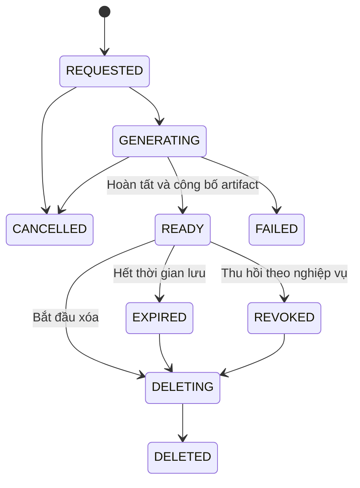
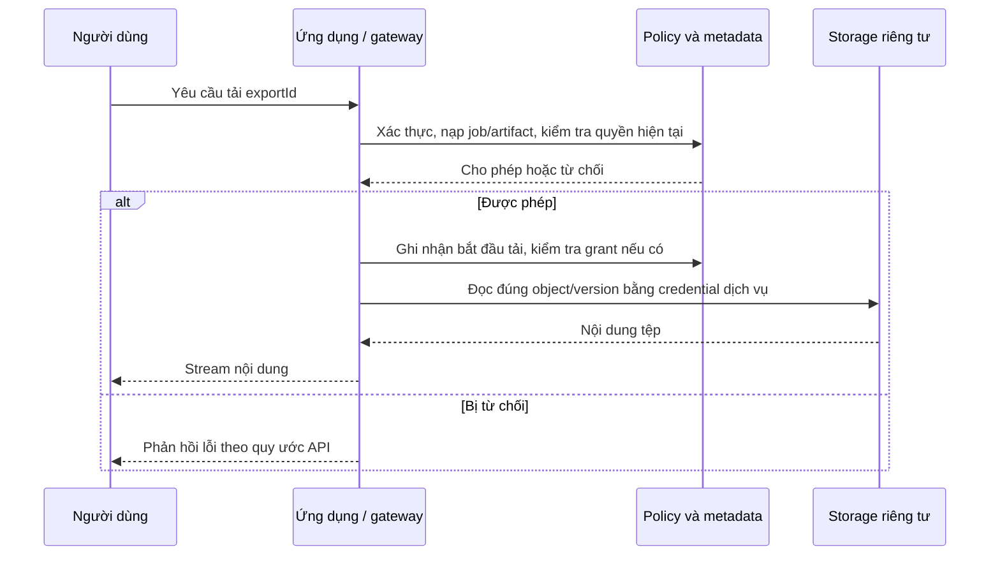

# Export download authorization

## 1. Vì sao tải bản xuất cần một quyết định quyền riêng?

Trong chương **Export Security** của module bảo vệ logic nghiệp vụ, *export download authorization* là việc quyết định ai được nhận nội dung của một bản xuất, trong ngữ cảnh nào và tại thời điểm nào. Đối tượng được bảo vệ là dữ liệu thật trong tệp, không chỉ là bản ghi mô tả công việc xuất dữ liệu.

Một quy trình thường có nhiều bước:

```text
Yêu cầu xuất → kiểm tra quyền → tạo job → sinh tệp → tệp sẵn sàng
                                                    ↓
                              yêu cầu tải → kiểm tra quyền → truyền tệp
```

Hai quyết định quyền ở hai thời điểm có thể cho kết quả khác nhau. Người dùng có thể bị khóa, rời tenant, mất vai trò, mất quyền với một nhóm khách hàng hoặc mất quyền xem trường nhạy cảm trong lúc job đang chạy. Vì vậy, việc đã được phép tạo job không tự động cho phép tải kết quả về sau.

Ví dụ, Lan thuộc nhóm Tài chính của tenant A và yêu cầu xuất bảng lương lúc 09:00. Lúc 09:05, Lan chuyển nhóm và bị thu hồi quyền xem lương. Tệp hoàn tất lúc 09:10. Nếu endpoint tải chỉ kiểm tra `export.requestedBy == currentUser.id`, Lan vẫn nhận được bảng lương dù không còn quyền nghiệp vụ tương ứng.

Bài học này tập trung vào ranh giới từ **tệp đã được tạo đến việc trao dữ liệu cho người nhận**. Các ví dụ dùng hệ thống Java nhiều tenant, nhưng nguyên tắc áp dụng cho báo cáo tài chính, hồ sơ khách hàng, dữ liệu đơn hàng và những dạng xuất dữ liệu khác.

Sau bài học, người học cần có khả năng:

- Viết invariant cho quyền tải, thay vì chỉ kiểm tra đăng nhập hoặc vai trò tổng quát.
- Phân biệt quyền với job, quyền với artifact và quyền với dữ liệu nằm trong artifact.
- Thiết kế luồng tải qua ứng dụng hoặc qua signed URL với giới hạn rõ ràng.
- Xử lý việc thu hồi quyền, yêu cầu đồng thời, retry và tải từng phần.
- Xây dựng kiểm thử phủ định cho hành vi lạm dụng logic tải bản xuất.

## 2. Phân biệt các đối tượng và nguồn tin cậy

Một lỗi thiết kế phổ biến là gom mọi thứ thành một `exportId`, rồi xem việc biết ID là đủ để tải tệp. Cần tách ít nhất các đối tượng sau:

| Đối tượng | Ý nghĩa | Nguồn tin cậy để quyết định quyền |
|---|---|---|
| Subject | Người dùng hoặc service đang thao tác | Phiên đăng nhập, token đã xác thực và trạng thái tài khoản hiện tại |
| Tenant context | Tổ chức mà yêu cầu đang hoạt động trong đó | Membership và ngữ cảnh đã được máy chủ xác minh |
| Export job | Yêu cầu nghiệp vụ, người yêu cầu, trạng thái xử lý | Bản ghi do hệ thống quản lý |
| Artifact | Tệp cụ thể, phiên bản nội dung, nơi lưu, phân loại dữ liệu | Metadata được worker đáng tin cậy ghi nhận khi hoàn tất |
| Download grant | Quyền tải tạm thời, có đối tượng và phạm vi xác định | Bản ghi do dịch vụ cấp sau khi kiểm tra quyền |
| Policy state | Quyền, phê duyệt, phân loại và các điều kiện đang hiệu lực | Kho chính sách hoặc dữ liệu quyền hiện hành |

`exportId`, `artifactId`, tên tệp và `tenantId` trong URL đều là dữ liệu đầu vào cần kiểm tra. Chúng giúp xác định đối tượng được yêu cầu; chúng không chứng minh người gọi có quyền với đối tượng đó.

Tương tự, không lấy quyền của người tải từ các trường như `requestedBy`, `role`, `approved=true` hoặc `allowedColumns` do client gửi. Máy chủ phải tự nạp và kiểm tra những dữ kiện liên quan. Nếu người dùng chọn tenant bằng header hoặc URL, máy chủ vẫn phải xác minh membership và quyền trên tenant được chọn.

### 2.1. Người tạo job không phải lúc nào cũng là người được nhận tệp

Có hệ thống chỉ cho người tạo job tải. Có hệ thống cho phép người duyệt hoặc nhóm kiểm toán tải thay. Cả hai đều là lựa chọn nghiệp vụ hợp lệ nếu được quy định rõ.

Điều không hợp lệ là mặc định rằng:

```text
Là người tạo job ⇒ luôn có quyền với mọi dữ liệu trong tệp.
Là admin của một tenant ⇒ có quyền với bản xuất của mọi tenant.
Có quyền xem trạng thái job ⇒ có quyền tải nội dung.
Biết đường dẫn storage ⇒ có quyền đọc storage.
```

Hãy mô hình hóa riêng các hành động như `EXPORT_CREATE`, `EXPORT_STATUS_READ`, `EXPORT_DOWNLOAD`, `EXPORT_DOWNLOAD_FOR_OTHER` và `EXPORT_REVOKE` khi nghiệp vụ cần phân biệt chúng. Không nhất thiết tạo từng vai trò riêng; điều quan trọng là policy hiểu đúng hành động.

## 3. Viết business invariants cho việc tải

Một quyết định tải có thể được diễn đạt bằng điều kiện tổng quát:

```text
CanDownload(subject, tenantContext, export, artifact, now)
  = subject đang hoạt động
  AND tenantContext đã được xác minh
  AND subject được phép thực hiện EXPORT_DOWNLOAD trong ngữ cảnh đó
  AND export.tenantId = tenantContext.tenantId
  AND artifact thuộc đúng export và cùng tenant
  AND export ở trạng thái cho phép tải
  AND artifact còn hiệu lực, đúng phiên bản và chưa bị thu hồi
  AND subject được phép nhận artifact theo quan hệ sở hữu/chia sẻ/ủy quyền
  AND phạm vi dữ liệu của artifact vẫn được phép đối với subject
  AND các điều kiện phê duyệt, thời hạn, mức xác thực đều được đáp ứng
```

Đây là một mô hình để triển khai policy, không phải biểu thức có thể đánh giá chỉ bằng dữ liệu từ request. Nếu dùng download grant, phải thêm kiểm tra grant tương ứng.

Các invariant nên được viết đủ cụ thể để kiểm thử:

| Mã | Invariant | Lỗi nghiệp vụ bị ngăn chặn |
|---|---|---|
| I1 | Artifact chỉ được trả khi subject có quyền tải hiện hành | Dùng quyền tạo job cũ sau khi đã bị thu hồi quyền |
| I2 | Tenant của phiên, job, artifact và grant phải khớp theo policy | Đổi ID để tải dữ liệu tenant khác |
| I3 | Quyền phải bao phủ toàn bộ dữ liệu nhạy cảm trong tệp | Có quyền xem một phần nhưng tải được toàn bộ báo cáo |
| I4 | Chỉ artifact hoàn tất, còn hạn và chưa bị thu hồi được tải | Tải tệp đang ghi, tệp cũ hoặc tệp đã bị hủy |
| I5 | Grant gắn với đúng người nhận, hành động và phiên bản artifact | Dùng grant của tệp ít nhạy cảm để lấy tệp nhạy cảm |
| I6 | Grant không được mở rộng quyền nghiệp vụ hiện tại | Tải bằng grant còn hạn sau khi mất membership |
| I7 | Số phiên tải được bắt đầu không vượt giới hạn grant | Hai request đồng thời cùng dùng một grant chỉ cho một lần bắt đầu |
| I8 | Mọi đường trao byte đều thực thi mô hình quyền đã chọn | Endpoint bảo vệ tốt nhưng bucket hoặc CDN vẫn công khai |
| I9 | Quyết định tải có thể truy vết mà không làm lộ credential tải | Token hoặc signed URL bị ghi vào log |

### 3.1. Quyền xem dữ liệu trực tiếp chưa chắc là quyền xuất hàng loạt

Một nhân viên có thể được xem từng khách hàng để xử lý hỗ trợ, nhưng không được tải danh sách toàn bộ khách hàng. Bản xuất làm thay đổi quy mô thu thập dữ liệu, khả năng lưu trữ và khả năng chuyển dữ liệu ra ngoài hệ thống.

Vì vậy, cần kiểm tra cả quyền xuất/tải theo nghiệp vụ và phạm vi hàng, cột, trường nhạy cảm. Không suy diễn `CUSTOMER_READ` thành `CUSTOMER_EXPORT_ALL`.

### 3.2. Không chỉ so sánh tên vai trò

Hai người cùng vai trò `SALES` vẫn có thể được phân vùng khách hàng khác nhau. Quyền tải có thể phụ thuộc vào chi nhánh, nhóm phụ trách, cấp độ dữ liệu, trạng thái hợp đồng và mục đích sử dụng được phê duyệt.

Việc kiểm tra `hasRole("SALES")` chỉ giải quyết được một phần rất nhỏ của invariant I3.

## 4. Ràng buộc quyền với dữ liệu đã được materialize

Artifact là một ảnh chụp dữ liệu tại một thời điểm. Sau khi tạo ra tệp CSV hoặc XLSX, quyền không còn được thực thi bằng điều kiện `WHERE` của truy vấn ban đầu mỗi khi người dùng đọc một dòng.

Giả sử artifact chứa:

```text
tenant: A
phạm vi hàng: khách hàng của chi nhánh NORTH và SOUTH
phạm vi cột: customer_id, name, email, credit_limit
phân loại: INTERNAL_FINANCIAL
phiên bản artifact: 7
```

Nếu hiện tại người tải chỉ được xem chi nhánh NORTH hoặc chỉ được xem ba cột đầu, không được gửi nguyên tệp này. Việc người tải có thể chạy một truy vấn tương tự trong ứng dụng không chứng minh rằng họ được phép nhận mọi hàng và cột đã nằm trong tệp.

### 4.1. Các cách kiểm chứng phạm vi

**Cách A — Vô hiệu hóa khi ngữ cảnh quyền thay đổi.** Lưu một phiên bản ngữ cảnh quyền đáng tin cậy khi tạo artifact. Khi tải, yêu cầu phiên bản hiện tại còn khớp, đồng thời kiểm tra đầy đủ policy tải. Nếu khác, từ chối tải và yêu cầu tạo lại bản xuất.

Phiên bản này có thể là một số tăng đơn điệu hoặc một tập phiên bản gắn với membership, phạm vi hàng, quyền trường, phân loại dữ liệu và phê duyệt. Nó phải thay đổi khi những dữ kiện có thể ảnh hưởng đến quyền với nội dung thay đổi. Chỉ lưu phiên bản định nghĩa role là chưa đủ nếu dữ liệu đổi chủ sở hữu hoặc người dùng chuyển nhóm mà role vẫn giữ nguyên.

Đây là cách tương đối bảo thủ: một thay đổi quyền không liên quan cũng có thể làm bản xuất phải tạo lại. Đổi lại, hệ thống có một điều kiện từ chối rõ ràng.

**Cách B — Kiểm chứng artifact là tập con của quyền hiện tại.** Lưu manifest đủ tin cậy và đủ chi tiết để kiểm tra phạm vi dữ liệu trong artifact nằm hoàn toàn trong quyền hiện tại của người tải. Với dữ liệu lớn hoặc quyền theo từng đối tượng, phép kiểm chứng này có thể tốn kém và phức tạp.

Một manifest chỉ ghi `branch=NORTH` sẽ không đủ nếu quyền còn phụ thuộc vào người phụ trách của từng khách hàng và các quan hệ đó đã thay đổi. Nếu hệ thống không thể chứng minh điều kiện bao phủ, hãy từ chối và tạo lại bản xuất với quyền hiện tại.

**Cách C — Artifact có người nhận và phạm vi cố định theo policy riêng.** Một tài liệu nghiệp vụ đã được duyệt có thể được phép giao cho nhóm người nhận cụ thể trong một thời hạn nhất định. Đây phải là quy tắc nghiệp vụ được mô hình hóa rõ, có điều kiện thu hồi; không nên vô tình tạo ra ngoại lệ này chỉ vì đã lưu tệp.

### 4.2. Metadata phải gắn với đúng nội dung

Lưu artifact theo phiên bản bất biến, ví dụ bằng object version hoặc một key riêng cho từng phiên bản. Gắn `artifactId`, phiên bản, tenant, phạm vi và digest nội dung với nhau khi worker công bố tệp hoàn tất.

Không thay nội dung dưới cùng một key rồi tiếp tục coi các grant cũ là hợp lệ. Một grant cấp cho artifact phiên bản 7 không được dùng để tải phiên bản 8. Digest giúp phát hiện sai lệch nội dung; nó không tự chứng minh người tải có quyền.

Worker tạo tệp thường có credential storage mạnh hơn người dùng. Việc worker đọc được object không phải là bằng chứng người nhận được phép đọc object. Đây là ranh giới cần chú ý để tránh dịch vụ trở thành *confused deputy*: dùng quyền nội bộ của mình để phục vụ một yêu cầu trái quyền từ bên ngoài.

## 5. State machine của job, artifact và quyền tải

Không nên dùng một cờ `completed=true` để đại diện cho mọi điều kiện tải.



Trong mô hình này, chỉ `READY` mới có thể được xem xét tải. `READY` là điều kiện cần; người gọi vẫn phải vượt qua kiểm tra quyền.

Một vài quy tắc chuyển trạng thái cần được thống nhất:

- Worker không công bố `READY` trước khi tệp được ghi hoàn tất và metadata được xác nhận.
- Callback hoặc retry của worker không được chuyển job từ `CANCELLED` hay `REVOKED` trở lại `READY`.
- Khi thu hồi, ứng dụng chặn việc bắt đầu tải mới ngay theo cơ chế đồng bộ đã chọn; không chờ đến lúc xóa object vật lý mới chặn tải.
- Nếu artifact đã mất trong storage dù metadata còn `READY`, xử lý như lỗi nhất quán và từ chối; không đoán một key khác để phục vụ tệp.

Download grant có vòng đời riêng. Với grant chỉ cho phép bắt đầu một phiên tải:

```text
ISSUED → STARTED
   ├──→ EXPIRED
   └──→ REVOKED

STARTED → quản lý tiếp bằng download session nếu cần retry hoặc resume
```

Tên trạng thái phải thể hiện đúng điều được bảo đảm. `STARTED` nghĩa là hệ thống đã chấp nhận bắt đầu một phiên tải. Nó không có nghĩa người dùng đã nhận đủ byte hoặc đã lưu tệp thành công.

## 6. Chọn đường phân phối tệp phù hợp

Có hai mô hình phổ biến, với bảo đảm khác nhau.

| Tiêu chí | Ứng dụng/gateway kiểm soát đường tải | Signed URL trực tiếp tới storage/CDN |
|---|---|---|
| Kiểm tra quyền hiện tại | Có thể thực hiện trước từng request | Thường chỉ thực hiện khi cấp URL |
| Credential gửi tới người nhận | Phiên ứng dụng hoặc grant có kiểm tra phía server | URL chứa quyền đọc có thời hạn |
| Ràng buộc với người nhận | Có thể kiểm tra tài khoản và session | URL thông thường là bearer capability |
| Thu hồi trước khi hết hạn | Có thể chặn request tiếp theo bằng trạng thái server | Phụ thuộc khả năng của storage, CDN và thiết kế cache |
| Giới hạn số lần bắt đầu tải | Có thể quản lý nguyên tử trong ứng dụng | Không tự có chỉ nhờ thời hạn hoặc chữ ký |
| Chi phí truyền dữ liệu | Hạ tầng ứng dụng/gateway tham gia đường truyền | Storage/CDN phục vụ phần lớn lưu lượng |

### 6.1. Tải qua ứng dụng hoặc gateway

Luồng đề xuất khi cần quyền động hoặc dữ liệu nhạy cảm:



Storage phải riêng tư. Client không được lấy một public URL có thể dùng để bỏ qua toàn bộ kiểm tra của gateway.

Nếu dùng reverse proxy nội bộ để truyền tệp sau khi ứng dụng duyệt, location nội bộ phải chỉ được gọi qua đường tin cậy. Proxy phải loại bỏ các header điều khiển nội bộ do client tự gửi và không công khai đường dẫn backend.

### 6.2. Signed URL: chữ ký bảo vệ URL, không xác thực người cầm URL

Signed URL thường cho phép bên nắm URL đọc một object trong thời hạn đã ký. Nếu Lan chuyển URL cho Minh, storage thường không biết Minh có phải người được ứng dụng cho phép hay không.

Những suy diễn sau đều không đủ cơ sở:

```text
URL hết hạn sau một phút ⇒ chỉ chủ tài khoản dùng được.
URL có userId trong query ⇒ storage kiểm tra đúng người dùng.
URL được gọi là one-time ⇒ chỉ có thể tải một lần.
Ứng dụng đã revoke grant ⇒ URL đã phát ra lập tức vô hiệu ở CDN.
```

Trường `userId` chỉ có ý nghĩa ràng buộc khi thành phần phục vụ tệp thực sự xác thực người gọi và kiểm tra trường đó. Một chữ ký gắn với query không tự tạo ra việc xác thực này.

Chỉ chọn signed URL trực tiếp khi nghiệp vụ chấp nhận cửa sổ truy cập bằng bearer URL và các giới hạn thu hồi tương ứng. Khi dùng:

- Kiểm tra đầy đủ quyền ngay trước khi cấp URL.
- Ký đúng object/version và phương thức cần thiết; tránh cấp quyền liệt kê bucket hoặc đọc prefix rộng.
- Đặt thời hạn ngắn phù hợp với kích thước tệp và trải nghiệm sử dụng.
- Giữ bucket riêng tư và kiểm tra đường origin/CDN không có lối truy cập công khai khác.
- Không đưa URL vào log, công cụ phân tích, email công khai hoặc trang có nguy cơ gửi URL sang bên thứ ba.
- Xác định rõ hành vi khi URL hết hạn, request đã bắt đầu, tải Range hoặc cache còn dữ liệu; các chi tiết này phụ thuộc hệ thống phân phối thực tế.

Nếu yêu cầu nghiệp vụ là “mất quyền thì mọi request tải mới phải bị từ chối ngay”, một signed URL không thể thu hồi còn sống trong nhiều phút không đáp ứng yêu cầu đó. Cần đổi đường phục vụ hoặc dùng một cơ chế kiểm tra quyền có thể thu hồi tại điểm phân phối.

## 7. Thiết kế download grant khi cần kiểm soát riêng

Download grant hữu ích khi muốn tách quyết định cấp quyền tải khỏi thao tác bắt đầu truyền tệp, áp dụng mức xác thực bổ sung hoặc kiểm soát phiên tải. Grant không thay thế policy nghiệp vụ.

Một bản ghi grant có thể gồm:

| Trường | Vai trò |
|---|---|
| `id`, `tokenDigest` | Tra cứu và kiểm chứng một token ngẫu nhiên đủ mạnh; tránh lưu token gốc |
| `subjectId`, `tenantId` | Người nhận và tenant được phép |
| `exportId`, `artifactId`, `artifactVersion` | Ràng buộc với đúng tệp đã được duyệt |
| `action` | Chỉ cho phép tải; không dùng cho sửa hoặc xóa |
| `issuedAt`, `expiresAt` | Thời hạn theo đồng hồ server |
| `policyContextVersion` | Dữ kiện phục vụ kiểm chứng ngữ cảnh quyền, nếu thiết kế có dùng |
| `state`, `startedAt`, `revokedAt` | Vòng đời và dấu vết bắt đầu hoặc thu hồi |
| `authContext` | Mức xác thực được yêu cầu hoặc thời điểm xác thực lại, nếu cần |

Không trả token qua các kênh không cần thiết. Trong thiết kế ràng buộc grant với tài khoản, người gọi phải vừa có phiên xác thực hợp lệ vừa sở hữu grant còn hợp lệ. Biết token chưa đủ nếu `subjectId` không khớp.

Nếu nghiệp vụ thật sự cần chia sẻ cho người ngoài không có tài khoản, đó là một chính sách chia sẻ riêng: cần người tạo chia sẻ có quyền, phạm vi dữ liệu, người nhận hoặc phương thức xác minh, thời hạn và khả năng thu hồi phù hợp. Không nên ngầm biến grant nội bộ thành đường tải ẩn danh.

### 7.1. Cấp grant và tải đều phải kiểm tra quyền

Ví dụ API:

```http
POST /api/exports/exp_A7/download-grants
Cookie: session=...
X-CSRF-Token: ...

GET /api/download-grants/grant_A7/content
Cookie: session=...
```

Trong ví dụ này, `grant_A7` là ID để tra cứu, không phải bằng chứng quyền. Endpoint tải còn kiểm tra subject của session, tenant, artifact và policy hiện tại. Nếu dùng thêm secret token, truyền và bảo vệ nó theo thiết kế cụ thể; không đặt secret vào ví dụ log hoặc thông báo lỗi.

Khi xác thực bằng cookie, endpoint cấp grant hoặc thay đổi trạng thái cần cơ chế chống CSRF phù hợp. `SameSite` là một lớp bảo vệ, không nên mặc định rằng mọi cấu hình cookie đã đủ để xử lý CSRF.

### 7.2. Tránh tiêu hao grant bởi thao tác xem trước liên kết

Trình duyệt, trình quét bảo mật hoặc công cụ preview có thể truy cập một URL trước người dùng. Với grant chỉ cho bắt đầu một phiên tải, không nên để việc preview hay `HEAD` vô tình làm mất lượt.

Một phương án rõ ràng là:

```text
Trang xác nhận tải
  → POST đã xác thực và bảo vệ CSRF để bắt đầu download session
  → GET nội dung của session đã được gắn với đúng người dùng
```

Đường `GET` cuối vẫn cần kiểm tra quyền session. Thiết kế có thể khác, nhưng phải chỉ ra thao tác nào tiêu hao lượt và thao tác nào chỉ đọc metadata.

## 8. Tính nguyên tử, TOCTOU và giới hạn “một lần”

### 8.1. Check rồi update riêng rẽ tạo ra cuộc đua

Đoạn logic sau có lỗi khi chạy đồng thời:

```java
// Ví dụ không an toàn.
if (grant.getState() == ISSUED) {
    streamArtifact();
    grant.setState(STARTED);
    save(grant);
}
```

Hai request có thể cùng thấy `ISSUED` và đều bắt đầu tải. Đánh dấu sau khi truyền tệp càng làm cửa sổ đua kéo dài.

Cần dùng transaction và khóa phù hợp, hoặc một cập nhật có điều kiện nguyên tử để giành quyền bắt đầu:

```sql
UPDATE download_grant
SET state = 'STARTED', started_at = :now
WHERE id = :grant_id
  AND subject_id = :subject_id
  AND tenant_id = :tenant_id
  AND artifact_id = :artifact_id
  AND artifact_version = :artifact_version
  AND state = 'ISSUED'
  AND expires_at > :now;
```

Chỉ request có đúng một dòng được cập nhật mới giành được lượt. Câu SQL này minh họa riêng phần tranh chấp grant; nó **không tự kiểm tra** membership, quyền hiện tại, trạng thái artifact hay việc thu hồi ở bảng khác. Các điều kiện đó phải nằm trong một cơ chế đồng bộ nhất quán của toàn quyết định cho phép tải.

### 8.2. Kiểm tra quyền và thu hồi phải có thứ tự xác định

Một transaction chỉ khóa grant không tự ngăn việc một transaction khác thu hồi membership. Nếu cần bảo đảm rằng thu hồi đã hoàn tất thì mọi lần bắt đầu tải sau đó đều bị từ chối, hai luồng phải dùng chung một cơ chế phân xử.

Ví dụ trong hệ thống có dữ liệu quyền và grant ở cùng cơ sở dữ liệu:

1. Định nghĩa một bản ghi `authorization_guard` cho phạm vi quyền cần bảo vệ, chẳng hạn tenant hoặc subject trong tenant.
2. Mọi thay đổi ảnh hưởng tới quyền tải đều khóa guard tương ứng và cập nhật phiên bản trong cùng transaction với thay đổi quyền.
3. Luồng bắt đầu tải khóa cùng guard, nạp policy hiện hành, kiểm tra job/artifact và giành lượt grant trong một transaction ngắn.
4. Quy định thứ tự khóa cố định, ví dụ guard → export → grant, và yêu cầu luồng thu hồi cũng tuân theo thứ tự tương thích.
5. Commit quyết định bắt đầu tải trước khi truyền nội dung.

Guard theo tenant có thể đơn giản nhưng gây tranh chấp cao. Guard chi tiết hơn cần bảo đảm mọi phụ thuộc quyền đều được bao phủ, kể cả thay đổi quyền trường, chuyển quyền sở hữu dữ liệu hoặc thay đổi phê duyệt. Không thể chỉ đặt tên một cột là `policyVersion` rồi mặc định đã giải quyết được đồng thời.

Nếu policy nằm ở dịch vụ bên ngoài hoặc được cache, phải làm rõ độ trễ đồng bộ và bảo đảm của dịch vụ đó. Transaction ở cơ sở dữ liệu ứng dụng không biến một kết quả policy cũ từ cache thành quyết định có hiệu lực tức thời.

### 8.3. Điểm quyết định và giới hạn thu hồi

Trong mô hình trên, transaction commit là điểm xác định việc bắt đầu tải đã được chấp nhận. Thu hồi commit trước điểm đó thì lần bắt đầu phải bị chặn. Thu hồi commit sau điểm đó có thể gặp một phiên tải đã được chấp nhận.

Không giữ transaction và khóa cơ sở dữ liệu trong toàn bộ thời gian stream một tệp lớn. Nếu cần dừng cả stream đang chạy, phải có cơ chế hủy riêng ở gateway hoặc kiểm tra định kỳ; vẫn cần thừa nhận byte đã gửi không thể bị thu hồi.

“Một lần” thường nên được định nghĩa là **tối đa một phiên tải được chấp nhận bắt đầu**. Server không thể suy ra chắc chắn người dùng đã lưu tệp thành công chỉ từ việc ghi xong response. Nếu đã tiêu hao grant rồi kết nối lỗi, cần cơ chế retry có kiểm soát, thay vì tự đưa grant về `ISSUED` và mở lại cuộc đua.

## 9. Luồng Java minh họa quyết định bắt đầu tải

Đoạn dưới là **mã giả gần Java**, thể hiện thứ tự và các trách nhiệm cần có. Các repository, policy và transaction runner là thành phần miền giả định; đây không phải mã có thể sao chép chạy ngay.

Giả định của ví dụ:

- Artifact bất biến và storage riêng tư.
- Policy tải dùng phương án bảo thủ: ngữ cảnh quyền liên quan thay đổi thì phải tạo lại bản xuất.
- Mọi thay đổi quyền liên quan tuân theo cơ chế guard đã mô tả.
- Grant chỉ cho phép bắt đầu một phiên tải; session được lưu riêng để hỗ trợ retry.
- Xác thực và chống CSRF cho thao tác bắt đầu phiên đã được xử lý ở lớp HTTP.

```java
record DownloadTicket(
    String sessionId,
    String artifactId,
    long artifactVersion,
    String objectKey,
    String objectVersion,
    String safeFilename,
    String mediaType
) {}

DownloadTicket startDownload(
        AuthenticatedPrincipal principal,
        VerifiedTenantContext tenant,
        String exportId,
        String grantId) {

    return transactions.required(() -> {
        Instant now = serverClock.instant();

        // Thứ tự khóa phải thống nhất với các luồng đổi quyền/thu hồi.
        AuthorizationGuard guard = guards.lockForTenant(tenant.id());
        access.requireActiveMembership(principal, tenant, guard);

        ExportJob job = exports.lockByTenantAndId(tenant.id(), exportId)
            .orElseThrow(NotFoundException::new);

        Artifact artifact = artifacts.requireCurrentImmutable(job);
        DownloadGrant grant = grants.lockById(grantId)
            .orElseThrow(NotFoundException::new);

        if (job.state() != READY
                || artifact.revoked()
                || !now.isBefore(artifact.expiresAt())) {
            throw new DownloadDeniedException();
        }

        grant.requireBoundTo(
            principal.id(), tenant.id(), job.id(),
            artifact.id(), artifact.version(), EXPORT_DOWNLOAD);
        grant.requireIssuedAndUnexpired(now);

        // Kiểm tra hành động, người nhận, dữ liệu và phê duyệt hiện hành.
        CurrentPolicyContext current = policy.loadCurrentUnderGuard(
            principal, tenant, artifact, guard);
        policy.requireCanReceiveExport(principal, job, artifact, current);

        if (!artifact.policyContextVersion().equals(current.version())) {
            throw new ExportMustBeRegeneratedException();
        }

        DownloadSession session = sessions.createBoundSession(
            principal.id(), tenant.id(), artifact.id(),
            artifact.version(), now);

        grant.markStarted(session.id(), now);
        grants.save(grant);

        // Outbox được commit cùng quyết định bắt đầu tải.
        auditOutbox.appendDownloadStarted(
            principal.id(), tenant.id(), job.id(),
            artifact.id(), artifact.version(), grant.id(), session.id());

        // Không lấy object key hoặc filename thô từ request của client.
        return ticketFactory.fromTrustedArtifact(session, artifact);
    });
}
```

Sau khi hàm trả về và transaction đã commit, gateway dùng `objectKey` và `objectVersion` từ ticket nội bộ để đọc storage. Không serialize ticket này nguyên vẹn cho client nếu nó chứa thông tin chỉ dành cho backend.

Đường phục vụ nội dung của download session phải xác thực lại subject, tenant, artifact và điều kiện quyền cho mỗi request mới theo policy. Nó không được trở thành một endpoint chỉ cần biết `sessionId` là đọc được tệp. Phần mã giả trên chỉ thể hiện việc bắt đầu phiên, chưa thể hiện controller streaming, retry hay resume.

Nếu mở storage thất bại sau commit, phiên đã bắt đầu nhưng không có byte nào được giao. Hệ thống có thể cho phép retry qua chính session đó hoặc cấp lại có kiểm soát theo policy; không tuyên bố rằng cơ chế này bảo đảm tải thành công đúng một lần.

## 10. Retry, idempotency và Range request

Tải tệp lớn thường có retry hoặc nhiều request lấy từng phần. Bảo vệ chỉ request đầu tiên sẽ tạo ra đường vòng.

### 10.1. Idempotency không thay thế authorization

Nếu `POST` bắt đầu phiên hỗ trợ `Idempotency-Key`, bản ghi idempotency phải gắn với ít nhất subject, tenant, thao tác và nội dung yêu cầu liên quan, gồm export/artifact version hoặc grant tương ứng.

Hai request cùng khóa nhưng khác tệp phải bị phát hiện xung đột. Hai người khác nhau dùng cùng chuỗi khóa không được nhận session của nhau. Khi trả lại kết quả đã có, vẫn phải kiểm tra quyền hiện tại trước khi cho truy cập tệp.

Khóa idempotency giúp một thao tác được lặp lại an toàn theo hợp đồng API. Nó không chứng minh rằng người gửi được phép thực hiện thao tác đó.

### 10.2. Quyền phải áp dụng cho từng request lấy nội dung

Những đường sau đều cần một policy nhất quán:

```http
GET  /api/download-sessions/sess_A7/content
GET  /api/download-sessions/sess_A7/content
Range: bytes=1048576-2097151

HEAD /api/download-sessions/sess_A7/content
```

- Request `Range` mới phải kiểm tra session, người gọi, tenant và điều kiện thu hồi; không chỉ tin `sessionId` hoặc `ETag`.
- Session phải gắn với artifact bất biến để các đoạn byte không đến từ hai phiên bản khác nhau.
- Nếu không hỗ trợ Range, từ chối hoặc bỏ qua Range theo hợp đồng HTTP đã chọn; không tự triển khai ghép offset thiếu kiểm soát.
- Nếu hỗ trợ nhiều đoạn hoặc nhiều kết nối, giới hạn tài nguyên và số kết nối theo policy để tránh biến khả năng resume thành đường tải hàng loạt không kiểm soát.
- `HEAD` không trả nội dung nhưng có thể làm lộ sự tồn tại, kích thước hoặc tên tệp. Nó cũng cần kiểm tra quyền, và không nên tiêu hao lượt tải ngoài dự kiến.

Có thể chọn không hỗ trợ resume cho dữ liệu rất nhạy cảm, nhưng cần ghi rõ hệ quả trải nghiệm. Điều cần bảo đảm là khái niệm “lượt tải”, “phiên tải” và “request lấy byte” không bị dùng thay thế cho nhau.

## 11. Ranh giới HTTP, cache và metadata

Một endpoint kiểm tra quyền đúng vẫn có thể bị vô hiệu hóa bởi cách phục vụ response.

### 11.1. Cache không được trở thành kho tệp dùng chung

Với bản xuất nhạy cảm qua ứng dụng, có thể dùng chính sách response như:

```http
Cache-Control: private, no-store
Content-Disposition: attachment; filename="customer-export.csv"
Content-Type: text/csv; charset=utf-8
X-Content-Type-Options: nosniff
Referrer-Policy: no-referrer
```

Tên tệp phải được chuẩn hóa, loại bỏ ký tự điều khiển và được mã hóa đúng khi tạo header. Không ghép trực tiếp tên do client cung cấp vào `Content-Disposition`. Loại nội dung cần phản ánh định dạng thực tế, không cố định là CSV cho mọi artifact.

`no-store` hướng dẫn các cache tuân thủ không lưu response; nó không ngăn người dùng đã được phép tải tự lưu hoặc chia sẻ tệp. Đồng thời cần kiểm tra cấu hình thực tế của reverse proxy, CDN và cơ chế service worker nếu ứng dụng sử dụng chúng.

Không để cache chung phục vụ response của người A cho người B chỉ vì URL giống nhau. Không coi thêm `Vary` là đủ để sửa mọi cấu hình CDN sai. Khi có đường xác thực dùng `ETag` hoặc phản hồi `304`, vẫn phải đánh giá quyền trước khi xác nhận quyền sử dụng lại nội dung.

### 11.2. Thông báo lỗi và endpoint phụ cũng là bề mặt dữ liệu

Quy ước API có thể dùng `404` cho đối tượng không nhìn thấy nhằm giảm tiết lộ sự tồn tại, hoặc `403` khi việc tồn tại đã được phép biết. Cần áp dụng nhất quán, không dùng mã lỗi như một biện pháp thay thế authorization.

Kiểm tra cả API liệt kê bản xuất, xem trạng thái, lấy tên tệp, kích thước, thông báo hoàn tất và endpoint redirect. Một người không được biết bản xuất bảng lương tồn tại cũng không nên nhận tên `salary-board-2026.xlsx` qua API metadata.

Không đưa `objectKey`, lỗi storage chi tiết, token hay signed URL vào phản hồi lỗi. Trang quản trị và liên kết “tải lại” cũng phải đi qua cùng ranh giới policy phù hợp.

## 12. Các tình huống lạm dụng logic tiêu biểu

### 12.1. Đổi export ID để tải của người khác

```http
GET /api/exports/exp_other_user/content
```

Người gọi vẫn đăng nhập hợp lệ nhưng thay ID. Nếu server chỉ kiểm tra `isAuthenticated()`, request có thể lấy dữ liệu ngoài phạm vi được phép.

Khắc phục bằng kiểm tra quyền theo đối tượng, tenant và phạm vi nội dung. ID ngẫu nhiên giúp giảm đoán ID, nhưng không thay thế các kiểm tra này.

### 12.2. Dùng trạng thái `READY` như một dấu phê duyệt

Người dùng có thể gọi endpoint tải ngay khi worker báo hoàn tất, dù yêu cầu chia sẻ chưa được duyệt. Trạng thái kỹ thuật hoàn tất không tương đương quyết định nghiệp vụ cho người nhận.

Policy phải kiểm tra phê duyệt tương ứng, người nhận, phiên bản artifact và hiệu lực của phê duyệt. Một phê duyệt cho phiên bản cũ không nên tự áp dụng cho tệp mới chứa thêm dữ liệu.

### 12.3. Tái sử dụng grant sau khi mất quyền

Grant được cấp trước khi tài khoản bị khóa hoặc membership bị gỡ. Nếu endpoint chỉ kiểm tra hạn grant, quyền cũ tiếp tục tồn tại.

Với mô hình quyền động, kiểm tra trạng thái hiện tại tại điểm bắt đầu và mỗi request nội dung mới. Nếu dùng signed URL trực tiếp, đánh giá theo cửa sổ hiệu lực thực tế của URL thay vì tuyên bố đã thu hồi chỉ vì bản ghi grant bị đổi trạng thái.

### 12.4. Tráo artifact hoặc storage key

Client gửi `exportId` hợp lệ nhưng thêm `objectKey` của một báo cáo khác. Backend kiểm tra quyền với job A rồi đọc tệp B bằng quyền dịch vụ.

Máy chủ phải lấy artifact và vị trí storage từ quan hệ tin cậy của job đã được duyệt. Grant, phiên bản và object được đọc phải cùng trỏ đến một artifact. Không nhận đường dẫn đọc tùy ý từ client.

### 12.5. Chia sẻ tệp rộng hơn quyền được xuất

Người tạo có quyền xuất nhóm khách hàng của mình nhưng dùng chức năng “chia sẻ bản xuất” để cấp cho một người chỉ có quyền với nhóm khác. Nếu quyền chia sẻ chỉ dựa trên việc sở hữu job, artifact vượt qua ranh giới dữ liệu.

Cần kiểm tra quyền chia sẻ của người cấp và quyền nhận của người nhận theo policy được chọn. Chuyển quyền sở hữu job không tự hợp thức hóa toàn bộ dữ liệu đã nằm trong tệp.

## 13. Kiểm thử tình huống tấn công logic

Thiết lập dữ liệu kiểm thử gồm tenant A và B; An và Bình trong A nhưng khác nhóm dữ liệu; Chi trong B; một người duyệt; artifact có và không có cột nhạy cảm; grant còn hạn, hết hạn và đã thu hồi.

Trong kiểm thử phủ định, không chỉ kiểm tra mã trạng thái. Cần xác nhận không có byte nhạy cảm, không có header redirect chứa signed URL và không có metadata vượt quyền. Khi phù hợp, theo dõi lời gọi storage để chứng minh nhánh bị từ chối không bắt đầu đọc nội dung.

| Tình huống | Thao tác kiểm thử | Kết quả cần chứng minh |
|---|---|---|
| Khác tenant | An dùng export ID của Chi | Từ chối; không cấp grant, URL hay nội dung |
| Cùng tenant, sai phạm vi | Bình tải artifact có khách hàng của An | Từ chối trừ khi policy chia sẻ cho phép rõ ràng |
| Mất quyền sau khi tạo job | Thu hồi quyền của An rồi hoàn tất job | Không được tải chỉ vì An là người tạo |
| Mất quyền sau khi cấp grant | Cấp grant, thu hồi membership, sau đó bắt đầu tải | Từ chối theo mô hình quyền động |
| Mất quyền với một cột | Thu hồi quyền xem `credit_limit` | Không trả nguyên artifact còn chứa cột đó |
| Dữ liệu đổi chủ sở hữu | Chuyển một khách hàng ra ngoài phạm vi của An | Cơ chế version/manifest phát hiện hoặc từ chối theo policy |
| Sai phiên bản | Dùng grant cho artifact v7 để yêu cầu v8 | Từ chối hoặc chỉ phục vụ đúng v7 nếu v7 còn được phép |
| Chưa hoàn tất | Tải khi `GENERATING` | Không trả tệp tạm |
| Đã thu hồi hoặc hết hạn | Tải artifact `REVOKED` hoặc `EXPIRED` | Từ chối dù object vật lý còn tồn tại |
| Tranh chấp grant | Hai request đồng thời với grant một phiên | Chỉ một phiên tải được chấp nhận bắt đầu |
| Thu hồi cạnh tranh với tải | Cho hai transaction giao nhau có kiểm soát | Kết quả tuân theo điểm quyết định đã định nghĩa |
| Lặp idempotency key | Retry cùng người/cùng yêu cầu rồi thử đổi tệp | Retry đúng quy ước; yêu cầu khác bị phát hiện xung đột |
| Sai người dùng với cùng key | Bình dùng chuỗi idempotency key của An | Không nhận session hay artifact của An |
| Resume sau thu hồi | Bắt đầu tải rồi thu hồi, gửi request Range mới | Request mới bị chặn theo policy |
| `HEAD` và preview | Gửi `HEAD`, mở trang preview | Không lộ metadata vượt quyền, không tiêu hao grant ngoài dự kiến |
| Bỏ qua ứng dụng | Truy cập trực tiếp object hoặc origin | Không đọc ẩn danh nếu thiết kế yêu cầu gateway |
| Cache giữa người dùng | An tải rồi Bình gọi cùng URL | Bình không nhận response được cache từ An |
| Token bị sao chép | Bình dùng grant gắn với tài khoản An | Từ chối trong mô hình grant ràng buộc tài khoản |
| Kết nối lỗi sau commit | Ngắt stream trước khi nhận đủ byte | Retry có kiểm soát, không tự mở lại grant để tải đồng thời |

### 13.1. Kiểm thử đồng thời phải điều khiển được thứ tự

Đối với grant một phiên, dùng barrier trong integration test để hai request tiến tới cùng điểm tranh chấp. Xác nhận số phiên được tạo, số lần chuyển trạng thái và số đường stream được mở. Chỉ gửi nhiều request ngẫu nhiên rồi thấy “không lỗi” chưa chứng minh tính nguyên tử.

Đối với thu hồi, kiểm tra ít nhất hai thứ tự:

```text
Trường hợp A:
  thu hồi commit → bắt đầu tải → phải bị từ chối

Trường hợp B:
  bắt đầu tải commit → thu hồi commit
  → phiên đã bắt đầu được xử lý theo policy stream đang chạy
  → các request nội dung mới phải theo quyền hiện tại
```

Thử cả đường policy cache và đường cập nhật membership thực tế. Một test chỉ đổi trường `revoked` trên grant sẽ không phát hiện lỗi bỏ sót thay đổi quyền ở nguồn khác.

### 13.2. Kiểm thử signed URL theo đúng mô hình đã chọn

Nếu chọn signed URL dạng bearer, việc người khác có URL và đọc được trong hạn có thể là hành vi đã được chấp nhận của mô hình, không phải bằng chứng rằng URL ràng buộc tài khoản. Kiểm thử phải làm rõ điều này với người duyệt nghiệp vụ.

Xác minh object/version đã ký, hạn dùng, khả năng truy cập qua CDN/origin, hiệu lực thu hồi thực tế và việc URL có xuất hiện trong log hay không. Nếu kết quả mâu thuẫn với invariant đã cam kết, thay đổi thiết kế phân phối tệp.

## 14. Audit và quan sát vận hành

Sự kiện nên phân biệt được các bước sau:

```text
DOWNLOAD_GRANT_ISSUED
DOWNLOAD_DENIED
DOWNLOAD_STARTED
DOWNLOAD_STREAM_FINISHED
DOWNLOAD_STREAM_FAILED
DOWNLOAD_GRANT_REVOKED
```

`DOWNLOAD_STREAM_FINISHED` mô tả trạng thái server quan sát được; không khẳng định người dùng đã đọc hoặc lưu tệp. Tránh dùng một sự kiện `DOWNLOAD_SUCCESS` mơ hồ cho cả cấp URL và truyền xong nội dung.

Thông tin phục vụ điều tra có thể gồm subject, tenant, export ID, artifact/version, grant/session ID không mang secret, thời điểm, phiên bản policy, lý do quyết định và correlation ID. Lý do chi tiết như `TENANT_MISMATCH`, `SCOPE_CHANGED` hoặc `APPROVAL_REVOKED` nên nằm ở log nội bộ được bảo vệ; response bên ngoài theo quy ước tiết lộ thông tin của API.

Không ghi session cookie, token gốc, signed URL đầy đủ hoặc dữ liệu của artifact vào log. Log quyết định đã commit có thể được bảo đảm bằng outbox; các lần bị từ chối cần đường ghi nhận riêng vì transaction nghiệp vụ bị rollback sẽ không giữ lại outbox trong transaction đó.

Các tín hiệu đáng theo dõi gồm nhiều lần đổi export ID, nhiều từ chối khác tenant, cố tải sau thu hồi, tranh chấp grant tăng đột biến và cấp lại phiên liên tục sau lỗi kết nối. Chúng giúp phát hiện lạm dụng và lỗi thiết kế; chúng không thay thế kiểm tra quyền trên từng đường tải.

## 15. Bài tập thiết kế

Một hệ thống cho phép trưởng chi nhánh xuất doanh thu. Worker lưu tệp vào bucket riêng tư. Khi job hoàn tất, API trả signed URL có hiệu lực 24 giờ. Endpoint chỉ kiểm tra người gọi là người tạo job. Trưởng chi nhánh có thể đổi chi nhánh sau khi yêu cầu xuất, và quyền xem thông tin khách hàng có thể bị gỡ độc lập với quyền xem doanh thu.

Hãy thiết kế lại để đáp ứng các yêu cầu:

1. Người dùng chỉ được nhận dữ liệu thuộc phạm vi hiện tại và các cột hiện tại được phép xem.
2. Khi thu hồi quyền đã hoàn tất, mọi lần bắt đầu tải mới phải bị chặn.
3. Có thể retry khi mạng lỗi nhưng không dùng retry để mở không giới hạn phiên tải song song.
4. Có audit phân biệt bắt đầu tải và truyền xong ở server.

Gợi ý triển khai:

- Viết invariant cho chi nhánh, cột nhạy cảm, tenant và trạng thái job trước khi chọn công nghệ tải.
- Dùng artifact bất biến, gắn metadata phạm vi đáng tin cậy với đúng phiên bản nội dung.
- Chọn cơ chế kiểm chứng phạm vi; nếu không chứng minh được tệp còn hợp lệ, yêu cầu tạo lại.
- Chọn gateway có kiểm tra quyền hiện tại nếu signed URL 24 giờ không đáp ứng yêu cầu thu hồi.
- Dùng một quyết định bắt đầu phiên nguyên tử, session ràng buộc người dùng và retry có thời hạn theo policy.
- Kiểm thử việc mất quyền giữa lúc tạo job, cấp grant, bắt đầu tải và gửi request resume.

Một thiết kế đạt yêu cầu phải trả lời được câu hỏi cụ thể: **“Vì sao người này, trong tenant này, tại thời điểm này, được nhận toàn bộ nội dung của đúng phiên bản tệp này?”** Câu trả lời cần dựa trên invariant, trạng thái và dữ kiện tin cậy mà hệ thống thực sự kiểm tra.
