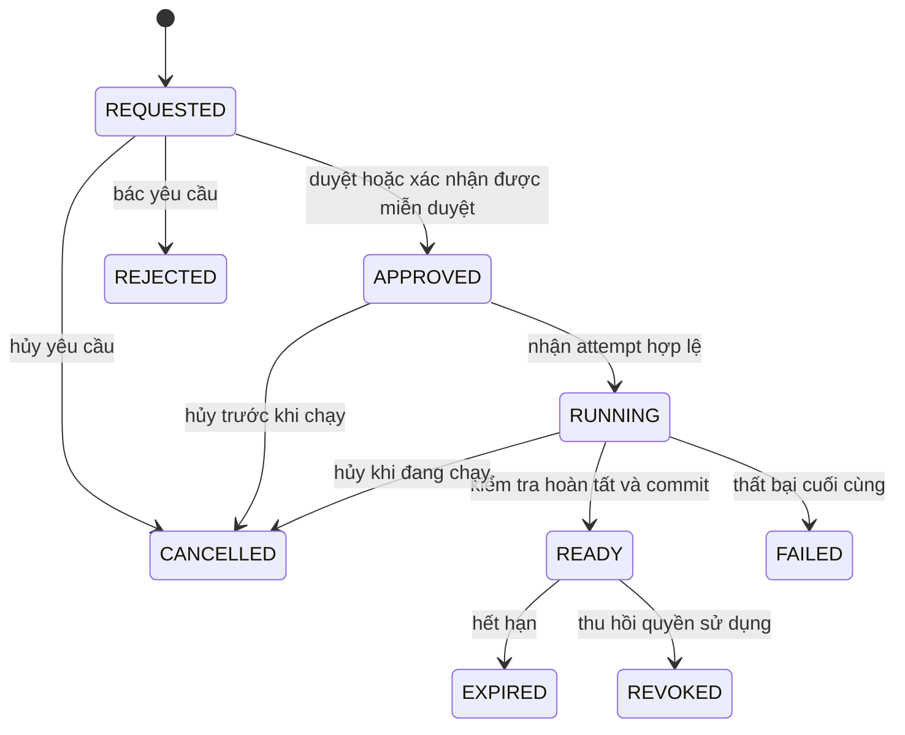
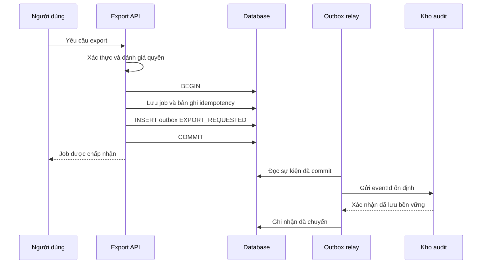

# Export audit event

## 1. Audit export phải trả lời được điều gì?

Một chức năng xuất dữ liệu có thể thực hiện đúng truy vấn SQL nhưng vẫn vi phạm quy tắc nghiệp vụ: nhân viên xuất dữ liệu của chi nhánh khác, bỏ qua phê duyệt, dùng lại một liên kết đã cấp trước khi bị thu hồi quyền, hoặc gửi nhiều yêu cầu trùng để vượt hạn mức. Khi xảy ra sự cố, dòng log `export success` không đủ để xác định điều gì đã được cho phép và dữ liệu nào có thể đã ra khỏi hệ thống.

**Export audit event** là bản ghi có cấu trúc về một hành động, quyết định hoặc thay đổi có ý nghĩa bảo mật trong vòng đời xuất dữ liệu. Nó cần liên kết được người yêu cầu, đối tượng export, phạm vi dữ liệu, quyết định phân quyền, kết quả và các bước liên quan.

Ví dụ, một chuỗi sự kiện hữu ích có thể cho biết:

> Người dùng `user-42` thuộc `tenant-17` yêu cầu xuất báo cáo đơn hàng; hệ thống chỉ chấp nhận phạm vi chi nhánh được phép; quản lý khác phê duyệt phiên bản yêu cầu đó; worker tạo một tệp chứa 1.240 dòng; sau đó một lượt tải bị từ chối vì quyền của người dùng đã bị thu hồi.

Thông tin này hỗ trợ phát hiện lạm dụng, giải thích quyết định và điều tra. **Audit không thay thế kiểm soát truy cập, transaction hay state machine**: ghi lại một lần xuất trái phép không làm lần xuất đó trở nên an toàn.

Trong bài này, thiết kế được đặt trong phạm vi bảo vệ logic nghiệp vụ của ứng dụng, đặc biệt là bất biến nghiệp vụ, quyền theo đối tượng, giao dịch và idempotency. Các tên sự kiện, schema và chính sách minh họa là lựa chọn thiết kế cho hệ thống ví dụ, không phải một chuẩn bắt buộc.

Theo [OWASP Logging Cheat Sheet](https://cheatsheetseries.owasp.org/cheatsheets/Logging_Cheat_Sheet.html), hoạt động import/export và các hành vi bất thường trong logic nghiệp vụ là những loại sự kiện cần cân nhắc ghi nhận trong security logging.

## 2. Bắt đầu từ các bất biến nghiệp vụ

Giả sử một hệ thống quản lý bán hàng cho phép xuất CSV theo tenant, chi nhánh, thời gian và nhóm cột. Một số export cần phê duyệt khi chứa dữ liệu nhạy cảm hoặc vượt ngưỡng quy mô. Người dùng tải tệp thông qua ứng dụng hoặc một liên kết truy cập có thời hạn.

Trước khi thiết kế audit, cần chốt các bất biến sau:

| Bất biến | Điểm thực thi | Bằng chứng cần có trong audit |
|---|---|---|
| Mọi export thuộc đúng tenant đã xác thực | Khi tạo, thực thi và truy cập job/tệp | Tenant tin cậy, job ID, quyết định phân quyền |
| Phạm vi được thực thi không vượt phạm vi được cấp và được duyệt | Khi chuẩn hóa yêu cầu, khi duyệt và trước khi thực thi | Phiên bản phạm vi, tham chiếu quyết định, dấu vân tay phạm vi |
| Nhóm cột nhạy cảm chỉ xuất hiện khi được phép | Khi xây dựng projection và khi kiểm tra trước khi công bố tệp | Mã bộ cột, phiên bản cấu hình che dữ liệu, classification |
| Không tự phê duyệt khi nghiệp vụ yêu cầu tách trách nhiệm | Tại lệnh approve | Người yêu cầu, người duyệt, quyết định và lý do từ chối |
| Một yêu cầu logic không tạo nhiều job do retry | Khi tiếp nhận yêu cầu và đặt chỗ idempotency | Job ID gốc, sự kiện replay/conflict, ID của từng lần tương tác |
| Worker cũ không công bố kết quả sau khi job bị hủy hoặc thu hồi | Khi nhận việc và khi hoàn tất | Attempt ID, phiên bản trạng thái, sự kiện từ chối hoàn tất |
| Chỉ tải khi còn đủ quyền và tệp còn hiệu lực | Tại điểm cấp quyền tải và điểm phục vụ tải do hệ thống kiểm soát | Người tải, grant ID, kết quả, thời hạn và reason code |
| Không công bố tệp trước khi lưu bền vững bằng chứng bắt buộc | Khi chuyển sang trạng thái cho phép tải | Sự kiện được commit cùng trạng thái công bố |

Audit cần mô tả **quyết định đã thực hiện**. Ví dụ, ghi role `MANAGER` không chứng minh người đó được xuất mọi dữ liệu. Quyết định còn phụ thuộc tenant, chi nhánh, quan hệ với đối tượng, bộ cột, mục đích sử dụng và trạng thái phê duyệt.

Phạm vi dữ liệu cũng cần có ngữ nghĩa rõ ràng. Một báo cáo có thể sử dụng snapshot tại thời điểm yêu cầu, hoặc dữ liệu hiện hành tại thời điểm chạy. Hai mô hình cho kết quả khác nhau; audit cần lưu `dataAsOf` hoặc tham chiếu snapshot nếu hệ thống thực sự cung cấp cam kết đó. Không tự gắn nhãn “snapshot” cho một truy vấn đọc dữ liệu đang thay đổi.

## 3. Phân biệt các sự kiện trong vòng đời export

### 3.1. Không gộp mọi bước thành “thành công”

| Sự kiện minh họa | Ý nghĩa chính xác | Chưa chứng minh điều gì |
|---|---|---|
| `EXPORT_REQUESTED` | Một job đã được chấp nhận và lưu bền vững | Chưa được duyệt, chưa tạo tệp |
| `EXPORT_REQUEST_DENIED` | Một lần yêu cầu đã bị từ chối | Không nhất thiết đã tồn tại job |
| `EXPORT_REQUEST_REPLAYED` | Retry hợp lệ nhận lại job của yêu cầu trước | Không phải một export mới |
| `EXPORT_IDEMPOTENCY_CONFLICT` | Khóa đã dùng bị gửi lại với nội dung khác | Không được sửa job cũ theo payload mới |
| `EXPORT_APPROVED` | Người có thẩm quyền đã duyệt một phiên bản yêu cầu | Không cho phép tự ý thay bộ lọc hoặc bộ cột sau duyệt |
| `EXPORT_APPROVAL_DENIED` | Một lần cố phê duyệt không hợp lệ | Không nhất thiết chuyển job sang `REJECTED` |
| `EXPORT_STARTED` | Worker đã nhận quyền xử lý một attempt | Chưa có tệp hoàn chỉnh |
| `EXPORT_READY` | Tệp đã hoàn tất và được hệ thống công bố là có thể tải | Không chứng minh có ai đã tải |
| `EXPORT_FAILED` | Job thất bại theo chính sách xử lý đã định nghĩa | Một lỗi attempt có thể chỉ cần retry, chưa phải lỗi cuối cùng |
| `EXPORT_CANCELLED` / `EXPORT_REVOKED` | Một thay đổi nghiệp vụ đã hủy hoặc thu hồi quyền sử dụng export | Không tự chứng minh tệp vật lý đã bị xóa |
| `EXPORT_DOWNLOAD_GRANTED` | Hệ thống đã cấp quyền hoặc capability tải | Không chứng minh liên kết đã được dùng |
| `EXPORT_DOWNLOAD_DENIED` | Một lần xin tải hoặc truy cập tải bị từ chối | Không nên trả chi tiết nhạy cảm cho client |
| `EXPORT_DOWNLOAD_STARTED` | Thành phần quan sát đã bắt đầu phục vụ lượt tải | Không chứng minh client nhận đủ nội dung |
| `EXPORT_DOWNLOAD_RESPONSE_COMPLETED` | Thành phần phục vụ hoàn tất phản hồi theo ngữ nghĩa đã công bố | Không chứng minh người dùng lưu, mở hoặc đọc tệp |
| `EXPORT_ARTIFACT_DELETED` | Đã xác nhận xóa artifact theo phạm vi được theo dõi | Chưa chắc mọi bản sao lưu đã bị xóa |

Một worker retry có thể tạo thêm `EXPORT_ATTEMPT_FAILED`. Chỉ ghi `EXPORT_FAILED` khi job thực sự đi vào trạng thái thất bại cuối cùng. Nếu dùng một tên sự kiện chung, phải có trường phân biệt `attemptOutcome` và `jobState` để người đọc không hiểu nhầm.

### 3.2. Phân biệt state machine với nhật ký hành động

Một state machine minh họa:



Đây là mô hình rút gọn; retry và lease của worker có thể được quản lý bằng bảng attempt riêng. Trường hợp miễn duyệt cần ghi rõ căn cứ chính sách, không gán một “người duyệt” giả hoặc ghi như có người đã phê duyệt.

Lượt tải thường là một thực thể riêng vì một tệp có thể có nhiều người tải, nhiều lần thử và nhiều HTTP range request. Một lần tải bị từ chối không làm job chuyển từ `READY` sang `FAILED`. Tương tự, một lần cố approve trái phép cần audit nhưng không đồng nghĩa yêu cầu bị bác về mặt nghiệp vụ.

## 4. Thiết kế schema có thể điều tra được

### 4.1. Các nhóm thông tin

Mỗi sự kiện cần có phiên bản schema để producer và consumer tiến hóa có kiểm soát. Có thể chia trường thành các nhóm sau:

| Nhóm | Trường minh họa | Mục đích |
|---|---|---|
| Định danh sự kiện | `eventId`, `eventType`, `schemaVersion` | Phân biệt sự kiện, kiểm tra định dạng, khử trùng khi giao lại |
| Thời gian | `occurredAt`, `ingestedAt` | Phân biệt lúc phát sinh với lúc hệ thống audit tiếp nhận |
| Nguồn phát | `producerService`, `producerVersion`, `environment` | Biết thành phần nào chịu trách nhiệm về phát biểu |
| Người khởi tạo | `initiator.subjectId`, `initiator.type` | Biết ai yêu cầu nghiệp vụ ban đầu |
| Chủ thể thực thi | `actor.subjectId`, `actor.type` | Biết ai thực hiện hành động hiện tại, kể cả worker |
| Ngữ cảnh ủy quyền | `effectiveSubjectId`, `delegationRef`, `impersonationRef` khi có | Phân biệt người thực hiện với người được đại diện |
| Đối tượng | `tenantId`, `exportJobId`, `artifactRef`, `downloadGrantId` | Liên kết với tài nguyên mà không đưa capability vào log |
| Phân quyền | `decisionId`, `policyVersion`, `reasonCode`, `approvalRef` | Giải thích căn cứ và kết quả kiểm tra |
| Phạm vi | `scopeVersion`, `scopeFingerprint`, `columnSetId`, `classification` | Gắn bằng chứng với phạm vi và bộ cột đã được duyệt |
| Kết quả | `outcome`, `stateBefore`, `stateAfter`, `rowCount`, `byteCount` | Mô tả kết quả đã quan sát; chỉ dùng trường phù hợp loại sự kiện |
| Liên kết | `interactionId`, `correlationId`, `causationId`, `attemptId` | Theo dõi một tương tác, cả workflow và nguyên nhân trực tiếp |
| Thứ tự | `jobVersion` hoặc `transitionSequence` | Đối chiếu thứ tự thay đổi trạng thái của một job |

Không phải trường nào cũng bắt buộc trong mọi sự kiện. Yêu cầu bị từ chối trước khi tạo job có thể không có `exportJobId`; người chưa xác thực không có `subjectId`; sự kiện cấp grant chưa có số byte đã truyền. Không tạo ID giả hay gán số `0` khi giá trị thực tế là chưa biết.

OWASP đề xuất ghi đủ bối cảnh về thời gian, nơi phát sinh, chủ thể và hành động; đồng thời phân biệt thời điểm sự kiện với thời điểm ghi log. Các nhóm trường trên áp dụng nguyên tắc đó cho export. [OWASP Logging Cheat Sheet](https://cheatsheetseries.owasp.org/cheatsheets/Logging_Cheat_Sheet.html)

### 4.2. Ví dụ một sự kiện `EXPORT_READY`

Các giá trị dưới đây là dữ liệu giả lập. Sự kiện thể hiện worker hoàn tất một job; nó không thể hiện hành động tải xuống.

```json
{
  "schemaVersion": 1,
  "eventId": "e0524a5c-a2a7-43da-a50e-07e5d7a443ef",
  "eventType": "EXPORT_READY",
  "occurredAt": "2026-11-22T03:10:26.418Z",
  "producerService": "sales-export-worker",
  "environment": "production",
  "tenantId": "tenant-17",
  "exportJobId": "export-901",
  "jobVersion": 4,
  "attemptId": "attempt-2",
  "initiator": {
    "type": "USER",
    "subjectId": "user-42"
  },
  "actor": {
    "type": "SERVICE",
    "subjectId": "sales-export-worker"
  },
  "authorization": {
    "decisionId": "decision-684",
    "policyVersion": "export-policy-v7",
    "reasonCode": "SCOPE_AND_APPROVAL_VALID",
    "approvalRef": "approval-112"
  },
  "scope": {
    "version": 2,
    "fingerprint": "hmac-sha256:k3:8c91...",
    "columnSetId": "orders-masked-v3",
    "classification": "INTERNAL_RESTRICTED",
    "dataAsOf": "2026-11-22T03:09:00Z"
  },
  "artifact": {
    "ref": "artifact-550",
    "rowCount": 1240,
    "byteCount": 238144,
    "expiresAt": "2026-11-22T04:10:26.418Z"
  },
  "outcome": "SUCCESS",
  "stateBefore": "RUNNING",
  "stateAfter": "READY",
  "interactionId": "worker-interaction-76",
  "correlationId": "workflow-390",
  "causationId": "event-export-started-58"
}
```

Chuỗi fingerprint được rút gọn để minh họa; hệ thống thực lưu giá trị đầy đủ. `dataAsOf` chỉ có ý nghĩa vì ví dụ giả định engine thực sự đọc snapshot tương ứng. `ingestedAt` có thể do hệ thống tiếp nhận bổ sung bên ngoài payload producer.

`rowCount` là số dòng dữ liệu thực sự được ghi vào artifact, theo quy ước không tính dòng header. `byteCount` phải chỉ rõ đang đo artifact lưu trữ, dữ liệu trước nén hay dữ liệu truyền tải; ví dụ này đo artifact đã lưu. Số lượng đúng không chứng minh phạm vi đúng: một tệp 1.240 dòng vẫn có thể chứa dữ liệu sai tenant.

## 5. Lấy sự thật từ phía server và giảm dữ liệu nhạy cảm

### 5.1. Không để client tự khai kết quả bảo mật

Client có thể đề xuất bộ lọc hoặc mục đích export. Server phải xác định danh tính, tenant được phép, phạm vi hiệu lực, trạng thái, kết quả kiểm tra quyền và số dòng thực tế từ các nguồn tin cậy.

Payload có `tenantId`, `approvedBy`, `rowCount` hoặc `exportedBy` không làm các giá trị đó trở thành sự thật. Với chức năng quản trị hỗ trợ nhiều tenant, tenant đích vẫn phải được kiểm tra bằng quyền đại diện cụ thể; không đơn thuần sao chép tenant do client gửi vào sự kiện.

Thông tin địa chỉ nguồn cũng có ranh giới tin cậy. Header như `X-Forwarded-For` chỉ có giá trị khi được xử lý theo cấu hình proxy tin cậy. Trace ID và correlation ID giúp liên kết, nhưng không phải bằng chứng xác thực hoặc bằng chứng quyền.

Worker phải giữ được người khởi tạo từ metadata job đã được bảo vệ. Nếu mọi sự kiện chỉ có actor `export-worker`, điều tra sẽ không biết ai đã yêu cầu xuất. Ngược lại, gán người khởi tạo làm actor cho mọi bước sẽ che mất thành phần thực sự đã tạo hoặc công bố tệp.

### 5.2. Audit metadata, không sao chép dữ liệu export

Theo [OWASP Logging Cheat Sheet](https://cheatsheetseries.owasp.org/cheatsheets/Logging_Cheat_Sheet.html), token truy cập, mật khẩu và dữ liệu cá nhân nhạy cảm thường cần được loại bỏ hoặc xử lý bảo vệ trước khi ghi log.

Với export, nên có allowlist các trường được phép ghi:

| Nên ghi khi phù hợp | Không ghi trực tiếp |
|---|---|
| ID nội bộ của artifact và grant | Presigned URL, bearer token, cookie, authorization header |
| Mã bộ cột và phiên bản masking | Nội dung từng dòng hoặc vài dòng mẫu của CSV |
| Mã lý do như `TENANT_SCOPE_DENIED` | Toàn bộ request body hoặc thông báo lỗi chứa dữ liệu khách hàng |
| Tham chiếu phạm vi có quyền truy cập riêng | Câu SQL đầy đủ với literal nhạy cảm |
| ID chủ thể cần thiết cho điều tra | Tên, email, số điện thoại nếu mục đích audit không cần |
| Dấu vân tay yêu cầu được bảo vệ | Idempotency key nguyên bản hoặc bộ lọc có định danh cá nhân |

Nếu cần biết chính xác phạm vi đã duyệt, có thể lưu biểu diễn chuẩn hóa trong một kho bằng chứng được phân quyền chặt hơn và ghi `scopeEvidenceRef` vào audit. Cần xác định thời gian lưu của kho này để tham chiếu không trở thành liên kết vô nghĩa trong thời gian cần điều tra.

Fingerprint hỗ trợ đối chiếu “hai yêu cầu có cùng phạm vi hay không”; nó không tự cho phép tái dựng phạm vi. Hash thông thường của một bộ lọc ít giá trị có thể bị đoán bằng thử vét các khả năng. HMAC với khóa được bảo vệ và mã phiên bản khóa là một phương án khi cần đối chiếu mà giảm khả năng đoán ngoài hệ thống; nó vẫn không biến metadata thành dữ liệu công khai an toàn.

Không dùng HMAC fingerprint của phạm vi để kết luận artifact đã được tạo đúng. Việc đó còn phụ thuộc truy vấn thực thi, projection, mapping và kiểm tra phạm vi. Nếu cần nhận diện đúng phiên bản tệp, lưu digest của artifact ở kho metadata tin cậy; digest cũng không thay thế kiểm tra quyền đọc.

### 5.3. Tránh giả mạo nội dung log

Các trường như tên báo cáo, mục đích và user agent là dữ liệu không tin cậy. Giới hạn kích thước, kiểm tra kiểu, dùng JSON serializer và encode phù hợp ở giao diện xem audit. Không nối chuỗi để tạo JSON hay để ký tự xuống dòng giả thành một sự kiện mới.

Một trường tùy chọn sai định dạng có thể được bỏ hoặc thay bằng giá trị an toàn có cờ báo lỗi; không để nó làm mất cả sự kiện bảo mật. Với trường cốt lõi như tenant hoặc danh tính, cần ngăn hành động nếu không thể xác định ngữ cảnh bắt buộc. Hai trường hợp này có mức độ ảnh hưởng khác nhau.

## 6. Ghi audit đáng tin cậy bằng transaction và outbox

### 6.1. Hai cách ghi dễ tạo khoảng trống

Giả sử ứng dụng vừa cập nhật job trong database, vừa gửi sự kiện đến hệ thống audit:

```text
commit job -> gửi audit
```

Nếu process dừng sau commit, job tồn tại nhưng không có sự kiện.

Đảo thứ tự cũng không giải quyết được:

```text
gửi audit "job đã tạo" -> commit job
```

Nếu transaction rollback, audit khẳng định một thay đổi không thực sự xảy ra. Một lệnh `logger.info(...)` đặt trong transaction database cũng không tự động tham gia transaction đó.

### 6.2. Lưu job và ý định phát sự kiện trong cùng transaction

Với transactional outbox, thay đổi nghiệp vụ và bản ghi sự kiện được lưu trong **cùng một transaction của cùng tài nguyên database**. Một relay chuyển các sự kiện đã commit đến kho audit.



Các điều kiện quan trọng:

1. `outbox.append` thực sự ghi cùng transaction với job, không chỉ đẩy vào bộ nhớ hoặc một database khác.
2. Relay giữ nguyên `eventId` khi giao lại cùng sự kiện và chỉ xác nhận sau khi đích lưu bền vững.
3. Consumer có ràng buộc duy nhất cho `eventId` trong miền định danh đã thống nhất; việc lưu và khử trùng phải nhất quán.
4. Bản ghi outbox chưa chuyển thành công không bị xóa bởi một lịch dọn dẹp dựa riêng vào tuổi dữ liệu.
5. Có giám sát độ trễ, số lần retry, dung lượng và các sự kiện không xử lý được.

Relay có thể gửi thành công rồi dừng trước khi đánh dấu. Lần sau, sự kiện sẽ được gửi lại. Đây là lý do cần thiết kế cho giao lặp và xử lý idempotent; không tuyên bố toàn bộ luồng là “exactly once” chỉ vì đã dùng outbox.

Để tránh một consumer độc lập nhìn thấy `READY` trước khi audit trung tâm tiếp nhận, cần phân biệt hai cam kết. Outbox bảo đảm **đã lưu bền vững sự kiện cùng thay đổi**, chưa bảo đảm mọi hệ thống hạ nguồn đã nhìn thấy sự kiện ngay lập tức. Nếu nghiệp vụ yêu cầu kho audit trung tâm xác nhận trước khi cấp tải, phải có bước chờ xác nhận và trạng thái tương ứng, chấp nhận thêm độ trễ.

### 6.3. Chọn hành vi khi audit gặp lỗi

Trong mô hình minh họa, tạo job và công bố tệp là các thao tác nhạy cảm bắt buộc có bằng chứng bền vững. Nếu không thể ghi bản ghi outbox bắt buộc, transaction không được commit và ứng dụng không trả thành công cho thao tác đó.

Kho audit trung tâm tạm ngừng không nhất thiết buộc API dừng ngay nếu outbox vẫn ghi bền vững và còn trong giới hạn vận hành đã duyệt. Khi backlog vượt giới hạn, hệ thống có thể tạm ngừng nhận export mới theo chính sách. Giới hạn và phản ứng cần được thiết kế trước, không chờ đến lúc ổ đĩa đầy.

Quyết định **từ chối** vẫn phải có hiệu lực dù đích audit lỗi. Không chuyển deny thành allow để tránh lỗi log. Một hàng đợi dự phòng bền vững hoặc cơ chế cảnh báo riêng có thể hỗ trợ lưu bằng chứng; nếu mọi đường lưu đều hỏng, phải thừa nhận khoảng trống quan sát thay vì giả định đã ghi thành công.

## 7. Ví dụ mã giả Java tại điểm nhận yêu cầu

Đoạn sau là mã giả Java để minh họa ranh giới transaction, không phải một implementation hoàn chỉnh. Các dependency như `tx`, `policies`, `idempotency` và `events` thể hiện hợp đồng cần được triển khai trong ứng dụng thực tế.

```java
public ExportReply requestExport(
        VerifiedContext context,
        ExportCommand command) {

    ValidatedCommand validated = commands.validateAndCanonicalize(command);
    String fingerprint = fingerprints.forRequest(validated);

    return tx.required(() -> {
        Instant now = clock.instant();
        ExportDecision decision = policies.evaluateCreate(
                context, validated, now);

        if (!decision.allowed()) {
            outbox.append(events.requestDenied(context, decision, now));
            // Trả kết quả để transaction chứa audit có thể commit.
            return ExportReply.denied(decision.publicReason());
        }

        IdempotencySlot slot = idempotency.reserveOrLock(
                context.tenantId(),
                context.subjectId(),
                "CREATE_EXPORT",
                validated.idempotencyKey());

        if (slot.hasResult()) {
            if (!slot.matches(fingerprint)) {
                outbox.append(events.idempotencyConflict(context, now));
                return ExportReply.conflict();
            }

            ExportJob existing = jobs.getInTenant(
                    context.tenantId(), slot.exportJobId());

            ExportDecision replayAccess = policies.evaluateReadJob(
                    context, existing, now);

            if (!replayAccess.allowed()) {
                outbox.append(events.replayDenied(
                        context, existing.id(), replayAccess, now));
                return ExportReply.denied(replayAccess.publicReason());
            }

            outbox.append(events.requestReplayed(
                    context, existing, now));
            return ExportReply.existing(existing.id());
        }

        ExportJob job = ExportJob.requested(
                ids.newJobId(),
                context.tenantId(),
                context.subjectId(),
                decision.permittedScope(),
                decision.policyVersion(),
                now);

        jobs.insert(job);
        slot.complete(fingerprint, job.id());
        outbox.append(events.requested(context, job, decision, now));

        return ExportReply.accepted(job.id());
    });
}
```

Để cách viết này đúng về nghiệp vụ, các hợp đồng sau phải được đáp ứng:

- `VerifiedContext` đến từ cơ chế xác thực và kiểm tra tenant của server; nó không được dựng từ các trường tùy ý trong JSON request.
- `validateAndCanonicalize` tạo biểu diễn ổn định cho các trường có ý nghĩa nghiệp vụ. Các giới hạn kích thước, kiểu dữ liệu và idempotency key được kiểm tra trước khi giữ khóa database.
- `evaluateCreate` quyết định quyền tạo yêu cầu; job mới vẫn ở `REQUESTED`. Quyền chạy và điều kiện phê duyệt được đánh giá ở bước riêng. Một kết quả allow tại đây không có nghĩa worker được bỏ qua phê duyệt.
- `reserveOrLock` có unique constraint và cơ chế đồng bộ cho cả trường hợp khóa chưa tồn tại. Mẫu “SELECT không thấy rồi INSERT” mà không xử lý cạnh tranh là chưa đủ.
- Ràng buộc khóa bao gồm ít nhất tenant, chủ thể, loại thao tác và khóa do client cung cấp. Thời gian giữ khóa phải bao phủ cửa sổ retry mà hợp đồng API cam kết.
- `fingerprint` chứa đầy đủ tham số có ý nghĩa cho việc nhận diện yêu cầu: loại báo cáo, bộ lọc chuẩn hóa, bộ cột, định dạng và các lựa chọn liên quan. Không đưa timestamp ngẫu nhiên của từng lần retry vào đó.
- Kiểm tra quota, điều kiện phê duyệt và các dữ kiện phân quyền có thể thay đổi cần cơ chế nhất quán thích hợp: khóa, version check, đặt chỗ hoặc kiểm tra lại trước hành động nhạy cảm. Chỉ đặt hàm đánh giá quyền bên trong transaction không tự tạo tính nguyên tử với một dịch vụ phân quyền bên ngoài.
- `slot.complete`, `jobs.insert` và `outbox.append` cùng transaction; lỗi commit phải truyền ra trước khi API trả một phản hồi thành công.

Một điểm dễ sai là ném exception phân quyền sau khi đã ghi audit trong cùng transaction. Nếu exception làm rollback transaction, sự kiện deny cũng mất. Ví dụ trả một kết quả có kiểu để transaction audit được commit, sau đó tầng HTTP chuyển kết quả thành phản hồi phù hợp. Một lựa chọn khác là transaction audit độc lập, nhưng phải thiết kế rõ hành vi lỗi và tránh ghi một kết quả nghiệp vụ chưa commit.

Các lỗi xảy ra trước transaction, như request không hợp lệ hoặc chưa xác thực, cần đường ghi sự kiện riêng nếu thuộc danh mục cần audit. Không vì chưa có job mà bỏ qua hoàn toàn những lần thử có dấu hiệu lạm dụng.

## 8. Gắn phê duyệt và hoàn tất worker với đúng phiên bản

### 8.1. Phê duyệt một nội dung cụ thể

Approval nên gắn với ít nhất `jobId`, `scopeVersion`, fingerprint phạm vi, bộ cột và phiên bản yêu cầu. Nếu người dùng thêm cột dữ liệu nhạy cảm sau khi được duyệt, hệ thống phải tạo phiên bản mới và yêu cầu duyệt lại hoặc từ chối thay đổi; không giữ nguyên `approvalRef` như thể nội dung không đổi.

Sự kiện phê duyệt cần phân biệt:

- Ai khởi tạo yêu cầu và ai thực hiện phê duyệt.
- Phiên bản nào được duyệt và theo chính sách nào.
- Người phê duyệt có đủ thẩm quyền cho phạm vi đó tại lúc duyệt hay không.
- Hành động bị từ chối do tự phê duyệt, sai tenant, sai trạng thái hay phiên bản đã thay đổi.

Đối với dữ liệu cần quyền hiện hành, worker kiểm tra lại quyền hoặc hiệu lực ủy quyền trước khi chạy và trước khi công bố. Nếu nghiệp vụ cho phép chạy dựa trên một ủy quyền đã chốt, ủy quyền đó phải là đối tượng rõ ràng có phạm vi, thời hạn và điều kiện thu hồi. Không ngầm coi session cũ của người dùng là giấy phép vô thời hạn.

### 8.2. Công bố tệp sau bước xử lý ngoài database

Tạo CSV và ghi object storage thường không nằm trong cùng transaction với database. Một luồng hoàn tất có thể gồm:

1. Worker nhận attempt có định danh và fencing token hoặc phiên bản bảo vệ khỏi worker cũ.
2. Worker đọc dữ liệu trong phạm vi đã được cấp, tạo artifact ở vùng riêng tư và lưu manifest kết quả.
3. Worker kiểm tra tệp đã lưu thành công, số dòng, bộ cột, phạm vi và điều kiện hiện hành cần thiết.
4. Một transaction cập nhật job từ `RUNNING` sang `READY` bằng điều kiện so sánh phiên bản, gắn artifact và ghi `EXPORT_READY` vào outbox.
5. Nếu điều kiện cập nhật thất bại vì job đã bị hủy, thu hồi hoặc attempt đã cũ, artifact không được công bố. Ghi nhận kết quả bị từ chối và lên lịch dọn tệp mồ côi.

Object đã ghi nhưng chưa commit trạng thái `READY` phải không thể tải từ luồng công khai. Không sử dụng object public rồi hy vọng trạng thái job sẽ ngăn người biết URL truy cập.

Một unique constraint cho sự kiện chuyển trạng thái có thể dựa trên `(exportJobId, jobVersion, eventType)`. Tuy nhiên, nó không thay thế conditional update bảo vệ chuyển trạng thái. Ngăn ghi hai sự kiện trùng không đồng nghĩa đã ngăn hai worker cùng tạo tác dụng nghiệp vụ.

Nếu worker mất kết nối ngay sau commit, lần chạy lại cần đọc trạng thái và nhận ra kết quả đã hoàn tất. Sự kiện đã commit không được tạo lại với một `eventId` mới chỉ vì worker chưa nhận được xác nhận.

## 9. Audit tải xuống và giới hạn quan sát

### 9.1. Tải qua ứng dụng

Với endpoint như `GET /exports/{jobId}/download`, cần kiểm tra quyền đối với job và artifact cụ thể, tenant, thời hạn, trạng thái thu hồi và điều kiện người nhận. ID khó đoán không thay thế kiểm tra quyền theo đối tượng.

[OWASP Authorization Cheat Sheet](https://cheatsheetseries.owasp.org/cheatsheets/Authorization_Cheat_Sheet.html) yêu cầu kiểm tra quyền trên từng request và từng đối tượng phù hợp. Đối với export, tạo job thành công không tự cấp quyền cho mọi request tải trong tương lai.

Nếu chính sách yêu cầu bằng chứng trước khi truyền dữ liệu, hệ thống phải ghi bền vững sự kiện cấp quyền hoặc bắt đầu lượt tải trước khi gửi byte đầu tiên. Kết quả hoàn tất là một sự kiện sau đó, phản ánh điều mà tầng phục vụ quan sát được.

Giữa database và socket mạng không có transaction nguyên tử thông thường. Process có thể dừng sau khi gửi dữ liệu nhưng trước khi ghi sự kiện hoàn tất. Vì vậy, một sự kiện `STARTED` không có `RESPONSE_COMPLETED` có thể là tải dở, lỗi quan sát hoặc process crash; không thể kết luận chắc chắn người dùng chưa nhận dữ liệu.

### 9.2. Tải qua object storage hoặc CDN

Khi API trả một URL có chữ ký, API chỉ quan sát chắc chắn việc **cấp capability tải**. Việc truy cập thật sự diễn ra ở storage/CDN. Muốn theo dõi cần tích hợp access log hoặc sự kiện của tầng phục vụ, hiểu rõ độ trễ, khả năng thiếu, cache và trường định danh mà nền tảng đó thực sự cung cấp.

Không ghi nguyên signed URL vào audit để nối log. Hãy thiết kế cơ chế liên kết bằng metadata không bí mật, chẳng hạn request ID do tầng phục vụ cung cấp và mapping nội bộ đến artifact/grant, nếu hạ tầng hỗ trợ. Không giả định mọi storage có sẵn `downloadGrantId` trong access log.

Một capability đã cấp có thể còn dùng được sau khi quyền tại ứng dụng thay đổi. Nếu yêu cầu thu hồi phải có hiệu lực tức thời, cần đường tải có kiểm tra online hoặc một cơ chế thu hồi mà tầng phục vụ thực sự hỗ trợ. URL sống ngắn chỉ thu hẹp cửa sổ rủi ro; nó không bảo đảm thu hồi tức thời hoặc dùng một lần.

### 9.3. Lượt tải logic không luôn bằng một HTTP request

Trình duyệt hoặc download manager có thể dùng `Range`, retry hoặc tải song song. Cần tách `downloadAttemptId` hoặc phiên tải logic khỏi từng storage request. Tổng byte phản hồi có thể lớn hơn kích thước artifact vì có phần được tải lại; không dùng phép cộng này để khẳng định số lần người dùng nhận trọn tệp.

Một thiết kế “chỉ tải một lần” cần chốt rõ đó là một lần cấp grant, một phiên tải hay một lần phục vụ request. Việc tiêu thụ grant phải nguyên tử, đồng thời chính sách cần hỗ trợ hoặc từ chối range/resume một cách nhất quán. Audit chỉ ghi kết quả, không tự làm grant trở thành dùng một lần.

## 10. Bảo vệ chính lịch sử audit

Audit export chứa thông tin về cấu trúc dữ liệu, hoạt động người dùng và phạm vi nhạy cảm. Nó cũng là tài nguyên cần quyền theo đối tượng và tenant.

- Producer chỉ nên có quyền cần thiết để gửi sự kiện; không được tùy ý sửa hoặc xóa lịch sử đã tiếp nhận.
- Người dùng tenant chỉ được xem phần audit thuộc phạm vi được cấp. Tra cứu theo `eventId` hoặc `exportJobId` vẫn phải kiểm tra quyền.
- Quyền xem metadata audit và quyền tải artifact cần được cấp riêng. Biết một tệp tồn tại không đương nhiên cho phép đọc nội dung.
- Các thao tác quản trị như thay đổi cấu hình audit, thay retention, xem dữ liệu nhạy cảm hoặc xuất chính lịch sử audit cũng cần được ghi nhận phù hợp.
- Kênh truyền và kho lưu cần bảo vệ tính bí mật, xác thực nguồn gửi và kiểm soát truy cập theo mức nhạy cảm.

“Append-only” ở tầng ứng dụng không bảo vệ trước mọi tài khoản quản trị database. Nếu mô hình đe dọa yêu cầu bằng chứng chống sửa đổi mạnh hơn, có thể dùng kho lưu bất biến hoặc cơ chế phát hiện sửa đổi với checkpoint được giữ ở miền tin cậy độc lập.

Chuỗi hash chỉ phát hiện được một số thay đổi khi có điểm neo tin cậy; người có quyền viết lại cả chuỗi có thể tính lại hash nếu không có bảo vệ bổ sung. Tương tự, chữ ký không chứng minh dữ liệu producer khai là đúng: một producer đã bị chiếm quyền có thể ký một phát biểu sai. Cần kết hợp phân quyền, đối chiếu độc lập và giám sát.

Thời hạn lưu audit và thời hạn sống của artifact là hai quyết định khác nhau. Xóa CSV sau một giờ không nên kéo theo việc mất bằng chứng về lần xuất đó nếu chính sách còn yêu cầu điều tra. Ngược lại, không giữ dữ liệu cá nhân trong audit vô thời hạn chỉ vì gọi đó là “log”. Chính sách lưu, ẩn danh và xóa phải được xác định theo nhu cầu thực tế và yêu cầu áp dụng cho tổ chức.

## 11. Dùng sự kiện để phát hiện lạm dụng và mất bằng chứng

Một bộ sự kiện có cấu trúc cho phép xây quy tắc phát hiện gắn với nghiệp vụ:

| Tín hiệu | Cách đối chiếu | Diễn giải và hành động |
|---|---|---|
| Nhiều lần bị từ chối vì tenant hoặc phạm vi | Theo actor, tenant tin cậy và khoảng thời gian | Có thể là dò đối tượng hoặc client lỗi; điều tra thay vì tự kết luận tấn công |
| Export tăng đột biến sau thay đổi quyền | Liên kết sự kiện quyền với `EXPORT_REQUESTED` và `EXPORT_READY` | Xem xét hành vi tích lũy dữ liệu và tính hợp lệ của việc cấp quyền |
| `READY` không có bằng chứng duyệt bắt buộc | Đối chiếu job, phiên bản phạm vi và chính sách áp dụng | Cảnh báo khả năng bỏ qua quy trình; kiểm tra cả độ trễ ingest |
| Tệp được phục vụ sau thu hồi/hết hạn | So sánh thời điểm quyết định và access log đáng tin cậy | Có thể có capability chưa bị vô hiệu; cần xem ngữ nghĩa thu hồi đã cam kết |
| Nhiều idempotency conflict | Theo chủ thể và loại thao tác | Có thể là lạm dụng hoặc client tái sử dụng khóa sai |
| Số job hoàn tất lệch khỏi số sự kiện hoàn tất | Đối chiếu database nghiệp vụ, outbox và kho audit | Phát hiện mất bản ghi, lỗi relay hoặc lỗi mapping |
| Outbox cũ dần, consumer bị kẹt phiên bản schema | Theo tuổi sự kiện cũ nhất và lỗi xử lý | Cảnh báo sự suy giảm khả năng giám sát trước khi đầy bộ đệm |

Không đếm số message nhận được làm số export: message có thể giao lặp. Khử trùng theo `eventId`, sau đó đếm theo job và loại chuyển trạng thái thích hợp. Ngược lại, nhiều lần tải hợp lệ là nhiều hành động thực tế; không gộp mất chúng chỉ vì dùng chung `exportJobId`.

Với sự kiện đến sai thứ tự, dùng phiên bản job hoặc sequence để dựng lại chuyển trạng thái trong phạm vi một job. Timestamp vẫn cần cho điều tra nhưng có sai lệch đồng hồ và độ trễ truyền; nó không tự cung cấp một thứ tự tổng đáng tin cậy giữa mọi dịch vụ.

Khi cảnh báo “thiếu sự kiện”, cần đợi một cửa sổ trễ phù hợp và đối chiếu nguồn bền vững trước khi khẳng định bị bỏ qua quy trình. Nếu producer đã bị chiếm quyền, các phép đối chiếu cùng một nguồn có thể cùng sai; access log của tầng phục vụ hoặc kho bằng chứng độc lập bổ sung góc nhìn khác.

## 12. Các tình huống kiểm thử cần thiết

Kiểm thử audit phải kiểm tra cả tác dụng nghiệp vụ lẫn bằng chứng, không chỉ kiểm tra có gọi logger. Các tình huống dưới đây là đặc tả gợi ý cho hệ thống triển khai; bài học này không giả định chúng đã được chạy.

| Tình huống | Kỳ vọng nghiệp vụ | Kỳ vọng audit |
|---|---|---|
| Người dùng tenant A gửi ID job tenant B | Không trả metadata hoặc tệp trái phép | Có sự kiện deny với ngữ cảnh tin cậy; thông tin chi tiết nội bộ được bảo vệ |
| Người yêu cầu tự phê duyệt khi bị cấm | Không chuyển sang trạng thái được duyệt | Có actor, initiator, phiên bản và reason code phù hợp |
| Thêm cột nhạy cảm sau phê duyệt | Bị từ chối hoặc phải duyệt phiên bản mới | Approval cũ không được dùng để giải thích phạm vi mới |
| Hai request đồng thời, cùng khóa và cùng payload | Chỉ một job, các phản hồi quy về cùng kết quả | Một sự kiện tạo job; lần replay được phân biệt nếu chính sách ghi nhận |
| Cùng khóa nhưng payload khác | Trả conflict, không thay job cũ | Có sự kiện conflict, không lộ khóa hoặc payload nhạy cảm |
| Quyền bị thu hồi trước khi retry hoặc tải | Kiểm tra lại theo chính sách hiện hành | Không dùng bản ghi idempotency để bỏ qua quyền đối tượng |
| Transaction tạo job rollback | Không tồn tại job đã commit | Không có `EXPORT_REQUESTED` khẳng định tạo thành công từ transaction đó |
| Ghi outbox thất bại trong thao tác bắt buộc audit | Không commit tác dụng nhạy cảm | Không báo thành công giả; có tín hiệu lỗi qua kênh khả dụng |
| Relay gửi lại sau khi mất ACK | Không tạo thêm tác dụng nghiệp vụ | Kho audit chỉ lưu một sự kiện logic theo `eventId` |
| Worker cũ hoàn tất sau hủy job | Không công bố artifact của attempt cũ | Có dấu vết từ chối hoàn tất, không có `READY` sai |
| Process dừng sau upload nhưng trước commit hoàn tất | Tệp mồ côi không thể truy cập công khai | Không khẳng định job đã `READY`; có thể đối chiếu và dọn tệp |
| Client ngắt tải giữa chừng | Không khẳng định đã nhận đủ tệp | Phân biệt started, aborted hoặc chưa rõ kết quả |
| URL được cấp nhưng không được dùng | Không tính là một lượt tải đã quan sát | Chỉ có bằng chứng cấp grant nếu không có nguồn quan sát khác |
| Tên báo cáo có CR/LF hoặc chuỗi giống JSON | Không tạo sự kiện giả | Dữ liệu được serialize, giới hạn và hiển thị an toàn |
| Payload chứa token hoặc thông tin cá nhân trong bộ lọc | Vẫn xử lý theo validation và quyền | Không rò rỉ qua event, exception log, gateway log hoặc APM |
| Hai range request và một lần retry | Thực thi đúng quy tắc tải/resume | Không suy ra ba lượt tải hoàn chỉnh từ ba request |

Các kiểm tra về rollback, unique constraint, cạnh tranh và giao lại cần môi trường tích hợp có database hoặc broker tương ứng. Mock một hàm ghi audit không xác nhận được các cam kết đó. Việc chèn lỗi tại ranh giới upload, commit, gửi message và ACK giúp kiểm tra những khoảng trống mà happy path thường bỏ sót.

## 13. Những quyết định phải chốt trước khi triển khai

Một đặc tả export audit có thể xem là đủ rõ khi trả lời được các điểm sau:

1. Mỗi tên sự kiện nói chính xác điều gì, do thành phần nào quan sát và có giới hạn bằng chứng nào?
2. Danh tính người yêu cầu, người phê duyệt, người thực thi và người tải được lấy từ đâu?
3. Phạm vi, bộ cột, phiên bản yêu cầu và approval được gắn với nhau thế nào?
4. Thay đổi nghiệp vụ nào bắt buộc lưu audit nguyên tử, và khi không ghi được thì ứng dụng phản ứng ra sao?
5. Retry của request, worker và relay được phân biệt và khử trùng bằng khóa nào?
6. Tệp có thể được truy cập ở đâu, và nguồn nào quan sát việc tải thật sự?
7. Việc thu hồi quyền có ảnh hưởng thế nào đến job đang chạy, artifact đã tạo và capability đã cấp?
8. Ai được đọc, xuất hoặc quản trị lịch sử audit; metadata nào bị cấm ghi và được lưu bao lâu?
9. Cơ chế đối chiếu nào phát hiện job không có sự kiện, sự kiện không có job và backlog chưa được chuyển?

Một hệ thống audit hữu ích phải cho phép giải thích chuỗi quyết định đã đưa dữ liệu ra ngoài, đồng thời nói rõ phần nào chưa quan sát được. Chính sự chính xác về phạm vi, trạng thái, quyền và ngữ nghĩa kết quả mới biến các bản ghi export thành bằng chứng phục vụ bảo vệ logic nghiệp vụ.
