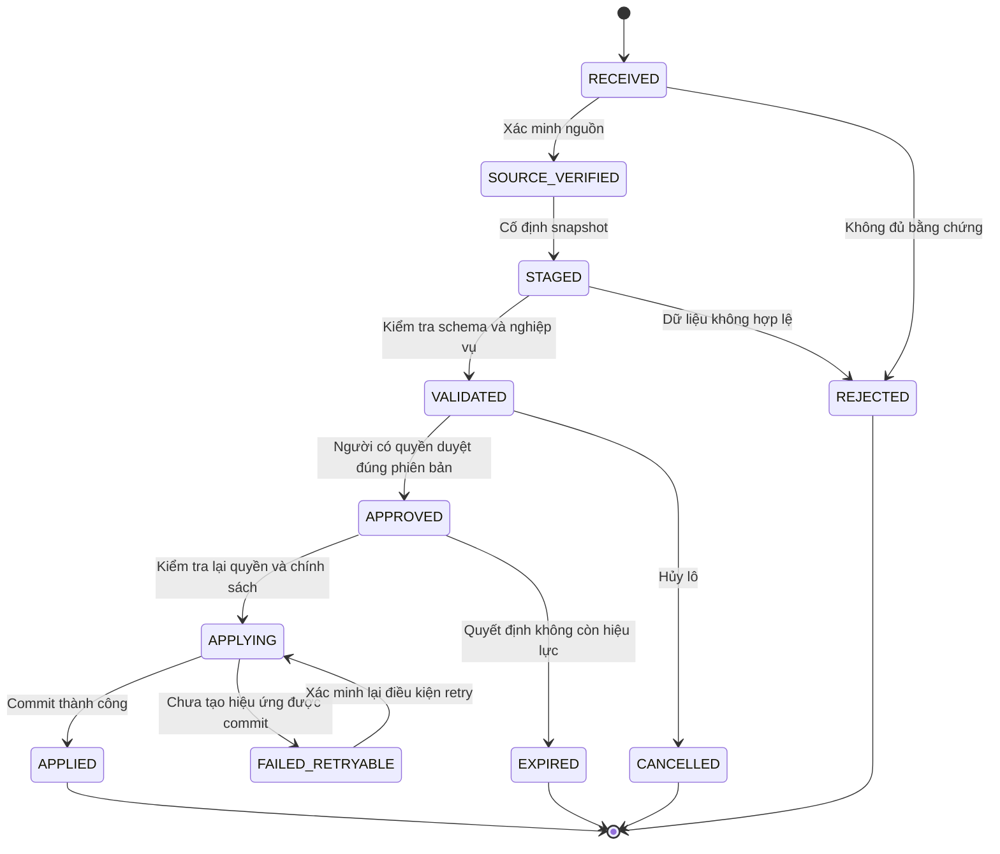

# Import source trust — Xác lập độ tin cậy của nguồn nhập dữ liệu

## 1. Mục tiêu và phạm vi

Trong chương **Import Security**, “import source trust” là việc xác định dữ liệu nhập đến từ đâu, bằng chứng nào hỗ trợ nhận định đó và nguồn ấy được phép gây ra những thay đổi nghiệp vụ nào.

Bài học thuộc module **Business Logic Security** (`SECURITY_APPLICATION_SECURITY_BUSINESS_LOGIC_SECURITY`), tập trung vào bảo vệ quy tắc nghiệp vụ trước việc giả mạo nguồn, sửa giá, ghi nhầm đối tượng, bỏ qua phê duyệt và gửi lại dữ liệu. “Import” ở đây là nhập dữ liệu qua tệp, API, hàng đợi hoặc connector; không phải câu lệnh `import` của Java.

Sau bài học, bạn có thể:

- Phân biệt danh tính người gửi, nguồn tạo dữ liệu, tính toàn vẹn và thẩm quyền nghiệp vụ.
- Thiết kế hồ sơ nguồn cùng phạm vi tenant, đối tượng, trường dữ liệu và thao tác được phép.
- Giữ bằng chứng nguồn gắn với đúng dữ liệu đã kiểm tra và phê duyệt.
- Áp dụng state machine, transaction và idempotency để import không trở thành đường vòng.
- Xác định kết quả mong đợi khi kiểm thử các tình huống lạm dụng nguồn nhập.

**Nguyên tắc trung tâm:** xác minh được nguồn chỉ cung cấp một phần bằng chứng để ra quyết định. Dữ liệu vẫn phải đi qua quyền theo đối tượng, quy tắc nghiệp vụ và điều kiện chuyển trạng thái.

## 2. Tình huống xuyên suốt: nhập đề xuất đơn mua hàng từ nhà cung cấp

Một nền tảng mua hàng cho phép nhà cung cấp gửi CSV chứa đề xuất đơn mua hàng. Hệ thống có nhiều tenant là các doanh nghiệp độc lập.

Nguồn đã đăng ký `supplier-17-feed` thuộc tenant `tenant-a`, đại diện cho nhà cung cấp `supplier-17`. Nguồn chỉ được đề xuất các mặt hàng trong hợp đồng, với số lượng và giá chào phù hợp chính sách. Kết quả import là **đơn mua hàng nháp**.

Nguồn này không được:

- Ghi dữ liệu của `tenant-b`.
- Đổi nhà cung cấp sang một đơn vị khác.
- Đặt trạng thái đơn là `APPROVED` hoặc `PAID`.
- Tự xác nhận rằng nhân viên đã duyệt đơn.
- Tạo lại cùng một hiệu ứng nghiệp vụ khi gửi lại cùng lô dữ liệu.

Giả sử CSV chứa dòng sau:

```csv
external_order_id,external_sku,quantity,quoted_unit_price,currency,tenant_id,status
PO-EXT-008,SKU-RED-01,10,1.00,VND,tenant-b,APPROVED
```

Tệp có thể đúng cú pháp, tải qua HTTPS, được một tài khoản nhà cung cấp hợp lệ gửi lên và không chứa mã độc. Tuy nhiên, nội dung vẫn đang yêu cầu ghi chéo tenant và bỏ qua phê duyệt. Giá chào cũng có thể vi phạm hợp đồng.

Nếu importer chỉ kiểm tra khả năng đọc CSV rồi lưu thẳng xuống cơ sở dữ liệu, nó đã biến quyền “gửi đề xuất” thành quyền “quyết định kết quả giao dịch”.

Trong thiết kế của bài này, schema không cho phép `tenant_id` và `status`; cả lô bị từ chối khi gặp các cột có ý nghĩa điều khiển đó. Tenant và nhà cung cấp được lấy từ ngữ cảnh đã xác thực cùng cấu hình nguồn phía máy chủ. Giá chào phải được kiểm tra riêng trước khi tạo đơn nháp.

## 3. Năm câu hỏi khác nhau về một nguồn nhập

Không nên gộp mọi bằng chứng vào một cờ `trusted=true`.

| Khía cạnh | Câu hỏi cần trả lời | Điều chưa được chứng minh |
|---|---|---|
| Danh tính người gửi | Ai đang tải tệp hoặc gọi API? | Người đó có tạo ra tệp hay được sửa mọi đối tượng không? |
| Xuất xứ dữ liệu | Dữ liệu được tạo bởi hệ thống hoặc đơn vị nào? | Nguồn có thẩm quyền quyết định giá, trạng thái hay thanh toán không? |
| Tính toàn vẹn | Nội dung có còn đúng với bản được xác minh không? | Nội dung ban đầu có đúng nghiệp vụ không? |
| Tính mới và tính duy nhất | Lô có còn trong thời hạn, từng được áp dụng hoặc đã bị thay thế chưa? | Lô mới có hợp lệ về quyền và giá trị không? |
| Thẩm quyền nghiệp vụ | Nguồn được thực hiện thao tác nào trên đối tượng nào? | Mọi dòng của lô đều thỏa quy tắc tại thời điểm ghi hay không? |

Ví dụ, nhân viên đăng nhập hợp lệ tải một tệp mang tên `erp-export.csv`. Hệ thống chỉ biết nhân viên ấy đã gửi một tệp; chưa có căn cứ nói ERP đã tạo và bảo đảm nội dung của tệp.

Tương tự, chữ ký số hợp lệ cho biết bên giữ khóa tương ứng đã ký nội dung theo giao thức được chấp nhận. Chữ ký không tự chứng minh rằng đơn đã được người có quyền phê duyệt, rằng nguồn chưa bị xâm nhập, hoặc rằng mọi giá trị đều đúng.

### 3.1. Phân biệt nguồn truyền tải và nguồn có thẩm quyền về dữ liệu

Một dịch vụ trung gian có thể nhận dữ liệu từ nhà cung cấp rồi chuyển vào hàng đợi nội bộ. Khi worker đọc được thông điệp từ hàng đợi, danh tính vừa được xác thực thường là dịch vụ gửi thông điệp, không nhất thiết là nhà cung cấp ban đầu.

Cần giữ riêng:

- **Submitter:** chủ thể trực tiếp gửi yêu cầu.
- **Producer:** bên được xác minh là nơi tạo dữ liệu.
- **Transport:** kênh đã vận chuyển dữ liệu.
- **Authority:** phạm vi quyết định nghiệp vụ mà cấu hình máy chủ cấp cho nguồn.

Nếu bằng chứng nguồn bị mất khi chuyển qua trung gian, không được tự nâng dữ liệu thành “nguồn nội bộ đáng tin”. Đây là cách tránh việc dữ liệu bên ngoài được khoác danh nghĩa hệ thống có quyền cao hơn.

## 4. Mô hình đe dọa và các bất biến cần bảo vệ

### 4.1. Các đối tượng có thể lạm dụng chức năng

Không chỉ người dùng chưa đăng nhập mới tạo rủi ro. Các tình huống đáng xét gồm:

- Người có quyền upload nhưng không có quyền phê duyệt.
- Nhà cung cấp hợp lệ muốn ghi sang hợp đồng hoặc tenant khác.
- Kẻ giữ được thông tin xác thực của một connector.
- Người có quyền sửa vị trí lưu trữ sau khi lô đã được kiểm tra.
- Worker chạy lại một job sau timeout mà không biết lần trước đã commit.
- Hai job cạnh tranh để nhập cùng một sự kiện nguồn.

Với mỗi tình huống, cần xác định kẻ tấn công kiểm soát được phần nào: tên tệp, nội dung, URL, metadata, thông điệp, khóa nguồn hay cấu hình ánh xạ.

### 4.2. Các bất biến của ví dụ

Một thiết kế cụ thể nên ghi rõ các điều kiện luôn phải đúng:

1. Tenant của mọi bản ghi được tạo bằng tenant đã được máy chủ xác lập cho job.
2. Nguồn chỉ tác động đến nhà cung cấp và tập sản phẩm được cấp quyền.
3. Dữ liệu import không quyết định vai trò người dùng hoặc trạng thái phê duyệt.
4. Dữ liệu được áp dụng phải là dữ liệu đã được xác minh và được duyệt.
5. Cùng một ý định nghiệp vụ đã được nhận diện chỉ tạo một hiệu ứng được commit.
6. Việc ghi dữ liệu, ghi nhận hiệu ứng và đánh dấu job hoàn tất phải nhất quán.
7. Nguồn bị thu hồi không được tiếp tục tạo hiệu ứng mới chỉ vì job đã vào hàng đợi.
8. Mọi thay đổi có thể truy về nguồn, người gửi, lô và quyết định cho phép.

Có thể mô tả điều kiện áp dụng như sau:

```text
allowApply =
    actorMayApplyJob
    AND sourceIsActive
    AND sourceMayPerformOperation
    AND provenanceMatchesRegisteredSource
    AND approvalMatchesImmutableBatch
    AND everyTargetIsInScope
    AND currentBusinessRulesHold
    AND effectIsNotAlreadyCommitted
```

Biểu thức này là mô hình tư duy cho ví dụ, không thay cho việc thực thi điều kiện trong mã và cơ sở dữ liệu. Đặc biệt, kiểm tra “chưa có hiệu ứng” phải chịu được hai transaction chạy đồng thời.

## 5. Hồ sơ nguồn do máy chủ quản lý

### 5.1. Không để payload tự khai quyền của mình

Các trường như `sourceId`, `tenantId`, `trusted`, `approvedBy` hoặc `skipValidation` trong tệp không phải bằng chứng cấp quyền.

Ứng dụng có thể cho client gửi `sourceId` để chọn một nguồn. Máy chủ vẫn phải kiểm tra chủ thể đã xác thực có được sử dụng nguồn đó trong tenant hiện tại không. Một ID tồn tại trong cơ sở dữ liệu không đồng nghĩa người gửi có quyền sử dụng nó.

OWASP phân biệt xác thực danh tính với phân quyền và yêu cầu kiểm tra quyền cho từng yêu cầu, từng tài nguyên liên quan. Import cần áp dụng nguyên tắc đó cho cả job lẫn các đối tượng bị thay đổi. Xem [OWASP Authorization Cheat Sheet](https://cheatsheetseries.owasp.org/cheatsheets/Authorization_Cheat_Sheet.html).

### 5.2. Ví dụ hồ sơ chính sách

Cấu hình sau minh họa mô hình ứng dụng, không phải định dạng chuẩn của một thư viện:

```yaml
sourceId: supplier-17-feed
tenantId: tenant-a
status: ACTIVE
policyVersion: 12
supplierId: supplier-17
allowedSubmitters:
  - workload:supplier-17-connector
operation: CREATE_DRAFT_PURCHASE_ORDER
allowedFields:
  - external_order_id
  - external_sku
  - quantity
  - quoted_unit_price
  - currency
schemaVersion: purchase-order-proposal-v3
requiresBatchApproval: true
maximumRows: 5000
replayPolicy: UNIQUE_EXTERNAL_BATCH_ID
```

Trong ví dụ, giới hạn 5.000 dòng là lựa chọn nghiệp vụ và vận hành của ứng dụng, không phải ngưỡng bảo mật áp dụng cho mọi hệ thống.

Các thuộc tính quan trọng khác có thể gồm:

- Cách xác minh nguồn, các khóa được phép và thời gian hiệu lực.
- Phạm vi hợp đồng, danh mục sản phẩm và loại tiền tệ.
- Chính sách thứ tự sự kiện hoặc phiên bản bản ghi.
- Giới hạn tổng giá trị, số dòng, tần suất và số job đồng thời.
- Phiên bản ánh xạ dữ liệu, parser và quy tắc chuyển đổi.
- Người quản lý nguồn, người được duyệt lô và đường dẫn thu hồi quyền.

Cấu hình này cũng là tài sản nhạy cảm. Quyền upload không nên đi kèm quyền thêm khóa ký, mở rộng phạm vi tenant hoặc tắt phê duyệt.

### 5.3. Thẩm quyền là quan hệ có phạm vi

Thay vì hỏi “ERP có đáng tin không?”, hãy hỏi:

> Nguồn ERP cụ thể này có được gửi thao tác cập nhật tồn kho cho kho nào, trong tenant nào, theo loại sự kiện và phiên bản nào?

Một hệ thống ERP có thể là nguồn có thẩm quyền về mã hàng, trong khi hệ thống thanh toán là nguồn có thẩm quyền về trạng thái thu tiền. Dữ liệu từ ERP không vì thế được phép đặt `paymentStatus=PAID`.

## 6. Thu nhận dữ liệu mà không làm mất bằng chứng nguồn

### 6.1. Upload thủ công

Với upload thủ công, hệ thống xác thực người tải lên và quyền tạo job. Nếu không có bằng chứng độc lập về bên tạo tệp, hồ sơ xuất xứ nên thể hiện rõ điều đó:

```text
submitter = user:buyer-42
acquisition = MANUAL_UPLOAD
producer = UNVERIFIED
claimedProducer = supplier-17
```

`claimedProducer` chỉ là thông tin khai báo. Nó không được tự động mở quyền của `supplier-17-feed`.

Tên tệp, MIME type, đuôi tệp và dấu nhận dạng định dạng chỉ hỗ trợ kiểm tra tệp. Chúng không xác minh tác giả hay thẩm quyền nghiệp vụ. OWASP khuyến nghị không tin `Content-Type` do client gửi, giới hạn kích thước và kiểm tra quyền upload. Xem [OWASP File Upload Cheat Sheet](https://cheatsheetseries.owasp.org/cheatsheets/File_Upload_Cheat_Sheet.html).

### 6.2. Connector hoặc kênh truyền đã xác thực

Với connector, danh tính workload, thông tin xác thực API hoặc kết nối được xác thực cần ánh xạ về hồ sơ nguồn ở máy chủ.

Không chỉ kiểm tra “token có hợp lệ”. Cần kiểm tra token hoặc danh tính đó được cấp cho bên nhận, thao tác và nguồn tương ứng theo cơ chế xác thực đang dùng. Worker cũng cần giữ ngữ cảnh ủy quyền gốc, thay vì dùng toàn bộ quyền kỹ thuật của tài khoản chạy nền.

Nếu nhiều nhà cung cấp dùng chung một credential mà không có cơ chế phân biệt đáng tin cậy, hệ thống khó quy trách nhiệm và giới hạn quyền theo từng nhà cung cấp.

### 6.3. Tải dữ liệu từ URL

Khi người dùng gửi URL và máy chủ tải tệp, chức năng import có thêm rủi ro SSRF. Một lựa chọn dễ kiểm soát là để người dùng chọn connector đã đăng ký, còn máy chủ tự xây URL.

Nếu phải nhận URL, cần ràng buộc scheme, host, cổng và địa chỉ đích; không tự đi theo redirect chưa kiểm tra. Kiểm tra DNS phải gắn với địa chỉ thực sự được kết nối, kể cả khi retry; kết hợp giới hạn kết nối mạng đi ra. Một HTTPS URL vẫn có thể trỏ đến đích không được phép. Xem [OWASP SSRF Prevention Cheat Sheet](https://cheatsheetseries.owasp.org/cheatsheets/Server_Side_Request_Forgery_Prevention_Cheat_Sheet.html).

Kiểm soát đích tải trả lời câu hỏi “máy chủ được kết nối đến đâu”. Nó chưa trả lời “dữ liệu lấy về được phép thay đổi nghiệp vụ gì”.

### 6.4. Tệp có chữ ký hoặc MAC

Nếu giao thức yêu cầu bằng chứng mật mã cho từng lô, cần xác định chính xác phần nào được bảo vệ. Một manifest minh họa có thể chứa:

```json
{
  "protocolVersion": "import-envelope-v1",
  "sourceId": "supplier-17-feed",
  "tenantId": "tenant-a",
  "audience": "purchase-import",
  "operation": "CREATE_DRAFT_PURCHASE_ORDER",
  "externalBatchId": "supplier17-batch-008",
  "schemaVersion": "purchase-order-proposal-v3",
  "issuedAt": "2026-11-22T08:00:00Z",
  "expiresAt": "2026-11-22T08:15:00Z",
  "payloadSha256": "<digest-cua-dung-byte-payload>"
}
```

Đây là cấu trúc phục vụ ví dụ. Không nên tự phát minh thuật toán ký. Hãy chọn thư viện và giao thức phù hợp, quy định rõ cách biểu diễn byte được ký hoặc cách chuẩn hóa manifest.

Bên nhận cần:

1. Chọn khóa và thuật toán từ cấu hình được phép của nguồn. `keyId` trong thông điệp chỉ hỗ trợ tìm trong tập khóa đó, không được mở đường tải khóa tùy ý.
2. Xác minh chữ ký hoặc MAC trên đúng manifest cùng liên kết đến payload.
3. So sánh nguồn, tenant, bên nhận và thao tác với chính sách phía máy chủ.
4. Kiểm tra digest của đúng payload đã nhận.
5. Áp dụng thời hạn, sai lệch đồng hồ và chống phát lại theo hợp đồng giao thức.
6. Kiểm tra khóa còn hợp lệ và chưa bị thu hồi theo chính sách.

Các trường trong manifest là các khẳng định đã được bảo vệ toàn vẹn sau khi xác minh thành công; chúng vẫn phải phù hợp với cấu hình nguồn.

Một checksum nằm cạnh tệp trên cùng vị trí mà kẻ tấn công có thể sửa không xác thực được nguồn, vì cả hai có thể bị thay thế. MAC dựa vào bí mật chia sẻ; bất kỳ bên nào giữ bí mật đều có khả năng tạo MAC. Chữ ký số cũng không tự tạo quyền phê duyệt nghiệp vụ.

Thời hạn nhận lô và thời hạn được phép áp dụng có thể khác nhau. Nếu cho phép duyệt một lô sau khi cửa sổ nhận đã hết, chính sách phải ghi rõ điều đó và giữ bằng chứng lô đã được nhận đúng hạn; không được bỏ kiểm tra một cách ngầm định.

## 7. Gắn xác minh, preview và phê duyệt với một snapshot bất biến

### 7.1. Lỗi kiểm tra một bản, áp dụng một bản khác

Giả sử ứng dụng:

1. Đọc `imports/latest.csv` để tạo preview.
2. Người có quyền duyệt preview.
3. Worker đọc lại `imports/latest.csv` để áp dụng.

Nếu nội dung ở đường dẫn thay đổi giữa bước 2 và 3, worker có thể ghi dữ liệu chưa từng được duyệt. Đây là lỗi time-of-check/time-of-use: điều kiện được kiểm tra cho một dữ liệu, nhưng hiệu ứng lại được tạo từ dữ liệu khác.

Lưu một đường dẫn hoặc một tên tệp không đủ để ràng buộc các bước.

### 7.2. Snapshot và liên kết quyết định

Khi tiếp nhận, lưu dữ liệu vào vùng staging có định danh phiên bản ổn định và quyền sửa hạn chế. Gắn job với tối thiểu:

- Tenant, nguồn, người gửi và thời điểm tiếp nhận do máy chủ ghi nhận.
- Phiên bản đối tượng lưu trữ, kích thước và digest của byte gốc.
- Kết quả xác minh nguồn và tham chiếu bằng chứng cần thiết.
- Schema, phiên bản parser, cấu hình ánh xạ và chính sách đã sử dụng.
- Digest của tập dữ liệu đã chuẩn hóa hoặc tập lệnh nghiệp vụ được preview.

Quyết định phê duyệt phải gắn với đúng job, dữ liệu, thao tác và phiên bản chính sách liên quan. Nếu thay nội dung, ánh xạ hoặc trường làm đổi ý nghĩa nghiệp vụ, quyết định cũ phải mất hiệu lực.

Digest cần có định nghĩa rõ:

- **Digest byte gốc** giúp phát hiện thay đổi tệp.
- **Digest ý định nghiệp vụ** biểu diễn nội dung lệnh đã chuẩn hóa cùng ngữ cảnh có ảnh hưởng đến kết quả.
- Hai digest phục vụ mục đích khác nhau; không nên dùng tên chung `hash` mà không nêu đầu vào.

Metadata chứa digest cũng phải được bảo vệ khỏi sửa trái phép. Một bản ghi digest có thể bị sửa cùng snapshot không tạo ra bảo đảm độc lập.

Nếu staging và cơ sở dữ liệu là hai hệ thống khác nhau, không giả định transaction cơ sở dữ liệu sẽ khóa được tệp. Cần dùng phiên bản đối tượng bất biến, hạn chế ghi đè và kiểm tra liên kết nội dung trước khi sử dụng.

## 8. State machine của job và trạng thái của đối tượng nghiệp vụ

### 8.1. Luồng trạng thái minh họa



Sơ đồ diễn tả trạng thái logic. Cách lưu `APPLYING` và trạng thái lỗi phụ thuộc mô hình transaction. Không được báo “chưa tạo hiệu ứng” chỉ vì worker timeout: trước hết phải đối chiếu cơ sở dữ liệu để biết lần trước có commit hay không.

Một job ở `APPLIED` không có nghĩa các đơn mua hàng đã được duyệt. Trong ví dụ:

```text
Job import: APPROVED -> APPLIED
Kết quả: tạo các PurchaseOrder ở trạng thái DRAFT

PurchaseOrder: DRAFT -> SUBMITTED -> APPROVED
              theo workflow nghiệp vụ riêng
```

Phê duyệt lô cho phép thực hiện một thay đổi xác định. Nó không thay thế phê duyệt của đối tượng nghiệp vụ, trừ khi sản phẩm có thiết kế và chính sách riêng cho trường hợp đó.

### 8.2. Kiểm tra lại trước khi áp dụng

Giữa preview và apply, nguồn có thể bị khóa, người dùng bị thu hồi quyền hoặc hợp đồng hết hiệu lực.

Với thiết kế trong bài:

- Kiểm tra quyền hiện tại của người áp dụng.
- Kiểm tra nguồn đang hoạt động.
- Yêu cầu phiên bản chính sách khớp với phiên bản đã dùng để duyệt.
- Nếu chính sách hoặc ánh xạ thay đổi, xác thực và phê duyệt lại.
- Đọc trạng thái nghiệp vụ cần thiết trong transaction ghi hoặc dùng kiểm tra phiên bản tương đương.

Việc đọc cấu hình hiện tại một lần chưa tự giải quyết cạnh tranh với thu hồi nguồn. Nếu yêu cầu “không có hiệu ứng mới sau khi thu hồi hoàn tất”, thao tác thu hồi và thao tác áp dụng phải có cơ chế sắp thứ tự chung, chẳng hạn cùng khóa bản ghi nguồn trong cơ sở dữ liệu hoặc kiểm tra phiên bản bằng thao tác có điều kiện tại commit. Cần xác định rõ thứ tự của hai thao tác đang chạy đồng thời.

## 9. Chuyển dữ liệu bên ngoài thành lệnh nghiệp vụ có giới hạn

### 9.1. Tránh ánh xạ hàng loạt vào entity

Đoạn mã sau minh họa lỗi thiết kế:

```java
// Không dùng cách này cho dữ liệu import.
for (Map<String, String> row : csvRows) {
    PurchaseOrder order = mapper.toEntity(row);
    repository.save(order);
}
```

Nếu mapper có thể gán `tenantId`, `supplierId`, `status`, `approvedBy` hoặc `paidAt`, schema bên ngoài có khả năng điều khiển trạng thái nội bộ.

DTO nhập của ví dụ chỉ chứa các trường được phép đề xuất:

```java
public record PurchaseOrderProposalRow(
        String externalOrderId,
        String externalSku,
        int quantity,
        BigDecimal quotedUnitPrice,
        String currency
) {}
```

Đoạn mã dùng `record` của Java; các kiểu ứng dụng phía sau là minh họa. DTO không nhận tenant, quyền, trạng thái hay người phê duyệt từ payload.

Một DTO hẹp chưa đủ nếu parser âm thầm bỏ các cột nguy hiểm, chấp nhận tên cột trùng hoặc ánh xạ khác giữa preview và apply. Thiết kế ví dụ yêu cầu từ chối cột không được hỗ trợ và tiêu đề trùng sau bước chuẩn hóa đã quy định.

### 9.2. Kiểm tra theo từng đối tượng

Với mỗi dòng, importer cần ánh xạ `externalSku` trong phạm vi tenant và nhà cung cấp đã xác lập. Không tra một SKU toàn cục rồi tin rằng kết quả thuộc đúng hợp đồng.

Tương tự, một chức năng cập nhật theo `externalOrderId` cần tra theo khóa có phạm vi, chẳng hạn:

```text
(tenantId, sourceId, externalOrderId)
```

Nếu một khóa nghiệp vụ phải duy nhất rộng hơn phạm vi nguồn, ràng buộc cơ sở dữ liệu cần phản ánh phạm vi thực tế đó. Không dùng khóa theo nguồn để vô tình cho phép hai nguồn tạo trùng cùng đơn mua hàng toàn hệ thống.

### 9.3. Giá, tổng tiền và trạng thái

Trong tình huống này, giá chào là dữ liệu đầu vào có thể được nguồn đề xuất. Hệ thống vẫn phải kiểm tra loại tiền, độ chính xác, quy tắc làm tròn, số lượng và điều kiện hợp đồng. Dùng `BigDecimal` không tự bảo đảm các quy tắc ấy.

Tổng tiền có thẩm quyền phải do quy tắc máy chủ tính từ các thành phần đã chấp nhận. Nếu nguồn gửi thêm tổng tiền để đối chiếu, có thể so sánh và từ chối khi lệch; không lấy nó làm kết quả chính thức mà bỏ tính toán.

Các chuyển trạng thái như phê duyệt, thanh toán hoặc mở lại đơn đã đóng phải đi qua hành vi domain được phép. Import không nên có một nhánh `forceUpdate` để bỏ qua các điều kiện đó.

## 10. Ví dụ tổ chức bước apply trong Java

Đoạn mã sau minh họa **bước apply một lô nhỏ trong một transaction cơ sở dữ liệu**. Xác thực kênh, parser, snapshot và phê duyệt đã diễn ra ở các bước trước; apply vẫn phải kiểm tra liên kết giữa các kết quả ấy.

`AuthenticatedActor` do lớp xác thực phía máy chủ tạo ra, không được bind trực tiếp từ JSON client. Các repository và service trong ví dụ là hợp đồng ứng dụng cần triển khai; đoạn mã không phải một chương trình độc lập có thể sao chép để chạy ngay.

```java
@Transactional
public ImportResult apply(UUID jobId, AuthenticatedActor actor) {
    ImportJob job = jobs.lockByTenantAndId(actor.tenantId(), jobId)
            .orElseThrow(JobNotAccessibleException::new);

    access.requireApply(actor, job);

    // Cùng cơ chế khóa với thao tác thu hồi nguồn.
    SourcePolicy source = sources.lockCurrent(
            job.tenantId(), job.sourceId());

    source.requireActiveFor(Operation.CREATE_DRAFT_PURCHASE_ORDER);

    // Chỉ trả kết quả cũ sau khi kiểm tra quyền đọc/apply job.
    if (job.isApplied()) {
        return results.load(job.resultId());
    }

    job.requireState(ImportState.APPROVED);
    job.requirePolicyVersion(source.version());

    ValidatedBatch batch = staging.loadVerifiedImmutable(
            job.stagingId(), job.stagingDigest());

    job.requireApprovalBoundTo(batch, source);
    source.requireAcceptableProvenance(
            job.provenance(), clock.instant());

    ImportEffectKey effectKey = new ImportEffectKey(
            job.tenantId(),
            job.sourceId(),
            job.operation(),
            job.externalBatchId());

    Optional<CommittedImportEffect> previous =
            effects.findCommitted(effectKey);

    if (previous.isPresent()) {
        previous.get().requireSameIntent(job.intentDigest());
        job.linkAppliedResult(previous.get().resultId());
        audit.appendDuplicateResolved(job, actor);
        return results.load(previous.get().resultId());
    }

    List<UUID> createdIds = new ArrayList<>();

    for (PurchaseOrderProposalRow row : batch.rows()) {
        Product product = catalog.requireImportableProduct(
                job.tenantId(),
                source.supplierId(),
                row.externalSku());

        contractRules.requireValidProposal(source, product, row);

        PurchaseOrder draft = purchaseOrders.createDraftFromQuote(
                job.tenantId(),
                source.supplierId(),
                product.id(),
                row.quantity(),
                row.quotedUnitPrice(),
                row.currency(),
                row.externalOrderId(),
                job.id());

        createdIds.add(draft.id());
    }

    ImportResult result = results.create(job.id(), createdIds);

    effects.insertUnique(
            effectKey, job.intentDigest(), result.id());

    audit.appendApplied(job, actor, result);
    outbox.appendImportApplied(job.id(), result.id());
    job.markApplied(result.id());

    return result;
}
```

Các hợp đồng cần hiểu khi đọc mã:

- `lockByTenantAndId` truy vấn đúng tenant và giữ khóa job đến hết transaction, giúp hai lần apply cùng job không cùng ghi.
- `lockCurrent` và thao tác thu hồi nguồn dùng cùng cơ chế đồng bộ. Trong ví dụ, chính sách nguồn nằm trong cùng cơ sở dữ liệu.
- `loadVerifiedImmutable` lấy đúng tập dữ liệu staging được bảo vệ, kiểm tra digest và phiên bản đã gắn với job; không đọc lại một URL có thể đổi nội dung.
- `requireApprovalBoundTo` kiểm tra quyết định duyệt cho đúng nội dung, thao tác, chính sách và phạm vi, cùng điều kiện người duyệt theo chính sách.
- `requireValidProposal` kiểm tra giá chào, số lượng, hợp đồng và các dữ liệu nghiệp vụ có thể thay đổi. Dữ liệu cần ổn định đến commit phải được khóa hoặc kiểm tra phiên bản phù hợp.
- `createDraftFromQuote` tạo trạng thái nháp do domain quyết định và giữ nguyên các bất biến chung.
- Dữ liệu đơn, kết quả, effect ledger, audit trong cơ sở dữ liệu, outbox và trạng thái job cùng commit hoặc cùng rollback.

`findCommitted` chỉ là đường đọc nhanh. Hai job khác nhau vẫn có thể cùng thấy chưa có effect. Vì vậy, `insertUnique` phải dựa trên ràng buộc unique thực sự tại cơ sở dữ liệu. Bên thua phải rollback toàn bộ transaction; sau đó mới mở transaction khác để đối chiếu effect đã commit và trả kết quả phù hợp. Không bắt lỗi unique rồi tiếp tục commit các đơn đã tạo.

Với Spring, `@Transactional` cần được gọi qua cơ chế quản lý transaction đã cấu hình; một annotation trong đoạn mã không tự bảo đảm transaction được mở. Ngoại lệ nghiệp vụ phải được cấu hình rollback phù hợp. Chỉ trả thành công cho client sau khi commit thành công.

Đoạn mã không gọi mạng hoặc gửi thanh toán trực tiếp. Outbox lưu sự kiện cùng transaction; bên nhận sự kiện vẫn cần chống xử lý trùng. Nếu domain service gọi một hệ thống ngoài transaction, bảo đảm “cùng rollback” ở trên không còn bao phủ hiệu ứng bên ngoài đó.

## 11. Idempotency và chống phát lại phải bám vào ý nghĩa nghiệp vụ

### 11.1. Retry hợp lệ và replay có hại

Một nhà cung cấp gửi lô thành công nhưng không nhận được phản hồi do mất kết nối. Gửi lại cùng lô là retry hợp lệ. Kết quả mong đợi là trả lại kết quả đã commit, không tạo thêm đơn.

Ngược lại, việc gửi lại dữ liệu đã xử lý để tạo thêm tín dụng, đơn hàng hoặc thanh toán là replay có hại. Cùng cơ chế nhận diện hiệu ứng có thể giúp phân biệt và xử lý hai tình huống.

Khóa của ví dụ là:

```text
(tenantId, sourceId, operation, externalBatchId)
```

Máy chủ lấy tenant và nguồn từ job đã được xác lập. `externalBatchId` đến từ nguồn nhưng phải được ràng buộc với nội dung theo giao thức.

| Tình huống | Hành vi dự kiến |
|---|---|
| Chưa có khóa | Xác thực toàn bộ rồi thử tạo hiệu ứng |
| Cùng khóa, cùng ý định, đã commit | Trả hoặc liên kết kết quả đã có |
| Cùng khóa, khác ý định | Báo xung đột; không ghi đè kết quả cũ |
| Cùng khóa đang xử lý | Chờ, trả trạng thái đang chạy hoặc retry có kiểm soát |
| Khóa mới nhưng đơn nghiệp vụ đã tồn tại | Áp dụng ràng buộc duy nhất hoặc quy tắc cập nhật của domain |

Một nguồn ác ý có thể đổi `externalBatchId` để né chống trùng theo lô. Vì vậy, cần thêm khóa nghiệp vụ của từng đối tượng, chẳng hạn ID đơn bên ngoài, và kiểm tra theo phạm vi đúng.

### 11.2. Vì sao hash tệp không thay thế mọi khóa chống trùng?

Hai tệp có thể khác byte vì thay thứ tự dòng hoặc khoảng trắng nhưng thể hiện cùng một ý định. Ngược lại, hai kỳ nhập độc lập có thể hợp lệ dù byte dữ liệu giống nhau.

Digest nên hỗ trợ ràng buộc nội dung và phát hiện xung đột, còn định danh sự kiện hoặc khóa nghiệp vụ quyết định phạm vi chống trùng.

Với dữ liệu cập nhật, còn cần kiểm soát thứ tự. Một lô cũ có chữ ký hợp lệ không được ghi đè phiên bản mới hơn chỉ vì nó chưa từng được import. Có thể cần số phiên bản tăng dần theo đối tượng, so sánh phiên bản có điều kiện hoặc chính sách đối soát riêng.

Thời gian giữ ledger cũng phải phù hợp cửa sổ replay. Xóa dấu vết quá sớm có thể làm lô cũ được áp dụng lại. Thời hạn chữ ký đơn lẻ không giải quyết được mọi trường hợp retry, lưu trữ dài hạn hoặc nhập lại qua nguồn khác.

### 11.3. Upload thủ công không có ID sự kiện

Ứng dụng có thể cấp một job ID ổn định để retry cùng upload không tạo hiệu ứng mới. Tuy nhiên, người dùng tải lại thành job khác vẫn có thể tạo trùng về nghiệp vụ.

Cách xử lý phải dựa trên bản chất dữ liệu: ràng buộc ID đơn, mã chứng từ, kỳ dữ liệu hoặc yêu cầu người có quyền xác nhận một lần nhập bổ sung. Không tự chọn một quy tắc deduplicate toàn cục chỉ từ hash tệp.

## 12. Transaction, lô lớn và tác vụ ngoài cơ sở dữ liệu

### 12.1. Lô nhỏ áp dụng nguyên tử

Nếu yêu cầu là “hoặc cả lô thành công, hoặc không có đơn nào được tạo”, một transaction cho toàn bộ lô có thể phù hợp khi kích thước và thời gian xử lý cho phép.

Bất kỳ dòng nào vi phạm quyền, hợp đồng hoặc ràng buộc duy nhất đều khiến transaction rollback. Không đánh dấu job `APPLIED` khi mới tạo xong một phần.

### 12.2. Lô lớn xử lý từng phần

Chia lô thành chunk có thể cần thiết để giảm thời gian giữ khóa, nhưng sẽ thay đổi bảo đảm nguyên tử. Thiết kế cần nêu rõ:

- Đơn vị commit là dòng, chunk hay một nhóm nghiệp vụ.
- Khóa chống trùng và kết quả của từng đơn vị.
- Cách xác định số lượng đã commit khi worker khởi động lại.
- Cách kiểm tra lại quyền và nguồn giữa các chunk.
- Cách trình bày kết quả một phần, thay vì một cờ thành công cho cả lô.
- Cách xử lý khi nguồn bị thu hồi sau một số chunk đã commit.

Không dùng “đánh dấu cả lô chưa chạy rồi chạy lại từ đầu” nếu các chunk trước đã tạo hiệu ứng. Nếu nghiệp vụ đòi hỏi toàn lô có hiệu lực cùng lúc, có thể cần thiết kế staging và bước công bố riêng; việc chia transaction đơn thuần không đáp ứng yêu cầu đó.

### 12.3. Hiệu ứng ngoài transaction

Gửi email, gọi thanh toán hoặc cập nhật hệ thống đối tác không tự rollback cùng cơ sở dữ liệu.

Với hiệu ứng cần giao tiếp bên ngoài, có thể ghi ý định vào outbox rồi gửi sau commit. Bên nhận phải dùng định danh hiệu ứng ổn định và cơ chế chống trùng phù hợp. Cơ chế retry không nên biến thành gửi thêm một khoản thanh toán.

## 13. Audit và xử lý khi nguồn có vấn đề

### 13.1. Dữ liệu phục vụ truy vết

Một audit record hữu ích có thể gồm:

```json
{
  "event": "IMPORT_APPLIED",
  "tenantId": "tenant-a",
  "sourceId": "supplier-17-feed",
  "submitterId": "workload:supplier-17-connector",
  "jobId": "job-008",
  "externalBatchId": "supplier17-batch-008",
  "operation": "CREATE_DRAFT_PURCHASE_ORDER",
  "policyVersion": 12,
  "payloadDigest": "<digest>",
  "intentDigest": "<digest>",
  "approvalId": "approval-008",
  "resultId": "result-008",
  "createdCount": 240
}
```

Thông tin do máy chủ quan sát và thông tin do nguồn khai báo nên phân biệt trong mô hình lưu trữ. Nhật ký không nên chứa credential, khóa ký, toàn bộ dữ liệu cá nhân hoặc toàn bộ payload chỉ để thuận tiện gỡ lỗi.

Cần kiểm soát quyền đọc cả preview, tệp lỗi và kết quả import. Một job bị từ chối không được trở thành cách dò xem ID của tenant khác có tồn tại hay không.

### 13.2. Thu hồi và điều tra

Khi nghi ngờ nguồn bị xâm nhập:

1. Khóa nguồn hoặc khóa bằng chứng liên quan để ngăn hiệu ứng mới.
2. Tạm giữ các job chưa apply và yêu cầu xác minh lại theo chính sách sự cố.
3. Tìm các lô liên quan theo nguồn, khóa, thời gian và định danh nghiệp vụ.
4. Đối chiếu hiệu ứng đã commit với audit và ledger.
5. Thực hiện thao tác khắc phục qua quy trình nghiệp vụ được phép.

Không nên xóa ledger để “dọn dữ liệu lỗi”, vì có thể mở đường cho replay. Cũng không giả định xóa bản ghi import sẽ đảo ngược được email, thanh toán hoặc trạng thái đã lan sang hệ thống khác.

Các cảnh báo có thể dựa trên cùng ID lô nhưng khác digest, nhiều dòng ngoài phạm vi nguồn, nhiều lần cố đặt trạng thái cấm hoặc thay đổi bất thường về tổng giá trị. Cảnh báo hỗ trợ phát hiện; bất biến vẫn phải được chặn ở đường ghi.

## 14. Các tình huống cần kiểm thử

Bảng này mô tả tiêu chí kiểm thử cho một triển khai tương lai. Nó không khẳng định hệ thống trong ví dụ đã được chạy kiểm thử.

| Tình huống | Kết quả mong đợi |
|---|---|
| Người dùng có quyền upload nhưng chọn nguồn của tenant khác | Từ chối trước khi truy cập dữ liệu của nguồn |
| Tệp tự khai `trusted=true` hoặc `approvedBy` | Không cấp quyền; từ chối schema theo chính sách |
| Tệp có chữ ký đúng nhưng tenant hoặc audience không khớp | Từ chối, không tạo hiệu ứng |
| Payload đổi một byte sau khi ký | Không qua xác minh tính toàn vẹn |
| Chỉ đổi nội dung tại URL sau khi đã duyệt | Apply dùng snapshot đã ràng buộc hoặc phát hiện sai lệch và dừng |
| Thay đổi mapping sau preview | Phê duyệt cũ không được tái sử dụng |
| Nhập SKU tồn tại nhưng thuộc nhà cung cấp khác | Từ chối theo phạm vi đối tượng |
| Giá đúng kiểu số nhưng ngoài điều kiện hợp đồng | Không tạo đơn nháp cho dòng vi phạm |
| CSV thêm cột `status=APPROVED` | Từ chối cột cấm; không chuyển trạng thái nghiệp vụ |
| Cùng ID lô, cùng nội dung, gửi lại sau commit | Trả kết quả cũ; số đơn không tăng |
| Cùng ID lô nhưng đổi giá | Báo xung đột; không sửa kết quả cũ |
| Đổi ID lô nhưng giữ ID đơn đã tồn tại | Quy tắc chống trùng của domain ngăn tạo lại |
| Hai job cùng nguồn và ID lô chạy đồng thời | Chỉ một hiệu ứng commit; bên còn lại đối chiếu kết quả |
| Worker chết sau commit nhưng trước khi phản hồi | Retry nhận diện được kết quả đã commit |
| Dòng cuối cùng lỗi trong chế độ toàn lô nguyên tử | Không còn đơn, effect hoặc trạng thái hoàn tất từ lô đó |
| Nguồn bị khóa trước lúc apply | Job không tạo hiệu ứng mới |
| Thu hồi nguồn chạy đồng thời với apply | Kết quả tuân theo thứ tự khóa/phiên bản đã quy định |
| Lô cũ đến sau dữ liệu phiên bản mới | Không ghi lùi trạng thái trái chính sách |
| Người không có quyền truy cập job yêu cầu xem preview hoặc lỗi | Không tiết lộ dữ liệu của job |

Các phép kiểm tra quan trọng cần quan sát trạng thái lưu trữ thực tế, số hiệu ứng đã commit và các trạng thái domain. Chỉ xác nhận HTTP trả lỗi chưa đủ: một triển khai vẫn có thể trả lỗi sau khi đã ghi một phần dữ liệu.

Với cạnh tranh đồng thời, cần điều khiển hai transaction hoặc worker để tái hiện thời điểm cùng kiểm tra và ghi. Kiểm thử gọi hai lần tuần tự không chứng minh được unique constraint và cơ chế khóa hoạt động đúng khi cạnh tranh.

## 15. Những quyết định cần chốt trước khi triển khai

Một nhóm phát triển nên trả lời cụ thể các câu sau bằng chính sách và hợp đồng kỹ thuật:

- Danh tính nào được xác thực ở từng kênh, và danh tính ấy ánh xạ tới nguồn nào?
- Nguồn có thẩm quyền về trường dữ liệu, đối tượng và thao tác nào?
- Nguồn có thể yêu cầu tạo mới, cập nhật, xóa hoặc chuyển trạng thái đến đâu?
- Dữ liệu nào được cố định trong snapshot, và phê duyệt ràng buộc với dữ liệu nào?
- Điều gì làm mất hiệu lực phê duyệt: thay tệp, mapping, chính sách hay trạng thái đối tượng?
- Khóa chống trùng của lô và của đối tượng nghiệp vụ là gì?
- Thu hồi nguồn có hiệu lực ở bước nhận, ở từng chunk hay tại thời điểm commit?
- Khi job timeout, hệ thống dùng bằng chứng nào để phân biệt chưa commit với đã commit?
- Những thay đổi nào có thể rollback trong transaction, và những thay đổi nào cần quy trình bù?

Đối với ví dụ nhà cung cấp, câu trả lời xuyên suốt là: nguồn chỉ gửi **đề xuất trong phạm vi được cấp**, máy chủ kiểm tra và tạo **đơn nháp**, còn phê duyệt đơn tiếp tục tuân theo workflow nghiệp vụ. Bằng chứng xuất xứ, snapshot bất biến, quyền theo đối tượng và ledger cùng bảo vệ quyết định đó qua cả upload, chạy nền và retry.
