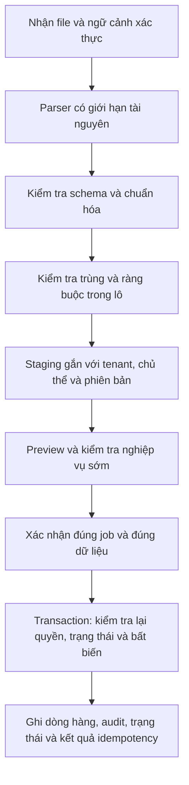

# Import schema validation

## Mục tiêu bài học

Import schema validation là quá trình kiểm tra một lô dữ liệu nhập có tuân thủ hợp đồng đầu vào đã công bố hay không: phiên bản nào, những trường nào được phép xuất hiện, trường bắt buộc, kiểu dữ liệu, miền giá trị và cấu trúc của từng bản ghi.

Trong bảo mật logic nghiệp vụ, một file đọc được chưa chắc là một yêu cầu hợp lệ. File CSV có đủ cột vẫn có thể chứa `tenantId` của đơn vị khác, yêu cầu sửa giá, hoặc những dòng làm tổng số lượng vượt giới hạn của đơn hàng. Vì vậy, schema validation là một lớp kiểm soát đầu vào; thao tác import còn cần kiểm tra quyền theo đối tượng, trạng thái nghiệp vụ và các bất biến ngay tại thời điểm ghi dữ liệu.

Sau bài học, bạn có thể:

- Thiết kế hợp đồng import theo danh sách trường được phép và phiên bản rõ ràng.
- Phân biệt lỗi parser, lỗi schema, lỗi trong toàn bộ lô và lỗi nghiệp vụ.
- Chuẩn hóa dữ liệu mà không âm thầm thay đổi ý nghĩa của dữ liệu sai.
- Tổ chức luồng staging, xác nhận và commit có kiểm tra lại quyền, trạng thái và giới hạn.
- Xử lý import trùng, lỗi một phần và báo cáo lỗi mà không mở đường bỏ qua quy tắc nghiệp vụ.

## 1. Vì sao import cần một ranh giới kiểm soát riêng?

Màn hình nhập liệu thông thường có thể chỉ cho phép chọn sản phẩm và số lượng. Trong khi đó, một chức năng import được triển khai vội thường nhận một bảng nhiều cột rồi ánh xạ trực tiếp vào entity. Khi đó, người gửi file có thể tác động tới những thuộc tính chưa từng được phép sửa trên giao diện.

Ví dụ, entity `OrderLine` có các trường `tenantId`, `orderId`, `sku`, `quantity`, `unitPrice` và `approved`. Nếu chương trình gán mọi tên cột trùng tên thuộc tính, một file có thêm cột `unitPrice` hoặc `approved` có thể can thiệp vào giá và bước phê duyệt. Đây là vấn đề kiểm soát thuộc tính đầu vào, thường được gọi là mass assignment.

Hai kết luận thiết kế:

1. Dùng DTO riêng cho import, chỉ chứa dữ liệu mà thao tác này thực sự cho phép người dùng đề xuất.
2. Mọi đường ghi dữ liệu, bao gồm giao diện, API, import và tác vụ nền, phải đi qua các quy tắc nghiệp vụ tương ứng.

Không coi dữ liệu là đáng tin chỉ vì người gửi có quyền upload, file được tạo từ template chính thức, hoặc một dịch vụ khác đã kiểm tra nó trước đó.

## 2. Tình huống xuyên suốt: thêm dòng vào đơn hàng nháp

Giả sử hệ thống cho phép import các dòng hàng vào một đơn hàng đang ở trạng thái `DRAFT`. Chức năng này chỉ thêm dòng mới, chưa hỗ trợ ghi đè hoặc cập nhật dòng đã tồn tại.

Ngữ cảnh của yêu cầu gồm:

- Danh tính người thực hiện và tenant được xác định từ cơ chế xác thực của máy chủ.
- `orderId` xác định đơn hàng đích; máy chủ phải kiểm tra đơn hàng thuộc tenant và người thực hiện có quyền sửa chính đơn hàng đó.
- `schemaVersion` xác định hợp đồng import được áp dụng.
- Khóa idempotency được gửi theo hợp đồng của API, nằm ngoài các cột dữ liệu dòng hàng.

Mỗi dòng chỉ được có ba trường:

| Trường | Quy tắc cấu trúc và giá trị | Ý nghĩa |
|---|---|---|
| `externalLineId` | Chuỗi từ 1 đến 64 ký tự ASCII; bắt đầu bằng chữ hoặc số, phần còn lại có thể chứa `.`, `_`, `-` | Định danh dòng do phía gửi cung cấp; phân biệt chữ hoa và chữ thường |
| `sku` | Sau chuẩn hóa là chuỗi ASCII từ 1 đến 32 ký tự, bắt đầu bằng chữ hoặc số, phần còn lại có thể chứa `_`, `-` | Mã sản phẩm cần được máy chủ tra cứu |
| `quantity` | Số nguyên từ 1 đến 1.000 | Số lượng đề xuất cho dòng hàng |

Hợp đồng còn quy định:

- Một file chứa từ 1 đến 5.000 dòng dữ liệu.
- Không chấp nhận trường ngoài danh sách, kể cả trường có giá trị rỗng.
- Không chấp nhận hai dòng có cùng `externalLineId` sau chuẩn hóa.
- `externalLineId` không được trùng dòng đã có trong đơn hàng vì đây là thao tác chỉ thêm.
- Tổng số lượng của đơn hàng sau import không vượt 100.000; tổng của mỗi SKU trong đơn hàng sau import không vượt 5.000.
- Giá được lấy từ chính sách giá phía máy chủ khi commit; file không có quyền quyết định giá.
- Không thêm dòng khi đơn hàng đã rời trạng thái `DRAFT`.

Các con số trên là chính sách minh họa của bài học, không phải ngưỡng mặc định cho mọi hệ thống. Đặc biệt, giới hạn toàn đơn hàng phải xét cả dữ liệu đã tồn tại và dữ liệu sắp nhập, không chỉ xét file hiện tại.

Ví dụ CSV hợp lệ ở tầng schema:

```csv
externalLineId,sku,quantity
line-001,BOOK-01,2
line-002,PEN_BLUE,10
```

File sau phải bị từ chối vì có trường không thuộc hợp đồng:

```csv
externalLineId,sku,quantity,approved
line-001,BOOK-01,2,true
```

Quyền phê duyệt đơn hàng không làm cho cột `approved` trở nên hợp lệ trong thao tác thêm dòng. Nếu cần import quyết định phê duyệt, phải thiết kế một thao tác riêng với schema, quyền và điều kiện chuyển trạng thái riêng.

## 3. Tách các lớp kiểm tra theo trách nhiệm

| Lớp | Câu hỏi cần trả lời | Ví dụ lỗi |
|---|---|---|
| Tiếp nhận và parser | Có thể đọc tài nguyên đầu vào trong ngân sách cho phép không? | File quá lớn, CSV sai dấu nháy, workbook vượt giới hạn giải nén |
| Schema | Dữ liệu có đúng cấu trúc, kiểu và miền giá trị đã khai báo không? | Thiếu `quantity`, giá trị âm, thêm `tenantId`, sai phiên bản |
| Toàn bộ lô | Những bản ghi trong cùng lô có mâu thuẫn với nhau không? | Trùng `externalLineId` sau chuẩn hóa |
| Quyền và nghiệp vụ | Chủ thể có được thực hiện thao tác này trên các đối tượng liên quan không? | Đơn hàng thuộc tenant khác, sản phẩm không được bán, đơn đã phê duyệt |
| Transaction và bất biến | Điều kiện có còn đúng khi dữ liệu được ghi đồng thời không? | Hai lô cùng làm tổng số lượng vượt giới hạn |
| Idempotency | Việc gửi lại cùng một thao tác có tạo thêm hiệu ứng không? | Người dùng retry vì mất phản hồi và các dòng bị thêm lần nữa |

Một kiểm tra có thể cần xuất hiện ở nhiều thời điểm. Ví dụ, trạng thái đơn hàng được kiểm tra khi preview để báo lỗi sớm và được kiểm tra lại khi commit để bảo vệ dữ liệu trước thay đổi đồng thời.

Không đưa truy vấn quyền hoặc toàn bộ nghiệp vụ vào JSON Schema rồi cho rằng validator đã thay thế service nghiệp vụ. Ngược lại, cũng không để service phải đoán ý nghĩa của các chuỗi chưa được parse rõ ràng.

## 4. Thiết kế hợp đồng schema đóng và có phiên bản

### 4.1. Từ chối trường không biết thay vì ánh xạ tùy ý

Hợp đồng đóng nghĩa là chỉ các trường đã liệt kê mới hợp lệ. Các trường điều khiển như `tenantId`, `ownerId`, `approved`, `status`, `unitPrice` không thuộc schema thêm dòng hàng.

Không nên bỏ qua âm thầm các trường lạ. Nếu template cũ gửi `qty` còn hệ thống yêu cầu `quantity`, việc bỏ qua `qty` rồi gán số lượng mặc định có thể tạo dữ liệu sai. Báo lỗi chính xác giúp phía gửi sửa hợp đồng thay vì phụ thuộc vào hành vi suy đoán.

Nếu có nhu cầu sửa giá, tạo schema và thao tác điều chỉnh giá riêng. Thao tác đó vẫn cần quyền phù hợp, giới hạn điều chỉnh và quy trình phê duyệt nếu nghiệp vụ yêu cầu.

### 4.2. Ví dụ hợp đồng cho JSON

Một API nhận dữ liệu JSON có thể mô tả cấu trúc như sau:

```json
{
  "$schema": "https://json-schema.org/draft/2020-12/schema",
  "type": "object",
  "additionalProperties": false,
  "required": ["schemaVersion", "orderId", "lines"],
  "properties": {
    "schemaVersion": {
      "const": "order-lines.v1"
    },
    "orderId": {
      "type": "string",
      "pattern": "^[0-9a-fA-F]{8}-[0-9a-fA-F]{4}-[0-9a-fA-F]{4}-[0-9a-fA-F]{4}-[0-9a-fA-F]{12}$"
    },
    "lines": {
      "type": "array",
      "minItems": 1,
      "maxItems": 5000,
      "items": {
        "type": "object",
        "additionalProperties": false,
        "required": ["externalLineId", "sku", "quantity"],
        "properties": {
          "externalLineId": {
            "type": "string",
            "minLength": 1,
            "maxLength": 64,
            "pattern": "^[A-Za-z0-9][A-Za-z0-9._-]{0,63}$"
          },
          "sku": {
            "type": "string",
            "minLength": 1,
            "maxLength": 32,
            "pattern": "^[A-Z0-9][A-Z0-9_-]{0,31}$"
          },
          "quantity": {
            "type": "integer",
            "minimum": 1,
            "maximum": 1000
          }
        }
      }
    }
  }
}
```

Schema trên kiểm tra định dạng của `orderId`, không chứng minh đơn hàng tồn tại hoặc thuộc quyền người gọi. Tương tự, `sku` đúng mẫu ký tự không chứng minh sản phẩm còn được bán.

`additionalProperties: false` cần được đặt ở cả object ngoài và từng object dòng. Đóng object ngoài không tự động đóng object bên trong.

Không dùng `uniqueItems: true` để thay cho kiểm tra duy nhất theo `externalLineId`. Hai object có cùng ID nhưng khác số lượng vẫn có thể là hai phần tử JSON khác nhau. Việc kiểm tra trùng theo một khóa cần được thực hiện riêng.

Ví dụ này minh họa cấu trúc schema; khi triển khai, phải chọn validator hỗ trợ đúng phiên bản và cấu hình lỗi phù hợp. Với một số từ khóa định dạng, hành vi kiểm tra còn phụ thuộc validator và cấu hình. Dù biểu thức định dạng đã đạt, mã ứng dụng vẫn cần parse ID sang kiểu tương ứng trước khi sử dụng.

### 4.3. Không tự đoán phiên bản

Mỗi job lưu phiên bản schema đã chọn và phiên bản quy tắc xử lý cần thiết để truy vết. Phiên bản không được hỗ trợ phải tạo lỗi rõ ràng; không thử các schema khác nhau cho đến khi tìm thấy một schema chấp nhận dữ liệu.

Khi thêm một trường bắt buộc hoặc thay đổi ý nghĩa dữ liệu, cần có kế hoạch phiên bản và chuyển đổi rõ ràng. Giá trị thiếu không được tự mặc định thành một quyết định nhạy cảm như `approved=true`.

## 5. Adapter định dạng: CSV, XLSX và JSON không có cùng kiểu dữ liệu

Schema nghiệp vụ nên nhận DTO có kiểu rõ ràng, nhưng mỗi định dạng cần một adapter đọc dữ liệu đúng quy tắc của nó.

| Định dạng | Điểm dễ sai | Chính sách cần công bố |
|---|---|---|
| CSV | Tất cả trường ban đầu là chuỗi; dấu phân cách, dấu nháy và encoding có thể khác nhau | Encoding, delimiter, header, cách biểu diễn số và cách xử lý dòng trống |
| XLSX | Ô có thể là số, chuỗi, công thức hoặc ngày; mã dài có thể đã bị phần mềm bảng tính làm mất độ chính xác | Cột định danh phải là text, xử lý công thức, sheet được nhận, giới hạn workbook |
| JSON | Giá trị có kiểu, nhưng parser có thể xử lý khóa lặp hoặc số lớn theo cách khác nhau | Từ chối khóa lặp, parse số chính xác, giới hạn độ sâu và độ dài |

### 5.1. Kiểm tra header trước khi chuyển thành map

CSV có thể chứa hai cột cùng tên. Nếu adapter chuyển ngay header vào `Map`, một giá trị có thể ghi đè giá trị còn lại trước khi validator nhìn thấy dữ liệu.

Adapter cần:

1. Đọc danh sách header gốc theo thứ tự.
2. Xử lý BOM đầu file theo chính sách encoding đã công bố.
3. Phát hiện header rỗng, header lặp, trường thiếu và trường lạ.
4. Kiểm tra mỗi bản ghi có đúng số ô; không bỏ qua ô thừa.
5. Chỉ sau đó mới tạo cấu trúc ánh xạ theo tên cột.

Trong ví dụ này, tên header phải đúng chính tả và phân biệt chữ hoa với chữ thường; thứ tự ba cột có thể thay đổi. Không tự suy luận `Quantity`, `qty` hoặc `số lượng` là `quantity`.

Không dùng `split(",")` để parse CSV: dấu phẩy có thể nằm trong một trường được bao bởi dấu nháy. Số thứ tự bản ghi cũng không luôn trùng số dòng vật lý vì một trường CSV có thể chứa xuống dòng.

Với JSON, khóa lặp cần bị chặn ở parser trước khi chuyển thành object hoặc map. Một object đã bị parser ghi đè khóa không còn đủ thông tin để schema validator phát hiện sự mơ hồ ban đầu.

### 5.2. Không ép kiểu có thể làm mất thông tin

Với CSV của bài học, `quantity` được biểu diễn bằng chữ số thập phân nguyên, không dấu phân nhóm, không số mũ và không phần thập phân. Các giá trị `1,000`, `1.000`, `1e3` hoặc `1.5` đều không thuộc biểu diễn được chấp nhận. Giá trị `0002` cũng bị từ chối theo hợp đồng này.

Với JSON, `quantity` là giá trị số nguyên theo schema. Không chuyển một số thập phân sang `int` bằng phép cắt phần lẻ. Nếu adapter dùng `BigDecimal`, phép chuyển như `intValueExact()` giúp phát hiện giá trị không nguyên hoặc vượt miền `int` thay vì âm thầm cắt dữ liệu.

Số định danh, số tài khoản và mã sản phẩm là chuỗi, không phải số để tính toán. Mất số 0 ở đầu hoặc làm tròn một mã dài có thể đổi đối tượng nghiệp vụ. Nếu file nguồn đã mất thông tin, validator không thể khôi phục bằng cách thêm số 0 theo suy đoán.

Nếu một schema khác cho phép nhập tiền, dùng đơn vị nhỏ nhất hoặc kiểu thập phân với scale xác định; không dùng số thực nhị phân làm chuẩn so sánh tiền. Nếu nhập ngày giờ, công bố mẫu và múi giờ, không tự đoán giữa ngày/tháng và tháng/ngày.

### 5.3. Công thức và nội dung được diễn giải

Đối với workbook thêm dòng hàng, adapter không cần tính công thức hoặc lấy dữ liệu từ liên kết ngoài. Chính sách có thể yêu cầu ba cột đều là giá trị trực tiếp và từ chối ô công thức, kể cả khi workbook có sẵn kết quả tính được lưu tạm.

Đối với CSV, một chuỗi bắt đầu bằng `=` vẫn là dữ liệu chuỗi ở bước đọc CSV. Nguy cơ công thức còn xuất hiện khi hệ thống xuất lại dữ liệu sang bảng tính. Vì vậy, báo cáo lỗi và dữ liệu xuất cần được ghi thành text hoặc được xử lý theo chính sách xuất an toàn của định dạng đích.

Không coi việc cấm ký tự `=` trên toàn hệ thống là giải pháp thay thế cho schema và kiểm soát đầu ra. Trong schema của bài học, các định danh đã có tập ký tự cho phép cụ thể; những cột mô tả tự do trong schema khác cần chính sách riêng.

## 6. Chuẩn hóa có giới hạn và kiểm tra lại sau chuẩn hóa

Chuẩn hóa giúp các biểu diễn được chấp nhận quy về một giá trị thống nhất. Nó không có nhiệm vụ biến mọi dữ liệu sai thành dữ liệu có vẻ đúng.

Với adapter CSV của ví dụ:

- Bỏ khoảng trắng ở hai đầu `externalLineId`, `sku` và `quantity`.
- `externalLineId` giữ nguyên hoa thường.
- `sku` chỉ nhận bảng chữ cái ASCII đã cho phép, sau đó chuyển thành chữ hoa bằng quy tắc không phụ thuộc locale.
- Không xóa khoảng trắng bên trong SKU, không bỏ dấu, không thay ký tự Unicode trông giống nhau và không cắt chuỗi quá dài.
- Kiểm tra độ dài và mẫu sau chuẩn hóa; giới hạn độ dài ô thô đã được parser áp dụng trước đó.

Ví dụ, `book-01` và ` BOOK-01 ` cùng trở thành `BOOK-01`. Ngược lại, `BOOK 01` không được tự biến thành `BOOK01` vì có thể trỏ sang một sản phẩm khác.

Mọi kiểm tra trùng khóa phải sử dụng giá trị chuẩn hóa cuối cùng. Hai dòng `line-001` và ` line-001 ` là trùng nhau theo hợp đồng này, dù chuỗi nguồn khác nhau.

Đối với JSON Schema ở trên, `sku` đầu vào đã phải ở dạng chữ hoa. Nếu muốn API JSON cũng chấp nhận chữ thường và khoảng trắng ngoài, phải công bố rõ bước chuẩn hóa trước khi kiểm tra schema tương ứng. Không để hai adapter tự có những quy tắc ngầm khác nhau.

## 7. Giới hạn tài nguyên là một phần của hợp đồng tiếp nhận

`maxItems` không giúp bảo vệ parser nếu parser đã tải một file khổng lồ vào bộ nhớ trước khi validator chạy. Các giới hạn cần được đặt ở nhiều điểm trong luồng đọc.

Một cấu hình minh họa:

| Tài nguyên | Giới hạn minh họa | Điểm áp dụng |
|---|---|---|
| Dữ liệu upload | 5 MiB | Trong khi nhận request, không chỉ sau khi ghi xong |
| Tổng dữ liệu giải nén | 20 MiB và giới hạn theo từng entry | Trong lúc đọc workbook dạng nén |
| Số dòng dữ liệu | 5.000 | Trong vòng lặp parser và schema |
| Số cột được quét | 20; sau đó vẫn phải khớp đúng 3 cột của schema | Khi đọc header và bản ghi |
| Độ dài nội dung mỗi ô | 200 ký tự | Trước chuẩn hóa và ánh xạ DTO |
| Thời gian và mức đồng thời | Theo ngân sách xử lý của dịch vụ | Parser, hàng đợi và worker |
| Số lỗi trả cho người dùng | 100 lỗi đầu tiên | Bộ thu thập lỗi |

Các giới hạn này cần được điều chỉnh theo loại dữ liệu thực tế. Ngoài tổng byte, workbook còn cần giới hạn số sheet, số entry và số ô được quét; JSON cần giới hạn độ sâu và độ dài token theo khả năng parser.

Giới hạn lỗi hiển thị không phải giới hạn số lỗi tồn tại. Khi đã đủ 100 lỗi để trả về, job vẫn phải được đánh dấu không hợp lệ. Nếu dừng sớm vì hết ngân sách, trạng thái cần thể hiện rằng việc kiểm tra chưa hoàn tất; không được báo những dòng chưa kiểm tra là hợp lệ.

## 8. Ví dụ Java: kiểm tra schema dòng CSV

Đoạn mã sau dùng các kiểu của Java 17 để minh họa phần kiểm tra sau parser. Adapter đã kiểm tra header không lặp, số ô chính xác, encoding và giới hạn tài nguyên. `rows` chỉ chứa các bản ghi dữ liệu; bản ghi số 1 là bản ghi đầu tiên sau header, không phải số dòng vật lý trong file.

Bộ kiểm tra này thực hiện chính sách toàn bộ lô thành công hoặc toàn bộ lô thất bại. Nó chưa truy vấn đơn hàng, sản phẩm, quyền hoặc cơ sở dữ liệu và không thực hiện commit.

```java
import java.util.ArrayList;
import java.util.HashMap;
import java.util.List;
import java.util.Locale;
import java.util.Map;
import java.util.Set;
import java.util.regex.Pattern;

public final class ImportRowSchema {
    private static final int MAX_ROWS = 5_000;
    private static final int MAX_REPORTED_ERRORS = 100;
    private static final Set<String> COLUMNS =
            Set.of("externalLineId", "sku", "quantity");

    private static final Pattern LINE_ID =
            Pattern.compile("[A-Za-z0-9][A-Za-z0-9._-]{0,63}");
    private static final Pattern RAW_SKU =
            Pattern.compile("[A-Za-z0-9][A-Za-z0-9_-]{0,31}");
    private static final Pattern QUANTITY =
            Pattern.compile("[1-9][0-9]{0,3}");

    public record CleanLine(
            String externalLineId, String sku, int quantity) {}

    // recordNumber == 0 biểu thị lỗi ở phạm vi toàn bộ lô.
    public record Issue(
            int recordNumber, String field, String code, String message) {}

    public record Result(
            List<CleanLine> lines,
            List<Issue> issues,
            int totalErrors) {
        public boolean valid() {
            return totalErrors == 0;
        }

        public boolean errorsTruncated() {
            return totalErrors > issues.size();
        }
    }

    private static final class Errors {
        private int total;
        private final List<Issue> reported = new ArrayList<>();

        void add(int row, String field, String code, String message) {
            total++;
            if (reported.size() < MAX_REPORTED_ERRORS) {
                reported.add(new Issue(row, field, code, message));
            }
        }
    }

    public static Result validate(List<Map<String, String>> rows) {
        Errors errors = new Errors();
        List<CleanLine> clean = new ArrayList<>();
        Map<String, Integer> firstRowById = new HashMap<>();

        if (rows == null || rows.isEmpty() || rows.size() > MAX_ROWS) {
            errors.add(0, "", "INVALID_ROW_COUNT",
                    "Lô phải có từ 1 đến 5000 bản ghi.");
            return finish(clean, errors);
        }

        for (int index = 0; index < rows.size(); index++) {
            int row = index + 1;
            Map<String, String> cells = rows.get(index);
            if (cells == null || !cells.keySet().equals(COLUMNS)) {
                errors.add(row, "", "INVALID_COLUMNS",
                        "Bản ghi phải có đúng ba trường được phép.");
                continue;
            }

            int errorsBeforeRow = errors.total;
            String lineId = strip(cells.get("externalLineId"));
            String rawSku = strip(cells.get("sku"));
            String rawQuantity = strip(cells.get("quantity"));
            String sku = null;
            int quantity = 0;

            if (lineId == null || !LINE_ID.matcher(lineId).matches()) {
                errors.add(row, "externalLineId", "INVALID_LINE_ID",
                        "Mã dòng không đúng định dạng.");
            } else {
                Integer firstRow = firstRowById.putIfAbsent(lineId, row);
                if (firstRow != null) {
                    errors.add(row, "externalLineId", "DUPLICATE_LINE_ID",
                            "Mã dòng trùng với bản ghi " + firstRow + ".");
                }
            }

            // Kiểm tra ASCII trước khi đổi hoa để tránh biến đổi ngoài ý muốn.
            if (rawSku == null || !RAW_SKU.matcher(rawSku).matches()) {
                errors.add(row, "sku", "INVALID_SKU",
                        "SKU không đúng định dạng.");
            } else {
                sku = rawSku.toUpperCase(Locale.ROOT);
            }

            if (rawQuantity == null
                    || !QUANTITY.matcher(rawQuantity).matches()) {
                errors.add(row, "quantity", "INVALID_INTEGER",
                        "Số lượng phải dùng chữ số nguyên theo hợp đồng.");
            } else {
                // Regex đã giới hạn tối đa bốn chữ số trước khi parse.
                quantity = Integer.parseInt(rawQuantity);
                if (quantity > 1_000) {
                    errors.add(row, "quantity", "OUT_OF_RANGE",
                            "Số lượng mỗi dòng không được vượt 1000.");
                }
            }

            if (errors.total == errorsBeforeRow) {
                clean.add(new CleanLine(lineId, sku, quantity));
            }
        }

        return finish(clean, errors);
    }

    private static String strip(String value) {
        return value == null ? null : value.strip();
    }

    private static Result finish(List<CleanLine> clean, Errors errors) {
        return new Result(
                errors.total == 0 ? List.copyOf(clean) : List.of(),
                List.copyOf(errors.reported),
                errors.total);
    }
}
```

Các điểm cần giữ khi áp dụng ý tưởng này:

- Danh sách cột được so sánh chính xác. Cột lạ không bị bỏ qua trước khi ánh xạ entity.
- Kiểm tra SKU ASCII xảy ra trước phép chuyển chữ hoa; quy tắc locale không được quyết định định danh sản phẩm.
- `quantity` được giới hạn hình thức và độ dài trước khi parse; không dùng phép cắt phần lẻ hoặc thay thế dấu phân cách.
- Trùng `externalLineId` được phát hiện sau chuẩn hóa, xuyên suốt các bản ghi trong lô, không chỉ giữa hai dòng liền nhau.
- `totalErrors` được giữ độc lập với danh sách lỗi trả về. Hết chỗ lưu lỗi không làm `valid()` chuyển thành `true`.
- Khi có bất kỳ lỗi nào, `lines` trả về rỗng để tầng gọi không vô tình commit phần dữ liệu đã đi qua kiểm tra.

Nếu dùng streaming cho lô lớn hơn, có thể thay danh sách trong bộ nhớ bằng vùng staging có giới hạn. Vẫn phải bảo đảm không ghi hiệu ứng nghiệp vụ cho các dòng đọc được trước khi biết lô đã được chấp nhận theo chính sách nguyên tử.

## 9. Kiểm tra schema thành công chưa đủ để ghi dữ liệu

Một dòng `line-001,BOOK-01,2` có thể hoàn toàn hợp lệ về cấu trúc nhưng không được phép thực thi. Sau schema validation, service nghiệp vụ cần kiểm tra ít nhất ba nhóm điều kiện.

### 9.1. Quyền theo từng đối tượng

Máy chủ phải xác minh quyền sửa đơn hàng cụ thể, không chỉ quyền gọi endpoint import. Tra cứu đơn hàng và sản phẩm trong phạm vi tenant được xác thực; việc một ID có dạng UUID không tạo ra quyền truy cập.

Nếu schema khác chứa `customerId`, `warehouseId` hoặc `approverId`, mỗi tham chiếu vẫn phải được kiểm tra theo phạm vi và chính sách tương ứng. Không tự tạo bản ghi tham chiếu mới chỉ vì không tìm thấy ID, trừ khi chức năng đó được thiết kế và cấp quyền rõ ràng.

Tác vụ nền cần lưu ngữ cảnh chủ thể và đối tượng đích đủ để kiểm tra lại. Không dùng quyền rộng của service account làm lý do bỏ qua quyền của người yêu cầu. Nếu người đó mất quyền sau khi upload, worker phải áp dụng chính sách ủy quyền đã công bố; trong ví dụ này, quyền sửa được kiểm tra lại lúc commit.

### 9.2. Trạng thái và bất biến nghiệp vụ

Service phải dựng trạng thái đơn hàng sau khi thêm các dòng đề xuất rồi kiểm tra:

- Đơn hàng còn ở `DRAFT` và cho phép thêm dòng.
- Sản phẩm tồn tại, khả dụng và thuộc phạm vi được phép sử dụng.
- Không có `externalLineId` trùng với dòng đã có.
- Tổng số lượng toàn đơn hàng và theo SKU vẫn nằm trong giới hạn.
- Giá, thuế hoặc chiết khấu do đúng chính sách phía máy chủ xác định.

Nếu tổng theo SKU tối đa là 5.000, không thể chỉ kiểm tra mỗi dòng `quantity <= 1.000`. Sáu dòng cùng SKU, mỗi dòng 1.000, đều đạt schema nhưng vi phạm bất biến sau khi gộp.

Tương tự, nếu đơn hàng hiện có 99.999 sản phẩm theo tổng số lượng, một dòng hợp lệ có số lượng 2 sẽ vượt giới hạn toàn đơn hàng. Đây là kiểm tra trên trạng thái kết quả, không phải một thuộc tính riêng của dòng nhập.

### 9.3. Thay đổi đồng thời

Giữa preview và commit, một người khác có thể thêm hàng hoặc phê duyệt đơn. Ngay cả hai job có cùng dữ liệu đầu vào cũng có thể quan sát những trạng thái cơ sở dữ liệu khác nhau.

Phải kiểm tra lại các điều kiện phụ thuộc trạng thái trong cơ chế transaction và kiểm soát đồng thời phù hợp. Khóa một bản ghi đơn hàng chỉ bảo vệ được bất biến của đơn hàng nếu mọi đường ghi liên quan cùng tuân thủ quy ước khóa đó. Một job khóa đúng nhưng một API khác ghi thẳng vẫn có thể phá vỡ bảo đảm.

Nếu bất biến liên quan tới tài nguyên dùng chung giữa nhiều đơn hàng, chẳng hạn tồn kho, cần kiểm soát đồng thời trên chính tài nguyên đó bằng thao tác điều kiện, khóa hoặc cơ chế nhất quán thích hợp. Khóa đơn hàng riêng lẻ không bảo vệ được tổng tồn kho toàn hệ thống.

## 10. Luồng staging, preview và commit



Mỗi bước có thể thất bại và phải tạo trạng thái rõ ràng. Sơ đồ biểu diễn đường đi thành công, không có nghĩa rằng mọi lô upload đều đến được commit.

Một state machine cho job có thể gồm:

```text
RECEIVED -> VALIDATING -> READY -> COMMITTING -> COMMITTED
                     -> REJECTED
                              READY -> EXPIRED
                              READY -> REJECTED
```

`REJECTED` là dữ liệu không được chấp nhận theo hợp đồng hoặc nghiệp vụ. Sự cố hạ tầng cần được phân biệt với lỗi dữ liệu, kèm chính sách retry riêng. Nếu worker dừng ở `COMMITTING`, cơ chế phục hồi phải xác định kết quả transaction đã được ghi hay chưa trước khi thử lại; không chỉ đặt trạng thái về `READY` rồi chạy lại vô điều kiện.

Staging nên lưu hoặc tham chiếu tới:

- Tenant, chủ thể khởi tạo và đối tượng đích.
- Phiên bản schema, DTO đã chuẩn hóa và dấu vết file nguồn theo chính sách lưu trữ.
- Hash của nội dung đã được diễn giải, trạng thái kiểm tra và thời điểm hết hạn preview.
- Phiên bản đơn hàng hoặc dữ liệu liên quan nếu dùng optimistic locking.
- Số dòng, số lỗi và phần lỗi được phép hiển thị.

API xác nhận nên nhận định danh job hoặc token liên kết đúng snapshot staging, thay vì nhận lại danh sách dòng tùy ý từ trình duyệt. Máy chủ tiếp tục kiểm tra quyền sở hữu job và phạm vi tenant. Nếu cho sửa lô trước khi xác nhận, cần tạo snapshot mới và thực hiện lại các kiểm tra bị ảnh hưởng.

Giá hiển thị ở preview phải có chính sách rõ ràng. Trong ví dụ lấy giá tại commit, preview là ước tính; nếu sản phẩm yêu cầu người dùng xác nhận đúng giá hoặc tổng tiền đã xem, thay đổi giá phải làm preview hết hiệu lực hoặc yêu cầu xác nhận lại.

## 11. Transaction và idempotency khi commit

Một phác thảo cho thao tác commit toàn bộ lô:

```text
commitImport(authenticatedActor, jobId, idempotencyKey):
    lấy snapshot staging đúng tenant và kiểm tra quyền trên job
    xác minh snapshot đã qua kiểm tra, chưa hết hạn và không bị thay đổi
    tính requestFingerprint theo phiên bản + đích + dữ liệu chuẩn hóa

    bắt đầu transaction
        nhận quyền xử lý idempotency bằng ràng buộc duy nhất ở DB
        nếu cùng khóa nhưng khác fingerprint: trả lỗi xung đột
        nếu cùng khóa đã commit: trả kết quả đã lưu

        khóa đơn hàng trong tenant của chủ thể
        kiểm tra lại quyền sửa, trạng thái DRAFT và phiên bản liên quan
        tra cứu sản phẩm, chính sách giá và dữ liệu tham chiếu hiện hành
        kiểm tra externalLineId với dữ liệu đã tồn tại
        dựng trạng thái kết quả và kiểm tra mọi bất biến

        thêm toàn bộ dòng hàng
        ghi audit và outbox nếu có sự kiện cần phát
        ghi kết quả idempotency và chuyển job thành COMMITTED
    commit transaction
```

Đây là phác thảo thiết kế, không phải mã có thể sao chép nguyên trạng. Cách nhận quyền xử lý idempotency phải giải quyết được hai yêu cầu đến đồng thời; mô hình “đọc xem có chưa, rồi insert” thiếu ràng buộc duy nhất vẫn có race condition.

Các điểm cần bảo đảm:

- Phạm vi khóa idempotency gắn với tenant, loại thao tác và đối tượng đích theo hợp đồng của API. Chỉ biết cùng một chuỗi khóa không được phép lấy kết quả của tenant khác.
- Fingerprint bao gồm dữ liệu có ý nghĩa với thao tác. Cùng khóa nhưng thay `orderId`, phiên bản hoặc số lượng phải bị phát hiện; không chỉ so tên file.
- Kết quả thành công được ghi nhất quán với các dòng hàng. Nếu mất kết nối sau commit, retry trả được kết quả đã ghi thay vì thêm lại dòng.
- Ràng buộc duy nhất như `(tenant_id, order_id, external_line_id)` bảo vệ định danh dòng ở tầng lưu trữ. Nó hỗ trợ tính toàn vẹn nhưng không thay thế quyền và quy tắc trạng thái.
- Mọi phép cộng hoặc nhân số lượng, tiền phải dùng kiểu đủ miền và kiểm tra tràn số theo cách triển khai.
- Audit, outbox và trạng thái job chỉ có thể nằm trong cùng transaction nếu chúng ở cùng ranh giới transaction. Nếu nằm ở các hệ thống khác nhau, cần thiết kế điều phối và phục hồi rõ ràng.

Hash của file hoặc dữ liệu chuẩn hóa chỉ giúp nhận diện nội dung. Nó không chứng minh chủ thể có quyền và không tự bảo đảm một thao tác chỉ tạo hiệu ứng một lần. Hai file khác nhau về thứ tự hoặc khoảng trắng cũng có thể biểu diễn cùng yêu cầu; hợp đồng cần quy định phần nào ảnh hưởng fingerprint.

Trong ví dụ chỉ thêm dòng, gửi lại cùng dữ liệu bằng một khóa idempotency mới sẽ bị kiểm tra trùng định danh dòng với dữ liệu hiện có. Nếu sản phẩm muốn hỗ trợ cập nhật dòng đã có, đó là một ngữ nghĩa khác, cần khai báo rõ điều kiện cập nhật, version và quyền.

## 12. Chính sách lỗi và thành công một phần

Mặc định của bài học là toàn bộ lô thành công hoặc toàn bộ lô thất bại:

- Lỗi parser, schema hoặc lô: không ghi dòng hàng nào.
- Lỗi quyền, trạng thái hoặc bất biến khi commit: rollback toàn bộ thao tác nghiệp vụ.
- Lỗi hạ tầng: xác định kết quả transaction trước khi retry.

Nếu sản phẩm cần thành công một phần, phải coi đó là một chế độ được thiết kế riêng. Cần xác định đơn vị transaction, thứ tự xét dòng, cách kiểm tra tổng sau mỗi lần áp dụng, kết quả từng dòng và hành vi retry. Không thể suy ra rằng cứ dòng nào đạt schema thì có thể ghi ngay.

Ví dụ, hai dòng riêng lẻ đều có thể thêm được vào một đơn hàng gần giới hạn, nhưng chỉ một trong hai có thể tồn tại trong trạng thái cuối. Chế độ thành công một phần phải có quy tắc chọn và báo kết quả xác định, không phụ thuộc ngẫu nhiên vào thứ tự thread chạy.

API cũng cần phân biệt lỗi đầu vào, xung đột trạng thái, từ chối quyền và lỗi hệ thống. Mã HTTP cụ thể phụ thuộc hợp đồng của dịch vụ; phía gọi nên dựa thêm vào mã lỗi ổn định, không parse chuỗi thông báo dành cho con người.

## 13. Báo lỗi hữu ích mà không tiết lộ dữ liệu ngoài quyền

Một phản hồi lỗi schema có thể có cấu trúc:

```json
{
  "jobStatus": "REJECTED",
  "validationComplete": true,
  "totalRows": 3,
  "totalErrors": 2,
  "errorsTruncated": false,
  "errors": [
    {
      "recordNumber": 2,
      "field": "quantity",
      "code": "OUT_OF_RANGE",
      "message": "Số lượng mỗi dòng không được vượt 1000."
    },
    {
      "recordNumber": 3,
      "field": "externalLineId",
      "code": "DUPLICATE_LINE_ID",
      "message": "Mã dòng trùng với bản ghi 1."
    }
  ]
}
```

Khi dừng kiểm tra vì giới hạn tài nguyên, không dùng `totalErrors` như thể đã biết đầy đủ mọi lỗi của file. Có thể trả số lỗi đã phát hiện cùng `validationComplete=false` và mã lý do dừng, hoặc không công bố tổng lỗi hoàn chỉnh.

Không trả nguyên stack trace, câu SQL, đường dẫn máy chủ hoặc dữ liệu của tenant khác. Lỗi tham chiếu tới đối tượng ngoài quyền có thể dùng thông báo “không tồn tại hoặc không được phép sử dụng” theo chính sách tránh tiết lộ của hệ thống.

Giá trị nguồn được trích trong lỗi phải được giới hạn độ dài và xử lý phù hợp với nơi hiển thị. Dữ liệu import có thể xuất hiện trên HTML, log và file báo lỗi; mỗi nơi có quy tắc bảo vệ riêng. Chỉ người có quyền trên job mới được xem hoặc tải báo cáo lỗi của job đó.

Audit nên có job ID, chủ thể, tenant, đối tượng đích, phiên bản schema, số dòng, kết quả và thời điểm commit. Tránh ghi toàn bộ nội dung file hoặc dữ liệu nhạy cảm vào log thông thường chỉ để phục vụ chẩn đoán.

## 14. Ma trận kiểm thử tình huống lạm dụng

Kiểm thử cần thể hiện kết quả nghiệp vụ và hiệu ứng lưu trữ, không chỉ kiểm tra validator có ném exception hay không.

| Tình huống | Lớp phát hiện chính | Kết quả cần quan sát |
|---|---|---|
| Thêm cột `approved` hoặc `unitPrice` | Schema | Lô bị từ chối; không có thuộc tính entity nào bị thay đổi |
| Header `quantity` xuất hiện hai lần | Parser/adapter | Từ chối trước khi chuyển thành map |
| JSON có khóa `quantity` lặp | Parser | Không để giá trị sau âm thầm ghi đè giá trị trước |
| Số lượng `0`, `-1`, `1001`, `1.5` trong CSV | Schema | Lỗi miền hoặc biểu diễn; không tự sửa giá trị |
| Mã định danh dài hoặc số ô vượt ngân sách | Tiếp nhận/parser | Dừng có kiểm soát; không đánh dấu lô đã hợp lệ |
| Hai ID dòng chỉ khác khoảng trắng ngoài | Toàn bộ lô | Phát hiện trùng sau chuẩn hóa |
| Hơn 100 lỗi trong lô | Thu thập lỗi | Trả tối đa 100 lỗi nhưng lô vẫn thất bại |
| SKU hợp lệ về mẫu nhưng không được sử dụng | Nghiệp vụ | Không thêm dòng tham chiếu sản phẩm ngoài chính sách |
| Đơn hàng thuộc tenant khác | Quyền theo đối tượng | Không đọc hoặc sửa dữ liệu ngoài quyền |
| Sáu dòng cùng SKU, mỗi dòng 1.000 | Bất biến kết quả | Từ chối vì tổng theo SKU vượt 5.000 |
| Đơn có tổng 99.999, import thêm 2 | Bất biến kết quả | Từ chối; không chỉ kiểm tra riêng file |
| Preview hợp lệ, đơn được phê duyệt trước commit | State machine/transaction | Commit bị từ chối; đơn đã phê duyệt không bị thêm dòng |
| Người khởi tạo mất quyền trước khi worker commit | Quyền khi thực thi | Worker không dùng quyền rộng để tiếp tục thay người dùng |
| Hai import chạy đồng thời gần giới hạn | Kiểm soát đồng thời | Tổng cuối không vượt giới hạn; không có lần ghi một phần ngoài chính sách |
| Cùng khóa idempotency, cùng dữ liệu, gửi đồng thời | Idempotency | Chỉ một hiệu ứng nghiệp vụ, kết quả retry nhất quán |
| Cùng khóa idempotency nhưng đổi số lượng | Idempotency | Báo xung đột; không áp dụng dữ liệu mới |
| Mất kết nối sau khi DB đã commit | Phục hồi/idempotency | Retry lấy kết quả đã ghi, không thêm dòng lần nữa |
| Thay file hoặc DTO sau preview | Ràng buộc snapshot | Bản xác nhận cũ không áp dụng được cho dữ liệu mới |
| Báo lỗi chứa chuỗi có ý nghĩa với bảng tính | Xuất báo cáo | Báo cáo không diễn giải dữ liệu người dùng thành công thức |

Đối với tình huống đồng thời, cần tạo sự giao nhau giữa các transaction trong kiểm thử tích hợp. Chạy hai yêu cầu nối tiếp không chứng minh được cơ chế khóa hoặc cập nhật có điều kiện hoạt động đúng.

Sau lỗi commit, kiểm tra cả bảng dòng hàng, trạng thái job, bản ghi idempotency và audit/outbox theo thiết kế. Một response báo lỗi nhưng đã ghi được nửa lô vẫn là lỗi bảo mật và toàn vẹn dữ liệu.

## 15. Những cách triển khai cần tránh

| Cách triển khai | Vấn đề | Cách thay thế |
|---|---|---|
| Import trực tiếp vào entity | Người gửi điều khiển thuộc tính ngoài quyền | DTO đóng, ánh xạ tường minh qua service nghiệp vụ |
| Bỏ qua cột lạ và mặc định trường thiếu | Che giấu template sai hoặc tạo giá trị nhạy cảm ngoài ý muốn | Từ chối sai hợp đồng với mã lỗi rõ ràng |
| Kiểm tra quyền chỉ ở bước upload | Quyền và trạng thái có thể thay đổi trước khi ghi | Kiểm tra lại khi commit |
| Chỉ kiểm tra từng dòng | Nhiều dòng hợp lệ riêng lẻ có thể cùng phá giới hạn | Kiểm tra lô và trạng thái kết quả |
| Ghi từng dòng trong khi vẫn parse file | Lỗi cuối file để lại dữ liệu đã áp dụng | Staging và commit theo chính sách nguyên tử |
| Kiểm tra trùng chỉ trong từng chunk | Bỏ sót ID lặp giữa các chunk | Phạm vi kiểm tra xuyên suốt job, có ràng buộc ở DB |
| Dùng tên file làm khóa chống trùng | Đổi tên hoặc dùng lại tên không phản ánh cùng thao tác | Khóa idempotency có phạm vi và fingerprint rõ ràng |
| Coi lỗi vượt giới hạn báo cáo là không có lỗi | Dữ liệu sai được đánh dấu hợp lệ | Tách số lỗi thực tế khỏi số lỗi được hiển thị |
| Khóa đơn hàng ở một đường ghi duy nhất | Đường ghi khác vẫn có thể phá bất biến | Quy ước kiểm soát đồng thời nhất quán cho mọi đường ghi |

## 16. Áp dụng vào một chức năng import thực tế

Khi thiết kế một import mới, hãy viết hợp đồng trước khi viết mã ánh xạ dữ liệu:

1. Xác định thao tác nghiệp vụ chính xác: thêm mới, cập nhật, thay thế hay yêu cầu chuyển trạng thái. Không gộp chúng chỉ vì cùng dùng một file.
2. Liệt kê trường được phép, trường bắt buộc, kiểu, giới hạn, quy tắc chuẩn hóa và phiên bản schema.
3. Chỉ rõ giá trị do máy chủ quyết định và các đối tượng cần kiểm tra quyền.
4. Định nghĩa bất biến trên trạng thái sau import, gồm dữ liệu đã tồn tại và tác động đồng thời.
5. Công bố chính sách nguyên tử hoặc thành công một phần, staging, thời hạn preview và idempotency.
6. Tách kiểm tra cấu trúc khỏi kiểm tra nghiệp vụ nhưng bảo đảm cả hai nằm trên đường thực thi bắt buộc.
7. Dùng ma trận tình huống lạm dụng để xác minh dữ liệu bị từ chối không tạo hiệu ứng trái phép.

Một thiết kế đạt yêu cầu phải trả lời được: dòng nào được phép đề xuất điều gì, ai có quyền áp dụng đề xuất lên đối tượng nào, điều kiện nào phải còn đúng lúc commit, và chuyện gì xảy ra khi cùng yêu cầu được gửi lại. Schema validation cung cấp hợp đồng đầu vào rõ ràng để những câu trả lời đó có thể được thực thi một cách nhất quán.
