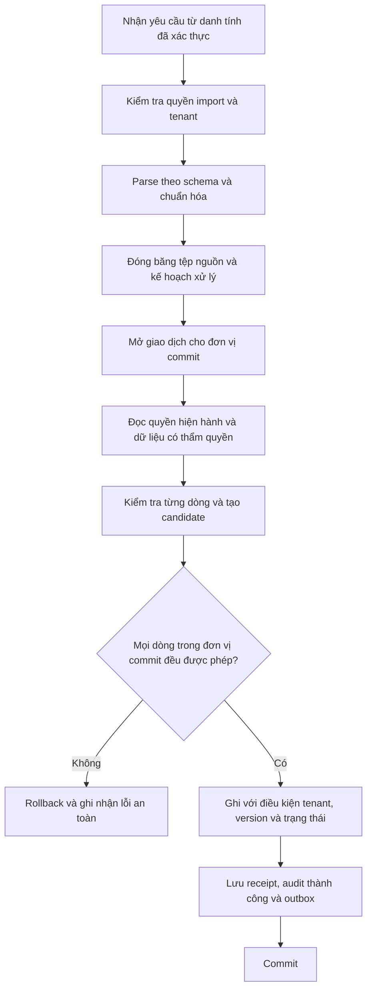

# Import row authorization — kiểm tra quyền cho từng dòng nhập dữ liệu

Một người dùng được phép mở màn hình import không có nghĩa là họ được sửa mọi đối tượng xuất hiện trong tệp. Một tệp chứa 2.000 dòng có thể trộn dữ liệu thuộc nhiều tenant, nhiều bộ phận, nhiều người sở hữu và nhiều trạng thái nghiệp vụ. Chỉ một dòng vượt quyền được ghi thành công cũng đủ làm hỏng ranh giới bảo vệ của toàn bộ chức năng import.

Trong chương **Import Security**, bài học này trình bày cách kiểm tra quyền ở cấp từng dòng trong phạm vi bảo mật logic nghiệp vụ. Mục tiêu là giữ nguyên các quy tắc về đối tượng, trường dữ liệu, trạng thái và giao dịch khi chuyển từ thao tác trên giao diện sang xử lý hàng loạt. Những đường đi như import CSV, import Excel, API hàng loạt và worker chạy nền đều phải bảo vệ cùng một quy tắc nghiệp vụ.

Sau bài học, bạn có thể:

- Phân biệt quyền sử dụng chức năng import với quyền thực hiện thay đổi trên từng đối tượng.
- Thiết kế chính sách cho cả đối tượng hiện tại, dữ liệu sau thay đổi và đối tượng được tham chiếu.
- Xử lý thay đổi quyền, xung đột trạng thái và yêu cầu lặp trong quá trình import.
- Xây dựng giao dịch, phản hồi lỗi và kiểm thử nhằm phát hiện hành vi vượt quyền qua import.

## 1. Mô hình bài toán và ranh giới tin cậy

Xét hệ thống quản lý đề nghị mua hàng. Mỗi đề nghị có các trường:

```text
PurchaseRequest
  id
  tenant_id
  requester_id
  cost_center_id
  supplier_id
  total_amount
  currency
  status            // DRAFT, SUBMITTED, APPROVED, REJECTED, CANCELLED
  version
```

Chức năng import của ví dụ chỉ hỗ trợ tạo đề nghị nháp và cập nhật đề nghị nháp. Một nhân viên có thể được cấp quyền chỉnh sửa các đề nghị trong những trung tâm chi phí nhất định. Quyền phê duyệt được quản lý riêng.

Giả sử người dùng Lan thuộc tenant A, được sửa đề nghị nháp của trung tâm chi phí CC-10. Tệp do Lan tải lên chứa:

```csv
operation,request_id,cost_center_id,supplier_id,total_amount,currency
UPDATE,PR-101,CC-10,SUP-01,2500000,VND
UPDATE,PR-202,CC-99,SUP-01,3500000,VND
UPDATE,PR-303,CC-10,SUP-01,1000000,VND
```

PR-101 thuộc phạm vi Lan được sửa. PR-202 thuộc bộ phận khác. PR-303 thuộc tenant B. Việc cả ba dòng đều đúng định dạng không làm cho dòng thứ hai và thứ ba trở nên hợp lệ về quyền.

Các mã trên là mã minh họa. Hệ thống thực tế có thể sử dụng UUID, khóa số hoặc khóa nghiệp vụ. Mã khó đoán giúp hạn chế dò tìm nhưng không thay thế kiểm tra quyền.

### Dữ liệu nào được tin cậy?

| Dữ liệu | Nguồn dùng làm căn cứ | Cách xử lý |
|---|---|---|
| Người thực hiện | Phiên đăng nhập hoặc danh tính đã xác thực | Không lấy từ cột `user_id` trong tệp |
| Tenant đang thao tác | Ngữ cảnh xác thực và lựa chọn tenant đã được kiểm tra quyền | Không chấp nhận tenant bất kỳ chỉ vì xuất hiện trong URL hoặc tệp |
| Người chạy thay mặt trong job nền | Bản ghi job do máy chủ tạo từ yêu cầu hợp lệ | Kiểm tra lại hiệu lực quyền khi thực thi |
| ID đề nghị, trung tâm chi phí, nhà cung cấp | Tệp do người dùng cung cấp | Xem là dữ liệu không tin cậy; tra cứu và phân quyền |
| Chủ sở hữu, trạng thái, phiên bản hiện tại | Dữ liệu có thẩm quyền trong cơ sở dữ liệu | Không dùng bản sao do tệp khai báo để quyết định quyền |
| Vai trò hoặc danh sách quyền trong tệp | Không có giá trị cấp quyền | Từ chối các cột dành riêng cho máy chủ |

Ngữ cảnh tenant không đơn thuần là một chuỗi ID. Khi người dùng chọn tenant từ request, máy chủ phải xác minh họ có quyền hoạt động trong tenant đó. Worker cũng phải ràng buộc bản ghi job, tệp nguồn và tenant của job với nhau.

## 2. Quyền chức năng và quyền từng dòng là hai lớp khác nhau

Một endpoint có thể yêu cầu quyền `PURCHASE_REQUEST_IMPORT`. Quyền này chỉ quyết định người dùng được bắt đầu quy trình import hay không.

Mỗi dòng sau đó còn phải trả lời:

1. Dòng yêu cầu hành động gì: tạo mới, cập nhật hay hành động khác?
2. Đối tượng hiện tại có thuộc tenant và phạm vi nghiệp vụ của người thực hiện không?
3. Người thực hiện có được sửa những trường mà dòng này yêu cầu không?
4. Giá trị mới có chuyển đối tượng sang phạm vi mà người đó không được sử dụng không?
5. Các đối tượng liên quan có được phép tham chiếu trong nghiệp vụ này không?
6. Quyền và điều kiện thực hiện còn đúng tại thời điểm ghi không?

Có thể mô tả quyết định phân quyền như sau:

```text
Authorized(row, actor, tenant, current, candidate) =
    canUseImport(actor, tenant)
    AND canPerformOperation(actor, row.operation)
    AND canAccessCurrentObject(actor, tenant, current)
    AND canChangeRequestedFields(actor, current, candidate)
    AND canUseDestinationScope(actor, tenant, candidate)
    AND canUseReferencedObjects(actor, tenant, candidate)
```

Đối với tạo mới, không có `current`; nhánh tạo mới phải có chính sách riêng về quyền tạo, phạm vi đích và các trường do máy chủ gán. Không được coi việc thiếu đối tượng hiện tại là tự động được phép tạo.

Quyết định ghi còn yêu cầu những điều kiện khác:

```text
CommitAllowed =
    Authorized
    AND validBusinessInvariants
    AND validStateTransition
    AND validConcurrencyConditions
    AND validIdempotencyConditions
```

Phân quyền và kiểm tra nghiệp vụ hỗ trợ nhau nhưng không đồng nhất. Số tiền dương là điều kiện nghiệp vụ; quyền sửa số tiền là điều kiện phân quyền. Một số tiền hợp lệ vẫn có thể do người không có quyền gửi lên.

### Các lỗi thiết kế phổ biến

- Chỉ kiểm tra annotation phân quyền ở controller, sau đó gọi `saveAll` với dữ liệu từ tệp.
- Kiểm tra tenant cho tệp một lần rồi mặc định mọi ID trong tệp đều thuộc tenant đó.
- Lấy bản ghi bằng ID toàn cục, sửa và lưu mà không kiểm tra phạm vi đối tượng.
- Cho worker dùng quyền quản trị hệ thống để thay thế quyền của người yêu cầu import.
- Xác nhận quyền lúc preview rồi dùng kết quả đó làm giấy phép ghi trong nhiều giờ tiếp theo.
- Dùng chung DTO cập nhật với entity, khiến các trường `tenant_id`, `requester_id` hoặc `status` bị gán hàng loạt.

Các lỗi này thường là lỗi logic ngay cả khi truy vấn đã dùng tham số và không có SQL injection.

## 3. Phân quyền dựa trên cả trạng thái trước và sau thay đổi

Chỉ kiểm tra quyền trên dữ liệu sau khi nhận tệp là chưa đủ. Kẻ tấn công có thể sửa các trường quyết định phạm vi rồi dùng chính dữ liệu đã sửa để vượt kiểm tra.

Ví dụ, PR-202 hiện thuộc CC-99 mà Lan không có quyền sửa. Nếu mã xử lý làm theo thứ tự:

```text
1. Tìm PR-202 theo ID.
2. Gán cost_center_id = CC-10 từ tệp.
3. Kiểm tra Lan có quyền với CC-10 không.
4. Lưu.
```

thì Lan có thể chiếm quyền sửa một đối tượng bằng cách chuyển nó vào phạm vi của mình.

Thứ tự hợp lý là:

```text
1. Đọc đối tượng hiện tại trong tenant đang thao tác.
2. Kiểm tra quyền trên đối tượng và phạm vi hiện tại.
3. Tạo candidate chỉ từ các trường được phép nhập.
4. Kiểm tra quyền sửa từng trường có yêu cầu thay đổi.
5. Kiểm tra quyền sử dụng phạm vi và tham chiếu của candidate.
6. Kiểm tra trạng thái, invariants và điều kiện đồng thời.
7. Ghi trong giao dịch có bảo vệ các điều kiện vừa kiểm tra.
```

`candidate` là biểu diễn dự kiến sau thay đổi, chưa phải entity đã được lưu hoặc một đối tượng đang được ORM tự theo dõi rồi tự flush. Có thể dùng một DTO bất biến để tránh tác dụng phụ trong quá trình kiểm tra.

### Chuyển phạm vi cần quyền riêng

Việc được sửa nội dung đề nghị trong CC-10 không mặc nhiên cho phép chuyển đề nghị sang CC-20. Một chính sách chuyển trung tâm chi phí có thể yêu cầu đồng thời:

- Có quyền chỉnh sửa đối tượng ở phạm vi nguồn.
- Có quyền `TRANSFER_COST_CENTER`.
- Có quyền sử dụng phạm vi đích.
- Đối tượng đang ở trạng thái cho phép chuyển.

Nếu nghiệp vụ yêu cầu đồng ý từ hai bộ phận, một dòng import chỉ nên tạo yêu cầu chuyển để đi qua quy trình phê duyệt. Không được biến import thành đường tắt hoàn thành việc chuyển.

### Tạo mới và cập nhật phải được phân biệt rõ

| Trường hợp | Quy tắc gợi ý |
|---|---|
| `CREATE`, không có ID hiện hữu | Kiểm tra quyền tạo trong phạm vi đích; máy chủ gán tenant, người tạo và trạng thái ban đầu |
| `UPDATE`, tìm được đối tượng trong tenant | Kiểm tra quyền trên bản ghi hiện tại và thay đổi dự kiến |
| `UPDATE`, không tìm được bản ghi trong tenant | Trả lỗi an toàn; không tự chuyển thành tạo mới |
| Hành động `APPROVE` hoặc `DELETE` trong tệp chỉ hỗ trợ tạo/cập nhật | Từ chối vì không thuộc hợp đồng import |
| Upsert được nghiệp vụ cho phép | Định nghĩa rõ khóa tra cứu có tenant, nhánh tạo và nhánh sửa; kiểm tra quyền riêng cho từng nhánh |

Với khóa nghiệp vụ như `request_code`, tra cứu bằng cặp `(tenant_id, request_code)`. Không được dùng phép dò toàn hệ thống rồi cập nhật bản ghi đầu tiên tìm thấy.

## 4. Kiểm tra đối tượng liên quan ở từng dòng

Một dòng cập nhật đúng đề nghị của người dùng vẫn có thể gắn đề nghị đó với nhà cung cấp hoặc trung tâm chi phí không được phép.

Ví dụ:

```csv
operation,request_id,cost_center_id,supplier_id,total_amount,currency
UPDATE,PR-101,CC-10,SUP-SECRET,2500000,VND
```

PR-101 nằm trong quyền của Lan, nhưng SUP-SECRET thuộc tenant khác hoặc thuộc danh sách nhà cung cấp chỉ bộ phận khác được sử dụng. Kiểm tra quyền trên PR-101 không bao phủ quan hệ này.

Đối với mỗi tham chiếu, cần xác minh:

1. Đối tượng liên quan tồn tại trong tenant đang thao tác, hoặc là dữ liệu dùng chung được chính sách cho phép rõ ràng.
2. Người thực hiện có quyền sử dụng đối tượng đó trong hành động cụ thể. Quyền xem danh mục chưa chắc đã là quyền chọn làm đối tác mua hàng.
3. Quan hệ giữa các đối tượng phù hợp: trung tâm chi phí, nhà cung cấp và đề nghị có thể kết hợp với nhau theo quy tắc nghiệp vụ.
4. Các điều kiện nghiệp vụ như trạng thái hoạt động, loại tiền được hỗ trợ vẫn đúng khi ghi.

Khóa ngoại thông thường chỉ bảo vệ sự tồn tại của bản ghi tham chiếu. Khi phù hợp với mô hình dữ liệu, khóa ngoại ghép có `tenant_id` có thể ngăn quan hệ chéo tenant ở tầng cơ sở dữ liệu. Nó vẫn không chứng minh người thực hiện có quyền sử dụng bản ghi đó.

Nếu tham chiếu dùng mã thay vì ID, hãy chuẩn hóa mã một lần theo hợp đồng dữ liệu rồi dùng cùng biểu diễn cho tra cứu, kiểm tra trùng và phân quyền. Không để bước kiểm tra quyền hiểu `cc-10` là một mã nhưng bước ghi lại hiểu nó theo quy tắc khác.

## 5. Giới hạn trường được nhập và bảo vệ state machine

Đừng nhận một entity hoàn chỉnh từ parser. Hãy định nghĩa schema import theo hành động.

```text
CreatePurchaseRequestRow
  cost_center_id
  supplier_id
  total_amount
  currency

UpdateDraftPurchaseRequestRow
  request_id
  expected_version
  cost_center_id
  supplier_id
  total_amount
  currency
```

Các trường `tenant_id`, `requester_id`, `approved_by`, `approved_at` và `status` không nằm trong schema này. Nếu tệp chứa cột dành riêng cho máy chủ, lựa chọn rõ ràng và dễ chẩn đoán là từ chối theo hợp đồng schema. Không âm thầm gán chúng vào entity.

Trong một schema khác, có thể cho phép sửa chủ sở hữu hoặc thực hiện chuyển trạng thái, nhưng đó phải là hành động có chính sách riêng. Không mở rộng quyền bằng cách thêm một cột tùy ý.

Đối với số tiền và loại tiền:

- Quyền sửa số tiền phải được kiểm tra trước khi áp dụng thay đổi.
- Giá trị tiền phải tuân theo quy tắc nghiệp vụ về giới hạn, độ chính xác và đơn vị.
- Nếu giá trị được suy ra từ dòng hàng, chiết khấu hoặc bảng giá, máy chủ tính lại từ nguồn có thẩm quyền; không mặc nhiên tin tổng tiền trong tệp.
- Nếu thay đổi số tiền làm thay đổi cấp phê duyệt, quy trình phải xác định lại cấp phê duyệt khi phù hợp. Import không được giữ một phê duyệt cũ để áp dụng cho nội dung đã thay đổi trái quy tắc.

Trong ví dụ này, `UPDATE` chỉ được sửa đề nghị ở trạng thái `DRAFT`. Dòng nhắm vào đề nghị `APPROVED` bị từ chối dù người nhập có quyền sửa đề nghị nháp cùng trung tâm chi phí.

State machine phải nằm trong dịch vụ nghiệp vụ được các đường ghi cùng sử dụng. Nếu API thông thường kiểm tra trạng thái nhưng import ghi thẳng xuống repository, quy tắc chỉ bảo vệ được một đường đi.

## 6. Luồng xử lý từ nhận tệp đến commit



Các bước parse và preview có thể diễn ra ngoài giao dịch ghi để tránh giữ khóa quá lâu. Tuy nhiên, kết quả preview chỉ mô tả dữ liệu và quyền ở thời điểm kiểm tra. Trước commit phải đọc lại những điều kiện có thể thay đổi.

Kế hoạch xử lý nên ràng buộc với phiên bản nội dung tệp, schema, các tùy chọn import và job cụ thể. Khi người dùng xác nhận preview, máy chủ phải xác minh nội dung được ghi vẫn là nội dung đã preview. Không tải lại một object storage key có thể đã bị thay thế mà không kiểm tra phiên bản hoặc hash.

Không bắt buộc phải lưu toàn bộ tệp vào cơ sở dữ liệu. Điều quan trọng là ràng buộc bất biến giữa job và nội dung thực sự được worker đọc.

### Dữ liệu staging cũng cần được bảo vệ

Nếu dùng bảng staging, mỗi dòng staging cần gắn với `job_id`, `tenant_id`, số dòng nguồn và danh tính yêu cầu đã được lưu trong job. Không cho phép người dùng sửa trực tiếp các trường gắn quyền của staging.

Endpoint xem preview, tải báo cáo lỗi, hủy job hoặc xem kết quả phải kiểm tra quyền truy cập job. Biết `job_id` của người khác không được trở thành cách xem dữ liệu của họ.

## 7. Ví dụ Java: đơn vị commit là một chunk

Đoạn mã sau là mã minh họa kiến trúc, không phải chương trình độc lập để chép chạy. Các lớp repository, transaction và policy là abstraction của ứng dụng, không mô tả API của một framework cụ thể. Ví dụ chỉ xử lý cập nhật đề nghị nháp; nhánh tạo mới phải có handler và chính sách tương ứng.

Worker nội bộ gọi dịch vụ với một `jobId` đã được xác minh từ thông điệp hàng đợi và một chunk thuộc kế hoạch đã đóng băng. Dịch vụ đọc dữ liệu chunk từ nguồn của job; không nhận danh sách dòng tùy ý từ trình duyệt.

```java
ChunkResult applyUpdateChunk(UUID jobId, int chunkNumber) {
    return tx.required(() -> {
        ImportJob job = jobs.lockForProcessing(jobId);
        job.requireProcessable();

        // Actor và tenant lấy từ job do máy chủ tạo.
        AuthContext auth = authority.lockAndLoadCurrent(
            job.requestedBy(), job.tenantId());
        policy.requireImportPermission(auth);

        List<UpdateRow> rows = source.readVerifiedChunk(job, chunkNumber);
        schema.requireOnlySupportedFields(rows);
        duplicates.requireUniqueTargets(rows);
        String payloadHash = canonicalHash.of(job.schemaVersion(), rows);

        Optional<ChunkReceipt> previous = receipts.find(
            job.tenantId(), job.id(), chunkNumber);
        if (previous.isPresent()) {
            previous.get().requireSamePayload(payloadHash);
            return previous.get().result();
        }

        // Repository giới hạn tenant ngay trong truy vấn và khóa theo
        // thứ tự ID ổn định. Không trả entity ngoài tenant để rồi lọc sau.
        Map<UUID, PurchaseRequest> currentById = requests.lockByTenantAndIds(
            auth.tenantId(), sortedDistinctIds(rows));
        AuthorizedReferences references = referenceService.lockAndResolve(
            auth, rows);
        List<ValidatedChange> changes = new ArrayList<>();

        for (UpdateRow row : rows) {
            PurchaseRequest current = currentById.get(row.requestId());
            if (current == null) {
                throw RowRejected.unavailable(row.sourceLine());
            }

            policy.requireUpdateOnCurrentObject(auth, current);
            concurrency.requireVersion(current, row.expectedVersion());
            PurchaseRequestCandidate candidate = mapper.allowedFieldsOnly(
                current, row);

            policy.requireAllowedFieldChanges(auth, current, candidate);
            policy.requireAllowedDestination(auth, current, candidate);
            references.requireUsableFor(auth, current, candidate);
            workflow.requireDraftEdit(current, candidate);
            invariants.requireValid(current, candidate);

            changes.add(ValidatedChange.of(current, candidate));
        }

        for (ValidatedChange change : changes) {
            int affected = requests.updateDraftConditionally(
                auth.tenantId(), change);
            if (affected != 1) {
                throw new ConcurrentChangeException();
            }
        }

        audit.appendSuccessfulChanges(job, auth, changes);
        outbox.appendRequiredEvents(job, changes);
        ChunkResult result = ChunkResult.applied(changes.size());
        receipts.insert(job.tenantId(), job.id(), chunkNumber,
                        payloadHash, result);
        return result;
    });
}
```

### Các hợp đồng bắt buộc phía sau ví dụ

Để luồng trên có ý nghĩa bảo mật, các abstraction cần thực hiện đúng hợp đồng:

- `lockForProcessing` đọc job có thẩm quyền và điều phối các worker của cùng job. Receipt đã commit phải có thể được truy xuất an toàn khi worker gửi lại yêu cầu sau sự cố; trạng thái job không được ngăn đường truy xuất receipt hợp lệ.
- `readVerifiedChunk` kiểm tra ràng buộc giữa job, số chunk và nội dung nguồn đã đóng băng. Hash do máy chủ tính; hash do khách gửi lên không phải bằng chứng nội dung đáng tin.
- `lockAndLoadCurrent` kiểm tra tài khoản còn hoạt động, quan hệ với tenant và quyền hiện tại. Nó còn phải tham gia cơ chế đồng bộ thay đổi quyền được trình bày ở phần tiếp theo; chỉ đặt tên hàm có chữ `lock` không tạo ra bảo đảm.
- `lockByTenantAndIds` và `lockAndResolve` đọc từ nguồn có thẩm quyền trong cùng giao dịch. Các điều kiện tham chiếu có thể thay đổi phải được bảo vệ khi ghi.
- `mapper.allowedFieldsOnly` tạo candidate từ danh sách trường cho phép. Nó không sửa entity hiện tại trong vòng kiểm tra.
- `updateDraftConditionally` ràng buộc tenant, ID, phiên bản và trạng thái nguồn. Mọi đường cập nhật đối tượng đều phải duy trì phiên bản nhất quán.
- Ngoại lệ từ bất kỳ dòng nào phải làm rollback toàn bộ chunk. Không bắt ngoại lệ trong vòng lặp rồi tiếp tục commit những dòng còn lại trong thiết kế này.
- Thay đổi dữ liệu, receipt, audit thành công và outbox nằm trong cùng giao dịch cơ sở dữ liệu. Tác dụng phụ bên ngoài được thực hiện sau commit qua cơ chế có kiểm soát lặp.

Ví dụ dùng khóa job để đơn giản hóa điều phối, vì vậy các chunk của cùng job có thể bị tuần tự hóa. Nếu cần chạy song song, phải thiết kế lại cơ chế claim chunk và xử lý trùng đối tượng; không bỏ khóa mà giữ nguyên các giả định về receipt.

Một câu lệnh cập nhật có điều kiện có thể mang dạng:

```sql
UPDATE purchase_request
SET cost_center_id = :new_cost_center_id,
    supplier_id = :new_supplier_id,
    total_amount = :new_total_amount,
    currency = :new_currency,
    version = version + 1
WHERE tenant_id = :tenant_id
  AND id = :request_id
  AND version = :expected_version
  AND status = 'DRAFT';
```

Các giá trị được truyền bằng tham số. Nếu số dòng bị ảnh hưởng bằng 0, đó là dấu hiệu đối tượng không còn phù hợp với điều kiện cập nhật; không được bỏ các điều kiện rồi thử lại bằng ID.

Câu SQL này là một lớp bảo vệ tại thời điểm ghi. Nó không tự kiểm tra quyền sửa số tiền, quyền chuyển trung tâm chi phí hoặc quyền dùng nhà cung cấp. Những điều kiện đó vẫn cần chính sách và cơ chế đồng bộ phù hợp.

## 8. TOCTOU: quyền có thể đổi trước khi ghi

TOCTOU là khoảng cách giữa thời điểm kiểm tra và thời điểm sử dụng kết quả kiểm tra. Với import chạy nền, khoảng cách này thường lớn hơn thao tác trực tiếp.

Ví dụ:

```text
09:00  Lan preview tệp, có quyền sửa CC-10.
09:03  Quản trị viên thu hồi quyền của Lan đối với CC-10.
09:05  Worker bắt đầu ghi chunk tiếp theo.
```

Worker phải đánh giá lại quyền hiện hành. Một snapshot quyền gắn trong tệp, token cũ hoặc kết quả preview không đủ để quyết định chunk mới được ghi.

Cũng có khoảng đua nhỏ hơn ngay trong quá trình xử lý:

```text
T1: Worker kiểm tra Lan có quyền.
T2: Một giao dịch khác thu hồi quyền và commit.
T3: Worker ghi dữ liệu rồi commit.
```

Đọc lại quyền ở T1 chưa giải quyết được khoảng đua T1–T3. Hệ thống cần xác định rõ thứ tự hiệu lực của thay đổi quyền và commit nghiệp vụ.

### Một giao thức khóa có thể áp dụng

Một phương án là dùng bản ghi bảo vệ quyền cho phạm vi actor–tenant, hoặc phạm vi chính sách phù hợp:

1. Giao dịch ghi nghiệp vụ giữ khóa bảo vệ khi đọc và sử dụng quyền.
2. Giao dịch thay đổi quyền phải lấy khóa xung đột trên cùng phạm vi trước khi thay đổi.
3. Cả hai giữ khóa đến khi commit.
4. Mọi đường cập nhật vai trò, thành viên, phạm vi bộ phận và quyền tham chiếu phải tuân theo giao thức tương ứng.

Giao thức tạo ra thứ tự rõ ràng: hoặc chunk được phép hoàn tất trước khi thu hồi có hiệu lực, hoặc thu hồi hoàn tất trước và chunk phải bị từ chối. Nó không có nghĩa một yêu cầu thu hồi mới được gửi lên sẽ hủy tức thì mọi giao dịch đã bắt đầu.

Khóa một hàng membership là chưa đủ nếu quyền thực tế còn đến từ role dùng chung, cấu hình tenant hoặc ACL của đối tượng mà giao dịch khác có thể sửa độc lập. Phải bảo vệ tất cả căn cứ quyền có thể ảnh hưởng đến quyết định, hoặc dùng một cơ chế giao dịch khác đã chứng minh được bảo đảm tương đương.

Khóa đối tượng và kiểm tra `version` giúp bảo vệ trạng thái của đề nghị. Chúng không tự phát hiện việc người dùng bị thu hồi quyền. Ngược lại, khóa quyền không thay thế kiểm soát xung đột trên đối tượng.

Với nhà cung cấp và phạm vi đích, việc ngừng hoạt động hoặc thay đổi quyền sử dụng cũng phải tham gia cơ chế đồng bộ thích hợp. Không dùng dữ liệu preview cũ để suy ra các tham chiếu vẫn hợp lệ.

### Giảm thời gian giữ khóa

Parse tệp, kiểm tra schema và chuẩn bị dữ liệu không phụ thuộc trạng thái hiện tại có thể làm trước. Giới hạn kích thước chunk và giữ thứ tự khóa ổn định giúp giảm tranh chấp. Nếu phải retry do deadlock hoặc xung đột, chạy lại toàn bộ đơn vị giao dịch với việc đọc và phân quyền mới.

Không mang các đối tượng đã được đánh dấu `authorized=true` từ lần thử trước sang lần thử mới.

## 9. Chọn tính nguyên tử theo đúng đơn vị nghiệp vụ

Có ba mô hình thường gặp:

| Mô hình | Khi gặp một dòng không có quyền | Điều phải công bố rõ |
|---|---|---|
| Toàn bộ tệp là một giao dịch | Không ghi dòng nào | Giới hạn kích thước tệp và thời gian giao dịch |
| Mỗi chunk là một giao dịch | Rollback chunk lỗi; chunk đã commit vẫn tồn tại | Ranh giới chunk, tiến độ, cách tiếp tục và tình trạng áp dụng một phần |
| Mỗi dòng hoặc nhóm nghiệp vụ là một giao dịch | Chỉ đơn vị lỗi không được ghi | Tính độc lập giữa các đơn vị và kết quả cụ thể cho từng đơn vị |

Đoạn Java ở trên dùng mô hình chunk. Chọn một chunk không có nghĩa là bảo đảm cả tệp nguyên tử. Khi chunk thứ ba thất bại, hai chunk đầu có thể đã commit.

Không được công bố kết quả “import thất bại” rồi khiến người dùng hiểu rằng chưa có gì thay đổi. Trạng thái job cần thể hiện số đơn vị đã áp dụng, đơn vị lỗi và khả năng tiếp tục.

Nếu các dòng cùng tạo nên một nghiệp vụ không thể tách rời, như một chứng từ và các dòng chi tiết, chúng phải nằm trong cùng đơn vị commit. Nếu toàn bộ tệp phải giữ một invariant chung, chẳng hạn tổng phân bổ phải bằng đúng ngân sách được cấp, việc kiểm tra rồi ghi từng chunk độc lập có thể phá invariant. Cần gom theo nhóm nghiệp vụ hoặc thiết kế quy trình staging và bước áp dụng có tính nguyên tử phù hợp.

Việc bỏ qua dòng bị cấm chỉ hợp lệ khi nghiệp vụ chấp nhận áp dụng một phần và người dùng được thông báo rõ. Mọi dòng được ghi vẫn phải tự thỏa chính sách; một dòng hợp lệ không cấp quyền cho dòng khác.

## 10. Dòng trùng, idempotency và retry

Dòng trùng trong tệp và yêu cầu xử lý lại là hai vấn đề khác nhau.

### Cùng đối tượng xuất hiện nhiều lần trong tệp

Ví dụ, PR-101 xuất hiện ở dòng 10 và dòng 900. Nếu mỗi dòng được kiểm tra trên một snapshot ban đầu nhưng áp dụng theo thứ tự, kết quả cuối có thể khó dự đoán hoặc vượt quy tắc tổng hợp.

Với import cập nhật đơn giản, chính sách dễ kiểm soát là từ chối nhiều dòng cùng nhắm đến một đối tượng trong một job. Kiểm tra này phải bao phủ toàn bộ tệp, kể cả các dòng nằm ở những chunk khác nhau. Chỉ gọi `requireUniqueTargets(rows)` cho một chunk như trong ví dụ không đủ; kế hoạch xử lý phải kiểm tra trùng trên toàn job trước khi cho áp dụng.

Nếu nghiệp vụ cho phép nhiều thao tác theo thứ tự trên cùng đối tượng, cần mô hình hóa chuỗi thao tác rõ ràng. Mỗi thao tác phải được kiểm tra trên trạng thái thật sau thao tác trước, cùng quy tắc phiên bản và ranh giới giao dịch phù hợp.

### Worker xử lý lại cùng chunk

Một worker có thể commit thành công rồi mất kết nối trước khi gửi xác nhận. Lần chạy lại không được ghi thay đổi và phát sự kiện thêm lần nữa.

Receipt có thể dùng khóa duy nhất:

```text
(tenant_id, job_id, chunk_number)
```

Receipt lưu hash nội dung chuẩn hóa, phiên bản schema cần thiết và kết quả đã commit. Các yêu cầu với cùng khóa nhưng khác nội dung phải bị từ chối. Receipt phải được lưu trong cùng giao dịch với thay đổi nghiệp vụ để tránh khoảng trống giữa “đã ghi dữ liệu” và “đã nhớ rằng đã ghi”.

Đối với yêu cầu tạo job được gửi lặp, khóa idempotency của endpoint cần được ràng buộc với tenant, người yêu cầu, loại thao tác và payload tương ứng. Không dùng một khóa do khách chọn làm định danh toàn cục có thể xung đột hoặc truy xuất kết quả của người khác.

Receipt của một chunk đã commit là bằng chứng kết quả cũ, không phải quyền thực hiện lại thay đổi. Đường trả kết quả cũ vẫn phải kiểm tra quyền xem job và dữ liệu kết quả. Nếu người dùng đã bị thu hồi quyền, không tiết lộ dữ liệu nhạy cảm chỉ vì họ biết khóa idempotency.

Khi retry một chunk chưa commit, phải kiểm tra quyền và trạng thái hiện hành từ đầu. Việc worker đã có quyền ở lần thử đầu không tạo ra đặc quyền cho các lần thử sau.

## 11. Tối ưu import mà vẫn kiểm tra đủ từng dòng

Kiểm tra quyền từng dòng không bắt buộc tạo một truy vấn cho mỗi dòng. Có thể tải dữ liệu theo tập rồi đánh giá chính sách riêng cho từng dòng:

1. Thu thập các ID mục tiêu và tham chiếu đã chuẩn hóa.
2. Tải theo batch với điều kiện tenant ngay trong truy vấn.
3. Tải hoặc tính phạm vi quyền có thẩm quyền cho actor đang thực hiện.
4. Ánh xạ kết quả theo khóa gồm tenant và ID khi dữ liệu hoặc cache phục vụ nhiều tenant.
5. Đánh giá từng candidate theo cùng chính sách như thao tác đơn lẻ.
6. Ghi theo batch chỉ sau khi mọi thay đổi trong đơn vị commit đã được chấp thuận.

Cần kiểm tra tập kết quả đầy đủ. Nếu yêu cầu có 100 ID nhưng truy vấn chỉ trả 99, không được mặc nhiên bỏ qua ID còn thiếu rồi báo thành công 100 dòng. Thông báo bên ngoài có thể gộp “không tồn tại hoặc không có quyền”, nhưng nội bộ vẫn phải xác định dòng nào không thể áp dụng.

### Cache quyền đúng phạm vi

Cache có khóa chỉ gồm `role_name` hoặc `object_id` dễ trộn quyền giữa tenant và người dùng. Cấu trúc khóa phải phản ánh những yếu tố thực sự ảnh hưởng tới chính sách, như tenant, actor, đối tượng, hành động và phiên bản chính sách nếu có.

Cache phục vụ preview có thể có độ trễ được chấp nhận theo chính sách sản phẩm. Đường commit phải đáp ứng bảo đảm thu hồi quyền đã chọn. Không suy ra rằng TTL ngắn tự tạo được tính nhất quán giao dịch.

Nếu dùng row-level security của cơ sở dữ liệu, cần thiết lập đúng ngữ cảnh tenant và actor cho kết nối, đặc biệt khi dùng connection pool. Đây là lớp bảo vệ bổ sung cho phạm vi truy cập; chính sách sửa trường, chuyển trạng thái và invariants vẫn phải được thực hiện ở nơi phù hợp. Không mặc định một cơ chế lọc hàng sẽ giải quyết mọi quyền nghiệp vụ.

## 12. Phản hồi lỗi an toàn và audit hữu ích

Đối với người dùng không có quyền, câu trả lời sau có thể tiết lộ thông tin không cần thiết:

```text
Dòng 18: PR-303 tồn tại trong tenant B, thuộc phòng Mua sắm chiến lược.
```

Một thông báo phù hợp hơn là:

```text
Dòng 18: Không thể áp dụng thay đổi vì đối tượng không khả dụng
hoặc bạn không có quyền thực hiện thao tác này.
```

Với một đối tượng người dùng đã được phép xem, có thể cung cấp lỗi nghiệp vụ cụ thể hơn, chẳng hạn đề nghị không còn ở trạng thái nháp. Thứ tự kiểm tra và mức chi tiết phải tránh tiết lộ trạng thái của đối tượng ngoài quyền xem.

Báo cáo lỗi nên chứa số dòng nguồn, mã lỗi ổn định và cách sửa an toàn. Không phản chiếu toàn bộ dữ liệu nhạy cảm từ tệp. Nếu xuất báo cáo CSV hoặc Excel, cần xử lý dữ liệu không tin cậy theo quy tắc an toàn của định dạng xuất, tránh biến báo cáo thành nơi thực thi công thức ngoài ý muốn.

Audit phục vụ điều tra có thể ghi:

- Job, chunk, số dòng nguồn và correlation ID.
- Tenant, danh tính người yêu cầu và danh tính worker thực thi.
- Hành động được yêu cầu, đối tượng mục tiêu và phiên bản dữ liệu liên quan.
- Kết quả phân quyền cùng mã lý do nội bộ; phiên bản chính sách nếu hệ thống có quản lý.
- Các trường đã thay đổi hoặc bản chênh lệch đã được lọc dữ liệu nhạy cảm.
- Thời điểm commit hoặc thất bại và trạng thái retry.

Log chỉ dành cho vai trò có thẩm quyền tương ứng. Không ghi token, bí mật, toàn bộ tệp hoặc dữ liệu cá nhân không cần thiết.

Audit thành công có thể đi cùng giao dịch dữ liệu để tránh ghi nhận “đã áp dụng” khi thực tế rollback. Bản ghi về lần thử bị từ chối cần một đường ghi thích hợp ngoài giao dịch vừa rollback, chẳng hạn hệ thống sự kiện bảo mật. Không kỳ vọng một hàng audit trong giao dịch thất bại sẽ còn tồn tại sau rollback.

## 13. Kiểm thử tình huống tấn công logic

Bộ kiểm thử cần chứng minh rằng dữ liệu không được phép không bị thay đổi, thay vì chỉ kiểm tra API trả mã lỗi. Khi có thể, xác nhận cả trạng thái cơ sở dữ liệu, phiên bản, receipt và tác dụng phụ.

| Tình huống | Kết quả cần chứng minh |
|---|---|
| Có quyền import nhưng không có quyền sửa đối tượng | Dòng bị từ chối; không có cập nhật hoặc sự kiện nghiệp vụ |
| Một ID thuộc tenant khác bị chèn vào tệp | Không đọc lộ dữ liệu; không cập nhật; lỗi không xác nhận tenant hoặc chủ sở hữu |
| Đối tượng ở phạm vi nguồn không được phép, nhưng tệp đổi sang phạm vi được phép | Không vượt được kiểm tra quyền trên bản ghi hiện tại |
| Đối tượng ở phạm vi nguồn được phép, nhưng chuyển sang phạm vi đích bị cấm | Không thay đổi phạm vi hoặc trường khác của đối tượng |
| Nhà cung cấp thuộc tenant khác hoặc người nhập không được sử dụng | Không tạo quan hệ trái phép |
| Tệp thêm `tenant_id`, `requester_id`, `status` hoặc `approved_by` | Bị từ chối theo schema; không có mass assignment |
| Dòng yêu cầu sửa đề nghị đã duyệt | Không sửa dữ liệu đã được bảo vệ bởi state machine |
| Preview thành công, sau đó quyền bị thu hồi | Chunk mới không được áp dụng theo quyền cũ |
| Thu hồi quyền chạy đồng thời với commit | Kết quả phù hợp thứ tự khóa và hợp đồng hiệu lực đã công bố |
| Trạng thái, phiên bản hoặc quyền dùng tham chiếu thay đổi sau preview | Giao dịch phát hiện điều kiện không còn hợp lệ và xử lý theo chính sách |
| Một dòng hợp lệ và một dòng vượt quyền trong cùng đơn vị commit | Rollback đúng phạm vi nguyên tử đã chọn |
| Cùng đối tượng xuất hiện ở hai chunk | Quy tắc chống trùng hoặc chuỗi thao tác được thực thi trên toàn job |
| Worker chạy lại chunk đã commit do mất xác nhận | Không có cập nhật hoặc tác dụng phụ lặp |
| Dùng cùng khóa idempotency với payload khác | Xung đột được phát hiện; không áp dụng nội dung mới dưới khóa cũ |
| Người dùng truy cập preview hoặc báo cáo lỗi của job khác | Bị từ chối theo quyền trên job |
| Worker phục vụ liên tiếp hai tenant | Không rò ngữ cảnh tenant qua cache, kết nối hoặc dữ liệu staging |

### Kiểm thử đồng thời phải điều khiển được thứ tự

Không chỉ chạy hai request gần nhau rồi hy vọng xảy ra race. Dùng điểm đồng bộ trong môi trường kiểm thử để sắp xếp:

```text
Giao dịch A: Giữ khóa bảo vệ quyền và đối tượng; chuẩn bị cập nhật.
Giao dịch B: Bắt đầu thu hồi quyền theo cùng giao thức khóa.
Kiểm tra: B không được vượt qua điểm xung đột trước khi A kết thúc.
Sau A commit và B commit: Chunk tiếp theo phải bị từ chối.
```

Kiểm tra cả thứ tự ngược: cho thu hồi quyền commit trước, rồi bắt đầu chunk. Chunk phải đọc quyền mới và không áp dụng thay đổi. Với cơ chế kiểm soát đồng thời khác, thiết kế kiểm thử theo đúng bảo đảm mà cơ chế đó cung cấp.

Ngoài các trường hợp cụ thể, có thể dùng các thuộc tính sau để mở rộng dữ liệu kiểm thử:

- Đổi ID mục tiêu hoặc tham chiếu sang một tenant không được phép không được tạo ra ghi dữ liệu ngoài phạm vi được phép.
- Thêm một dòng không được phép không làm thay đổi quyết định phân quyền của các dòng khác.
- Mọi thay đổi đã commit phải có dấu vết gắn với đúng actor, tenant và đơn vị xử lý.
- Preview thành công không được bỏ qua bất kỳ kiểm tra bắt buộc nào tại thời điểm ghi.

## 14. Checklist áp dụng vào thiết kế

Trước khi đưa chức năng import vào sử dụng, hãy xác định rõ:

- Tenant và actor được lấy từ đâu, được xác minh thế nào và được giữ nguyên trong job ra sao?
- Import hỗ trợ chính xác những hành động và trường nào?
- Chính sách có kiểm tra đối tượng trước thay đổi, phạm vi sau thay đổi và mọi tham chiếu không?
- Cùng một quy tắc trạng thái và invariant có được dùng cho thao tác đơn lẻ lẫn import không?
- Quyền bị thu hồi hoặc dữ liệu thay đổi trong lúc chạy được xử lý theo giao thức nào?
- Ranh giới rollback là tệp, chunk hay nhóm nghiệp vụ; invariant có phù hợp ranh giới đó không?
- Dòng trùng, retry, receipt và phát sự kiện có tránh áp dụng lặp không?
- Preview, staging, trạng thái job và báo cáo lỗi có được phân quyền theo đối tượng không?
- Có kiểm thử xác nhận không ghi dữ liệu và không phát tác dụng phụ khi từng lớp kiểm tra thất bại không?

Quy tắc cốt lõi là mỗi dòng import phải được đánh giá như một lệnh nghiệp vụ có danh tính, tenant, đối tượng, hành động và điều kiện thực thi cụ thể. Hiệu năng xử lý theo lô chỉ thay đổi cách tải và ghi dữ liệu; nó không làm giảm những điều kiện cần thỏa trước khi một thay đổi được commit.
