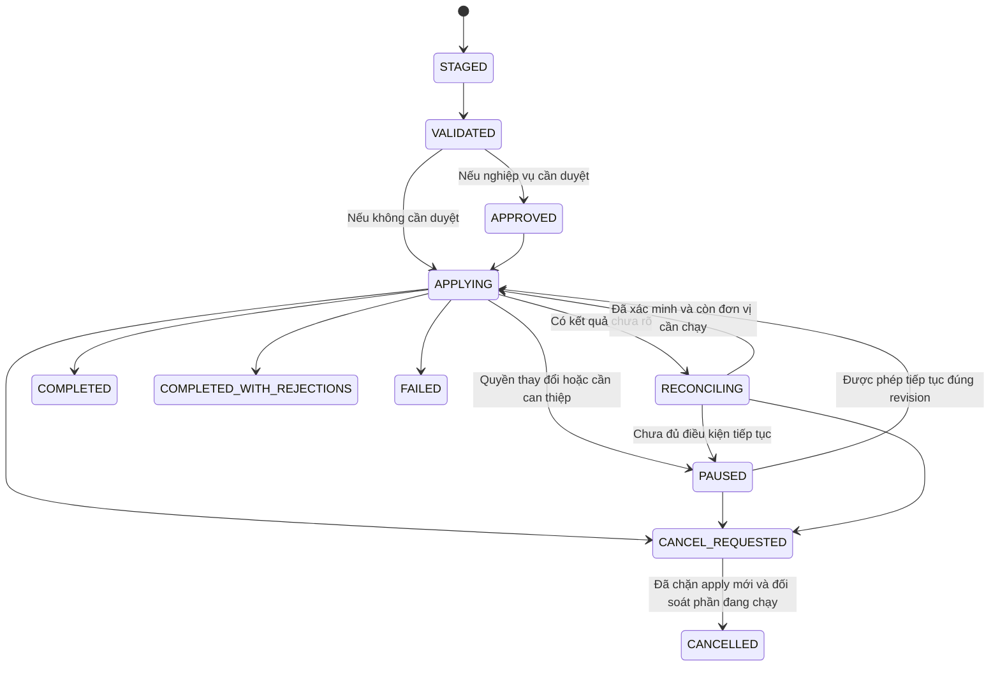

# Import partial failure

## 1. Lỗi một phần là vấn đề an toàn nghiệp vụ

Trong chương **Import Security** của module bảo vệ logic nghiệp vụ, *partial failure* là tình huống một phần công việc import đã hoàn tất hoặc tạo hiệu ứng, trong khi phần khác thất bại, chưa chạy hoặc chưa xác định được kết quả.

Ví dụ, một tệp chứa 1.000 lệnh điều chỉnh tồn kho. Worker đã commit 400 lệnh rồi mất kết nối. Người dùng nhìn thấy trạng thái `FAILED` và bấm chạy lại. Nếu hệ thống thực hiện lại cả tệp, 400 lệnh đầu có thể được áp dụng lần nữa. Nếu hệ thống báo “rollback toàn bộ” dù đã commit từng dòng, người dùng có thể ra quyết định dựa trên tồn kho không đúng thực tế.

Lỗi một phần còn có thể bị khai thác có chủ đích. Người có quyền import đặt một dòng lỗi ở cuối tệp để giữ các thay đổi đầu nhưng làm job mang nhãn thất bại; tạo cập nhật cha thành công nhưng bỏ lại các cập nhật con bắt buộc; hoặc yêu cầu hủy job trong lúc worker vẫn tiếp tục ghi dữ liệu.

Mục tiêu không phải là làm mọi import thành công. Mục tiêu là giữ các invariant khi có lỗi, biểu diễn trung thực những gì đã commit, và chỉ phục hồi bằng các thao tác được phép.

## 2. Xác định đơn vị nguyên tử trước khi nói “thành công”

Một dòng trong CSV không tự động tương đương một giao dịch nghiệp vụ. Cần trả lời: **những thay đổi nào bắt buộc phải cùng thành công hoặc cùng không xảy ra?**

| Đơn vị nguyên tử | Ví dụ | Bảo đảm cần có |
|---|---|---|
| Toàn tệp | Cấu hình bảng giá phải thay đồng bộ | Không công bố trạng thái giá bị pha giữa hai phiên bản |
| Nhóm đối tượng | Đơn hàng và toàn bộ dòng hàng | Không có đơn được xác nhận với chi tiết chưa hợp lệ |
| Một thao tác độc lập | Gắn một nhãn cho một khách hàng | Lỗi ở khách hàng khác không làm sai thao tác đã commit |
| Một nhóm có invariant chung | Hai vế chuyển tồn kho | Không trừ bên gửi mà thiếu cộng bên nhận |
| Một phiên bản dữ liệu | Import danh mục rồi chuyển con trỏ phiên bản | Chỉ phiên bản hoàn tất mới được nhìn thấy bởi người dùng |

### 2.1. Chunk kỹ thuật không phải ranh giới nghiệp vụ mặc định

Chia mỗi 500 dòng thành một chunk giúp giới hạn bộ nhớ và thời gian xử lý. Nhưng nếu một đơn hàng nằm ở hai chunk, commit theo chunk có thể để lại nửa đơn hàng. Nếu mỗi dòng độc lập, buộc cả 500 dòng cùng rollback cũng có thể không cần thiết.

Hãy nhóm theo invariant trước, sau đó mới chọn kích thước xử lý. Với nhóm quá lớn, cần thiết kế trạng thái chưa công bố hoặc workflow nhiều bước; không phá nhóm chỉ vì muốn giữ một con số chunk cố định.

### 2.2. Ba đại lượng cần tách biệt

```text
Dòng đầu vào         → vị trí trong tệp, hữu ích cho báo lỗi.
Đơn vị nghiệp vụ     → nhóm thay đổi cần nguyên tử.
Lần thử xử lý        → một lần worker cố apply đơn vị đó.
```

Một đơn vị nghiệp vụ có thể chứa nhiều dòng và được thử nhiều lần nhưng chỉ được áp dụng hiệu ứng theo hợp đồng chống lặp đã định nghĩa. Không dùng số lần thử làm số thao tác đã thành công.

## 3. Viết business invariants cho lỗi một phần

Giả sử import điều chỉnh tồn kho theo từng sự kiện độc lập, ngoại trừ sự kiện chuyển kho gồm hai vế. Các invariant có thể là:

| Mã | Invariant |
|---|---|
| P1 | Không có đơn vị nghiệp vụ nào ở trạng thái nửa commit |
| P2 | Mỗi thao tác có định danh ổn định không tạo hiệu ứng lặp khi retry |
| P3 | Kết quả `APPLIED` chỉ tồn tại khi hiệu ứng và bằng chứng apply đã cùng commit |
| P4 | Kết quả commit chưa rõ không được tự coi là thất bại chưa tạo hiệu ứng |
| P5 | Quyền, phê duyệt và trạng thái nghiệp vụ phải hợp lệ tại điểm apply được chấp nhận |
| P6 | Job đã hủy không được bắt đầu commit thêm đơn vị sau điểm hủy có hiệu lực đã định nghĩa |
| P7 | Dòng lỗi không được làm bỏ qua invariant của các dòng còn lại |
| P8 | Retry hoặc tiếp tục job không được đổi dữ liệu, phạm vi hay chính sách dưới phê duyệt cũ |
| P9 | Trạng thái và số đếm phải phản ánh dữ liệu đã commit, không chỉ phản ánh tiến độ đọc tệp |
| P10 | Rollback hoặc compensation không được xóa dấu vết và bỏ qua quyền nghiệp vụ |

Các invariant này buộc thiết kế làm rõ cả hành vi lỗi lẫn hành vi bình thường. Ví dụ P6 cần một điểm hiệu lực cụ thể; chỉ có nút “Hủy” trên giao diện chưa đủ.

## 4. Chọn mô hình xử lý phù hợp với nghiệp vụ

### 4.1. All-or-nothing trong một ranh giới giao dịch

Với tập dữ liệu đủ nhỏ và các thay đổi cùng database, có thể validate trước rồi apply trong một transaction. Một lỗi làm rollback toàn bộ thay đổi thuộc transaction đó.

Tuy nhiên:

- Validate trước không giữ nguyên quyền và dữ liệu trong suốt khoảng chờ; phải kiểm tra lại điều kiện có thể thay đổi tại thời điểm apply.
- Transaction dài có thể gây khóa lâu và tăng rủi ro vận hành.
- Một lời gọi ra dịch vụ khác không tự được rollback vì transaction database bị rollback.
- Ghi log “đã xử lý 100 dòng” không có nghĩa 100 dòng đã commit.

Không dùng nhãn all-or-nothing nếu thực tế đã commit nhiều chunk độc lập rồi cố xóa ngược khi lỗi.

### 4.2. Commit theo đơn vị nghiệp vụ độc lập

Mỗi đơn vị có transaction riêng. Job có thể kết thúc với một số đơn vị `APPLIED` và một số bị từ chối hoặc chưa hoàn tất.

Đây là một hợp đồng nghiệp vụ cần được công bố rõ, không phải hành vi tình cờ khi code bắt exception và tiếp tục vòng lặp. Những đơn vị có phụ thuộc phải được nhóm hoặc điều phối theo điều kiện rõ ràng.

### 4.3. Staging và công bố phiên bản

Với danh mục hoặc bảng giá lớn, có thể ghi dữ liệu vào phiên bản chưa hoạt động, kiểm tra tính đầy đủ rồi chuyển một con trỏ phiên bản trong transaction ngắn.

```text
Upload bất biến
  → parse / staging phiên bản mới
  → kiểm tra toàn bộ invariant của phiên bản
  → phê duyệt đúng phiên bản nếu cần
  → công bố nguyên tử
```

Trong thiết kế này, các chunk staging có thể đã được ghi mà chưa có hiệu ứng nghiệp vụ nhìn thấy. Tất cả đường đọc phải tôn trọng phiên bản được công bố; nếu một API đọc trực tiếp dữ liệu staging, bảo đảm công bố nguyên tử bị phá vỡ.

### 4.4. Workflow nhiều bước và compensation

Khi thao tác trải qua nhiều hệ thống, cần mô hình trạng thái, idempotency và đối soát giữa các bước. Một số lỗi có thể cần compensation: tạo thao tác nghiệp vụ đối ứng để khắc phục hiệu ứng trước đó.

Compensation không đồng nghĩa quay ngược thời gian. Email đã gửi không thể bị “unsend” bằng rollback database; tiền đã chuyển có thể cần nghiệp vụ hoàn tiền riêng; hàng đã xuất có thể không thể tự tăng lại kho bằng cách xóa bản ghi import.

## 5. Phân loại lỗi trước khi quyết định retry

| Loại kết quả | Ví dụ | Cách xử lý phù hợp |
|---|---|---|
| Lỗi đầu vào xác định | Thiếu mã kho, số lượng sai định dạng | Từ chối đơn vị; sửa dữ liệu theo revision mới nếu cần |
| Vi phạm invariant | Điều chỉnh làm tồn kho âm trái policy | Không retry mù; cần thay đổi điều kiện hoặc nghiệp vụ được phép |
| Lỗi quyền/phê duyệt | Người yêu cầu mất quyền kho trước lúc apply | Từ chối hoặc tạm dừng theo policy; không dùng quyền worker để vượt qua |
| Lỗi tạm thời, biết chưa commit | Transaction bị rollback do tranh chấp | Retry có giới hạn và kiểm tra lại điều kiện hiện hành |
| Kết quả commit chưa rõ | Kết nối mất sau khi gửi lệnh commit | Đối soát bằng định danh thao tác trước khi quyết định áp dụng lại |
| Hiệu ứng ngoài hệ thống chưa rõ | Dịch vụ đích timeout sau yêu cầu | Tra cứu theo idempotency key hoặc quy trình đối soát của đích |
| Lỗi hệ thống nghiêm trọng | Không đọc được staging, sai phiên bản dữ liệu | Dừng/tạm dừng để tránh áp dụng sai hoặc báo cáo sai |

### 5.1. Timeout không chứng minh rollback

```text
Worker gửi COMMIT
Database commit thành công
Kết nối đứt trước khi worker nhận được phản hồi
Worker thấy timeout
```

Nếu đánh dấu ngay là `FAILED_NOT_APPLIED` rồi chạy lại, hệ thống có thể tạo hiệu ứng lặp. Cần trạng thái như `RECONCILING` hoặc `OUTCOME_UNKNOWN` cho trường hợp chưa biết kết quả, sau đó tra cứu bằng khóa nghiệp vụ ổn định ở nguồn có thẩm quyền.

Không dùng một lần đọc từ replica đang trễ để kết luận ledger không tồn tại và thao tác chưa commit. Cơ chế đối soát phải đáp ứng yêu cầu nhất quán của quyết định retry.

### 5.2. Không retry mọi lỗi cùng một cách

Retry một dòng thiếu quyền bằng tài khoản service mạnh hơn là vượt quyền. Retry một dòng sai dữ liệu một nghìn lần là lãng phí tài nguyên. Retry một hiệu ứng chưa rõ mà không có khóa ổn định có thể làm sai số dư.

Đặt số lần thử, khoảng chờ, điều kiện dừng và cách chuyển sang đối soát riêng cho từng nhóm lỗi. Mỗi lần apply mới vẫn phải kiểm tra quyền và invariant hiện hành.

## 6. State machine phản ánh đúng dữ liệu đã xảy ra

### 6.1. Trạng thái job

Một mô hình khái niệm có thể là:



Sơ đồ minh họa các chuyển trạng thái quan trọng, không liệt kê mọi đường chuyển của một sản phẩm cụ thể. Các trạng thái trước apply cũng cần đường từ chối hoặc hủy phù hợp.

`FAILED` không được ngầm hiểu là “không có dữ liệu nào thay đổi”. Khi hợp đồng cho phép commit từng đơn vị, phản hồi phải kèm thông tin đã apply, bị từ chối và chưa xác định. `CANCELLED` cũng có thể đi kèm phần đã commit trước điểm hủy.

Không kết thúc job ở trạng thái hoàn tất nếu vẫn còn kết quả chưa rõ. Nếu cần đóng vận hành trong khi chờ một quy trình ngoài hệ thống, phải dùng trạng thái và trách nhiệm đối soát thể hiện rõ điều đó.

### 6.2. Trạng thái đơn vị và lịch sử attempt

```text
PENDING
  → APPLIED
  → REJECTED
  → RETRY_WAIT
  → RECONCILING

RETRY_WAIT  → thử lại khi policy cho phép
RECONCILING → xác nhận APPLIED hoặc xác nhận chưa apply rồi xử lý tiếp
```

Trạng thái worker đang chạy có thể được biểu diễn bằng attempt, lease và epoch riêng. Nó không phải bằng chứng dữ liệu đã commit.

Một đơn vị `APPLIED` không được đưa về `PENDING` chỉ để nút “chạy lại” hoạt động. Nếu cần sửa tác động đã áp dụng, dùng nghiệp vụ điều chỉnh hoặc compensation có định danh mới và liên kết với thao tác gốc.

Lưu lịch sử attempt để biết ai chạy, epoch nào, thời điểm nào và lỗi gì. Một lỗi đến muộn từ attempt cũ không được ghi đè kết quả thành công của attempt mới.

## 7. Cố định đầu vào và kiểm tra quyền tại điểm apply

### 7.1. Bind phê duyệt với đúng nội dung

Một phê duyệt import nên gắn với revision bất biến gồm:

- Tệp hoặc tập dữ liệu staging đã cố định.
- Phiên bản schema và mapping cột.
- Chế độ tạo/cập nhật, chính sách trùng và phạm vi thao tác.
- Nhóm đơn vị nghiệp vụ và các giá trị đã được preview.
- Phạm vi tenant, nguồn dữ liệu và điều kiện duyệt có liên quan.

Nếu sửa một dòng lỗi rồi tiếp tục, cần tạo revision mới hoặc một tập sửa có quan hệ rõ với revision cũ. Không cập nhật âm thầm staging đã duyệt và để worker tiếp tục dùng phê duyệt cũ.

### 7.2. Preview không phải quyết định quyền vĩnh viễn

Giữa preview và apply, đối tượng có thể đổi chủ sở hữu, chuyển trạng thái, bị khóa hoặc người yêu cầu mất quyền. Worker phải kiểm tra theo policy hiện hành trong ranh giới nhất quán của quyết định apply.

Service account có quyền đọc staging và ghi database không có nghĩa nó được phép thay mặt mọi người thực hiện mọi nghiệp vụ. Lưu người khởi tạo, tenant và ngữ cảnh ủy quyền đáng tin cậy; kiểm tra điều kiện áp dụng theo ngữ cảnh đó. Không nhận một trường `runAsUserId` tùy ý từ tệp rồi tin rằng đã có ủy quyền.

Khi quyền thay đổi, có thể tạm dừng toàn job để duyệt lại hoặc chỉ từ chối các đơn vị không còn được phép, tùy hợp đồng đã công bố. Không âm thầm đổi chính sách giữa hai chunk.

### 7.3. Dòng phụ thuộc không được coi là độc lập khi tiện retry

Ví dụ, tạo đơn hàng thành công nhưng dòng áp dụng hạn mức thất bại. Nếu nghiệp vụ yêu cầu hạn mức trước khi xác nhận đơn, trạng thái đơn phải còn chưa công bố hoặc cả nhóm phải rollback. Không tiếp tục xác nhận chỉ vì “dòng tạo đơn đã thành công”.

Với dependency graph, đơn vị chỉ đủ điều kiện chạy khi các tiền điều kiện đã được xác nhận theo thiết kế. Không dùng một số đếm tiến độ chung để thay thế trạng thái của từng phụ thuộc.

## 8. Transaction của một đơn vị apply

Trong một database giao dịch, ranh giới thường cần bao gồm:

```text
Kiểm tra quyền và trạng thái job theo cơ chế đồng bộ đã chọn
  + xác minh đúng revision/epoch
  + khóa dữ liệu nghiệp vụ liên quan
  + kiểm tra invariant hiện tại
  + phân xử idempotency
  + thay đổi nghiệp vụ
  + ledger apply
  + kết quả đơn vị
  + outbox
  = một commit
```

Không thực hiện lời gọi chậm tới dịch vụ ngoài trong transaction chỉ để tạo cảm giác nguyên tử. Với hiệu ứng ngoài, dùng giao thức riêng như outbox, idempotency ở đích và đối soát.

### 8.1. Mã giả Java

Ví dụ dưới đây mô tả một đơn vị độc lập. Đây là mã giả thể hiện trách nhiệm; các repository và API không phải thư viện có sẵn.

Giả định:

- Dữ liệu quyền, job và dữ liệu nghiệp vụ có cơ chế đồng bộ phù hợp trong cùng database.
- Các luồng đổi quyền, hủy và apply tuân thủ thứ tự khóa tương thích.
- Ledger, kết quả đơn vị, outbox và hiệu ứng nghiệp vụ cùng transaction.
- Worker được cấp một epoch; job đổi epoch sẽ vô hiệu các attempt cũ.

```java
ApplyOutcome applyUnit(WorkerAttempt attempt, String unitId) {
    return transactions.required(() -> {
        // Thứ tự khóa phải được dùng thống nhất ở các luồng liên quan.
        AuthorizationGuard guard = guards.lockForTenant(attempt.tenantId());
        ImportJob job = jobs.lockByTenantAndId(
            attempt.tenantId(), attempt.jobId());

        job.requireApplyingAtEpoch(attempt.epoch());
        job.requireApprovedRevision(attempt.inputRevision());

        ImportUnit unit = units.lockWithinJob(job.id(), unitId);
        access.requireCurrentDelegation(job.initiator(), job, guard);
        access.requireCanApplyUnit(job.initiator(), unit, guard);

        if (unit.isApplied()) {
            return ApplyOutcome.alreadyApplied(unit.resultReference());
        }

        unit.requireEligibleForAttempt(attempt);
        dependencies.requireSatisfied(unit);

        // Định danh và payload bất biến, không sinh khóa mới cho mỗi retry.
        OperationKey key = operationKeys.fromApprovedUnit(job, unit);
        AppliedOperation previous = ledger.findCommitted(key);
        if (previous != null) {
            previous.requireSameFingerprint(unit.payloadFingerprint());
            unit.markAppliedFromLedger(previous.resultReference());
            units.save(unit);
            return ApplyOutcome.alreadyApplied(previous.resultReference());
        }

        // Cơ chế claim phải phân xử cả các job khác dùng cùng operation key.
        ledger.claimWithinTransaction(key, unit.payloadFingerprint());
        DomainChange change = domain.lockAndValidateCurrentState(unit);
        change.apply();

        String resultId = domain.save(change);
        ledger.complete(key, resultId);
        unit.markApplied(resultId);
        units.save(unit);
        outbox.appendImportUnitApplied(job.id(), unit.id(), key, resultId);

        return ApplyOutcome.applied(resultId);
    });
}
```

`claimWithinTransaction` không được là một thao tác `SELECT` rồi `INSERT` thiếu ràng buộc. Nếu có tranh chấp với job khác, repository phải dùng cơ chế database phù hợp; bên thua rollback hoặc đọc lại bằng transaction hợp lệ, xác minh payload và chuyển sang kết quả replay. Không bỏ qua mọi lỗi unique như thể thao tác đã thành công.

Các phương thức kiểm tra quyền trong ví dụ chỉ có ý nghĩa khi thay đổi quyền được phân xử nhất quán với guard. Nếu quyền nằm ở dịch vụ khác hoặc cache, phải xác định bảo đảm và độ trễ thực tế; transaction ứng dụng không tự giải quyết được trạng thái quyền cũ ở hệ thống ngoài.

### 8.2. Ghi nhận lỗi sau rollback cần tránh lỗi đến muộn

Một exception xảy ra trước commit có thể làm rollback cả thay đổi nghiệp vụ và kết quả đơn vị. Nếu cần ghi nhận lỗi, thực hiện bằng transaction riêng sau khi đã biết transaction apply không commit.

Lần ghi lỗi phải có điều kiện phù hợp với `attemptId`, epoch và trạng thái hiện tại. Không cho attempt cũ ghi `REJECTED` lên đơn vị đã `APPLIED` bởi attempt mới. Nếu kết quả commit còn chưa rõ, ghi nhận nhu cầu đối soát thay vì kết luận chưa áp dụng.

## 9. Hủy job, lease và worker cũ

### 9.1. Lease hết hạn không bảo đảm worker đã dừng

Worker A có thể bị treo, mất kết nối với bộ điều phối nhưng vẫn chạy và còn kết nối tới database. Worker B được giao tiếp quản sau khi lease của A hết hạn. Nếu chỉ dựa vào lease, cả hai có thể tiếp tục ghi.

Dùng fencing token hoặc epoch tăng đơn điệu để phân biệt quyền xử lý hiện tại. Tuy nhiên, chỉ kiểm tra epoch lúc nhận message là chưa đủ; worker cũ có thể đã vượt qua kiểm tra trước khi epoch đổi.

Việc kiểm tra epoch, trạng thái job và commit đơn vị phải cùng cơ chế phân xử. Trong ví dụ khóa job ở trên, luồng hủy hoặc chuyển quyền worker cũng khóa job và tăng epoch; một worker giữ epoch cũ không được commit đơn vị mới sau điểm thay đổi đã có hiệu lực.

### 9.2. Định nghĩa điểm hiệu lực của hủy

Một hợp đồng dễ kiểm chứng là:

```text
Luồng apply giữ khóa job trong transaction ngắn của một đơn vị.
Luồng hủy lấy cùng khóa, đổi trạng thái và epoch rồi commit.

Đơn vị đã commit trước điểm hủy → vẫn đã áp dụng.
Lần apply kiểm tra sau điểm hủy → bị từ chối.
```

Nếu yêu cầu hủy phải chờ một transaction đang giữ khóa kết thúc, giao diện nên biểu diễn `CANCEL_REQUESTED` trong lúc chờ, thay vì khẳng định mọi hoạt động đã dừng ngay khi người dùng nhấn nút.

Hủy không tự hoàn tác các đơn vị đã commit và không tự thu hồi thông điệp đã gửi ra ngoài. Nếu còn hiệu ứng chưa xác định, cần đối soát trước khi khẳng định kết quả cuối cùng của việc hủy.

### 9.3. Không giữ khóa cho cả quá trình xử lý tệp

Parse, gọi mạng và đọc tệp lớn nên ở ngoài transaction apply khi có thể. Khóa cần bao phủ quyết định và thay đổi của một đơn vị, không phải toàn bộ thời gian worker hoạt động.

Khóa job cho mọi đơn vị có thể giảm mức song song. Nếu cần mở rộng, phải dùng cơ chế kiểm soát tương đương hoặc tổ chức nhóm xử lý khác mà vẫn giữ được điểm hiệu lực hủy và invariant. Không bỏ kiểm tra chỉ để tăng throughput.

## 10. Retry và phục hồi có kiểm soát

### 10.1. Xây dựng tập công việc phục hồi từ trạng thái có thẩm quyền

Sau sự cố:

1. Xác định revision đầu vào và policy xử lý đã được phê duyệt.
2. Đối chiếu ledger, kết quả đơn vị và những hiệu ứng ngoài đang chờ xác nhận.
3. Tách đơn vị đã commit, bị từ chối xác định, retry được và chưa rõ kết quả.
4. Kiểm tra quyền tiếp tục và cấp epoch mới khi cần tiếp quản worker.
5. Chỉ đưa đơn vị đủ điều kiện trở lại hàng đợi, giữ nguyên operation key.
6. Tổng hợp lại trạng thái job sau khi các kết quả đã được xác nhận.

Không coi checkpoint “đã đọc đến dòng 400” là bằng chứng 400 dòng đã commit. Checkpoint đọc có thể dùng để tối ưu, nhưng dữ liệu apply và ledger mới quyết định cần làm gì tiếp.

### 10.2. Không dùng tệp lỗi như một tệp mới hoàn toàn một cách mù quáng

Tệp báo lỗi có thể chứa dữ liệu nhạy cảm và định danh các thao tác cũ. Khi người dùng sửa rồi gửi lại, hệ thống phải phân biệt:

- Retry cùng thao tác chưa apply: giữ định danh và kiểm tra payload theo hợp đồng.
- Sửa nội dung sau khi bị từ chối: revision mới, có liên kết với lần trước và phê duyệt lại nếu cần.
- Sửa một thao tác đã apply: nghiệp vụ điều chỉnh mới, không ghi đè lịch sử cũ.

Không mặc định “đổi job ID” nghĩa là mọi thao tác trong tệp đều mới.

### 10.3. Khóa idempotency của API không đủ cho phục hồi

Idempotency ở endpoint tạo job giúp tránh tạo nhiều job cho cùng request. Nhưng worker vẫn có thể nhận message lặp hoặc retry sau crash. Cần idempotency ở đơn vị hiệu ứng với phạm vi nghiệp vụ ổn định.

Nếu resume API dùng `Idempotency-Key`, khóa phải được phân vùng theo tenant, chủ thể và hành động, đồng thời gắn với revision và yêu cầu cụ thể. Khi trả lại kết quả cũ, vẫn kiểm tra quyền xem job và quyền tiếp tục hiện tại.

## 11. Hiệu ứng ngoài database và compensation

### 11.1. Outbox không biến lời gọi ngoài thành một transaction chung

Khi commit dữ liệu nghiệp vụ, ghi cùng một bản ghi outbox. Worker gửi outbox có thể gửi nhiều lần nếu mất phản hồi. Hệ thống đích cần nhận cùng operation key và xử lý idempotent hoặc cung cấp cơ chế tra cứu để đối soát.

Ví dụ, đã tạo yêu cầu hoàn tiền nội bộ không có nghĩa tiền đã được hoàn ở cổng thanh toán. Theo dõi riêng trạng thái yêu cầu nội bộ và trạng thái hiệu ứng được đích xác nhận.

### 11.2. Compensation phải là nghiệp vụ có điều kiện

Nếu một điều chỉnh tồn kho đã commit và sau đó hàng đã được bán, xóa bản ghi điều chỉnh rồi trừ ngược có thể làm tồn kho âm. Compensation cần kiểm tra invariant hiện tại, quyền, phê duyệt và khả năng thực hiện.

Một thao tác compensation nên có:

- Định danh chống lặp riêng.
- Liên kết tới thao tác gốc.
- Lý do và người có thẩm quyền yêu cầu.
- Tiền điều kiện và kết quả thực tế.
- Trạng thái chờ đối soát hoặc can thiệp khi không thể tự động hoàn tất.

Không xóa ledger gốc để “cho phép import lại”. Điều đó xóa bằng chứng chống lặp và có thể làm một thao tác cũ xuất hiện như mới.

## 12. Kết quả và báo cáo không được tạo cảm giác an toàn sai

Một báo cáo nên phân biệt tối thiểu:

```text
applied              → hiệu ứng đã xác nhận commit
replayed             → thao tác đã có, không tạo hiệu ứng mới
rejected             → bị từ chối xác định theo dữ liệu/quyền/invariant
pending              → chưa được xử lý
retryWait            → chờ thử lại theo policy
reconciling          → kết quả chưa rõ, đang đối soát
cancelledBeforeApply → bị chặn trước khi apply
```

Các nhóm trạng thái cần loại trừ nhau theo đơn vị nghiệp vụ đã chọn. Số dòng đầu vào có thể khác số đơn vị, vì một nhóm nhiều dòng được commit cùng nhau. Báo rõ cả hai nếu người dùng cần đối chiếu.

Ví dụ báo cáo trung thực:

```text
Trạng thái job: RECONCILING
Đơn vị nghiệp vụ: 1.000
Đã apply: 400
Bị từ chối: 20
Chưa chạy: 579
Chưa rõ kết quả: 1

Chưa được chạy lại toàn bộ. Một đơn vị đang được xác minh kết quả commit.
```

Trạng thái tổng hợp phải được tính từ kết quả có thẩm quyền hoặc được cập nhật cùng transaction phù hợp. Không tăng `successCount` khi vừa lấy dòng khỏi queue. Nếu dùng bộ đếm bất đồng bộ để hiển thị tiến độ, cần phân biệt ước lượng tiến độ với kết quả nghiệp vụ cuối cùng.

Báo cáo lỗi phải được kiểm tra quyền theo tenant và job, có thời hạn lưu và không lộ dữ liệu của đối tượng mà người dùng không được biết. Không trả stack trace, credential hoặc toàn bộ dữ liệu nhạy cảm trong mỗi dòng lỗi.

## 13. Ma trận kiểm thử lỗi và lạm dụng logic

Kiểm thử cần cố ý đặt sự cố tại các điểm khác nhau của ranh giới commit. Chỉ kiểm tra happy path hoặc ném lỗi trước khi transaction bắt đầu sẽ bỏ sót các tình huống nguy hiểm nhất.

| Tình huống | Kết quả cần chứng minh |
|---|---|
| Một dòng sai trong nhóm nguyên tử | Cả nhóm không được ở trạng thái nửa commit |
| Dòng cuối lỗi sau nhiều đơn vị độc lập đã commit | Báo rõ phần đã apply; không tuyên bố rollback toàn tệp |
| Lỗi sau thay đổi nghiệp vụ, trước ghi ledger trong cùng transaction | Hiệu ứng và ledger cùng rollback nếu chưa commit |
| Mất phản hồi sau commit | Chuyển sang đối soát hoặc tìm ledger; không apply lần hai |
| Crash sau commit, trước ack message | Message nhận lại không tạo thêm hiệu ứng |
| Lỗi giữa hai vế chuyển kho | Không tạo chuyển kho chỉ có một vế |
| Cùng đơn vị được hai worker nhận | Cơ chế phân xử giữ invariant và kết quả không ghi đè lẫn nhau |
| Worker cũ sống lại sau khi đổi epoch | Không commit được đơn vị mới bằng quyền xử lý cũ |
| Hủy đua với apply | Kết quả phù hợp điểm hiệu lực hủy; không nói đã hoàn tác phần commit trước đó |
| Thu hồi quyền giữa preview và apply | Đơn vị không được apply nhờ quyền service account |
| Thu hồi quyền giữa hai đơn vị | Đơn vị tiếp theo được kiểm tra hiện hành theo policy |
| Sửa staging sau phê duyệt | Bị chặn hoặc buộc tạo revision và duyệt lại |
| Retry cả tệp bằng job ID mới | Những thao tác đã commit không tạo hiệu ứng lặp |
| Ghi nhận lỗi trễ từ attempt cũ | Không đổi đơn vị đã apply thành rejected/pending |
| Outbox gửi lại sau timeout | Đích không tạo hiệu ứng ngoài hợp đồng chống lặp |
| Compensation bị từ chối bởi trạng thái mới | Có trạng thái cần can thiệp; không xóa dấu vết gốc |
| Người khác tenant truy cập báo cáo lỗi | Không nhận dữ liệu hoặc thông tin tồn tại vượt quyền |
| Một kết quả còn unknown | Không báo job hoàn tất không cần đối soát |

### 13.1. Kiểm thử đồng thời phải kiểm soát được thứ tự

Dùng barrier hoặc điểm dừng trong integration test để tạo ít nhất hai thứ tự:

```text
Apply commit trước → hủy commit sau
  → giữ kết quả đã apply; chặn đơn vị mới theo trạng thái hủy.

Hủy commit trước → worker thử apply sau
  → worker không được thay đổi dữ liệu bằng epoch cũ.
```

Kiểm tra cả dữ liệu nghiệp vụ, ledger, trạng thái đơn vị, outbox và báo cáo tổng hợp. Không chỉ nhìn một trường trạng thái job.

### 13.2. Kiểm thử kết quả commit chưa rõ

Mô phỏng server đã commit nhưng client mất phản hồi. Sau phục hồi, xác nhận hệ thống tra cứu theo operation key, xác nhận hiệu ứng đã có và không áp dụng lần nữa. Thử cả trường hợp transaction thật sự chưa commit để chứng minh luồng đối soát không làm mất thao tác hợp lệ.

Nếu có dịch vụ ngoài, chạy kịch bản đích đã thực hiện nhưng response bị mất. Một mock luôn trả timeout trước khi tạo hiệu ứng sẽ không kiểm tra được rủi ro này.

## 14. Audit và bài tập thiết kế

Audit nên ghi job/revision, tenant, người yêu cầu, người duyệt nếu có, unit ID, operation key, attempt/epoch, quyết định quyền, kết quả commit, thời điểm hủy và các liên kết compensation. Không ghi dữ liệu nhạy cảm chỉ để chứng minh đã xử lý một dòng.

Phân biệt sự kiện “bắt đầu thử”, “commit xác nhận”, “kết quả chưa rõ”, “đối soát hoàn tất” và “compensation đã xác nhận”. Sự kiện audit trong outbox có thể gắn với commit nghiệp vụ; các lần bị từ chối hoặc rollback cần đường ghi phù hợp mà không giả mạo thành công.

**Bài tập:** hệ thống import 10.000 điều chỉnh tồn kho, commit mỗi 200 dòng. Có sự kiện chuyển kho gồm hai dòng ở hai chunk khác nhau. Sau 3.000 dòng, worker mất phản hồi commit. Người dùng đồng thời nhấn hủy, rồi tải báo cáo lỗi và gửi lại toàn bộ tệp.

Hãy thiết kế:

1. Đơn vị nguyên tử và cách gom hai vế chuyển kho.
2. Định danh thao tác ổn định qua các lần gửi lại.
3. Trạng thái cho kết quả commit chưa rõ và cơ chế đối soát.
4. Điểm hiệu lực hủy, epoch và điều kiện worker cũ được phép ghi.
5. Ranh giới transaction giữa hiệu ứng, ledger, kết quả đơn vị và outbox.
6. Báo cáo thể hiện đúng phần đã apply, chưa apply, bị từ chối và đang đối soát.
7. Quy trình điều chỉnh nếu người dùng muốn hoàn tác những phần đã commit.

Một thiết kế đạt yêu cầu phải trả lời được: **“Phần nào chắc chắn đã xảy ra, phần nào chưa xảy ra, phần nào chưa biết, và hành động tiếp theo nào được phép?”** Mỗi câu trả lời cần dựa trên trạng thái có thẩm quyền và invariant được bảo vệ, thay vì suy luận từ một thông báo lỗi chung.
