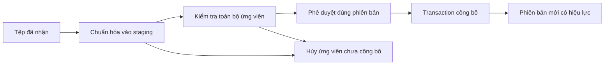
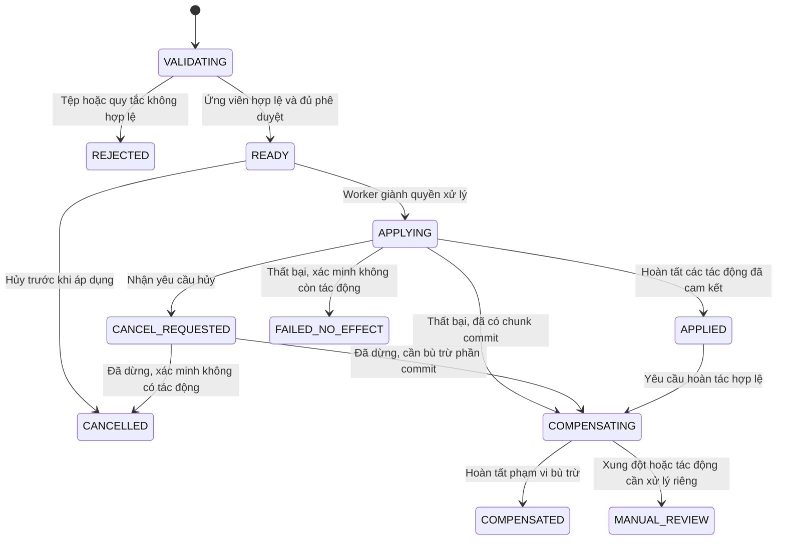

# Import rollback

## 1. Rollback khi import bảo vệ điều gì?

Một chức năng import thường nhận tệp CSV hoặc Excel rồi tạo, cập nhật hoặc liên kết nhiều đối tượng nghiệp vụ. Dù đầu vào là một tệp, tác động có thể trải qua nhiều transaction, nhiều bảng dữ liệu và cả dịch vụ bên ngoài. Vì vậy, “có nút hoàn tác” chưa đủ để chứng minh import an toàn.

Trong bảo mật logic nghiệp vụ, import rollback phải bảo vệ các quy tắc như:

- Không để lộ một phần bảng giá mới nếu chính sách yêu cầu áp dụng cả đợt.
- Không để người thuộc tenant A hoàn tác dữ liệu của tenant B bằng cách thay `jobId`.
- Không dùng hoàn tác để xóa thay đổi hợp lệ được thực hiện sau lần import.
- Không cho phép một lần import gây trừ kho, cấp quyền hoặc ghi nhận giao dịch nhiều lần do retry.
- Không coi trạng thái `FAILED` của job là bằng chứng rằng mọi thay đổi đã biến mất.
- Không dùng đường dẫn hoàn tác để bỏ qua phê duyệt vốn được yêu cầu khi sửa dữ liệu trực tiếp.

Ví dụ xuyên suốt: nhân viên nhập bảng giá gồm 10.000 sản phẩm cho một doanh nghiệp. Giá không được âm, một số mức giảm cần phê duyệt và người import chỉ được sửa sản phẩm trong phạm vi được giao. Nếu dòng thứ 7.000 sai, yêu cầu nghiệp vụ có thể là “không giá nào thay đổi”. Nếu bảng giá đã được công bố và có đơn hàng sử dụng giá đó, yêu cầu “hoàn tác” lại là một nghiệp vụ khác, có giới hạn và có thể cần phê duyệt.

Điểm bắt đầu luôn là xác định **đơn vị nguyên tử**: một dòng, một nhóm dòng, toàn bộ tệp hay một phiên bản dữ liệu được công bố cùng lúc. Đây là cam kết của sản phẩm, không phải chi tiết do kích thước batch vô tình quyết định.

## 2. Phân biệt rollback, hủy và hoàn tác sau commit

| Cơ chế | Thời điểm | Tác dụng thực tế | Giới hạn cần nói rõ |
|---|---|---|---|
| Rollback transaction | Transaction chưa commit | Hủy các thay đổi thuộc transaction đó trong cơ sở dữ liệu | Không hủy các transaction đã commit hoặc tác động bên ngoài |
| Hủy job | Job đang chờ hoặc đang chạy | Ngăn job tiếp tục ở một ranh giới được kiểm soát | Không tự khôi phục phần đã commit |
| Hủy dữ liệu staging | Dữ liệu mới chưa được công bố | Loại bỏ ứng viên chưa được sử dụng làm dữ liệu chính thức | Chỉ an toàn nếu staging chưa gây tác động nghiệp vụ khác |
| Hoàn tác bằng bù trừ | Dữ liệu đã commit | Thực hiện một thay đổi nghiệp vụ mới để bù cho thay đổi trước | Có thể gặp xung đột, cần retry hoặc không thể đảo ngược hoàn toàn |
| Khôi phục bản sao lưu | Sự cố vận hành diện rộng | Khôi phục dữ liệu theo phạm vi và thời điểm của bản sao lưu | Có thể làm mất thay đổi hợp lệ không liên quan; không thay thế API hoàn tác một job |

Không gọi một lần cập nhật ngược sau commit là “rollback transaction”. Cách đặt tên chính xác giúp người vận hành hiểu liệu dữ liệu đã được phục hồi, đang được bù trừ hay còn cần xử lý thủ công.

Một email đã gửi không thể được thu hồi bằng rollback cơ sở dữ liệu. Một đơn hàng đã chốt theo giá mới cũng không tự đổi giá vì bảng giá nguồn được khôi phục. Hệ thống cần mô hình riêng cho thông báo đính chính, điều chỉnh đơn hàng hoặc các nghiệp vụ bù trừ liên quan.

## 3. Xác định invariants và ranh giới tin cậy

### 3.1. Các quy tắc phải giữ trước, trong và sau import

Với ví dụ bảng giá, có thể định nghĩa các invariant sau:

1. Mọi đối tượng được đọc hoặc ghi phải thuộc tenant đang được xác thực.
2. Mọi giá được công bố phải hợp lệ và đã có phê duyệt nếu chính sách yêu cầu.
3. Nếu áp dụng toàn bộ tệp, người đọc chỉ thấy phiên bản cũ hoặc phiên bản mới đã hoàn chỉnh.
4. Retry cùng một thao tác không tạo thêm tác động nghiệp vụ.
5. Hoàn tác chỉ ghi đè dữ liệu khi chứng minh được trạng thái hiện tại vẫn phù hợp với điều kiện hoàn tác.
6. Trạng thái cuối của job phải phản ánh tác động đã commit và tình trạng bù trừ thực tế.
7. Bằng chứng về import và hoàn tác phải còn để truy vết sau khi dữ liệu nghiệp vụ được phục hồi.

Quyền import, quyền yêu cầu hủy, quyền phê duyệt và quyền hoàn tác có thể khác nhau. Sở hữu một job không mặc nhiên cho phép khôi phục mọi đối tượng mà job từng chạm tới. Chính sách có thể cấp quyền hoàn tác ở cấp job, nhưng phạm vi đó phải được định nghĩa rõ và kiểm tra ở phía máy chủ.

### 3.2. Tệp import không phải nguồn có thẩm quyền

Các trường như `tenant_id`, `approved`, `owner_id`, `previous_price`, `rollback_token` hoặc `job_status` trong tệp không được quyết định quyền truy cập, phê duyệt hoặc nội dung khôi phục.

Máy chủ phải tự xác định:

- Tenant và người thực hiện từ ngữ cảnh xác thực.
- Đối tượng được phép thay đổi qua truy vấn có điều kiện phạm vi.
- Phê duyệt gắn với đúng nội dung hoặc đúng phiên bản ứng viên.
- Giá trị trước thay đổi từ dữ liệu tin cậy trong cơ sở dữ liệu.
- Trạng thái job và điều kiện chuyển trạng thái từ bản ghi do hệ thống quản lý.

Nếu cho phép người dùng truyền “giá cũ” vào API hoàn tác, kẻ tấn công có thể dùng API này để đặt một giá tùy ý. Hoàn tác khi đó trở thành một đường cập nhật dữ liệu vượt quyền.

### 3.3. Validation trước không loại bỏ kiểm tra tại thời điểm áp dụng

Một tệp có thể hợp lệ lúc kiểm tra nhưng không còn hợp lệ lúc commit: quyền đã bị thu hồi, sản phẩm đã bị khóa hoặc bảng giá hiện hành đã thay đổi.

Kết quả preview nên gắn với nội dung đã chuẩn hóa, phiên bản quy tắc và các điều kiện nền cần thiết. Khi áp dụng, máy chủ phải kiểm tra lại các điều kiện còn có thể thay đổi. Nếu một trong các điều kiện nền không còn đúng, cần dừng, kiểm tra lại hoặc yêu cầu phê duyệt lại theo chính sách. Không tin cờ `validated=true` do client gửi.

## 4. Chọn chiến lược rollback phù hợp

| Chiến lược | Phù hợp khi | Bảo đảm cần thiết | Rủi ro cần quản lý |
|---|---|---|---|
| Một transaction cho toàn bộ import | Khối lượng và thời gian xử lý đủ nhỏ | Tất cả ghi cùng commit hoặc cùng rollback | Transaction dài, giữ khóa lâu, tranh chấp tài nguyên |
| Staging rồi công bố nguyên tử | Tệp lớn, dữ liệu có thể biểu diễn theo phiên bản | Chỉ công bố phiên bản đã kiểm tra hoàn chỉnh | Đọc lẫn phiên bản, phê duyệt lỗi thời, công bố đè một lần công bố mới hơn |
| Commit theo chunk, bù trừ nếu cần | Nghiệp vụ chấp nhận trạng thái trung gian hoặc có mô hình bù trừ | Mỗi chunk có checkpoint, dấu vết và khả năng xử lý lại | Người dùng có thể thấy dữ liệu dở dang; bù trừ có thể xung đột |

Nếu yêu cầu là “không ai được thấy bất kỳ giá mới nào trước khi toàn bộ tệp hợp lệ”, commit theo chunk trực tiếp vào bảng giá đang dùng không đáp ứng yêu cầu đó. Bù trừ sau cùng không xóa được khoảng thời gian người dùng đã nhìn thấy hoặc sử dụng giá mới.

Đừng chọn một transaction khổng lồ chỉ để có từ “atomic”. Hãy chọn mô hình dữ liệu và ranh giới công bố phù hợp với quy mô xử lý.

## 5. Import trong một transaction

### 5.1. Ranh giới transaction phải bao trùm tác động cần nguyên tử

Luồng khái niệm:

```text
đọc và chuẩn hóa tệp thành ứng viên có giới hạn kích thước
kiểm tra định dạng, dòng trùng, quy tắc có thể kiểm tra trước

bắt đầu transaction
    nạp job theo tenant và jobId; giành quyền xử lý hợp lệ
    kiểm tra quyền hiện tại và phê duyệt của đúng ứng viên
    kiểm tra trạng thái/phiên bản đối tượng cần thiết
    áp dụng mọi dòng trong cùng transaction
    ghi change log và outbox liên quan trong cùng transaction
    cập nhật job thành APPLIED trong cùng transaction
commit

nếu transaction thất bại
    rollback transaction
    sau khi biết kết quả rollback, ghi nhận thất bại bằng giao dịch riêng
```

Đây là mã giả, không phụ thuộc framework. Khi hiện thực bằng Java, cần kiểm tra ranh giới transaction thực tế của ứng dụng. Không được bắt lỗi một dòng, bỏ qua lỗi rồi để phần còn lại commit nếu hợp đồng là toàn bộ tệp cùng thành công hoặc cùng thất bại. Lỗi khi flush hoặc commit cũng phải được xử lý; vòng lặp chạy xong chưa chứng minh dữ liệu đã được commit.

Nếu việc ghi trạng thái thất bại cũng nằm trong transaction bị rollback, thông tin đó có thể biến mất. Có thể ghi nhận thất bại sau rollback bằng một giao dịch riêng, với điều kiện trạng thái và phiên bản job còn cho phép. Không được ghi đè `APPLIED` chỉ vì một worker cũ báo lỗi muộn.

### 5.2. Mất kết nối sau commit là kết quả chưa xác định

Tình huống quan trọng:

1. Cơ sở dữ liệu commit thành công.
2. Kết nối bị ngắt trước khi worker nhận xác nhận.
3. Worker hoặc client coi đây là lỗi và gửi lại yêu cầu.

Lỗi mạng không chứng minh transaction đã rollback. Hệ thống phải tra cứu kết quả bằng định danh thao tác và dữ liệu trạng thái bền vững. Nếu chưa xác định được kết quả, giữ trạng thái cần đối soát, không vội chạy import lần nữa hoặc đánh dấu “đã hoàn tác”.

### 5.3. Savepoint chỉ có phạm vi trong transaction hiện tại

Savepoint có thể giúp hoàn tác một phần trong transaction chưa commit, nhưng không hủy những chunk đã commit trước đó. Nếu chính sách cho phép bỏ qua dòng lỗi thì đó là import một phần; cần phản ánh rõ số dòng áp dụng, số dòng bị từ chối và tác động liên quan. Không trình bày chính sách này như một import nguyên tử toàn tệp.

## 6. Staging và công bố một phiên bản hoàn chỉnh

Với bảng giá lớn, có thể tách quá trình xây dựng ứng viên khỏi thời điểm công bố:



Một thiết kế đơn giản gồm:

- `price_list_version`: phiên bản, tenant, trạng thái kiểm tra và định danh nội dung.
- `price_list_item`: giá từng sản phẩm thuộc một phiên bản.
- `active_price_list`: con trỏ tới phiên bản có hiệu lực của từng tenant.

Các chunk ghi vào một phiên bản chưa có hiệu lực. Transaction công bố kiểm tra ứng viên đã hoàn tất, phê duyệt còn hợp lệ, phiên bản hiện hành vẫn đúng điều kiện nền, rồi chuyển con trỏ và ghi trạng thái job cùng nhau.

Ví dụ SQL minh họa một thao tác kiểm tra và đổi con trỏ:

```sql
UPDATE active_price_list
SET version_id = :candidate_version,
    revision = revision + 1
WHERE tenant_id = :trusted_tenant
  AND version_id = :expected_active_version
  AND revision = :expected_revision;
```

Nếu số dòng cập nhật khác 1, quá trình công bố phải dừng trong transaction và xử lý xung đột. Không tự bỏ điều kiện phiên bản rồi thử ghi lại. Các bước kiểm tra ứng viên, quyền, phê duyệt và cập nhật trạng thái job cũng thuộc giao thức công bố; câu SQL này chỉ minh họa việc ngăn một thao tác cũ ghi đè thay đổi mới hơn.

Tính nguyên tử của con trỏ chỉ có ý nghĩa nếu đường đọc sử dụng nó đúng cách. Một yêu cầu tính giá cần giữ một phiên bản nhất quán trong suốt lần xử lý. Nếu mỗi truy vấn tự lấy lại con trỏ, yêu cầu có thể trộn giá cũ và mới. Cache, chỉ mục tìm kiếm và bản sao đọc cũng cần chính sách đồng bộ phù hợp với cam kết công bố.

Trước công bố, hủy ứng viên thường chỉ cần ngăn ứng viên đó được công bố và dọn staging theo chính sách. Sau công bố, chuyển con trỏ trở lại phiên bản cũ là một thao tác mới, phải kiểm tra quyền, phiên bản hiện hành và các thay đổi phụ thuộc. Nó không tự sửa đơn hàng đã được tạo theo phiên bản mới.

## 7. Import theo chunk và hoàn tác bằng bù trừ

### 7.1. Không suy ra trạng thái dữ liệu từ trạng thái job

Giả sử job có 10 chunk, mỗi chunk có 1.000 dòng. Chunk 1 đến 6 đã commit; chunk 7 thất bại. Dữ liệu của 6 chunk đầu vẫn tồn tại dù job được đánh dấu `FAILED`.

Nếu cần hoàn tác các chunk đã áp dụng, mỗi chunk phải ghi trong cùng transaction:

1. Thay đổi nghiệp vụ của chunk.
2. Dấu vết đủ để bù trừ từng thay đổi.
3. Checkpoint hoặc ledger xác nhận chunk đã commit.
4. Outbox phát sinh từ chunk, nếu có.

Nếu checkpoint được ghi trước thay đổi, worker có thể bỏ qua dữ liệu chưa áp dụng. Nếu checkpoint được ghi sau bằng transaction khác, worker có thể áp dụng lại một chunk đã commit. Ghi cùng transaction giúp hai thông tin có cùng số phận.

Checkpoint phải thuộc đúng tenant, job, phiên bản nội dung và chunk đã chuẩn hóa. Nếu nội dung tệp có thể thay đổi giữa các lần retry, một số thứ tự chunk giống nhau không đủ chứng minh đó là cùng công việc.

### 7.2. Change log phải được tạo từ phía máy chủ

Bản ghi thay đổi có thể gồm:

| Trường | Mục đích |
|---|---|
| `tenant_id`, `job_id`, `change_id` | Xác định phạm vi và định danh duy nhất của thay đổi |
| `entity_type`, `entity_id`, `operation` | Biết đối tượng và loại tác động: tạo, sửa hoặc thao tác nghiệp vụ khác |
| `before_fields` | Các trường được phép khôi phục, lấy từ dữ liệu tin cậy trước khi sửa |
| `after_revision` | Phiên bản đối tượng ngay sau khi import thay đổi nó |
| `sequence_no` hoặc quan hệ phụ thuộc | Xác định thứ tự bù trừ khi cần |
| `compensation_status` | Ghi tiến độ bù trừ để hỗ trợ retry |

Không nhất thiết lưu toàn bộ bản ghi nếu chỉ thay đổi vài trường. Lưu đủ thông tin cần thiết, hạn chế dữ liệu nhạy cảm và bảo vệ change log khỏi sửa đổi trái phép. Với invariant trải nhiều bảng, nhật ký phải thể hiện cả nhóm tác động cần bù trừ, không chỉ một giá trị đơn lẻ.

### 7.3. Không ghi đè thay đổi mới

Giả sử import đổi giá sản phẩm từ 100.000 thành 80.000 ở revision 12. Sau đó nhân viên được phép đổi giá thành 90.000 ở revision 13. Hoàn tác bằng câu lệnh chỉ lọc `product_id` sẽ phục hồi 100.000 và xóa mất thay đổi hợp lệ của nhân viên.

Một cách kiểm soát là chỉ khôi phục nếu revision vẫn là revision do import tạo ra:

```sql
UPDATE product_price
SET amount = :trusted_before_amount,
    revision = revision + 1
WHERE tenant_id = :trusted_tenant
  AND product_id = :product_id
  AND revision = :recorded_after_revision;
```

Số dòng cập nhật bằng 0 là xung đột, đối tượng đã bị xóa hoặc điều kiện phạm vi không còn đúng. Không được xóa điều kiện revision để “cố hoàn tác cho xong”. Việc cập nhật giá và đánh dấu change log đã bù trừ phải nằm trong cùng transaction.

Cơ chế này yêu cầu mọi đường ghi liên quan đều cập nhật revision đúng cách. So sánh riêng giá hiện tại với giá sau import không đủ: giá có thể đã bị sửa rồi được đặt lại đúng giá cũ, trong khi lịch sử và các phụ thuộc đã khác.

Revision cấp đối tượng có thể từ chối cả trường hợp một trường không liên quan vừa thay đổi. Đây là lựa chọn bảo thủ. Nếu cần độ chi tiết cao hơn, phải thiết kế điều kiện xung đột theo trường và kiểm tra các invariant liên quan; không đơn giản bỏ kiểm tra phiên bản.

### 7.4. Tạo mới, xóa và dữ liệu phụ thuộc

- **Bản ghi do import tạo mới:** chỉ xóa khi có bằng chứng nó thuộc job, chưa bị thay đổi ngoài điều kiện cho phép và chưa được đối tượng khác sử dụng. Tránh xóa theo danh sách ID do client cung cấp hoặc theo một khoảng thời gian tạo.
- **Bản ghi đã sửa:** khôi phục đúng trường thuộc thay đổi của job, kèm điều kiện phiên bản và các ràng buộc nghiệp vụ hiện tại.
- **Bản ghi đã xóa:** việc tái tạo có thể gặp xung đột khóa, định danh hoặc quan hệ. Cân nhắc dùng trạng thái ngừng hoạt động có kiểm soát nếu nghiệp vụ cho phép; không mặc định mọi thao tác xóa đều đảo ngược được.
- **Bản ghi đã có phụ thuộc mới:** cần đánh giá chính sách riêng. Ví dụ sản phẩm mới đã xuất hiện trong đơn hàng thì xóa sản phẩm để hoàn tác import có thể phá vỡ dữ liệu kinh doanh.

Thứ tự ngược với thứ tự áp dụng thường hữu ích khi có phụ thuộc, nhưng không phải quy tắc đủ cho mọi miền nghiệp vụ. Nếu nhiều dòng cùng sửa một đối tượng, chuỗi revision sau các lần bù trừ phải được tính toán đúng. Cách đơn giản hơn là từ chối dòng trùng hoặc gộp chúng thành một thay đổi chuẩn hóa trước khi import.

### 7.5. Chọn chính sách khi bù trừ gặp xung đột

Cần công bố rõ một trong các chính sách phù hợp:

- Hoàn tác tất cả trong một transaction đủ nhỏ; gặp xung đột thì rollback toàn bộ lần bù trừ đó.
- Hoàn tác các phần độc lập, ghi rõ phần đã bù trừ và phần bị chặn.
- Dừng tại xung đột và chuyển sang xử lý thủ công theo quy trình có kiểm soát.

Không đánh dấu `COMPENSATED` khi vẫn còn thay đổi chưa được bù trừ theo phạm vi đã cam kết. Kiểm tra trước toàn bộ xung đột rồi bù trừ qua nhiều transaction cũng không bảo đảm tất cả cùng thành công: dữ liệu có thể đổi giữa các bước. Muốn bảo đảm mạnh hơn cần một ranh giới transaction hoặc cơ chế phối hợp phù hợp với mô hình dữ liệu.

## 8. State machine: phối hợp import, hủy và hoàn tác

Một state machine minh họa cho luồng import theo chunk có bù trừ:



Tên trạng thái có thể khác giữa các hệ thống. Điều quan trọng là mỗi chuyển trạng thái có điều kiện, quyền hạn và bằng chứng tác động tương ứng. Khi chưa biết transaction đã commit hay chưa, cần trạng thái đối soát riêng; không ép kết quả chưa xác định vào `FAILED_NO_EFFECT`.

`CANCEL_REQUESTED` chỉ xác nhận hệ thống đã nhận yêu cầu dừng. Nó không có nghĩa là dữ liệu đã được phục hồi. API phải phân biệt “đã nhận yêu cầu”, “đã dừng xử lý” và “đã hoàn tác xong”.

### 8.1. Race giữa hủy và commit chunk

Một worker có thể kiểm tra “chưa có yêu cầu hủy”, sau đó một request khác yêu cầu hủy ngay trước khi worker commit. Cần một giao thức đồng bộ chung giữa điểm bắt đầu chunk, yêu cầu hủy và checkpoint.

Ví dụ: cả worker lẫn yêu cầu hủy cùng khóa bản ghi job trong transaction khi quyết định chuyển trạng thái. Nếu worker đã giành quyền áp dụng chunk, chunk đó có thể hoàn tất trước khi yêu cầu hủy được ghi nhận. Sau khi yêu cầu hủy đã commit, không chunk mới nào được phép bắt đầu theo giao thức này. Phần đã commit được xử lý theo chính sách bù trừ.

Nếu dùng lease cho worker chạy nền, hết lease không tự bảo đảm worker cũ đã dừng. Có thể cần một số thứ tự quyền xử lý tăng dần và kiểm tra nó khi ghi, để worker đã mất quyền không tiếp tục commit tác động. Chỉ ghi cột `worker_id` mà không kiểm tra quyền sở hữu ở các điểm ghi không ngăn được hai worker cùng xử lý.

### 8.2. Không cho job cũ ghi đè kết quả mới

Mọi cập nhật trạng thái phải kiểm tra trạng thái trước, phiên bản job hoặc quyền xử lý hiện tại. Callback cũ không được đổi `COMPENSATED` thành `APPLIED`, cũng không được đánh dấu job mới là thất bại chỉ vì một lần chạy cũ hết thời gian chờ.

## 9. Idempotency cho cả import và hoàn tác

Import và hoàn tác là hai loại thao tác khác nhau, nhưng cả hai đều phải chịu được retry.

Một thiết kế định danh thao tác có thể dùng khóa duy nhất theo phạm vi:

```text
(tenant_id, operation_type, idempotency_key)
```

Máy chủ gắn định danh này với hash nội dung yêu cầu đã chuẩn hóa và kết quả bền vững. Khóa chỉ là định danh thao tác, không phải bằng chứng quyền truy cập.

- Cùng khóa, cùng nội dung: trả lại thao tác đang chạy hoặc kết quả đã ghi nhận.
- Cùng khóa, khác nội dung: từ chối vì khóa đã gắn với một yêu cầu khác.
- Hai request đồng thời: ràng buộc duy nhất và transaction phải phân xử; kiểm tra tồn tại bằng mã ứng dụng rồi mới insert không đủ.
- Request retry sau timeout: tra cứu trạng thái thao tác; không mặc định bắt đầu lại từ đầu.

Hash tệp không thay thế hoàn toàn định danh thao tác. Cùng một tệp có thể được import có chủ ý ở một thời điểm khác với điều kiện nền khác. Ngược lại, người dùng đổi tên tệp không được làm mất khả năng nhận diện một lần retry.

Ở cấp chunk và cấp bù trừ cũng cần định danh bền vững. Ví dụ, mỗi thay đổi có một `change_id` và chỉ một kết quả bù trừ hoàn tất cho thay đổi đó. Trong transaction bù trừ, hệ thống kiểm tra trạng thái change log, áp dụng thay đổi ngược có điều kiện, rồi đánh dấu hoàn tất.

Nếu worker chết sau commit nhưng trước khi xác nhận công việc, worker tiếp theo phải nhận ra bước đã hoàn tất. Không cộng hoặc trừ số lượng ngược lần nữa. Với dữ liệu như tồn kho hoặc sổ giao dịch, nên dùng bút toán bù trừ có định danh duy nhất theo nghiệp vụ thay vì tùy tiện đặt lại một số dư tổng.

Thời gian lưu định danh retry và change log phải phù hợp với cửa sổ retry, thời hạn hoàn tác và chính sách lưu trữ. Nếu lịch sử đã hết hạn, hệ thống phải từ chối hoặc đưa vào quy trình khôi phục được kiểm soát; không đoán giá trị cũ.

## 10. Tác động bên ngoài và transactional outbox

Import có thể gửi email, phát sự kiện, đồng bộ tồn kho hoặc yêu cầu một dịch vụ khác thực hiện hành động. Nếu gọi dịch vụ bên ngoài trước khi transaction dữ liệu commit, dịch vụ đó có thể đã xử lý dù dữ liệu cục bộ bị rollback.

Transactional outbox giải quyết việc ghi nhận ý định phát sự kiện cùng transaction với thay đổi dữ liệu:

```text
transaction của chunk hoặc lần công bố
    ghi thay đổi dữ liệu nghiệp vụ
    ghi change log và checkpoint
    ghi sự kiện vào outbox
commit

dispatcher đọc outbox và gửi sau commit
consumer xử lý theo eventId hoặc operationId có tính idempotent
```

Outbox không tạo rollback xuyên hệ thống và không bảo đảm một sự kiện chỉ được gửi đúng một lần. Dispatcher có thể gửi thành công rồi chết trước khi đánh dấu đã gửi, vì vậy phía nhận phải xử lý được sự kiện trùng.

Khi hoàn tác:

- Sự kiện chưa được lấy để gửi chỉ có thể bị hủy nếu giao thức giữa hủy và dispatcher bảo đảm không có lần gửi đang chạy hoặc sẽ chạy từ bản sao đã nhận.
- Sự kiện đã gửi, đã được lấy để gửi hoặc chưa rõ kết quả cần đối soát hoặc một hành động bù trừ theo nghiệp vụ.
- Việc bù trừ dữ liệu cục bộ và ghi ý định bù trừ ra outbox cũng cần chung transaction khi chúng phải nhất quán.
- Sự kiện bù trừ cần định danh riêng, liên kết với sự kiện gốc và điều kiện xử lý. Nếu sự kiện gốc và bù trừ có thể đến sai thứ tự, phía nhận phải dùng cơ chế sắp thứ tự hoặc phiên bản phù hợp.

Xóa dòng outbox không thể “thu hồi” thông điệp mà dispatcher đã đọc hoặc consumer đã xử lý. Với tác động khó đảo ngược, nên trì hoãn đến sau khi ứng viên đã được công bố hoặc sau bước phê duyệt cuối cùng theo chính sách nghiệp vụ.

## 11. Quyền, phê duyệt và audit của thao tác hoàn tác

Một API hoàn tác cần kiểm tra tối thiểu:

1. Người gọi đã được xác thực và có quyền hoàn tác ở phạm vi thích hợp.
2. Job thuộc tenant được xác định từ ngữ cảnh tin cậy.
3. Phạm vi đối tượng và tác động của job thuộc quyền cho phép hiện tại hoặc một quyền quản trị được định nghĩa rõ.
4. Job ở trạng thái cho phép yêu cầu hoàn tác; chưa có thao tác cạnh tranh đang sở hữu nó.
5. Thời hạn hoàn tác, điều kiện phê duyệt và điều kiện xung đột còn thỏa mãn.
6. Nội dung yêu cầu được gắn với định danh idempotency trước khi được xử lý.

Phê duyệt import không mặc nhiên là phê duyệt hoàn tác. Ví dụ, quay về bảng giá cũ có thể làm giá giảm sâu hơn chính sách hiện tại hoặc khôi phục một quyền đã bị thu hồi. Khi đó cần đánh giá lại invariant hiện tại và áp dụng quy trình phê duyệt tương ứng. “Trước đây dữ liệu từng như vậy” không đủ chứng minh bây giờ có thể phục hồi nó.

Audit cần lưu người yêu cầu, người phê duyệt nếu có, tenant, job, định danh thao tác, thời điểm, trạng thái trước/sau, số tác động đã commit, đã bù trừ và xung đột còn lại. Không xóa dấu vết import chỉ vì nghiệp vụ đã được hoàn tác.

Phân biệt hai loại bằng chứng:

- Bằng chứng về thay đổi đã commit được ghi cùng transaction với thay đổi đó.
- Bằng chứng về một lần thử thất bại phải được ghi qua cơ chế bền vững phù hợp sau khi xác định kết quả, vì bản ghi trong transaction bị rollback cũng có thể biến mất.

Tệp gốc và dữ liệu trước thay đổi có thể chứa thông tin nhạy cảm. Cần kiểm soát quyền đọc, giới hạn thời gian lưu và tránh đưa toàn bộ nội dung vào log hoặc phản hồi lỗi. Báo cáo xung đột cũng phải lọc theo quyền, không làm lộ đối tượng thuộc tenant khác.

## 12. Những cách triển khai dễ bị lạm dụng

| Cách làm | Tình huống lạm dụng hoặc lỗi | Cách kiểm soát |
|---|---|---|
| Xóa mọi dòng có `created_at` sau lúc bắt đầu import | Xóa cả dữ liệu do người khác tạo cùng thời điểm | Theo dõi chính xác tác động của job và kiểm tra phụ thuộc |
| Dùng `tenant_id` trong tệp hoặc request làm phạm vi tin cậy | Hoàn tác xuyên tenant | Lấy tenant từ ngữ cảnh xác thực và áp dụng điều kiện phạm vi ở các truy vấn |
| Phục hồi nguyên một bản ghi cũ, không kiểm tra revision | Ghi đè thay đổi hợp lệ hoặc khôi phục quyền đã bị thu hồi | Khôi phục đúng trường, kiểm tra phiên bản và invariant hiện tại |
| Gắn `FAILED` sau khi một chunk lỗi | Người dùng tin rằng không có dữ liệu mới dù các chunk trước đã commit | Ghi ledger các tác động đã commit và trạng thái bù trừ riêng |
| Nhận `previous_price` từ client | Dùng hoàn tác để đặt giá tùy ý | Lấy dữ liệu khôi phục từ change log tin cậy |
| Bỏ điều kiện xung đột khi retry | Cố hoàn tác thành công bằng cách ghi đè dữ liệu mới | Retry đúng bước chưa hoàn tất; đưa xung đột vào quy trình xử lý |
| Dùng lại phê duyệt cho tệp đã bị đổi | Công bố nội dung chưa được phê duyệt | Gắn phê duyệt với nội dung và phiên bản ứng viên bất biến |
| Gửi email hoặc gọi dịch vụ ngay trong vòng lặp import | Tạo tác động bên ngoài dù transaction cuối cùng rollback | Ghi outbox và thiết kế bù trừ theo từng tác động |
| Chỉ kiểm tra quyền trên giao diện | Gọi trực tiếp API hoàn tác để vượt quyền | Kiểm tra quyền và chuyển trạng thái ở phía máy chủ |

## 13. Kiểm thử tình huống tấn công logic

Kiểm thử rollback phải xác nhận trạng thái dữ liệu và invariant, không chỉ mã HTTP hoặc thông báo “thành công”. Với kiểm thử đồng thời, nên điều khiển các điểm dừng trước commit, sau commit và trước xác nhận để tái tạo lịch chạy cụ thể.

| Kịch bản | Cách tạo tình huống | Điều phải xác nhận |
|---|---|---|
| Một dòng giữa tệp vi phạm quy tắc | Chèn giá âm hoặc mức giảm thiếu phê duyệt | Trong chế độ nguyên tử, không có giá mới nào có hiệu lực |
| Lỗi ở commit | Gây lỗi ràng buộc hoặc xung đột tại ranh giới commit | Không báo thành công chỉ vì vòng lặp đã kết thúc |
| Lỗi sau nhiều chunk | Dừng ở chunk 7 sau khi 6 chunk đã commit | Ledger phản ánh đúng phần đã áp dụng; bù trừ xử lý đúng phạm vi |
| Mất phản hồi sau commit | Ngắt kết nối sau commit rồi gửi lại cùng khóa | Tra cứu được thao tác cũ, không áp dụng lại dữ liệu |
| Hai worker xử lý một job | Cho cả hai đi tới bước giành quyền | Chỉ worker có quyền hợp lệ được commit tác động |
| Lease hết hạn nhưng worker cũ còn chạy | Cho worker mới nhận việc trước khi worker cũ ghi | Worker cũ không ghi được sau khi quyền đã chuyển |
| Hủy cạnh tranh với chunk | Gửi hủy đúng lúc worker chuẩn bị commit | Kết quả phù hợp giao thức; không có chunk mới sau ranh giới dừng đã cam kết |
| Hoàn tác sau sửa trực tiếp | Import ở revision 12, sửa trực tiếp ở revision 13 | Không ghi đè revision 13; báo xung đột theo chính sách |
| Hai job cùng sửa một đối tượng | Job A áp dụng rồi job B thay đổi tiếp | Hoàn tác A không xóa tác động B; xử lý đúng quan hệ phụ thuộc |
| Đổi `jobId` sang tenant khác | Gọi API bằng tài khoản không thuộc tenant sở hữu | Không thay đổi dữ liệu và không làm lộ chi tiết nhạy cảm |
| Giả mạo giá trị trước thay đổi | Gửi `before_fields` hoặc `previous_price` tùy ý | API từ chối hoặc bỏ qua theo hợp đồng; không dùng chúng làm nguồn khôi phục |
| Thu hồi quyền sau preview | Preview hợp lệ, sau đó thu hồi quyền rồi áp dụng | Không sử dụng kết quả preview để vượt quyền hiện tại |
| Đổi nội dung sau phê duyệt | Giữ mã phê duyệt nhưng thay ứng viên | Không công bố nội dung chưa được phê duyệt |
| Retry thao tác bù trừ | Cho worker chết sau khi bù trừ đã commit | Không bù trừ lần hai; tiếp tục từ bước chưa hoàn tất |
| Bản ghi tạo mới đã được sử dụng | Tạo đơn hàng tham chiếu sản phẩm import | Không xóa mù bản ghi đang có phụ thuộc |
| Outbox gửi trùng hoặc sai thứ tự | Gửi lại sự kiện gốc và đảo thứ tự với sự kiện bù trừ | Consumer giữ invariant nhờ định danh và cơ chế thứ tự/phiên bản |
| Change log hết hạn hoặc thiếu | Yêu cầu hoàn tác ngoài thời hạn hỗ trợ | Không đoán dữ liệu cũ và không báo hoàn tác hoàn tất |

Các điểm gây lỗi hữu ích gồm: trước ghi dữ liệu, giữa ghi dữ liệu và checkpoint trong cùng transaction, sau commit trước xác nhận, sau phát sự kiện trước đánh dấu đã gửi, và giữa hai bước bù trừ. Chỉ đo trạng thái cuối cùng chưa đủ cho yêu cầu công bố nguyên tử; cần kiểm tra cả những gì người đọc có thể thấy trong quá trình xử lý.

## 14. Ví dụ quyết định thiết kế

### Trường hợp A: bảng giá phải cùng có hiệu lực

Yêu cầu: 10.000 giá phải cùng được công bố, không được để đơn hàng dùng bảng giá mới chưa hoàn chỉnh.

Thiết kế phù hợp là staging theo phiên bản. Các chunk xây dựng ứng viên chưa có hiệu lực; phê duyệt gắn với ứng viên hoàn chỉnh; transaction công bố kiểm tra revision của phiên bản hiện hành trước khi đổi con trỏ. Mỗi lần tính giá dùng một phiên bản nhất quán. Lỗi trước công bố khiến ứng viên bị từ chối hoặc hủy, còn dữ liệu đang có hiệu lực giữ nguyên.

Sau công bố, hoàn tác là một lần công bố mới có điều kiện. Nếu một phiên bản khác đã được công bố hoặc đã có đơn hàng dùng bảng giá mới, hệ thống kiểm tra các phụ thuộc đó theo chính sách. Không tự sửa các đơn hàng đã chốt bằng cách đổi con trỏ bảng giá.

### Trường hợp B: cập nhật nhãn sản phẩm độc lập

Yêu cầu: cho phép áp dụng từng phần, người dùng nhìn thấy tiến độ, từng sản phẩm có thể phục hồi nếu chưa bị sửa tiếp.

Có thể dùng chunk với change log và checkpoint cùng transaction. Bù trừ kiểm tra revision từng đối tượng, ghi trạng thái hoàn tất từng thay đổi và dừng hoặc tách phần xung đột theo chính sách đã công bố. Màn hình hiển thị rõ số sản phẩm đã áp dụng, đã bù trừ và còn cần xử lý.

Nếu một nhãn ảnh hưởng tới quyền truy cập hoặc định tuyến nghiệp vụ, nó không còn là thay đổi độc lập đơn giản. Thiết kế phải xét cả tác động phụ của nhãn trước khi chọn bù trừ theo từng dòng.

## 15. Các câu hỏi cần trả lời trước khi triển khai

- Đơn vị nguyên tử là gì, và người đọc có thể thấy dữ liệu trung gian nào?
- Lỗi trước commit, sau commit và mất xác nhận commit được phân biệt ra sao?
- Khi chạy theo chunk, bằng chứng nào xác nhận chính xác từng tác động đã commit?
- Dữ liệu dùng để hoàn tác có nguồn tin cậy, thời hạn lưu và phạm vi truy cập nào?
- Điều kiện nào ngăn hoàn tác ghi đè thay đổi của người dùng hoặc job khác?
- Import, hủy, phê duyệt và hoàn tác cần những quyền nào ở thời điểm thực hiện?
- Hai worker, hai request retry hoặc một yêu cầu hủy cạnh tranh được phân xử thế nào?
- Tác động bên ngoài nào có thể bù trừ, tác động nào cần trì hoãn hoặc xử lý riêng?
- Khi gặp xung đột, hệ thống dừng toàn bộ, xử lý phần độc lập hay chuyển xử lý thủ công?
- Bằng chứng nào cho phép hiển thị “đã hoàn tác xong” mà không che giấu tác động còn tồn tại?

Một cơ chế import rollback đáng tin cậy cần bảo vệ invariant ở cả ranh giới commit lẫn quá trình phục hồi. Chọn rõ đơn vị nguyên tử, lưu dấu vết đủ dùng, kiểm tra quyền và phiên bản khi bù trừ, rồi kiểm thử các lịch chạy cạnh tranh sẽ giúp thao tác hoàn tác giữ đúng ý nghĩa nghiệp vụ mà người dùng kỳ vọng.
