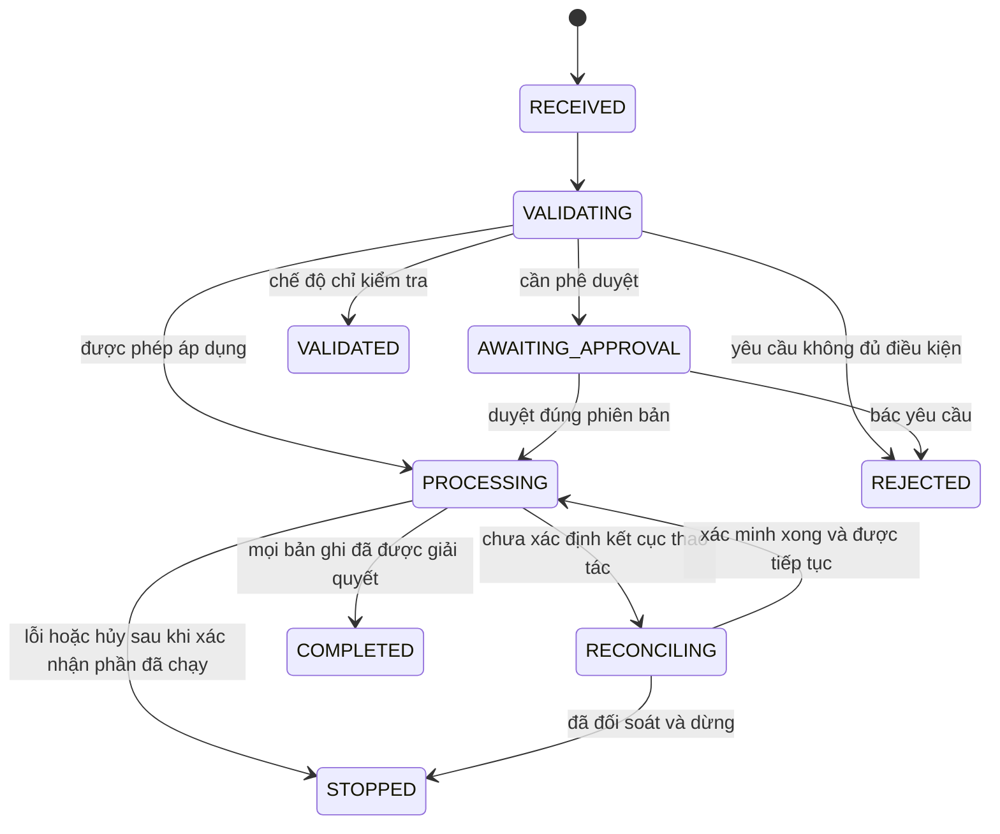

# Import result reporting

## 1. Báo cáo kết quả import là một phần của bảo mật nghiệp vụ

Một tiến trình import không kết thúc ở việc đọc được CSV hoặc chạy xong vòng lặp xử lý. Người sử dụng còn cần biết bản ghi nào đã được áp dụng, bản ghi nào bị từ chối, dữ liệu nào chưa được xử lý và bước tiếp theo có an toàn hay không.

Nếu báo cáo nói “thất bại” trong khi một phần dữ liệu đã commit, người dùng có thể tải lại tệp và gây tạo đơn trùng, cộng tồn kho hai lần hoặc lặp một khoản thanh toán. Nếu báo cáo nói “thành công” trước khi transaction commit, người dùng có thể phê duyệt bước tiếp theo trên dữ liệu thực tế chưa tồn tại. Nếu thông báo lỗi trả về thông tin của tenant khác, chính báo cáo trở thành một kênh rò rỉ dữ liệu.

**Import result reporting** là cơ chế công bố kết quả đã được xác nhận của một import, ở mức toàn job và từng bản ghi, theo đúng quyền truy cập và ngữ nghĩa transaction của nghiệp vụ.

Trong phạm vi bảo vệ logic nghiệp vụ, một báo cáo tốt cần bảo đảm ba điều:

- Kết quả phản ánh tác dụng nghiệp vụ đã được xác nhận, phân biệt với validation, dự đoán và trạng thái đang xử lý.
- Retry, xử lý song song và lỗi giữa chừng không làm kết quả bị đếm trùng hoặc che mất những thay đổi đã commit.
- Người xem chỉ nhận được thông tin được phép biết, dưới dạng không tạo thêm lỗ hổng ở giao diện hoặc tệp kết quả.

Các trạng thái, mã lỗi và schema trong bài là một thiết kế minh họa. Hệ thống thực tế cần chọn một hợp đồng nhất quán, công bố rõ ngữ nghĩa và thực thi nó ở cả backend lẫn giao diện.

## 2. Chốt chế độ áp dụng trước khi thiết kế thông báo

Giả sử một hệ thống quản lý kho cho phép import điều chỉnh tồn kho theo tenant và kho hàng. Mỗi bản ghi gồm mã sản phẩm, kho đích, số lượng điều chỉnh và mã tham chiếu. Một số mức điều chỉnh cần phê duyệt; người dùng không được tự sửa tồn của kho ngoài phạm vi mình quản lý.

Chức năng này có thể có nhiều chế độ xử lý:

| Chế độ | Cam kết nghiệp vụ | Điều phải nói rõ trong báo cáo |
|---|---|---|
| `VALIDATE_ONLY` | Chỉ kiểm tra, không áp dụng thay đổi nghiệp vụ | Bao nhiêu bản ghi đạt kiểm tra; không gọi đó là số bản ghi đã nhập |
| `ALL_OR_NOTHING` | Toàn bộ tập dữ liệu nghiệp vụ thuộc cam kết cùng thành công hoặc cùng rollback | Có commit toàn bộ hay không; các bản ghi hợp lệ có thể vẫn chưa được áp dụng |
| `PARTIAL` | Từng đơn vị xử lý có transaction độc lập | Bản ghi nào đã commit, bị từ chối, chưa xử lý hoặc chưa xác định được |
| `CHUNKED` | Mỗi nhóm bản ghi là một đơn vị transaction | Nhóm nào commit, nhóm nào rollback; không ngầm coi đây là nguyên tử toàn tệp |

Một import theo từng chunk không thể được mô tả là `ALL_OR_NOTHING` nếu các chunk trước đã commit và hệ thống chưa có cơ chế nghiệp vụ bảo đảm hoàn tác toàn bộ. Bù trừ cũng là một quy trình có thể thất bại, cần trạng thái riêng; nó không biến các transaction độc lập thành một transaction duy nhất.

Cam kết “tất cả hoặc không có gì” phải xác định phạm vi. Nó có thể chỉ bao phủ các bảng trong một database, không tự bao phủ email đã gửi, file đã ghi hay lệnh đã chuyển sang dịch vụ thanh toán. Nếu import phát sinh tác dụng bên ngoài, báo cáo phải phân biệt việc đã ghi nhận lệnh nghiệp vụ với việc tác dụng bên ngoài đã hoàn tất.

Chế độ xử lý phải do server kiểm tra và lưu vào job. Không cho client đổi chế độ sau khi đã phê duyệt, hoặc đổi từ “chỉ kiểm tra” sang “áp dụng” chỉ bằng việc sửa trạng thái trong request lấy báo cáo.

## 3. Xây dựng bất biến cho dữ liệu và kết quả

Với ví dụ điều chỉnh tồn kho, các bất biến quan trọng gồm:

| Bất biến | Biện pháp thực thi | Kết quả báo cáo tương ứng |
|---|---|---|
| Chỉ tác động tenant và kho được phép | Quyền theo đối tượng tại điểm áp dụng | Từ chối an toàn khi đối tượng không được phép sử dụng |
| Không bỏ qua phê duyệt bắt buộc | State machine và approval gắn phiên bản nội dung | `AWAITING_APPROVAL` chưa được mô tả là dữ liệu đã áp dụng |
| Mỗi thao tác điều chỉnh logic chỉ thực hiện một lần trong phạm vi cam kết | Idempotency và ràng buộc nghiệp vụ | Retry trả lại kết quả gốc, không cộng lại số lượng |
| Tác dụng nghiệp vụ và kết quả bền vững phải khớp nhau | Cùng transaction khi dùng cùng database | Chỉ ghi `APPLIED` khi thay đổi tương ứng có thể commit cùng kết quả |
| Không công bố hoàn tất khi còn thao tác chưa rõ kết cục | Finalizer, checkpoint và đối soát | Có trạng thái đang xác minh thay vì đoán thất bại |
| Thống kê là phép phân hoạch theo bản ghi, không theo số attempt | Sổ kết quả có khóa duy nhất cho bản ghi | Retry không làm số thành công vượt số bản ghi |
| Báo cáo không vượt quyền của người đọc hiện tại | Phân quyền khi đọc summary, chi tiết và tải file | Chủ sở hữu job không mặc nhiên giữ quyền đọc mãi mãi |

Một bản ghi vượt hạn mức không nên chỉ bị đánh dấu lỗi ở báo cáo trong khi thay đổi đã được áp dụng. Kết quả phải là hệ quả của kiểm soát nghiệp vụ, không phải một nhãn trang trí được gán sau khi đã ghi dữ liệu.

## 4. Thiết kế trạng thái toàn job và kết quả từng bản ghi

### 4.1. Trạng thái job phản ánh mức độ xác nhận

Một state machine rút gọn cho import có thể như sau:



Trong mô hình này, `COMPLETED` nghĩa là đã xử lý và giải quyết xong tập đầu vào thuộc hợp đồng; nó vẫn cần một `completionOutcome` để phân biệt tất cả được áp dụng với có bản ghi bị từ chối. `STOPPED` cần nêu lý do, phần đã commit và phần chưa được xử lý. Không dùng màu xanh hoặc chữ “thành công toàn bộ” chỉ vì worker không còn chạy.

Các trạng thái chờ duyệt và validation không phải trạng thái dữ liệu đã được áp dụng. Nếu giao diện có nút “Tiếp tục”, endpoint tương ứng vẫn phải kiểm tra quyền và trạng thái hiện hành; đọc một báo cáo không phải là hành vi phê duyệt.

### 4.2. Kết quả từng bản ghi phải phân biệt được tác dụng

Một bộ kết quả minh họa:

| Kết quả | Ngữ nghĩa |
|---|---|
| `APPLIED` | Thay đổi nghiệp vụ của bản ghi đã commit theo hợp đồng áp dụng |
| `REJECTED` | Bản ghi bị từ chối bởi validation hoặc quy tắc nghiệp vụ, không có thay đổi của bản ghi đó được commit |
| `SKIPPED` | Chủ động không áp dụng theo quy tắc đã công bố, ví dụ dữ liệu không đổi và nghiệp vụ cho phép bỏ qua |
| `NOT_APPLIED` | Không được áp dụng do dừng, hủy hoặc rollback ở cấp nhóm/toàn job, không đồng nghĩa bản ghi có lỗi dữ liệu |
| `PENDING` | Đã nhận diện bản ghi nhưng chưa bắt đầu xử lý |
| `IN_FLIGHT` | Một attempt đang xử lý, chưa có kết quả cuối cùng |
| `UNRESOLVED` | Chưa xác định chắc chắn tác dụng đã commit hay chưa; cần đối soát |

Không gọi một bản ghi là `REJECTED` chỉ vì worker timeout. Timeout ở phía gọi không chứng minh transaction phía database chưa commit. Tương tự, bản ghi đã validate hợp lệ nhưng bị rollback cùng toàn tệp phải là `NOT_APPLIED` hoặc một trạng thái tương đương, không phải `APPLIED`.

`SKIPPED` cần reason code rõ ràng. Một bản ghi không đủ quyền phải bị từ chối theo chính sách, không được giấu dưới nhãn “bỏ qua thành công”. Retry của cùng một bản ghi đã áp dụng cần trả lại kết quả `APPLIED` gốc; không biến kết quả đó thành `SKIPPED` làm mất thông tin tác dụng thực tế.

### 4.3. Đếm theo một snapshot nhất quán

Gọi `D` là số bản ghi dữ liệu đã được nhận diện. Nếu mỗi bản ghi nằm đúng một nhóm kết quả tại một phiên bản báo cáo, cần giữ bất biến:

```text
D = applied + rejected + skipped + notApplied
    + pending + inFlight + unresolved
```

Khi job được công bố đã giải quyết xong, các nhóm `pending`, `inFlight` và `unresolved` phải bằng 0. Nếu parser chưa đọc hết tệp, `D` mới là số đã nhận diện, chưa phải tổng số bản ghi cuối cùng.

Quy ước đếm cần nói rõ có tính header, dòng trống, bản ghi nhiều dòng hoặc dữ liệu lỗi cú pháp hay không. Với CSV, số bản ghi logic không luôn bằng số dòng vật lý vì một ô có thể chứa xuống dòng. Nếu parser không thể xác định ranh giới bản ghi sau một lỗi nghiêm trọng, báo cáo lỗi cấp file và để tổng chưa biết, thay vì bịa ra số dòng còn lại.

Các bộ đếm cần được tạo từ cùng snapshot hoặc cùng phiên bản tổng hợp. Đọc `applied` trước một batch, rồi đọc `pending` sau batch đó có thể làm tổng không khớp dù từng truy vấn riêng lẻ đều đúng.

## 5. Xác định bản ghi ổn định và chống đếm trùng

### 5.1. Tách file, job, bản ghi và attempt

Một mô hình định danh hữu ích gồm:

- `importJobId`: một yêu cầu import đã được server chấp nhận.
- `sourceVersion`: phiên bản nguồn đã chốt, gắn với file hoặc staging không cho sửa tùy ý.
- `sourceRecordId`: định danh ổn định của bản ghi sau parse, trong đúng phiên bản nguồn.
- `businessOperationKey`: khóa thao tác nghiệp vụ nếu cần chống lặp vượt qua phạm vi một job.
- `attemptId`: một lần thử xử lý; nhiều attempt có thể cùng quy về một kết quả bản ghi.
- `resultVersion`: phiên bản công bố của kết quả, giúp summary, trang chi tiết và file báo cáo khớp nhau.

Có thể dùng một khóa duy nhất cho sổ kết quả như `(tenantId, importJobId, sourceVersion, sourceRecordId)`. Số thứ tự bản ghi chỉ phù hợp khi parser và nội dung đầu vào đã cố định. Khi người dùng sửa tệp, đó phải là phiên bản mới hoặc job mới với quan hệ được khai báo rõ.

Checksum file giúp nhận diện byte của nguồn, nhưng không tự xác nhận quyền import hoặc quyết định hai yêu cầu có cùng ý nghĩa nghiệp vụ. Cùng file có thể được sử dụng với cách mapping, tenant, chế độ và thời điểm khác nhau. Không dùng riêng hash file làm khóa idempotency toàn hệ thống.

### 5.2. Phân biệt trùng trong một job với trùng nghiệp vụ

Giả sử bản ghi số 12 và số 28 đều điều chỉnh cùng sản phẩm. Hai bản ghi này có thể là hai thao tác hợp lệ, hoặc là dữ liệu trùng cần từ chối, tùy hợp đồng. Không tự gộp chúng chỉ vì có cùng mã sản phẩm hoặc payload giống nhau.

Ngược lại, khi người dùng tải lại cả tệp sau lỗi mạng và tạo job mới, unique constraint theo `importJobId` không ngăn tác dụng nghiệp vụ lặp. Nếu nghiệp vụ yêu cầu mỗi mã điều chỉnh chỉ áp dụng một lần, cần `businessOperationKey` trong đúng phạm vi tenant/nghiệp vụ và có ràng buộc bền vững tương ứng.

Ở mức request, idempotency key cần gắn với tenant, chủ thể hoặc miền ủy quyền phù hợp, loại thao tác và fingerprint nội dung đã chuẩn hóa. Gửi lại cùng khóa với nội dung khác phải nhận conflict; không sửa ngầm file, mapping hoặc chế độ của job đã có.

Khi đọc lại kết quả bằng khóa idempotency, hệ thống vẫn phải kiểm tra quyền hiện tại. Khóa chống gửi trùng không phải capability cho phép đọc báo cáo của người khác.

## 6. Một hợp đồng API báo cáo kết quả

### 6.1. Summary không che mất phần bị từ chối

Ví dụ dưới đây mô tả một job `PARTIAL` đã xử lý xong 1.000 bản ghi dữ liệu:

```json
{
  "importJobId": "import-734",
  "mode": "PARTIAL",
  "state": "COMPLETED",
  "completionOutcome": "WITH_REJECTIONS",
  "resultVersion": 8,
  "sourceVersion": 1,
  "discoveryComplete": true,
  "totalRecordCount": 1000,
  "counts": {
    "applied": 950,
    "rejected": 40,
    "skipped": 10,
    "notApplied": 0,
    "pending": 0,
    "inFlight": 0,
    "unresolved": 0
  },
  "businessEffect": "COMMITTED_PER_RECORD",
  "completedAt": "2026-11-22T07:15:40Z",
  "reportArtifact": {
    "state": "GENERATING"
  },
  "errorDetails": {
    "totalRejectedRecords": 40,
    "returnedRecords": 2,
    "truncated": true,
    "nextCursor": "opaque-cursor-2",
    "items": [
      {
        "sourceRecordId": "record-31",
        "recordNumber": 31,
        "outcome": "REJECTED",
        "errorCode": "QUANTITY_OUT_OF_ALLOWED_RANGE",
        "field": "adjustmentQuantity",
        "message": "Số lượng điều chỉnh nằm ngoài giới hạn được phép.",
        "retryAdvice": "CORRECT_AND_RESUBMIT"
      },
      {
        "sourceRecordId": "record-57",
        "recordNumber": 57,
        "outcome": "REJECTED",
        "errorCode": "REFERENCE_NOT_USABLE",
        "field": "warehouseCode",
        "message": "Không thể sử dụng kho đã cung cấp cho thao tác này.",
        "retryAdvice": "REVIEW_REFERENCE_OR_PERMISSION"
      }
    ]
  }
}
```

Thông điệp phù hợp cho người dùng là: “Đã xử lý xong: 950 bản ghi đã áp dụng, 40 bị từ chối, 10 được bỏ qua theo quy tắc. Tệp chi tiết đang được tạo.” Không hiển thị “Nhập thành công 1.000 bản ghi”.

`reportArtifact.state` độc lập với trạng thái xử lý nghiệp vụ. Renderer tạo file báo cáo bị lỗi không làm 950 thay đổi đã commit trở thành thất bại. Cần retry phần tạo báo cáo, không mặc nhiên chạy lại import.

`recordNumber` trong ví dụ là thứ tự bản ghi dữ liệu không tính header, không mặc định là số dòng trên trình soạn thảo văn bản. Nếu cần hỗ trợ người dùng tìm vị trí, có thể bổ sung sheet và dòng bắt đầu theo đúng parser, kèm giới hạn thông tin phù hợp.

### 6.2. Dùng mã lỗi ổn định và lời khuyên có phạm vi

`errorCode` phục vụ xử lý bằng máy, tài liệu và dịch thông điệp. `message` dành cho người dùng; nội dung có thể thay đổi theo ngôn ngữ nên không được dùng làm điều kiện điều khiển retry.

Một số nhóm lỗi thường gặp:

| Nhóm | Ví dụ mã | Hành động phù hợp |
|---|---|---|
| Cấu trúc đầu vào | `MISSING_REQUIRED_COLUMN`, `INVALID_VALUE_FORMAT` | Sửa dữ liệu hoặc mapping, tạo phiên bản/job mới theo hợp đồng |
| Quy tắc nghiệp vụ | `APPROVAL_REQUIRED`, `QUANTITY_OUT_OF_ALLOWED_RANGE` | Hoàn tất điều kiện nghiệp vụ hoặc sửa yêu cầu |
| Quyền/đối tượng | `REFERENCE_NOT_USABLE`, `ACTION_NOT_ALLOWED` | Kiểm tra phạm vi được cấp, không tự retry để dò đối tượng |
| Trùng thao tác | `BUSINESS_OPERATION_ALREADY_APPLIED` | Tra cứu kết quả đã được phép xem, không áp dụng lại |
| Xung đột cập nhật | `TARGET_VERSION_CONFLICT` | Đọc lại dữ liệu và đánh giá lại ý định thao tác |
| Hạ tầng tạm thời | `PROCESSING_TEMPORARILY_UNAVAILABLE` | Retry có kiểm soát khi đã xác định không làm lặp tác dụng |
| Kết cục chưa rõ | `OUTCOME_RECONCILIATION_REQUIRED` | Chờ hoặc yêu cầu đối soát bằng định danh gốc |

Tránh chỉ có `retryable: true` mà không nói retry ở mức nào. Poll lại trạng thái, retry một attempt nội bộ, sửa rồi gửi bản ghi lỗi và gửi lại cả tệp là những thao tác khác nhau. Backend quyết định điều kiện áp dụng; lời khuyên trong báo cáo không phải quyền bỏ qua kiểm tra.

## 7. Commit thay đổi và kết quả cùng nhau

### 7.1. Mẫu xử lý từng bản ghi

Trong chế độ `PARTIAL` với dữ liệu nghiệp vụ và sổ kết quả cùng database, transaction của một bản ghi nên bao gồm việc xác định quyền xử lý, áp dụng thay đổi, lưu kết quả và ghi sự kiện outbox nếu cần.

Mã giả Java sau minh họa ranh giới đó. Các phương thức là hợp đồng thiết kế, không phải một thư viện có sẵn:

```java
public RowResult processRow(
        VerifiedWorkerContext worker,
        RowIdentity identity) {

    return tx.required(() -> {
        ImportJob job = jobs.lockAndVerifyProcessingLease(
                worker, identity.jobId());

        RowLedger row = ledger.lockOrCreate(
                job.tenantId(), identity);

        if (row.hasConfirmedFinalResult()) {
            return row.finalResult();
        }

        StagedRecord input = staging.loadImmutable(
                job.sourceVersion(), identity.sourceRecordId());

        RowDecision decision = rules.evaluate(
                job, input, worker, clock.instant());

        if (!decision.allowed()) {
            RowResult rejected = row.markRejected(
                    decision.publicErrorCode());
            outbox.append(events.rowRejected(job, rejected));
            return rejected;
        }

        AppliedChange change = domain.applyAllowed(
                job, input, decision);

        RowResult applied = row.markApplied(change.reference());
        outbox.append(events.rowApplied(job, applied));
        return applied;
    });
}
```

Để mẫu này có ý nghĩa, cần đáp ứng các điều kiện sau:

- `lockAndVerifyProcessingLease` xác thực worker, tenant, trạng thái job và quyền của attempt hiện tại. Worker cũ không được tiếp tục commit sau khi lease bị thay thế hoặc việc hủy đã có hiệu lực theo hợp đồng.
- `lockOrCreate` xử lý được cạnh tranh khi bản ghi ledger chưa tồn tại, có unique constraint đúng phạm vi. Kiểm tra trong bộ nhớ hoặc truy vấn “chưa thấy” đơn thuần không đủ.
- Staging không được sửa sau khi duyệt; mapping và phiên bản chính sách cần thiết được gắn với job. Mã kho trong file không thể thay tenant tin cậy của job.
- `rules.evaluate` kiểm tra cả quyền theo đối tượng, điều kiện phê duyệt và các bất biến nghiệp vụ; không chỉ kiểm tra định dạng số.
- Các điều kiện có thể thay đổi giữa kiểm tra và ghi cần khóa, version check hoặc thao tác database có điều kiện. Một lời gọi kiểm tra quyền không tự tạo tính nguyên tử với dịch vụ ngoài database.
- `domain.applyAllowed`, kết quả ledger và outbox cùng transaction. Nếu bất kỳ phần bắt buộc nào không thể commit thì không được công bố `APPLIED`.
- Mọi tác dụng bên ngoài phải có cơ chế riêng như outbox và idempotency tại đích. Không gửi email hoặc gọi thanh toán trực tiếp rồi giả định database rollback sẽ thu hồi tác dụng đó.

Khóa job trong mã giả giúp diễn giải đơn giản nhưng có thể tuần tự hóa việc xử lý từng job. Hệ thống cần song song cao có thể dùng thiết kế lease/fencing khác, miễn vẫn bảo đảm việc dừng job và commit bản ghi có một quy tắc cạnh tranh xác định.

### 7.2. Không bắt mọi exception rồi ghi “dòng lỗi”

Mẫu nguy hiểm là:

```text
try:
    ghi thay đổi nghiệp vụ
    tăng bộ đếm thành công
catch mọi lỗi:
    ghi bản ghi thất bại
tiếp tục
```

Một lỗi SQL có thể làm transaction không còn khả năng commit; thay đổi có thể đã rollback hoặc kết cục commit chưa rõ nếu mất kết nối. Không thể chỉ catch exception rồi tiếp tục lưu một kết quả tin cậy trong cùng transaction đã hỏng.

Các lỗi nghiệp vụ dự đoán được nên được biểu diễn bằng quyết định trước tác dụng, hoặc xử lý bằng transaction/savepoint có ngữ nghĩa rõ ràng. Lỗi hạ tầng cần đi qua đường điều phối riêng. Không tăng bộ đếm thành công trước commit và không lấy số vòng lặp đã chạy làm số thay đổi đã áp dụng.

### 7.3. Trường hợp mất xác nhận commit

Giả sử database đã commit thay đổi cùng ledger nhưng kết nối rơi trước khi worker nhận ACK. Nếu worker lập tức đánh dấu thất bại rồi retry bằng một khóa mới, tồn kho có thể bị điều chỉnh lần nữa.

Cách xử lý là giữ định danh gốc, đối soát ledger hoặc khóa thao tác nghiệp vụ bằng nguồn đọc có tính nhất quán phù hợp, rồi trả lại kết quả đã xác nhận. Khi chưa thể phân biệt, dùng trạng thái điều phối `RECONCILING`; không ghi đè một kết quả cuối cùng có thể đã commit bằng phỏng đoán `REJECTED`.

Nếu truy vấn đối soát đi vào replica trễ, “chưa thấy kết quả” không đủ để kết luận chưa commit. Việc retry phải tuân thủ cùng cơ chế idempotency và kiểm soát cạnh tranh, kể cả sau một lần đối soát chưa tìm thấy dữ liệu.

## 8. Tạo kết quả cuối cùng và quản lý phiên bản báo cáo

### 8.1. Finalizer phải chờ tác dụng được giải quyết

Với job xử lý song song, finalizer cần xác nhận:

1. Việc đọc và phân loại nguồn đã hoàn tất, hoặc đã dừng có chủ đích với phạm vi chưa đọc được nêu rõ.
2. Không còn attempt hợp lệ có thể commit thêm ngoài tập kết quả được tổng hợp.
3. Các thao tác chưa rõ kết cục đã được đối soát; nếu còn, job vẫn chưa được công bố là đã giải quyết xong.
4. Summary được dựng từ sổ kết quả bền vững, mỗi bản ghi tính một lần và các bộ đếm thỏa bất biến.
5. Phiên bản summary cùng trạng thái hoàn tất được lưu nhất quán; sự kiện kết thúc được ghi bền vững theo cam kết audit.

Khi người dùng bấm hủy, không lập tức chuyển mọi bản ghi đang chạy thành `NOT_APPLIED`. Cần ngăn nhận việc mới, xác định các attempt còn quyền commit và chờ hoặc đối soát phần đang chạy. Những bản ghi đã commit vẫn phải giữ kết quả đã áp dụng, trừ khi có một quy trình bù trừ riêng đã hoàn tất và được báo cáo rõ.

### 8.2. Báo cáo tải xuống là sản phẩm dẫn xuất

Một renderer có thể đọc snapshot kết quả đã chốt rồi tạo CSV, JSON hoặc bảng xem trên giao diện. File báo cáo cần gắn `importJobId`, `resultVersion`, bộ lọc, schema và thời điểm tạo. Nếu file chỉ chứa dòng lỗi, cần công bố rõ đó là báo cáo lỗi, không phải toàn bộ dữ liệu đầu vào.

Nếu summary có phiên bản 8 nhưng CSV lấy từ dữ liệu đang thay đổi của phiên bản 7, người dùng có thể sửa hoặc gửi lại sai bản ghi. Chọn một phiên bản nhất quán cho cả summary, phân trang và artifact; nếu không thể giữ snapshot, hãy yêu cầu làm mới thay vì âm thầm trộn phiên bản.

Cursor phân trang cần được bảo vệ khỏi sửa tùy ý và gắn với job, phiên bản, bộ lọc cần thiết. Dù cursor hợp lệ, mỗi request vẫn phải kiểm tra quyền hiện tại; chữ ký cursor không thay thế authorization.

Giới hạn số lỗi trả về là cần thiết để tránh payload quá lớn. Tuy nhiên phải có `truncated`, tổng số bản ghi bị từ chối và cách xem phần còn lại. Một báo cáo chỉ trả 100 lỗi đầu tiên không được khiến giao diện kết luận chỉ có 100 lỗi. Số lỗi theo trường cũng không đồng nghĩa số bản ghi lỗi: một bản ghi có thể có nhiều lỗi.

Nếu không tạo được file do dữ liệu quá lớn hoặc lỗi renderer, phải giữ kết quả nghiệp vụ đã xác nhận và báo trạng thái file riêng. Renderer có thể retry theo cùng phiên bản, không tạo lại các thay đổi nghiệp vụ.

## 9. Bảo vệ quyền đọc và ngăn rò rỉ qua thông báo lỗi

### 9.1. Phân quyền cho mọi đường lấy kết quả

Các endpoint như sau đều cần kiểm tra quyền theo job, tenant và chính sách chia sẻ hiện hành:

```text
GET /imports/{jobId}
GET /imports/{jobId}/results
GET /imports/{jobId}/error-report
GET /imports/{jobId}/report-download
```

Không chỉ bảo vệ trang chính rồi để file báo cáo ở một URL public. Quyền upload tệp, quyền áp dụng thay đổi và quyền đọc lỗi chi tiết có thể khác nhau. Người từng tạo job nhưng đã chuyển bộ phận hoặc bị thu hồi quyền không mặc nhiên tiếp tục được đọc báo cáo.

Trả summary, chi tiết, tìm kiếm, phân trang và tải artifact phải dùng cùng một chính sách phù hợp. Các count, tên file và thời gian cũng có thể tiết lộ hoạt động của tenant khác dù không có nội dung từng bản ghi.

Nếu ứng dụng cấp URL có chữ ký, cần hiểu rằng URL đó là capability truy cập trong thời hạn hiệu lực. Thu hồi quyền trong ứng dụng không nhất thiết vô hiệu hóa ngay URL đã cấp. Với yêu cầu kiểm tra quyền tức thời, cần đường tải có kiểm tra online hoặc cơ chế thu hồi thực sự được tầng phục vụ hỗ trợ.

Với báo cáo nhạy cảm, có thể sử dụng chính sách cache như `Cache-Control: no-store` ở phản hồi phù hợp, đồng thời cấu hình proxy/CDN nhất quán. Header cache không thay thế quyền truy cập hay xóa được các bản sao mà người đã được phép tải đã lưu.

### 9.2. Không biến lỗi import thành bộ dò đối tượng

Giả sử người dùng tenant A nhập mã kho của tenant B. Thông báo “Kho này tồn tại trong tenant B và do nhân viên X quản lý” tiết lộ thông tin không được cấp. Phản hồi công khai có thể dùng `REFERENCE_NOT_USABLE`; chi tiết chẩn đoán chỉ nằm ở kênh nội bộ được phân quyền.

Không phải mọi lỗi đều cần làm mơ hồ. Một người có quyền với kho của mình có thể cần biết một trường bắt buộc bị thiếu hoặc số lượng vượt giới hạn đã công bố. Mức chi tiết nên dựa trên quyền đọc và loại lỗi, không đơn thuần dựa vào việc người gọi đã đăng nhập.

Với lỗi bất ngờ, trả thông điệp an toàn và mã tham chiếu điều tra; không trả stack trace, SQL, tên bảng nội bộ, đường dẫn server hoặc thông báo driver. Nguyên tắc tách phản hồi người dùng khỏi chẩn đoán nội bộ được trình bày trong [OWASP Error Handling Cheat Sheet](https://cheatsheetseries.owasp.org/cheatsheets/Error_Handling_Cheat_Sheet.html).

Kênh nội bộ cũng cần giảm dữ liệu: không ghi toàn bộ hàng nhập, token, thông tin thanh toán hoặc request body chỉ vì lỗi cần điều tra. `supportReference` phải là mã tham chiếu, không phải khóa cho phép ai biết mã cũng đọc được chẩn đoán.

## 10. Báo cáo lỗi là một đầu ra không tin cậy

### 10.1. Không phản chiếu nguyên tệp đầu vào

Người nhập thường muốn tải file “các dòng lỗi” rồi sửa để gửi lại. Tuy nhiên, file đó có thể lặp lại dữ liệu cá nhân, công thức bảng tính hoặc nội dung HTML do người khác cung cấp. Cần quyết định rõ trường nào thật sự cần đưa vào báo cáo.

Một thiết kế giảm rủi ro có thể chỉ bao gồm:

- Định danh bản ghi và vị trí nguồn đã được quy ước.
- Mã lỗi, tên trường trong allowlist và mô tả an toàn.
- Khóa tham chiếu đã được phép xem hoặc giá trị đã che khi cần phân biệt.
- Chỉ dẫn sửa dữ liệu, phiên bản nguồn và phiên bản kết quả.

Không đưa toàn bộ giá trị gốc vào `message`. Một trường “ghi chú” dài hàng megabyte có thể làm báo cáo phình to; một trường có dữ liệu bí mật có thể bị sao chép sang log, APM hoặc email hỗ trợ nếu không giới hạn ngay từ đầu.

### 10.2. CSV injection và nội dung HTML

Một ô có nội dung như `=1+1` là ví dụ vô hại cho thấy phần mềm bảng tính có thể diễn giải dữ liệu thành công thức. Dữ liệu không tin cậy được chép vào file lỗi có thể gây formula injection khi người hỗ trợ hoặc quản trị viên mở file.

Quoting đúng quy tắc CSV bảo vệ ranh giới ô, nhưng không tự biến công thức thành văn bản. Việc xử lý còn phụ thuộc ứng dụng, locale và thao tác lưu/mở lại. OWASP lưu ý các biến thể ký tự mở đầu và khả năng một số cách escape không còn an toàn sau khi file được lưu lại. [OWASP CSV Injection](https://owasp.org/www-community/attacks/CSV_Injection)

Vì vậy, cần chọn định dạng và hợp đồng người đọc cụ thể. Nếu tạo workbook có kiểu ô, các trường văn bản không tin cậy phải được ghi dưới kiểu văn bản, không qua API công thức. Với CSV, áp dụng chính sách trung hòa phù hợp với các client được hỗ trợ, dùng serializer đúng định dạng và kiểm tra cả vòng lưu/mở lại. Không tuyên bố chỉ thêm dấu nháy kép là đã giải quyết mọi trường hợp.

Nếu không thể bảo đảm an toàn cho việc mở bằng bảng tính, có thể cung cấp báo cáo JSON có cấu trúc hoặc giao diện xem an toàn cho trường văn bản không tin cậy. Định dạng thay thế vẫn cần phân quyền và encoding đúng khi hiển thị.

Ở giao diện web, render thông điệp và giá trị bằng cơ chế text/escaping của framework, không ghép vào HTML. Tên file tải xuống cũng phải được server tạo hoặc chuẩn hóa theo allowlist, không sử dụng nguyên tên upload để ghép đường dẫn hay header.

### 10.3. Không coi file lỗi đã chỉnh là dữ liệu được tin cậy

Một file lỗi có thêm cột `approved=true` hoặc `originalRowStatus=REJECTED` không được phép điều khiển kết quả lần import sau. Khi người dùng sửa và gửi lại, đó vẫn là đầu vào không tin cậy: kiểm tra lại schema, quyền, phạm vi, phê duyệt, version conflict và idempotency.

Nếu cho phép “retry bản ghi bị từ chối”, server phải xác định tập bản ghi được retry từ sổ kết quả của mình. Không tin danh sách do client tự gắn nhãn, không retry các bản ghi đã áp dụng chỉ vì chúng xuất hiện trong tệp mới.

## 11. Cách diễn giải những tình huống dễ nhầm

### 11.1. Toàn tệp rollback

Một tệp có 100 bản ghi, 97 bản ghi đạt validation và 3 bản ghi vi phạm. Với `ALL_OR_NOTHING`, nếu không áp dụng thay đổi nào, báo cáo phù hợp là:

```text
Chế độ: ALL_OR_NOTHING
Kết quả: Không áp dụng thay đổi nghiệp vụ
Đã áp dụng: 0
Bị từ chối do lỗi dữ liệu: 3
Chưa áp dụng vì toàn bộ yêu cầu không đủ điều kiện: 97
```

Có thể cung cấp thêm `validationPassedCount=97`, nhưng không hiển thị đó là số đã nhập thành công. Nếu lỗi xảy ra ở cấp hệ thống sau validation, phải dùng mã và kết quả phù hợp, không tự gán ba bản ghi lỗi như ví dụ này.

### 11.2. Import một phần rồi worker dừng

Với 1.000 bản ghi đã nhận diện, 400 đã commit, 20 bị từ chối và 580 chưa xử lý, hệ thống không được báo “import thất bại, vui lòng tải lại toàn bộ”. Sau khi đã ngăn các attempt còn lại commit và xác nhận kết quả, có thể báo:

```text
Tiến trình đã dừng; các thay đổi đã commit được giữ lại.
Đã áp dụng: 400
Bị từ chối: 20
Chưa áp dụng do tiến trình dừng: 580
Hành động tiếp theo: tiếp tục theo job gốc hoặc gửi lại tập được server cho phép.
```

Nếu vẫn còn bản ghi chưa rõ kết cục thì chưa được đưa tất cả vào 580 bản ghi `NOT_APPLIED`. Cần giữ nhóm `UNRESOLVED` và trạng thái đối soát cho đến khi có kết luận.

### 11.3. Validation thành công nhưng dữ liệu thay đổi trước khi áp dụng

Dry run xác nhận một sản phẩm đang ở phiên bản 8 và kho còn hạn mức. Khi import thật chạy, sản phẩm có thể đã ở phiên bản 9 hoặc quyền quản lý kho đã bị thu hồi. Kết quả dry run chỉ mô tả điều kiện được kiểm tra tại thời điểm đó, không tự giữ khóa hoặc cấp quyền dài hạn.

Nếu cần bảo đảm một phê duyệt áp dụng đúng tập dữ liệu, phải gắn approval với nguồn, mapping, phạm vi và phiên bản yêu cầu. Khi thực thi, vẫn kiểm tra các điều kiện hiện hành mà nghiệp vụ yêu cầu; báo `TARGET_VERSION_CONFLICT` hoặc lý do phù hợp thay vì dùng báo cáo validation cũ để bỏ qua.

### 11.4. Dữ liệu đã commit nhưng phát thông báo còn chờ

Một thay đổi tồn kho đã commit cùng lệnh outbox gửi thông báo. Nếu hợp đồng import chỉ cam kết ghi nhận thay đổi tồn kho, bản ghi có thể là `APPLIED` với trạng thái thông báo `PENDING_DELIVERY` ở phần riêng. Không biến nó thành lỗi nhập dữ liệu và yêu cầu chạy lại thay đổi tồn kho vì email chưa gửi.

Nếu hợp đồng nghiệp vụ yêu cầu tác dụng ở dịch vụ đích hoàn tất mới coi là xong, cần theo dõi trạng thái workflow và xác nhận tại đích. Tên `APPLIED` phải được định nghĩa tương ứng; không nâng cam kết bằng câu chữ trong báo cáo.

## 12. Quan sát, đối soát và thời gian lưu

Kết quả người dùng và audit có mục đích khác nhau. Kết quả giúp sửa dữ liệu và hiểu tác dụng; audit giải thích ai tạo yêu cầu, ai duyệt, ai thực thi, theo phạm vi nào và ai đọc/tải báo cáo. Không trả toàn bộ audit nội bộ làm báo cáo người dùng.

Các tín hiệu vận hành hữu ích gồm:

| Tín hiệu | Điều cần kiểm tra |
|---|---|
| `applied` lớn hơn số bản ghi đã nhận diện | Đếm theo attempt, trùng ledger hoặc tổng hợp sai |
| Job hoàn tất nhưng còn `IN_FLIGHT`/`UNRESOLVED` | Finalizer chạy sớm hoặc mất kiểm soát lease |
| Tác dụng nghiệp vụ có nhưng không có kết quả tương ứng | Thiếu transaction chung hoặc đường ghi bỏ qua ledger |
| Summary không khớp file chi tiết | Trộn snapshot, sai `resultVersion` hoặc renderer lấy sai bộ lọc |
| Nhiều lượt tra cứu job khác tenant | Có thể có dò đối tượng; điều tra cùng lỗi client và hoạt động hợp lệ |
| Nhiều retry tạo job mới sau lỗi mạng | Hợp đồng idempotency hoặc thông điệp hướng dẫn chưa đúng |
| Artifact báo cáo lỗi lâu hơn thời gian cam kết | Lỗi riêng của renderer/kho lưu, không mặc nhiên lỗi nghiệp vụ import |

Đối soát số lượng không đủ để chứng minh mọi dữ liệu đúng: 400 thay đổi sai kho vẫn có thể khớp với 400 kết quả `APPLIED`. Cần liên kết từng tác dụng với định danh bản ghi và tham chiếu nghiệp vụ đáng tin cậy, đồng thời kiểm tra bất biến tenant/phạm vi tại điểm ghi.

Thời hạn lưu nguồn upload, staging, ledger, file báo cáo và audit có thể khác nhau. Xóa file gốc không nên làm mất khả năng trả kết quả trong cửa sổ retry đã cam kết. Xóa khóa chống trùng quá sớm cũng có thể cho phép tác dụng lặp; thời gian giữ phải phù hợp miền idempotency và quy tắc nghiệp vụ.

Ngược lại, không giữ nguyên dữ liệu nhạy cảm trong file lỗi vô thời hạn. Cần giới hạn thời gian lưu, phân quyền đọc, quản lý bản sao và làm rõ những gì còn có thể truy xuất sau khi artifact hết hạn. Kết quả hết thời gian cung cấp phải được báo là hết hạn theo chính sách, không giả làm một import chưa từng xảy ra.

## 13. Các tình huống cần kiểm thử khi triển khai

Những tình huống sau mô tả cam kết cần kiểm chứng trong một hệ thống thực tế; chúng không phải kết quả chạy kiểm thử của bài học này.

| Tình huống | Điều cần xác nhận |
|---|---|
| Hai worker nhận cùng bản ghi | Một tác dụng nghiệp vụ và một kết quả logic, không đếm hai lần |
| Cùng request key nhưng khác file hoặc mapping | Trả conflict, không thay nội dung job cũ |
| Commit thành công nhưng worker mất ACK | Đối soát định danh gốc, không áp dụng lại và không báo từ chối giả |
| Database rollback sau khi đã dựng kết quả trong bộ nhớ | Không có `APPLIED` bền vững hoặc summary thành công giả |
| `ALL_OR_NOTHING` có một bản ghi không hợp lệ | Tổng `applied` bằng 0 trong phạm vi cam kết |
| `PARTIAL` dừng sau vài bản ghi đã commit | Báo đúng phần giữ lại và phần chưa áp dụng; không gợi ý replay toàn tệp thiếu bảo vệ |
| Người dùng hủy khi worker đang commit | Kết quả tuân theo quy tắc cạnh tranh đã định, không giấu tác dụng đã commit |
| Dry run xong rồi quyền hoặc dữ liệu thay đổi | Thực thi kiểm tra lại; báo xung đột hoặc từ chối phù hợp |
| Đọc job hoặc artifact của tenant khác | Không lộ chi tiết, count, tên tệp hay nội dung |
| Tra cứu một mã đối tượng ngoài quyền | Thông báo không làm lộ sự tồn tại hoặc chủ sở hữu ngoài phạm vi |
| Report chứa HTML hoặc nội dung giống công thức | Hiển thị dưới dạng dữ liệu và không tạo công thức ngoài ý muốn trên client được hỗ trợ |
| Có hàng trăm nghìn lỗi | Payload và artifact có giới hạn; truncation và tổng số được công bố đúng |
| Một bản ghi có ba lỗi theo trường | Không tăng số bản ghi bị từ chối thành ba |
| Parser dừng giữa bản ghi nhiều dòng | Không tự tạo tổng số bản ghi hoặc vị trí nguồn giả |
| Người dùng sửa cursor hoặc đổi quyền giữa hai trang | Không đọc được dữ liệu ngoài phạm vi; phiên bản báo cáo không bị trộn |
| Renderer thất bại sau khi import commit | Retry tạo báo cáo độc lập, không chạy lại thay đổi nghiệp vụ |
| Gửi lại file lỗi có thêm cột phê duyệt giả | Server bỏ qua hoặc từ chối trường không hợp lệ, thực hiện lại kiểm soát cần thiết |

Kiểm tra transaction, unique constraint, mất ACK và lease cần môi trường tích hợp tương ứng. Một unit test chỉ xác nhận gọi `setStatus("SUCCESS")` không chứng minh kết quả khớp commit. Khi kiểm thử lỗi, cần quan sát đồng thời dữ liệu nghiệp vụ, ledger, summary và artifact thay vì chỉ nhìn HTTP response.

## 14. Những quyết định phải rõ trước khi công bố báo cáo

Trước khi đưa chức năng vào sử dụng, cần trả lời được:

1. “Đã áp dụng” bao phủ transaction hoặc tác dụng nghiệp vụ nào; khác validation và tác dụng bên ngoài ra sao?
2. Khi import dừng giữa chừng, hệ thống xác định phần đã commit và phần chưa rõ bằng nguồn nào?
3. Bản ghi, attempt và thao tác nghiệp vụ được nhận diện thế nào để retry không đếm hoặc ghi trùng?
4. Approval gắn với phiên bản nguồn, mapping và phạm vi nào; thay đổi điều kiện sau dry run được xử lý thế nào?
5. Summary, phân trang và file tải xuống có cùng `resultVersion` không?
6. Ai được xem summary, dữ liệu gốc và chẩn đoán; quyền có được kiểm tra lại khi tải báo cáo không?
7. Mã lỗi nào được công khai, mã nào chỉ dùng nội bộ, và lời khuyên retry áp dụng ở cấp nào?
8. Khi file kết quả bị cắt bớt, hết hạn hoặc chưa tạo được, người dùng được thông báo chính xác ra sao?

Báo cáo kết quả import đáng tin cậy giúp người dùng hành động tiếp mà không làm lặp hoặc bỏ sót tác dụng nghiệp vụ. Muốn vậy, kết quả phải được xây từ bằng chứng commit, gắn với đúng phạm vi và phiên bản, đồng thời được bảo vệ như chính dữ liệu mà import đang thay đổi.
