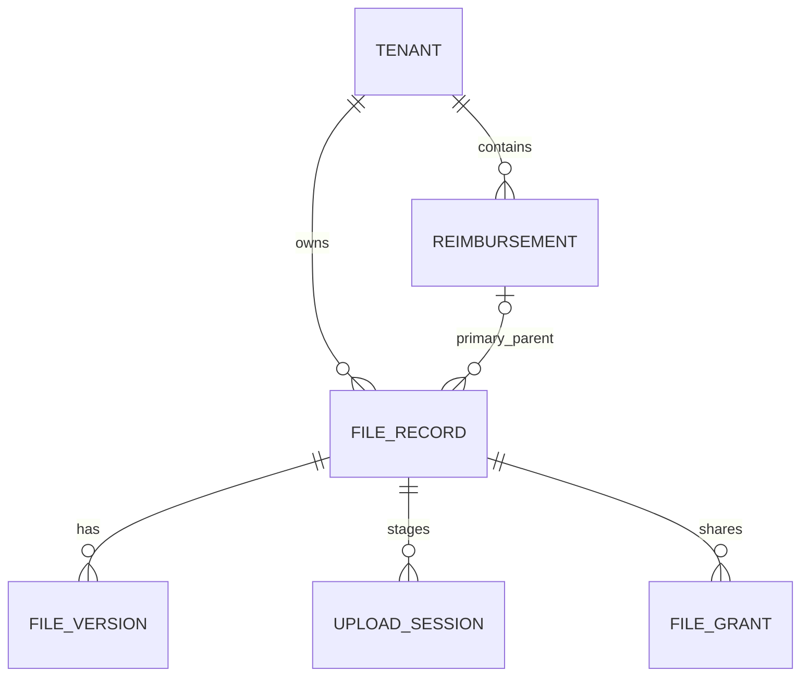
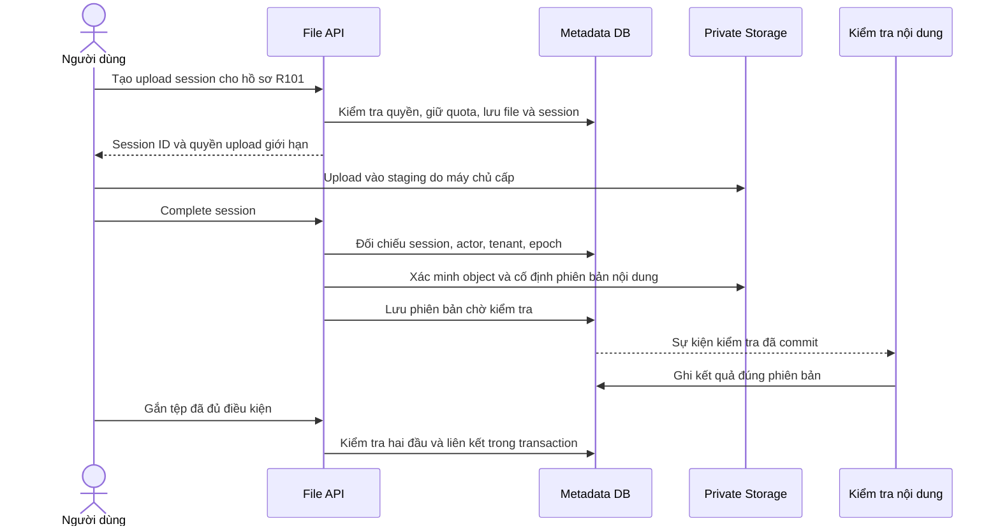
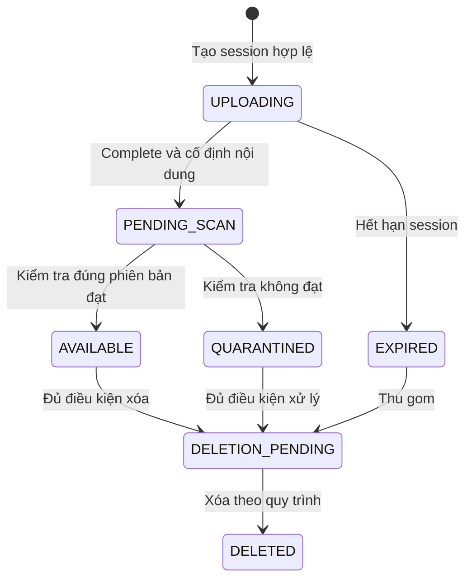

# File ownership — Quyền sở hữu tệp trong quy tắc nghiệp vụ

## 1. Mục tiêu bài học

Một ứng dụng lưu tệp cần trả lời được nhiều câu hỏi hơn “tệp này nằm ở đâu?”: tệp thuộc tenant nào, phục vụ hồ sơ nghiệp vụ nào, ai được xem, ai được thay phiên bản, ai được gắn nó sang hồ sơ khác và ai có quyền xóa?

Trong chương **File Business Rules** của module `SECURITY_APPLICATION_SECURITY_BUSINESS_LOGIC_SECURITY`, file ownership được xem là một phần của **bảo mật logic nghiệp vụ**. Trọng tâm là bảo vệ quan hệ sở hữu và các quyền phát sinh từ quan hệ đó, kể cả khi người dùng thay đổi mã tệp, gửi yêu cầu lặp, bỏ qua bước phê duyệt hoặc tạo các thao tác đồng thời.

Sau bài học, người học có thể:

- Phân biệt người tải tệp lên, chủ thể sở hữu nghiệp vụ, đối tượng chứa tệp và tài khoản dịch vụ lưu trữ.
- Phát biểu invariants cho tạo tệp, liên kết, đọc, thay phiên bản, chuyển quyền và xóa.
- Thiết kế quyền theo đối tượng, tenant và trạng thái hồ sơ.
- Kết hợp state machine, transaction, version và idempotency để bảo vệ quan hệ sở hữu.
- Kiểm thử các tình huống IDOR/BOLA, chiếm tệp, gắn tệp trái phép và cạnh tranh giữa chuyển quyền với truy cập.

Các mô hình, chính sách và mã minh họa trong bài là phương án thiết kế cho ví dụ. Khi áp dụng, cần xác định lại quy tắc nghiệp vụ của sản phẩm; không mặc định mọi chủ sở hữu đều có toàn quyền đối với tệp.

## 2. “Sở hữu tệp” có những nghĩa nào?

Một trường `ownerId` không đủ mô tả mọi khía cạnh sở hữu.

| Khái niệm | Ví dụ | Ý nghĩa |
|---|---|---|
| Người tải lên — uploader | Nhân viên Lan | Nguồn gốc thao tác, phục vụ audit; không tự tạo quyền vĩnh viễn |
| Chủ thể sở hữu nghiệp vụ | Công ty A hoặc một đơn vị trong công ty | Bên chịu trách nhiệm quản lý tài liệu theo chính sách ứng dụng |
| Đối tượng chứa tệp — parent/container | Hồ sơ hoàn ứng R101 | Cung cấp ngữ cảnh phân quyền, trạng thái và quy trình phê duyệt |
| Người được chia sẻ | Quản lý đang duyệt R101 | Có một số quyền cụ thể, không tự trở thành chủ sở hữu |
| Chủ sở hữu trong hệ điều hành hoặc storage | Tài khoản dịch vụ backend | Quyền kỹ thuật để đọc/ghi byte; không xác định người dùng được phép truy cập |
| Chủ thể quyền tác giả hoặc quyền pháp lý | Tác giả, bên ký hợp đồng | Khái niệm pháp lý riêng; không suy ra chỉ từ trường dữ liệu ứng dụng |

Ví dụ, Lan upload hóa đơn lên hồ sơ hoàn ứng của công ty. Lan là uploader. Công ty quản lý tài liệu, hồ sơ hoàn ứng quyết định ai được xem và thời hạn lưu. Khi Lan nghỉ việc, hệ thống không nhất thiết xóa hóa đơn hoặc chuyển quyền tải tệp về tài khoản cá nhân của Lan.

Ngược lại, một tệp nháp chưa gắn vào hồ sơ có thể chỉ cho người khởi tạo upload session xem trạng thái. Quyền đó phải có thời hạn và không làm tệp nháp trở thành tài nguyên dùng chung toàn công ty.

Cần ghi rõ trong mô hình nghiệp vụ: ownership đang có nghĩa là trách nhiệm quản lý, quyền kiểm soát hay quyền truy cập. Một tài liệu có thể do một nhóm quản lý, nhiều người được đọc và không ai được xóa khi đang trong thời hạn lưu.

## 3. Tình huống xuyên suốt: hóa đơn trong hồ sơ hoàn ứng

Xét hệ thống nhiều tenant:

- Tenant A và tenant B có dữ liệu tách biệt.
- Lan tạo hồ sơ R101 trong tenant A và upload hóa đơn F1.
- Quản lý Minh chỉ được xem hồ sơ thuộc phạm vi quản lý hiện hành.
- Nhân viên hỗ trợ vận hành được xử lý sự cố kỹ thuật nhưng không mặc nhiên đọc hóa đơn.
- Hóa đơn chỉ được dùng trong một hồ sơ hoàn ứng; muốn tái sử dụng cho mục đích khác phải qua chức năng được thiết kế riêng.
- Hồ sơ đã gửi duyệt không được thay hóa đơn âm thầm.
- Hồ sơ đã quyết toán có thể bị khóa xóa theo chính sách lưu trữ của sản phẩm.

Hai request sau có thể dùng cùng một `fileId`, nhưng cần quyết định quyền khác nhau:

```http
GET /files/F1/content
POST /reimbursements/R202/attachments
```

Quyền đọc F1 không đồng nghĩa với quyền đưa F1 vào R202. Việc gắn tệp có thể làm người được truy cập R202 nhìn thấy hóa đơn của R101, tức là tạo ra một đường chia sẻ mới.

Một mã UUID khó đoán chỉ làm việc đoán mã khó hơn. Nếu không kiểm tra quyền trên đối tượng, người biết mã qua log, đường dẫn hoặc lịch sử trình duyệt vẫn có thể dùng nó. OWASP mô tả IDOR là thiếu kiểm tra quyền khi người dùng thay đổi tham chiếu đối tượng; mã phức tạp không thay thế kiểm soát truy cập. [OWASP — IDOR Prevention Cheat Sheet](https://cheatsheetseries.owasp.org/cheatsheets/Insecure_Direct_Object_Reference_Prevention_Cheat_Sheet.html)

## 4. Những business invariants cần giữ

Các invariant sau áp dụng cho tình huống hoàn ứng trong bài:

| Invariant | Hệ quả thiết kế |
|---|---|
| Một file record thuộc đúng một tenant | Tenant được xác định từ ngữ cảnh hợp lệ; không sửa qua DTO công khai |
| `uploaded_by` phản ánh nguồn gốc bất biến | Chuyển người quản lý không viết lại lịch sử người upload |
| Chỉ có một hồ sơ chính quản lý hóa đơn trong mô hình này | Không thể gắn đồng thời F1 vào R101 và R202 |
| Người gắn tệp phải có quyền với cả tệp và hồ sơ đích | Kiểm tra hai đầu quan hệ và hành động tạo liên kết |
| Tệp được gắn phải đúng mục đích, đúng trạng thái và đã được kiểm tra | Không gắn tệp cách ly hoặc upload chưa hoàn tất |
| Sau khi gửi duyệt, nội dung đã duyệt không được bị thay âm thầm | Phê duyệt gắn với đúng phiên bản tệp, không chỉ file ID |
| Chuyển quyền không làm lộ quyền cũ ngoài chính sách | Xử lý grant cũ, link chia sẻ, cache và upload session đang mở |
| Người đọc phải còn quyền tại thời điểm yêu cầu | Trước đây là uploader hoặc owner chưa đủ để đọc hiện tại |
| Xóa liên kết không đồng nghĩa xóa byte | Kiểm tra tham chiếu, lưu trữ bắt buộc và quy trình xóa vật lý |
| Request lặp không tạo liên kết hoặc hiệu ứng chuyển quyền trùng | Transaction, ràng buộc dữ liệu và idempotency bảo vệ thao tác |

Nếu sản phẩm cho một tệp xuất hiện trong nhiều hồ sơ, invariant “một hồ sơ chính” phải được thay bằng mô hình nhiều liên kết rõ ràng. Khi đó, mỗi liên kết có chính sách chia sẻ riêng; không dùng logic “chỉ cần có quyền ở một nơi là được truy cập ở mọi nơi”.

## 5. Mô hình dữ liệu: phân biệt tệp logic, phiên bản byte và liên kết

Một cách tổ chức phù hợp với ví dụ:



### 5.1. Tệp logic

`file_record` chứa:

- `tenant_id`, `file_id`: định danh và ranh giới tenant.
- `uploaded_by`: người khởi tạo, giữ để truy vết.
- `managed_by_group_id`: nhóm chịu trách nhiệm quản lý, nếu nghiệp vụ cần.
- `reimbursement_id`: hồ sơ chính; có thể rỗng khi tệp còn nháp.
- `lifecycle_state`: trạng thái xử lý tệp.
- `ownership_epoch`: phiên bản ngữ cảnh quyền, tăng khi đổi parent, nhóm quản lý hoặc các quan hệ quyền liên quan theo chính sách.
- `version`: phiên bản phục vụ optimistic locking.
- `current_version_id`: phiên bản nội dung hiện hành.
- `retention_until`, `deletion_hold`: điều kiện quản lý vòng đời do hệ thống quyết định.

`uploaded_by` không thay thế `managed_by_group_id`; cả hai cũng không thay thế quyền của người đọc trên hồ sơ.

### 5.2. Phiên bản nội dung

`file_version` chứa định danh phiên bản, file ID, tenant, vị trí storage do máy chủ cấp, kích thước, checksum và trạng thái kiểm tra nội dung. Mỗi phiên bản đã chấp nhận phải trỏ đến nội dung bất biến.

“Bất biến” cần được thực thi: dùng object version cụ thể hoặc sao chép từ vùng staging sang key cuối mà người upload không có quyền ghi đè. Không chỉ đặt tên trường là `immutableKey` rồi tiếp tục cho upload lại vào cùng key đó.

Bản phê duyệt hồ sơ phải tham chiếu đúng `file_version_id` hoặc manifest gồm các phiên bản đã duyệt. Nếu chỉ tham chiếu `file_id` rồi tải `current_version_id` mới nhất, người dùng có thể thay hóa đơn sau khi duyệt.

### 5.3. Ràng buộc tenant ở quan hệ dữ liệu

SQL dưới đây minh họa phần quan hệ chính, chưa phải schema đầy đủ:

```sql
CREATE TABLE reimbursement (
    tenant_id UUID NOT NULL,
    reimbursement_id UUID NOT NULL,
    state VARCHAR(32) NOT NULL,
    version BIGINT NOT NULL,
    PRIMARY KEY (tenant_id, reimbursement_id)
);

CREATE TABLE file_record (
    tenant_id UUID NOT NULL,
    file_id UUID NOT NULL,
    uploaded_by UUID NOT NULL,
    reimbursement_id UUID NULL,
    lifecycle_state VARCHAR(32) NOT NULL,
    ownership_epoch BIGINT NOT NULL,
    version BIGINT NOT NULL,
    PRIMARY KEY (tenant_id, file_id),
    FOREIGN KEY (tenant_id, reimbursement_id)
        REFERENCES reimbursement (tenant_id, reimbursement_id)
);
```

Khóa ngoại ghép giúp ngăn liên kết sang hồ sơ tenant khác ngay cả khi lập trình viên quên một điều kiện. Đây là hàng rào toàn vẹn dữ liệu; nó không tự kiểm tra Lan có được sửa R101 hay không.

Nếu dùng `owner_type + owner_id` cho nhiều loại đối tượng, cơ sở dữ liệu thường không có một foreign key đơn giản xác minh mọi loại parent. Cần bảng container chung hoặc logic cưỡng chế tương đương; tránh để một cặp giá trị tùy ý trở thành nguồn quyền.

Các tham chiếu như nhóm quản lý, grant và phiên bản cũng phải giữ tenant nhất quán. Không chỉ bảo vệ quan hệ parent rồi bỏ qua bảng chia sẻ.

## 6. Quyền theo action và ngữ cảnh, không chỉ theo owner ID

Một công thức kiểm tra khái quát:

```text
allow(actor, action, file, context) =
    actor đã được xác thực và còn hiệu lực
    AND actor được phép hoạt động trong tenant của file
    AND action được chính sách cho phép
    AND quan hệ actor-file-parent thỏa điều kiện
    AND trạng thái file và parent cho phép action
    AND không có điều kiện cấm ưu tiên cao hơn
```

Điều kiện cấm có thể là tệp đang cách ly, hồ sơ đã khóa hoặc người nhận không còn membership. Nếu sản phẩm có chia sẻ liên tenant, cần một quy trình riêng với giới hạn cụ thể; không bỏ điều kiện tenant ở endpoint chung.

| Action | Điều kiện minh họa |
|---|---|
| `upload.start` | Có quyền thêm chứng từ vào hồ sơ đích hoặc tạo tệp nháp trong phạm vi cho phép |
| `upload.complete` | Đúng người/session, đúng mục đích, chưa hết hạn và ngữ cảnh quyền chưa mất hiệu lực |
| `file.attach` | Có quyền sử dụng tệp và sửa hồ sơ đích; liên kết không vi phạm tính độc quyền |
| `file.read` | Có quyền hiện hành qua parent hoặc grant được phép; phiên bản đủ điều kiện phục vụ |
| `file.replace` | Được sửa chứng từ, hồ sơ còn cho sửa và phiên bản mới qua quy trình kiểm tra |
| `file.transfer` | Có quyền chuyển từ nguồn, quyền tiếp nhận ở đích và phê duyệt nếu cần |
| `file.share` | Được chia sẻ đúng loại nội dung với đúng người nhận, mục đích và thời hạn |
| `file.delete` | Có quyền xóa và không bị chặn bởi tham chiếu, trạng thái hồ sơ hoặc retention |

Không triển khai một hàm `isOwner()` rồi dùng nó cho mọi endpoint. Có hệ thống cho owner đọc nhưng không xóa, cho quản lý duyệt nhưng không thay chứng từ, hoặc cho nhân viên hỗ trợ thấy trạng thái mà không được tải nội dung.

OWASP khuyến nghị từ chối mặc định, kiểm tra quyền trên từng yêu cầu và thiết kế quyền phù hợp quan hệ/ngữ cảnh ứng dụng. Trong bài này, bảng action là cách cụ thể hóa các nguyên tắc đó cho tệp. [OWASP — Authorization Cheat Sheet](https://cheatsheetseries.owasp.org/cheatsheets/Authorization_Cheat_Sheet.html)

## 7. Vòng đời upload: xác lập ownership trước khi nhận byte

Luồng an toàn bắt đầu từ ngữ cảnh nghiệp vụ, thay vì upload tệp bất kỳ rồi để client tự nhận quyền sở hữu.



### 7.1. Tạo session

Máy chủ xác định actor và tenant từ ngữ cảnh xác thực hợp lệ. Nếu request chọn tenant hoặc hồ sơ đích, máy chủ kiểm tra quyền chọn đó. Không tin các trường `ownerId`, `uploadedBy`, `tenantId`, `approved` hoặc `storageKey` do client gán.

Upload session lưu tối thiểu:

- File ID, người khởi tạo, tenant và mục đích.
- Hồ sơ đích nếu đã biết; nếu chưa biết, giới hạn tệp nháp và điều kiện gắn về sau.
- Epoch ngữ cảnh quyền, thời hạn và trạng thái session.
- Key staging do máy chủ cấp, giới hạn kích thước/định dạng và reservation quota.
- Idempotency key cho ý định khởi tạo nếu API hỗ trợ.

Quyền upload trực tiếp lên storage phải giới hạn đúng đối tượng và thao tác. Không cấp quyền ghi cả prefix chỉ vì prefix có chứa tenant ID.

### 7.2. Hoàn tất session

Endpoint complete không nhận một URL bất kỳ rồi tạo file record cho nó. Nó tra session trong phạm vi tenant và đối chiếu người gọi, hạn session, trạng thái, mục đích và quyền hiện tại.

Cần xác minh object thật từ storage: kích thước, phiên bản và checksum theo cơ chế được chọn. Metadata `ownerId` do client ghi lên object không chứng minh ownership. Một người biết checksum hoặc tên key cũng chưa chứng minh họ được quyền nhận tệp.

Nếu quyền upload cũ vẫn có thể ghi lại staging sau complete, backend phải cố định phiên bản nhận được hoặc tạo bản cuối bất biến. Kết quả quét phải gắn với đúng phiên bản đó; nếu quét byte A nhưng sau đó phục vụ byte B thì mọi kết luận kiểm tra đã mất ý nghĩa.

OWASP khuyến nghị chỉ cho người được phép upload, dùng tên do ứng dụng sinh, giới hạn tệp và bảo vệ vị trí lưu trữ. Các kiểm soát này bổ sung cho ownership; một tệp có nội dung hợp lệ vẫn có thể bị gắn vào hồ sơ trái quyền. [OWASP — File Upload Cheat Sheet](https://cheatsheetseries.owasp.org/cheatsheets/File_Upload_Cheat_Sheet.html)

## 8. State machine của tệp và trạng thái của hồ sơ

Trạng thái xử lý nội dung nên tách khỏi quan hệ sở hữu. Một tệp `AVAILABLE` chưa chắc đã được gắn vào hồ sơ; một tệp đã gắn cũng có thể nằm trong hồ sơ không cho tải hoặc không cho chỉnh sửa.



Các bước cần bảo vệ:

- Client không được gửi `lifecycleState=AVAILABLE` để bỏ qua kiểm tra.
- Worker kiểm tra nội dung chỉ được ghi kết quả cho phiên bản và lượt kiểm tra tương ứng; không được sửa owner, parent hoặc grant theo payload.
- Callback cũ không được chuyển một tệp `DELETION_PENDING` trở lại `AVAILABLE`.
- Upload thành công không làm hồ sơ tự chuyển sang trạng thái đã duyệt.
- Parent ở trạng thái `SUBMITTED` hoặc `SETTLED` có thể cấm attach, detach và replace dù file vẫn `AVAILABLE`.
- Khi thay tệp, phiên bản mới đi qua kiểm tra riêng; phiên bản cũ đã được duyệt không bị ghi đè.

Nếu scanner, OCR hoặc bộ tạo thumbnail xử lý bất đồng bộ, sự kiện phải chứa định danh file/version để đối chiếu với dữ liệu máy chủ. Không để một URL trong message quyết định tệp nào được đánh dấu an toàn.

## 9. Gắn tệp vào hồ sơ: kiểm tra cả hai đầu quan hệ

Một thiết kế dễ sai:

```java
void attach(UUID reimbursementId, UUID fileId) {
    FileRecord file = fileRepository.findById(fileId).orElseThrow();
    file.setReimbursementId(reimbursementId);
    fileRepository.save(file);
}
```

Đoạn này thiếu tenant, quyền với file, quyền với hồ sơ, kiểm tra trạng thái và tính độc quyền. Kẻ tấn công có thể lấy ID tệp ở hồ sơ khác rồi gắn vào hồ sơ mình được xem.

### 9.1. Điều kiện attach

Với mỗi yêu cầu, phải trả lời:

1. Actor có hoạt động trong đúng tenant không?
2. Actor có quyền sửa phần chứng từ của hồ sơ đích ở trạng thái hiện tại không?
3. Actor có quyền đưa tệp này vào chính hồ sơ đích không, hay chỉ có quyền đọc?
4. Tệp có đúng mục đích và đã đủ điều kiện sử dụng không?
5. Tệp đã có parent khác hoặc đang chờ xóa/chuyển quyền không?
6. Phiên bản nội dung yêu cầu có phải phiên bản được phép gắn không?
7. Việc gắn có vượt số lượng chứng từ hoặc quy tắc không trùng hóa đơn không?

Quyền ở bước 3 là một action riêng. Không suy ra nó từ việc file tồn tại trong cùng tenant hoặc actor có thể xem thumbnail.

### 9.2. Khung service Java

Mã sau minh họa transaction cho tệp chưa có parent:

```java
@Transactional
public AttachmentView attach(
        ActorContext actor,
        UUID reimbursementId,
        AttachFileCommand command) {

    UUID tenantId = actor.requireVerifiedTenant();

    // Các thao tác attach, transfer và delete dùng chung quy ước khóa.
    Reimbursement parent = reimbursements.lockByTenantAndId(
        tenantId, reimbursementId
    ).orElseThrow(NotFoundException::new);

    FileRecord file = files.lockByTenantAndId(
        tenantId, command.fileId()
    ).orElseThrow(NotFoundException::new);

    policy.requireCanEditAttachments(actor, parent);
    policy.requireCanAttach(actor, file, parent);

    // Retry đã thành công vẫn phải qua kiểm tra quyền trước khi trả dữ liệu.
    if (file.isAttachedTo(parent.id())) {
        return attachments.requireMatchingVersion(
            file, command.fileVersionId()
        );
    }

    parent.requireDraft();
    file.requireAvailable();
    file.requireNoParent();

    FileVersion content = versions.requireAcceptedImmutableVersion(
        tenantId, file.id(), command.fileVersionId()
    );

    rules.requireAllowedPurpose(parent, file);
    rules.requireAttachmentCapacity(parent);
    rules.requireInvoiceNotAlreadyClaimed(parent, content);

    file.attachTo(parent.id(), content.id());
    file.advanceOwnershipEpoch();
    files.save(file);

    audit.appendAttachmentCreated(actor, parent, file, content);
    outbox.appendAttachmentCreated(parent, file, content);

    return AttachmentView.from(file, content);
}
```

Các phương thức và kiểu dữ liệu là minh họa, không phải API có sẵn. Việc triển khai cần giữ những điều kiện sau:

- `ActorContext` được xây từ danh tính đã xác thực, không bind trực tiếp từ request body.
- Khóa bao phủ mọi đường thay parent hoặc xóa; nếu chỉ một endpoint dùng khóa thì vẫn có race.
- Các luồng nhiều file/parent khóa theo thứ tự thống nhất để giảm deadlock; dùng transaction ngắn.
- Ràng buộc phiên bản và tenant phải có ở truy vấn thật, không chỉ trong tên phương thức.
- Quy tắc chống một hóa đơn được hoàn ứng hai lần có thể cần khóa nghiệp vụ hoặc unique constraint riêng. Cùng checksum chưa chắc đồng nghĩa cùng hóa đơn, và file ID khác cũng chưa chắc là hóa đơn khác.
- Nếu kiểm tra quyền qua dịch vụ từ xa, row lock không tự khóa quyền bên ngoài. Cần định nghĩa độ trễ thu hồi hoặc cơ chế phiên bản quyền phù hợp.

Nếu dùng compare-and-set thay vì khóa, điều kiện cập nhật cần chứa tenant, trạng thái, parent rỗng và version mong đợi:

```sql
UPDATE file_record
SET reimbursement_id = :target_id,
    ownership_epoch = ownership_epoch + 1,
    version = version + 1
WHERE tenant_id = :trusted_tenant_id
  AND file_id = :file_id
  AND reimbursement_id IS NULL
  AND lifecycle_state = 'AVAILABLE'
  AND version = :expected_version;
```

Chỉ cập nhật được một dòng mới xem là attach thành công. SQL này là hàng rào cạnh tranh; các điều kiện quyền, trạng thái hồ sơ và phiên bản nội dung vẫn phải được bảo vệ trong transaction tương ứng.

### 9.3. Kiểm tra đường dẫn lồng nhau

Với endpoint:

```http
GET /reimbursements/R101/files/F1/content
```

Không chỉ kiểm tra người dùng được xem R101 rồi tải F1 độc lập. Phải xác minh F1 thực sự thuộc R101, đúng tenant và đúng phiên bản được phục vụ trong ngữ cảnh đó.

Nếu quan hệ này được kiểm tra nhưng endpoint `/files/F1/content` bỏ qua nó, đường dẫn ngắn hơn vẫn có thể gây lộ tệp. Tất cả đường truy cập phải đi qua cùng chính sách tài nguyên; tên URL không phải hàng rào bảo mật.

## 10. Chuyển quyền và đổi parent là các nghiệp vụ có kiểm soát

Không mở một endpoint chung cho phép cập nhật `ownerId` hoặc `reimbursementId` tùy ý. Đổi nhóm quản lý và di chuyển tệp sang hồ sơ khác là hai hành động có thể kéo theo quyền khác nhau.

### 10.1. Đổi nhóm chịu trách nhiệm

Ví dụ, nhóm Kế toán miền Nam chuyển tài liệu cho nhóm Kế toán trung tâm trong cùng tenant. Quy trình cần xác định:

- Ai được yêu cầu chuyển, ai được tiếp nhận và có cần người khác duyệt không?
- Nhóm đích có được xử lý loại tài liệu và mức nhạy cảm đó không?
- Quyền đọc kế thừa từ parent có thay đổi hay chỉ trách nhiệm quản lý thay đổi?
- Grant chia sẻ cũ có bị thu hồi, giữ lại hay phải duyệt lại?
- Session upload hoặc replace đang mở có còn hợp lệ không?

Đổi nhóm quản lý không tự làm nhóm đích được đọc mọi hồ sơ nếu parent vẫn có phạm vi hạn chế.

### 10.2. Di chuyển tệp sang hồ sơ khác

Trong ví dụ hoàn ứng, chỉ cho di chuyển khi cả nguồn và đích còn ở trạng thái được phép sửa và người thao tác có quyền ở cả hai đầu. Hồ sơ đã gửi duyệt cần quy trình mở lại hoặc đính chính riêng.

Một yêu cầu chuyển có thể lưu:

```text
transfer_id
tenant_id
file_id
source_parent_id
target_parent_id
source_ownership_epoch
file_version_id
requested_by
approved_by
expires_at
state
idempotency_key
```

Approval gắn với bộ giá trị này. Nếu owner, parent hoặc nội dung thay đổi, approval cũ không được dùng để chuyển một tài nguyên đã khác.

Transaction thực thi chuyển:

1. Khóa hoặc đối chiếu request chuyển, file, parent nguồn và parent đích.
2. Kiểm tra request chưa dùng, chưa hết hạn và đúng actor/quyền hiện tại.
3. Kiểm tra epoch, phiên bản nội dung và trạng thái hai parent.
4. Kiểm tra quyền tiếp nhận của đích, giới hạn và điều kiện phê duyệt.
5. Cập nhật quan hệ parent/nhóm quản lý, tăng epoch và version.
6. Vô hiệu hóa hoặc đánh giá lại grant theo chính sách; hủy session không còn hợp lệ.
7. Đánh dấu transfer đã thực hiện, ghi audit/outbox trong cùng transaction.

Không thực hiện “gỡ ở nguồn” rồi “gắn ở đích” bằng hai request độc lập. Tệp có thể bị bỏ rơi giữa hai bước hoặc bị người khác chiếm vào lúc parent rỗng.

### 10.3. Chuyển tenant không phải sửa một cột

Mô hình mặc định của bài không cho sửa `tenant_id` của file. Nếu sản phẩm cần chuyển tài liệu liên tổ chức, nên có quy trình xuất bản sao hoặc chuyển giao chuyên biệt, với quyền nguồn, quyền đích, kiểm tra nội dung, phê duyệt và truy vết thích hợp.

Cần quyết định cả bản sao, phiên bản lịch sử, thumbnail, khóa mã hóa, grant và retention. Cập nhật mỗi metadata tenant trong khi storage và các dẫn xuất vẫn thuộc tenant cũ tạo ra trạng thái khó bảo vệ.

### 10.4. Người dùng bị khóa hoặc rời tổ chức

Không chuyển toàn bộ tài liệu về quyền của một người bất kỳ chỉ vì uploader bị khóa. Tài liệu gắn với hồ sơ tổ chức tiếp tục theo chính sách của tổ chức; quyền đăng nhập của uploader bị thu hồi.

Đối với tệp nháp cá nhân, có thể hết hạn, xóa hoặc chuyển giao có phê duyệt theo chính sách. Các lựa chọn này cần được xác định trước và được audit, tránh biến quy trình offboarding thành cách chiếm dữ liệu.

## 11. Chia sẻ, download và các bản dẫn xuất

### 11.1. Grant chia sẻ không thay thế ownership

Một grant nên xác định rõ người nhận hoặc nhóm, action, file/version được cấp quyền, thời hạn, người cấp và epoch ngữ cảnh quyền nếu chính sách yêu cầu.

Không cho client tự gán các quyền rộng như `OWNER` hoặc `ALL`. Người được đọc tệp không tự có quyền chia sẻ tiếp, thay nội dung hoặc chuyển parent.

Một grant có thể bị chặn bởi điều kiện cấm chung: người nhận bị khóa, tenant bị đình chỉ, tệp bị cách ly hoặc hồ sơ bị hạn chế. Cần quy định thứ tự ưu tiên để một grant cũ không vượt qua lệnh thu hồi mới.

### 11.2. Endpoint đọc phải kiểm tra quyền hiện tại

Luồng tải nội dung:

```text
xác thực actor
-> tìm file trong tenant được phép
-> nạp parent và phiên bản được yêu cầu
-> đánh giá file.read cho quan hệ hiện hành
-> kiểm tra trạng thái phục vụ
-> tra vị trí storage từ metadata máy chủ
-> phục vụ nội dung hoặc cấp khả năng tải giới hạn
```

Không nhận `bucket`, `storageKey` hay một đường dẫn vật lý từ client để backend đọc thay. File ID chỉ là khóa tra cứu; quyền đến từ quan hệ và chính sách.

Quyền đọc cũng phải bao phủ metadata, filename, số trang, OCR, thumbnail, preview, lịch sử phiên bản và tệp nằm trong bản export. Chỉ bảo vệ tệp gốc có thể vẫn làm lộ toàn bộ hóa đơn qua ảnh xem trước.

### 11.3. URL có chữ ký là một quyền truy cập tạm thời

Nếu dùng URL tải trực tiếp, người giữ URL có thể sử dụng khả năng mà URL cấp trong thời gian nó còn hiệu lực. Với S3, presigned URL là bearer token và có thể dùng nhiều lần trước khi hết hạn; nó không tự gắn với phiên đăng nhập ứng dụng. [Amazon S3 — Download and upload objects with presigned URLs](https://docs.aws.amazon.com/AmazonS3/latest/userguide/using-presigned-url.html)

Do đó:

- Chỉ cấp URL sau khi kiểm tra quyền hiện tại và đúng phiên bản nội dung.
- Dùng thời hạn ngắn theo mức nhạy cảm; không ghi URL vào log hoặc analytics.
- Hiểu rằng đổi owner trong DB không tự vô hiệu hóa URL đã cấp bằng danh tính dịch vụ vẫn còn hiệu lực.
- Nếu cần chặn các yêu cầu tải mới ngay khi chuyển quyền, dùng gateway kiểm tra quyền hoặc cơ chế thu hồi phù hợp ở tầng phục vụ.
- Không hứa thu hồi byte đã tải; luồng đang truyền cũng cần hợp đồng riêng nếu phải ngắt.

Cache quyết định quyền phải có thời hạn và cơ chế vô hiệu hóa phù hợp. Gắn `ownership_epoch` vào cache key chỉ hữu ích nếu nơi quyết định biết epoch hiện tại; lấy cả epoch cũ từ một cache không được làm mới vẫn tạo cửa sổ quyền cũ.

### 11.4. Tệp dẫn xuất và deduplication

Thumbnail, bản OCR và bản đã chuyển định dạng phải kế thừa tenant, nguồn file/version và hạn chế truy cập thích hợp. Worker xử lý ảnh không được biến đầu ra thành public URL mặc định.

Nếu nhiều file record dùng chung byte do deduplication, mỗi file record vẫn có quyền nghiệp vụ riêng. Biết checksum hoặc có một bản sao giống nội dung không chứng minh người dùng được nhận file record của người khác.

Cần tránh endpoint cho phép “nhận sở hữu blob theo hash” mà không chứng minh quyền hợp lệ. Việc dedup giữa tenant còn phải xét khả năng lộ sự tồn tại qua thời gian phản hồi, dung lượng hoặc thông báo trùng. Chia sẻ vật lý byte không được kéo theo chia sẻ quyền hoặc xóa blob khi còn tham chiếu.

## 12. Detach, xóa và thu gom phải giữ đúng quyền sở hữu

### 12.1. Gỡ liên kết không khôi phục quyền của uploader một cách tự động

Một lỗi tinh vi là đặt `parent_id = NULL` khi detach rồi cho phép bất kỳ tệp không parent nào được xem bởi `uploaded_by`. Tệp từng thuộc một hồ sơ hạn chế có thể quay lại tài khoản người upload sau khi người đó không còn quyền.

Cần phân biệt:

- **Tệp nháp chưa từng được tiếp nhận:** quyền giới hạn theo upload session hoặc không gian nháp.
- **Tệp đã được tổ chức tiếp nhận:** detach không tự biến nó thành tệp cá nhân.
- **Tài liệu có lịch sử phê duyệt hoặc yêu cầu lưu:** bỏ khỏi giao diện hiện tại không xóa nghĩa vụ quản lý lịch sử.

Có thể lưu trạng thái tiếp nhận hoặc chủ thể quản lý bền vững độc lập với parent. Nếu cho chuyển trở lại nháp, đó là một hành động được phép rõ ràng, có tăng epoch và kiểm tra người nhận.

### 12.2. Xóa logic và xóa vật lý

Một quy trình xóa an toàn:

1. Kiểm tra quyền xóa trên file và ngữ cảnh hiện hành.
2. Kiểm tra parent, các phiên bản đã phê duyệt, tham chiếu lịch sử, retention và hold.
3. Trong transaction, chuyển sang `DELETION_PENDING`, tăng epoch, vô hiệu hóa khả năng phục vụ mới và ghi outbox.
4. Worker xóa đúng object/version do máy chủ quản lý.
5. Ghi kết quả xóa, quyết toán dung lượng theo chính sách và giữ audit/tombstone cần thiết.
6. Reconciliation xử lý các lượt xóa thất bại hoặc chưa rõ kết quả.

Một khi chuyển `DELETION_PENDING` đã commit, attach/transfer không được sử dụng tệp đó. Nếu hỗ trợ khôi phục, phải có quy trình phối hợp với worker để không phục hồi metadata trỏ vào byte sắp bị xóa.

Storage và DB thường không cùng một transaction. Không đánh dấu xóa hoàn toàn chỉ vì đã gửi message. Worker cần retry an toàn, đối chiếu đúng phiên bản và không xóa nhầm object của phiên bản mới.

Với blob dùng chung, chỉ xóa vật lý khi không còn tham chiếu hợp lệ theo cơ chế phối hợp nguyên tử. Một `SELECT count(*) = 0` rồi xóa sau đó có thể cạnh tranh với một liên kết mới. Cần trạng thái ngăn tham chiếu mới, khóa/ledger hoặc cơ chế tương đương.

### 12.3. Thu gom upload bỏ dở

Tệp chưa gắn không mặc nhiên là rác có thể xóa ngay. Một upload có thể đang hoàn tất hoặc đang chờ quét.

Garbage collector phải dùng trạng thái và thời hạn, ví dụ:

```text
chọn session hết hạn
-> chuyển có điều kiện sang trạng thái không thể complete
-> kiểm tra object không phải phiên bản đã được tiếp nhận
-> xóa đúng staging object/session
-> giải phóng reservation đúng một lần
```

Nếu complete thắng race trước bước chuyển trạng thái, GC không được xóa tệp đã nhận. Nếu GC thắng, complete phải thất bại và yêu cầu upload lại. Thời gian chờ giúp giảm cạnh tranh, nhưng không thay thế kiểm tra nguyên tử.

Quota cho upload nháp cũng cần giới hạn theo actor và tenant. Nếu chỉ tính tệp đã attach, người dùng có thể tạo nhiều upload không liên kết để chiếm storage mà không dùng quota.

## 13. Transaction, idempotency và kiểm soát cạnh tranh

### 13.1. Các thay đổi cần nằm cùng transaction

| Nghiệp vụ | Những thay đổi phải nhất quán |
|---|---|
| Tạo upload session | File nháp, session, reservation quota và bản ghi idempotency |
| Attach | Quan hệ parent, phiên bản nội dung được gắn, version/epoch và audit/outbox |
| Transfer | Nguồn-đích, trạng thái request chuyển, grant/session bị tác động và audit/outbox |
| Delete request | Trạng thái chặn phục vụ, điều kiện vòng đời, epoch và sự kiện xóa |
| Nhận kết quả quét | Đúng file/version/lượt quét và chuyển trạng thái có điều kiện |

Nếu tác dụng phụ đi qua queue, ghi outbox trong transaction thay đổi nghiệp vụ rồi relay gửi sau. Consumer phải chịu được message trùng. Không cập nhật DB xong rồi hy vọng việc gửi message tiếp theo luôn thành công.

Không giữ transaction mở trong suốt upload, quét virus hoặc truyền tệp. Những công việc dài xử lý bên ngoài; transaction ngắn quyết định trạng thái và liên kết.

### 13.2. Idempotency gắn với một ý định xác định

Khóa có thể có phạm vi:

```text
UNIQUE (tenant_id, actor_id, operation, idempotency_key)
```

Lưu hash của request chuẩn hóa và kết quả nghiệp vụ. Với transfer, hash bao gồm file, nguồn, đích, phiên bản và epoch mong đợi.

- Cùng key và cùng nội dung: không tạo thêm liên kết, transfer hoặc reservation.
- Cùng key nhưng khác đích hoặc khác file: trả xung đột.
- Request đồng thời: unique constraint hoặc cơ chế nguyên tử quyết định một kết quả.
- Replay sau khi actor mất quyền: không dùng kết quả đã lưu để lộ metadata hoặc cấp lại quyền; vẫn đánh giá quyền trả kết quả hiện tại.
- Request có key mới: vẫn chịu các invariant về độc quyền, trạng thái và quota.

Không lưu key “đã thành công” trước khi thay đổi nghiệp vụ commit. Ngược lại, nếu DB commit nhưng client mất phản hồi, lần gửi lại phải nhận diện được hiệu ứng đã có.

Idempotency không cho phép bỏ qua kiểm tra ownership. Một thao tác sai quyền lặp lại vẫn là thao tác sai quyền.

### 13.3. Race condition cần có kết quả được định nghĩa

| Hai thao tác cạnh tranh | Hàng rào cần có |
|---|---|
| Attach F1 vào R101 và R202 | Khóa file hoặc CAS trên parent rỗng/version; chỉ một liên kết chính |
| Gửi duyệt hồ sơ và thay tệp | Cùng bảo vệ trạng thái/version parent; manifest duyệt không bị thay âm thầm |
| Transfer và replace | Đối chiếu ownership epoch, file version và quyền hiện hành |
| Delete và attach | Cùng khóa/trạng thái; tệp chờ xóa không nhận liên kết mới |
| GC và complete upload | Chuyển trạng thái session có điều kiện |
| Download và transfer | Quy định thời điểm quyết định quyền và cửa sổ hiệu lực của khả năng tải đã cấp |

Đặc biệt, “kiểm tra owner rồi mới UPDATE” là TOCTOU nếu giữa hai bước owner có thể đổi. Kiểm tra và thay đổi phải được liên kết bằng khóa, version hoặc điều kiện cập nhật.

Khóa row của file không khóa membership ở một dịch vụ khác, và khóa DB cũng không ngắt một URL tải trực tiếp đã cấp. Khi yêu cầu thu hồi có hiệu lực nghiêm ngặt, phải phối hợp nơi đánh giá quyền, nơi lưu quan hệ và nơi phục vụ byte, đồng thời nêu rõ giới hạn đối với yêu cầu đang chạy.

## 14. Audit để giải thích ai đã kiểm soát tệp

Các sự kiện hữu ích gồm:

- `UPLOAD_SESSION_CREATED`, `UPLOAD_COMPLETED`, `FILE_ACCEPTED`, `FILE_QUARANTINED`.
- `FILE_ATTACHED`, `FILE_DETACHED`, `FILE_VERSION_REPLACED`.
- `FILE_TRANSFER_REQUESTED`, `FILE_TRANSFER_APPROVED`, `FILE_TRANSFERRED`.
- `FILE_GRANT_CREATED`, `FILE_GRANT_REVOKED`, `FILE_ACCESS_DENIED`.
- `FILE_DELETION_REQUESTED`, `FILE_STORAGE_DELETED`.

Mỗi sự kiện nên có tenant, actor, service actor nếu có, file/version, nguồn-đích liên quan, epoch trước/sau, mã lý do, request/correlation ID và thời điểm.

Không ghi access token, URL có chữ ký hoặc nội dung hóa đơn vào log. Filename và tên parent cũng có thể nhạy cảm; chỉ ghi khi cần và bảo vệ quyền đọc audit.

Audit giúp trả lời: “Ai upload F1?”, “Ai cho đưa F1 vào R202?”, “Ai duyệt phiên bản V3?” và “Vì sao tài khoản này được đọc sau khi chuyển nhóm?”. Bốn câu này có thể có bốn chủ thể khác nhau; không thay tất cả bằng `ownerId`.

Theo dõi các mẫu lạm dụng như nhiều lần attach tệp không thuộc phạm vi, cố đọc file tenant khác, chuyển qua lại giữa hai parent, hoặc tạo upload bỏ dở để chiếm quota. Tránh trả lỗi chi tiết cho client làm lộ sự tồn tại của tài liệu; nguyên nhân đầy đủ có thể nằm trong audit nội bộ được phân quyền.

## 15. Kiểm thử tình huống tấn công logic

Không chỉ khẳng định API trả 403 hay 409. Phải kiểm tra quan hệ trong DB, phiên bản nội dung, grant, khả năng tải, quota và tác dụng phụ đã commit.

| Tình huống | Cách dựng | Kết quả mong đợi |
|---|---|---|
| Giả owner khi tạo | Gửi `ownerId`, `uploadedBy`, `tenantId` ngoài DTO được phép | Máy chủ không nhận các giá trị này làm nguồn quyền |
| IDOR cùng tenant | Lan gọi download tệp của hồ sơ ngoài phạm vi | Không trả nội dung hay metadata nhạy cảm |
| Vượt tenant | Dùng actor tenant B gọi file ID của A | Không đọc, sửa, gắn hoặc chuyển được |
| Giả quan hệ URL | Đặt F1 của R101 trong URL chứa R202 | Kiểm tra quan hệ thất bại |
| Đọc rồi gắn trái phép | Người chỉ được đọc F1 đưa F1 sang hồ sơ mình quản lý | Không tạo đường chia sẻ mới |
| Chiếm upload session | Người khác complete session của Lan | Không nhận tệp hoặc đổi ownership |
| Hoán đổi storage key | Complete bằng key không thuộc session | Không tiếp nhận object lạ |
| Ghi đè sau quét | Upload lại vào staging sau khi một phiên bản đã được quét | Nội dung phục vụ vẫn là phiên bản bất biến đã kiểm tra |
| Bỏ qua kiểm tra | Client tự đặt file `AVAILABLE` | Không vượt được state machine |
| Callback cũ | Gửi kết quả quét sau khi file đã chờ xóa | Không làm sống lại file |
| Attach cạnh tranh | Hai actor gắn F1 vào hai hồ sơ cùng lúc | Chỉ một parent chính hợp lệ |
| Sửa sau duyệt | Thay nội dung file khi hồ sơ đã gửi duyệt | Không thay manifest đã duyệt |
| Transfer không đúng phiên bản | File hoặc epoch đổi sau khi duyệt transfer | Approval cũ không thực thi được |
| Chuyển về chính mình | Actor không có quyền nguồn nhưng có quyền đích | Không chiếm được file |
| Replay transfer | Gửi lại cùng key sau commit | Không tăng epoch hoặc tạo hiệu ứng chuyển lần hai |
| Đổi nội dung dưới key cũ | Cùng key nhưng đổi parent đích | Xung đột, giữ nguyên kết quả trước |
| Uploader rời tổ chức | Khóa Lan sau khi hồ sơ được tiếp nhận | Lan không tải được; tài liệu không bị xóa hoặc chuyển sai người |
| Detach tạo quyền cũ | Gỡ tệp tổ chức rồi thử tải bằng uploader cũ | Không tự phục hồi quyền cá nhân |
| Delete cạnh tranh attach | Hai thao tác cùng sửa F1 | Không có liên kết trỏ tới tệp đã được quyết định xóa |
| GC cạnh tranh complete | Dừng hai tiến trình ở thời điểm kiểm tra session | Chỉ một chuyển trạng thái thắng; không xóa bản đã tiếp nhận |
| Grant sau transfer | Dùng grant có epoch cũ | Hành vi theo chính sách thu hồi, không tự kế thừa ngoài ý muốn |
| URL đã cấp | Tải bằng URL cũ sau đổi owner | Hành vi đúng cửa sổ hiệu lực đã quy định |
| Preview/OCR | Người bị chặn tệp gốc gọi endpoint thumbnail hoặc OCR | Cũng bị chặn theo nguồn/phiên bản |
| Dedup theo hash | Biết hash tệp tenant khác và yêu cầu nhận file | Không được cấp ownership hoặc metadata |
| Xóa blob dùng chung | Xóa một file record còn blob được record khác dùng | Không xóa byte đang có tham chiếu hợp lệ |

Đối với race condition, dùng barrier/latch của test harness để kiểm soát thời điểm, thay vì trông chờ sleep ngẫu nhiên. Ví dụ kiểm thử attach độc quyền:

```text
Given:
  F1 AVAILABLE, chưa có parent, version = 7
  actor A có quyền attach F1 vào R101
  actor B có quyền attach F1 vào R202

When:
  A và B cùng gửi attach với expected version = 7

Then:
  chỉ một transaction thành công
  F1 có đúng một parent chính
  version và ownership epoch tăng đúng cho thay đổi đã commit
  chỉ có sự kiện attach tương ứng với kết quả thành công
  request thua không làm lộ thêm dữ liệu của parent thắng
```

Cần thêm các bài kiểm thử lỗi: mất phản hồi sau commit, broker giao callback trùng, policy service timeout và storage chưa xác nhận xóa. Khi không xác định được quyền, hệ thống không được tự cho phép để hoàn thành thao tác.

## 16. Những lỗi thiết kế thường gặp

| Cách làm | Vì sao nguy hiểm | Hướng sửa |
|---|---|---|
| `uploadedBy == currentUser` là toàn bộ chính sách | Không xét hồ sơ, tenant, trạng thái và thay đổi quan hệ | Phân quyền theo action và ngữ cảnh hiện hành |
| Có quyền sửa parent là được gắn mọi file | Biến attach thành kênh đọc hoặc sao chép trái phép | Kiểm tra quyền ở cả file, parent và liên kết |
| File ID là UUID nên bỏ kiểm tra | Mã có thể lộ qua kênh khác | Kiểm tra quyền đối tượng trên mọi đường truy cập |
| Cho client sửa `ownerId` qua entity binding | Mass assignment gây chiếm quyền | DTO allowlist và nghiệp vụ transfer chuyên biệt |
| Chỉ lưu file ID trong approval | Nội dung có thể đổi sau duyệt | Pin đúng version hoặc manifest bất biến |
| Chuyển quyền chỉ cập nhật một cột | Grant, cache và session cũ tiếp tục có tác dụng | Tăng epoch và xử lý các khả năng truy cập liên quan |
| Detach tự trả tệp về uploader | Người không còn quyền nhận lại tài liệu | Phân biệt provenance với chủ thể quản lý hiện tại |
| Đổi ACL storage là đủ | Không bảo vệ quan hệ nghiệp vụ ở API | Policy ứng dụng và storage cùng giữ ranh giới |
| Xóa object ngay trong request DB chưa commit | Rollback để metadata trỏ tới byte đã mất | Quyết định xóa bền vững rồi thực thi có retry |
| Dùng checksum để cấp quyền sở hữu | Hash không chứng minh quyền trên tài nguyên | Cấp quyền theo danh tính và quan hệ hợp lệ |

## 17. Bài tập áp dụng

Thiết kế quản lý tệp cho hồ sơ tuyển dụng với các yêu cầu:

- Ứng viên upload CV vào đúng hồ sơ mình được phép nộp.
- Nhân viên tuyển dụng được đọc theo phạm vi vị trí phụ trách.
- Người phỏng vấn chỉ được đọc các phiên bản đã được chia sẻ cho buổi phỏng vấn.
- Chuyển hồ sơ sang nhóm tuyển dụng khác không làm uploader thay đổi.
- Tệp cũ đã nằm trong một quyết định đánh giá không được thay byte.
- Không chia sẻ mặc định giữa hai tenant.

Hãy xây dựng:

1. Bảng phân biệt uploader, chủ thể quản lý, parent và người được chia sẻ.
2. Invariants và action matrix cho upload, complete, attach, read, replace, transfer và delete.
3. Mô hình dữ liệu có ràng buộc tenant, phiên bản nội dung và ownership epoch.
4. State machine và transaction cho attach/transfer, bao gồm xử lý approval cũ.
5. Tối thiểu tám kịch bản kiểm thử, có race giữa transfer với replace và GC với complete.

Khi tự đánh giá, hãy thử giả định người dùng biết mọi file ID nhưng chỉ có quyền hợp lệ trên một hồ sơ. Thiết kế vẫn phải giữ được quyền sở hữu và phạm vi truy cập đã xác định.

## 18. Những điểm cần ghi nhớ

File ownership là quan hệ nghiệp vụ được máy chủ quản lý. Nó không được xác định chỉ bởi người upload, tên đường dẫn, metadata trên object hoặc tài khoản dịch vụ đang giữ byte.

Quyền đọc, gắn, chia sẻ, thay phiên bản, chuyển và xóa là các action khác nhau. Mỗi action cần xét tenant, parent, phiên bản nội dung, trạng thái và quyền hiện tại. Các thay đổi liên quan phải giữ nhất quán bằng transaction, version và cơ chế idempotency phù hợp.

Một thiết kế bảo vệ ownership cần chịu được cả đường thành công lẫn đường lỗi: client sửa ID, bỏ qua bước, gửi lặp, worker trả kết quả cũ, quyền thay đổi và nhiều thao tác cùng chạy.
