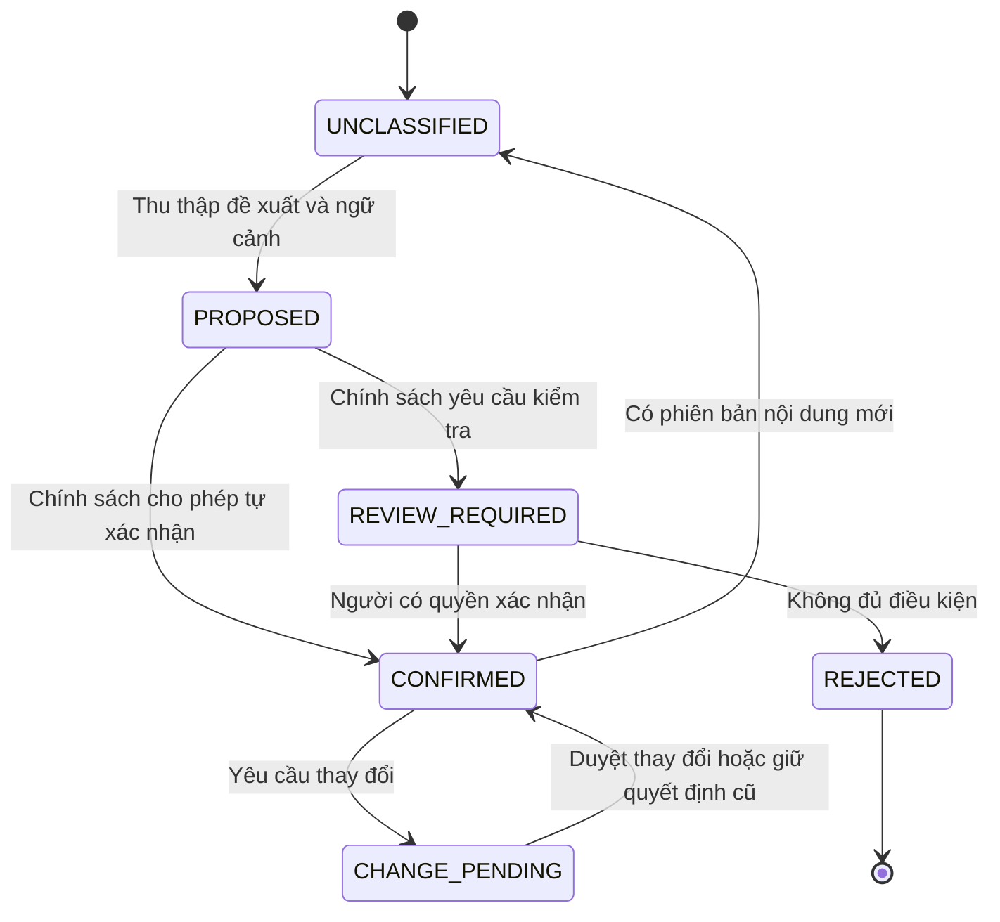

# File classification — Phân loại tệp để thực thi quy tắc nghiệp vụ

## 1. Phân loại tệp quyết định điều gì?

Trong chương **File Business Rules**, phân loại tệp là việc xác định tệp thuộc loại nào, phục vụ nghiệp vụ gì và cần được xử lý theo chính sách nào. Kết quả phân loại phải tác động đến hành vi của hệ thống: ai được đọc, ai được gắn tệp vào hồ sơ, tệp có thể tham gia bước phê duyệt nào và khi nào được phép chia sẻ ra bên ngoài.

Bài học thuộc module **Business Logic Security** (`SECURITY_APPLICATION_SECURITY_BUSINESS_LOGIC_SECURITY`). Trọng tâm là bảo vệ quy tắc nghiệp vụ trước việc giả loại tài liệu, đổi nhãn để mở quyền, thay nội dung sau phê duyệt hoặc dùng tệp không phù hợp để vượt qua một bước bắt buộc.

Sau bài học, bạn có thể:

- Tách định dạng kỹ thuật, loại tài liệu nghiệp vụ, mức độ nhạy cảm và trạng thái xử lý.
- Xác định dữ liệu phân loại nào do người dùng đề xuất, dữ liệu nào do máy chủ xác nhận.
- Thiết kế quyền theo đối tượng và điều kiện chuyển loại, đặc biệt khi giảm mức bảo vệ.
- Gắn phân loại với đúng phiên bản nội dung, chính sách và bằng chứng kiểm tra.
- Giữ chính sách nhất quán qua download, preview, bản chuyển đổi, tác vụ nền và retry.

**Bất biến trung tâm:** người dùng không được mở rộng quyền đối với một tệp chỉ bằng cách đổi tên, đổi đuôi, sửa nhãn hoặc chọn một loại tài liệu khác.

## 2. Tình huống xuyên suốt: biến hồ sơ mua hàng thành tài liệu công khai

Một nền tảng mua hàng có hai nhóm chức năng:

- Nhân viên mua hàng tải đề xuất mua hàng và tài liệu phê duyệt.
- Nhân viên phụ trách danh mục đăng ảnh, tài liệu giới thiệu sản phẩm được phép công khai.

Một người có quyền upload đề xuất mua hàng gửi yêu cầu:

```json
{
  "fileName": "product-guide.pdf",
  "declaredContentType": "application/pdf",
  "businessPurpose": "PUBLIC_CATALOG_ASSET",
  "sensitivity": "PUBLIC",
  "approved": true
}
```

Nội dung thật là tài liệu có giá thương lượng, hạn mức và tên người duyệt. Người gửi muốn hệ thống coi tài liệu đó là tài sản truyền thông, bỏ qua quyền đọc hồ sơ mua hàng và tạo đường dẫn công khai.

Có ba lớp kiểm tra khác nhau:

1. Tệp có thực sự là định dạng được phép và có thể xử lý an toàn theo chính sách kỹ thuật không?
2. Người gửi có được yêu cầu dùng tệp làm tài sản danh mục trong ngữ cảnh này không?
3. Nội dung và quyết định phân loại có cho phép công khai đúng phiên bản này không?

Nếu chỉ kiểm tra đuôi `.pdf` và cho phép client đặt `sensitivity=PUBLIC`, ứng dụng đã biến một metadata có thể sửa thành cơ chế cấp quyền.

Trong thiết kế của bài, các trường client gửi chỉ có thể là **đề xuất** khi API cho phép. Máy chủ tạo bản ghi tệp riêng tư, kiểm tra quyền, thu thập bằng chứng và thực hiện quy trình xác nhận. Trường `approved` do client gửi không có giá trị phê duyệt.

## 3. Bốn chiều phân loại cần tách riêng

### 3.1. Định dạng kỹ thuật

Định dạng kỹ thuật mô tả cấu trúc byte và khả năng xử lý: PDF, JPEG, CSV, DOCX hoặc ZIP.

Cần phân biệt:

- Tên và phần mở rộng do người dùng gửi.
- `Content-Type` do client khai báo.
- Định dạng được bộ nhận diện phát hiện.
- Kết quả parser có đọc được nội dung theo cấu hình cho phép hay không.
- Kết quả kiểm tra mã độc hoặc nội dung chủ động theo chính sách.

OWASP khuyến nghị không tin `Content-Type` do người dùng gửi và không dùng dấu nhận dạng định dạng như biện pháp duy nhất. Nên giới hạn loại tệp, kích thước và quyền upload, đồng thời bảo vệ nơi lưu trữ. Xem [OWASP File Upload Cheat Sheet](https://cheatsheetseries.owasp.org/cheatsheets/File_Upload_Cheat_Sheet.html).

Một tệp đúng cấu trúc PDF chưa chứng minh nó là hợp đồng, đã được duyệt hay không chứa thông tin mật.

### 3.2. Loại tài liệu theo nghiệp vụ

Loại tài liệu thể hiện vai trò của tệp trong ứng dụng, ví dụ:

- `PURCHASE_PROPOSAL`: đề xuất mua hàng.
- `APPROVAL_EVIDENCE`: tài liệu hỗ trợ hồ sơ phê duyệt.
- `SUPPLIER_CONTRACT`: hợp đồng nhà cung cấp.
- `PUBLIC_CATALOG_ASSET`: nội dung dự kiến dùng cho danh mục công khai.

Các loại này có thể cùng dùng PDF. Nhận diện định dạng không xác định được loại nghiệp vụ.

Đổi loại có thể làm thay đổi quyền đọc, điều kiện đính kèm, người được duyệt, thời hạn lưu theo chính sách nội bộ hoặc quy trình phát hành. Vì vậy, thao tác đổi loại là một hành động nghiệp vụ cần phân quyền.

### 3.3. Mức độ nhạy cảm

Ứng dụng minh họa dùng thang sau:

```text
PUBLIC < INTERNAL < CONFIDENTIAL < RESTRICTED
```

Đây là quy ước của ví dụ, không phải bộ nhãn bắt buộc cho mọi tổ chức.

| Mức minh họa | Ý nghĩa trong ứng dụng |
|---|---|
| PUBLIC | Nội dung đủ điều kiện về độ nhạy cảm để xem xét phát hành công khai |
| INTERNAL | Chỉ dành cho người dùng nội bộ có phạm vi được phép |
| CONFIDENTIAL | Chỉ dành cho nhóm nghiệp vụ hoặc quan hệ đối tượng xác định |
| RESTRICTED | Chỉ dành cho tập chủ thể được cấp quyền rõ ràng và kiểm soát bổ sung |

`PUBLIC` không tự động đồng nghĩa “đang được phát hành”. Ứng dụng còn cần quyết định phát hành, quyền của người phát hành và kiểm tra đúng phiên bản nội dung.

Tương tự, `INTERNAL` không có nghĩa mọi nhân viên đều được đọc. Tenant, bộ phận, quan hệ với hồ sơ và mục đích sử dụng vẫn là điều kiện riêng.

### 3.4. Trạng thái xử lý và độ tin cậy của bằng chứng

Các trạng thái như “đã upload”, “quét sạch”, “đã xác nhận phân loại” và “đã công khai” trả lời những câu hỏi khác nhau.

| Thuộc tính | Ví dụ giá trị | Không được suy ra trực tiếp |
|---|---|---|
| Tiếp nhận | QUARANTINED, ACCEPTED, REJECTED | ACCEPTED không có nghĩa công khai |
| Quét mã độc | PENDING, CLEAN, DETECTED, ERROR | CLEAN không có nghĩa không chứa bí mật |
| Phân loại | UNCLASSIFIED, PROPOSED, CONFIRMED | CONFIRMED không chứng minh đã ký hợp đồng |
| Phát hành | PRIVATE, PUBLISHED, REVOKED | PUBLISHED không bỏ qua việc thu hồi quyền sau đó |
| Tính xác thực tài liệu | Chưa xác minh, đã xác minh theo quy trình riêng | Đúng loại không chứng minh người có quyền đã phê duyệt |

Không nên nén toàn bộ các chiều này vào một cờ `safe` hoặc `trusted`.

## 4. Thiết kế chính sách phân loại theo ngữ cảnh

### 4.1. Chính sách không chỉ là bảng ánh xạ phần mở rộng

Một cấu hình minh họa cho tenant có thể là:

| Loại tài liệu | Định dạng được chấp nhận | Mức bảo vệ tối thiểu | Được công khai? | Điều kiện nghiệp vụ đáng chú ý |
|---|---|---|---|---|
| PURCHASE_PROPOSAL | PDF, CSV theo schema cho phép | CONFIDENTIAL | Không theo luồng thông thường | Gắn với đúng hồ sơ mua hàng |
| APPROVAL_EVIDENCE | PDF theo hồ sơ kiểm tra | CONFIDENTIAL | Không | Gắn đúng quyết định và đúng phiên bản tài liệu |
| SUPPLIER_CONTRACT | PDF theo hồ sơ kiểm tra | RESTRICTED | Không theo luồng thông thường | Không ghi đè bản đã trở thành bằng chứng |
| PUBLIC_CATALOG_ASSET | JPEG, PNG, PDF theo hồ sơ kiểm tra | PUBLIC | Có điều kiện | Cần kiểm tra nội dung và quyết định phát hành riêng |

Các mức trong bảng là lựa chọn cho tình huống học tập. Một tổ chức khác có thể có chính sách khác.

“Mức tối thiểu PUBLIC” của tài sản danh mục không yêu cầu mọi tệp thuộc loại đó phải được gán PUBLIC. Nếu tài liệu có nội dung nhạy cảm, ứng dụng phải giữ mức cao hơn, từ chối loại dự kiến hoặc yêu cầu tạo bản công khai đã xử lý phù hợp.

### 4.2. Ngữ cảnh ảnh hưởng đến kết quả

Cùng một mẫu tài liệu có thể cần bảo vệ khác nhau tùy:

- Tenant và bộ phận quản lý.
- Hồ sơ nghiệp vụ mà tệp được gắn vào.
- Tình trạng dự thảo, đã ký hoặc đã phát hành.
- Dữ liệu cá nhân, điều khoản thương mại hoặc thông tin nội bộ có trong nội dung.
- Nguồn tạo tệp và mức độ đầy đủ của bằng chứng phân loại.
- Chính sách hiện hành cùng các ngoại lệ đã được phê duyệt.

Một tệp có nhiều liên kết không nên nhận chính sách dễ dãi nhất trong các hồ sơ liên quan. Cần xác định chính sách tổng hợp: trong mô hình thang nhạy cảm tuyến tính của ví dụ, mức hiệu lực không thấp hơn mức cao nhất do các ngữ cảnh yêu cầu.

Nếu cần bản được chia sẻ rộng hơn, có thể tạo một tài liệu dẫn xuất và xét duyệt riêng. Không giảm nhãn của bản gốc chỉ để đáp ứng một mục đích chia sẻ.

### 4.3. Loại nghiệp vụ không có một thứ tự chung

Có thể so sánh các mức nhạy cảm theo thang của ứng dụng. Không thể mặc định xếp mọi loại nghiệp vụ thành “cao” và “thấp”.

Đổi từ `APPROVAL_EVIDENCE` sang `PUBLIC_CATALOG_ASSET` có thể đồng thời:

- Mở rộng nhóm người được xem.
- Làm mất điều kiện phải gắn với quyết định phê duyệt.
- Thay đổi cách lưu giữ bằng chứng.
- Mở thêm khả năng xuất bản hoặc chuyển đổi.

Việc đánh giá thay đổi phải so sánh các quyền và nghĩa vụ thực tế. Chỉ so sánh một con số `sensitivityLevel` sẽ bỏ sót tác động của loại nghiệp vụ.

## 5. Ai có quyền nói tệp thuộc loại nào?

### 5.1. Ba nguồn thông tin

Hệ thống có thể kết hợp ba nhóm dữ liệu:

1. **Người dùng đề xuất:** mục đích sử dụng, hồ sơ liên quan và loại tài liệu dự kiến.
2. **Hệ thống quan sát:** định dạng, phiên bản byte, kết quả parser, quét mã độc và phát hiện nội dung.
3. **Chính sách hoặc người có quyền xác nhận:** loại và mức bảo vệ có hiệu lực, phạm vi chia sẻ, ngoại lệ cùng lý do.

Không biến kết quả của nhóm thứ nhất thành quyết định của nhóm thứ ba bằng cách đổi tên một field.

Ví dụ, API nhận `requestedPurpose` rõ nghĩa hơn một API cho client cập nhật thẳng `effectivePurpose`. Phân biệt tên trường hỗ trợ thiết kế; máy chủ vẫn phải thực thi quyền và workflow.

### 5.2. Bộ nhận diện tự động là bằng chứng có giới hạn

Một detector có thể nhận thấy số định danh, thông tin liên hệ hoặc từ khóa thương mại. Kết quả đó giúp đề xuất bảo vệ hoặc chuyển sang kiểm tra thủ công.

Tuy nhiên:

- Không phát hiện không đồng nghĩa không có thông tin nhạy cảm.
- OCR có thể bỏ sót chữ trong ảnh hoặc nội dung khó đọc.
- Tệp mã hóa có thể không cho phép phân tích đủ.
- Metadata, trang ẩn hoặc đối tượng đính kèm có thể nằm ngoài phạm vi một detector.
- Nội dung tự ghi “đây là tài liệu công khai” không có thẩm quyền cấp quyền.
- Kết quả phải gắn với phiên bản tệp và phiên bản bộ kiểm tra đã chạy.

Nếu không đủ bằng chứng cho một thao tác mở quyền, hệ thống nên giữ tệp ở phạm vi hạn chế hoặc chờ kiểm tra. Không dùng lỗi dịch vụ phân tích làm lý do tự gán mức thấp.

### 5.3. Metadata có thẩm quyền phải do máy chủ quản lý

Một bản ghi có thể lưu:

```json
{
  "fileId": "file-204",
  "tenantId": "tenant-a",
  "businessObjectId": "purchase-request-51",
  "contentVersion": 3,
  "contentDigest": "<digest-byte-goc>",
  "declaredContentType": "application/pdf",
  "detectedFormat": "PDF",
  "requestedPurpose": "PUBLIC_CATALOG_ASSET",
  "effectivePurpose": "PURCHASE_PROPOSAL",
  "effectiveSensitivity": "CONFIDENTIAL",
  "classificationStatus": "CHANGE_PENDING",
  "classificationRevision": 8,
  "classificationPolicyVersion": 14,
  "publicationState": "PRIVATE",
  "accessEpoch": 6
}
```

Trong ví dụ, yêu cầu đổi loại đang chờ duyệt; chính sách hiệu lực vẫn là `PURCHASE_PROPOSAL / CONFIDENTIAL`.

Tenant, định danh phiên bản, trạng thái xác nhận và người duyệt không được lấy trực tiếp từ field do client gửi. Tên object, tên thư mục hoặc nhãn metadata ở kho lưu trữ cũng không nên trở thành một nguồn quyền độc lập với hệ thống chính sách.

## 6. Các bất biến nghiệp vụ cần viết ra

Đối với ứng dụng minh họa, các điều kiện sau luôn phải đúng:

1. Mọi quyết định phân loại gắn với một file, tenant và phiên bản nội dung xác định.
2. Chưa phân loại xong thì không được phát hành ra ngoài.
3. Người có quyền upload không vì thế có quyền giảm mức bảo vệ hoặc xác nhận phân loại.
4. Quét mã độc thành công không tự mở quyền đọc hoặc quyền công khai.
5. Thay nội dung làm mất hiệu lực các bằng chứng không còn khớp phiên bản.
6. Đổi loại không được làm hồ sơ nghiệp vụ vượt qua một bước phê duyệt bắt buộc.
7. Giảm mức bảo vệ hoặc mở rộng người xem phải có quyết định được cấp quyền rõ ràng.
8. Preview, OCR, thumbnail và bản tải xuống phải tuân theo chính sách hiệu lực.
9. Request lặp không tạo nhiều quyết định hoặc nhiều lần phát hành ngoài dự kiến.
10. Người không có quyền với đối tượng không được nhận dữ liệu chỉ nhờ biết file ID.

Có thể diễn tả điều kiện phát hành:

```text
mayPublish =
    actorMayPublishThisFile
    AND currentContentVersionIsAccepted
    AND requiredTechnicalChecksPassed
    AND classificationIsConfirmedForCurrentVersion
    AND effectiveSensitivityAllowsPublicUse
    AND businessPurposeAllowsPublication
    AND releaseApprovalMatchesCurrentContentAndClassification
    AND noActiveRestrictionBlocksPublication
```

Đây là tập điều kiện của ví dụ. Một hệ thống khác cần xác định chính sách riêng, thay vì mặc định mọi tệp đều có cùng quy trình.

## 7. Quy trình phân loại từ lúc nhận tệp

### 7.1. Giữ tệp riêng tư trong lúc chưa có quyết định

Một luồng hợp lý gồm:

1. Xác thực người gửi và quyền tạo tệp trong hồ sơ được chọn.
2. Ghi nhận nội dung vào vùng riêng tư hoặc cách ly theo phiên bản ổn định.
3. Tạo metadata do máy chủ quản lý, chưa cấp quyền phát hành.
4. Kiểm tra định dạng, giới hạn xử lý và các kiểm tra kỹ thuật cần thiết.
5. Thu thập ngữ cảnh nghiệp vụ và bằng chứng phát hiện nội dung.
6. Đánh giá chính sách, tự xác nhận trong phạm vi cho phép hoặc yêu cầu người duyệt.
7. Ghi quyết định phân loại có phiên bản.
8. Chỉ sau đó mới xem xét các hành động như đính kèm, phát hành hoặc xuất dữ liệu.

Không lưu tệp ở vị trí công khai rồi chờ job nền gắn nhãn lại. Khoảng thời gian “chưa kịp phân loại” cũng là một trạng thái hệ thống phải bảo vệ.

### 7.2. State machine của quyết định phân loại



Sơ đồ mô tả workflow; trạng thái quét và phát hành được quản lý riêng. Nhánh tự xác nhận chỉ được dùng khi chính sách phía máy chủ cho phép, không do client chọn.

Với phiên bản mới, hệ thống có thể tạo một bản ghi phân loại mới cho phiên bản ấy thay vì xóa lịch sử của phiên bản cũ. Cách lưu phải giữ được liên hệ giữa từng quyết định và nội dung tương ứng.

OWASP khuyến nghị lưu trạng thái workflow ở máy chủ và xác thực điều kiện chuyển bước tại các endpoint. Trong bài này, điều đó có nghĩa endpoint đổi loại và endpoint phát hành đều kiểm tra trạng thái hiện tại, kể cả khi giao diện chưa hiển thị nút thao tác. Xem [OWASP Business Logic Security Cheat Sheet](https://cheatsheetseries.owasp.org/cheatsheets/Business_Logic_Security_Cheat_Sheet.html).

## 8. Đổi phân loại và giảm mức bảo vệ

### 8.1. Phân biệt đề xuất với trạng thái hiệu lực

Khi người dùng yêu cầu giảm `CONFIDENTIAL` xuống `PUBLIC`, trong thời gian chờ duyệt:

```text
effectiveSensitivity = CONFIDENTIAL
requestedSensitivity = PUBLIC
changeStatus = PENDING
publicationState = PRIVATE
```

Không cập nhật nhãn hiệu lực thành PUBLIC trước rồi hy vọng một job sau đó sẽ kiểm tra.

Khi phát hiện dấu hiệu cần bảo vệ cao hơn, ứng dụng có thể áp dụng biện pháp hạn chế ngay, chẳng hạn tạm dừng chia sẻ và đưa vào kiểm tra. Cần phân biệt “biện pháp hạn chế tạm thời” với “quyết định phân loại đã được xác nhận”.

### 8.2. Điều kiện phê duyệt thay đổi

Trong ví dụ, một thay đổi mở rộng quyền xem cần:

- Người yêu cầu có quyền đề xuất thay đổi trên tệp.
- Người duyệt có quyền xét thay đổi trong đúng tenant và ngữ cảnh.
- Người yêu cầu và người duyệt là hai chủ thể khác nhau.
- Nội dung, phiên bản metadata và chính sách khớp với yêu cầu đã được xem xét.
- Bằng chứng cần thiết đã có và còn phù hợp.
- Không vi phạm mức bảo vệ tối thiểu hoặc điều kiện của hồ sơ liên quan.
- Có lý do và dấu vết quyết định.

Yêu cầu hai người là chính sách của ứng dụng minh họa, không phải mặc định cho mọi chức năng phân loại.

Việc đổi loại hoặc giảm nhãn không tự phát hành tệp. Sau khi quyết định thay đổi có hiệu lực, bước phát hành vẫn phải kiểm tra quyền và quyết định phát hành riêng.

### 8.3. Đổi nhãn không phải biện pháp xóa dữ liệu nhạy cảm

Nếu tài liệu chứa giá nội bộ, đổi nhãn thành PUBLIC không làm giá nội bộ biến mất. Cách chia sẻ có thể là tạo một bản đã loại bỏ thông tin cần bảo vệ rồi xác nhận riêng cho bản đó.

Bản công khai phải được kiểm tra trên nội dung thực tế được phát hành, gồm các thành phần liên quan như metadata, đối tượng đính kèm hoặc nội dung ẩn. Một hình chữ nhật che chữ trong preview không tự chứng minh dữ liệu gốc đã bị loại bỏ khỏi tệp.

Bản gốc giữ chính sách bảo vệ và lịch sử của nó. Bản dẫn xuất giữ liên hệ nguồn gốc nhưng có quyết định riêng khi chính sách cho phép giảm mức bảo vệ.

## 9. Phân loại phải đi cùng quyền theo đối tượng

### 9.1. Không chỉ kiểm tra vai trò chung

Một người có vai trò `DOCUMENT_REVIEWER` có thể chỉ được xem tài liệu của một bộ phận hoặc nhóm hợp đồng. Quyền cần xét cả:

```text
subject + tenant + action + file + businessContext
        + effectiveClassification + currentState
```

Tệp thuộc `tenant-a` không được đọc bởi người của `tenant-b`, dù hai người cùng có vai trò reviewer.

OWASP yêu cầu kiểm tra quyền cho từng tài nguyên liên quan. Biết hoặc đoán được một ID không đủ để có quyền với tài nguyên đó. Xem [OWASP Authorization Cheat Sheet](https://cheatsheetseries.owasp.org/cheatsheets/Authorization_Cheat_Sheet.html).

### 9.2. Gắn tệp vào hồ sơ là một thao tác riêng

Giả sử người dùng có quyền đọc một tệp và quyền sửa một hồ sơ mua hàng. Họ chưa chắc được gắn tệp ấy làm bằng chứng phê duyệt của hồ sơ đó.

Thao tác đính kèm cần kiểm tra:

- Quyền sử dụng tệp theo mục đích dự kiến.
- Quyền sửa hồ sơ đích.
- Tenant, đơn vị và các quan hệ đối tượng phù hợp.
- Loại tài liệu được chấp nhận cho trường đính kèm đó.
- Phiên bản nội dung cùng trạng thái xác nhận cần thiết.
- Các ràng buộc chống dùng lại chứng từ nếu nghiệp vụ yêu cầu.

Không cho client thay `businessPurpose` để thỏa điều kiện bắt buộc rồi đổi lại ngay sau khi hồ sơ được duyệt.

### 9.3. Đúng loại không có nghĩa đúng bằng chứng

Một tệp được phân loại `APPROVAL_EVIDENCE` chỉ cho biết vai trò dự kiến hoặc đã được xác nhận của tài liệu. Nó không tự chứng minh:

- Người duyệt có thẩm quyền.
- Quyết định duyệt có tồn tại.
- Người duyệt đã đồng ý đúng nội dung hiện tại.
- Quyết định chưa bị thu hồi.
- Tài liệu đáp ứng đầy đủ các điều kiện xác thực của nghiệp vụ.

Hệ thống phải liên kết với bản ghi phê duyệt hoặc quy trình xác minh bằng chứng riêng. Không đặt trạng thái đơn là `APPROVED` chỉ vì có một tệp mang nhãn “biên bản phê duyệt”.

## 10. Minh họa thiết kế dịch vụ Java

### 10.1. API nhận đề xuất, không nhận quyết định có hiệu lực

DTO có thể giới hạn đầu vào:

```java
public record RequestClassificationChange(
        UUID fileId,
        long expectedMetadataRevision,
        BusinessPurpose requestedPurpose,
        Sensitivity requestedSensitivity,
        String reason,
        String idempotencyKey
) {}
```

Người dùng không truyền `tenantId`, `approvedBy`, `classificationStatus` hoặc `publicationState` để máy chủ tin và lưu thẳng.

Máy chủ lấy danh tính từ ngữ cảnh xác thực, kiểm tra quyền với tệp, xác thực đề xuất và tạo bản ghi yêu cầu thay đổi. Bản ghi ấy chụp lại phiên bản nội dung, revision metadata, chính sách và các field được yêu cầu.

Không dùng:

```java
// Minh họa cách làm sai.
file.setPurpose(request.requestedPurpose());
file.setSensitivity(request.requestedSensitivity());
file.setApproved(true);
repository.save(file);
```

Đoạn mã sai vì cho phép đề xuất tự trở thành quyết định.

### 10.2. Xác nhận thay đổi trong transaction

Đoạn mã sau minh họa bước duyệt cho **một tệp gốc và nhóm bản dẫn xuất do ứng dụng quản lý**. Các repository và kiểu nghiệp vụ là hợp đồng cần triển khai, không phải chương trình độc lập có thể chạy ngay.

`AuthenticatedActor` được tạo từ lớp xác thực phía máy chủ. Nội dung ở kho lưu trữ dùng phiên bản bất biến; các kết quả scan và detection đã được lưu với định danh phiên bản đó.

```java
@Transactional
public ClassificationResult approveChange(
        UUID changeId,
        AuthenticatedActor actor
) {
    ClassificationChange change = changes.lockByTenantAndId(
            actor.tenantId(), changeId)
            .orElseThrow(ChangeNotAccessibleException::new);

    FileRecord file = files.lockByTenantAndId(
            actor.tenantId(), change.fileId())
            .orElseThrow(FileNotAccessibleException::new);

    access.requireReviewClassification(actor, file, change);
    change.requireReviewerDifferentFromRequester(actor.id());

    // Retry chỉ được trả kết quả sau khi kiểm tra quyền.
    if (change.isApplied()) {
        return results.load(change.resultId());
    }

    change.requirePending();
    file.requireContentIdentity(
            change.contentVersion(), change.contentDigest());
    file.requireMetadataRevision(change.baseMetadataRevision());

    ClassificationPolicy policy = policies.lockCurrent(
            file.tenantId(), file.businessContext());

    change.requirePolicyVersion(policy.version());

    ScanEvidence scan = scans.requireForContent(
            file.id(), file.contentVersion(), file.contentDigest());

    DetectionEvidence detection = detections.requireForContent(
            file.id(), file.contentVersion(), file.contentDigest());

    ClassificationDecision decision = policy.evaluate(
            file, change.requestedClassification(), scan, detection);

    decision.requireAllowed();

    if (decision.expandsAccessOrRemovesProtection()) {
        access.requireDeclassificationAuthority(actor, file, decision);
        change.requireAdditionalReviewEvidence(decision);
    }

    file.applyClassification(decision.classification());
    file.incrementMetadataRevision();
    file.incrementAccessEpoch();
    file.setPublicationState(PublicationState.PRIVATE);

    // Chỉ thu hồi grant do gateway của ứng dụng quản lý.
    gatewayGrants.revokeForLineage(file.lineageId());

    ClassificationResult result = results.create(
            change.id(), file.id(), decision, actor.id());

    change.markApplied(result.id());
    audit.appendClassificationChanged(file, change, actor, decision);
    outbox.appendClassificationChanged(
            file.id(), file.contentVersion(), file.accessEpoch());

    return result;
}
```

Các điều kiện quan trọng của ví dụ:

- Truy vấn có tenant và khóa đối tượng đến hết transaction.
- Các thao tác thay nội dung hoặc đổi metadata cũng dùng cơ chế khóa hoặc kiểm tra phiên bản tương thích.
- `evaluate` kiểm tra tập định dạng được phép, mức bảo vệ tối thiểu, trạng thái scan, độ đầy đủ của bằng chứng, ngữ cảnh nghiệp vụ và hạn chế đang có.
- Kết quả quét `ERROR`, `PENDING` hoặc bằng chứng không khớp phiên bản không được hiểu như `CLEAN`.
- `expandsAccessOrRemovesProtection` so sánh cả phạm vi người xem và ràng buộc của loại nghiệp vụ, không chỉ so sánh thứ tự các nhãn nhạy cảm.
- Thay đổi phân loại đưa tệp về PRIVATE trong mô hình này; mở lại phát hành cần quyết định mới.
- Revision metadata, trạng thái yêu cầu, kết quả, grant tại gateway, audit trong cơ sở dữ liệu và outbox cùng commit hoặc cùng rollback.

Hai yêu cầu đổi loại khác nhau có thể cùng được đề xuất trên revision 8. Sau khi một yêu cầu commit revision 9, yêu cầu còn lại phải bị từ chối do revision không còn khớp, thay vì ghi đè quyết định mới.

Với Spring, cần bảo đảm lời gọi thực sự đi qua cơ chế quản lý transaction và cấu hình rollback phù hợp. Annotation trong ví dụ không tự thay thế cấu hình triển khai. Chỉ trả thành công sau khi commit thành công.

Thu hồi grant trong cơ sở dữ liệu không tự thu hồi URL tải trực tiếp đã cấp từ dịch vụ lưu trữ, cũng không xóa bản đã tải xuống. Bảo đảm của gateway và giới hạn đó được phân tích ở phần tiếp theo.

## 11. Thực thi phân loại trên mọi đường đọc tệp

### 11.1. Một quyết định phải chi phối nhiều điểm truy cập

Cùng một tệp có thể xuất hiện qua:

- API tải bản gốc.
- Preview và thumbnail.
- Trang tìm kiếm hoặc danh sách tài liệu.
- API OCR hoặc trích xuất văn bản.
- Tệp ZIP xuất nhiều tài liệu.
- Email, webhook hoặc connector gửi dữ liệu đi.
- Đường dẫn chia sẻ và CDN.

Nếu download kiểm tra nhãn nhưng preview phục vụ công khai, chính sách vẫn bị vượt qua.

Các điểm truy cập nên dựa trên chính sách có thẩm quyền, đúng phiên bản nội dung và trạng thái hiệu lực. Tránh duy trì nhiều cờ độc lập như `isPublic` ở bảng tệp, metadata object và chỉ mục tìm kiếm mà không có quy tắc đồng bộ rõ ràng.

### 11.2. Phân loại không thay thế quyền đọc

Điều kiện đọc nội bộ có thể là:

```text
mayRead =
    subjectMayAccessTenant
    AND subjectMayReadBusinessObject
    AND classificationPermitsSubjectAndPurpose
    AND contentVersionIsAvailableForThisAction
    AND noActiveHoldBlocksThisAccess
```

Một bản ghi mang nhãn PUBLIC nhưng chưa được phát hành vẫn không cho phép truy cập ẩn danh trong ví dụ. Một bản ghi CONFIDENTIAL cũng không mặc định cho phép tất cả người dùng có vai trò “nhân viên”.

### 11.3. URL ký sẵn và thời điểm thu hồi

URL ký sẵn thường hoạt động như một quyền truy cập có thời hạn: người giữ URL có thể dùng nó theo cơ chế của dịch vụ lưu trữ. Việc đổi nhãn ở cơ sở dữ liệu ứng dụng không bảo đảm URL đó mất hiệu lực ngay.

Nếu yêu cầu nghiệp vụ cần kiểm tra quyền hiện tại cho mỗi lần đọc, có thể dùng gateway để:

1. Xác thực chủ thể hoặc grant chia sẻ.
2. Đọc chính sách có hiệu lực.
3. Kiểm tra version và `accessEpoch`.
4. Phục vụ đúng nội dung được phép.

Nếu gateway kiểm tra xong rồi chuyển hướng sang một URL tải trực tiếp có thời hạn, vẫn tồn tại cửa sổ hiệu lực của URL ấy. Cần đánh giá bảo đảm thực tế, không gọi đó là thu hồi tức thời.

Ngay cả với gateway, hệ thống phải định nghĩa cách xử lý lượt tải đang diễn ra khi quyền bị thu hồi. Không thể xóa dữ liệu mà người nhận đã lưu trước đó chỉ bằng việc đổi nhãn.

### 11.4. Cache phải phản ánh quyết định quyền

Cache quyền dựa duy nhất vào `fileId` có thể tiếp tục cho phép đọc sau khi phân loại đổi. Khóa cache nên tính đến các thành phần liên quan như tenant, chủ thể hoặc phạm vi chia sẻ, version nội dung, revision chính sách và epoch quyền.

Nếu cache công khai hoặc CDN đã lưu nội dung, cần có quy trình ngừng phục vụ và vô hiệu hóa cache tương ứng. Với tài liệu yêu cầu thu hồi chặt chẽ, không đặt bản gốc trong một cơ chế cache công khai không thể kiểm tra chính sách hiện tại.

## 12. Bản dẫn xuất và dữ liệu trích xuất cũng cần phân loại

### 12.1. Kế thừa bảo vệ là điểm khởi đầu

Các kết quả sau có thể làm lộ cùng thông tin với bản gốc:

- Thumbnail của hợp đồng.
- Văn bản OCR.
- PDF chuyển đổi từ tài liệu văn phòng.
- Ảnh chụp trang.
- Tệp nén tổng hợp.
- Trích đoạn trong kết quả tìm kiếm.

Trong mô hình của bài, bản dẫn xuất giữ mức bảo vệ không thấp hơn bản nguồn và chịu điều kiện truy cập liên quan. Muốn giảm mức bảo vệ phải có quy trình riêng cho chính bản dẫn xuất.

Việc chuyển từ PDF sang ảnh không làm thông tin trở nên công khai. Xóa tên người tải lên cũng chưa chắc đã loại bỏ dữ liệu nhạy cảm trong nội dung.

### 12.2. Tổng hợp nhiều tệp

Với thang tuyến tính đã chọn, mức nhạy cảm của một tệp xuất tổng hợp không thấp hơn mức cao nhất của các đầu vào, trừ khi có quyết định cho một đầu ra đã được xử lý và kiểm tra riêng.

Tuy nhiên, lấy mức cao nhất chưa đủ để quyết định ai được đọc. Nếu một người chỉ được đọc một trong hai tài liệu nguồn, họ không mặc nhiên được đọc gói chứa cả hai. Phạm vi người nhận phải thỏa quyền với mọi đầu vào liên quan hoặc có một cơ sở cấp quyền riêng được chính sách cho phép.

### 12.3. Job nền phải giữ liên kết phiên bản

Một job tạo preview nên gắn với:

```text
fileId
contentVersion
contentDigest
classificationRevision hoặc accessEpoch liên quan
transformerVersion
outputIdentity
```

Trước khi công bố đầu ra, worker kiểm tra job còn tương ứng với phiên bản hiện hành được phép phục vụ. Nếu tệp đã bị hạn chế hoặc thay nội dung, job cũ không được ghi đè preview hiện tại hay mở lại một grant vừa bị thu hồi.

Khi chia sẻ ra một hệ thống khác, cần xác định chính sách ở phía nhận và khả năng thu hồi thực tế. Ghi nhãn ở hệ thống nguồn không tự buộc hệ thống nhận thực thi cùng quy tắc.

## 13. Idempotency, cạnh tranh và thay đổi chính sách

### 13.1. Retry yêu cầu đổi loại

Khóa idempotency có thể có phạm vi:

```text
(tenantId, authenticatedRequesterId, operation, idempotencyKey)
```

Yêu cầu gốc cần được ràng buộc với file, phiên bản, revision nền, loại đề xuất, mức đề xuất và các tham số có ý nghĩa.

- Cùng khóa và cùng yêu cầu: trả lại bản ghi thay đổi đã tạo.
- Cùng khóa nhưng khác file hoặc khác nhãn: báo xung đột.
- Hai yêu cầu cùng khóa chạy đồng thời: dùng ràng buộc duy nhất và transaction để chỉ tạo một bản ghi.
- Người không có quyền hiện tại: không được nhận dữ liệu chỉ nhờ giữ khóa idempotency.

Việc duyệt một yêu cầu đã hoàn tất cũng cần hành vi rõ ràng. Trong mã ví dụ, retry được cấp quyền trả lại kết quả đã có; nó không tạo một lần đổi nhãn mới.

### 13.2. Cạnh tranh với thay phiên bản nội dung

Tình huống điển hình:

```text
A: Người duyệt xem tệp version 3.
B: Người tải lên tạo version 4 có thêm nội dung mật.
A: Gửi yêu cầu xác nhận phân loại PUBLIC.
```

Hệ thống phải phát hiện yêu cầu duyệt gắn với version 3. Không áp dụng nó cho version 4 chỉ vì file ID giống nhau.

Nếu một phiên bản cũ vẫn được phép phát hành độc lập, quyết định phải chỉ rõ phiên bản cũ đó; đường dẫn “latest” không được âm thầm thay bằng nội dung mới.

### 13.3. Cạnh tranh với cập nhật chính sách

Một chính sách mới có thể nâng mức bảo vệ tối thiểu cho tài liệu hợp đồng. Một yêu cầu cũ đang chờ không nên commit theo chính sách đã hết hiệu lực mà không có quy tắc chuyển tiếp rõ ràng.

Ví dụ chọn cách yêu cầu version chính sách khớp; nếu không khớp thì đánh giá và duyệt lại. Khi chính sách yêu cầu hạn chế ngay, cần chặn truy cập bằng chính sách hiệu lực hoặc biện pháp tạm thời, thay vì chờ tất cả tệp được job nền gắn nhãn lại.

Event đến muộn cũng không được ghi lùi revision. Consumer cần kiểm tra version hoặc epoch và xử lý lặp theo định danh sự kiện, thay vì áp dụng mọi thông điệp theo thứ tự nhận được.

## 14. Audit và tiêu chí kiểm thử

### 14.1. Audit quyết định, không chỉ audit upload

Một bản ghi đổi phân loại nên cho biết:

- Tệp, tenant, phiên bản nội dung và digest liên quan.
- Loại và mức bảo vệ trước, sau.
- Người yêu cầu, người duyệt và thời điểm do máy chủ ghi nhận.
- Lý do, bằng chứng hoặc tham chiếu hồ sơ.
- Version chính sách và revision metadata.
- Quyết định thu hồi hoặc thay đổi quyền phát hành.
- Kết quả thành công, từ chối hay xung đột phiên bản.

Không ghi toàn bộ nội dung nhạy cảm vào log chỉ để giải thích vì sao tệp được phân loại cao. Quyền đọc audit, preview, lỗi xử lý và tên tệp cũng cần được kiểm soát.

Các dấu hiệu cần theo dõi có thể gồm nhiều yêu cầu giảm nhãn, đổi qua lại giữa các loại nghiệp vụ, cố tự duyệt, hoặc liên tục chọn file của tenant khác.

### 14.2. Ma trận tình huống lạm dụng

Bảng sau mô tả kết quả mong đợi khi triển khai. Nó không khẳng định mã minh họa đã được chạy kiểm thử.

| Tình huống | Kết quả mong đợi |
|---|---|
| Client gửi `approved=true` | Không tạo quyết định phê duyệt |
| Đổi tên hợp đồng thành `catalog.pdf` | Không thay đổi loại và quyền hiệu lực |
| Gửi MIME hợp lệ nhưng nội dung không khớp chính sách | Không được dùng cho luồng đã chọn |
| Tệp scan CLEAN nhưng chứa giá nội bộ | Không tự gán PUBLIC hoặc phát hành |
| Detector timeout hoặc không đọc được nội dung | Giữ hạn chế hoặc yêu cầu kiểm tra; không tự giảm mức |
| Người có quyền upload yêu cầu giảm nhãn | Chỉ tạo đề xuất nếu được phép; không đổi quyền hiệu lực |
| Người yêu cầu tự duyệt thay đổi trong mô hình hai người | Bị từ chối |
| Reviewer của tenant khác dùng đúng change ID | Không đọc hoặc duyệt được yêu cầu |
| Người dùng đổi loại sang tài sản công khai để né quyền hồ sơ mua hàng | Chính sách ngữ cảnh chặn mở quyền trái phép |
| Đính kèm tệp đúng loại nhưng không thuộc hồ sơ được phép | Bị từ chối tại thao tác đính kèm |
| Có tệp `APPROVAL_EVIDENCE` nhưng thiếu quyết định duyệt hợp lệ | Hồ sơ không tự chuyển sang APPROVED |
| Người duyệt xem version 3 nhưng version 4 đã thay thế | Không áp dụng quyết định cũ cho version mới |
| Hai thay đổi cùng dựa trên revision 8 | Tối đa một thay đổi commit; thay đổi còn lại xử lý xung đột |
| Cùng idempotency key nhưng đổi nhãn đề xuất | Báo xung đột tham số |
| Retry yêu cầu đã commit | Không tạo thêm quyết định hoặc mở lại phát hành |
| Phân loại được xác nhận PUBLIC nhưng chưa duyệt phát hành | Truy cập ẩn danh vẫn bị chặn |
| Thu hồi quyền với tệp gốc nhưng gọi URL preview | Preview áp dụng hạn chế tương ứng |
| Job preview cũ hoàn tất sau khi tăng accessEpoch | Không công bố đầu ra theo quyền cũ |
| Tệp ZIP chứa tài liệu có các phạm vi quyền khác nhau | Kiểm tra quyền với toàn bộ đầu vào liên quan |
| Event cũ đến sau event đổi phân loại mới | Không ghi lùi revision hoặc mở lại grant |
| Đổi nhãn giữa lúc URL tải trực tiếp còn hạn | Kết quả phải đúng với giới hạn thu hồi đã công bố của kiến trúc |

Các kiểm tra cần quan sát cả metadata, grant có hiệu lực, nội dung thực sự được phục vụ và trạng thái domain. Chỉ xác nhận API trả lỗi chưa đủ nếu file hoặc preview đã được công khai trước đó.

Kiểm thử cạnh tranh cần tạo được hai thao tác chồng lấn. Hai lời gọi tuần tự không chứng minh cơ chế khóa hoặc kiểm tra revision xử lý đúng xung đột.

## 15. Những quyết định cần chốt trước khi triển khai

Nhóm phát triển nên xác định rõ:

- Danh mục loại nghiệp vụ và thang nhạy cảm có ý nghĩa gì trong sản phẩm?
- Những trường nào là đề xuất, những trường nào là quyết định phía máy chủ?
- Ai được xác nhận, đổi loại, giảm mức bảo vệ và phát hành từng nhóm tài liệu?
- Khi bằng chứng tự động không đầy đủ, tệp được giữ ở trạng thái nào?
- Quyết định nào mất hiệu lực khi nội dung, metadata hoặc chính sách thay đổi?
- Các đường đọc nào phải kiểm tra quyền hiện tại, và có chấp nhận URL trực tiếp còn hiệu lực một thời gian không?
- Bản dẫn xuất kế thừa quyền thế nào, và ai được phép duyệt một bản công khai đã xử lý?
- Việc đính kèm tài liệu ảnh hưởng gì đến workflow của hồ sơ?
- Retry, event cũ và thao tác đồng thời được nhận diện bằng khóa cùng version nào?
- Audit có đủ để giải thích vì sao một phiên bản cụ thể từng được chia sẻ cho một nhóm người cụ thể không?

Trong tình huống mua hàng, tài liệu không trở thành nội dung công khai nhờ tên `product-guide.pdf`, kết quả scan CLEAN hay nhãn người gửi tự chọn. Nó chỉ được sử dụng theo loại và phạm vi mà chính sách đã xác nhận cho đúng nội dung; mọi hành động mở rộng quyền tiếp tục chịu điều kiện nghiệp vụ tương ứng.
