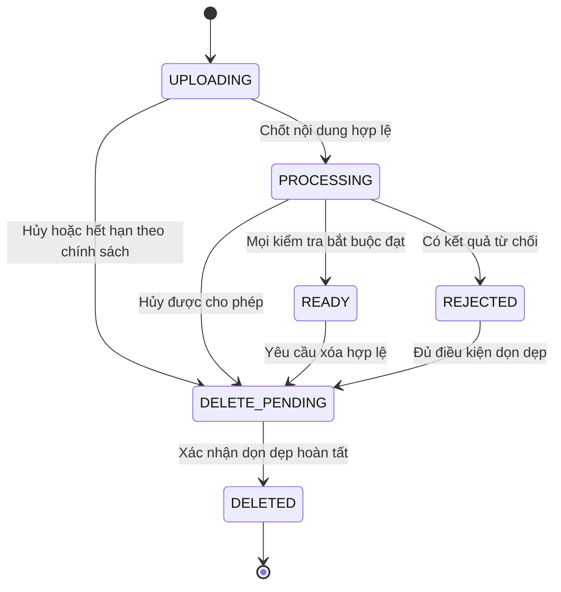

# File lifecycle — bảo vệ vòng đời tệp bằng quy tắc nghiệp vụ

Một tệp đã xuất hiện trong kho lưu trữ chưa chắc được phép dùng làm chứng từ. Một tệp đã quét thành công chưa chắc người đang đăng nhập được tải xuống. Một yêu cầu xóa đã được chấp nhận chưa chắc dữ liệu vật lý đã biến mất. Nếu ứng dụng gộp những khái niệm này thành một cờ `uploaded=true`, người dùng có thể khai thác các khoảng trống giữa tải lên, xử lý, đính kèm, phê duyệt và xóa.

Trong chương **File Business Rules**, bài học này xem tệp như một đối tượng nghiệp vụ có danh tính, trạng thái, quyền và lịch sử. Trọng tâm là bảo mật logic nghiệp vụ: duy trì invariants, kiểm soát state machine, phân quyền theo đối tượng, phối hợp transaction và xử lý yêu cầu lặp trong suốt vòng đời tệp.

Sau bài học, bạn có thể:

- Thiết kế vòng đời tệp với điều kiện chuyển trạng thái rõ ràng.
- Gắn kết kết quả xử lý với đúng nội dung bất biến, tránh dùng kết quả quét của phiên bản cũ.
- Bảo vệ thao tác đính kèm, tải xuống, thay thế và xóa theo ngữ cảnh nghiệp vụ.
- Xử lý retry, sự kiện đến muộn và lỗi giữa cơ sở dữ liệu với kho lưu trữ.
- Xây dựng các tình huống kiểm thử nhằm phát hiện hành vi bỏ qua bước hoặc phục hồi tệp trái phép.

## 1. Tệp là một đối tượng nghiệp vụ, không chỉ là đường dẫn

Xét hệ thống duyệt hồ sơ chi phí. Nhân viên tải hóa đơn lên, đính kèm vào hồ sơ nháp rồi gửi phê duyệt. Một hồ sơ đã duyệt phải giữ nguyên những chứng từ mà người duyệt đã xem.

Ví dụ này có hai đối tượng độc lập:

```text
ExpenseClaim
  id
  tenant_id
  requester_id
  status               // DRAFT, SUBMITTED, APPROVED, REJECTED
  version

FileRecord
  id
  tenant_id
  uploaded_by
  purpose
  lifecycle_state
  metadata_version
  upload_session_id
  storage_key
  storage_version
  verified_size
  verified_digest
  current_scan_task_id
  delivery_blocked
  retention_until
  hold
```

Quan hệ đính kèm được quản lý riêng:

```text
ClaimAttachment
  tenant_id
  claim_id
  file_id
  attached_by
  attached_at
```

Trong mô hình này, `FileRecord` đại diện cho một nội dung bất biến sau khi hoàn tất tải lên. Thay thế hóa đơn tạo một `file_id` mới. Ứng dụng không ghi đè nội dung của `file_id` đã được sử dụng làm bằng chứng.

`storage_version` là định danh phiên bản nội dung mà ứng dụng thực sự sử dụng. Nếu kho lưu trữ không cung cấp phiên bản đối tượng, ứng dụng phải đạt tính bất biến bằng một cơ chế khác, chẳng hạn khóa lưu trữ riêng cho từng nội dung và ngăn ghi đè. Chỉ đặt tên khóa bằng UUID chưa đủ nếu cùng khóa vẫn có thể bị ghi đè.

### Ba sự thật cần tách biệt

| Sự thật | Nó chứng minh điều gì? | Nó chưa chứng minh điều gì? |
|---|---|---|
| Đối tượng có trong kho lưu trữ | Một số byte đã được lưu | Nội dung đã được kiểm tra và được phép sử dụng |
| Nội dung đạt yêu cầu xử lý kỹ thuật | Các kiểm tra đã định nghĩa cho đúng phiên bản nội dung đã đạt | Người dùng có quyền xem hoặc chứng từ phù hợp với hồ sơ |
| Tệp đang được đính kèm | Có quan hệ nghiệp vụ giữa tệp và hồ sơ | Hồ sơ đã duyệt hoặc quan hệ được phép thay đổi |

Kết quả quét mã độc không chứng minh hóa đơn đúng người mua, đúng số tiền hoặc đã được phê duyệt. Các điều kiện đó thuộc nghiệp vụ và cần cơ chế kiểm tra riêng.

## 2. Xác định invariants trước khi đặt tên trạng thái

Invariant là điều kiện hệ thống phải duy trì ở những điểm có ý nghĩa nghiệp vụ. Với ví dụ hồ sơ chi phí, có thể chọn các invariants sau:

1. Không đính kèm tệp thuộc tenant khác vào hồ sơ.
2. Chỉ tệp sẵn sàng, đúng mục đích và không bị chặn mới được dùng để bổ sung chứng từ.
3. Kết quả xử lý phải gắn với đúng phiên bản nội dung đang được tham chiếu.
4. Chỉ người có quyền trên cả hồ sơ và tệp mới được tạo hoặc thay đổi quan hệ đính kèm.
5. Hồ sơ đã gửi hoặc đã duyệt không bị thay đổi chứng từ bằng đường cập nhật tệp.
6. Một yêu cầu xóa đã có hiệu lực không bị sự kiện upload hoặc scanner đến muộn làm phục hồi tệp.
7. Tệp còn tham chiếu được bảo vệ hoặc đang bị giữ theo chính sách không được xóa vật lý trái quy tắc.
8. Retry không tạo thêm quan hệ, trừ quota nhiều lần hoặc phát sinh tác dụng phụ nghiệp vụ lặp.

Phải xác định thời điểm áp dụng invariant. Ví dụ, khi gửi hồ sơ, mọi chứng từ bắt buộc phải đang đủ điều kiện sử dụng tại thời điểm commit. Nếu hệ thống phát hiện tệp nguy hiểm sau đó, có thể phải chặn phân phối và mở quy trình xử lý sự cố. Không được âm thầm thay nội dung cũ bằng một tệp mới để làm cho hồ sơ trông như chưa từng có vấn đề.

Một quyết định cho phép sử dụng tệp thường có dạng:

```text
CanUseFile(actor, tenant, file, claim) =
    actorIsActiveInTenant
    AND file.tenant_id == tenant
    AND claim.tenant_id == tenant
    AND canAccessFileInThisContext(actor, file, claim)
    AND canModifyClaim(actor, claim)
    AND claim.status == DRAFT
    AND file.lifecycle_state == READY
    AND NOT file.delivery_blocked
    AND file.purpose == EXPENSE_EVIDENCE
    AND acceptedProcessingResultMatchesExactContent(file)
```

Như vậy, `READY` chỉ là một điều kiện. Nó không phải quyền truy cập toàn cục.

## 3. State machine của vòng đời tệp

Một state machine tham khảo gồm:

| Trạng thái | Ý nghĩa | Có được phân phối nội dung không? |
|---|---|---|
| `UPLOADING` | Đã tạo phiên tải lên; nội dung chưa được chốt | Không |
| `PROCESSING` | Đã chốt đúng nội dung; đang kiểm tra và tạo dữ liệu dẫn xuất cần thiết | Không |
| `READY` | Những bước xử lý bắt buộc đã đạt cho đúng phiên bản nội dung | Chỉ khi quyền và điều kiện nghiệp vụ cũng cho phép |
| `REJECTED` | Nội dung bị từ chối bởi một kiểm tra bắt buộc | Không |
| `DELETE_PENDING` | Đã đóng đường sử dụng; đang thực hiện hoặc chờ hoàn tất dọn dẹp | Không |
| `DELETED` | Dọn dẹp đã được xác nhận theo hợp đồng lưu trữ; giữ metadata cần thiết để chống phục hồi và phục vụ audit | Không |



Đây là mô hình cho bài học, không phải tập trạng thái bắt buộc cho mọi sản phẩm. Hệ thống thực tế có thể tách thêm trạng thái kiểm dịch, tạo preview hoặc lưu trữ dài hạn. Dù có bao nhiêu trạng thái, mỗi chuyển tiếp vẫn cần chủ thể được phép, điều kiện nguồn, căn cứ nội dung và tác dụng phụ rõ ràng.

### Điều kiện của các chuyển tiếp quan trọng

| Chuyển tiếp | Ai được yêu cầu? | Điều kiện cần giữ |
|---|---|---|
| Tạo `UPLOADING` | Người có quyền tải tệp đúng mục đích | Tenant hợp lệ, quota được giữ chỗ, phiên gắn đúng actor và giới hạn |
| `UPLOADING → PROCESSING` | Dịch vụ hoàn tất upload | Đúng phiên, đúng đối tượng lưu trữ, nội dung được chốt, kích thước thực tế hợp lệ |
| `PROCESSING → READY` | Dịch vụ xử lý có thẩm quyền | Đúng task hiện hành, đúng nội dung, đủ mọi kết quả bắt buộc |
| `PROCESSING → REJECTED` | Dịch vụ xử lý có thẩm quyền | Kết quả từ chối áp dụng cho đúng nội dung và lần xử lý hiện hành |
| Trạng thái hoạt động → `DELETE_PENDING` | Người dùng hoặc tiến trình dọn dẹp có quyền | Đủ điều kiện xóa, không vi phạm tham chiếu hoặc chính sách giữ tệp |
| `DELETE_PENDING → DELETED` | Worker dọn dẹp | Đã xác nhận xử lý mọi tài sản liên quan và rủi ro upload đến muộn theo hợp đồng |

Nếu scanner lỗi mạng hoặc timeout, hệ thống chưa có kết luận nội dung đạt yêu cầu. Tệp tiếp tục bị chặn ở `PROCESSING`, được retry có giới hạn hoặc chuyển sang quy trình xử lý lỗi. Không biến lỗi hạ tầng thành kết quả quét sạch.

Không cung cấp API chung kiểu `PATCH /files/{id}` cho phép khách tự đặt `lifecycle_state`. Hãy cung cấp các lệnh nghiệp vụ như tạo phiên, hoàn tất upload, yêu cầu xóa và đính kèm, với policy riêng cho từng lệnh.

## 4. Bắt đầu upload: ràng buộc danh tính, mục đích và tài nguyên

Máy chủ tạo bản ghi tệp và phiên upload từ yêu cầu đã xác thực. Người dùng có thể khai báo tên hiển thị, mục đích hoặc kích thước dự kiến, nhưng máy chủ phải quyết định:

- Tenant và actor thực hiện.
- Mục đích upload có thuộc quyền được cấp không.
- Khóa lưu trữ do máy chủ sinh, giới hạn kích thước và thời hạn phiên.
- Quota được giữ chỗ và số phiên đang mở cho người dùng hoặc tenant.
- Loại tệp được chấp nhận theo hợp đồng của chức năng.

Không nhận `storage_key`, `tenant_id`, `uploaded_by` hoặc `status=READY` từ payload rồi sử dụng làm dữ liệu có thẩm quyền.

### Tên tệp không phải định danh nội dung

Hai tệp cùng tên `invoice.pdf` có thể có nội dung và quyền khác nhau. Tên hiển thị không được dùng làm khóa duy nhất cho quan hệ chứng từ hoặc làm đường dẫn lưu trữ tùy ý.

Đường dẫn lưu trữ cũng không phải bằng chứng quyền. Việc một khóa có tiền tố `tenant-a/` không thay thế việc xác minh bản ghi tệp thuộc tenant A và người thực hiện có quyền với bản ghi đó.

### Giới hạn khai báo phải được đối chiếu với thực tế

Nếu người dùng khai báo 2 MB nhưng thực sự tải 200 MB, giới hạn dựa riêng trên metadata khách gửi là vô nghĩa. Phải thực thi giới hạn trong cơ chế upload khi khả thi và kiểm tra kích thước thực tế trước khi chốt nội dung.

Đối với upload trực tiếp vào kho lưu trữ, quyền upload cần được giới hạn theo đối tượng, thao tác và các điều kiện mà cơ chế lưu trữ thực sự hỗ trợ. Nếu không thể ràng buộc cứng kích thước ngay tại đường upload, phải có biện pháp kiểm soát staging và ngân sách tài nguyên tương ứng; bước kiểm tra sau upload không ngăn được chi phí lưu trữ tạm thời đã phát sinh.

Content type và phần mở rộng do khách khai báo chỉ là dữ liệu đầu vào. Những kiểm tra nội dung cần thiết phải dựa trên byte thực tế. Bài học tập trung vào điều kiện sử dụng kết quả kiểm tra trong vòng đời; chọn công cụ kiểm tra cụ thể phụ thuộc loại tệp và yêu cầu của sản phẩm.

## 5. Hoàn tất upload: chốt đúng byte trước khi xử lý

Một request `completeUpload(fileId)` không được hiểu là lời xác nhận đáng tin rằng tệp đã an toàn. Nó chỉ là yêu cầu máy chủ xác minh và chuyển tiếp nếu điều kiện phù hợp.

Luồng tham khảo:

1. Xác thực người gọi và kiểm tra họ được hoàn tất phiên của tệp này trong đúng tenant.
2. Đọc phiên upload và bản ghi tệp có thẩm quyền; yêu cầu trạng thái nguồn là `UPLOADING`.
3. Xác minh đối tượng lưu trữ thuộc đúng phiên, đã tải xong và có kích thước thực tế hợp lệ.
4. Chốt định danh nội dung bất biến: khóa, phiên bản lưu trữ, kích thước và digest đã được xác minh bằng cơ chế tin cậy.
5. Trong giao dịch, kiểm tra lại trạng thái, phiên và phiên bản metadata, rồi chuyển sang `PROCESSING`.
6. Tạo task xử lý và ghi sự kiện outbox cùng giao dịch với bước chuyển trạng thái.

Digest là giá trị băm dùng để nhận diện hoặc đối chiếu byte. Digest do trình duyệt tự khai báo không chứng minh byte đang nằm trong kho đúng như khai báo. Máy chủ phải tính hoặc xác minh bằng một cơ chế đáng tin cho đúng phiên bản nội dung. Các giá trị metadata của nhà cung cấp lưu trữ chỉ được dùng theo hợp đồng đã hiểu rõ; không mặc nhiên coi mọi mã trả về của upload là digest nội dung.

### Không quét một phiên bản rồi phục vụ phiên bản khác

Một lỗi nguy hiểm là:

```text
1. Tải nội dung A vào khóa K.
2. Scanner quét A và kết luận đạt.
3. Ghi đè khóa K bằng nội dung B.
4. Download dùng phiên bản hiện tại của K, tức B.
```

Cách phòng vệ là làm bất biến nội dung đã chốt và dùng cùng định danh phiên bản trong scanner, preview, download và quan hệ nghiệp vụ. Nếu phát sinh byte mới, đó là nội dung mới cần đi qua quy trình xử lý tương ứng.

### Cơ sở dữ liệu và kho lưu trữ không tự tạo một transaction chung

Thông thường, thao tác với kho lưu trữ và cập nhật cơ sở dữ liệu không cùng tham gia một giao dịch nguyên tử của ứng dụng. Có thể xảy ra:

- Byte đã được tải lên nhưng chưa ghi được metadata hoàn tất.
- Metadata đã chuyển sang `PROCESSING` nhưng thông điệp xử lý chưa được gửi.
- Scanner đã xong nhưng callback thất bại.

Outbox giúp giải quyết khoảng trống giữa commit metadata và phát công việc: lưu bản ghi công việc trong cùng giao dịch, sau đó một tiến trình gửi công việc ra hàng đợi. Bên nhận vẫn cần idempotency vì việc gửi hoặc nhận có thể lặp.

Outbox không làm cho thao tác lưu trữ trở nên nguyên tử với cơ sở dữ liệu. Các khoảng trống còn lại cần retry, trạng thái trung gian và tiến trình đối soát.

## 6. Kết quả xử lý phải đúng nội dung và đúng lần xử lý

Một thông điệp chỉ chứa `fileId` và `clean=true` là thiếu ngữ cảnh. Kết quả nên được đối chiếu với các dữ liệu như:

```text
ProcessingResult
  tenant_id
  file_id
  storage_key
  storage_version
  verified_digest
  scan_task_id
  scan_policy_version
  verdict
```

Danh tính dịch vụ gửi kết quả phải được xác thực. Sau đó máy chủ vẫn phải đối chiếu dữ liệu kết quả với task và nội dung đang chờ xử lý. Một callback đã được xác thực nhưng thuộc task cũ vẫn không được quyền thay đổi trạng thái hiện tại.

Một cập nhật có điều kiện có thể có dạng:

```sql
UPDATE file_record
SET lifecycle_state = 'READY',
    metadata_version = metadata_version + 1
WHERE tenant_id = :tenant_id
  AND id = :file_id
  AND lifecycle_state = 'PROCESSING'
  AND current_scan_task_id = :scan_task_id
  AND storage_version = :storage_version
  AND verified_digest = :verified_digest
  AND metadata_version = :expected_metadata_version;
```

Các giá trị được truyền bằng tham số. Câu lệnh này minh họa điều kiện chống kết quả cũ; nó chưa đại diện cho toàn bộ policy. Trước khi chuyển `READY`, dịch vụ còn phải xác nhận phiên bản chính sách được chấp nhận và mọi bước bắt buộc, như kiểm tra nội dung hoặc tạo preview cần thiết, đều đã hoàn tất.

Nếu cập nhật ảnh hưởng 0 dòng, không bỏ điều kiện để ghi lại. Hãy phân loại an toàn: kết quả đã được xử lý, task đã bị thay thế, metadata đã thay đổi hoặc tệp đang bị xóa. Kết quả đến muộn không được phục hồi tệp từ `DELETE_PENDING` hoặc `DELETED`.

### Preview và dữ liệu dẫn xuất cũng thuộc vòng đời

Thumbnail, ảnh trang đầu, văn bản trích xuất và bản chuyển đổi có thể tiết lộ nội dung tương tự tệp gốc. Chúng cần:

- Gắn với đúng phiên bản nguồn và phiên bản công cụ xử lý cần thiết.
- Chịu quyền truy cập và điều kiện chặn phân phối phù hợp với tệp nguồn.
- Không được phát hành công khai chỉ vì dễ đặt vào thư mục static.
- Được đưa vào danh sách tài sản cần dọn dẹp khi xóa.

Nếu hệ thống tạo một bản đã làm sạch hoặc biến đổi nội dung, bản đó là một tài sản có danh tính riêng. Phải xác định rõ bản nào được kiểm tra, bản nào được phục vụ và bản nào được gắn vào hồ sơ. Không lấy kết quả của bản gốc để mặc nhiên chứng minh mọi bản chuyển đổi đều đạt yêu cầu.

## 7. Đính kèm và phê duyệt: trạng thái tệp phải phù hợp trạng thái hồ sơ

Giả sử Lan có quyền sửa hồ sơ chi phí CL-101. Lan gửi `file_id` của một tệp READY do người khác tải lên. Việc Lan có quyền trên hồ sơ không tự cấp quyền dùng tệp đó.

Lệnh đính kèm phải kiểm tra ít nhất:

1. Người dùng hiện hành có quyền sửa hồ sơ.
2. Hồ sơ và tệp thuộc tenant đang thao tác.
3. Chính sách cho phép người dùng sử dụng tệp trong ngữ cảnh hồ sơ này.
4. Hồ sơ đang ở trạng thái cho phép sửa quan hệ chứng từ.
5. Tệp đúng mục đích, READY, không bị chặn và có kết quả xử lý cho đúng nội dung.
6. Giới hạn số lượng, tổng dung lượng hoặc các quy tắc nghiệp vụ liên quan vẫn được thỏa.

Không lấy `uploaded_by == actor` làm điều kiện duy nhất. Có hệ thống cho phép dùng chung tệp trong một nhóm; cũng có hệ thống cấm uploader xem lại chứng từ sau khi quyền trên hồ sơ đã thay đổi. Policy phải thể hiện mô hình chia sẻ thực tế.

### Kiểm tra lại khi gửi hồ sơ

Một tệp READY khi đính kèm có thể đã bị chặn trước lúc người dùng gửi hồ sơ. Do đó, lệnh `submitClaim` phải kiểm tra lại tập chứng từ bắt buộc và điều kiện sử dụng tại thời điểm commit.

Thao tác gửi hồ sơ và thay đổi tham chiếu phải tham gia cùng giao thức đồng bộ. Nếu đọc tập đính kèm trước rồi khóa sau, cần xác minh tập tham chiếu không đổi trước khi commit; nếu đổi, đọc và đánh giá lại. Khóa mỗi hồ sơ nhưng cho phép một đường khác sửa quan hệ mà không lấy khóa tương ứng sẽ không bảo vệ được invariant.

### Thay thế chứng từ sau phê duyệt

Không cho phép đổi byte bên dưới `file_id` đã được duyệt. Với mô hình của bài học:

- Khi hồ sơ còn nháp, thay thế bằng cách tạo tệp mới, xử lý đầy đủ rồi cập nhật quan hệ theo quyền.
- Khi hồ sơ đã gửi hoặc duyệt, yêu cầu mở lại, bổ sung chứng từ hoặc tạo phiên bản hồ sơ theo quy trình được định nghĩa.
- Lịch sử phải chỉ ra chính xác nội dung nào gắn với lần phê duyệt nào.

Một cột `status=APPROVED` trên hồ sơ không đủ bảo vệ kết quả phê duyệt nếu ứng dụng vẫn cho phép ghi đè chứng từ đã được người duyệt xem.

## 8. Ví dụ Java: tạo quan hệ đính kèm trong giao dịch

Đoạn sau là mã minh họa kiến trúc, không phải chương trình độc lập. Các abstraction về transaction, repository và policy thuộc ứng dụng; không mô tả API của một framework cụ thể.

```java
AttachmentResult attachEvidence(AuthContext requestContext,
                                UUID claimId,
                                UUID fileId) {
    return tx.required(() -> {
        AuthContext auth = authority.lockAndLoadCurrent(requestContext);

        // Các đường attach, detach, submit và delete phải tuân theo
        // một thứ tự khóa thống nhất. Ví dụ này khóa file trước hồ sơ.
        FileRecord file = files.lockInTenant(auth.tenantId(), fileId)
            .orElseThrow(ResourceUnavailableException::new);
        ExpenseClaim claim = claims.lockInTenant(auth.tenantId(), claimId)
            .orElseThrow(ResourceUnavailableException::new);

        policy.requireAttachPermission(auth, claim, file);
        claimRules.requireDraft(claim);
        fileRules.requireReady(file);
        fileRules.requireDeliveryAllowed(file);
        fileRules.requirePurpose(file, FilePurpose.EXPENSE_EVIDENCE);
        processing.requireAcceptedResultForExactContent(file);

        Optional<ClaimAttachment> existing = attachments.find(
            auth.tenantId(), claim.id(), file.id());
        if (existing.isPresent()) {
            return AttachmentResult.existing(existing.get().id());
        }

        claimRules.requireAttachmentLimits(claim, file);
        ClaimAttachment created = attachments.insert(
            auth.tenantId(), claim.id(), file.id(), auth.actorId());
        claims.bumpVersion(claim.id(), auth.tenantId(), claim.version());

        audit.recordAttachment(auth, claim, file, created);
        outbox.appendAttachmentCreated(auth.tenantId(), created.id());
        return AttachmentResult.created(created.id());
    });
}
```

Các hợp đồng cần được thực hiện rõ ràng:

- `requestContext` xuất phát từ danh tính đã xác thực, không được dựng từ các trường tùy ý trong payload.
- `lockAndLoadCurrent` kiểm tra quyền hiện hành và tham gia cơ chế đồng bộ thay đổi quyền nếu hệ thống cần bảo đảm thu hồi quyền tại commit. Đọc một token hoặc cache cũ chưa đủ để tạo bảo đảm này.
- `lockInTenant` giới hạn tenant ngay trong truy vấn và lấy khóa phù hợp trên dữ liệu có thẩm quyền.
- Mọi đường thay đổi trạng thái phân phối, yêu cầu xóa hoặc thêm tham chiếu đều phải tuân theo giao thức khóa tương thích. Một đường cập nhật bỏ qua khóa có thể phá toàn bộ giả định.
- `bumpVersion` phải xác nhận cập nhật đúng một bản ghi với phiên bản mong đợi; xung đột làm rollback giao dịch.
- Cơ sở dữ liệu cần ràng buộc duy nhất cho `(tenant_id, claim_id, file_id)`. Ràng buộc này chống quan hệ trùng, nhưng không thay thế policy.
- Ngoại lệ từ bước kiểm tra, ghi quan hệ, audit thành công hoặc outbox phải dẫn đến xử lý giao dịch nhất quán; không báo thành công khi quan hệ chưa commit.

Ví dụ trả lại quan hệ cũ khi nhận cùng yêu cầu trong điều kiện hiện tại vẫn cho phép. Nếu hồ sơ đã chuyển trạng thái hoặc người dùng bị thu hồi quyền, lần gọi sau có thể bị từ chối. Idempotency bảo vệ tác dụng của thao tác; nó không cấp quyền vượt qua chính sách hiện hành để lấy kết quả cũ.

Đối với nghiệp vụ có nhiều tệp hoặc hồ sơ, cần thứ tự khóa ổn định và chiến lược retry rõ ràng. Không sao chép thứ tự của một hàm riêng lẻ rồi mặc định mọi đường đi đã tránh được deadlock.

## 9. Xóa tệp là một quy trình có điều kiện

Tách ba thao tác:

- **Detach:** gỡ quan hệ giữa tệp và một hồ sơ theo quyền và trạng thái hồ sơ.
- **Yêu cầu xóa:** chuyển đối tượng tệp sang trạng thái không còn được sử dụng nếu policy cho phép.
- **Xóa vật lý:** dọn byte gốc, phiên upload và tài sản dẫn xuất theo kế hoạch có thể retry.

Detach khỏi một hồ sơ không có nghĩa tệp không còn được hồ sơ khác sử dụng. Ngược lại, uploader không được xóa chứng từ của hồ sơ đã duyệt chỉ vì mình là người tải lên.

Trong ví dụ này, policy không cho bắt đầu xóa nếu còn tham chiếu nghiệp vụ đang được bảo vệ, nếu có `hold`, hoặc nếu thời điểm giữ tệp tối thiểu `retention_until` chưa đến. Đây là chính sách sản phẩm được cấu hình; không phải khẳng định về nghĩa vụ pháp lý áp dụng cho mọi hệ thống.

### Luồng yêu cầu xóa

1. Xác thực actor hoặc danh tính tiến trình dọn dẹp.
2. Khóa bản ghi tệp và kiểm tra quyền hiện hành.
3. Đọc các tham chiếu và điều kiện giữ tệp bằng giao thức ngăn thêm tham chiếu đồng thời.
4. Chuyển sang `DELETE_PENDING`, tăng phiên bản metadata và đóng quyền sử dụng tệp.
5. Ghi nhiệm vụ xóa vào outbox trong cùng giao dịch.
6. Worker dọn dẹp đúng các tài sản thuộc bản ghi, rồi cập nhật có điều kiện khi hoàn tất.

Không chỉ đọc `reference_count == 0` từ cache rồi xóa. Một giao dịch khác có thể thêm tham chiếu sau lần đọc đó. Nếu dùng bộ đếm tham chiếu, cần duy trì bộ đếm cùng giao dịch và giao thức đồng bộ với mọi đường attach/detach; đồng thời có cơ chế đối soát.

### Hai kiểu lỗi giữa DB và storage

```text
Trường hợp A:
  DB đã commit DELETE_PENDING.
  Worker chưa xóa được byte do lỗi mạng.
  => Không cho dùng tệp; retry dọn dẹp.

Trường hợp B:
  Storage đã xóa byte.
  Worker lỗi trước khi ghi DELETED.
  => Chạy lại việc xóa theo cách idempotent, rồi chốt metadata.
```

Không phục hồi về READY chỉ vì worker xóa gặp lỗi. Nếu sản phẩm hỗ trợ hủy xóa hoặc khôi phục, đó phải là chuyển tiếp riêng với thời hạn, quyền và điều kiện kiểm chứng nội dung; state machine của ví dụ không hỗ trợ chuyển tiếp đó.

### Đề phòng upload hoàn tất sau yêu cầu xóa

Một quyền upload đã phát hành có thể vẫn được sử dụng dù bản ghi đã chuyển `DELETE_PENDING`. Do đó cần:

- Đóng hoặc vô hiệu hóa phiên upload khi cơ chế cho phép.
- Từ chối mọi yêu cầu hoàn tất upload hoặc callback muốn kích hoạt lại bản ghi đang xóa.
- Dùng định danh phiên và nội dung để phân biệt byte đến muộn với nội dung đã chốt.
- Dọn các đối tượng đến muộn bằng sự kiện lưu trữ hoặc tiến trình đối soát.

Trong bài học này, `DELETED` có nghĩa việc dọn dẹp đã được xác nhận theo hợp đồng đã chọn. Nếu còn cơ chế có thể hoàn tất một lần ghi muộn, không được suy ra rằng một lần gọi xóa thành công đã chứng minh mọi byte vĩnh viễn vắng mặt. Cần chờ hoặc kiểm soát các phiên còn hiệu lực theo cơ chế upload thực tế, và đối soát phần có thể đến muộn.

Không xóa sạch metadata ngay lập tức rồi mất thông tin rằng một callback cũ đã bị vô hiệu. Có thể giữ tombstone, tức bản ghi tối thiểu đánh dấu tệp đã kết thúc vòng đời, trong thời gian phù hợp với cửa sổ retry và chính sách audit.

### Phạm vi dọn dẹp

Danh sách cần xử lý có thể gồm tệp gốc, các phiên bản mà ứng dụng quản lý, multipart chưa hoàn tất, preview, thumbnail, văn bản trích xuất và bản sao phục vụ phân phối. Không chỉ xóa một khóa gốc rồi mặc định mọi tài sản liên quan đã biến mất.

Lưu trữ dự phòng hoặc cơ chế giữ dữ liệu của hạ tầng có vòng đời riêng. Trạng thái ứng dụng phải phản ánh đúng phạm vi mà quy trình xóa kiểm soát; không tuyên bố xóa mọi bản sao khi hệ thống chỉ xác nhận được kho phục vụ trực tiếp.

## 10. Download và URL ký sẵn phải tuân theo vòng đời

Luồng tải xuống không được chỉ nhận `fileId`, tìm `storage_key` rồi ký URL. Trước khi cấp nội dung hoặc quyền tải, máy chủ phải kiểm tra:

```text
DownloadAllowed =
    authenticatedAndAuthorizedForThisFileContext
    AND correctTenant
    AND lifecycle_state == READY
    AND NOT delivery_blocked
    AND acceptableProcessingResultForExactContent
    AND businessVisibilityRulesSatisfied
```

Quyền xem hồ sơ có thể là một căn cứ để xem chứng từ, nhưng cần thể hiện rõ trong policy. Không cấp quyền cho người biết ID hoặc đoán được URL. Quy tắc này áp dụng cả preview, endpoint trích xuất nội dung và báo cáo có chứa nội dung tệp.

### URL ký sẵn là một quyền tạm thời đã phát hành

Một URL cho phép tải trực tiếp từ kho lưu trữ thường được sử dụng theo điều kiện đã ký, độc lập với lần kiểm tra quyền ban đầu trong ứng dụng. Vì vậy, đổi trạng thái tệp sang `DELETE_PENDING` hoặc thu hồi quyền người dùng không nhất thiết làm mọi URL đã phát hành mất hiệu lực ngay.

Thiết kế cần lựa chọn phù hợp:

- Ràng buộc URL vào đúng đối tượng và phiên bản nội dung, với thời hạn thích hợp.
- Không cấp URL mới sau khi quyền hoặc vòng đời không còn cho phép.
- Nếu cần kiểm tra quyền tại mỗi lần truy cập, dùng cổng tải xuống có kiểm soát hoặc cơ chế thu hồi mà hạ tầng thực sự hỗ trợ.
- Xác định cách xử lý cache, bản sao phân phối và lượt tải đang diễn ra theo yêu cầu sản phẩm.

Thời hạn ngắn làm giảm cửa sổ sử dụng quyền cũ nhưng không tự tạo được thu hồi tức thì. Nội dung đã được người dùng tải về cũng không thể bị lấy lại chỉ bằng cách đổi trạng thái phía máy chủ.

Không ghi URL có quyền truy cập vào log rộng rãi hoặc gửi sang một tenant khác qua kết quả idempotency. Một URL hợp lệ bị lộ vẫn có thể cấp quyền trong thời gian và phạm vi mà nó mang theo.

## 11. Idempotency, quota và công việc đến không đúng thứ tự

### Thiết kế khóa theo từng lệnh

Không phải mọi bước đều dùng chung một khóa idempotency. Có thể định nghĩa:

| Lệnh hoặc sự kiện | Phạm vi định danh chống lặp | Điều kiện khi nhận lại |
|---|---|---|
| Tạo phiên upload | Tenant, actor, loại lệnh, khóa request | Cùng payload trả phiên đã tạo nếu còn được phép xem; khác payload báo xung đột |
| Hoàn tất upload | Tệp, phiên upload, định danh nội dung đã chốt | Không chốt sang byte khác hoặc tạo task không kiểm soát |
| Kết quả xử lý | Task, tệp, phiên bản nội dung, chính sách xử lý | Không dùng kết quả cũ để thay đổi trạng thái mới |
| Đính kèm | Tenant, hồ sơ, tệp và khóa lệnh nếu cần | Không tạo quan hệ trùng; vẫn kiểm tra quyền hiện hành |
| Yêu cầu xóa | Tenant, tệp, lần yêu cầu xóa | Không phát sinh nhiều tác dụng nghiệp vụ cho cùng yêu cầu |
| Dọn byte và cập nhật quota | Tài sản hoặc lần dọn dẹp có định danh | Không hoàn quota nhiều lần khi worker chạy lại |

Hash dùng để đối chiếu payload phải bao gồm những trường có ý nghĩa với lệnh, như mục đích, nội dung, phiên upload hoặc đối tượng đích. Không tái sử dụng một khóa do khách chọn để đọc kết quả của actor hoặc tenant khác.

### Quota cũng là một invariant nghiệp vụ

Nếu hai upload cùng kiểm tra “còn 10 MB” ngoài giao dịch rồi mỗi upload nhận 8 MB, tenant có thể vượt giới hạn dù từng request riêng lẻ đã kiểm tra.

Một mô hình kế toán có thể giữ:

```text
committed_usage + active_reservations <= configured_limit
```

Giữ chỗ cần được thực hiện nguyên tử, chẳng hạn bằng cập nhật có điều kiện hoặc khóa phù hợp. Khi chốt upload, đối chiếu kích thước thực tế với reservation và chuyển số liệu đúng một lần. Không để người dùng khai báo thấp rồi chốt nội dung lớn hơn mức được cấp.

Cần phân biệt quota nghiệp vụ với chi phí byte vật lý. Nếu quota đo dung lượng vật lý đang giữ, chuyển sang `DELETE_PENDING` chưa đủ để hoàn dung lượng khi byte vẫn tồn tại. Nếu quota đo số tệp đang hoạt động, chính sách hoàn có thể khác. Chọn một định nghĩa rõ ràng và dùng cùng định nghĩa cho giữ chỗ, tính dùng, hủy và retry.

Tệp bị từ chối hoặc phiên bị bỏ dở vẫn có thể chiếm tài nguyên staging. Không giải phóng mọi số liệu theo bộ đếm người dùng trong khi nội dung vật lý tiếp tục tồn tại không giới hạn. Cần có giới hạn và tiến trình dọn tài nguyên tạm riêng phù hợp.

### Khử trùng nội dung không phải chia sẻ quyền

Hai người tải cùng byte có thể tạo cùng digest. Nếu hệ thống khử trùng lưu trữ, phần byte dùng chung phải được quản lý tách khỏi các đối tượng tệp và ACL nghiệp vụ.

Biết digest không cấp quyền đọc nội dung của người khác. Không dùng câu trả lời “tệp này đã có ở tenant B” để làm lộ sự tồn tại của dữ liệu. Xóa một tham chiếu logic cũng không được làm mất byte vẫn còn được tham chiếu hợp lệ ở nơi khác.

### Sự kiện không đến theo thứ tự mong muốn

Ví dụ, kết quả quét thành công đến sau sự kiện yêu cầu xóa. Trạng thái nguồn, task hiện hành và phiên bản nội dung phải quyết định sự kiện có còn áp dụng được hay không. Không dùng quy tắc “sự kiện đến cuối cùng thắng”.

Tương tự, khi worker tạo preview nhận cùng công việc hai lần, việc tạo tài sản và đăng ký tài sản phải có định danh chống lặp. Outbox bảo vệ việc phát công việc, nhưng bên nhận và hệ thống gửi thông báo vẫn phải xử lý lặp.

## 12. Đối soát và audit giúp phát hiện vòng đời bị mắc kẹt

Một hệ thống có retry vẫn cần đối soát định kỳ, vì tiến trình có thể dừng giữa các bước. Những nhóm cần quan sát gồm:

- `UPLOADING` quá hạn nhưng còn reservation hoặc phiên lưu trữ.
- `PROCESSING` không còn task đang chạy hoặc đã vượt thời hạn vận hành.
- `READY` nhưng thiếu đúng phiên bản byte hoặc thiếu kết quả xử lý bắt buộc.
- `DELETE_PENDING` liên tục thất bại hoặc còn tài sản dẫn xuất chưa được dọn.
- Byte mồ côi không gắn với bản ghi hợp lệ hoặc thuộc phiên đến muộn.
- Bộ đếm quota và tham chiếu khác với dữ liệu có thẩm quyền.

Không thấy metadata ngay trong một lần quét không tự động chứng minh một đối tượng là mồ côi. Cần xét các giao dịch đang thực hiện, cửa sổ upload, thông điệp chưa xử lý và thời gian an toàn theo kiến trúc. Tiến trình đối soát cũng phải dùng chuyển tiếp có điều kiện; không tự gán READY hoặc xóa bỏ tham chiếu để làm cho số liệu khớp.

Audit nên ghi được ai yêu cầu, dịch vụ nào thực thi, tenant, file, phiên nội dung, trạng thái trước và sau, task hoặc khóa lệnh, thời điểm và lý do từ chối. Khi nội dung bị thay thế theo nghiệp vụ, lịch sử cần nối được tệp cũ, tệp mới và phiên bản hồ sơ tương ứng.

Audit thành công có thể nằm cùng giao dịch metadata. Sự kiện từ chối hoặc giao dịch rollback cần đường ghi phù hợp để không bị mất cùng transaction. Không ghi token, URL mang quyền truy cập hoặc toàn bộ nội dung chứng từ vào log thông thường.

Theo dõi số lượng job mắc kẹt, callback cũ bị từ chối, lần truy cập bị chặn và chênh lệch quota giúp phát hiện cả lỗi vận hành lẫn hành vi cố tình khai thác vòng đời.

## 13. Kiểm thử các đường tắt và race condition

Kiểm thử phải xác nhận trạng thái cuối, quan hệ nghiệp vụ, byte được phục vụ, quota và tác dụng phụ. Chỉ kiểm tra mã HTTP chưa chứng minh vòng đời được bảo vệ.

| Tình huống tấn công hoặc sự cố | Kết quả cần chứng minh |
|---|---|
| Gửi `status=READY` hoặc tenant khác trong payload | Không tự cấp trạng thái hoặc chuyển tenant |
| Gọi complete khi chưa có byte hoặc byte chưa chốt | Không chuyển sang xử lý như một upload hoàn chỉnh |
| Khai báo kích thước nhỏ, tải nội dung lớn | Không dùng khai báo để vượt giới hạn; tài nguyên tạm được kiểm soát |
| Hai request giữ chỗ quota đồng thời | Tổng kế toán không vượt invariant đã chọn |
| Ghi đè nội dung sau khi quét | Download không phục vụ byte mới dưới kết quả kiểm tra của byte cũ |
| Callback hợp lệ về danh tính nhưng sai task hoặc phiên nội dung | Không chuyển READY |
| Scanner timeout hoặc chỉ hoàn thành một phần pipeline | Không coi là mọi kiểm tra đã đạt |
| Đính kèm tệp PROCESSING, REJECTED hoặc đang xóa | Không tạo quan hệ hợp lệ |
| Dùng tệp READY của tenant khác hoặc ngoài quyền | Không lộ nội dung và không đính kèm được |
| Thay byte của chứng từ sau khi hồ sơ đã duyệt | Không làm đổi bằng chứng gắn với lần duyệt |
| Tệp bị chặn sau khi đính kèm nhưng trước khi gửi hồ sơ | Lệnh gửi kiểm tra lại theo chính sách hiện hành |
| Attach và delete chạy đồng thời | Không tồn tại quan hệ đã commit trỏ vào tệp đã được phép xóa trái invariant |
| Gỡ khỏi một hồ sơ nhưng còn hồ sơ khác tham chiếu | Không xóa byte còn được bảo vệ |
| Xóa khi có hold hoặc chưa hết thời gian giữ | Không phát lệnh xóa vật lý trái policy |
| Upload hoặc scanner hoàn tất sau yêu cầu xóa | Không phục hồi trạng thái; byte đến muộn được đưa vào dọn dẹp |
| Worker xóa xong rồi lỗi trước khi chốt DB | Retry không hoàn quota hoặc phát thông báo nhiều lần |
| Truy cập bằng URL đã phát hành sau khi quyền đổi | Hành vi đúng với hợp đồng thu hồi đã công bố, không giả định URL tự hết hiệu lực |
| Preview, thumbnail hoặc kết quả trích xuất bị gọi trực tiếp | Cùng ranh giới quyền và vòng đời với nội dung liên quan |
| Cùng khóa idempotency nhưng payload khác | Phát hiện xung đột, không tái sử dụng kết quả sai |

### Điều khiển thứ tự để kiểm thử race

Với cuộc đua attach và delete, dùng điểm đồng bộ trong môi trường kiểm thử:

```text
Nhánh A:
  Giữ khóa file và chuẩn bị tạo tham chiếu.
Nhánh B:
  Bắt đầu yêu cầu xóa cùng file theo cùng giao thức khóa.
Kỳ vọng:
  B không vượt qua điểm kiểm tra tham chiếu khi A còn giữ khóa.
  Sau khi A commit, B phải thấy tham chiếu và từ chối xóa theo policy.
```

Kiểm tra cả thứ tự ngược: cho yêu cầu xóa commit `DELETE_PENDING` trước, rồi attach. Attach phải đọc trạng thái mới và từ chối. Không chỉ bắn hai request gần nhau rồi coi một lần chạy thành công là bằng chứng đã xử lý hết race.

Với callback đến muộn:

```text
1. Chốt nội dung và tạo task S1.
2. Chuyển tệp sang DELETE_PENDING.
3. Gửi lại kết quả đạt của S1 nhiều lần.
4. Xác nhận tệp không trở lại READY, không được cấp URL mới,
   không có quan hệ mới và không phát lại sự kiện sẵn sàng.
```

Các thuộc tính hữu ích để mở rộng kiểm thử:

- Mọi đường phục vụ byte đều sử dụng đúng định danh nội dung đã được chấp nhận.
- Không có sự kiện cũ nào chuyển một đối tượng đã kết thúc sang trạng thái được sử dụng.
- Mọi quan hệ đính kèm đã commit thỏa quyền và điều kiện vòng đời tại điểm commit.
- Cùng một tác dụng kế toán hoặc nghiệp vụ chỉ được áp dụng một lần cho cùng định danh lệnh.
- Mọi đường cập nhật trạng thái, kể cả worker và công cụ quản trị, đều đi qua policy hoặc giao thức tương đương đã được kiểm soát.

## 14. Checklist thiết kế

- Mỗi `file_id` có đại diện cho một nội dung bất biến không? Nếu có phiên bản, mọi đường đọc có chỉ rõ phiên bản không?
- Mỗi chuyển trạng thái có chủ thể, điều kiện nguồn và căn cứ xác minh riêng không?
- Kết quả xử lý có gắn đúng tệp, task, nội dung và chính sách đang được chấp nhận không?
- Đính kèm, gửi hồ sơ và thay thế chứng từ có cùng bảo vệ trạng thái nghiệp vụ không?
- Tệp gốc và mọi dữ liệu dẫn xuất có được phân quyền theo cùng ngữ cảnh không?
- Attach, detach, delete và thay đổi quyền có giao thức đồng bộ phù hợp không?
- Retry có tránh lặp quan hệ, task, quota và tác dụng phụ không?
- Quy trình xóa có xử lý tham chiếu, thời gian giữ, upload muộn và đối soát không?
- Thông báo về READY, xóa và thu hồi URL có phản ánh đúng bảo đảm thực tế không?

Vòng đời tệp an toàn được tạo từ những lệnh nghiệp vụ có điều kiện và những nội dung có danh tính ổn định. Khi trạng thái, quyền, byte và quan hệ chứng từ được kiểm soát cùng nhau, các thao tác tải lên, sử dụng và xóa mới giữ được ý nghĩa mà người dùng và quy trình phê duyệt đang dựa vào.
