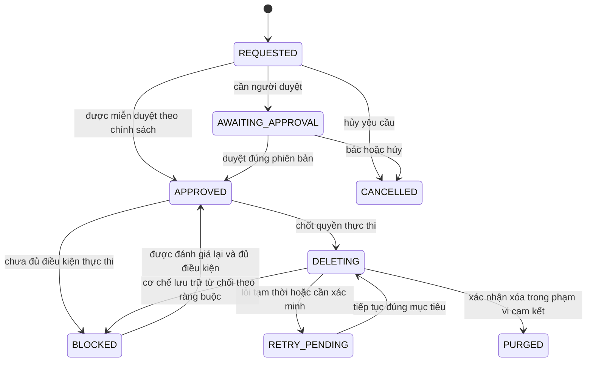
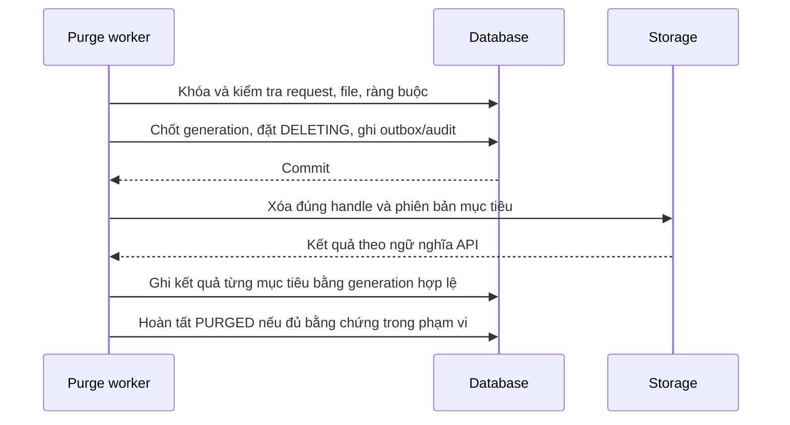

# File deletion authority

## 1. Quyền xóa tệp phải đi theo nghiệp vụ

Một nhân viên tải hóa đơn lên hồ sơ thanh toán. Khi hồ sơ còn nháp, nhân viên có thể thay hóa đơn bị chụp sai. Sau khi hồ sơ được phê duyệt và thanh toán, hóa đơn trở thành bằng chứng của một giao dịch đã hoàn tất. Nếu hệ thống vẫn cho người tải lên xóa tệp chỉ vì `uploadedBy == currentUser`, người đó có thể làm mất bằng chứng mà không cần sửa khoản thanh toán.

**File deletion authority** là thẩm quyền thực hiện một thao tác loại bỏ tệp trong một ngữ cảnh nghiệp vụ cụ thể. Thẩm quyền này phụ thuộc chủ thể, tenant, đối tượng cha, quan hệ với tệp, trạng thái quy trình, phiên bản nội dung, điều kiện lưu giữ và loại thao tác xóa.

Quyền tải lên, xem hoặc sửa một tệp không tự kéo theo quyền xóa. Vai trò quản trị cũng không mặc nhiên cho phép vượt qua mọi yêu cầu giữ bằng chứng. Việc xóa thành công ở object storage chỉ chứng minh một thao tác hạ tầng đã được thực hiện, chưa chứng minh thao tác đó được phép theo nghiệp vụ.

Trong phạm vi bảo vệ logic nghiệp vụ, thiết kế cần đồng thời trả lời:

- Ai được yêu cầu, phê duyệt và thực thi loại xóa nào?
- Những bất biến nào phải còn đúng tại thời điểm hành động có hiệu lực?
- Điều gì xảy ra khi xóa cạnh tranh với phê duyệt, gắn tệp, đặt lệnh giữ hoặc retry?
- Hệ thống đang cam kết gỡ khỏi giao diện, thu hồi truy cập hay xóa những bản sao nào?

Các tên trạng thái và chính sách trong bài là ví dụ thiết kế. Chúng cần được điều chỉnh theo nghiệp vụ của ứng dụng, không phải một bộ quyền mặc định áp dụng cho mọi loại tệp.

## 2. Tách các hành động thường bị gọi chung là “xóa”

Một nút “Xóa” có thể che nhiều tác dụng khác nhau:

| Hành động | Tác dụng | Điều không được ngầm suy ra |
|---|---|---|
| `DETACH_FILE` | Gỡ một liên kết giữa tệp và hồ sơ | Không đồng nghĩa được hủy blob đang được hồ sơ khác dùng |
| `HIDE_FILE` hoặc logical delete | Ẩn tệp và chặn các đường đọc theo chính sách | Không đồng nghĩa byte đã biến mất khỏi storage hoặc cache |
| `REQUEST_PURGE` | Tạo yêu cầu hủy dữ liệu theo phạm vi được nêu | Không đồng nghĩa đã được duyệt hoặc thực thi |
| `APPROVE_PURGE` | Phê duyệt một yêu cầu và phiên bản cụ thể | Không cấp quyền sửa phạm vi sau duyệt hoặc bỏ qua lệnh giữ mới |
| `EXECUTE_PURGE` | Thực thi xóa vật lý đối với tập đối tượng xác định | Không mặc nhiên bao phủ mọi phiên bản, bản sao lưu và sản phẩm dẫn xuất |
| `RESTORE_FILE` | Khôi phục khả năng sử dụng nếu còn dữ liệu và đủ điều kiện | Không tự khôi phục quyền truy cập hoặc approval cũ |
| `RELEASE_HOLD` / `CHANGE_RETENTION` | Thay đổi ràng buộc đang ngăn xóa | Không được coi là thao tác phụ của người có quyền xóa |

Ví dụ, người dùng có thể được gỡ một ảnh khỏi bài viết nháp nhưng không có quyền xóa ảnh đó khỏi bài viết đã công bố của nhóm khác. Khi hai hồ sơ dùng chung nội dung, quyền đối với một liên kết không trở thành quyền đối với mọi liên kết hoặc blob dùng chung.

API nên công bố rõ tác dụng. Một endpoint nhận `force=true` hoặc `hardDelete=true` từ client không được phép tự nâng quyền. Nếu có xóa cưỡng bức theo chính sách, đó phải là hành động có quyền, điều kiện và bằng chứng riêng; không phải một cờ bỏ qua kiểm tra.

## 3. Viết bất biến trước khi viết điều kiện role

Với hệ thống hồ sơ thanh toán, có thể xác định các bất biến sau:

| Bất biến | Điểm cần thực thi |
|---|---|
| Không tác động tệp hoặc liên kết ngoài tenant được cấp | Tra cứu đối tượng, đánh giá quyền và cập nhật trạng thái |
| Tệp phải thực sự thuộc hồ sơ được chỉ định | Kiểm tra quan hệ file–parent ở phía server |
| Hồ sơ đã chốt không mất chứng từ bắt buộc | Gỡ liên kết, xóa logic, xóa vật lý và chuyển trạng thái hồ sơ |
| Tệp trong thời gian giữ hoặc có hold không bị purge trái chính sách | Khi xét yêu cầu và tại ranh giới thực thi purge |
| Phê duyệt chỉ áp dụng đúng nội dung và phạm vi đã duyệt | Khi duyệt và khi worker nhận quyền thực thi |
| Một blob còn tham chiếu hợp lệ không bị xóa | Khi tạo/gỡ tham chiếu và khi chốt quyền purge |
| Retry không xóa phiên bản nội dung được tải lên sau đó | Khi định danh mục tiêu và gọi storage |
| Không công bố đã xóa vật lý trước khi có xác nhận phù hợp | Khi cập nhật kết quả job xóa |

Một biểu thức tư duy có thể là:

```text
allow(action, subject, file, parent, context)
    = subject được xác thực hoặc là service principal được cấp phép
      AND tenant và quan hệ đối tượng hợp lệ
      AND chủ thể có quyền thực hiện action trên đối tượng cụ thể
      AND trạng thái hồ sơ và tệp cho phép hành động
      AND các điều kiện phê duyệt, giữ dữ liệu và tham chiếu được đáp ứng
      AND phiên bản yêu cầu vẫn khớp mục tiêu
```

Các điều kiện được chọn theo hành động. Yêu cầu lên lịch purge sau thời hạn giữ có thể được chấp nhận dù chưa được phép xóa ngay; ngược lại, `EXECUTE_PURGE` phải thỏa điều kiện thực thi tại thời điểm có hiệu lực. Không dùng cùng một kết quả allow mơ hồ cho cả hai bước.

Theo [OWASP Authorization Cheat Sheet](https://cheatsheetseries.owasp.org/cheatsheets/Authorization_Cheat_Sheet.html), quyền phải được kiểm tra trên từng request và đối tượng phù hợp. Với xóa tệp, việc ẩn nút trên giao diện hoặc kiểm tra role tại một endpoint không bảo vệ được các đường khác như bulk delete, worker, công cụ hỗ trợ và tác vụ dọn dữ liệu.

### 3.1. Một ma trận quyền minh họa

| Chủ thể | Hồ sơ nháp thuộc phạm vi mình quản lý | Hồ sơ đã thanh toán | Purge vật lý |
|---|---|---|---|
| Người tạo hồ sơ | Có thể gỡ tệp không bắt buộc nếu được cấp quyền | Không tự gỡ chứng từ đã chốt | Chỉ yêu cầu nếu chính sách cho phép |
| Người phê duyệt nghiệp vụ | Không mặc định được xóa mọi tệp của người khác | Được xử lý ngoại lệ theo quy trình riêng | Có thể duyệt trong phạm vi được giao |
| Người quản lý dữ liệu | Thực hiện hành động được phân công | Phải tôn trọng trạng thái, thời hạn giữ và hold | Không tự bỏ qua điều kiện bảo vệ |
| Worker purge | Không có quyền tùy chọn hồ sơ để xóa | Chỉ thực thi lệnh hợp lệ | Chỉ đúng tập đối tượng, phiên bản và phạm vi được cấp |
| Quản trị hạ tầng | Quyền hạ tầng được quản lý riêng | Không được coi thao tác trực tiếp là quy trình nghiệp vụ bình thường | Cần kiểm soát đặc quyền và khả năng phát hiện thao tác ngoài ứng dụng |

Ma trận này thể hiện một chính sách ví dụ, không phải khuyến nghị cấp các role trên cho mọi ứng dụng. Tách người yêu cầu và người duyệt chỉ cần thiết ở nơi nghiệp vụ yêu cầu, nhưng khi đã yêu cầu thì phải thực thi phía server, kể cả với tài khoản có nhiều role.

## 4. Mô hình hóa tệp, liên kết và phiên bản mục tiêu

### 4.1. Dữ liệu server cần biết

Một mô hình tối thiểu thường gồm các thực thể:

- **File record**: ID logic, tenant, loại tài liệu, trạng thái truy cập, phiên bản metadata và phân loại nhạy cảm.
- **Attachment**: quan hệ giữa file với hồ sơ cha, mục đích sử dụng và loại chứng từ; bản thân quan hệ cũng có thể cần kiểm soát phiên bản.
- **Blob/version**: định danh nội dung và vị trí lưu do server quản lý; một file record có thể có nhiều phiên bản.
- **Deletion request**: loại xóa, tập mục tiêu, người yêu cầu, lý do, phiên bản được chốt, thời điểm sớm nhất được thực thi và trạng thái xử lý.
- **Approval/hold/retention**: các đối tượng điều kiện có phạm vi, hiệu lực và phiên bản riêng.

`uploadedBy` là dấu vết nguồn gốc, không phải chính sách sở hữu đầy đủ. Sau khi tệp được chuyển vào hồ sơ, người tải lên có thể không còn quyền thay đổi; quyền có thể thuộc nhóm quản lý hồ sơ hoặc một service nghiệp vụ.

Nếu hồ sơ phải có ít nhất một chứng từ hợp lệ, cần bảo vệ điều kiện đó cùng với các thay đổi cạnh tranh. Hai request đồng thời gỡ hai tệp đều có thể nhìn thấy “còn một tệp khác” rồi cùng gỡ, để lại hồ sơ không có chứng từ. Kiểm tra số lượng trước transaction mà không có đồng bộ phù hợp không giữ được bất biến.

### 4.2. Client chỉ cung cấp ý định, không chọn đường dẫn storage

Một lệnh yêu cầu purge có thể có dạng:

```json
{
  "fileId": "file-420",
  "expectedFileVersion": 7,
  "deletionMode": "PURGE_SELECTED_VERSION",
  "targetContentVersionId": "content-v3",
  "reasonCode": "APPROVED_DUPLICATE_DOCUMENT",
  "idempotencyKey": "request-key-92"
}
```

Server phải kiểm tra `targetContentVersionId` thuộc đúng file và được phép xử lý; nó không được chấp nhận một ID bất kỳ rồi suy ra quyền. `deletionMode` là một giá trị trong tập được cho phép, không phải chỉ thị tự nâng quyền.

Không nhận `storagePath`, bucket, object key, tenant có thẩm quyền hoặc `approvedBy` như sự thật do client tự khai. Từ `fileId`, server tra cứu metadata thuộc tenant được xác thực, kiểm tra hồ sơ cha và tự xác định handle storage. ID khó đoán chỉ giảm khả năng đoán, không thay thế phân quyền.

Phiên bản metadata và phiên bản nội dung có ý nghĩa khác nhau. Một approval duyệt xóa `content-v3` không cho phép worker xóa `content-v4` vừa được tải lên dưới cùng `fileId`. Tập mục tiêu của “xóa toàn bộ phiên bản” cũng phải có ngữ nghĩa rõ: tập đã được chốt, hay mọi phiên bản tồn tại khi thực thi. Nếu cho phép bổ sung mục tiêu sau duyệt, quyền phê duyệt phải bao phủ chính xác hành vi đó.

## 5. Tách trạng thái truy cập khỏi trạng thái hủy dữ liệu

Một file có thể đang ẩn nhưng vẫn còn được giữ để phục hồi hoặc điều tra. Vì vậy, nên tách ít nhất hai chiều trạng thái:

| Chiều trạng thái | Giá trị minh họa | Câu hỏi được trả lời |
|---|---|---|
| Khả năng truy cập trong ứng dụng | `ACTIVE`, `HIDDEN` | Đường đọc thông thường có được phục vụ không? |
| Quy trình purge | `NONE`, `REQUESTED`, `AWAITING_APPROVAL`, `APPROVED`, `DELETING`, `RETRY_PENDING`, `BLOCKED`, `PURGED`, `CANCELLED` | Yêu cầu hủy dữ liệu đang ở bước nào? |

Hold và thời hạn giữ là các điều kiện độc lập, không chỉ là một nhãn trong danh sách trạng thái. Một file `HIDDEN` vẫn có thể đang có hold. Một yêu cầu `APPROVED` vẫn có thể bị chặn khi điều kiện thực thi thay đổi.



Đây là mô hình rút gọn. Hệ thống có thể tách thêm trạng thái đối soát, từ chối hoặc chờ lịch. Mỗi đường chuyển phải có người có thẩm quyền, điều kiện và quy tắc cạnh tranh cụ thể.

Chấp nhận `REQUEST_PURGE` không bắt buộc phải ẩn tệp ngay. Nếu sản phẩm muốn đồng thời ẩn tệp, phải đánh giá cả quyền ẩn và ảnh hưởng lên hồ sơ. Trong thiết kế minh họa của bài, yêu cầu purge chỉ ghi nhận ý định; bước chốt thực thi sẽ thu hồi đường đọc cần thiết trước khi gọi storage.

Không tự khôi phục `ACTIVE` khi một lần xóa storage thất bại. Ý định thu hồi truy cập có thể vẫn còn hiệu lực, và một phần phiên bản hoặc bản sao có thể đã bị xóa. Phục hồi là thao tác riêng cần xét điều kiện.

## 6. Tiếp nhận yêu cầu bằng một transaction có kiểm soát

### 6.1. Kiểm tra trên trạng thái được bảo vệ khỏi cạnh tranh

Một luồng tiếp nhận có thể thực hiện:

1. Xác thực chủ thể và ngữ cảnh tenant từ nguồn tin cậy.
2. Tra cứu file, hồ sơ và quan hệ liên quan; dùng khóa hoặc version check phù hợp với các thay đổi cạnh tranh.
3. Kiểm tra quyền đọc/truy cập yêu cầu hiện tại và xử lý idempotency trong đúng phạm vi.
4. Đánh giá quyền yêu cầu loại xóa cụ thể, trạng thái hồ sơ, mục tiêu và điều kiện lên lịch.
5. Lưu yêu cầu với tập mục tiêu đã chốt, phiên bản, lý do và trạng thái phê duyệt.
6. Ghi sự kiện outbox bắt buộc trong cùng transaction, rồi chỉ trả kết quả chấp nhận sau commit.

Mã giả Java sau minh họa ranh giới đó; tên dependency thể hiện hợp đồng cần triển khai:

```java
public DeletionReply requestPurge(
        VerifiedContext context,
        PurgeCommand command) {

    ValidatedPurgeCommand input = commands.validate(command);

    return tx.required(() -> {
        LockedDeletionContext target = repository.lockDeletionContext(
                context.tenantId(), input.fileId());

        access.requireCanAccessDeletionWorkflow(context, target);

        IdempotencySlot slot = idempotency.reserveOrLock(
                context.tenantId(), context.subjectId(),
                "REQUEST_PURGE", input.idempotencyKey());

        String fingerprint = fingerprints.ofPurgeIntent(input);
        if (slot.hasResult()) {
            slot.requireSameFingerprint(fingerprint);
            return requests.readAuthorizedReply(context, slot.requestId());
        }

        PurgeDecision decision = policies.evaluateRequestPurge(
                context, target, input, clock.instant());

        if (!decision.allowed()) {
            outbox.append(events.purgeRequestDenied(
                    context, target, decision));
            return DeletionReply.denied(decision.publicReason());
        }

        DeletionRequest request = requests.create(
                context, target, input, decision);
        slot.complete(fingerprint, request.id());
        outbox.append(events.purgeRequested(context, request));

        return DeletionReply.accepted(
                request.id(), request.state());
    });
}
```

`lockDeletionContext` không chỉ khóa dòng file rồi mặc kệ hồ sơ cha. Hợp đồng của nó phải bao phủ những dữ kiện mà các thao tác phê duyệt, gỡ/gắn tệp và thay đổi ràng buộc cũng dùng để giữ bất biến. Có thể dùng khóa theo thứ tự thống nhất, optimistic locking hoặc một thiết kế giao dịch khác; các đường ghi cạnh tranh phải cùng tham gia quy tắc đó.

`reserveOrLock` cần unique constraint và xử lý đúng tình huống hai request cùng tạo khóa chưa có. Thời hạn giữ idempotency key phải phù hợp cửa sổ retry. Fingerprint phải bao gồm file, phiên bản mục tiêu, loại xóa và tham số có ý nghĩa; cùng khóa nhưng khác ý định phải nhận conflict.

Kết quả replay chỉ được trả sau khi kiểm tra quyền hiện tại đối với workflow và kết quả. Không dùng idempotency key làm quyền đọc. Việc replay một yêu cầu đã nhận không tạo một lần purge mới và không mở rộng tập mục tiêu.

Trong nhánh deny, mã giả trả một kết quả có kiểu để transaction ghi audit có thể commit. Nếu thay bằng exception làm rollback cùng transaction, sự kiện deny có thể bị mất. Các lỗi xảy ra trước transaction và các xung đột có thể cần đường audit riêng. Ghi audit phải dùng metadata an toàn, không sao chép token, URL có chữ ký hoặc toàn bộ nội dung tệp.

Quan trọng nhất, `accepted` ở đây nghĩa là đã nhận yêu cầu, không phải tệp đã được xóa vật lý.

## 7. Phê duyệt phải gắn đúng nội dung và phạm vi

Một phê duyệt xóa cần gắn với một ý định cụ thể, ví dụ:

```text
requestId             = deletion-312
requestVersion        = 2
tenantId              = tenant-17
fileId                = file-420
targetContentVersions = [content-v3]
deletionMode          = PURGE_SELECTED_VERSION
targetManifestDigest  = digest của manifest mục tiêu đã chốt
requestedBy           = user-42
approvedBy            = user-81
approvalExpiresAt     = thời hạn hiệu lực theo chính sách
```

Manifest có thể chứa các handle lưu trữ do server quản lý và danh sách sản phẩm dẫn xuất thuộc phạm vi. Digest giúp nhận diện manifest không đổi; nó không tự chứng minh mọi mục tiêu trong manifest đều được phép xóa.

Các điều kiện cần kiểm tra bao gồm:

- Người duyệt có thẩm quyền với tenant, loại tài liệu, hồ sơ và mức độ ảnh hưởng hay không.
- Có yêu cầu tách người yêu cầu với người duyệt hay không; nhiều role trên một tài khoản không tạo ra hai người độc lập.
- Phiên bản request và manifest còn khớp; một lần cập nhật file không được âm thầm thay mục tiêu.
- Approval đã hết hạn, bị thu hồi hoặc đã được tiêu thụ cho một tác vụ khác hay chưa.
- Việc thay đổi điều kiện hiện hành có buộc đánh giá lại hoặc duyệt lại không.

Một approval hợp lệ không phải giấy phép vô thời hạn. Khi thêm phiên bản, thay loại xóa từ một phiên bản sang toàn bộ, hoặc mở rộng sang file khác, hệ thống phải yêu cầu thẩm quyền tương ứng và cập nhật quy trình phê duyệt theo chính sách.

Không phải mọi tác vụ hệ thống đều cần người duyệt trực tiếp. Tác vụ xóa upload mồ côi hoặc dữ liệu hết hạn có thể hoạt động theo một chính sách tự động đã được cấp. Trong trường hợp đó, ghi rõ service principal, chính sách, phạm vi và căn cứ miễn duyệt; không tạo một tài khoản “người duyệt” giả để lấp trường dữ liệu.

## 8. Thực thi purge mà không tạo khoảng trống về quyền

### 8.1. Tách lệnh bền vững và tác dụng ở storage

Database và object storage thường không có một transaction nguyên tử chung. Một luồng thực thi phù hợp có thể gồm:

1. Worker nhận `requestId` và tra cứu yêu cầu đã commit; message không được tự quyết định object key ngoài metadata tin cậy.
2. Trong transaction, worker xác minh danh tính service, trạng thái request, phiên bản mục tiêu, approval/ủy quyền và các điều kiện thực thi hiện hành.
3. Worker xác nhận không còn tham chiếu ngăn xóa, thời hạn giữ đã thỏa và không có hold có hiệu lực theo quy tắc đồng bộ đã chọn.
4. Worker chốt quyền thực thi bằng một execution generation hoặc fencing token; chuyển sang `DELETING`, chặn các thao tác gắn mới và thu hồi đường đọc cần thiết theo chính sách.
5. Commit trạng thái và bằng chứng bắt đầu. Sau đó gọi storage bằng handle của đúng đối tượng/phiên bản đã chốt.
6. Lưu kết quả từng mục tiêu và hoàn tất request bằng cập nhật có điều kiện, chỉ khi worker vẫn thuộc generation hợp lệ.

Một outbox có thể lưu lệnh thực thi cùng trạng thái đã duyệt. Relay có thể giao lặp; worker phải xử lý lại cùng yêu cầu và cùng mục tiêu thay vì tạo một lệnh xóa mới. Outbox bảo đảm có lệnh bền vững cùng thay đổi database, không biến lời gọi storage thành một phần của transaction đó.



Nếu storage tạm lỗi, giữ trạng thái và quyền truy cập theo ý định nghiệp vụ đã commit, rồi retry hoặc chuyển sang đối soát. Không đưa file trở lại hiển thị chỉ vì chưa xóa hết byte. Nếu chỉ một phần manifest đã được xóa, phải phản ánh phần còn lại thay vì báo thất bại như thể chưa có tác dụng nào.

### 8.2. Quyền của người yêu cầu có thể thay đổi khi chờ

Giữa lúc yêu cầu và lúc worker chạy, người yêu cầu có thể bị thu hồi quyền hoặc chuyển tenant. Cần chọn rõ một trong các hợp đồng phù hợp:

- **Yêu cầu phụ thuộc quyền hiện hành**: trước khi thực thi, đánh giá lại quyền của người yêu cầu; quyền không còn thì dừng hoặc yêu cầu duyệt lại.
- **Ủy quyền nghiệp vụ bền vững**: sau phê duyệt, có một mandate rõ ràng cho service thực thi, với phạm vi, thời hạn, điều kiện và cách thu hồi; worker kiểm tra hiệu lực mandate.

Không ngầm chọn mô hình thứ hai chỉ vì trong database còn `requestedBy`. Một ảnh chụp role cũ hoặc session đã hết hạn không tự trở thành ủy quyền nghiệp vụ. Tác vụ retention tự động cũng cần có chủ thể dịch vụ và chính sách riêng, thay vì mượn quyền của người đã tải tệp.

Worker có credential xóa storage không đồng nghĩa mọi yêu cầu mà nó nhận đều hợp lệ. Nếu nó xóa object key tùy ý từ message do thành phần ít tin cậy tạo, nó trở thành một tác nhân sử dụng đặc quyền thay cho người không có quyền. Cần buộc mỗi lệnh về một request hợp lệ và tập mục tiêu do server xác định.

### 8.3. Retry phải nhắm đúng phiên bản

Một lỗi nguy hiểm xảy ra khi hệ thống tái sử dụng object key:

```text
1. Worker định xóa bản cũ tại key K.
2. Lần gọi bị timeout, worker chưa biết kết quả.
3. Một bản mới được ghi vào K.
4. Worker retry DELETE K và xóa nhầm bản mới.
```

Cách tránh là dùng đối tượng bất biến theo phiên bản/generation và không tái sử dụng handle của nội dung đã lên lịch xóa, hoặc sử dụng điều kiện xóa/version identifier mà nền tảng thực sự hỗ trợ. DB version check không đủ nếu lời gọi storage vẫn nhắm vào một key có thể bị ghi đè ngoài kiểm soát.

Khi nhận “not found”, chỉ xem đó là mục tiêu đã không còn nếu đang xác minh đúng handle và ngữ nghĩa phản hồi đáng tin cậy. Lỗi quyền, lỗi kết nối hoặc việc không nhìn thấy do một lớp ứng dụng khác che đi không phải bằng chứng xóa vật lý.

Một số API xóa trả thành công khi đối tượng vốn không tồn tại; một số thao tác trên storage có versioning chỉ tạo dấu xóa. Worker cần diễn giải đúng hợp đồng API, không coi mọi phản hồi thành công là bằng chứng mọi byte và phiên bản đã bị hủy.

### 8.4. Hủy yêu cầu có giới hạn thời điểm

Trước khi chốt thực thi, có thể cho phép hủy hoặc thu hồi approval trong transaction nếu người gọi đủ quyền. Sau khi worker đã vượt qua ranh giới được định nghĩa là không thể hủy, ứng dụng không được hứa “đã hủy, dữ liệu chắc chắn còn”.

Một yêu cầu hủy đến muộn có thể được trả là không còn khả năng hủy hoặc đang xác minh kết quả. Fencing token chỉ bảo vệ được các thành phần kiểm tra token; nó không tự thu hồi một lời gọi xóa đã gửi đến storage không hỗ trợ cơ chế đó. Quy trình phải ngăn hoặc quản lý worker cũ trước khi cấp lại quyền thực thi, và vẫn dùng đúng mục tiêu bất biến khi có retry.

## 9. Giữ dữ liệu, hold và tham chiếu dùng chung

### 9.1. Phân biệt thời hạn giữ và lệnh giữ

Thời hạn giữ thường xác định thời điểm sớm nhất được phép xóa theo chính sách. Hold là một điều kiện ngăn xóa trong phạm vi nhất định cho đến khi được gỡ bởi chủ thể có thẩm quyền. Có thể cần cả hai; hết thời hạn không tự gỡ hold.

Đây là các điều kiện nghiệp vụ do tổ chức xác định trong hệ thống, không phải khẳng định về một thời hạn pháp lý chung. Cần lưu căn cứ và phiên bản chính sách phù hợp, dùng thời gian server tin cậy và không để client gửi `now` hoặc sửa `retainUntil` nhằm làm đủ điều kiện xóa.

Quyền thay thời hạn giữ hoặc gỡ hold cần được tách khỏi quyền purge khi chính sách yêu cầu. Nếu người có quyền xóa cũng có thể tự đặt thời hạn về quá khứ mà không kiểm soát, điều kiện retention chỉ còn hình thức.

### 9.2. Kiểm tra hold rồi gọi xóa vẫn có thể bị race

Luồng sau chưa đủ an toàn:

```text
Worker đọc: không có hold.
Người quản lý đặt hold.
Worker gọi storage để xóa.
```

Đặt hàm đọc hold trong transaction không tự khóa được khoảng thời gian tới lời gọi storage bên ngoài. Thiết kế cần một quy tắc phối hợp rõ ràng giữa **chốt purge** và **đặt hold**.

Ví dụ, cả hai thao tác cùng khóa một bản ghi điều phối. Nếu hold commit trước, worker không được chốt purge. Nếu purge đã vượt điểm chốt không thể hủy theo chính sách, việc tạo hold phải phản ánh rằng nó chưa thể bảo vệ mục tiêu đó, hoặc đi vào quy trình xử lý ngoại lệ; không trả “hold đã có hiệu lực” khi lời gọi xóa vẫn có thể hoàn tất.

Nếu yêu cầu bắt buộc hold phải được thực thi tại tầng lưu trữ cho đến sát thời điểm hủy dữ liệu, cần cơ chế khóa/retention của storage phù hợp và kiểm soát quyền thay đổi cơ chế đó. Một lá cờ database đơn lẻ không tạo ra cam kết đó. Dù dùng cách nào, ranh giới có hiệu lực và hành vi khi hai hành động cạnh tranh phải được kiểm thử.

### 9.3. Gỡ liên kết không đồng nghĩa không còn ai dùng blob

Với nội dung dùng chung hoặc deduplication, cần kiểm tra tất cả tham chiếu đang có hiệu lực theo mô hình lưu trữ. Một truy vấn “không tìm thấy attachment” rồi gọi xóa sau đó có thể cạnh tranh với request đang gắn blob vào hồ sơ khác.

Các thao tác gắn/gỡ và chốt purge phải dùng cùng cơ chế đồng bộ. Có thể đánh dấu blob `DELETION_RESERVED` hoặc trạng thái tương đương để chặn tham chiếu mới trước khi xóa. Nếu dùng reference count, phải cập nhật nguyên tử và bảo đảm mọi đường ghi đều tham gia; một counter bị lệch không phải bằng chứng an toàn để hủy dữ liệu.

Không công bố chi tiết tham chiếu ngoài quyền người gọi. Khi blob được dùng bởi một hồ sơ mà người gọi không được xem, có thể trả lý do an toàn như `DELETION_BLOCKED_BY_POLICY` thay vì tiết lộ tên hồ sơ, tenant hoặc người sở hữu khác.

Hệ thống dedup giữa các tenant có thêm ranh giới bảo mật ở quản lý khóa mã hóa, retention và tính toán tham chiếu. Nếu chưa thiết kế được các ràng buộc đó, không nên coi việc cùng checksum là đủ để chia sẻ vòng đời blob giữa các tenant.

## 10. Xác định đúng phạm vi “đã xóa”

### 10.1. Versioning và dấu xóa

Ví dụ cụ thể: với bucket Amazon S3 đã bật versioning, một thao tác xóa thông thường không chỉ định version có thể tạo delete marker trong khi các phiên bản nội dung vẫn còn. Xóa vĩnh viễn một phiên bản cần thao tác đúng định danh phiên bản và quyền tương ứng. [Amazon S3: Deleting object versions](https://docs.aws.amazon.com/AmazonS3/latest/userguide/DeletingObjectVersions.html)

Vì vậy, việc một đường tải hiện tại trả “không tìm thấy” chưa chứng minh các phiên bản cũ đã bị hủy. Ngữ nghĩa tương tự cần được xác minh theo storage mà ứng dụng dùng, thay vì suy đoán từ tên phương thức `delete` trong SDK.

Khi tuyên bố `PURGED`, phải ghi rõ phạm vi, chẳng hạn “đã xóa các content version trong manifest khỏi kho chính” hoặc “đã xóa cả các bản dẫn xuất được quản lý”. Không dùng thông báo “đã xóa khỏi mọi nơi” nếu chưa kiểm soát được phạm vi đó.

### 10.2. Bản dẫn xuất, cache và bản sao lưu

Tệp có thể có thumbnail, nội dung OCR, bản chuyển đổi, chỉ mục tìm kiếm, bản sao phục vụ tải và backup. Một manifest purge có thể bao gồm các sản phẩm dẫn xuất được quản lý cùng với mục tiêu gốc; kết quả cần phân biệt từng lớp nếu thời điểm xóa khác nhau.

Logical delete phải ngăn các đường truy cập còn thuộc kiểm soát của ứng dụng, kể cả endpoint preview hoặc tải bản cũ. Cache/CDN và URL có chữ ký có thể tiếp tục phục vụ dữ liệu theo cấu hình và thời hạn của chúng. Nếu yêu cầu thu hồi tức thời, cần cơ chế kiểm tra online hoặc vô hiệu hóa mà các tầng đó thực sự hỗ trợ; xóa một dòng database không tự làm mọi cache mất hiệu lực.

Backup có thể tồn tại theo lịch giữ riêng. Khi không thể xóa chọn lọc ngay, phải xác định phạm vi cam kết và quy trình để dữ liệu đã bị xóa không tự xuất hiện lại sau restore. Chẳng hạn, quy trình phục hồi cần áp dụng lại sổ tombstone phù hợp trước khi mở quyền truy cập. Không coi việc đợi backup hết hạn là đã hoàn tất một cam kết xóa tức thời khỏi backup.

Nếu dùng cơ chế hủy khóa mã hóa để làm dữ liệu không thể đọc, phải biết các bản sao khóa, wrapping key, cache khóa và phạm vi chia sẻ. Không thể gọi đó là xóa có bảo đảm chỉ vì xóa một tham chiếu khóa trong database. Thiết kế và thông báo cần phản ánh đúng cơ chế thực sự được triển khai.

### 10.3. Phục hồi cần được cấp quyền lại

Khôi phục một tệp đã ẩn có thể khiến dữ liệu quay lại hồ sơ đã thay đổi quyền hoặc trạng thái. Do đó, thao tác restore phải kiểm tra tenant, hồ sơ đích, loại tài liệu, yêu cầu scan/kiểm tra hiện hành và điều kiện phê duyệt phù hợp.

Không phục hồi chỉ bằng cách đặt `deleted=false` trong khi bản nội dung tương ứng đã bị xóa hoặc chỉ còn một bản cũ khác. Nếu lấy dữ liệu từ backup và tạo phiên bản mới, cần lưu nguồn gốc, định danh nội dung mới và các quyền liên quan. Approval xóa cũ không được phép xóa nhầm phiên bản vừa phục hồi do tái sử dụng handle.

## 11. Audit phải giải thích được thẩm quyền và kết quả

Audit xóa tệp cần trả lời được ai yêu cầu, ai duyệt, thành phần nào thực thi, trên đối tượng nào, theo chính sách nào và kết quả đến đâu. Một dòng `file deleted` không phân biệt được gỡ attachment với hủy content version.

| Sự kiện minh họa | Ngữ nghĩa cần giữ |
|---|---|
| `FILE_DETACHED` | Một quan hệ được gỡ hợp lệ; không khẳng định blob đã bị hủy |
| `FILE_ACCESS_REVOKED` | Hệ thống đã thay đổi quyền phục vụ theo phạm vi được ghi |
| `FILE_PURGE_REQUESTED` | Yêu cầu được lưu bền vững, chưa khẳng định được duyệt |
| `FILE_PURGE_REQUEST_DENIED` | Một lần yêu cầu bị từ chối với reason code an toàn |
| `FILE_PURGE_APPROVED` | Một phiên bản request và manifest được phê duyệt |
| `FILE_PURGE_BLOCKED` | Điều kiện hiện hành ngăn thực thi; không coi approval cũ là đủ |
| `FILE_PURGE_STARTED` | Quyền thực thi cho một generation đã được chốt |
| `FILE_PURGE_TARGET_CONFIRMED` | Kết quả đã được xác nhận cho một mục tiêu và ngữ nghĩa cụ thể |
| `FILE_PURGE_COMPLETED` | Tập mục tiêu thuộc cam kết đã được giải quyết theo tiêu chí hoàn tất |
| `FILE_RESTORE_COMPLETED` | Đã phục hồi trong phạm vi được cấp, với nội dung và phiên bản xác định |

Một sự kiện có thể gồm `eventId`, `occurredAt`, `tenantId`, `fileId`, `parentRef`, `requestId`, `requestVersion`, `manifestDigest`, `actor`, `initiator`, `approvalRef`, `policyVersion`, `executionGeneration`, `outcome` và `reasonCode`. Chỉ bổ sung trường phù hợp loại sự kiện; không tạo số liệu hoặc ID giả khi chưa biết.

Actor của bước storage thường là service principal; initiator vẫn phải truy được về người hoặc tác vụ hệ thống khởi tạo. Không dùng người yêu cầu làm actor cho mọi bước, cũng không chỉ ghi `purge-worker` rồi mất dấu người đưa ra ý định.

Các thay đổi trạng thái và sự kiện bắt buộc nên được lưu cùng transaction qua outbox khi dùng cùng database. Relay có thể giao lặp nên kho audit cần khử trùng bằng định danh sự kiện. Kết quả từ storage được ghi sau khi có bằng chứng tương ứng, không phát sự kiện “hoàn tất” trước lời gọi xóa.

Không ghi nguyên signed URL, credential hoặc nội dung tài liệu vào audit. Nếu cần điều tra đối tượng storage, dùng tham chiếu metadata được bảo vệ; kho audit cũng phải có phân quyền theo tenant và chức năng. Tệp bị xóa không có nghĩa được xóa luôn lịch sử yêu cầu nếu chính sách còn yêu cầu giữ bằng chứng.

Các tín hiệu nên theo dõi gồm nhiều lần xóa bị từ chối ngoài tenant, thay đổi retention ngay trước purge, số lượng purge tăng bất thường, request bị kẹt ở `DELETING`, blob bị mất nhưng không có request hợp lệ và thao tác storage trực tiếp ngoài luồng ứng dụng. Đây là tín hiệu để đối chiếu, không tự là kết luận có tấn công.

## 12. Những đường xóa dễ bỏ sót

### 12.1. Xóa hàng loạt

Bulk delete không được chỉ kiểm tra quyền của phần tử đầu tiên rồi áp dụng cho cả danh sách. Mỗi mục tiêu phải nằm trong phạm vi được cấp và thỏa điều kiện nghiệp vụ tương ứng.

Nếu người dùng chọn “xóa tất cả kết quả tìm kiếm”, kết quả truy vấn có thể thay đổi giữa lúc xem, duyệt và thực thi. Cần chốt tập mục tiêu hoặc có một ủy quyền rõ ràng cho phạm vi động. Một approval cho 20 tệp không mặc nhiên cho phép xóa 2.000 tệp mới xuất hiện trong cùng bộ lọc.

Hợp đồng bulk cần nói rõ nguyên tử toàn yêu cầu hay xử lý từng mục tiêu. Với tác dụng storage từng mục tiêu, lỗi giữa chừng thường có thể để lại kết quả một phần. Báo cáo cần phân biệt đã xác nhận, đang chờ, bị chặn và chưa rõ kết cục; retry không mở rộng danh sách và không xóa lại phiên bản mới.

Danh sách lỗi cũng cần kiểm soát rò rỉ. Với mục tiêu ngoài quyền, không trả metadata của tệp chỉ để giải thích tại sao không xóa được. Thống kê hoặc kết quả từng mục phải tuân thủ chính sách tiết lộ thông tin của ứng dụng.

### 12.2. Cascade khi xóa hồ sơ cha

Một lệnh xóa hồ sơ có thể kéo theo xóa attachment qua database cascade, event handler hoặc tác vụ nền. Quyền xóa hồ sơ không tự cho phép bỏ qua retention của từng tài liệu hoặc hủy blob vẫn dùng chung.

Cần xác định cascade chỉ gỡ quan hệ hay tạo yêu cầu purge có điều kiện. Hồ sơ đã đóng, đã thanh toán hoặc đang được giữ để điều tra có thể cần quy trình lưu trữ/thay đổi trạng thái thay vì xóa trực tiếp. Xóa metadata trước khi có manifest bền vững cũng có thể làm mất khả năng biết blob nào cần dọn và vì sao nó được phép xóa.

### 12.3. Dọn upload tạm và blob mồ côi

Garbage collector là một chủ thể có quyền xóa tự động, không phải ngoại lệ khỏi chính sách. Nó cần xác định thế nào là upload hết hạn hoặc blob không còn được dùng bằng metadata tin cậy, thay vì dựa riêng vào tên thư mục hay thời gian client gửi.

Ví dụ, khi finalize upload cạnh tranh với tác vụ dọn tệp, cả hai cần phối hợp bằng trạng thái/reservation hoặc version check. Nếu finalize đã tạo tham chiếu hợp lệ, collector không được xóa. Nếu collector đã chốt xóa, finalize phải bị từ chối hoặc tạo nội dung mới theo quy trình; không gắn một blob đang có thể bị hủy.

Việc liệt kê object storage rồi không thấy metadata trong một lần đọc có thể chưa đủ để kết luận mồ côi: transaction tạo metadata có thể đang chạy hoặc nguồn đọc có thể trễ. Cần khoảng an toàn, nguồn dữ liệu và cơ chế đồng bộ phù hợp, nhưng chỉ chờ thêm thời gian không thay thế hoàn toàn việc bảo vệ race ở điểm chốt xóa.

### 12.4. Công cụ hỗ trợ và credential hạ tầng

Endpoint nội bộ, script hỗ trợ và màn hình quản trị phải đi qua cùng dịch vụ chính sách hoặc có kiểm soát tương đương được thiết kế rõ. Nhãn “internal” không cấp quyền xóa mọi tenant. Chức năng đại diện tenant cần ghi người thao tác thực, tenant đích, căn cứ và phạm vi.

Người dùng cuối không nên nhận credential hoặc capability xóa storage nằm ngoài quy trình cần kiểm tra online. Nếu một nền tảng hỗ trợ cấp capability xóa trực tiếp, phải đánh giá nó có còn kiểm tra được trạng thái hồ sơ, hold và quyền sau thời điểm cấp hay không. Một capability còn hiệu lực có thể giữ khả năng xóa dù quyền trong ứng dụng đã bị thu hồi.

Credential của worker cũng cần giới hạn theo tài nguyên và thao tác cần thiết; không dùng một quyền hạ tầng quá rộng rồi chỉ dựa vào giao diện để bảo vệ. Những người có quyền hạ tầng đủ mạnh vẫn có thể thao tác ngoài code ứng dụng, nên mô hình đe dọa phải tính đến kiểm soát đặc quyền, phân tách nhiệm vụ và đối chiếu độc lập phù hợp.

## 13. Các tình huống cần kiểm thử khi triển khai

Kiểm thử phải xác nhận cả quyết định quyền, tác dụng database và mục tiêu storage. Các tình huống dưới đây là đặc tả gợi ý, không phải kết quả kiểm thử đã chạy của bài học này.

| Tình huống | Kết quả cần xác nhận |
|---|---|
| Người dùng tenant A gửi file ID của tenant B | Không thay trạng thái, không gửi lệnh storage, không lộ metadata ngoài quyền |
| Thay `parentId` để giả quan hệ sở hữu | Server kiểm tra quan hệ thực, không chỉ kiểm tra quyền đối với parent được client chọn |
| Người tải lên xóa chứng từ của hồ sơ đã thanh toán | Bị từ chối theo trạng thái nghiệp vụ dù `uploadedBy` khớp |
| Hai request gỡ đồng thời hai chứng từ cuối cùng | Không làm hồ sơ vi phạm số chứng từ bắt buộc |
| Xóa cạnh tranh với phê duyệt hồ sơ | Chỉ một thứ tự hợp lệ theo quy tắc đồng bộ; không chốt hồ sơ thiếu chứng từ |
| Có quyền hide nhưng không có quyền purge | Không nâng quyền bằng cờ `hardDelete` hoặc đường gọi khác |
| Người yêu cầu tự duyệt trong chính sách tách trách nhiệm | Bị từ chối dù tài khoản có cả hai role |
| Sau approval có phiên bản nội dung mới | Worker không xóa phiên bản mới ngoài tập được duyệt |
| Quyền bị thu hồi trong thời gian chờ | Thực thi đúng hợp đồng quyền hiện hành hoặc mandate đã công bố |
| Retention chưa hết hoặc hold đang có hiệu lực | Không vượt điểm chốt purge trái chính sách |
| Hold và purge được chốt đồng thời | Kết quả theo thứ tự có hiệu lực đã thiết kế, không báo hold bảo vệ giả |
| Tệp còn tham chiếu từ hồ sơ khác | Không hủy blob dùng chung, không tiết lộ thông tin hồ sơ ngoài quyền |
| Gắn tham chiếu mới cạnh tranh với purge | Không tạo liên kết đến blob đã được chốt để xóa |
| Cùng idempotency key với cùng/khác ý định | Trả kết quả gốc có kiểm tra quyền, hoặc conflict; không tạo mục tiêu mới |
| Relay giao lặp hoặc worker mất ACK từ storage | Retry đúng handle, đối soát khi cần, không xóa nội dung mới |
| Storage chỉ tạo delete marker | Không kết luận đã hủy mọi content version |
| Xóa thành công một phần manifest | Báo đúng phần đã xác nhận và phần còn lại; không phục hồi trạng thái hiển thị sai |
| Hủy request khi lời gọi storage đã được gửi | Không hứa giữ nguyên dữ liệu nếu đã quá ranh giới hủy |
| Xóa file nhưng preview/CDN/URL cũ còn khả năng phục vụ | Kết quả và giới hạn thu hồi phù hợp cam kết; xử lý đường truy cập còn kiểm soát được |
| Restore dữ liệu từ backup | Không tự phục vụ lại nội dung đã có tombstone; kiểm tra lại quyền và phiên bản |
| Collector chạy đồng thời với finalize upload | Không xóa blob vừa trở thành tham chiếu hợp lệ |
| Bulk delete trộn nhiều tenant và trạng thái | Mỗi mục tiêu được kiểm tra, kết quả không rò rỉ hoặc mở rộng phạm vi |

Các trường hợp cạnh tranh và mất xác nhận cần kiểm thử tích hợp với database và tầng lưu trữ tương ứng, hoặc cơ chế chèn lỗi có hợp đồng sát thực tế. Mock một hàm `delete()` trả `true` không chứng minh hệ thống đã giữ được bất biến khi có versioning, hold hoặc retry.

Khi kiểm tra, cần quan sát cả mục tiêu được gửi tới storage, ledger yêu cầu, trạng thái truy cập và audit. Chỉ nhìn HTTP `403` là chưa đủ nếu một tác vụ nền vẫn nhận và thực thi lệnh xóa trước khi phản hồi đó được trả.

## 14. Những quyết định phải rõ trước khi triển khai

Một đặc tả quyền xóa tệp cần trả lời được:

1. “Xóa” là gỡ liên kết, chặn truy cập, tạo yêu cầu hay hủy những bản sao nào?
2. Quyền gắn với uploader, hồ sơ, nhóm quản lý hay một quan hệ được cấp cụ thể?
3. Những trạng thái nghiệp vụ nào cấm xóa và thao tác cạnh tranh nào có thể làm điều kiện thay đổi?
4. Approval chốt phiên bản, manifest và loại xóa nào; thay đổi sau duyệt được xử lý ra sao?
5. Hold, retention, tham chiếu mới và purge có điểm chốt được phối hợp như thế nào?
6. Khi quyền thay đổi trong lúc chờ, worker dùng quyền hiện hành hay một mandate có phạm vi và hiệu lực rõ ràng?
7. Retry nhắm vào định danh bất biến nào, và xử lý ra sao nếu kết cục xóa chưa rõ?
8. `PURGED` chứng minh điều gì về kho chính, phiên bản cũ, bản dẫn xuất, cache và backup?
9. Ai được phục hồi, xem kết quả và đọc audit; các đường quản trị và dọn tự động có cùng kiểm soát cần thiết không?

Quyền xóa tệp được bảo vệ tốt khi mọi đường dẫn đến tác dụng không thể đảo ngược đều gắn với một quyết định nghiệp vụ hợp lệ, đúng đối tượng và đúng thời điểm. Transaction, state machine, phê duyệt, idempotency và định danh phiên bản phải cùng giữ các bất biến đó; một kiểm tra role trước lời gọi xóa không đủ để bảo đảm chúng.
