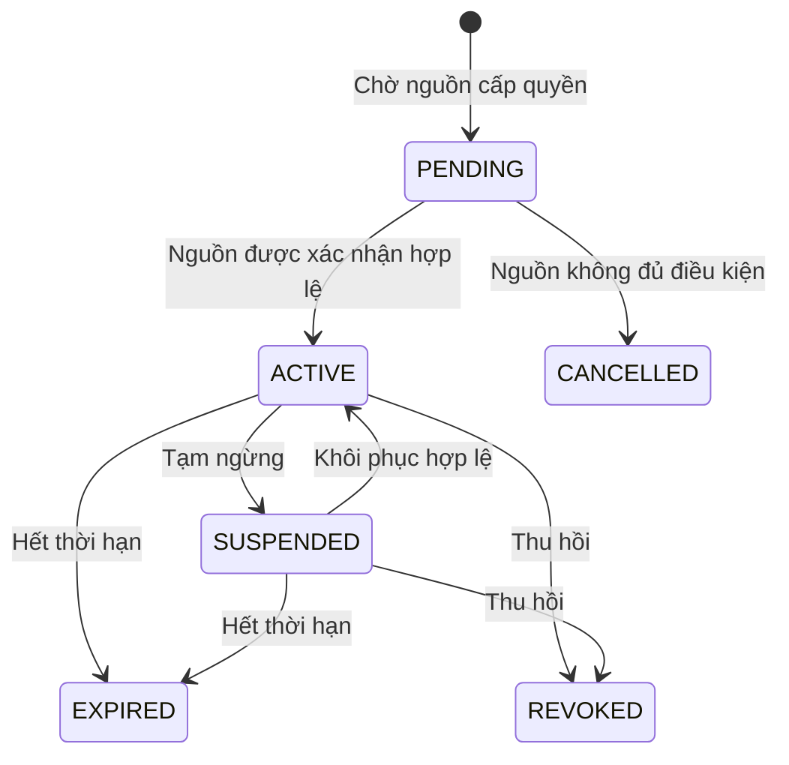
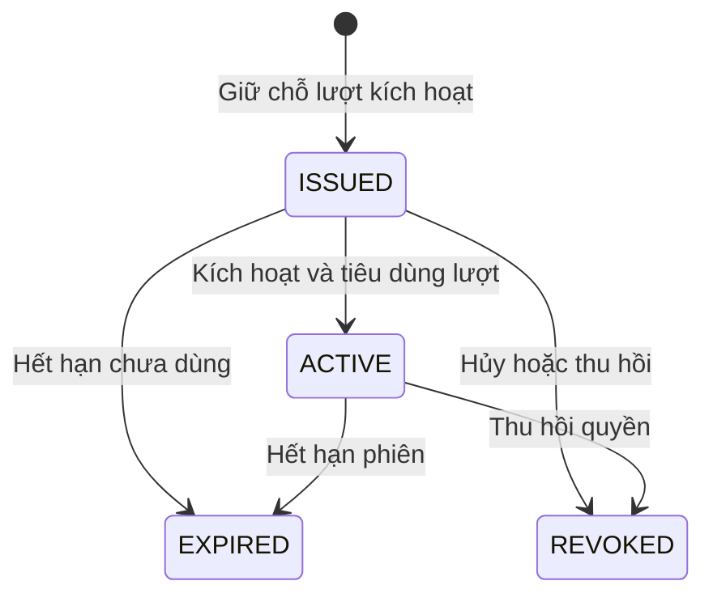
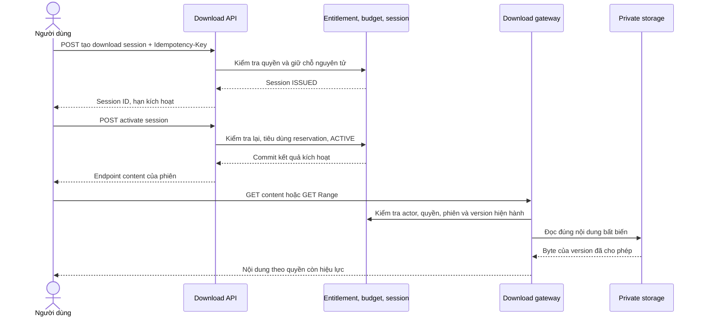

# File download entitlement — Quyền nghiệp vụ để tải tệp

## 1. Mục tiêu và phạm vi

**File download entitlement** là quyền nghiệp vụ cho phép một chủ thể tải một tệp hoặc một tập phiên bản tệp trong những điều kiện xác định. Điều kiện có thể đến từ đơn hàng đã thanh toán, giấy phép nội dung, gói dịch vụ, quyền trên hồ sơ, quyết định phê duyệt hoặc một grant chia sẻ có thời hạn.

Trong chương **File Business Rules** của module `SECURITY_APPLICATION_SECURITY_BUSINESS_LOGIC_SECURITY`, bài học tập trung vào việc giữ đúng các điều kiện đó trước yêu cầu giả mạo, bỏ qua bước, gửi lặp và thao tác đồng thời. Một tệp đã upload thành công hoặc một người đã đăng nhập chưa đủ để kết luận được tải.

Sau bài học, người học có thể:

- Phân biệt ownership, entitlement, download session và khả năng truy cập qua URL.
- Mô hình hóa quyền tải theo tenant, chủ thể, tệp, phiên bản, thời gian và nguồn cấp quyền.
- Bảo vệ điều kiện thanh toán, phê duyệt, giới hạn lượt tải và thu hồi quyền.
- Dùng transaction, state machine và idempotency để chống tiêu dùng quyền trùng hoặc vượt hạn mức.
- Thiết kế gateway, URL có chữ ký, cache và HTTP Range phù hợp với cam kết nghiệp vụ.
- Kiểm thử những đường truy cập có thể lách quyết định entitlement.

Các số liệu, state machine, schema và đoạn mã dưới đây là **thiết kế minh họa**. Chúng cần được điều chỉnh theo chính sách sản phẩm; đặc biệt phải định nghĩa rõ một “lượt tải” là sự kiện nào.

## 2. Bốn khái niệm không được gộp làm một

| Khái niệm | Trả lời câu hỏi | Ví dụ |
|---|---|---|
| Ownership | Ai quản lý tài liệu và tài liệu thuộc ngữ cảnh nào? | Hóa đơn thuộc hồ sơ hoàn ứng của công ty A |
| Entitlement | Ai được nhận nội dung, theo căn cứ và điều kiện nào? | Người mua được tải bộ tài liệu đã thanh toán trong 30 ngày |
| Download session | Lần thực hiện cụ thể nào đang được cho phép? | Một phiên của Lan, gắn với phiên bản V3, hết hạn sau 10 phút |
| Khả năng truy cập ở tầng truyền tải | Bằng cách nào byte được phục vụ? | Gateway có xác thực hoặc URL có chữ ký cho một object |

Chủ sở hữu nghiệp vụ có thể bị chặn tải khi tệp đang cách ly. Một người không sở hữu tệp vẫn có thể được tải qua grant hợp lệ. Người giữ URL có chữ ký có thể nhận byte trong cửa sổ URL có hiệu lực dù ứng dụng không xác thực lại họ ở mỗi request storage.

Do đó, không dùng một trong các biểu thức sau làm toàn bộ chính sách:

```text
đã đăng nhập
file.owner_id == actor.id
order tồn tại
file.state == READY
biết file_id
URL có chữ ký hợp lệ
```

Mỗi điều kiện chỉ giải quyết một phần bài toán. Entitlement cần gắn với action cụ thể, đối tượng cụ thể và ngữ cảnh hiện tại.

## 3. Tình huống xuyên suốt và hợp đồng “lượt tải”

Xét một nền tảng bán tài liệu kỹ thuật cho nhiều doanh nghiệp:

- Đơn hàng O101 của tenant A có dòng hàng L1 mua tài liệu F1.
- Chỉ trạng thái thanh toán hợp lệ do backend xác nhận mới tạo quyền tải.
- Quyền áp dụng cho phiên bản V3 của F1, không tự bao gồm mọi phiên bản tương lai.
- Người mua được kích hoạt tối đa ba download session trong thời hạn 30 ngày.
- Phiên chưa kích hoạt hết hạn sau 60 giây; phiên đã kích hoạt có thời hạn tối đa 10 phút và không vượt hạn entitlement.
- Trong một phiên, client được retry hoặc dùng HTTP Range; mỗi request truyền tải không tính thêm một lượt kích hoạt.
- Quyền bị thu hồi thì các yêu cầu tải mới qua gateway phải bị chặn.
- Quản trị hệ thống không mặc nhiên được nhận nội dung thay cho người mua.

Ở đây, sản phẩm đếm **lần kích hoạt phiên được chấp thuận**, không hứa đếm “số lần người dùng đã nhận đủ tệp”. Lượt kích hoạt được ghi nhận bằng một lệnh POST có chủ ý. Request GET/HEAD để truyền hoặc kiểm tra nội dung không tự trừ thêm lượt.

Hợp đồng này cần được mô tả cho người dùng. Nếu mạng lỗi sau khi kích hoạt, hệ thống cho tiếp tục trong cùng phiên còn hạn; không tự động tạo một phiên mới hoặc hoàn lượt vì không thấy log hoàn tất.

Với tệp hồ sơ nội bộ không có lượt tải, có thể bỏ ngân sách kích hoạt. Tuy nhiên, kiểm tra tenant, quyền theo đối tượng, trạng thái và thu hồi vẫn cần giữ.

## 4. Những business invariants phải luôn đúng

| Invariant | Hệ quả thực thi |
|---|---|
| Entitlement có chủ thể và tenant xác định | Danh tính và tenant được máy chủ xác minh; không nhận từ tham số tải như một nguồn quyền |
| Căn cứ cấp quyền phải hợp lệ | Không cấp quyền chỉ vì client báo thanh toán thành công hoặc gửi `approved=true` |
| Quyền gắn đúng tài nguyên và phạm vi phiên bản | Mua F1/V3 không cho tải F2 hoặc V4 |
| Một grant không vượt các điều kiện cấm hiện hành | Tài khoản bị khóa, tệp bị cách ly hoặc nguồn bị thu hồi có thể chặn tải |
| Quyền xem metadata không tự bao gồm nhận byte | Bảo vệ action `file.download` và các đường xem trước có nội dung tương đương |
| Ngân sách không bị vượt khi có request đồng thời | Giữ chỗ, tiêu dùng và hoàn giữ chỗ bằng transaction có điều kiện |
| Retry cùng ý định không tiêu dùng thêm lượt | Idempotency gắn với actor, operation và request xác định |
| Mỗi session chỉ phục vụ đúng nội dung đã được cho phép | Pin phiên bản bất biến; không tra “bản mới nhất” tùy ý lúc truyền |
| Phiên còn hạn không vượt qua quyền đã bị thu hồi | Gateway kiểm tra lại chính sách; URL trực tiếp phải có cửa sổ rủi ro được chấp nhận |
| Việc cấp URL không chứng minh đã tải xong | Audit phân biệt cho phép, kích hoạt, bắt đầu truyền và kết quả quan sát được |
| Không có endpoint phụ bỏ qua entitlement | HEAD, Range, preview, CDN và storage origin không trở thành đường vòng |

OWASP khuyến nghị từ chối mặc định và kiểm tra quyền trên từng yêu cầu, bao gồm quyền với đúng đối tượng được truy cập. Bảng invariant trên là cách cụ thể hóa nguyên tắc đó cho download. [OWASP — Authorization Cheat Sheet](https://cheatsheetseries.owasp.org/cheatsheets/Authorization_Cheat_Sheet.html)

## 5. Thiết kế quyết định entitlement

### 5.1. Một quyết định cần nhiều đầu vào

Một quyết định có thể biểu diễn:

```text
allow_download(actor, file_version, session, now) =
    actor được xác thực và còn hoạt động
    AND ngữ cảnh tenant được phép
    AND có căn cứ entitlement còn hiệu lực
    AND entitlement bao phủ đúng tệp, phiên bản, action và mục đích
    AND quan hệ actor với chủ thể entitlement còn hợp lệ
    AND tệp và hồ sơ chứa tệp cho phép phục vụ
    AND session hợp lệ nếu action yêu cầu session
    AND không có điều kiện cấm ưu tiên cao hơn
```

Với action tạo hoặc kích hoạt phiên, thêm kiểm tra ngân sách tương ứng. Với GET của một phiên đã kích hoạt, kiểm tra phiên đã được tính lượt hợp lệ; **không yêu cầu số lượt còn lại phải lớn hơn 0**. Nếu không phân biệt hai trường hợp này, phiên cuối cùng sẽ bị chặn ngay sau khi chính nó tiêu dùng lượt cuối.

Các khoảng hiệu lực nên có ngữ nghĩa rõ, ví dụ:

```text
valid_from <= now < valid_until
```

Dùng thời điểm từ nguồn đáng tin cậy và kiểu dữ liệu có timezone/instant phù hợp. Không để timestamp client gửi quyết định quyền đã hết hạn hay chưa.

### 5.2. Căn cứ cấp quyền phải đến từ nguồn có thẩm quyền

| Nguồn | Điều phải xác minh |
|---|---|
| Đơn hàng | Đúng người mua/tổ chức, đúng dòng hàng, trạng thái thanh toán được chấp nhận và chính sách hoàn tiền |
| Gói dịch vụ | Đúng gói, khoảng hiệu lực, nội dung được bao phủ và điều kiện đình chỉ |
| Hồ sơ nghiệp vụ | Membership, quan hệ với hồ sơ, trạng thái hồ sơ và quyền nhận loại nội dung |
| Phê duyệt | Đúng request, đối tượng, phiên bản, người nhận và hạn phê duyệt |
| Grant chia sẻ | Đúng action, người nhận, thời gian, phiên bản và trạng thái thu hồi |

Không coi trang redirect về từ cổng thanh toán là bằng chứng đã trả tiền. Backend xác minh thông tin từ nguồn thanh toán được cấu hình và gắn kết quả với đúng order/line item. Trạng thái `PAID` do client gửi không tạo entitlement.

Hành vi sau hoàn tiền phụ thuộc hợp đồng sản phẩm: thu hồi toàn bộ, thu hồi phần chưa sử dụng hoặc giữ quyền đã cấp. Phải xác định chính sách trước; không để logic này hình thành ngẫu nhiên từ việc một bảng vẫn còn dòng dữ liệu.

### 5.3. Quyền cấp cho nhóm hoặc doanh nghiệp

Một entitlement cấp cho tenant hoặc nhóm không đồng nghĩa mọi tài khoản từng thuộc nhóm đều được dùng mãi mãi. Khi mỗi request đến, cần xác minh quan hệ hiện hành hoặc một grant độc lập được sản phẩm quy định.

Lưu `subject_type` và `subject_id` rõ ràng; không so sánh mọi loại chủ thể với cùng một `userId`. Quyền của thành viên nhóm có thể khác quyền của tài khoản mua cá nhân.

Nếu cho chia sẻ liên tenant, xây một luồng chuyên biệt với người nhận và phạm vi cụ thể. Không bỏ kiểm tra tenant ở endpoint chung để hỗ trợ một ngoại lệ.

## 6. Mô hình dữ liệu tối thiểu

### 6.1. Entitlement bền vững

Một bản ghi `download_entitlement` có thể gồm:

| Nhóm | Trường minh họa |
|---|---|
| Định danh | `tenant_id`, `entitlement_id` |
| Chủ thể | `subject_type`, `subject_id` |
| Tài nguyên | `file_id`, `version_scope`, `action` |
| Nguồn cấp quyền | `source_type`, `source_id`, `source_line_id`, `source_version` |
| Thời gian | `valid_from`, `valid_until` |
| Trạng thái | `state`, `revoked_at`, `reason_code` |
| Đồng thời | `security_epoch`, `version` |
| Ngân sách | Tham chiếu đến budget hoặc ledger theo phạm vi được sản phẩm định nghĩa |

`version_scope` phải có ngữ nghĩa được cưỡng chế: một version cụ thể, một danh sách version đã phát hành hoặc quy tắc bao phủ release. Không lưu chuỗi “ALL” rồi mặc nhiên hiểu là mọi nội dung và mọi bản cập nhật tương lai.

Một source có thể sinh nhiều entitlement hợp lệ, ví dụ bundle gồm nhiều tài liệu. Ràng buộc chống tạo trùng cần dựa trên khóa nghiệp vụ của **grant dự định tạo**, chẳng hạn tenant, nguồn, dòng hàng, chủ thể, action và phạm vi nội dung. Không đặt unique quá rộng làm mất các quyền hợp lệ trong bundle.

### 6.2. Download session ngắn hạn

`download_session` gồm:

- Tenant, session ID, entitlement ID và actor được phép sử dụng.
- File ID, file version ID và liên kết storage bất biến do máy chủ quản lý.
- Trạng thái `ISSUED`, `ACTIVE`, `EXPIRED` hoặc `REVOKED`.
- Epoch quyền đã đối chiếu, thời điểm cấp, hạn kích hoạt và hạn phục vụ.
- Reservation/charge ID cùng phiên bản cho cập nhật có điều kiện.
- Idempotency key hoặc tham chiếu bản ghi xử lý idempotency.
- Dấu truy vết và các thông số giới hạn đồng thời/băng thông nếu có.

Session ID nên khó đoán nhưng vẫn phải kiểm tra quyền. Không xem nó như bí mật duy nhất đủ để cấp byte trong mô hình gateway có ràng buộc tài khoản.

Nếu dùng token opaque để trao quyền cho người không đăng nhập, đó là mô hình capability riêng. Cần entropy đủ, bảo vệ bí mật, thời hạn, thu hồi và hợp đồng người nhận; không mô tả token bearer là đã ràng buộc danh tính.

### 6.3. Budget và tính toàn vẹn quan hệ

Ví dụ ngân sách:

```text
activation_limit = 3
used_activations = 1
reserved_activations = 1

used_activations + reserved_activations <= activation_limit
```

Dùng ràng buộc không âm, unique ledger key cho từng reservation/charge và liên kết tenant nhất quán giữa entitlement, session và file. Nếu file ID chỉ duy nhất trong tenant, khóa ngoại phải chứa cả tenant.

Vị trí storage không phải đầu vào công khai. Download API tra nó từ file version đã được xác minh, thay vì nhận `bucket` hoặc `objectKey` từ request.

## 7. State machine cho quyền và phiên

### 7.1. Vòng đời entitlement



Trong mô hình này, `REVOKED` là kết thúc. Nếu nghiệp vụ cho cấp lại, tạo grant mới hoặc một chuyển trạng thái chuyên biệt có kiểm soát; callback thanh toán cũ không được tự khôi phục quyền.

Thời gian phải được kiểm tra trực tiếp khi ra quyết định. Nếu scheduler chưa đổi `ACTIVE` sang `EXPIRED`, entitlement đã quá `valid_until` vẫn không được sử dụng.

### 7.2. Vòng đời download session



Mô hình không dùng trạng thái `COMPLETED` để tự hoàn/trừ lượt. Server có thể quan sát stream kết thúc, nhưng điều đó không chứng minh người dùng đã lưu hoặc mở đủ tệp. Các số liệu truyền tải được lưu riêng với mức chắc chắn phù hợp.

Phiên `ACTIVE` không phải giấy phép vĩnh viễn. Nó còn phụ thuộc entitlement, actor, file version và thời hạn hiện hành.

## 8. Luồng cấp phiên và kích hoạt có kiểm soát

Luồng minh họa tách thao tác làm thay đổi ngân sách khỏi request truyền tải:



### 8.1. Tạo phiên: giữ chỗ thay vì đọc rồi đếm

Request công khai có thể chứa:

```http
POST /files/F1/download-sessions
Idempotency-Key: 2b1a-example-key
Content-Type: application/json

{
  "fileVersionId": "V3",
  "purpose": "PURCHASED_DOCUMENT"
}
```

Actor, tenant, source order, ngân sách và thời hạn do máy chủ xác định hoặc kiểm tra theo nguồn có thẩm quyền. Một chuỗi `purpose` không cấp quyền chỉ vì nó có tên hợp lệ.

Trong transaction:

1. Kiểm tra idempotency key và hash của nội dung chuẩn hóa.
2. Xác minh quyền tạo phiên cho file/version trong ngữ cảnh hiện tại.
3. Giữ chỗ một lượt bằng cập nhật nguyên tử.
4. Tạo session `ISSUED` gắn với actor, entitlement, version và epoch.
5. Lưu kết quả idempotency, audit và sự kiện cần thiết.
6. Commit rồi mới trả session ID.

Ví dụ phần giữ chỗ:

```sql
UPDATE download_budget
SET reserved_activations = reserved_activations + 1,
    version = version + 1
WHERE tenant_id = :trusted_tenant_id
  AND budget_id = :budget_id
  AND used_activations + reserved_activations < activation_limit;
```

Chỉ cập nhật được một dòng mới tiếp tục. Câu SQL không tự thay thế kiểm tra quyền; entitlement, reservation và session phải được phối hợp trong cùng transaction theo cơ chế khóa/version đã chọn.

Một `SELECT` xem còn lượt rồi `INSERT session` riêng lẻ có thể cho hai request cùng dùng lượt cuối. Khi budget được chia sẻ bởi cả nhóm, các actor khác nhau cũng phải cạnh tranh trên cùng ngân sách phù hợp.

Reservation có thời hạn để tránh giữ lượt vô hạn. Giới hạn số session chưa kích hoạt và rate limit giúp ngăn hành vi giữ chỗ liên tục để cản người khác.

### 8.2. Kích hoạt: cổng kiểm tra cuối trước khi cấp khả năng nhận byte

Endpoint:

```http
POST /download-sessions/{sessionId}/activate
```

Cần đánh giá lại quyền, vì thanh toán, membership, phê duyệt hoặc trạng thái file có thể đổi sau khi tạo session.

Trong transaction ngắn:

- Đọc/khóa session, entitlement, budget và các trạng thái có thẩm quyền cần thiết.
- Kiểm tra actor/tenant, epoch, thời gian, nguồn cấp quyền và version nội dung.
- Nếu session đã `ACTIVE`, trả lại cùng kết quả theo quyền hiện tại, không trừ thêm.
- Nếu còn `ISSUED`, kiểm tra hạn kích hoạt và reservation.
- Chuyển reservation sang lượt đã dùng; tạo charge ledger duy nhất cho session.
- Chuyển session sang `ACTIVE` và lưu hạn phục vụ được giới hạn bởi entitlement.
- Commit trước khi trả endpoint hoặc khả năng tải.

Quy tắc ngân sách khi kích hoạt:

```text
reserved_activations := reserved_activations - 1
used_activations     := used_activations + 1
```

Cả hai thay đổi và chuyển trạng thái session phải cùng commit. Không giải phóng reservation trước rồi mới tăng lượt đã dùng bằng một transaction khác.

### 8.3. Idempotency ở hai cấp

Với create-session, có thể dùng:

```text
UNIQUE (tenant_id, actor_id, operation, idempotency_key)
```

Cùng key nhưng đổi file, version hoặc phạm vi entitlement phải trả xung đột. Hai request cùng key và cùng nội dung chỉ tạo một session và một reservation.

Với activate, session ID đã cung cấp một định danh nghiệp vụ cho việc kích hoạt. Một unique charge key theo session và chuyển trạng thái có điều kiện bảo đảm không tiêu dùng lần hai, kể cả khi client đổi idempotency key.

Bản ghi kết quả không được biến thành đường vượt quyền. Nếu actor đã mất membership sau lần thành công trước, replay không được trả lại một URL còn hiệu lực mà không kiểm tra lại.

Nếu transaction commit nhưng client mất phản hồi, retry nhận diện được kết quả đã có. Không tự hoàn lượt vì timeout ở phía client.

## 9. Khung Java cho kích hoạt và phục vụ nội dung

Các đoạn mã sau thể hiện hợp đồng thiết kế. Repository, policy engine và lớp stream là thành phần cần triển khai, không phải API có sẵn.

### 9.1. Kích hoạt trong transaction ngắn

```java
@Transactional
public DownloadSessionView activate(
        ActorContext actor,
        UUID sessionId) {

    UUID tenantId = actor.requireVerifiedTenant();

    // Nạp và khóa dữ liệu liên quan theo thứ tự thống nhất
    // giữa activate, expire, revoke và các cập nhật budget.
    ActivationContext context =
        repository.lockActivationContext(tenantId, sessionId)
            .orElseThrow(NotFoundException::new);

    Instant now = repository.databaseNow();

    // Kiểm tra quyền dùng phiên hiện tại, không kiểm tra "còn lượt"
    // đối với phiên đã được kích hoạt và tính lượt trước đó.
    policy.requireMayUseSession(actor, context, now);

    DownloadSession session = context.session();

    if (session.isActive()) {
        session.requireNotExpired(now);
        return DownloadSessionView.from(session);
    }

    session.requireIssuedAndActivationDeadlineValid(now);
    session.requireMatchesSecurityEpoch(context.entitlement());
    context.reservation().requireLiveFor(session.id(), now);

    policy.requireMayActivate(actor, context, now);

    context.budget().consumeReservation(context.reservation());
    charges.insertUniqueActivationCharge(session.id(), 1);

    Instant expiresAt = policy.computeServingDeadline(context, now);
    session.activate(now, expiresAt);

    repository.saveActivation(context);
    audit.appendActivated(actor, session);
    outbox.appendActivated(session);

    return DownloadSessionView.from(session);
}
```

Các ràng buộc quan trọng:

- `requireMayUseSession` kiểm tra chủ thể, tenant, entitlement, file/version, điều kiện cấm và epoch hiện hành. Nó không chỉ tin quyết định đã lưu lúc tạo.
- Quyền và trạng thái cần bảo vệ trong transaction phải đến từ dữ liệu được khóa hoặc đối chiếu version phù hợp.
- Nếu nguồn quyền nằm ở hệ thống từ xa, khóa DB không tự làm nguồn đó nhất quán. Cần cơ chế epoch/sự kiện đồng bộ và quy định độ trễ.
- Nếu exception làm transaction rollback, mọi thay đổi budget và session cũng rollback. Reservation chưa dùng có thể được bộ hết hạn xử lý, không bị trừ lần hai.
- Không gọi storage để truyền tệp trong transaction này.
- Nếu việc tạo URL sau commit thất bại, retry dùng lại session đã kích hoạt; không tạo charge mới.

### 9.2. GET content không dùng lại một boolean “đã được duyệt”

```java
public DownloadResponse content(
        ActorContext actor,
        UUID sessionId,
        ContentRequest request) {

    ServingContext context = repository.loadServingContext(
        actor.requireVerifiedTenant(), sessionId
    ).orElseThrow(NotFoundException::new);

    Instant now = clock.instant();

    policy.requireMayServe(actor, context, now);

    // Authorization đi trước cả HEAD, điều kiện cache và lỗi Range
    // có thể chứa thông tin về tài nguyên.
    context.session().requireActiveAndNotExpired(now);

    ImmutableObjectRef object = context.pinnedFileVersion().objectRef();
    return gateway.serveAuthorizedVersion(object, request, context);
}
```

Trong triển khai thật, phải xác định thời điểm quyết định này có hiệu lực. Nếu grant bị thu hồi ngay sau kiểm tra và trước byte đầu, một lệnh kiểm tra ở Java không tự loại bỏ khoảng TOCTOU.

Nếu yêu cầu nghiêm ngặt ở điểm bắt đầu phục vụ, gateway có thể cần thủ tục admission được phối hợp với nguồn quyền và kiểm tra epoch ngay tại điểm đó. Nếu phải ngắt stream đang chạy, còn cần cơ chế tín hiệu thu hồi hoặc lease phục vụ theo chunk. Những cơ chế này vẫn không thu hồi byte đã gửi.

Không lưu một context rồi tái sử dụng vô thời hạn trong nhiều request GET. Mỗi request mới phải đáp ứng hợp đồng quyền và độ mới mà sản phẩm đã chọn.

## 10. Thu hồi quyền và đồng bộ nguồn cấp quyền

### 10.1. Các sự kiện có thể làm thay đổi quyền

Ví dụ: đơn hàng bị hủy/hoàn tiền theo chính sách, grant bị thu hồi, tài khoản bị khóa, thành viên rời nhóm, file bị cách ly hoặc hồ sơ bị đổi phân loại.

Một luồng thu hồi bền vững có thể:

1. Cập nhật nguồn hoặc trạng thái entitlement bằng điều kiện version hợp lệ.
2. Tăng `security_epoch`.
3. Chặn các quyết định tải mới dựa trên trạng thái/epoch hiện tại.
4. Thu hồi session và giải phóng reservation chưa dùng đúng một lần.
5. Ghi audit/outbox để vô hiệu hóa cache và thông báo cho gateway.
6. Theo dõi các tác dụng phụ chưa hoàn thành bằng reconciliation.

Không chờ một batch cập nhật toàn bộ session mới có hiệu lực chặn tải. Gateway nên kiểm tra entitlement gốc hoặc trạng thái thu hồi đáng tin cậy, để session chưa được batch chạm tới vẫn không vượt quyền.

### 10.2. Event trùng và sai thứ tự

Nếu hệ thống thanh toán gửi lại cùng một sự kiện, consumer không được tạo thêm entitlement hoặc hoàn ngân sách lần hai.

Nếu sự kiện “thanh toán thành công” cũ đến sau sự kiện “đã thu hồi”, nó không được kích hoạt lại quyền chỉ vì được nhận sau. Cần event ID để chống xử lý trùng và source version/trạng thái từ nguồn có thẩm quyền để quyết định thứ tự hợp lệ.

Chỉ deduplicate theo event ID không giải quyết sai thứ tự. Chỉ dùng thời gian nhận tại consumer cũng không chứng minh thứ tự nghiệp vụ. Khi nguồn không cung cấp version đáng tin cậy, có thể cần truy vấn lại trạng thái chuẩn hoặc một cơ chế đối soát phù hợp.

### 10.3. Chính sách độ trễ phải được công bố trung thực

| Mô hình | Điều có thể cam kết |
|---|---|
| Nguồn quyền và admission cùng transaction | Có thể tuyến tính hóa điểm chấp thuận với cập nhật thu hồi theo cùng cơ chế khóa |
| Read model đồng bộ bằng event | Có cửa sổ trễ; cần đo, giới hạn và xác định hành vi khi lag |
| Gateway kiểm tra quyền cho từng request | Chặn request mới khi nhận biết thu hồi; stream đã mở là vấn đề riêng |
| URL tải trực tiếp đã cấp | Có thể tiếp tục được dùng trong cửa sổ URL còn hiệu lực nếu không có biện pháp thu hồi khác |

Cache key chứa epoch chỉ giúp khi bên kiểm tra biết epoch hiện tại. Nếu lấy cả epoch cũ từ một cache chưa được vô hiệu hóa, hệ thống vẫn dùng quyền cũ.

Khi không xác định được quyền do lỗi policy service hoặc read model không đáp ứng độ mới bắt buộc, từ chối hoặc trả lỗi tạm thời cho yêu cầu mới theo chính sách. Không tự coi timeout là cho phép.

## 11. Gateway hay URL có chữ ký?

### 11.1. Gateway kiểm tra quyền

Gateway phù hợp khi cần ràng buộc tài khoản, kiểm tra lại từng request và áp dụng giới hạn phiên. Storage origin chỉ cho gateway hoặc dịch vụ được cấp quyền truy cập; một URL object công khai sẽ phá hàng rào này.

Chi phí là băng thông, kết nối dài, xử lý Range, khả năng phục hồi và giới hạn đồng thời. Kiểm soát entitlement không thay thế bảo vệ tài nguyên: một phiên hợp lệ có thể tạo nhiều request gây tải hệ thống.

Có thể thêm giới hạn số stream đồng thời và băng thông theo actor/session/tenant. Nếu dùng lease cho stream, việc hết lease và giải phóng phải chịu được crash; một bộ đếm tăng rồi không giảm có thể khóa phiên mãi mãi.

### 11.2. URL có chữ ký

Với S3, presigned URL là bearer token, dùng được nhiều lần trong thời gian còn hiệu lực và bị giới hạn bởi credential dùng để ký. Ai có URL có khả năng sử dụng quyền mà URL cấp; storage không tự kiểm tra entitlement ứng dụng của người đó. [Amazon S3 — Presigned URLs](https://docs.aws.amazon.com/AmazonS3/latest/userguide/using-presigned-url.html)

Chỉ cấp URL sau khi kích hoạt và kiểm tra quyền hiện tại. URL phải gắn đúng object/version và phương thức. Thời hạn hiệu lực không vượt giới hạn chính sách:

```text
effective_expiry <= min(
    session_expiry,
    entitlement_expiry,
    giới_hạn_ngắn_hạn_của_sản_phẩm,
    hạn_credential_ký
)
```

Các điều kiện không có hạn hữu hạn được xử lý theo chính sách, không thay bằng thời gian tùy ý từ client.

Không ghi URL vào log, analytics, thông báo hoặc nơi công khai. Bảo vệ cả API cấp URL, redirect và đường nội dung cuối. Tùy mô hình, URL cũ vẫn có thể dùng sau khi quyền ứng dụng bị thu hồi; TTL ngắn giảm cửa sổ nhưng không tạo thu hồi tức thì.

S3 kiểm tra hạn URL tại thời điểm request bắt đầu. Một lượt tải đã bắt đầu trước hạn có thể tiếp tục sau hạn; không hứa rằng TTL cắt luồng đúng giây hết hạn. [Amazon S3 — Expiration time for presigned URLs](https://docs.aws.amazon.com/AmazonS3/latest/userguide/using-presigned-url.html#PresignedUrl-Expiration)

### 11.3. “Một lần đổi token” khác “một lần nhận tệp”

Token đổi một lần rồi redirect đến một URL storage dùng nhiều lần chỉ giới hạn số lần **đổi token**. Nó không giới hạn số GET trên URL cuối, không chứng minh danh tính người giữ URL và không ngăn copy tệp sau khi nhận.

Nếu sản phẩm thực sự yêu cầu một phiên duy nhất, gateway phải quản lý phiên cùng retry/Range và khả năng truyền đồng thời. Ngay cả vậy, không thể bảo đảm người nhận không sao chép byte. Entitlement là kiểm soát truy cập, không tự trở thành DRM.

## 12. HTTP Range, HEAD và cache không được tạo đường vòng

### 12.1. Tải tiếp phải giữ đúng phiên bản

HTTP Range cho phép yêu cầu một phần của representation; response thành công có thể là `206 Partial Content` và dùng `Content-Range`. `If-Range` giúp client xử lý việc representation có thay đổi. Các cơ chế này thuộc tầng truyền tải, không cấp entitlement. [RFC 9110 — Range Requests](https://www.rfc-editor.org/rfc/rfc9110.html#section-14)

Trong thiết kế minh họa:

- Mọi request Range phải dùng cùng session hợp lệ và cùng actor.
- Session pin file version bất biến; không chuyển sang “bản mới nhất” giữa hai phần tải.
- Mỗi request mới vẫn kiểm tra entitlement, thu hồi và thời hạn.
- Range trong một phiên không trừ lượt kích hoạt mới.
- Giới hạn số range, số stream đồng thời và băng thông để tránh lạm dụng.
- Nếu phiên đã hết hạn, client không được tiếp tục chỉ vì còn phần chưa tải; việc cấp phiên mới theo đúng hợp đồng ngân sách.

Không coi mọi response `206` là một lần tải hoàn tất. Cũng không tự cộng độ dài các range rồi kết luận người dùng đã nhận toàn bộ tệp: các range có thể trùng, phản hồi có thể bị ngắt và số byte phía server ghi ra không chứng minh client đã lưu.

Nếu hệ thống không hỗ trợ Range, có thể chọn hợp đồng không hỗ trợ theo HTTP; phải bảo đảm fallback tải toàn bộ vẫn đi qua authorization. Không để một route phục vụ Range riêng đọc storage trực tiếp mà quên kiểm tra quyền.

### 12.2. HEAD và conditional request cũng cần quyền

HEAD có thể lộ filename, kích thước, MIME type hoặc ETag. Yêu cầu có `If-None-Match` cũng có thể xác nhận sự tồn tại của một tài nguyên. Kiểm tra quyền trước khi trả các thông tin này hoặc quyết định `304 Not Modified`.

Trong mô hình đếm kích hoạt bằng POST:

- HEAD không giữ chỗ hoặc tiêu dùng lượt.
- GET, GET Range và conditional GET không tạo lượt mới.
- Client phải có session `ACTIVE` hợp lệ để dùng endpoint content.
- Lỗi Range có chứa kích thước tệp chỉ được trả sau khi người gọi đã được phép tiếp cận thông tin đó.

Điều này còn tránh việc link scanner, prefetch hoặc trình duyệt tự kiểm tra URL làm mất lượt ngoài ý định của người dùng. Với xác thực bằng cookie, bảo vệ các POST tạo/kích hoạt phiên theo cơ chế chống CSRF của ứng dụng.

### 12.3. Chỉ thị cache có ý nghĩa khác nhau

Theo RFC 9111, `private` hạn chế shared cache, `no-cache` yêu cầu xác thực lại trước khi dùng response đã lưu, còn `no-store` yêu cầu không lưu response. Chúng không phải các tên gọi thay thế cho nhau. [RFC 9111 — Cache-Control Response Directives](https://www.rfc-editor.org/rfc/rfc9111.html#section-5.2.2)

Với tệp nhạy cảm qua gateway, một cấu hình có thể là:

```http
Cache-Control: private, no-store
Content-Type: application/pdf
Content-Disposition: attachment; filename="document.pdf"
```

Tên tệp và header phải do máy chủ xây an toàn từ metadata được chấp nhận. Những header này không ngăn người nhận chủ động lưu byte; chúng hướng dẫn hành vi cache của thành phần tuân thủ.

Áp dụng chính sách phù hợp cho response chứa nội dung, bao gồm partial content, cùng response cấp URL/redirect nếu có thông tin nhạy cảm. `Cache-Control` trên một response 302 không tự điều khiển response object cuối từ storage hoặc CDN.

### 12.4. CDN và storage origin

Nếu CDN trả nội dung cache mà không kiểm tra quyền ở đường cache hit, gateway kiểm tra ở origin không còn đủ. Thiết kế phải bảo đảm quyết định truy cập ở edge hoặc buộc luồng phù hợp đi qua gateway.

Không dùng cùng cache entry công khai cho các bản có watermark riêng theo người nhận. Với nội dung dùng chung, việc dùng chung byte cache vẫn phải tách khỏi quyền nhận byte.

Cần bảo vệ origin để người dùng không bỏ CDN/gateway rồi gọi object URL trực tiếp. CORS không thay thế phân quyền: một HTTP client ngoài trình duyệt vẫn có thể gọi origin nếu origin cho phép.

## 13. Hết hạn, hủy và lỗi một phần

### 13.1. Hoàn reservation chưa dùng đúng một lần

Khi session `ISSUED` hết hạn, bộ xử lý thực hiện trong transaction:

```text
khóa hoặc CAS session còn ISSUED và đã qua hạn
-> đánh dấu EXPIRED
-> chuyển reservation từ RESERVED sang RELEASED
-> giảm reserved_activations đúng một lần
-> ghi audit/outbox
```

Expire và activate phải cạnh tranh bằng cùng cơ chế dữ liệu. Nếu activate thắng, expire không được hoàn reservation đã chuyển thành lượt dùng. Nếu expire thắng, activate không được tạo charge.

Không chỉ xóa session khỏi cache rồi giảm bộ đếm. Hai worker có thể xử lý cùng session; khi đó một reservation phải vẫn chỉ được giải phóng một lần.

### 13.2. Hủy phiên đã kích hoạt

Trong hợp đồng minh họa, hủy một session `ACTIVE` chặn các request tiếp theo nhưng không tự hoàn lượt. Đây là lựa chọn nghiệp vụ để tránh hành vi kích hoạt, nhận phần lớn tệp, hủy rồi lấy lại toàn bộ ngân sách.

Nếu sản phẩm cần hoàn lượt do lỗi dịch vụ, thực hiện một nghiệp vụ bù có:

- Quyền thực hiện và điều kiện rõ ràng.
- Charge gốc và mã lý do.
- Khóa chống bù trùng.
- Audit và cập nhật budget nhất quán.

Không giảm trực tiếp `used_activations` chỉ vì frontend gửi “download failed”. Client không phải nguồn tin cậy cho sự kiện đã nhận hay chưa nhận dữ liệu.

### 13.3. Các điểm lỗi cần có hợp đồng

| Điểm lỗi | Hành vi an toàn |
|---|---|
| Tạo session commit, phản hồi bị mất | Retry cùng key trả session cũ nếu còn được phép |
| Activate commit, phản hồi bị mất | Không tiêu dùng lần hai; đọc trạng thái/ledger đã có |
| Ký URL thất bại sau activate | Thử cấp lại cho cùng phiên còn quyền, không tạo lượt mới |
| Storage thiếu object đã pin | Trả lỗi kiểm soát; không đổi sang version khác ngoài entitlement |
| Mạng ngắt giữa stream | Cho resume theo phiên còn hạn; không tự hoàn lượt |
| Không rõ kết quả một transaction | Đọc lại trạng thái bằng định danh nghiệp vụ, không đoán rollback |
| Worker expire nhận message trùng | Không giảm reservation hai lần |
| Policy service không truy cập được | Xử lý lỗi tạm thời theo chính sách, không bỏ qua quyền |
| CDN còn URL cũ | Đánh giá theo cơ chế edge/TTL đã chọn; không coi DB revoke là đã thu hồi mọi khả năng |

Budget giới hạn số phiên không giới hạn tổng chi phí truyền tải. Một session có thể retry nhiều lần; cần ngân sách băng thông hoặc giới hạn vận hành riêng nếu đó là yêu cầu sản phẩm.

## 14. Quyền tải qua các đường gián tiếp

Một entitlement chỉ có ý nghĩa khi mọi đường có thể trả nội dung đều giữ chính sách tương ứng.

| Đường truy cập | Điều cần bảo vệ |
|---|---|
| Preview hoặc thumbnail | Có thể tiết lộ thông tin tương đương bản gốc dù không gọi là download |
| OCR hoặc trích xuất văn bản | Không cho đọc toàn văn qua endpoint dẫn xuất khi bản gốc bị chặn |
| Phiên bản lịch sử | Quyền với V3 không tự bao gồm V1, V2 hoặc bản mới |
| Batch download/ZIP | Kiểm tra từng mục, pin version và không nhận storage key từ client |
| Export từ hồ sơ | Quyền export không tự cấp quyền nhận mọi attachment trong hồ sơ |
| Watermark/chuyển định dạng | Job đầu ra kế thừa giới hạn người nhận và quyền nguồn phù hợp |
| Link từ thông báo | Chỉ dẫn về luồng xác thực hoặc capability được thiết kế có giới hạn |
| Endpoint hỗ trợ vận hành | Cần quyền đặc biệt và audit; không mặc nhiên dùng quyền service để đọc thay |

Với batch ZIP, có thể chọn all-or-nothing hoặc loại các mục không đủ quyền theo hợp đồng rõ ràng. Không âm thầm bỏ tệp rồi báo “đầy đủ” nếu nghiệp vụ yêu cầu một bộ hồ sơ hoàn chỉnh.

Nếu dựng ZIP bất đồng bộ, quyền có thể đổi trong lúc chờ. Cần kiểm tra trước xử lý, trước công bố và khi tải theo chính sách đã chọn. Không dùng kết quả bundle làm bản sao tải được mãi sau khi entitlement nguồn bị thu hồi.

Đối với tài liệu có watermark riêng, session phải gắn với output dành cho đúng chủ thể. Một file output chung bị tái sử dụng cho người khác có thể làm sai cả chính sách lẫn dữ liệu định danh.

## 15. Audit và quan sát với mức chắc chắn phù hợp

Nên phân biệt các sự kiện:

- `ENTITLEMENT_GRANTED`, `ENTITLEMENT_SUSPENDED`, `ENTITLEMENT_REVOKED`, `ENTITLEMENT_EXPIRED`.
- `DOWNLOAD_SESSION_ISSUED`, `DOWNLOAD_SESSION_ACTIVATED`, `DOWNLOAD_SESSION_EXPIRED`.
- `DOWNLOAD_AUTHORIZED`, `DOWNLOAD_DENIED`.
- `DOWNLOAD_RESPONSE_STARTED`, `DOWNLOAD_STREAM_ENDED`, `DOWNLOAD_STREAM_ABORTED`.
- `DOWNLOAD_ACTIVATION_COMPENSATED` nếu có nghiệp vụ bù.

Mỗi bản ghi có thể chứa tenant, actor, entitlement, source/version, file/version, session, reservation/charge, epoch, mã lý do, correlation ID và thời điểm.

Không ghi token, URL có chữ ký, nội dung tệp hoặc thông tin thanh toán nhạy cảm vào log. Mã nguồn cấp quyền và filename cũng cần quyền đọc audit phù hợp.

Các sự kiện có ý nghĩa khác nhau:

| Sự kiện | Có thể kết luận |
|---|---|
| Entitlement granted | Đã ghi quyền nghiệp vụ theo nguồn được chấp nhận |
| Session activated | Một lượt kích hoạt đã được chấp thuận và tính ngân sách |
| URL issued | Đã cấp khả năng tải, chưa chứng minh URL được sử dụng |
| Response started | Server bắt đầu phản hồi |
| Stream ended | Stream kết thúc theo quan sát ở thành phần ghi log |
| Client báo đã tải | Một tín hiệu từ client, không tự là bằng chứng duy nhất để quyết toán |

Theo dõi các mẫu như nhiều lần yêu cầu version không mua, actor khác dùng cùng session, reservation không kích hoạt liên tục, Range quá nhiều, lượt bù bất thường hoặc nguồn thu hồi có độ trễ cao.

Rate limit phát hiện lạm dụng giúp bảo vệ tài nguyên; nó không sửa việc một request sai quyền vẫn được phục vụ.

## 16. Kiểm thử các tình huống tấn công logic

Mỗi kiểm thử nên xác minh cả kết quả trả về và hiệu ứng bền vững: entitlement, session, budget, charge ledger, URL được cấp và khả năng nhận nội dung.

| Tình huống | Cách dựng thử nghiệm | Kết quả mong đợi |
|---|---|---|
| Giả thanh toán | Client gửi `paid=true` hoặc tự gọi URL thành công | Không tạo entitlement |
| Sai dòng hàng | Có order mua F1 nhưng yêu cầu F2 | Không được cấp phiên |
| Sai version | Mua V3, gửi V4 hoặc bỏ version để lấy latest | Không vượt phạm vi version |
| Sai tenant | Dùng actor tenant B với file/session của A | Không lộ metadata hoặc byte |
| Sai chủ thể | Người khác dùng session ID đã biết | Bị chặn trong mô hình ràng buộc tài khoản |
| Uploader không có grant | Người upload thử tải tài liệu đã bị giới hạn theo hồ sơ | Ownership không vượt điều kiện entitlement |
| Quyền hết hạn nhưng state chưa đổi | Giữ state ACTIVE, cho thời gian qua `valid_until` | Không tạo/kích hoạt/phục vụ mới |
| Thu hồi khi còn ISSUED | Thu hồi sau create, trước activate | Không tiêu dùng để cấp quyền mới; reservation được xử lý đúng |
| Thu hồi khi đang ACTIVE | Sau activate, gọi GET mới qua gateway | Bị chặn theo độ mới quyền đã cam kết |
| Hai request cùng key | Gửi create đồng thời | Một session và một reservation |
| Đổi request dưới key cũ | Cùng key nhưng đổi file/version | Xung đột, không tạo hiệu ứng mới |
| Lượt cuối cạnh tranh | Hai actor hợp lệ cùng giữ chỗ khi còn một slot | Chỉ một reservation thành công |
| Activate lặp | Gửi activate đồng thời cho một session | Một charge, session ACTIVE duy nhất |
| Activate và expire | Điều khiển hai transaction cùng cạnh tranh | Không vừa hoàn reservation vừa tiêu dùng nó |
| Lượt cuối đã dùng | GET trong session vừa dùng lượt cuối | Vẫn được phục vụ nếu quyền khác còn hợp lệ |
| Mất phản hồi commit | Ngắt phản hồi sau activate đã commit | Retry không trừ thêm lượt |
| Event nguồn trùng | Giao lại cùng sự kiện thanh toán | Không tạo grant hoặc budget trùng |
| Event sai thứ tự | Giao sự kiện thành công cũ sau thu hồi | Không khôi phục quyền sai |
| HEAD không quyền | Gọi HEAD khi không có quyền tải | Không lộ kích thước, ETag hoặc filename |
| Conditional request | Dùng ETag cũ sau thu hồi | Không trả 304 để xác nhận tài nguyên ngoài quyền |
| Range bypass | Gọi route Range riêng hoặc đổi session | Vẫn phải qua entitlement |
| Resume qua version khác | Đổi current version giữa hai request Range | Session vẫn pin version được cấp hoặc bị chặn rõ ràng |
| URL đã cấp | Thu hồi trong DB rồi thử URL trực tiếp còn hạn | Hành vi đúng cửa sổ rủi ro đã quy định |
| Cache chéo người dùng | Cho actor không quyền gọi sau một cache hit hợp lệ | Không nhận nội dung của actor trước |
| Origin bypass | Gọi object URL trực tiếp | Không vượt gateway/edge policy |
| Preview/OCR bypass | Bị chặn bản gốc rồi gọi bản dẫn xuất | Chính sách tương ứng vẫn được thực thi |
| Client báo lỗi giả | Đã nhận dữ liệu nhưng gửi “failed” | Không tự hoàn lượt |
| Bù trùng | Gửi lại cùng nghiệp vụ bù | Budget chỉ thay đổi một lần |
| Batch chứa một tệp cấm | Thêm file không đủ quyền vào ZIP | Hành vi đúng hợp đồng batch; không lộ byte bị cấm |
| Policy service lỗi | Làm timeout lúc cấp hoặc phục vụ | Không chuyển thành cho phép mặc định |

Dùng barrier/latch trong test harness để kiểm soát race condition, thay vì sleep ngẫu nhiên. Ví dụ kiểm thử ngân sách lượt cuối:

```text
Given:
  activation_limit = 3
  used_activations = 2
  reserved_activations = 0
  actor A và B đều có entitlement hợp lệ

When:
  A và B đồng thời tạo session với hai idempotency key khác nhau

Then:
  chỉ một reservation được commit
  used_activations + reserved_activations <= 3
  không có session ISSUED mà thiếu reservation hợp lệ
  request thua không nhận được URL hoặc capability tải
```

Ví dụ kiểm thử activate cạnh tranh expire:

```text
Given:
  S1 ISSUED, có reservation R1
  đồng hồ chuẩn ở sát hạn kích hoạt

When:
  một transaction activate và một transaction expire cùng xử lý S1

Then:
  nếu activate thắng:
      S1 ACTIVE, R1 đã tiêu dùng, chỉ một charge
      expire không giảm reserved lần nữa
  nếu expire thắng:
      S1 EXPIRED, R1 được giải phóng đúng một lần
      activate không cấp endpoint/capability dùng được
```

Cần kiểm thử cả cơ sở dữ liệu thật cho điều kiện khóa/unique và adapter HTTP/storage cho route bypass. Một unit test mock tất cả repository khó chứng minh race về ngân sách đã được loại bỏ.

## 17. Những lỗi thiết kế cần nhận diện nhanh

| Cách làm | Lỗi nghiệp vụ | Hướng sửa |
|---|---|---|
| Order tồn tại là được tải | Đơn chưa trả tiền hoặc sai dòng hàng vẫn được dùng | Căn cứ nguồn, chủ thể và line item hợp lệ |
| Mua file là được lấy latest | Vượt phạm vi phiên bản được mua | Version scope và nội dung bất biến |
| Có session là bỏ mọi kiểm tra | Session cũ vượt thu hồi | Kiểm tra trạng thái, thời hạn, epoch và quyền hiện tại |
| Còn lượt mới được GET | Lượt cuối tự khóa phiên hợp lệ | Tách quyền tạo phiên khỏi phục vụ phiên đã tính lượt |
| Mỗi GET trừ một lượt | HEAD/prefetch/retry/Range làm sai ngân sách | Lệnh kích hoạt rõ ràng và idempotent |
| Tăng used sau khi stream xong | Request đồng thời vượt lượt; crash làm mất quyết toán | Admission/reservation bền vững trước khả năng tải |
| Token một lần redirect sang URL dài hạn | Quyền thực tế dùng được nhiều lần và lâu hơn dự định | Hợp đồng capability rõ hoặc gateway quản lý phiên |
| Chỉ chặn API cấp URL | URL cũ, cache hoặc origin vẫn phục vụ | Kiểm soát toàn đường truyền và cửa sổ hiệu lực |
| Hoàn lượt theo client báo lỗi | Có thể tải rồi báo lỗi để dùng vô hạn | Nghiệp vụ bù có căn cứ và chống trùng |
| Grant từ event được nhận cuối cùng thắng | Event cũ làm sống lại quyền thu hồi | Source version, state transition và đối soát |

## 18. Bài tập áp dụng

Thiết kế quyền tải báo cáo kiểm toán với các điều kiện:

- Báo cáo thuộc tenant và chỉ định danh người nhận trong nhóm được phê duyệt.
- Người phê duyệt không được đồng thời là người yêu cầu.
- Phê duyệt gắn với đúng report version, không tự bao gồm bản mới.
- Mỗi người được kích hoạt tối đa hai phiên trong 24 giờ sau phê duyệt.
- Mỗi phiên cho resume trong tối đa năm phút và không vượt hạn quyền.
- Thu hồi phê duyệt phải chặn các request mới qua gateway.
- Người vận hành được xem trạng thái nhưng không mặc nhiên được tải nội dung.

Hãy tạo:

1. Entitlement model và bảng quyết định cho create-session, activate, HEAD, GET và Range.
2. State machine cho phê duyệt, entitlement, session và reservation.
3. Transaction cho giữ chỗ, kích hoạt, hết hạn và thu hồi.
4. Chính sách độ mới quyền, cache, origin và xử lý stream đang truyền.
5. Ít nhất mười kiểm thử, có cạnh tranh lượt cuối, event sai thứ tự và mất phản hồi sau commit.

Tiêu chí tự đánh giá: không có một bước cũ, một request lặp hoặc một đường tải phụ nào tạo khả năng nhận nội dung vượt phạm vi đã cho phép.

## 19. Những điểm cần ghi nhớ

Entitlement là điều kiện nghiệp vụ để nhận nội dung, khác với ownership và khả năng truy cập storage. Quyết định phải gắn với chủ thể, tenant, action, nguồn cấp quyền, phiên bản và thời điểm.

Giới hạn lượt tải chỉ có thể được cưỡng chế rõ khi định nghĩa đúng sự kiện được đếm. Reservation, transaction và idempotency bảo vệ ngân sách; kiểm tra quyền hiện hành bảo vệ trước thu hồi và thay đổi ngữ cảnh.

Gateway, URL có chữ ký, Range và cache có các giới hạn khác nhau. Chọn cơ chế theo cam kết thực tế, đồng thời bảo vệ cả đường cấp quyền lẫn mọi đường có thể trả byte.
