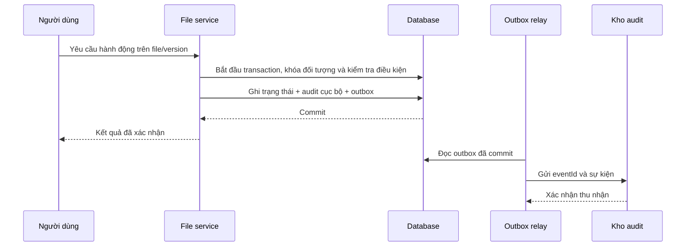

# File action audit

## 1. Audit hành động trên tệp bảo vệ điều gì?

Trong chương **File Business Rules** của module bảo vệ logic nghiệp vụ, *file action audit* là việc tạo và bảo vệ bằng chứng về các hành động có ý nghĩa nghiệp vụ đối với tệp: tải lên, thay thế, gắn vào hồ sơ, duyệt, chia sẻ, tải xuống, thu hồi hoặc xóa.

Audit cần giúp trả lời những câu hỏi cụ thể:

- Ai yêu cầu hành động, ai được hành động thay và thành phần nào thực thi?
- Hành động nhắm tới tệp nào, phiên bản nào và trong tenant nào?
- Những điều kiện quyền và trạng thái nào đã được kiểm tra?
- Yêu cầu bị từ chối, mới được chấp nhận hay đã tạo hiệu ứng?
- Hiệu ứng nào đã được xác nhận, hiệu ứng nào còn chưa rõ?

Ví dụ, nhân viên gửi lệnh xóa tài liệu đã được duyệt trong một hồ sơ tín dụng. API trả `202 Accepted`; worker xóa object sau đó. Một dòng log `user deleted file` tại thời điểm nhận request sẽ mô tả sai thực tế: lúc đó có thể chỉ mới ghi nhận yêu cầu, còn object chưa bị xóa hoặc lệnh đã bị chặn vì tệp đang bị giữ theo chính sách lưu trữ.

Audit không thay thế authorization, transaction hoặc state machine. Nó cung cấp bằng chứng để kiểm chứng các cơ chế này, điều tra lạm dụng và phục hồi khi kết quả không rõ ràng. Một hệ thống ghi log rất nhiều nhưng vẫn cho phép sửa giá trị trái quyền chưa bảo vệ được quy tắc nghiệp vụ.

## 2. Xác định hành động ở mức nghiệp vụ

Không nên ghi mọi việc thành `FILE_UPDATED`. Cùng một cập nhật database có thể mang ý nghĩa hoàn toàn khác nhau: đổi tên, thay nội dung, duyệt sử dụng hoặc chuyển quyền sở hữu.

| Hành động | Đối tượng cần định danh | Bằng chứng quan trọng |
|---|---|---|
| Khởi tạo upload | Upload session, người gửi, tenant | Ai được phép đưa dữ liệu vào phạm vi nào |
| Chấp nhận nội dung | File ID, phiên bản nội dung | Nội dung nào đã được hoàn tất và được hệ thống tiếp nhận |
| Thay thế tệp | Phiên bản cũ và mới | Quyền thay thế; phê duyệt cũ còn hiệu lực hay đã bị vô hiệu |
| Gắn hoặc tháo khỏi hồ sơ | Tệp và hồ sơ nghiệp vụ | Quyền trên cả hai đối tượng; quan hệ trước và sau |
| Duyệt hoặc từ chối | Tệp, phiên bản, phạm vi duyệt | Người duyệt, điều kiện và đúng nội dung được duyệt |
| Chia sẻ hoặc cấp quyền | Tệp, người nhận, phạm vi, thời hạn | Ai cấp quyền; người nhận nào; quyền nào thực sự có hiệu lực |
| Tải hoặc xem trước | Phiên bản tệp, phiên tải | Quyết định cho phép và mức độ truyền dữ liệu quan sát được |
| Thu hồi | Grant, liên kết chia sẻ hoặc quyền sử dụng | Điểm thu hồi có hiệu lực và phạm vi bị chặn |
| Yêu cầu xóa | Tệp, phiên bản, lý do | Quyền xóa, điều kiện giữ tệp, trạng thái đã commit |
| Xóa ở storage | Object/version được quản lý | Kết quả phía storage; không suy rộng sang mọi bản sao |
| Khôi phục | Phiên bản được khôi phục, nơi gắn lại | Quyền hiện tại và trạng thái sau khôi phục |

Hệ thống chỉ cần các loại hành động phù hợp nghiệp vụ của mình. Điều quan trọng là mỗi tên sự kiện phải có định nghĩa rõ và có điểm phát sinh xác định.

### 2.1. Không gộp quyền đối với tệp và quyền đối với hồ sơ

Một người có thể được đọc tệp nhưng không được gắn nó vào hồ sơ khách hàng khác. Một người có quyền quản lý hồ sơ chưa chắc được thay tài liệu đã ký bên trong hồ sơ.

Audit hành động `FILE_ATTACHED` cần định danh cả tệp lẫn hồ sơ đích, cùng kết quả kiểm tra quan hệ tenant và phạm vi dữ liệu. Chỉ lưu `fileId` sẽ khiến việc điều tra hành vi chuyển tài liệu sai hồ sơ thiếu dữ kiện.

## 3. Viết invariant cho audit

| Mã | Invariant | Hậu quả nếu bị phá vỡ |
|---|---|---|
| A1 | Mỗi thay đổi nghiệp vụ đã commit thuộc diện bắt buộc audit có bằng chứng bền vững tương ứng | Dữ liệu đổi nhưng không truy được ai thực hiện |
| A2 | Sự kiện không khẳng định hiệu ứng đã xảy ra trước khi hiệu ứng được xác nhận | Log báo đã xóa trong khi mới đưa yêu cầu vào queue |
| A3 | Tệp, phiên bản, tenant và đối tượng liên quan được lấy từ dữ kiện đáng tin cậy | Client ghi audit cho tệp A nhưng thực tế sửa tệp B |
| A4 | Người yêu cầu, chủ thể được ủy quyền và service thực thi không bị đánh đồng | Worker dùng quyền mạnh nhưng mọi hành động bị gán cho người dùng hoặc tài khoản hệ thống chung |
| A5 | Retry không tạo thêm hiệu ứng nghiệp vụ, nhưng các lần thử vẫn phân biệt được khi cần | Không biết một hành động hay nhiều hành động đã xảy ra |
| A6 | Thứ tự chuyển trạng thái của một đối tượng có thể kiểm chứng | Tệp bị thay nội dung sau duyệt nhưng audit vẫn trông như duyệt đúng nội dung |
| A7 | Người không đủ quyền không được sửa, xóa hoặc đọc audit vượt phạm vi | Audit trở thành đường rò rỉ hoặc bị xóa để che giấu |
| A8 | Dữ liệu audit không chứa credential hoặc nội dung nhạy cảm không cần thiết | Log trở thành kho token, signed URL hoặc tài liệu bị lộ |
| A9 | Kết quả chưa rõ được giữ là chưa rõ cho đến khi đối soát | Timeout bị coi nhầm là không có hiệu ứng |
| A10 | Lỗi đường ghi audit có hành vi được định nghĩa theo từng loại hành động | Hệ thống âm thầm tiếp tục thao tác bắt buộc phải có bằng chứng |

Không phải mọi audit event đều phải nằm trong transaction nghiệp vụ. Ví dụ, ghi nhận một lần bị từ chối không có thay đổi nghiệp vụ để commit cùng. Nhưng các loại bằng chứng khác nhau cần cơ chế bảo đảm phù hợp, thay vì cùng gọi một hàm `logger.info()` rồi mặc định đã đủ.

## 4. Thiết kế event envelope và nguồn tin cậy

Một audit event thường cần các nhóm dữ kiện sau:

| Nhóm | Trường minh họa | Quy tắc |
|---|---|---|
| Định danh sự kiện | `eventId`, `eventType`, `schemaVersion` | Do hệ thống cấp; không dùng request ID làm định danh duy nhất của mọi sự kiện |
| Thời gian | `occurredAt`, `recordedAt` | Thời điểm xảy ra và thời điểm thu nhận có thể khác nhau |
| Phạm vi | `tenantId`, `businessObjectType`, `businessObjectId` | Lấy từ ngữ cảnh đã xác minh và đối tượng thực tế |
| Nội dung tệp | `fileId`, `contentVersion`, `contentDigest` | Định danh đúng phiên bản, không chỉ tên tệp |
| Chủ thể | `initiatedBy`, `onBehalfOf`, `executedBy` | Tách người khởi tạo, ủy quyền và thành phần thực thi |
| Quyết định quyền | `authorizationDecision`, `policyVersion`, `reasonCode` | Ghi quyết định có cấu trúc; không lưu token xác thực |
| Kết quả | `outcome`, `stateBefore`, `stateAfter` | Chỉ ghi trạng thái sau đã được xác nhận trong phạm vi sự kiện |
| Liên kết luồng | `requestId`, `correlationId`, `causationId`, `operationId` | Dùng để nối các bước, không phải bằng chứng quyền |
| Đồng thời | `aggregateVersion`, `attemptId`, `workerEpoch` | Khi cần kiểm chứng thứ tự và loại bỏ worker cũ |

### 4.1. Actor của request và actor của worker

Một ví dụ ủy quyền hợp lệ có thể là:

```text
initiatedBy = người dùng U17
onBehalfOf = nhóm nghiệp vụ được ủy quyền theo delegation D8
executedBy = file-retention-worker
```

Không tự lấy `onBehalfOf` từ header hoặc ô dữ liệu người dùng tự khai. Nếu có ủy quyền, server phải xác minh và lưu tham chiếu tới quyết định ủy quyền có liên quan.

Với thao tác tự động theo chính sách, actor nghiệp vụ có thể là một policy hoặc service, không phải người tải tệp ban đầu. Gán mọi sự kiện xóa tự động cho người tạo tệp sẽ làm sai trách nhiệm.

### 4.2. Tên tệp và địa chỉ mạng là dữ liệu không đáng tin mặc định

Tên tệp có thể chứa ký tự xuống dòng hoặc chuỗi giống nội dung log. Ghi log có cấu trúc và mã hóa dữ liệu đúng cách; không nối thẳng tên tệp vào một dòng văn bản để phân tích bằng mắt hoặc biểu thức chính quy.

Địa chỉ IP từ header chuyển tiếp chỉ đáng tin theo cấu hình proxy tin cậy. IP và user agent là dữ kiện bổ trợ; chúng không chứng minh một người cụ thể đã thao tác. Không dùng chúng thay thế định danh phiên đã xác thực.

### 4.3. Ví dụ sự kiện có cấu trúc

```json
{
  "eventId": "evt-901",
  "schemaVersion": 1,
  "eventType": "FILE_DELETE_REQUESTED",
  "occurredAt": "2026-11-22T03:15:00Z",
  "tenantId": "tenant-A",
  "fileId": "file-117",
  "contentVersion": 4,
  "aggregateVersion": 12,
  "initiatedBy": {"kind": "USER", "id": "user-17"},
  "executedBy": {"kind": "SERVICE", "id": "file-api"},
  "authorizationDecision": "ALLOW",
  "policyVersion": "file-policy-8",
  "outcome": "COMMITTED",
  "stateBefore": "AVAILABLE",
  "stateAfter": "DELETE_PENDING",
  "reasonCode": "AUTHORIZED_OWNER_REQUEST",
  "operationId": "delete-op-83",
  "requestId": "req-215"
}
```

Sự kiện này chứng minh yêu cầu xóa và chuyển trạng thái đã commit. Nó không khẳng định object đã biến mất khỏi storage, backup hay cache. Các định danh chỉ minh họa cấu trúc, không phải secret hoặc đường dẫn storage để client truy cập.

## 5. Phân biệt ý định, quyết định và hiệu ứng

Một hành động có thể đi qua nhiều điểm quan sát:

```text
Nhận request
  → xác thực
  → đánh giá quyền và invariant
  → commit thay đổi hoặc chấp nhận công việc
  → thực thi bất đồng bộ
  → xác nhận hiệu ứng ngoài hệ thống
```

Không nên dùng một `SUCCESS` cho toàn bộ chuỗi.

| Kết quả hoặc mốc | Ý nghĩa | Chưa chứng minh được |
|---|---|---|
| `ATTEMPTED` | Thành phần đã quan sát một lần thử | Request có quyền hoặc đã tạo hiệu ứng |
| `DENIED` | Quyết định chặn hành động | Không có đường vòng ở thành phần khác |
| `ALLOWED` | Policy cho phép tại điểm kiểm tra | Thay đổi đã commit hoặc tệp đã được gửi |
| `COMMITTED` | Thay đổi trong ranh giới transaction đã hoàn tất | Hiệu ứng ngoài database đã hoàn tất |
| `STARTED` | Một phiên hoặc tác vụ đã được chấp nhận bắt đầu | Người dùng đã nhận đầy đủ dữ liệu |
| `FINISHED` | Thành phần thực thi quan sát việc kết thúc theo định nghĩa | Người dùng đã đọc hoặc lưu tệp |
| `FAILED` | Có lỗi được xác định trong phạm vi quan sát | Mọi hiệu ứng đều chưa xảy ra hoặc đã được hoàn tác |
| `OUTCOME_UNKNOWN` | Chưa xác định được hiệu ứng | Được phép retry mà không đối soát |

Một lời từ chối cần phân biệt từ chối quyền và vi phạm invariant như đang bị giữ tệp, phiên bản cũ hoặc chưa được duyệt. Reason code nội bộ giúp điều tra; response bên ngoài vẫn theo chính sách hạn chế tiết lộ thông tin.

## 6. Ghi audit cùng transaction với chuyển trạng thái

### 6.1. Lỗi check rồi log riêng rẽ

```text
Đổi quyền chia sẻ commit → process crash trước khi ghi audit
  → quyền đã mở nhưng thiếu bằng chứng.

Ghi audit thành công → transaction đổi quyền rollback
  → audit mô tả thay đổi chưa từng có hiệu lực.
```

Đối với thay đổi trong một database, có thể ghi bản ghi audit cục bộ và outbox trong cùng transaction với trạng thái nghiệp vụ. Sau commit, một tiến trình xuất outbox sang kho audit phục vụ truy vấn hoặc lưu trữ độc lập.



Nếu relay tạm ngừng, bằng chứng cục bộ vẫn tồn tại trong ranh giới đã commit. Cần theo dõi độ trễ và dung lượng để sự cố kéo dài không làm mất khả năng lưu bền vững.

### 6.2. Mã giả Java cho yêu cầu xóa

Đây là mã giả thể hiện trách nhiệm, không phải mã có thể sao chép chạy ngay. Giả định metadata tệp, audit cục bộ và outbox cùng database; thay đổi quyền và trạng thái tuân thủ cơ chế khóa phù hợp.

```java
DeleteReceipt requestDelete(
        AuthenticatedPrincipal principal,
        VerifiedTenantContext tenant,
        String fileId,
        long expectedAggregateVersion,
        String operationId) {

    return transactions.required(() -> {
        AuthorizationGuard guard = guards.lockForTenant(tenant.id());
        FileRecord file = files.lockByTenantAndId(tenant.id(), fileId)
            .orElseThrow(NotFoundException::new);

        access.requireCurrentDeletePermission(principal, file, guard);
        // Phân xử operationId trong phạm vi đã xác minh; payload khác là conflict.
        DeleteOperation operation = operations.claimOrLoad(
            tenant.id(), principal.id(), operationId,
            file.id(), expectedAggregateVersion);

        if (operation.alreadyCommitted()) {
            return operation.authorizedReceipt();
        }

        file.requireVersion(expectedAggregateVersion);
        file.requireDeletionAllowedByCurrentRules();

        FileState before = file.state();
        file.markDeletePending();
        files.save(file);

        AuditEvent event = auditEvents.deleteRequested(
            principal, tenant, file,
            before, file.state(), file.aggregateVersion(), operation.id());

        auditRepository.appendRequired(event);
        outbox.appendAudit(event.eventId(), event);
        deletionTasks.enqueueInDatabase(file.id(), file.contentVersion(), operation.id());
        operations.complete(operation, file.aggregateVersion());

        return DeleteReceipt.pending(operation.id(), file.aggregateVersion());
    });
}
```

`enqueueInDatabase` là ghi công việc hoặc outbox công việc trong transaction, không phải gọi queue ngoài database mà giả định đã nguyên tử. Repository claim cũng phải thực thi chống lặp bằng cơ chế phân xử thực sự, không chỉ `SELECT` rồi `INSERT` thiếu ràng buộc.

Nếu `appendRequired` thất bại, transaction rollback cùng trạng thái tệp. Worker chỉ thấy công việc xóa đã commit. Sự kiện xóa object ở storage được ghi riêng sau khi có kết quả phù hợp.

Ở đây, replay được nhận diện trước khi áp dụng lại precondition phiên bản nhưng sau khi kiểm tra quyền hiện tại. Khóa operation phải gắn với fingerprint yêu cầu, gồm file ID và phiên bản mong đợi. Cùng khóa nhưng khác yêu cầu là xung đột, không phải lý do trả receipt của một thao tác khác.

## 7. Ghi nhận từ chối và xử lý khi audit gặp lỗi

### 7.1. Từ chối không thể dựa vào transaction đã rollback

Nếu ghi sự kiện `FILE_DELETE_DENIED` trong transaction rồi ném exception làm rollback, chính audit cũng biến mất. Dùng một đường ghi độc lập phù hợp, như transaction riêng hoặc collector có xác nhận lưu bền vững, với thiết kế xử lý lỗi rõ ràng.

Không bắt exception chung rồi tự gán mọi lỗi thành `DENIED`. Lỗi database, lỗi stream và lỗi quyền là các sự kiện khác nhau. Với request chưa xác thực được, không gán user ID do client khai thành actor đã xác minh; có thể ghi `UNAUTHENTICATED` cùng dữ kiện yêu cầu đã được giới hạn.

Một lần bị từ chối có thể không được biết file có tồn tại hay không. Audit nên lưu quyết định và định danh đầu vào trong trường phù hợp, không bịa thêm metadata tệp chưa được nạp hoặc chưa được phép sử dụng.

### 7.2. Quy định hành vi khi không ghi được audit

Chọn hành vi theo loại hành động và bảo đảm hệ thống đã cam kết:

| Tình huống | Hành vi có thể thiết kế |
|---|---|
| Thay đổi quyền bắt buộc có audit, database không lưu được audit | Rollback thay đổi; trả lỗi phù hợp |
| Kho audit trung tâm không sẵn sàng, outbox cục bộ còn bền vững | Tiếp tục theo policy và cảnh báo độ trễ xuất sự kiện |
| Bắt đầu tải nhạy cảm yêu cầu có bằng chứng trước khi trao byte | Không bắt đầu stream nếu không lưu được bằng chứng bắt đầu |
| Stream đã gửi một phần rồi lỗi ghi sự kiện kết thúc | Ghi nhận sự cố và đối soát; không tuyên bố chưa có byte nào được gửi |
| Đường ghi từ chối bị nghẽn do nhiều request tấn công | Giới hạn tài nguyên, cảnh báo và bảo vệ hành động nghiệp vụ; không nới quyền |

“Fail closed” chỉ có ý nghĩa tại điểm hệ thống còn kiểm soát được hiệu ứng. Sau khi đã gửi dữ liệu hoặc dịch vụ ngoài đã thực hiện, trả một mã lỗi không hoàn tác được hiệu ứng đó.

Nếu dùng sampling cho telemetry lưu lượng lớn, phải phân biệt với loại audit bắt buộc đầy đủ. Không âm thầm lấy mẫu các sự kiện thay đổi quyền rồi vẫn khẳng định có thể truy vết mọi thay đổi.

## 8. Audit tải xuống và signed URL

Tải tệp là nơi audit dễ khẳng định quá mức:

```text
Đã cho phép tải ≠ đã phát URL ≠ đã bắt đầu stream
               ≠ server đã ghi xong response ≠ người dùng đã đọc tệp.
```

Với gateway kiểm soát đường tải, có thể ghi:

- Quyết định cấp hoặc từ chối quyền tải đối với đúng file/version.
- Phiên tải đã bắt đầu và actor được ràng buộc với phiên.
- Số byte gateway quan sát đã truyền, kết quả stream và lỗi kết nối.
- Các request Range hoặc resume liên quan tới cùng phiên theo hợp đồng của hệ thống.

Một tệp có thể được tải qua nhiều request. Không đếm mỗi Range thành một người tải mới, và không coi `HEAD` là bằng chứng nhận nội dung. `FINISHED` cần định nghĩa theo phạm vi server quan sát được.

Với signed URL trực tiếp, ứng dụng thường chỉ biết việc cấp URL. Muốn biết URL đã được dùng phải có log hoặc sự kiện phù hợp từ storage/CDN. URL dạng bearer có thể bị chuyển cho người khác, nên chủ thể được cấp URL không nhất thiết là người thực sự dùng URL.

Không ghi signed URL đầy đủ, token grant, cookie hoặc Authorization header vào audit. Có thể liên kết bằng grant ID không chứa secret, operation ID và object/version tham chiếu nội bộ đã được kiểm soát. Cũng cần kiểm tra access log, reverse proxy và công cụ phân tích không vô tình lưu các secret này.

## 9. Worker bất đồng bộ, retry và kết quả xóa thực tế

### 9.1. Một operation có thể có nhiều attempt

Luồng xóa thường có các sự kiện:

```text
FILE_DELETE_REQUESTED
  → DELETE_ATTEMPT_STARTED
  → STORAGE_DELETE_CONFIRMED hoặc DELETE_ATTEMPT_FAILED
  → FILE_DELETION_FINALIZED khi điều kiện nghiệp vụ được đáp ứng
```

Tách `operationId` ổn định khỏi `attemptId`. Retry do mất phản hồi cần giữ định danh thao tác để không tạo hiệu ứng lặp. Một attempt lỗi không được ghi đè kết quả cuối đã xác nhận của attempt khác.

Nếu storage đã xóa nhưng worker không nhận được phản hồi, ghi kết quả chưa rõ và đối soát theo đúng object/version. Không suy từ timeout rằng object vẫn còn. Nếu kết quả “không tìm thấy” được dùng như thành công idempotent, cần bảo đảm worker đang tra đúng đối tượng và chính sách xóa thật sự chấp nhận kết quả đó.

### 9.2. Phạm vi xác nhận xóa phải cụ thể

`STORAGE_DELETE_CONFIRMED` cần định nghĩa theo hành vi storage thực tế. Trong hệ thống có versioning, một thao tác có thể chỉ tạo dấu xóa ở phiên bản hiện hành; các phiên bản cũ vẫn tồn tại. Một kết quả xóa tại origin không tự chứng minh backup, replica, thumbnail hoặc cache đã bị loại bỏ.

Audit nên phân biệt xóa logic, thu hồi khả năng truy cập, xóa một object/version và hoàn tất quy trình xóa theo phạm vi đã cam kết. Không phát sự kiện `ALL_COPIES_ERASED` chỉ vì một API storage trả thành công.

### 9.3. Kiểm tra điều kiện ở thời điểm worker thực thi

Sau lúc yêu cầu xóa, tệp có thể bị đặt vào trạng thái giữ, phê duyệt có thể bị thu hồi hoặc job có thể bị hủy. Policy phải xác định quyết định nào được giữ cố định và điều kiện nào cần kiểm tra lại khi thực thi.

Worker cần ghi ngữ cảnh được dùng tại điểm quyết định, thay vì sao chép toàn bộ kết quả kiểm tra cũ như thể đó là kiểm tra hiện tại. Nếu worker dùng ủy quyền có thời hạn, audit phải liên kết với ủy quyền đó, không tự suy ra quyền từ việc message nằm trong queue.

Với fencing token hoặc epoch, ghi epoch phục vụ điều tra nhưng vẫn phải thực thi kiểm tra tại ranh giới thay đổi phù hợp. Audit cho biết worker cũ đã cố làm gì; chỉ ghi epoch không tự ngăn worker cũ ghi dữ liệu.

### 9.4. Chống ghi sự kiện commit lặp khi xuất outbox

Outbox relay có thể gửi lại cùng sự kiện. Kho audit cần nhận diện cùng `eventId` để không hiển thị một lần thay đổi quyền như nhiều thay đổi độc lập. Nếu cùng event ID nhưng nội dung khác, coi là lỗi toàn vẹn cần điều tra, không ghi đè âm thầm.

Ngược lại, nhiều lần thử khác nhau phải có event ID riêng và cùng liên kết operation. Loại trùng mọi sự kiện theo `operationId` sẽ làm mất lịch sử các attempt, từ chối hoặc đối soát.

## 10. Thứ tự sự kiện và chuyển trạng thái

### 10.1. Timestamp không phải thứ tự tuyệt đối

Các service có thể lệch đồng hồ; relay có thể gửi muộn; hai sự kiện có thể đến kho audit theo thứ tự ngược với lúc commit. `recordedAt` muộn hơn không tự chứng minh hành động xảy ra muộn hơn.

Với mỗi tệp, có thể tăng `aggregateVersion` trong cùng transaction với thay đổi metadata. Mỗi sự kiện chuyển trạng thái ghi phiên bản và trạng thái trước/sau. Nếu một lần thay đổi sinh nhiều sự kiện, cần phân biệt thứ tự trong transaction hoặc một change ID chung phù hợp.

```text
file F, aggregateVersion 40: APPROVED, contentVersion 6
file F, aggregateVersion 41: CONTENT_REPLACED, contentVersion 7
file F, aggregateVersion 42: APPROVAL_INVALIDATED, contentVersion 7
```

Nếu nghiệp vụ yêu cầu thay nội dung phải đồng thời vô hiệu phê duyệt, hai thay đổi cuối phải được thực hiện nguyên tử hoặc được biểu diễn như một chuyển trạng thái không có cửa sổ dùng phiên bản mới dưới phê duyệt cũ. Audit không hợp thức hóa một cửa sổ sai invariant chỉ vì nó được ghi lại đầy đủ.

### 10.2. Duyệt đúng phiên bản nội dung

Phê duyệt nên gắn với `contentVersion` hoặc một định danh nội dung bất biến đáng tin cậy. Tên tệp giữ nguyên không có nghĩa nội dung giữ nguyên.

Digest hỗ trợ kiểm tra nội dung tương ứng, nhưng không chứng minh ai được phép đọc hoặc nội dung được phê duyệt đúng quy trình. Các phiên bản nội dung và metadata cần được quản lý để không thể thay object dưới cùng một tham chiếu rồi tiếp tục dùng dấu phê duyệt cũ.

### 10.3. Liên kết nguyên nhân thay vì chỉ nối theo thời gian

Một sự kiện `FILE_SHARE_REVOKED` nên có `causationId` liên kết tới yêu cầu thu hồi hoặc policy event đã kích hoạt. Nếu sau đó một request tải bị từ chối, liên kết grant/file/version và policy state giúp hiểu nguyên nhân mà không phải đoán từ hai timestamp gần nhau.

Với hành động tác động nhiều đối tượng, như chuyển tệp giữa hai hồ sơ, cần một operation ID chung và bằng chứng trạng thái của các đối tượng liên quan. Không kỳ vọng một thứ tự toàn cục đơn giản giữa mọi tenant và mọi service nếu kiến trúc không cung cấp bảo đảm đó.

## 11. Bảo vệ audit khỏi sửa đổi và thiếu sự kiện

### 11.1. Giới hạn quyền ghi và quyền quản trị

Service nghiệp vụ chỉ nên có quyền cần thiết để thêm sự kiện theo thiết kế. Người xem audit không mặc định có quyền sửa audit hoặc tải toàn bộ nội dung tệp.

Tách quyền truy vấn, xuất báo cáo, cấu hình retention và quản lý kho lưu. Những thay đổi quản trị như nới quyền đọc audit, đổi cấu hình xuất log hoặc rút ngắn retention cũng cần được theo dõi qua đường đủ độc lập để tránh người thay đổi tự che dấu vết.

Một cột `immutable=true` hoặc quy ước “không dùng UPDATE” chưa tạo ra bảo đảm bất biến nếu credential vẫn có thể sửa và xóa tùy ý. Cần ràng buộc quyền thực tế, cơ chế lưu trữ phù hợp và giám sát việc sử dụng quyền đặc biệt.

### 11.2. Tính phát hiện sửa đổi khác với tính đầy đủ

Các cơ chế có thể cân nhắc theo mức bảo đảm cần thiết:

- Chỉ cho append ở đường sử dụng thông thường; hạn chế quyền sửa/xóa trực tiếp.
- Lưu bản sao ở miền quản trị độc lập hoặc kho lưu có chính sách bảo vệ tương ứng.
- Dùng digest, chữ ký hoặc hash chain với quy tắc kiểm chứng rõ.
- Lưu checkpoint/anchor độc lập và đối soát với các chuyển trạng thái có thẩm quyền.

Hash chain có thể giúp phát hiện sửa một sự kiện giữa chuỗi, nhưng tự nó không chứng minh mọi hành động đã được ghi. Nếu kẻ tấn công xóa phần cuối chuỗi và không có anchor độc lập, người kiểm tra có thể không biết phần cuối từng tồn tại. Nếu họ kiểm soát cả dữ liệu lẫn khóa tạo bằng chứng, mức bảo đảm tiếp tục giảm.

Chuỗi hash trong môi trường ghi song song cần quy tắc thứ tự và phân xử append. Không giả định nối `previousHash` trong mỗi process sẽ tạo được một chuỗi toàn cục nhất quán.

### 11.3. Phát hiện thiếu audit

Có thể đối soát các thay đổi metadata quan trọng với audit cục bộ/outbox, kiểm tra watermark xuất sự kiện và cảnh báo khi có công việc bị kẹt. Việc đối soát nên bao phủ cả đường API, tác vụ quản trị, migration và worker có thể thay đổi cùng dữ liệu.

Một khoảng trống trong sequence không tự chứng minh có tấn công: cơ chế cấp số có thể bỏ số khi rollback. Ngược lại, không có khoảng trống không chứng minh đủ sự kiện nếu một đường cập nhật chưa từng phát audit. Cần hiểu cách cấp số và đối chiếu với nguồn thay đổi thực tế.

Database trigger có thể hỗ trợ ghi nhận thay đổi dữ liệu, nhưng thường không tự biết đầy đủ actor nghiệp vụ, phê duyệt hoặc lý do. Nếu dùng, phải thiết kế cách truyền ngữ cảnh đáng tin cậy và tránh coi trigger như bằng chứng hoàn chỉnh cho toàn workflow.

## 12. Bảo vệ dữ liệu bên trong audit

Audit cũng là dữ liệu có thể nhạy cảm. Danh sách tệp, tên khách hàng, quan hệ giữa người dùng và hồ sơ, lý do từ chối hoặc thông tin người nhận đều có thể tiết lộ nghiệp vụ.

### 12.1. Ghi tối thiểu nhưng đủ điều tra

Ưu tiên định danh và mã lý do có cấu trúc thay vì sao chép nội dung tệp. Với thay đổi quyền, có thể ghi phạm vi quyền trước/sau cần thiết; không cần ghi toàn bộ hồ sơ người nhận. Với thay nội dung, thường lưu phiên bản/digest và loại thay đổi thay vì toàn bộ byte.

Không coi hash của một dữ liệu ít khả năng như email hoặc số điện thoại là đã ẩn danh an toàn. Dữ liệu có thể bị đoán và đối chiếu; ngay cả định danh giả vẫn có thể liên kết lại qua hệ thống khác. Chọn cách giảm thiểu và bảo vệ phù hợp mục đích audit.

### 12.2. Quyền truy vấn và xuất báo cáo

Endpoint tra audit phải kiểm tra tenant, phạm vi đối tượng và quyền xem lịch sử. Quyền quản lý tệp hiện tại không nhất thiết đồng nghĩa quyền xem mọi lịch sử nhạy cảm trước đó; điều này cần policy rõ ràng.

Một trường `tenantId` trong query không phải ranh giới bảo vệ. Server phải ràng buộc tenant đã xác minh và áp dụng filter ở nguồn dữ liệu. Các tính năng tìm kiếm, đếm kết quả, autocomplete và xuất audit cũng phải có cùng phạm vi thích hợp.

Ghi nhận các hành động đọc/xuất audit nhạy cảm theo policy, nhưng tránh vòng lặp vô hạn trong đó ghi một sự kiện audit lại kích hoạt vô hạn sự kiện mới. Có thể dùng loại sự kiện quản trị hoặc đường lưu riêng với quy tắc rõ ràng.

### 12.3. Thời hạn lưu không đồng nhất với tuổi thọ tệp

Xóa tệp nghiệp vụ không nhất thiết là xóa ngay mọi bằng chứng về hành động trên tệp. Ngược lại, giữ audit vô hạn cũng không tự động là lựa chọn phù hợp. Xác định mục đích, thời hạn và các điều kiện giữ theo policy của hệ thống.

Quy trình hết hạn audit phải được ủy quyền, kiểm soát và có bằng chứng quản trị tương ứng. Không cho người dùng xóa lịch sử để làm một thao tác cũ trông như chưa từng xảy ra, hoặc xóa ledger chống lặp rồi áp dụng lại hiệu ứng.

## 13. Ma trận kiểm thử hành động và audit

Chuẩn bị hai tenant, người có và không có quyền với tệp, nhiều phiên bản nội dung, một tệp đã duyệt, một tệp đang bị giữ, kho audit tạm ngừng và worker có thể retry.

| Tình huống | Bằng chứng cần kiểm tra |
|---|---|
| Người hợp lệ đổi quyền chia sẻ | Trạng thái quyền và sự kiện commit cùng tồn tại; người nhận/phạm vi đúng |
| Người không có quyền yêu cầu xóa | Không đổi trạng thái; có sự kiện từ chối theo đường ghi đã thiết kế |
| Tenant A dùng file ID của tenant B | Không có hiệu ứng hoặc metadata vượt quyền; actor và tenant ghi đúng ngữ cảnh |
| Tên tệp chứa ký tự xuống dòng | Audit giữ cấu trúc; không giả tạo thêm một dòng sự kiện |
| Client giả header actor/correlation | Actor lấy từ nguồn đã xác minh; correlation không trở thành bằng chứng quyền |
| Ghi audit cục bộ thất bại trước commit | Hành động bắt buộc audit rollback; không còn công việc ngoài transaction |
| Crash sau đổi metadata nhưng trước commit | Không có sự kiện `COMMITTED` tồn tại độc lập với thay đổi đã rollback |
| Crash sau commit, trước response | Operation đã có được đối soát; retry không tạo thay đổi nghiệp vụ thứ hai |
| Relay gửi lại cùng event ID | Kho audit không hiển thị thành hai chuyển trạng thái độc lập |
| Cùng event ID nhưng payload khác | Phát hiện lỗi toàn vẹn, không ghi đè âm thầm |
| Kho audit trung tâm ngừng hoạt động | Outbox còn bền vững; có cảnh báo và phục hồi xuất sự kiện |
| Thay nội dung sau khi duyệt | Liên kết nội dung/phê duyệt và trạng thái mới phản ánh đúng invariant |
| Hai cập nhật cùng phiên bản mong đợi | Phân xử đồng thời rõ; audit phản ánh chuyển trạng thái đã commit |
| Cấp signed URL nhưng không dùng | Chỉ có bằng chứng cấp URL, không báo người dùng đã tải |
| Stream bị ngắt giữa chừng | Sự kiện kết thúc phản ánh lỗi/phạm vi quan sát, không báo đã nhận đủ tệp |
| Request Range hoặc `HEAD` | Không đánh đồng với một lượt nhận đầy đủ nội dung |
| Worker xóa timeout sau hiệu ứng | Kết quả chưa rõ được đối soát, không khẳng định storage chưa xóa |
| Storage có versioning hoặc cache | Sự kiện xóa không khẳng định quá phạm vi đã xác nhận |
| Worker cũ tiếp tục sau đổi epoch | Kiểm tra fencing chặn hiệu ứng; attempt cũ vẫn truy vết được |
| Người đọc audit khác tenant | Không đọc, đếm hoặc xuất dữ liệu ngoài phạm vi |
| Credential quản trị sửa hoặc xóa audit | Cơ chế hạn chế/phát hiện hoạt động theo bảo đảm đã thiết kế |
| Truy vấn log tìm secret | Không có token, cookie, signed URL đầy đủ hoặc nội dung tệp không cần thiết |

### 13.1. Đặt lỗi đúng ranh giới

Integration test nên có điểm lỗi trước commit, sau commit nhưng trước phản hồi, trước gửi outbox và sau kho audit đã nhận nhưng relay chưa nhận xác nhận. Mỗi điểm tạo ra tình huống phục hồi khác nhau.

Với transaction, kiểm tra cả bảng nghiệp vụ, audit cục bộ, outbox và operation ledger. Chỉ mock lời gọi `appendAudit()` thành công không chứng minh rằng dữ liệu thật được ghi nguyên tử.

Với audit từ chối, xác nhận sự kiện không bị rollback cùng exception nghiệp vụ. Với lỗi đường audit, xác nhận hệ thống thực hiện đúng policy đã định nghĩa, đặc biệt trước khi trao dữ liệu nhạy cảm.

### 13.2. Kiểm thử đồng thời và thứ tự

Điều khiển hai request cùng sửa một file/version hoặc một worker đua với thao tác thu hồi. Xác nhận audit mô tả đúng bên thắng và bên bị chặn; không có sự kiện `COMMITTED` cho thay đổi không có hiệu lực.

Cho relay gửi sự kiện ngược thứ tự để kiểm tra công cụ điều tra vẫn tái dựng được chuyển trạng thái theo aggregate version và liên kết nguyên nhân. Không yêu cầu thứ tự thu nhận phải luôn là thứ tự nghiệp vụ nếu kiến trúc không bảo đảm điều đó.

## 14. Điều tra và cảnh báo lạm dụng logic

Một truy vấn điều tra nên bắt đầu từ file ID, content version hoặc operation ID, sau đó nối sang request, actor, quyết định quyền và các attempt liên quan. Không bắt đầu bằng việc giả định một dòng log `success` chứng minh mọi bước đã hoàn tất.

Ví dụ cần điều tra việc tài liệu đã duyệt bị thay:

```text
1. Xác định contentVersion được duyệt.
2. Tìm operation đã thay nội dung và aggregateVersion tương ứng.
3. Kiểm tra actor, ủy quyền và quyết định quyền tại điểm thay.
4. Xác minh phê duyệt cũ bị vô hiệu hoặc được xử lý theo policy.
5. Tìm các lượt cấp quyền/tải liên quan tới phiên bản mới.
6. Đối chiếu audit với trạng thái có thẩm quyền và các khoảng chưa rõ.
```

Các tín hiệu hữu ích gồm nhiều lần truy cập ID ngoài phạm vi, tải ngay sau khi quyền bị thu hồi, thay nội dung sát thời điểm duyệt, tạo chia sẻ ngoài nhóm thường dùng, thao tác xóa bị chặn vì trạng thái giữ và độ trễ outbox tăng cao.

Cảnh báo cần gắn với invariant và ngữ cảnh. Nhiều lần retry có thể do lỗi mạng; một lần thay tệp dưới phê duyệt cũ có thể đã đủ nghiêm trọng. Không chỉ dùng số lượng log làm mức độ rủi ro.

Một sự kiện audit không tự chứng minh tuyệt đối danh tính con người. Tài khoản có thể bị chiếm quyền, session có thể bị dùng chung hoặc service có credential bị lộ. Kết luận điều tra cần phân biệt điều hệ thống quan sát được với suy luận về người đứng sau.

## 15. Bài tập thiết kế

Một hệ thống hồ sơ vay có các đặc điểm:

- Mỗi hồ sơ chứa nhiều tệp, có tenant và nhân viên phụ trách.
- Tài liệu đã duyệt được phép dùng trong bước giải ngân.
- Khi thay nội dung, hệ thống hiện giữ nguyên tên tệp và cờ `approved=true`.
- API xóa trả thành công ngay sau khi đưa message vào queue.
- Audit hiện chỉ ghi `userId`, `fileName`, `action=UPDATE`, `success=true`.
- Các lượt tải dùng signed URL, còn application log coi việc cấp URL là đã tải thành công.

Hãy thiết kế lại để đáp ứng:

1. Phê duyệt gắn với đúng phiên bản nội dung và không được tái sử dụng ngầm sau khi thay tệp.
2. Mọi thay đổi quyền, quan hệ hồ sơ và trạng thái quan trọng có bằng chứng bền vững cùng commit phù hợp.
3. Yêu cầu xóa, thu hồi truy cập và kết quả xóa storage được phân biệt rõ.
4. Người yêu cầu, người được ủy quyền và worker thực thi có thể truy vết riêng.
5. Retry và relay gửi lại không tạo thêm hiệu ứng hoặc làm mất lịch sử attempt.
6. Người xem audit chỉ nhận thông tin trong phạm vi được cấp quyền và không nhận secret tải.
7. Lỗi ghi audit, mất phản hồi commit và storage timeout đều có trạng thái xử lý cụ thể.

Một phương án hợp lý cần xác định state machine, định danh phiên bản, event envelope, transaction/outbox, quyền tra audit và các điểm đối soát. Sau đó dùng ma trận lỗi để chứng minh hệ thống không ghi nhận vượt quá điều nó thực sự biết.

Thiết kế đạt yêu cầu phải trả lời được: **“Ai đã được phép làm gì với đúng phiên bản tệp nào, hiệu ứng nào đã được xác nhận và bằng chứng đó được bảo vệ ra sao?”** Câu trả lời phải dựa trên dữ kiện đáng tin cậy và trạng thái đã xác nhận, không chỉ trên một dòng log thành công chung chung.
