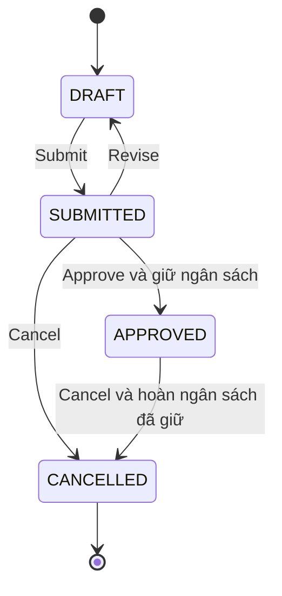
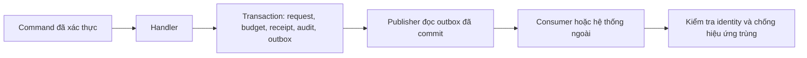

# Concurrent command model — Mô hình lệnh nghiệp vụ khi xử lý đồng thời

## 1. Vì sao cần mô hình command đồng thời?

Một command là yêu cầu thực hiện **một hành động nghiệp vụ có ý nghĩa**, chẳng hạn phê duyệt đề xuất mua hàng, hủy đơn, giữ ngân sách hoặc thay đổi nội dung hồ sơ.

Hai command đồng thời có thể đều hợp lệ khi kiểm tra riêng, nhưng tạo kết quả sai khi cùng ghi dữ liệu. Ví dụ, hai yêu cầu phê duyệt đều nhìn thấy ngân sách còn đủ, rồi cùng giữ tiền vượt hạn mức. Một người cũng có thể chủ động gửi nhiều yêu cầu để khai thác khoảng trống giữa kiểm tra và cập nhật.

Bài thuộc chương **Concurrency Rules** của module **Business Logic Security** (`SECURITY_APPLICATION_SECURITY_BUSINESS_LOGIC_SECURITY`). Trọng tâm là bảo vệ bất biến nghiệp vụ, quyền theo đối tượng và workflow khi command cạnh tranh, được gửi lại hoặc chạy trên nhiều instance.

Sau bài học, bạn có thể:

- Mô tả command bằng ý định, chủ thể, đối tượng, điều kiện trước và hiệu ứng.
- Xác định command nào xung đột, kể cả khi chúng ghi hai đối tượng khác nhau.
- Phân biệt kiểm soát phiên bản, transaction và idempotency.
- Chọn điểm thực thi nguyên tử cho trạng thái, ngân sách và dấu vết hiệu ứng.
- Xác định kết quả hợp lệ khi có retry, timeout, deadlock hoặc thu hồi quyền.
- Thiết kế kiểm thử dựa trên bất biến sau commit.

Các ví dụ SQL dùng PostgreSQL; ví dụ Java dùng mô hình dịch vụ Spring với JDBC hoặc repository tương đương. Những đặc tính được nêu riêng cho PostgreSQL không nên mặc định áp dụng giống hệt cho mọi hệ quản trị cơ sở dữ liệu.

## 2. Command, request và transaction attempt là ba khái niệm khác nhau

### 2.1. Command biểu diễn ý định nghiệp vụ

Ví dụ:

> Phê duyệt yêu cầu mua hàng R-51 ở phiên bản 8 mà người duyệt đã xem.

Một DTO có thể là:

```java
public record ApprovePurchaseRequest(
        UUID requestId,
        long expectedVersion,
        String idempotencyKey
) {}
```

DTO không chứa `approved=true`, số dư ngân sách mà client quan sát, vai trò người duyệt hoặc ID tenant để máy chủ tin và ghi thẳng.

Tenant và chủ thể được lấy từ ngữ cảnh xác thực phía máy chủ. Máy chủ đọc số tiền, loại tiền và tài khoản ngân sách từ đúng phiên bản yêu cầu cần phê duyệt.

### 2.2. Một command có thể được chuyển qua nhiều request

Client gửi command nhưng mất phản hồi. Khi gửi lại, đó có thể vẫn là cùng ý định, không phải một lần phê duyệt mới.

Cần phân biệt:

| Định danh | Mục đích | Không thay thế được |
|---|---|---|
| Idempotency key hoặc command identity | Nhận diện một ý định trong phạm vi đã quy định | Quyền của người gửi |
| Request ID / correlation ID | Theo dõi một lần vận chuyển, chuỗi gọi hoặc log | Nhận diện hiệu ứng nghiệp vụ duy nhất |
| Transaction attempt ID | Phân biệt các lần thử thực thi sau lỗi kỹ thuật | Command identity ổn định |
| Aggregate ID | Xác định đối tượng nghiệp vụ | Phiên bản người dùng đã xem |
| Expected version | Ràng buộc thao tác với trạng thái đã quan sát | Chống gửi lại cùng hiệu ứng sau commit |

Một command có thể đi qua hai HTTP request và ba transaction attempt, nhưng chỉ được tạo một hiệu ứng nghiệp vụ đã commit.

### 2.3. Hợp đồng command cần xác định điều gì?

Với mỗi loại command, nên ghi rõ:

- Chủ thể nào được phép thực hiện, trên đối tượng và phạm vi nào.
- Trạng thái, phiên bản và bằng chứng nào phải có trước khi chạy.
- Dữ liệu nào được lấy từ máy chủ, dữ liệu nào được người dùng đề xuất.
- Những tài nguyên nào được đọc để quyết định và được ghi để tạo hiệu ứng.
- Các điều kiện nào phải còn đúng tại thời điểm commit.
- Cách xử lý command trùng, phiên bản cũ, lỗi nghiệp vụ và kết quả chưa biết.
- Hiệu ứng nào nằm trong cơ sở dữ liệu, hiệu ứng nào nằm ở hệ thống ngoài.

Có thể mô hình hóa:

```text
execute(state, command, authenticatedContext)
    -> REJECTED(reason)
    hoặc
    -> COMMITTED(newState, stableResult, events)

Với mọi kết quả COMMITTED:
    các bất biến nghiệp vụ vẫn đúng.
```

Đây là mô hình quyết định, không có nghĩa toàn bộ hệ thống phải dùng một khóa toàn cục hoặc xử lý mọi command tuần tự.

## 3. Tình huống xuyên suốt: phê duyệt và giữ ngân sách

Một nền tảng cho phép gửi và duyệt yêu cầu mua hàng.

Mô hình thu gọn trong bài có bốn trạng thái:



Phạm vi này chưa có chi tiền hoặc thực hiện mua hàng không thể đảo ngược. Nếu hệ thống bổ sung các hành động ấy, cần thêm trạng thái và quy tắc hủy tương ứng; không tiếp tục cho phép hủy mọi đơn đã phê duyệt theo mô hình thu gọn.

### 3.1. Quy tắc của ứng dụng minh họa

- Người lập yêu cầu không tự phê duyệt yêu cầu của mình.
- Chỉ người có quyền trên đúng tenant và trung tâm chi phí được duyệt.
- Phê duyệt phải gắn với đúng phiên bản nội dung đã xem.
- Yêu cầu APPROVED giữ một khoản ngân sách bằng số tiền đã duyệt.
- Tổng ngân sách giữ không vượt hạn mức.
- Hủy yêu cầu đã duyệt hoàn lại đúng một lần khoản đã giữ.
- Đổi nội dung một yêu cầu SUBMITTED bằng command Revise đưa nó về DRAFT.
- Mỗi thay đổi nghiệp vụ thành công tăng version.

Trong ví dụ, số tiền lưu bằng số nguyên theo đơn vị tiền nhỏ nhất mà ứng dụng quy định cho từng loại tiền. Phải kiểm tra số dương, miền giá trị, loại tiền và phép chuyển đổi ở biên; không dùng `double` để quyết định ngân sách.

### 3.2. Hai yêu cầu khác nhau vẫn cạnh tranh

Ngân sách B có hạn mức 100 đơn vị, chưa giữ khoản nào. Hai yêu cầu R-51 và R-52 đều cần 80 đơn vị.

Từng command Approve nhìn riêng đều có vẻ hợp lệ. Nếu cả hai commit thành công, tổng tiền giữ là 160, vi phạm hạn mức.

Khóa riêng R-51 và R-52 hoặc kiểm tra version riêng của từng yêu cầu chưa bảo vệ được ngân sách chung B. **Phạm vi xung đột phải được suy ra từ bất biến, không chỉ từ URL hoặc aggregate ID.**

## 4. Viết bất biến trước khi chọn cơ chế khóa

### 4.1. Bất biến theo yêu cầu mua hàng

1. Một yêu cầu thuộc đúng một tenant và một ngữ cảnh ngân sách hợp lệ.
2. APPROVED chỉ đạt được từ SUBMITTED qua hành vi phê duyệt hợp lệ.
3. Người phê duyệt khác người lập yêu cầu.
4. Phiên bản được duyệt chứa đúng số tiền, loại tiền, dòng hàng và thông tin có ảnh hưởng đến quyết định.
5. Chỉ một thay đổi mới được commit dựa trên cùng version trong hợp đồng dùng expected version nghiêm ngặt.
6. CANCELLED không thể quay lại APPROVED chỉ vì một command cũ đến muộn.

Version phải tăng khi bất kỳ dữ liệu nào làm thay đổi ý nghĩa quyết định được sửa. Chỉ tăng version khi đổi trạng thái nhưng không tăng khi đổi giá sẽ khiến cơ chế “duyệt đúng phiên bản” mất tác dụng.

### 4.2. Bất biến theo ngân sách

Với mô hình chỉ giữ và hoàn ngân sách:

```text
0 <= reservedMinor <= limitMinor

reservedMinor của ngân sách B
    = tổng amountMinor của các yêu cầu APPROVED đang giữ ngân sách B
```

Đẳng thức thứ hai là quan hệ giữa nhiều bản ghi. Một `CHECK` đơn giản trên riêng dòng ngân sách không tự chứng minh tổng tiền giữ khớp các yêu cầu.

Các bước cập nhật có thể tạm thời chưa khớp bên trong một transaction chưa commit. Điều cần bảo đảm là các thay đổi liên quan cùng commit hoặc rollback và không có đường ghi khác phá vỡ quan hệ đó.

### 4.3. Bất biến theo hiệu ứng command

```text
Một command identity đã commit
    -> một kết quả ổn định
    -> không tạo thêm khoản giữ hoặc hoàn ngân sách khi retry.
```

Ràng buộc idempotency không thay thế giới hạn ngân sách. Người tấn công có thể gửi nhiều command identity khác nhau; mỗi command mới vẫn phải chịu trạng thái, quyền và hạn mức hiện tại.

## 5. Mô hình xung đột giữa các command

### 5.1. Xét tập đọc và tập ghi có ý nghĩa nghiệp vụ

Hai command có thể xung đột nếu:

- Cùng sửa một trạng thái hoặc phiên bản.
- Một command sửa dữ liệu mà command kia dùng làm điều kiện cho phép.
- Cùng sử dụng một nguồn lực hữu hạn.
- Cùng cạnh tranh một khóa duy nhất hoặc một hiệu ứng chỉ được thực hiện một lần.
- Một command thu hồi quyền mà command kia đang dùng để tạo hiệu ứng.

Tập đọc không chỉ gồm các dòng được truy vấn trực tiếp. Điều kiện “tổng số yêu cầu đã duyệt nhỏ hơn N” phụ thuộc cả một tập bản ghi và những bản ghi có thể được thêm vào.

### 5.2. Ma trận xung đột minh họa

| Cặp command | Vì sao xung đột? | Cách xử lý trong mô hình |
|---|---|---|
| Approve R / Approve R | Cùng version, trạng thái và khoản giữ | Khóa hoặc CAS trên R, cùng ledger |
| Approve R / Revise R | Quyết định duyệt có thể dùng nội dung cũ | Expected version và chuyển trạng thái có kiểm soát |
| Approve R / Cancel R | Cùng trạng thái nguồn và hiệu ứng ngân sách | Sắp thứ tự trên R, kiểm tra version |
| Approve R1 / Approve R2 dùng cùng B | Cùng năng lực ngân sách | Cập nhật có điều kiện trên B |
| Cancel R1 / Approve R2 dùng cùng B | Một bên hoàn, một bên giữ | Các thay đổi trên B chịu cùng cơ chế nguyên tử |
| Approve R / RevokeGrant G | Quyền có thể bị thu hồi trước khi ghi | Cơ chế sắp thứ tự chung nếu yêu cầu thu hồi chặt chẽ |
| Hai request cùng idempotency key | Cùng identity, có thể khác payload | Unique constraint và đối chiếu nội dung |
| Hai command ở tenant và ngân sách độc lập | Không có bất biến dùng chung trong ví dụ | Có thể thực thi song song |

Không cần tuần tự hóa các command độc lập. Ngược lại, việc chia chúng sang hai endpoint, hai service hoặc hai partition không làm mất xung đột nghiệp vụ.

### 5.3. Chốt ngữ nghĩa của expected version

Trong ví dụ, Approve, Revise và Cancel đều ràng buộc vào version đã quan sát.

Nếu Approve và Cancel cùng gửi `expectedVersion=8`:

- Cancel commit trước: yêu cầu thành CANCELLED, version tăng; Approve bị từ chối.
- Approve commit trước: yêu cầu thành APPROVED, version tăng; Cancel với version 8 bị từ chối.
- Sau đó người có quyền có thể tạo **một command Cancel mới**, dựa trên version mới, để hủy theo quy tắc cho phép.

Một sản phẩm có thể chọn ngữ nghĩa “hủy trạng thái hiện tại nếu còn hủy được”, không ràng buộc version quan sát theo cách trên. Khi đó Approve rồi Cancel có thể đều thành công theo thứ tự hợp lệ. Đây là quyết định về ý nghĩa command, không phải một lỗi mà cơ chế khóa tự quyết định thay sản phẩm.

## 6. Những lịch thực thi làm lộ lỗi

### 6.1. Kiểm tra trước, cập nhật sau

Giả sử ứng dụng đọc ngân sách rồi tự tính trong Java:

```java
// Minh họa lỗi: điều kiện và cập nhật không được bảo vệ cùng nhau.
Budget budget = budgetRepository.find(budgetId);
if (budget.available() >= amount) {
    budgetRepository.saveReserved(budgetId, budget.reserved() + amount);
    requestRepository.markApproved(requestId);
}
```

Một lịch thực thi có thể là:

| Bước | Command A | Command B |
|---|---|---|
| 1 | Đọc reserved = 0, limit = 100 | |
| 2 | | Đọc reserved = 0, limit = 100 |
| 3 | Kiểm tra 80 <= 100: đạt | |
| 4 | | Kiểm tra 80 <= 100: đạt |
| 5 | Ghi reserved = 80, duyệt R-51 | |
| 6 | | Ghi reserved = 80, duyệt R-52 |

Kết quả: hai yêu cầu APPROVED có tổng 160, nhưng bộ đếm ngân sách chỉ ghi 80. Đây vừa là ghi đè cập nhật, vừa làm sai quan hệ giữa trạng thái yêu cầu và ngân sách.

Đổi thành phép cộng `reserved = reserved + 80` có thể tránh mất cập nhật, nhưng nếu không gắn điều kiện hạn mức vào thao tác nguyên tử thì reserved có thể thành 160. Sửa một hiện tượng chưa chắc đã bảo vệ toàn bộ bất biến.

### 6.2. Write skew khi kiểm tra một tổng rồi ghi hai dòng khác nhau

Một cách khác là tính `SUM(amount)` của các yêu cầu đã duyệt, kiểm tra còn đủ rồi duyệt một yêu cầu mới.

Hai transaction có thể cùng đọc tổng cũ và ghi hai yêu cầu khác nhau. Chúng không nhất thiết tranh cùng một dòng để cơ chế khóa dòng tự chặn.

Cần bảo vệ điều kiện tổng hợp, chẳng hạn dùng một dòng ngân sách chung được cập nhật nguyên tử, một giao thức khóa đầy đủ hoặc isolation SERIALIZABLE phù hợp. Chỉ gắn `@Version` lên từng yêu cầu không bao phủ điều kiện tổng hợp ấy.

## 7. Chọn điểm thực thi nguyên tử cho từng bất biến

### 7.1. Transaction bảo vệ tập thay đổi cùng nhau

Với command Approve trong ví dụ, các thay đổi cần cùng commit gồm:

```text
giữ ngân sách
+ tạo bản ghi khoản giữ
+ chuyển yêu cầu sang APPROVED và tăng version
+ ghi kết quả command
+ ghi audit nghiệp vụ trong cơ sở dữ liệu
+ ghi outbox
```

Nếu một bước thất bại, không được để các bước trước commit riêng.

Tuy nhiên, bao tất cả trong transaction không tự làm mọi phép kiểm tra cạnh tranh trở nên đúng. Isolation và các câu lệnh khóa hoặc cập nhật có điều kiện vẫn phải bao phủ dữ liệu mà bất biến phụ thuộc.

### 7.2. Các công cụ có phạm vi khác nhau

| Cơ chế | Bảo vệ tốt điều gì? | Giới hạn cần nhớ |
|---|---|---|
| UPDATE có điều kiện | Điều kiện và thay đổi trên tài nguyên được cập nhật | Phải kiểm tra số dòng; không tự bao phủ mọi quan hệ nhiều dòng |
| Optimistic locking / CAS | Chỉ ghi nếu version còn đúng | Version của một đối tượng không bảo vệ ngân sách chung |
| SELECT FOR UPDATE | Quyết định rồi sửa trên các dòng đã khóa | Không khóa một dòng chưa tồn tại hay mọi bản ghi có thể thêm vào |
| Unique constraint | Chỉ có một bản ghi cho một khóa nghiệp vụ | Khóa phải có phạm vi đúng; lỗi phải rollback phù hợp |
| SERIALIZABLE | Phát hiện thực thi không tương đương thứ tự tuần tự trong phạm vi DB | Cần retry toàn transaction; logic tuần tự vẫn phải đúng |
| Khóa theo tài nguyên ở ứng dụng | Hỗ trợ điều phối khi giao thức phù hợp | Mọi bên ghi phải tuân thủ; khóa cục bộ không bao phủ instance khác |
| Idempotency ledger | Nhận diện command đã tạo hiệu ứng | Không cấp quyền và không thay thế giới hạn tài nguyên |

Không cần dùng mọi công cụ cho mọi command. Cần chỉ ra cơ chế cụ thể bảo vệ từng bất biến và cách phối hợp chúng.

### 7.3. Cập nhật ngân sách có điều kiện

Một phần schema PostgreSQL có thể là:

```sql
CREATE TABLE budget_account (
    tenant_id       uuid   NOT NULL,
    id              uuid   NOT NULL,
    currency        text   NOT NULL,
    status          text   NOT NULL,
    limit_minor     bigint NOT NULL CHECK (limit_minor >= 0),
    reserved_minor  bigint NOT NULL DEFAULT 0,
    PRIMARY KEY (tenant_id, id),
    CHECK (reserved_minor >= 0 AND reserved_minor <= limit_minor)
);
```

Lệnh giữ ngân sách, dùng ký hiệu tham số đặt tên của lớp truy cập dữ liệu:

```sql
UPDATE budget_account
SET reserved_minor = reserved_minor + :amount
WHERE tenant_id = :tenantId
  AND id = :budgetId
  AND currency = :currency
  AND status = 'OPEN'
  AND :amount > 0
  AND :amount <= limit_minor - reserved_minor;
```

Máy chủ lấy `:amount`, `:currency` và `:budgetId` từ yêu cầu đã khóa và đã kiểm tra, không từ số dư client tự khai.

- Một dòng được cập nhật: bước giữ ngân sách đã đạt trong transaction hiện tại.
- Không có dòng được cập nhật: không được tiếp tục đánh dấu yêu cầu APPROVED.
- Thành công của câu UPDATE chưa phải thành công của toàn command cho đến khi commit.

Điều kiện dùng hiệu `limit_minor - reserved_minor` trên miền số không âm được ràng buộc, thay vì tính trước tổng có nguy cơ tràn. Vẫn phải kiểm tra miền giá trị đầu vào và mọi phép tính tiền khác ở ứng dụng.

Ở PostgreSQL READ COMMITTED, một UPDATE gặp dòng đang được cập nhật có thể chờ, rồi đánh giá lại điều kiện trên phiên bản đã cập nhật. Đây là cơ sở cho mẫu điều kiện ngân sách trên một dòng này; không phải bảo đảm cho mọi truy vấn tổng hợp. Xem [PostgreSQL — Transaction Isolation](https://www.postgresql.org/docs/18/transaction-iso.html).

### 7.4. Version bảo vệ đúng quyết định đã quan sát

Một mẫu CAS cho trạng thái yêu cầu:

```sql
UPDATE purchase_request
SET state = 'APPROVED',
    approved_by = :actorId,
    version = version + 1
WHERE tenant_id = :tenantId
  AND id = :requestId
  AND state = 'SUBMITTED'
  AND version = :expectedVersion;
```

Cần kiểm tra đúng một dòng bị thay đổi. Nếu không, command không được tiếp tục như thể đã phê duyệt.

Câu SQL này chỉ minh họa kiểm soát trạng thái và version; nó chưa thay cho kiểm tra người lập, quyền theo đối tượng và ngân sách. Các bước liên quan phải nằm trong cùng transaction.

Nếu đã khóa dòng yêu cầu, vẫn có thể giữ điều kiện version để làm rõ hợp đồng và phát hiện đường ghi không đúng. Với ORM, phải hiểu thao tác nào thực sự tham gia cơ chế version; không giả định mọi bulk update hoặc SQL thủ công đều tự được bảo vệ.

## 8. Command identity và kết quả ổn định

### 8.1. Phạm vi khóa idempotency

Một lựa chọn cho API là:

```text
(tenantId, authenticatedActorId, commandType, idempotencyKey)
```

Khóa cần ràng buộc với fingerprint của ý định, gồm ít nhất đối tượng, expected version, loại command và các tham số nghiệp vụ có ảnh hưởng đến hiệu ứng.

Tenant và actor trong phạm vi khóa được lấy từ máy chủ. Fingerprint không chứa request ID hoặc transaction attempt ID vì chúng thay đổi giữa các lần retry.

Không dùng nối chuỗi mơ hồ để tạo fingerprint. Cần cách biểu diễn chuẩn, có phiên bản, phân biệt được trường, kiểu và giá trị. Hash hỗ trợ so sánh nội dung; nó không xác thực người gửi và không cấp quyền.

### 8.2. Bản ghi receipt nằm cùng transaction

Schema thu gọn:

```sql
CREATE TABLE command_receipt (
    tenant_id         uuid NOT NULL,
    actor_id          uuid NOT NULL,
    command_type      text NOT NULL,
    idempotency_key   text NOT NULL,
    intent_digest     text NOT NULL,
    command_id        uuid NOT NULL,
    status            text NOT NULL,
    result_id         uuid,
    PRIMARY KEY (
        tenant_id, actor_id, command_type, idempotency_key
    ),
    CHECK (status IN ('IN_PROGRESS', 'COMPLETED')),
    CHECK (status <> 'COMPLETED' OR result_id IS NOT NULL)
);
```

Ví dụ chỉ lưu receipt thành công cùng transaction hiệu ứng. Hàng IN_PROGRESS được tạo bên trong transaction và phải được hoàn thành trước commit. Crash trước commit làm cả receipt lẫn hiệu ứng rollback.

Ràng buộc CHECK trên chỉ kiểm tra hình dạng từng hàng; ứng dụng vẫn phải bảo đảm không commit một receipt IN_PROGRESS trong mô hình này.

Một cách claim khóa là:

```sql
INSERT INTO command_receipt (
    tenant_id, actor_id, command_type, idempotency_key,
    intent_digest, command_id, status
)
VALUES (
    :tenantId, :actorId, 'APPROVE_PURCHASE_REQUEST', :key,
    :digest, :commandId, 'IN_PROGRESS'
)
ON CONFLICT (
    tenant_id, actor_id, command_type, idempotency_key
) DO NOTHING;
```

Nếu insert không tạo dòng mới, lớp truy cập dữ liệu đọc receipt hiện có bằng một câu lệnh tiếp theo trong transaction READ COMMITTED, rồi đối chiếu fingerprint và kết quả.

Unique constraint phối hợp các insert cạnh tranh; không thay bằng “SELECT thấy chưa có rồi INSERT” mà không có ràng buộc. Không dùng upsert để ghi đè digest của command cũ. Cú pháp và hành vi xung đột được mô tả trong [PostgreSQL — INSERT](https://www.postgresql.org/docs/18/sql-insert.html).

### 8.3. Kết quả của một lần thực hiện không phải trạng thái hiện tại

Giả sử phê duyệt đã commit ở version 9. Sau đó một command hủy hợp lệ đưa yêu cầu sang CANCELLED ở version 10.

Retry command phê duyệt cũ có thể trả:

```text
Command đã được áp dụng:
    approvedAtVersion = 9
    originalResultId = result-51
```

Điều đó không có nghĩa trạng thái hiện tại vẫn là APPROVED. API nên phân biệt kết quả lịch sử của command với truy vấn trạng thái hiện hành.

Trước khi trả receipt hoặc kết quả cũ, vẫn phải kiểm tra quyền đọc kết quả và quyền truy cập đối tượng theo chính sách. Giữ idempotency key không đồng nghĩa giữ quyền truy cập vĩnh viễn.

## 9. Tổ chức dịch vụ Approve trong Java

### 9.1. Phạm vi bảo đảm của ví dụ

Đoạn mã dùng một transaction PostgreSQL READ COMMITTED. Yêu cầu mua hàng, ngân sách, grant phê duyệt, receipt, khoản giữ, audit và outbox đều nằm trong cùng cơ sở dữ liệu và cùng transaction manager.

Các repository và kiểu dữ liệu là hợp đồng cần triển khai. Đây không phải một chương trình độc lập có thể sao chép để chạy ngay.

Để minh họa cả thu hồi quyền, grant của người duyệt được đọc và khóa trong cơ sở dữ liệu. Thao tác thu hồi phải sửa đúng grant bằng giao thức khóa tương thích. Nếu quyền thật nằm ở một hệ thống ngoài hoặc chỉ được lấy từ token cũ, không thể nhận luôn bảo đảm ấy.

### 9.2. Dịch vụ thực thi

```java
@Transactional(isolation = Isolation.READ_COMMITTED)
public ApprovalResult approve(
        ApprovePurchaseRequest command,
        AuthenticatedActor actor
) {
    commandValidation.requireValid(command);

    PurchaseRequest request = requests.lockByTenantAndId(
            actor.tenantId(), command.requestId())
            .orElseThrow(RequestNotAccessibleException::new);

    ApprovalGrant grant = grants.lockCurrent(
            actor.tenantId(), actor.id(), request.costCenterId());

    grant.requireApprovePermission(actor, request);

    CommandScope scope = new CommandScope(
            actor.tenantId(),
            actor.id(),
            "APPROVE_PURCHASE_REQUEST");

    String digest = fingerprints.forApproval(scope, command);

    ReceiptClaim claim = receipts.claimOrLoad(
            scope, command.idempotencyKey(), digest);

    if (claim.isReplay()) {
        claim.requireSameIntent(digest);
        access.requireReadCommandResult(actor, request, claim.resultId());
        return results.loadApprovalResult(claim.resultId());
    }

    request.requireState(RequestState.SUBMITTED);
    request.requireVersion(command.expectedVersion());
    request.requireApproverDifferentFromRequester(actor.id());
    request.requireValidAmountAndCurrency();

    int reserved = budgets.reserveIfAvailable(
            request.tenantId(),
            request.budgetId(),
            request.currency(),
            request.amountMinor());

    if (reserved != 1) {
        throw new BudgetUnavailableException();
    }

    reservations.insertHeldUnique(
            request.tenantId(),
            request.id(),
            request.budgetId(),
            request.currency(),
            request.amountMinor());

    int approved = requests.markApprovedIfVersionMatches(
            request.tenantId(),
            request.id(),
            command.expectedVersion(),
            actor.id());

    if (approved != 1) {
        throw new CommandConflictException();
    }

    ApprovalResult result = results.createApprovalResult(
            claim.commandId(),
            request.id(),
            command.expectedVersion() + 1);

    receipts.complete(claim, result.id());
    audit.appendApproved(request, actor, claim.commandId(), result);
    outbox.appendApprovalCommitted(
            claim.commandId(), request.id(), result.appliedVersion());

    return result;
}
```

### 9.3. Những điều mã phải thực sự bảo đảm

- `lockByTenantAndId` dùng truy vấn tenant-scoped với khóa dòng, không dùng đối tượng đọc từ cache cũ.
- Danh tính actor do lớp xác thực tạo; không bind các quyền và tenant từ JSON của command.
- `lockCurrent` giữ grant phù hợp đến hết transaction; các đường thu hồi dùng cùng giao thức.
- `claimOrLoad` dùng unique constraint và xử lý xung đột; chỉ trả replay khi có kết quả đã commit và fingerprint phù hợp.
- `reserveIfAvailable` thực hiện UPDATE có điều kiện đã mô tả, không đọc số dư rồi ghi riêng.
- `insertHeldUnique` có khóa nghiệp vụ duy nhất `(tenantId, requestId)` trong mô hình không mở lại yêu cầu đã hủy. Bản ghi khoản giữ không bị xóa chỉ để cho phép retry.
- Mọi ngoại lệ làm hỏng điều kiện phải dẫn đến rollback toàn bộ transaction.
- Kết quả thành công chỉ được gửi ra sau commit; publisher không gửi sự kiện từ outbox chưa commit.

Nếu transaction thất bại sau khi đã UPDATE ngân sách nhưng trước khi hoàn thành receipt, toàn bộ khoản giữ, trạng thái và receipt mới phải rollback.

Một biến thể lưu cả lỗi nghiệp vụ trong receipt có thể hợp lệ, nhưng phải thiết kế riêng: lỗi nào được coi là kết quả ổn định, lỗi nào cho retry và lúc nào receipt được commit. Đừng suy ra receipt đã tồn tại đồng nghĩa command đã thành công.

### 9.4. Cấu hình transaction là một phần của triển khai

Trong chế độ proxy của Spring, self-invocation không tự đi qua interceptor transaction. Cũng cần cấu hình rollback đúng với kiểu ngoại lệ: cấu hình mặc định không coi mọi checked exception là lỗi phải rollback. Xem [Spring — Using @Transactional](https://docs.spring.io/spring-framework/reference/data-access/transaction/declarative/annotations.html).

Các câu lệnh repository phải dùng cùng transaction đang mở. Một repository tự mở transaction độc lập, gọi `REQUIRES_NEW` không đúng chỗ hoặc một tác vụ nền khác connection có thể phá bảo đảm “cùng commit”.

## 10. Command hủy phải phối hợp với command phê duyệt

### 10.1. Hủy trước khi được duyệt

Cancel trên SUBMITTED, với expected version khớp:

- Kiểm tra quyền hủy theo đối tượng.
- Chuyển sang CANCELLED và tăng version.
- Không hoàn ngân sách vì chưa có khoản giữ.
- Ghi receipt, audit và outbox cùng transaction.

Một command Approve đến sau không được khôi phục yêu cầu từ CANCELLED.

### 10.2. Hủy sau khi được duyệt

Cancel trên APPROVED dùng khoản giữ đã ghi nhận, không lấy số tiền hoàn từ request client.

Luồng có thể là:

```text
khóa request
-> kiểm tra quyền và receipt
-> kiểm tra state, expected version
-> đọc khoản giữ HELD của request
-> hoàn đúng khoản đó trên budget
-> chuyển khoản giữ sang RELEASED
-> chuyển request sang CANCELLED, tăng version
-> ghi kết quả, audit, outbox
-> commit
```

Các cập nhật phải chịu cùng cơ chế đồng bộ với Approve. Nếu khoản giữ hoặc số dư không nhất quán, không đánh dấu hủy thành công rồi bỏ qua lỗi.

Hai lần Cancel không được hoàn ngân sách hai lần. Receipt xử lý retry cùng identity; trạng thái request và khoản giữ cùng ràng buộc nghiệp vụ chặn cả trường hợp client đổi identity.

### 10.3. Không sửa version để tự vượt xung đột

Khi Cancel hoặc Approve bị từ chối vì expected version cũ, không tự lấy version mới rồi thực hiện lại như cùng quyết định của người dùng.

Người dùng có thể đã xem một số tiền khác hoặc một trạng thái khác. Cần đọc lại và tạo một ý định mới nếu nghiệp vụ yêu cầu xác nhận lại. Retry lỗi kỹ thuật của transaction và tạo command mới sau xung đột nghiệp vụ là hai việc khác nhau.

## 11. Lỗi, retry và kết quả chưa biết

### 11.1. Không gom mọi lỗi vào “thử lại”

| Kết quả hoặc lỗi | Cách xử lý dự kiến |
|---|---|
| Dữ liệu command không hợp lệ | Sửa đầu vào; không retry mù |
| Không có quyền với đối tượng | Từ chối; không đổi actor hoặc tenant để thử vòng qua |
| Expected version không khớp | Đọc trạng thái mới, xem xét ý định mới |
| Không đủ ngân sách | Báo kết quả nghiệp vụ; không tự duyệt sau khi sửa số tiền |
| Deadlock hoặc serialization failure đã rollback | Có thể retry toàn transaction với giới hạn |
| Lock timeout | Hủy/rollback attempt đúng cách rồi cân nhắc retry có giới hạn |
| Mất kết nối khi chưa biết COMMIT đã hoàn tất chưa | Giữ command identity, đối chiếu receipt và trạng thái có thẩm quyền |
| Hiệu ứng bên ngoài chưa rõ kết quả | Đối soát hoặc retry theo cơ chế idempotency của bên nhận |

Một lần retry transaction dùng lại ý định và idempotency key ban đầu, nhưng đọc lại dữ liệu cần thiết trong transaction mới. Không tái sử dụng entity đã đọc từ attempt cũ để bỏ kiểm tra hiện tại.

Với mô hình receipt thành công trong bài, lỗi ngân sách làm transaction rollback nên chưa có kết quả thành công được lưu. Nếu người dùng chủ động gửi lại sau đó, điều kiện được đánh giá lại. Nếu sản phẩm muốn lỗi nghiệp vụ là kết quả ổn định của command, cần thiết kế lưu kết quả từ chối riêng và công bố ngữ nghĩa đó.

### 11.2. Retry phải bao ngoài transaction

Khi một transaction đã bị đánh dấu rollback hoặc đã thất bại, không tiếp tục chạy các bước còn lại trong chính transaction ấy.

Cấu trúc khái niệm:

```text
retry policy có giới hạn
    -> mở transaction attempt mới
    -> đọc và kiểm tra lại
    -> thực thi
    -> commit hoặc rollback
```

Có thể dùng backoff và jitter để giảm nhiều client tranh lại cùng lúc. Cần giới hạn số lần, thời gian tổng và tần suất theo chủ thể hoặc tài nguyên.

Không retry mọi unique violation như lỗi cạnh tranh thông thường. Vi phạm khóa receipt có thể là duplicate hợp lệ hoặc xung đột ý định; vi phạm khóa nghiệp vụ khác có thể cho thấy logic sai. Phải phân loại theo ràng buộc và ngữ cảnh.

### 11.3. Timeout không chứng minh rollback

Một kịch bản quan trọng:

```text
DB đã COMMIT.
Phản hồi bị mất.
Client thấy timeout.
Client gửi lại cùng command.
```

Lần gửi lại cần tìm receipt đã commit, xác thực quyền rồi trả kết quả cũ. Tạo key mới có thể làm mất khả năng đối chiếu ý định ban đầu, dù các ràng buộc domain vẫn phải ngăn hiệu ứng trùng.

Việc đối chiếu phải dùng nguồn đọc có bảo đảm phù hợp, chẳng hạn database primary của transaction đó. Một replica hoặc cache chậm cập nhật có thể báo “chưa thấy receipt” dù lần trước đã commit.

Không thấy receipt cũng chưa luôn đủ để kết luận transaction cũ đã kết thúc: nó có thể còn chạy. Thao tác claim bằng khóa duy nhất hoặc cơ chế đối soát phải phối hợp với attempt đang tồn tại, thay vì bắt đầu một hiệu ứng bên ngoài không được bảo vệ.

## 12. Isolation, thứ tự khóa và phạm vi bảo đảm

### 12.1. SERIALIZABLE không viết thay quy tắc nghiệp vụ

Một transaction chạy tuần tự mà vẫn cho phép người lập tự duyệt sẽ tiếp tục sai dù isolation cao nhất. SERIALIZABLE chỉ giải quyết các bất thường do thực thi đồng thời trong phạm vi bảo đảm của cơ sở dữ liệu.

PostgreSQL có thể hủy một transaction khi phát hiện nguy cơ không tuần tự hóa được; ứng dụng cần retry toàn bộ quyết định và cập nhật trong transaction mới. Chi tiết được mô tả trong [PostgreSQL — Serializable Isolation](https://www.postgresql.org/docs/18/transaction-iso.html#XACT-SERIALIZABLE).

Nếu chọn isolation này để bảo vệ một điều kiện tổng hợp, mọi đường ghi liên quan phải tham gia một giao thức tương thích. Không trộn các đường ghi thiếu bảo vệ rồi kỳ vọng một endpoint SERIALIZABLE tự bảo vệ toàn bộ hệ thống.

### 12.2. Thứ tự khóa nhất quán

Ví dụ Approve có thứ tự:

```text
purchase request
-> grant phê duyệt
-> khóa receipt
-> budget account
-> các bản ghi phụ thuộc
```

Các command khác cần thiết kế thứ tự tương thích. Khi một command tác động nhiều request hoặc nhiều budget, có thể cần sắp khóa theo một thứ tự định danh ổn định trong từng nhóm tài nguyên.

Không khóa budget trước rồi chờ request ở một đường ghi, trong khi đường khác giữ request rồi chờ cùng budget mà không đánh giá deadlock.

PostgreSQL giữ các khóa dòng liên quan đến hết transaction và có cơ chế phát hiện deadlock. Tài liệu khuyến nghị lấy khóa theo thứ tự nhất quán để giảm deadlock. Xem [PostgreSQL — Explicit Locking](https://www.postgresql.org/docs/18/explicit-locking.html).

Có giao thức khóa tốt vẫn cần xử lý lỗi cạnh tranh còn lại. Không giữ transaction mở trong lúc chờ người dùng xác nhận, gọi dịch vụ chậm hoặc thực hiện xử lý tệp dài.

### 12.3. Thu hồi quyền là một cạnh tranh cần định nghĩa

Trong ví dụ, Approve và RevokeGrant cùng tranh trên một dòng grant:

- Nếu RevokeGrant commit trước, Approve đọc grant đã bị thu hồi và bị từ chối.
- Nếu Approve đã giữ khóa grant, RevokeGrant chờ; Approve có thể commit trước rồi việc thu hồi mới hoàn tất.

Như vậy, hệ thống xác lập được thứ tự thay vì có một quyền cũ không được kiểm soát trong cache.

Đây không phải cơ chế “hoàn tác mọi phê duyệt vừa xảy ra”. Nếu chính sách muốn hủy các phê duyệt trước đó, cần một command nghiệp vụ riêng.

Đối với quyền có thời hạn, cần nêu rõ thời điểm đánh giá hiệu lực. Khóa dòng không làm đồng hồ ngừng chạy. Nếu quyền và dữ liệu quyết định nằm ở hệ thống khác, phải thiết kế cơ chế phiên bản, ủy quyền hoặc giao thức riêng; transaction cục bộ không khóa được mọi nguồn ngoài.

### 12.4. Những đường ghi phải cùng tham gia

Các bất biến cần được bảo vệ cả khi thay đổi đến từ:

- API cho người dùng.
- Job nền và tác vụ retry.
- Import, đồng bộ và xử lý thông điệp.
- Công cụ quản trị.
- Command cập nhật hạn mức ngân sách.
- Script sửa dữ liệu được cho phép trong vận hành.

Ví dụ, command giảm hạn mức phải kiểm tra hạn mức mới không thấp hơn khoản đã giữ, và cạnh tranh đúng với command giữ ngân sách. Không thể chỉ bảo vệ endpoint Approve rồi cho công cụ quản trị ghi tùy ý vào cùng dữ liệu.

## 13. Nhiều instance, hàng đợi và khóa phân tán

### 13.1. Khóa trong JVM chỉ có phạm vi cục bộ

`synchronized`, `ReentrantLock` hoặc một map khóa trong bộ nhớ chỉ điều phối các luồng dùng chung cơ chế đó trong process tương ứng.

Hai instance độc lập, một worker nền và một script quản trị không tự nhìn thấy cùng khóa. Khóa cục bộ có thể hữu ích cho hiệu năng hoặc tài nguyên nội bộ, nhưng không thay cơ chế bảo vệ dữ liệu có thẩm quyền dùng chung.

Trong mô hình database của bài, điều kiện UPDATE, khóa dòng, unique constraint và transaction là nơi cuối cùng thực thi bất biến.

### 13.2. Hàng đợi tuần tự theo đối tượng chưa bao phủ tài nguyên chung

Partition theo `requestId` có thể giữ thứ tự command của một yêu cầu. R-51 và R-52 ở hai partition vẫn cạnh tranh ngân sách B.

Partition theo budget có thể điều phối một nhóm xung đột rộng hơn, nhưng còn phải xét:

- Retry và thông điệp được giao lại.
- Quyền hiện tại và expected version.
- Đường API hoặc công cụ khác ghi trực tiếp.
- Command tác động nhiều budget.
- Worker cũ tiếp tục chạy sau khi bị thay thế.

Hàng đợi là phương tiện vận chuyển và điều phối. Nó không tự tạo bảo đảm chỉ một hiệu ứng nghiệp vụ.

### 13.3. Lease và fencing khi xử lý tác vụ dài

Nếu worker claim một job bằng lease, lease có thể hết hạn trong khi worker cũ vẫn chạy. Worker mới nhận lại job, dẫn tới hai attempt cùng hoạt động.

Một giao thức có thể dùng số thế hệ tăng dần, gọi là fencing token. Tuy nhiên, token chỉ có tác dụng khi nơi nhận lệnh ghi hoặc tạo hiệu ứng thực sự từ chối attempt đã cũ.

Chỉ lưu token vào log hoặc Redis mà không kiểm tra tại điểm ghi không chặn được worker cũ. Với dữ liệu trong cơ sở dữ liệu, có thể dùng cập nhật có điều kiện theo generation và trạng thái claim, cùng các ràng buộc domain.

Không cần thêm khóa phân tán chỉ vì có nhiều instance nếu cơ sở dữ liệu đã cung cấp đầy đủ điểm thực thi nguyên tử cần thiết. Nếu dùng thêm, phải xác định chính xác nó bổ sung bảo đảm nào.

## 14. Hiệu ứng bên ngoài và sự kiện sau commit

### 14.1. Transaction cục bộ không bao phủ cuộc gọi mạng

Giả sử Approve còn gửi yêu cầu sang hệ thống mua hàng ngoài. Nếu gọi hệ thống ngoài thành công rồi transaction cục bộ rollback, hai hệ thống có thể lệch nhau.

Trong ví dụ, outbox được ghi cùng transaction:



Publisher có thể gửi lại sau lỗi. Consumer cần lưu dấu xử lý hoặc dùng cơ chế idempotency tương ứng với định danh hiệu ứng ổn định.

Gửi sự kiện một lần ở một attempt không đồng nghĩa bên nhận chỉ thực hiện một lần trong toàn bộ vòng đời lỗi và retry.

### 14.2. Thứ tự sự kiện có ý nghĩa

Approve và Cancel có thể tạo hai sự kiện. Nếu Cancel đến trước Approve ở phía nhận, không được để sự kiện Approve đến muộn khôi phục trạng thái sai.

Cách xử lý phụ thuộc loại sự kiện:

- Sự kiện biểu diễn snapshot trạng thái có thể dùng version để từ chối snapshot cũ.
- Sự kiện biểu diễn delta cần áp dụng theo giao thức thứ tự phù hợp; không bỏ qua một delta chỉ vì thấy version lớn hơn mà chưa xử lý phần thiếu.
- Event ID giúp chống giao lại cùng sự kiện; nó không tự giải quyết thứ tự giữa hai sự kiện khác nhau.

Cần lưu version nguồn và kết quả xử lý ở phía nhận. Với hiệu ứng không thể đảo ngược, phải có quy trình đối soát hoặc bù theo nghiệp vụ, không giả định xóa receipt là hoàn tác.

### 14.3. Phạm vi lời hứa “một lần”

Bài bảo vệ một hiệu ứng phê duyệt và giữ ngân sách trong cùng cơ sở dữ liệu bằng transaction, identity và ràng buộc domain.

Để mở rộng sang bên ngoài, phải xác định rõ bên nhận, khóa hiệu ứng, thời gian giữ dấu vết, cách đối soát và quy trình phục hồi. Không dùng một nhãn “exactly once” để che đi các ranh giới đó.

## 15. Kiểm thử mô hình bằng các bất biến sau commit

### 15.1. Kiểm thử hai command dùng chung ngân sách

Chuẩn bị:

```text
budget.limit = 100
budget.reserved = 0
R1 = SUBMITTED, amount = 80
R2 = SUBMITTED, amount = 80
hai người duyệt hợp lệ, khác người lập
hai idempotency key riêng
```

Cho hai luồng bắt đầu cùng lúc, mỗi luồng gọi dịch vụ qua cơ chế transaction thực sự. Dùng database cùng loại với triển khai và hai connection riêng.

Khi không có lỗi kỹ thuật ngoài tình huống kiểm thử, kết quả mong đợi:

```text
số command phê duyệt thành công = 1
số request APPROVED = 1
budget.reserved = 80
tổng khoản giữ HELD = 80
số receipt thành công = 1
không có outbox phê duyệt cho request bị từ chối
```

Nên dùng barrier hoặc latch ở trước khi gọi handler để đồng bộ điểm bắt đầu. Nếu đặt barrier sau khi một transaction đã lấy khóa dòng mà transaction kia đang chờ chính khóa đó, kiểm thử có thể tự treo vì thiết kế barrier, không phải vì lỗi nghiệp vụ.

Connection pool phải đủ phục vụ các transaction cạnh tranh. Đọc kết quả xác minh trong transaction mới sau khi các attempt kết thúc.

### 15.2. Ma trận kiểm thử tấn công logic và lỗi cạnh tranh

| Tình huống | Kết quả mong đợi |
|---|---|
| Hai Approve cùng request và cùng expected version, key khác nhau | Chỉ một lần chuyển trạng thái và giữ ngân sách |
| Hai request cùng command identity và payload | Cùng kết quả gốc; không thêm khoản giữ |
| Cùng key nhưng thay request ID hoặc expected version | Xung đột ý định; không thực thi payload mới |
| Hai yêu cầu khác nhau cùng vượt tổng hạn mức nếu cùng thành công | Bất biến hạn mức ngăn một kết quả không hợp lệ |
| Người lập gửi nhiều Approve đồng thời cho chính yêu cầu của mình | Tất cả bị từ chối; không có khoản giữ |
| Actor thuộc tenant khác dùng request ID hợp lệ | Không truy cập hoặc thay đổi được đối tượng |
| Revise và Approve cùng version | Chỉ một thay đổi dựa trên version đó commit |
| Cancel và Approve cùng version theo hợp đồng nghiêm ngặt | Một thay đổi commit; command còn lại nhận xung đột |
| Retry Cancel đã commit | Không hoàn ngân sách thêm lần nữa |
| Đổi key rồi Cancel yêu cầu đã CANCELLED | Trạng thái và khoản giữ vẫn ngăn hoàn lần hai |
| Thất bại sau giữ ngân sách, trước cập nhật request | Mọi thay đổi của attempt rollback |
| Worker chết trước commit | Không còn hiệu ứng hoặc receipt thành công của attempt |
| Phản hồi bị mất sau commit | Retry tìm được kết quả đã commit |
| Thu hồi grant commit trước Approve lấy quyền | Không tạo phê duyệt mới bằng grant đã thu hồi |
| Hai instance xử lý cùng command | Unique constraint và domain vẫn ngăn hiệu ứng trùng |
| Consumer nhận lại sự kiện | Không tạo thêm hiệu ứng ở bên nhận |
| Sự kiện cũ đến sau sự kiện hủy | Không khôi phục sai trạng thái |
| Deadlock hoặc serialization failure | Attempt thất bại rollback đầy đủ; retry theo giới hạn |
| Job nền hoặc công cụ quản trị dùng cùng dữ liệu | Không có đường bỏ qua bất biến |

Bảng mô tả tiêu chí cho một triển khai tương lai, không khẳng định các ví dụ trong bài đã được chạy kiểm thử.

### 15.3. Kiểm tra lịch sử và trạng thái thực, không chỉ HTTP status

Một API có thể trả lỗi sau khi một repository đã commit riêng. Vì vậy, cần kiểm tra:

- Trạng thái và version của yêu cầu.
- Số tiền giữ cùng tổng ledger tương ứng.
- Receipt và kết quả đã lưu.
- Audit nghiệp vụ thành công và outbox.
- Hiệu ứng ở bên ngoài nếu tình huống có giao tiếp mạng.

Kiểm thử mất phản hồi sau commit cần mô phỏng đúng ranh giới ấy; ném một exception trước commit không thay thế được kịch bản “đã commit nhưng chưa nhận phản hồi”.

Với kết quả từ chối, transaction rollback cũng rollback audit được ghi trong cùng transaction. Nếu cần lưu các lần bị từ chối, cần một cơ chế log/audit riêng được thiết kế phù hợp, phân biệt rõ attempt thất bại với hiệu ứng thành công.

## 16. Chốt hợp đồng trước khi triển khai

Với mỗi command có thể cạnh tranh, nhóm phát triển cần trả lời được:

- Ý định nào được nhận diện là cùng một command?
- Chủ thể và tenant được xác lập từ đâu?
- Quyết định gắn với version nào và thay đổi nào làm version tăng?
- Bất biến thuộc một đối tượng, một tài nguyên chung hay cả tập bản ghi?
- Điều kiện nào được kiểm tra cùng thao tác ghi nguyên tử?
- Những thay đổi nào phải cùng commit?
- Thu hồi quyền cạnh tranh với command theo thứ tự nào?
- Lỗi nào retry cùng ý định, lỗi nào cần người dùng xem lại trạng thái?
- Làm sao đối chiếu khi chưa biết commit đã thành công hay chưa?
- Mọi đường ghi và bên nhận hiệu ứng đã tham gia cùng giao thức chưa?

Đối với ví dụ mua hàng, một command Approve chỉ thành công khi người có quyền duyệt đúng phiên bản, ngân sách được giữ trong hạn mức và toàn bộ kết quả được commit nhất quán. Các request đến cùng lúc hoặc được gửi lại phải tiếp tục giữ được các điều kiện đó, kể cả khi chạy trên nhiều instance.
