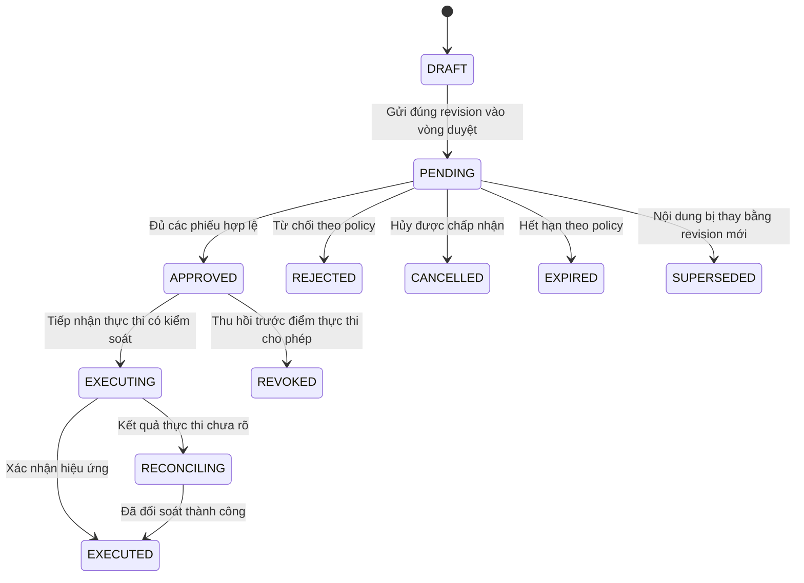

# Concurrent approval handling

## 1. Khi phê duyệt đồng thời trở thành lỗ hổng nghiệp vụ

Trong chương **Concurrency Rules** của module bảo vệ logic nghiệp vụ, xử lý phê duyệt đồng thời là việc bảo đảm nhiều quyết định đến gần như cùng lúc vẫn tuân thủ đầy đủ quy tắc duyệt: đúng người, đúng nội dung, đúng cấp, đủ số người độc lập và chỉ tạo hiệu ứng được phép.

Ví dụ, một lệnh chi cần hai người duyệt độc lập. Hiện đã có một phiếu. Hai request cùng đọc số phiếu là 1, cùng thêm phiếu và cùng chuyển lệnh sang `APPROVED`. Nếu mỗi request tự gọi dịch vụ thanh toán sau đó, hệ thống có thể phát hai lệnh thanh toán cho một yêu cầu.

Một lỗi khác xuất hiện khi cùng người duyệt nhấn hai lần. Nếu server chỉ tăng `approvalCount`, hai request của cùng người có thể đáp ứng điều kiện “hai người duyệt”. Số đếm đã đúng về mặt kỹ thuật nhưng sai về ý nghĩa nghiệp vụ.

Các invariant cần được bảo vệ ngay cả khi có retry, message lặp, nhiều instance ứng dụng, người dùng đổi quyền hoặc có người sửa nội dung trong lúc người khác duyệt. Không thể dựa vào việc giao diện đã vô hiệu hóa nút hoặc mỗi người “thường chỉ bấm một lần”.

## 2. Viết invariant trước khi chọn khóa

Giả sử yêu cầu thanh toán cần hai người duyệt, không cho người tạo tự duyệt và mọi phiếu phải áp dụng cho cùng một phiên bản nội dung.

| Mã | Invariant | Ví dụ vi phạm |
|---|---|---|
| C1 | Một phiếu chỉ áp dụng cho đúng nội dung và vòng duyệt đã xác định | Duyệt 10 triệu nhưng hệ thống chi theo nội dung đã sửa thành 100 triệu |
| C2 | Một danh tính phê duyệt chỉ được tính theo số vị trí mà policy cho phép | Cùng người nhấn hai lần được tính là hai người độc lập |
| C3 | Quorum được tính từ các phiếu hợp lệ, không từ số request | Retry làm tăng số phiếu |
| C4 | Người tạo, người được ủy quyền và người thực sự thao tác phải tuân thủ quy tắc tách nhiệm vụ | Người tạo dùng ủy quyền để tự duyệt |
| C5 | Trạng thái chỉ chuyển theo các cạnh hợp lệ của state machine | Request duyệt đến muộn làm sống lại yêu cầu đã hủy |
| C6 | Phiếu, kết quả xét quorum, chuyển trạng thái và outbox liên quan phải commit nhất quán | Có phiếu nhưng trạng thái mất cập nhật, hoặc có sự kiện đã duyệt mà transaction rollback |
| C7 | Một chuyển trạng thái quyết định chỉ xảy ra một lần trong một vòng duyệt | Hai request cùng phát sự kiện hoàn tất phê duyệt |
| C8 | Quyền và điều kiện phê duyệt được kiểm tra trong ranh giới đồng bộ đã định nghĩa | Người đã mất quyền vẫn duyệt nhờ dữ liệu role cũ |
| C9 | Phê duyệt không đồng nghĩa hiệu ứng bên ngoài đã hoàn tất | `APPROVED` bị hiển thị như đã chuyển tiền |
| C10 | Một thao tác thực thi nghiệp vụ không được lặp chỉ vì có nhiều phiếu hoặc nhiều vòng duyệt | Tạo vòng duyệt mới dẫn đến chi cùng khoản tiền lần nữa |

Trước khi triển khai, cần xác định rõ những quy tắc như “hai người”, “một người mỗi cấp” hoặc “mỗi phòng ban một phiếu”. Chúng không tương đương nhau và dẫn đến khóa duy nhất khác nhau.

## 3. Phân biệt nội dung, policy, vòng duyệt và phiên bản kỹ thuật

Một số lỗi xuất phát từ việc dùng một cột `version` cho mọi mục đích.

| Định danh | Ý nghĩa | Khi nào thay đổi? |
|---|---|---|
| `businessRevision` | Phiên bản các dữ kiện cần được duyệt | Sửa số tiền, tiền tệ, người nhận hoặc điều kiện nghiệp vụ có liên quan |
| `policyRevision` | Phiên bản quy tắc duyệt được áp dụng | Đổi ngưỡng, nhóm duyệt, quorum hoặc quy tắc tách nhiệm vụ theo quy trình |
| `approvalRoundId` | Một lần tổ chức duyệt cho nội dung và policy đã ràng buộc | Khởi tạo lại quy trình duyệt theo nghiệp vụ được phép |
| `aggregateVersion` | Phiên bản kỹ thuật của aggregate để phân xử cập nhật | Thêm phiếu, đổi trạng thái hoặc cập nhật metadata thuộc aggregate |

Ví dụ, hai người cùng duyệt `businessRevision=7` trong vòng `round-23`. Phiếu đầu làm `aggregateVersion` tăng từ 40 lên 41; phiếu thứ hai vẫn có thể hợp lệ với nội dung revision 7. Không nên vô hiệu phiếu đầu chỉ vì phiên bản kỹ thuật đã tăng khi lưu phiếu thứ hai.

Ngược lại, nếu người nhận tiền bị đổi và `businessRevision` tăng lên 8, phiếu cho revision 7 không được tự động dùng cho revision 8. Nếu policy yêu cầu duyệt lại, phải kết thúc hoặc vô hiệu vòng cũ và tạo vòng mới đúng quy trình.

### 3.1. Dữ liệu được duyệt phải được xác định đầy đủ

Phạm vi nội dung có thể gồm số tiền, tiền tệ, bên nhận, tài khoản đích, nguồn ngân sách, hồ sơ tham chiếu và các điều kiện liên quan. Chỉ bind phiếu với `requestId` là chưa đủ nếu nội dung trong request còn sửa được.

Có thể lưu snapshot bất biến hoặc digest của biểu diễn chuẩn, kèm phiên bản nội dung. Digest phải do server tính từ dữ liệu đáng tin cậy và bao phủ các trường làm thay đổi ý nghĩa. Không lấy số tiền hoặc digest do client gửi làm nguồn quyết định cuối cùng.

Việc đổi một chú thích có thể không cần duyệt lại nếu policy cho phép. Nhưng phải quy định trường nào không ảnh hưởng nội dung được duyệt; không để người dùng tự đánh dấu một thay đổi là “chỉ metadata” để né quy trình.

### 3.2. Vòng duyệt mới không có nghĩa hiệu ứng nghiệp vụ mới

`approvalRoundId` phân biệt các lần tổ chức duyệt, nhưng một khoản thanh toán vẫn có định danh nghiệp vụ riêng, chẳng hạn `paymentId`.

Khóa chống lặp thực thi phải gắn với khoản thanh toán hoặc thao tác nghiệp vụ cần bảo vệ, không chỉ với vòng duyệt. Nếu cùng khoản tiền được duyệt lại sau sự cố, không được tạo lần chuyển tiền thứ hai chỉ vì round ID đã khác.

## 4. State machine và chính sách xung đột

Một mô hình đơn giản cho yêu cầu có thể là:



Đây là mô hình minh họa. Sản phẩm có thể có thêm trạng thái tạm dừng hoặc xử lý lỗi, nhưng phải định nghĩa rõ các cạnh và điều kiện.

### 4.1. Duyệt và từ chối cùng đến thì ai thắng?

Không có câu trả lời chung cho mọi nghiệp vụ. Một lựa chọn là: khi request còn `PENDING`, mọi quyết định được phân xử dưới cùng khóa; quyết định làm request đạt trạng thái kết thúc được commit trước sẽ có hiệu lực. Quyết định đến sau không được đổi trạng thái kết thúc qua endpoint bỏ phiếu.

Ví dụ, phiếu từ chối commit trước khi quorum duyệt hoàn tất thì yêu cầu thành `REJECTED`. Nếu phiếu đủ quorum đã chuyển yêu cầu sang `APPROVED` trước, request từ chối đến sau bị từ chối với lý do trạng thái đã thay đổi. Nếu nghiệp vụ cần chặn sau duyệt, phải dùng hành động thu hồi/hủy riêng có quyền và điều kiện tương ứng.

Chỉ ghi “reject ưu tiên approve” trong tài liệu chưa đủ. Nếu muốn tiếp nhận từ chối trong một cửa sổ thời gian trước khi chốt, phải có trạng thái và bước chốt riêng; không vừa thực thi ngay khi đủ phiếu vừa hứa rằng một phiếu đến sau luôn có thể thắng.

### 4.2. Duyệt nhiều cấp

Với quy trình tuần tự, phiếu cấp 2 chỉ hợp lệ khi cấp 2 đã được mở. Chuyển cấp, đóng cấp hiện tại và ghi phiếu làm đạt quorum phải nằm trong ranh giới nhất quán.

Với các nhóm duyệt song song, có thể cần đủ quota của từng nhóm thay vì đủ tổng số người. Hai phiếu từ nhóm Tài chính không thay thế phiếu bắt buộc của nhóm Pháp chế. Trường `stageId` hoặc `approvalSlot` phải phản ánh đúng mô hình này.

## 5. Những cuộc đua thường gặp

### 5.1. Đếm request thay vì người duyệt

```text
T1: người A gửi approve, thấy chưa có phiếu của A.
T2: retry của A gửi approve, cũng thấy chưa có phiếu của A.
T1: tăng approvalCount lên 1.
T2: tăng approvalCount lên 2.
```

Một phép tăng số nguyên tử chỉ ngăn mất cập nhật số đếm. Nó không bảo đảm hai phiếu đến từ hai người hợp lệ. Cần định danh người được tính phiếu và ràng buộc duy nhất phù hợp.

### 5.2. Mất cập nhật khi hai người cùng duyệt

```text
Ban đầu approvalCount = 0.
T1: A đọc 0, tính kết quả 1.
T2: B đọc 0, tính kết quả 1.
T1: ghi 1.
T2: ghi 1.
```

Hai phiếu có thể đã tồn tại nhưng bộ đếm chỉ là 1. Nếu bộ đếm là nguồn quyết định duy nhất, request bị kẹt hoặc báo sai. Bộ đếm cần được duy trì nguyên tử theo invariant, hoặc quorum được suy ra từ tập phiếu có thẩm quyền trong ranh giới đồng bộ.

### 5.3. Hai bên cùng phát lệnh thực thi

```text
Ban đầu đã có 1 phiếu, cần 2.
T1: thêm phiếu B, thấy đủ → phát lệnh thanh toán.
T2: thêm phiếu C, cũng thấy đủ → phát lệnh thanh toán.
```

Chỉ việc “kiểm tra đủ phiếu” không tạo ra quyền duy nhất để thực thi. Phải phân xử chuyển trạng thái và ghi intent/outbox trong cùng transaction; bên không tạo được chuyển trạng thái mới không được phát thêm lệnh nghiệp vụ.

### 5.4. Sửa nội dung trong lúc duyệt

Người duyệt mở màn hình số tiền 10 triệu. Người tạo sửa thành 100 triệu rồi người duyệt bấm nút. Nếu API chỉ nhận request ID và server duyệt trạng thái mới nhất, phiếu bị gắn vào nội dung người duyệt chưa xác nhận.

Request bỏ phiếu cần nêu revision/vòng duyệt đang được xác nhận. Server kiểm tra với dữ liệu hiện tại. Nếu khác, trả xung đột hoặc yêu cầu xem lại; không tự chuyển phiếu sang revision mới.

## 6. Danh tính, quyền và hiệu lực của phiếu

### 6.1. Một tài khoản, nhiều vai trò chưa chắc là nhiều người độc lập

Một người có cả vai trò trưởng nhóm và kiểm soát viên không mặc định được lấp hai vị trí độc lập. Nếu policy đòi hỏi hai người khác nhau, phải tính theo danh tính phê duyệt ổn định phù hợp hệ thống, không theo số role hoặc số access token.

Nếu hệ thống cho phép nhiều tài khoản đại diện cùng một người, cần mô hình danh tính hoặc quy tắc quản trị để thực thi yêu cầu độc lập. Chỉ unique theo `userId` không tự chứng minh hai tài khoản là hai con người khác nhau.

### 6.2. Ủy quyền không được trở thành đường tự duyệt

Audit và policy cần phân biệt người đăng nhập thực tế, người mà họ được phép đại diện và danh tính được tính phiếu. Server phải xác minh ủy quyền; client chỉ được gửi tham chiếu để yêu cầu tra cứu.

Quy tắc cấm tự duyệt phải xét các quan hệ liên quan. Người tạo không được né bằng cách hành động thay một cấp quản lý nếu policy vẫn coi đó là xung đột nhiệm vụ. Một người gửi hai request với hai tham chiếu ủy quyền không mặc nhiên tạo hai phiếu độc lập.

### 6.3. Khi người đã bỏ phiếu mất quyền

Có ít nhất hai mô hình hợp lệ về mặt thiết kế:

- Giữ hiệu lực theo quyền tại thời điểm bỏ phiếu, nếu nghiệp vụ chấp nhận và lưu được bằng chứng quyết định tương ứng.
- Chỉ tính phiếu khi người duyệt và các điều kiện liên quan vẫn hợp lệ tại thời điểm chốt hoặc thực thi.

Phải chọn rõ mô hình. Không dùng role snapshot cũ trong một luồng nhưng dùng membership hiện tại trong luồng khác rồi coi kết quả tương đương.

**Ví dụ chính của bài chọn mô hình thứ hai:** khi đánh giá quorum để chốt, kiểm tra lại hiệu lực các phiếu theo policy; trước khi tiếp nhận thực thi, kiểm tra lại các điều kiện phê duyệt mà policy yêu cầu. Phiếu lịch sử vẫn được giữ để audit, nhưng phiếu không còn hợp lệ không được tính để vượt ngưỡng.

Điều này không có nghĩa hệ thống có thể thu hồi hiệu ứng đã xảy ra. Thu hồi sau điểm tiếp nhận thực thi cần hành vi riêng tùy nghiệp vụ và giới hạn của hệ thống đích.

## 7. Mô hình dữ liệu và ràng buộc duy nhất

Một cấu trúc tối thiểu có thể gồm:

| Dữ liệu | Vai trò |
|---|---|
| Approval request | Tenant, người tạo, trạng thái, business revision, aggregate version |
| Approval round | Ràng buộc request/revision với policy revision và các stage |
| Approval vote | Danh tính được tính phiếu, actor thực tế, decision, stage và thời điểm |
| Command ledger | Chống lặp request theo khóa và fingerprint yêu cầu |
| Audit/outbox | Bằng chứng chuyển trạng thái và sự kiện đã commit |
| Execution intent | Phân xử việc tiếp nhận hiệu ứng nghiệp vụ, không chỉ từng vòng duyệt |

Nếu policy quy định mỗi danh tính chỉ có một quyết định bất biến trong một stage/vòng, ràng buộc có thể là:

```sql
UNIQUE (
    tenant_id,
    request_id,
    approval_round_id,
    stage_id,
    effective_approver_id
)
```

Các cột định danh bắt buộc phải có quy tắc không rỗng và quan hệ tham chiếu phù hợp. Cú pháp tạo ràng buộc cụ thể tùy database.

Không thêm `decision` vào khóa trên để rồi cho cùng người có cả một phiếu `APPROVE` và một phiếu `REJECT`. Nếu cho đổi ý, cần một nghiệp vụ sửa/rút quyết định có phiên bản, điều kiện và lịch sử riêng; không tạo thêm phiếu độc lập rồi đếm cả hai.

Với mô hình nhiều slot, khóa có thể khác, nhưng vẫn phải kiểm tra quy tắc độc lập giữa các slot. Unique từng slot không ngăn một người chiếm nhiều slot nếu policy cấm.

Ràng buộc này cũng chưa chứng minh có đủ quota từng nhóm, không tự kiểm tra quyền và không ngăn tự duyệt. Database constraint là một phần của cơ chế, không phải toàn bộ policy.

## 8. Cách tiếp cận bằng khóa aggregate và transaction ngắn

Một phương án dễ lý giải là phân xử mọi quyết định của một request bằng cách khóa bản ghi request trong transaction. Trong transaction đó:

1. Xác minh tenant, subject và ngữ cảnh ủy quyền từ nguồn đáng tin cậy.
2. Khóa các guard quyền cần thiết và request theo thứ tự thống nhất.
3. Kiểm tra đúng business revision, policy revision, vòng duyệt và stage.
4. Nhận diện replay của command; cùng khóa nhưng khác nội dung là xung đột.
5. Với quyết định mới, yêu cầu trạng thái và stage còn mở, chưa hết hạn.
6. Kiểm tra quyền hiện tại, tách nhiệm vụ và danh tính được tính phiếu.
7. Ghi phiếu theo ràng buộc duy nhất; replay phiếu không tăng quorum.
8. Đánh giá tập phiếu hợp lệ, quota từng nhóm và các điều kiện chốt.
9. Chuyển stage/trạng thái nếu đủ điều kiện; tăng phiên bản kỹ thuật.
10. Ghi audit, command result và outbox cần thiết trong cùng commit.

Hai người duyệt khác nhau có thể được xử lý lần lượt trong database dù request HTTP đến cùng lúc. Điều đó không làm mất tính song song ở các request nghiệp vụ khác; nó tạo một điểm phân xử cho những thay đổi cùng aggregate.

### 8.1. Khóa request không tự đồng bộ với thu hồi quyền

Nếu luồng duyệt khóa request nhưng luồng thu hồi membership chỉ cập nhật bảng người dùng, hai transaction vẫn có thể giao nhau. Muốn bảo đảm rằng thu hồi đã commit thì lần chấp nhận phiếu sau đó bị chặn, phải có cơ chế đồng bộ bao phủ cả hai luồng.

Ví dụ, một `authorization_guard` của tenant được khóa trước request. Mọi thay đổi ảnh hưởng quyền duyệt tương ứng cũng khóa guard đó trong transaction thay đổi quyền. Khi luồng duyệt lấy được guard, nó nạp trạng thái quyền hiện hành và đánh giá phiếu dưới cùng cơ chế phân xử.

Guard theo tenant khá bảo thủ và có thể gây tranh chấp lớn. Guard chi tiết hơn chỉ đúng khi bao phủ đầy đủ các phụ thuộc như membership, ủy quyền, nhóm duyệt và policy. Một cột mang tên `permissionVersion` không tự tạo bảo đảm nếu có đường đổi quyền không cập nhật nó.

Nếu policy ở dịch vụ ngoài hoặc cache, cần mô tả độ trễ và hợp đồng nhất quán thực tế. Transaction tại database ứng dụng không biến quyền đã cache thành dữ kiện cập nhật tức thời.

### 8.2. Thứ tự khóa phải nhất quán

Ví dụ thứ tự có thể là guard quyền → request → phiếu/command → tài nguyên chung liên quan. Các luồng sửa nội dung, hủy, thu hồi và tiếp nhận thực thi phải dùng thứ tự tương thích.

Không giữ transaction trong lúc người dùng đọc màn hình, chờ OTP hoặc gọi một dịch vụ mạng chậm. Thu thập chứng cứ cần thiết trước, rồi kiểm tra hiệu lực và ghi quyết định trong transaction ngắn. Bằng chứng xác thực bổ sung cũng phải gắn với đúng hành động/phạm vi và còn hiệu lực theo policy.

## 9. Mã giả Java cho một quyết định phê duyệt

Đây là mã giả thể hiện ranh giới và trách nhiệm, không phải implementation có thể chạy trực tiếp. Các repository phải thực thi khóa, chống lặp và transaction đúng trên database thực tế.

Giả định:

- Nội dung và policy của một vòng duyệt được ràng buộc bất biến.
- Quyền liên quan được kiểm tra theo cơ chế guard đã mô tả.
- Mỗi danh tính chỉ có một quyết định bất biến trong một stage/vòng.
- Cùng một request được khóa trong toàn transaction bỏ phiếu.
- Phiếu, trạng thái, command result, audit và outbox ở cùng database.

```java
DecisionReceipt decide(
        AuthenticatedPrincipal principal,
        VerifiedTenantContext tenant,
        ApprovalCommand command) {

    return transactions.required(() -> {
        AuthorizationGuard guard = guards.lockForTenant(tenant.id());
        ApprovalRequest request = requests.lockByTenantAndId(
            tenant.id(), command.requestId())
            .orElseThrow(NotFoundException::new);

        request.requireBoundRevision(
            command.businessRevision(), command.policyRevision(),
            command.approvalRoundId());

        ApproverIdentity identity = policy.resolveVerifiedIdentity(
            principal, command.delegationReference(), request, guard);

        // Quyền ở đây không thay thế điều kiện state/stage bên dưới.
        access.requireCurrentApprovalEntitlement(
            principal, identity, request, command.stageId(), guard);
        policy.requireSeparationOfDuties(request, principal, identity);

        CommandClaim claim = commands.claimOrLoadWithinTransaction(
            tenant.id(), principal.id(), "APPROVAL_DECIDE",
            command.idempotencyKey(),
            fingerprints.forDecision(command, identity));

        if (claim.alreadyCommitted()) {
            // Không tạo phiếu mới; người gọi vẫn phải có quyền hiện tại.
            return claim.authorizedReceipt();
        }

        request.requirePendingStage(command.stageId());
        request.requireNotExpired(serverClock.instant());

        VoteWrite vote = votes.insertOrLoadImmutableDecision(
            tenant.id(), request.id(), request.approvalRoundId(),
            command.stageId(), identity.effectiveApproverId(),
            principal.id(), command.decision(), request.businessRevision());

        if (vote.alreadyExists()) {
            vote.requireSameDecisionAndMeaning(command, identity);
            DecisionReceipt receipt = vote.authorizedReceipt();
            commands.complete(claim, receipt);
            return receipt;
        }

        ApprovalState before = request.state();
        RoundEvaluation evaluation = policy.evaluateCurrentRound(
            request,
            votes.loadForRound(request.id(), request.approvalRoundId()),
            guard);

        request.applyEvaluation(evaluation);
        request.incrementAggregateVersion();
        requests.save(request);

        audit.appendVoteAndTransition(
            principal, identity, request, vote, before, request.state());

        if (before != APPROVED && request.state() == APPROVED) {
            outbox.appendOnce(
                eventKeys.approvalCompleted(request.id(), request.approvalRoundId()),
                events.approvalCompleted(request));
        }

        DecisionReceipt receipt = receipts.from(request, vote);
        commands.complete(claim, receipt);
        return receipt;
    });
}
```

`evaluateCurrentRound` phải thực hiện đúng policy: lọc phiếu theo round/stage/revision, kiểm tra danh tính độc lập, quota từng nhóm, hiệu lực quyền và điều kiện chuyển cấp hoặc từ chối. Nó không chỉ là `votes.size() >= 2`.

`claimOrLoadWithinTransaction` và `insertOrLoadImmutableDecision` cần cơ chế phân xử database thực sự. Nếu một unique conflict làm transaction hiện tại không còn sử dụng được, rollback và xử lý lại trong transaction hợp lệ; không bắt exception rồi tiếp tục ghi như thể chưa có lỗi.

Nhánh replay command được xử lý trước điều kiện `PENDING` để một lần retry sau commit có thể nhận kết quả cũ mà không bỏ phiếu lại. Trong ví dụ, người gọi vẫn phải vượt qua kiểm tra revision và quyền hiện tại. Nếu muốn cho xem receipt của vòng cũ, cần endpoint tra lịch sử với policy riêng, không mở lại quyền bỏ phiếu.

Nhánh phiếu đã tồn tại cũng không chạy lại hiệu ứng hoặc tăng số phiếu. Nếu cần đánh giá lại quorum do quyền/policy thay đổi mà không có phiếu mới, hãy mô hình hóa một hành động đánh giá lại có kiểm soát; không mặc định replay là một phiếu bổ sung.

## 10. Optimistic locking và các giới hạn cần hiểu

### 10.1. Compare-and-set trên trạng thái/phiên bản

Một cách khác là dùng phiên bản kỹ thuật và cập nhật có điều kiện:

```sql
UPDATE approval_request
SET state = :new_state,
    aggregate_version = aggregate_version + 1
WHERE tenant_id = :tenant_id
  AND id = :request_id
  AND aggregate_version = :expected_version
  AND approval_round_id = :expected_round
  AND state = 'PENDING';
```

Cập nhật đúng một dòng mới là thắng tranh chấp phiên bản. Nhưng câu SQL này chỉ phân xử bản ghi request; nó chưa chứng minh đủ phiếu, quyền hợp lệ hay đúng revision. Việc ghi phiếu, cập nhật trạng thái và outbox vẫn phải nằm trong cùng transaction.

Nếu compare-and-set thất bại, không được để phiếu hoặc outbox từ lần thử thua vẫn commit độc lập. Cần rollback rồi nạp lại dữ kiện, kiểm tra lại điều kiện và quyết định retry hoặc trả xung đột.

### 10.2. Retry chỉ được giữ nguyên ý định đã xác nhận

Hai người duyệt cùng revision có thể gặp xung đột kỹ thuật dù cả hai ý định đều hợp lệ. Server có thể retry có giới hạn sau khi đọc trạng thái mới, miễn là vẫn cùng nội dung, vòng, stage và hành động mà người dùng đã xác nhận.

Không tự retry bằng cách đổi từ revision 7 sang revision 8, chuyển stage hoặc thay decision để “giúp request thành công”. Những thay đổi đó cần quyết định mới của người dùng hoặc quy tắc nghiệp vụ rõ ràng.

Nếu API yêu cầu client gửi cả `aggregateVersion`, một phiếu khác đến trước có thể làm client nhận lỗi phiên bản. Đây là lựa chọn trải nghiệm cần được giải thích, không phải bằng chứng rằng nội dung đã thay đổi. Phân biệt xung đột kỹ thuật với nội dung đã được sửa giúp trả lỗi đúng.

### 10.3. Khóa đúng request chưa đủ cho invariant chung

Hai yêu cầu thanh toán khác nhau cùng lấy tiền từ một ngân sách. Mỗi yêu cầu được khóa riêng và đều thấy số dư đủ, nhưng tổng số tiền vượt ngân sách.

Nếu phê duyệt có nghĩa là giữ ngân sách, bước giữ phải bảo vệ invariant trên ngân sách chung bằng cơ chế phù hợp trong transaction liên quan. Nếu phê duyệt chỉ là cho phép xem xét thực thi, bước thực thi vẫn phải kiểm tra/giữ ngân sách theo policy.

Không suy rằng “đã có optimistic lock trên request” là mọi invariant liên bảng đều an toàn. Mức cô lập giao dịch mạnh hơn có thể giúp phát hiện một số xung đột, nhưng vẫn cần xử lý transaction bị hủy và không thay thế các điều kiện nghiệp vụ hoặc idempotency ở hệ thống ngoài.

## 11. Từ được duyệt đến thực thi chỉ một thao tác nghiệp vụ

### 11.1. Phân tách hai ranh giới

```text
Ranh giới 1: phiếu hợp lệ + chốt APPROVED + outbox → commit.
Ranh giới 2: kiểm tra approval còn dùng được + nhận execution intent → commit.
Sau đó: thực hiện hiệu ứng theo giao thức của hệ thống đích.
```

Sự kiện `APPROVAL_COMPLETED` không phải chứng cứ tiền đã chuyển. Worker nhận sự kiện phải nạp trạng thái có thẩm quyền, kiểm tra request/revision/round đang có hiệu lực và xác minh điều kiện tiếp nhận thực thi.

Một sự kiện hoàn tất từ vòng cũ không được dùng để thực thi nội dung đã bị thay thế, hủy hoặc thu hồi. Không lấy toàn bộ payload trong message làm nguồn chân lý khi aggregate hiện tại đã thay đổi.

### 11.2. Execution intent gắn với định danh hiệu ứng

Ví dụ, ràng buộc duy nhất cho việc tiếp nhận chi tiền có thể theo:

```text
(tenantId, paymentId, executionKind)
```

Định danh này cần phản ánh một hiệu ứng nghiệp vụ cụ thể. Một khoản có nhiều lần chi hợp lệ phải được mô hình hóa bằng các thao tác con được kiểm soát, không bỏ ràng buộc chỉ vì cùng payment ID xuất hiện nhiều lần.

Outbox lặp hoặc tạo lại vòng duyệt không được tự tạo intent thứ hai cho cùng thao tác. Nếu cần điều chỉnh hoặc hoàn tiền, dùng nghiệp vụ mới có quyền, lý do và liên kết với thao tác gốc.

### 11.3. Thu hồi đua với tiếp nhận thực thi

Luồng thu hồi và luồng tiếp nhận thực thi phải có cơ chế phân xử chung. Ví dụ, cả hai khóa request và các guard cần thiết theo cùng thứ tự:

```text
Thu hồi commit trước → lần tiếp nhận thực thi sau phải bị chặn.
Tiếp nhận thực thi commit trước → xử lý thu hồi theo trạng thái đã thực thi/đang thực thi.
```

Trong mô hình quyền hiện hành của bài, trước khi nhận thực thi cần kiểm tra lại hiệu lực các điều kiện phê duyệt được yêu cầu. Nếu không còn đủ điều kiện, không chi tiền chỉ vì đã có outbox; chuyển sang quy trình tạm dừng hoặc duyệt lại theo policy.

Sau điểm tiếp nhận, khả năng dừng một lời gọi ngoài phụ thuộc giao thức và trạng thái thực tế. Không hứa thu hồi tức thời mọi hiệu ứng chỉ bằng cách đổi một cột trong database.

### 11.4. Idempotency ở hệ thống đích

Execution intent nội bộ chỉ phân xử việc tiếp nhận nội bộ. Nếu lời gọi thanh toán timeout sau khi bên đích đã thực hiện, retry vẫn có thể gây lặp nếu không có idempotency ở đích hoặc quy trình đối soát phù hợp.

Dùng định danh hiệu ứng ổn định khi hệ thống đích hỗ trợ. Nếu kết quả chưa rõ, giữ trạng thái `RECONCILING` và tra cứu trước khi quyết định gửi lại. Không xóa intent hoặc tạo key mới chỉ để vượt thông báo “đã tồn tại”.

## 12. Idempotency, lỗi và giao tiếp với người dùng

### 12.1. Phạm vi khóa idempotency

Một khóa command cần được phân vùng theo tenant, chủ thể và hành động. Fingerprint cần bao phủ request, business revision, vòng duyệt, stage, decision và ngữ cảnh ủy quyền liên quan.

```text
Cùng khóa + cùng ý định → trả kết quả đã commit nếu còn được phép xem.
Cùng khóa + ý định khác → báo xung đột, không dùng kết quả cũ cho hành động mới.
Khóa khác, cùng người/cùng stage → vẫn chịu ràng buộc phiếu duy nhất.
```

Khóa idempotency không phải quyền phê duyệt. Client đổi key không được thêm phiếu thứ hai, và client biết key của người khác không được đọc receipt của họ.

### 12.2. Phân biệt các kết quả

| Kết quả | Ý nghĩa đối với người dùng |
|---|---|
| Phiếu được ghi, còn chờ | Quyết định của bạn đã có hiệu lực trong vòng, chưa đủ điều kiện chốt |
| Đã chốt duyệt | Vòng đã đạt điều kiện phê duyệt; chưa đồng nghĩa hiệu ứng đã hoàn tất |
| Replay cùng quyết định | Không tạo thêm phiếu hoặc hiệu ứng |
| Nội dung/vòng thay đổi | Cần xem lại và xác nhận đúng nội dung mới |
| Stage hoặc trạng thái đóng | Không thể bỏ phiếu qua hành động hiện tại |
| Không có quyền hiện tại | Không chấp nhận quyết định; không dùng service account để vượt qua |
| Tranh chấp tạm thời | Có thể retry giới hạn nếu vẫn giữ nguyên ý định hợp lệ |
| Kết quả commit chưa rõ | Đang đối soát; không hướng dẫn gửi lại bằng key mới |

Mã HTTP cụ thể theo quy ước API, nhưng cần phân biệt xung đột và thiếu quyền. Không trả chi tiết request của tenant khác chỉ để giải thích vì sao không thể duyệt.

### 12.3. Mất phản hồi sau commit

Nếu database đã commit phiếu nhưng response bị mất, lần retry phải tìm được command result hoặc phiếu đã có. Timeout không có nghĩa phiếu chưa tồn tại.

Đối soát bằng nguồn có thẩm quyền với bảo đảm đọc phù hợp. Một lần đọc replica đang trễ có thể chưa thấy command vừa commit; không dùng điều đó làm lý do tạo lại phiếu hoặc thực thi bằng định danh mới.

Nếu transaction bị deadlock hoặc xung đột và chắc chắn rollback, retry toàn bộ transaction sau khi nạp lại điều kiện. Không chỉ chạy lại riêng câu phát outbox hoặc riêng phép tăng số đếm.

## 13. Ma trận kiểm thử đồng thời và lạm dụng logic

Chuẩn bị người tạo A, hai người duyệt B/C, một người chỉ có quyền cấp khác, một người có ủy quyền, hai tenant và một quy trình có quorum cùng quy tắc tách nhiệm vụ rõ ràng.

| Tình huống | Kết quả cần chứng minh |
|---|---|
| B gửi hai approve đồng thời cùng idempotency key | Một quyết định nghiệp vụ; trả lại kết quả nhất quán |
| B gửi hai approve với hai key khác nhau | Không tính B thành hai người độc lập |
| B đồng thời approve và reject cùng stage | Chỉ một quyết định bất biến được nhận theo cơ chế phân xử; không đếm cả hai |
| B và C cùng duyệt từ lúc chưa có phiếu | Giữ đủ hai phiếu hợp lệ; không mất cập nhật |
| Hai phiếu cùng có thể hoàn tất quorum | Chỉ một chuyển sang `APPROVED` và một sự kiện hoàn tất logic |
| Người tạo tự duyệt | Bị chặn theo quy tắc tách nhiệm vụ |
| Người tạo dùng ủy quyền để tự duyệt | Không vượt quy tắc độc lập danh tính |
| Một người có hai role cần độc lập | Không được tính hai vị trí nếu policy cấm |
| Chỉ đủ tổng số phiếu, thiếu nhóm bắt buộc | Chưa được chốt duyệt |
| Phiếu cấp 2 đến trước lúc mở cấp | Không chấp nhận nhờ client tự khai stage |
| Duyệt đua với sửa số tiền/người nhận | Phiếu chỉ gắn với revision đã xác nhận; không chuyển ngầm sang nội dung mới |
| Approve đua với reject | Kết quả theo chính sách chốt đã định nghĩa; không có hai trạng thái kết thúc |
| Approve đua với hủy/hết hạn | Không làm sống lại yêu cầu đã đóng; kiểm tra thời hạn theo đồng hồ server |
| Thu hồi membership commit trước lần bỏ phiếu | Phiếu mới bị chặn theo cơ chế quyền hiện hành |
| Phiếu cũ mất hiệu lực trước khi chốt | Không tính phiếu đó trong mô hình của bài |
| Event hoàn tất của vòng cũ đến muộn | Không thực thi nội dung đã thay thế hoặc bị thu hồi |
| Outbox được gửi lại | Không tạo execution intent hoặc hiệu ứng nghiệp vụ mới |
| Hai vòng duyệt cho cùng thao tác thanh toán | Không chi hai lần do chỉ đổi round ID |
| Hai request cùng dùng ngân sách chung | Invariant ngân sách vẫn đúng tại ranh giới được quy định |
| Timeout sau commit phiếu | Retry đối soát được, không tạo thêm phiếu |
| Timeout sau hiệu ứng ở đích | Giữ kết quả chưa rõ/đối soát, không gửi lại bằng key mới một cách mù quáng |
| Người tenant khác đổi request ID | Không bỏ phiếu hoặc nhận thông tin vượt phạm vi |

### 13.1. Điều khiển được lịch chạy

Integration test nên dùng barrier hoặc điểm dừng để hai transaction cùng tiến tới vùng tranh chấp, thay vì chỉ gửi nhiều request ngẫu nhiên.

Với phương án khóa aggregate, kiểm tra một bên phải chờ, sau đó đọc được trạng thái đã commit của bên đi trước. Với optimistic locking, kiểm tra bên thua rollback cả phiếu/trạng thái/outbox rồi retry hoặc trả lỗi đúng.

Không chỉ kiểm tra response. Kiểm tra tập phiếu distinct, trạng thái request, business revision/round, audit, số sự kiện hoàn tất và execution intent. Hai response `200` không tự chứng minh có hai phiếu độc lập hợp lệ.

### 13.2. Kiểm tra cả hai thứ tự của cuộc đua

```text
Trường hợp A:
  hủy/thu hồi commit → yêu cầu duyệt/thực thi được phân xử sau
  → phải bị chặn theo điều kiện hiện tại.

Trường hợp B:
  duyệt/tiếp nhận thực thi commit → hủy/thu hồi commit sau
  → hành vi theo trạng thái đã chốt, không giả vờ hiệu ứng trước chưa xảy ra.
```

Tương tự, cho sửa nội dung thắng trước rồi thử phiếu cũ, và cho chốt duyệt thắng trước rồi thử sửa qua endpoint thông thường. Cả hai đường đều phải tuân theo state machine, không chỉ bảo vệ một thứ tự thuận lợi.

## 14. Audit và quan sát vận hành

Audit nên ghi actor thực tế, danh tính được tính phiếu, ủy quyền đã xác minh, tenant, request, business revision, policy revision, round/stage, decision, trạng thái trước/sau, aggregate version và command/operation ID.

Phân biệt các sự kiện như:

```text
APPROVAL_VOTE_RECORDED
APPROVAL_VOTE_DENIED
APPROVAL_STAGE_COMPLETED
APPROVAL_COMPLETED
APPROVAL_REVOKED
EXECUTION_ACCEPTED
EXECUTION_CONFIRMED
EXECUTION_OUTCOME_UNKNOWN
```

Sự kiện về chuyển trạng thái đã commit nên được ghi cùng transaction phù hợp. Các lần bị từ chối cần đường ghi riêng không bị rollback theo exception nghiệp vụ. Không ghi token, credential hoặc toàn bộ dữ liệu nhạy cảm của yêu cầu chỉ để chứng minh đã bỏ phiếu.

Các tín hiệu đáng theo dõi gồm cùng danh tính gửi nhiều quyết định xung đột, số lần unique conflict tăng bất thường, nhiều phiếu cho revision cũ, ủy quyền bị dùng để vượt tách nhiệm vụ, outbox trễ và nhiều kết quả thực thi chưa rõ.

Timestamp giúp điều tra nhưng không tạo thứ tự tổng thể chắc chắn giữa nhiều service. Dùng aggregate version, round và liên kết operation để tái dựng chuyển trạng thái. Không kết luận một hành động xảy ra trước chỉ vì log của nó được thu nhận trước.

## 15. Bài tập thiết kế

Một hệ thống hoàn tiền yêu cầu hai người duyệt với khoản trên một ngưỡng. Người tạo không được tự duyệt. Hiện tại API chỉ thực hiện:

```java
// Ví dụ không an toàn.
request.approvalCount++;
if (request.approvalCount >= 2) {
    request.status = APPROVED;
    paymentGateway.refund(request.paymentId, request.amount);
}
repository.save(request);
```

Hãy thiết kế lại để đáp ứng:

1. Đếm hai danh tính hợp lệ, không đếm hai request hoặc hai role của cùng người.
2. Bind quyết định với số tiền, người nhận, business revision và vòng duyệt cụ thể.
3. Phân xử đồng thời approve/reject, sửa/hủy và thu hồi quyền theo policy rõ ràng.
4. Ghi phiếu, chốt trạng thái, command result và outbox trong transaction phù hợp.
5. Chỉ tiếp nhận một thao tác hoàn tiền nghiệp vụ dù message lặp hoặc tạo lại vòng duyệt.
6. Giữ trạng thái chưa rõ và đối soát khi cổng thanh toán timeout sau khi đã có thể thực hiện.

Một phương án hợp lý sẽ có danh tính phê duyệt được xác minh, phiếu bất biến theo vòng/stage, khóa hoặc compare-and-set đúng ranh giới, kiểm tra quyền hiện hành và execution intent gắn với định danh hoàn tiền ổn định. Chọn policy rồi dùng các lịch chạy cạnh tranh để chứng minh invariant.

Thiết kế đạt yêu cầu phải trả lời được: **“Những ai đã duyệt đúng nội dung nào, vì sao tập phiếu đủ điều kiện, và cơ chế nào ngăn cùng quyết định tạo thêm hiệu ứng khi chạy đồng thời?”** Câu trả lời phải thể hiện trong dữ liệu, transaction và state machine thực sự được thực thi.
