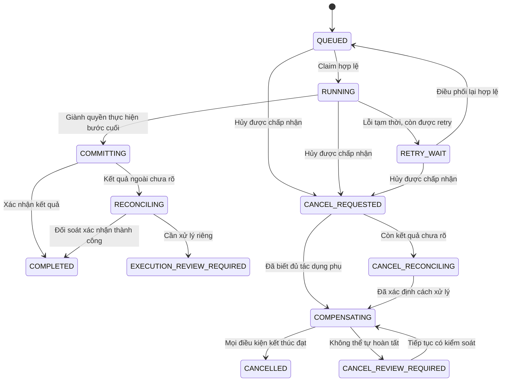

# Concurrent cancellation handling — Xử lý yêu cầu hủy đồng thời

## 1. Mục tiêu và phạm vi

Một yêu cầu hủy thường đến khi hệ thống vẫn đang làm việc: worker đang xử lý đơn hàng, scheduler đang retry, dịch vụ bên ngoài đang nhận yêu cầu hoặc một tiến trình khác đang hoàn tất giao dịch. Vì vậy, “đặt trạng thái thành CANCELLED” không đủ để bảo đảm nghiệp vụ đã được hủy.

Trong chương **Concurrency Rules** của module `SECURITY_APPLICATION_SECURITY_BUSINESS_LOGIC_SECURITY`, bài học này tập trung vào cách giữ đúng business invariants khi **hủy cạnh tranh với thực thi, hoàn tất, retry và bù trừ**. Đây là bài toán bảo mật logic: người dùng có thể cố ý gửi nhiều yêu cầu ở đúng thời điểm để nhận hàng dù đơn đã hủy, hoàn tiền nhiều lần hoặc lấy lại quota trong khi vẫn sử dụng dịch vụ.

Sau bài học, người học có thể:

- Phân biệt yêu cầu hủy, việc dừng thực thi và kết quả hủy đã được xác nhận.
- Chọn điểm phân xử giữa hủy và bước không còn được phép hủy.
- Thiết kế state machine, quyền theo đối tượng và idempotency cho cancellation.
- Dùng transaction, cập nhật có điều kiện, lease và fencing để chặn worker cũ.
- Quản lý tác dụng phụ bên ngoài, bù trừ và trạng thái chưa biết kết quả.
- Kiểm thử race condition bằng các kịch bản có thứ tự được điều khiển.

Các chính sách và đoạn mã dưới đây là thiết kế minh họa. Ví dụ SQL dùng cú pháp PostgreSQL; Java thể hiện hợp đồng service/repository, không phải một ứng dụng chạy độc lập.

## 2. “Đã hủy” có thể mang những nghĩa khác nhau

| Khái niệm | Điều được xác nhận | Điều chưa được chứng minh |
|---|---|---|
| Client ngừng chờ | Trình duyệt hoặc HTTP client không còn đợi response | Backend và dịch vụ ngoài đã dừng |
| Đã nhận yêu cầu hủy | Ý định hủy được lưu bền vững | Worker đã ngừng và tài nguyên đã được thu hồi |
| Đã phát tín hiệu dừng | Thread, process hoặc worker nhận tín hiệu | Mọi tác dụng phụ đã được đảo ngược |
| Đang bù trừ | Hệ thống xử lý các hiệu ứng đã xảy ra | Bù trừ đã hoàn thành |
| Đã hủy hoàn tất | Các điều kiện kết thúc của hợp đồng hủy đã được đáp ứng | Không nhất thiết mọi chi phí thực tế đã biến mất |

Ví dụ, người dùng hủy một đơn đặt hàng. Ngừng thread không tự hoàn lại tồn kho. Hoàn lại tồn kho không tự hủy lệnh giao hàng đã gửi. Một request hoàn tiền timeout cũng không chứng minh tiền chưa được hoàn.

Cần xác định chính xác khi nào được báo `CANCELLED`. Trong bài này, trạng thái đó có nghĩa: luồng xử lý bình thường không thể tiếp tục; các tài nguyên cần giải phóng đã được xử lý; các tác dụng phụ liên quan đã có kết quả đủ chắc chắn và bù trừ bắt buộc đã hoàn tất.

Nếu còn tác dụng phụ chưa rõ kết quả, hệ thống giữ trạng thái đang đối soát hoặc cần xử lý, không báo hủy thành công để làm đẹp giao diện.

## 3. Tình huống xuyên suốt và cách một race phá quy tắc

Xét đơn hàng O101 có một reservation giữ hai sản phẩm. Worker W1 chuẩn bị thực hiện đơn. Người dùng gửi hủy cùng lúc.

Một triển khai yếu:

```java
if (order.isCancellable()) {
    inventory.release(order.reservationId());
    order.setState(CANCELLED);
    orderRepository.save(order);
}
```

Nếu trạng thái được đọc từ trước và không có điều kiện khi ghi, có thể xảy ra:

| Thứ tự | Luồng hủy | Luồng worker |
|---|---|---|
| 1 | Đọc O101 = RUNNING | |
| 2 | | Đọc O101 = RUNNING |
| 3 | Hoàn reservation | |
| 4 | Ghi CANCELLED | |
| 5 | | Thực hiện bước giao hàng |
| 6 | | Ghi COMPLETED từ dữ liệu cũ |

Hệ thống vừa trả tài nguyên vừa thực hiện đơn. Nếu hai request hủy cùng vào đoạn code, tồn kho có thể được hoàn hai lần.

Đây không chỉ là lỗi do tải cao. Kẻ tấn công có thể gửi nhiều request hủy, hoàn tất hoặc retry để tăng khả năng rơi vào khoảng kiểm tra-rồi-thực hiện, còn gọi là TOCTOU.

### 3.1. Hợp đồng hủy của ví dụ

Ví dụ sử dụng chính sách:

- Đơn có reservation từ khi ở trạng thái `QUEUED`.
- Cho phép yêu cầu hủy khi `QUEUED`, `RUNNING` hoặc `RETRY_WAIT`.
- Worker phải giành quyền chuyển sang `COMMITTING` trước bước không thể hủy theo luồng này.
- Sau khi `COMMITTING` đã commit, endpoint hủy thông thường trả kết quả “quá muộn”; đổi trả hoặc bù trừ sau đó là nghiệp vụ khác.
- Nếu yêu cầu hủy thắng trước `COMMITTING`, worker không được thực hiện bước đó.
- Các tác dụng phụ có thể đảo ngược trong giai đoạn chuẩn bị phải được theo dõi; chỉ kết thúc hủy khi chúng đã được xử lý.

Đây là một lựa chọn nghiệp vụ. Sản phẩm khác có thể cho hủy khi tác dụng phụ đang diễn ra, nhưng phải có giao thức hủy/bù trừ tương ứng. Không đổi chính sách ngầm bằng cách ghi đè trạng thái.

## 4. Business invariants và điểm phân xử

| Invariant | Cơ chế cần có |
|---|---|
| Actor chỉ hủy đối tượng mình có quyền hủy | Tenant và object-level authorization |
| Một execution chỉ có một quyết định hủy có hiệu lực | Ràng buộc duy nhất và idempotency |
| Hủy đã thắng không bị worker cũ đảo ngược | State transition có điều kiện, epoch và lease token |
| Hủy và bước không thể hủy cùng dùng một nguồn phân xử | Khóa hoặc compare-and-set trên aggregate có thẩm quyền |
| Reservation chỉ được giải phóng một lần | Trạng thái reservation và ledger nguyên tử |
| Đã tiêu dùng tài nguyên không bị xử lý như reservation còn giữ | Phân biệt HELD, CONSUMED, RELEASED và nghiệp vụ bù riêng |
| Một tác dụng phụ không bị lặp vì delivery/retry | Idempotency theo định danh tác dụng phụ |
| Không kết luận CANCELLED khi còn kết quả chưa biết | Effect journal, reconciliation và điều kiện kết thúc |
| Retry không làm sống lại execution đã hủy | Kiểm tra state, generation và dispatch version |
| Phản hồi “đã nhận hủy” không giả làm “đã hủy xong” | Hợp đồng API và status rõ ràng |

### 4.1. Điểm tuyến tính hóa là gì?

Đó là điểm mà hệ thống coi một thao tác đã giành được quyền quyết định trước thao tác cạnh tranh. Với mô hình một DB trong bài, điểm này gắn với **chuyển trạng thái có điều kiện được commit** trên order.

Không dùng thời điểm người dùng bấm nút, thời gian request tới một máy chủ hoặc thời điểm log được ghi làm thứ tự quyết định. Các mốc đó không bảo đảm đồng bộ giữa nhiều tiến trình.

Hai kết quả hợp lệ:

```text
A. RUNNING -> CANCEL_REQUESTED commit trước
   => chuyển RUNNING -> COMMITTING không còn hợp lệ

B. RUNNING -> COMMITTING commit trước
   => yêu cầu hủy thông thường bị từ chối là quá muộn
```

Một transaction có thể cập nhật trước nhưng sau đó rollback. Vì vậy không công bố tác dụng phụ không thể thu hồi chỉ dựa trên một cập nhật chưa commit.

### 4.2. Giới hạn của điểm phân xử trong DB

Quyết định trong DB bảo vệ các thao tác tham gia đúng giao thức. Nó không tự chặn một lệnh gọi provider mà worker đã gửi trước đó, cũng không khóa tài nguyên nằm ở dịch vụ khác.

Muốn cam kết “hủy thắng thì không gửi bước không thể hủy”, mọi đường gửi bước đó phải đi qua admission `COMMITTING` đã commit. Nếu có worker gọi provider trước rồi mới cập nhật DB, invariant đã bị phá ngay từ thiết kế.

## 5. State machine cho cancellation

Sơ đồ sau tập trung vào các trạng thái liên quan đến hủy và xử lý đồng thời:



Các quy tắc:

- Client yêu cầu hành động cancel; không được chỉ định trạng thái đích.
- `CANCEL_REQUESTED` chặn luồng thực thi bình thường, chưa khẳng định tài nguyên đã thu hồi.
- `COMMITTING` không quay lại `RUNNING` chỉ vì timeout. Phải xác định tác dụng phụ đã xảy ra hay chưa.
- `CANCELLED` không quay về queue bởi message cũ.
- Retry bù trừ tiếp tục quy trình hủy, không mở lại luồng thực hiện đơn.
- Tác vụ cần người xử lý không được tự đánh dấu `CANCELLED` khi hết retry.
- Lỗi xử lý đơn cũng cần quy trình kết thúc/tài nguyên phù hợp; không coi mọi lỗi là hủy do người dùng.

Nếu đơn chưa có tác dụng phụ ngoài và toàn bộ tài nguyên thuộc cùng DB, có thể tối ưu hủy thành một transaction kết thúc trực tiếp. Khi đó vẫn phải giữ đầy đủ điều kiện quyền, cạnh tranh và giải phóng một lần.

## 6. Mô hình dữ liệu cần phản ánh execution và hiệu ứng

### 6.1. Aggregate được hủy

Một `order_execution` có thể chứa:

- `tenant_id`, `order_id`, `execution_id`: phân biệt đơn và lần thực thi cụ thể.
- `state`, `version`: trạng thái cùng phiên bản đồng thời.
- `execution_epoch`: generation ngăn worker hoặc message của quyền thực thi cũ.
- `dispatch_version`: phiên bản điều phối.
- `lease_token`, `lease_until`: quyền sở hữu của worker thực thi.
- `cancel_operation_id`, `cancel_requested_by`, `cancel_requested_at`, `cancel_reason`.
- `cancel_deadline`: hạn hủy nếu nghiệp vụ có quy định.
- `cleanup_token`, `cleanup_lease_until`: quyền xử lý hủy, tách khỏi lease thực thi.
- `finished_at`, `reason_code`, các định danh truy vết.

Epoch không thay thế version: version phát hiện cập nhật cạnh tranh; epoch diễn đạt một thế hệ quyền thực thi đã bị thay đổi hoặc vô hiệu hóa.

### 6.2. Cancellation operation

`cancellation_operation` lưu ý định và kết quả xử lý hủy. Có thể dùng:

```text
UNIQUE (tenant_id, execution_id)
```

Ràng buộc này phù hợp chính sách mỗi execution chỉ có một quy trình hủy. Nếu hỗ trợ rút yêu cầu hủy hoặc mở lại, cần mô hình revision/generation được định nghĩa riêng; không xóa bản ghi để message cũ có thể áp dụng lên lần mới.

API có thể bổ sung:

```text
UNIQUE (tenant_id, actor_id, operation, idempotency_key)
```

Hash request chuẩn hóa gắn với execution, action và các tham số có ý nghĩa. Không nhận phí hủy, số tiền hoàn hoặc reservation cần hoàn từ client làm giá trị có thẩm quyền.

### 6.3. Reservation và effect journal

Reservation có định danh riêng, lượng tài nguyên và trạng thái `HELD`, `CONSUMED` hoặc `RELEASED`. Ledger ghi hiệu ứng cấp phát/giải phóng với khóa chống trùng.

Effect journal theo dõi từng tác dụng phụ:

```text
effect_id
tenant_id
execution_id
effect_type
provider_reference
idempotency_key
request_generation
state: PLANNED | IN_FLIGHT | SUCCEEDED | FAILED | UNKNOWN
compensation_state
source_version
```

Một lời gọi timeout chuyển sang `UNKNOWN` hoặc trạng thái cần đối soát, không tự thành `FAILED`. Tên trạng thái có thể khác nhưng phải giữ được ý nghĩa “chưa biết”.

Journal cần được ghi trước khi có khả năng gửi effect, theo cùng giao thức admission. Nếu effect đã có thể xảy ra mà không có bản ghi truy vết, cleanup không thể kết luận đáng tin cậy rằng đã liệt kê đủ tác dụng phụ.

## 7. Quyền hủy cũng là quyền theo đối tượng

Biết mã đơn hoặc đã tạo đơn trước đây chưa đủ để hủy ở mọi thời điểm.

| Kiểm tra | Câu hỏi |
|---|---|
| Tenant | Actor có hoạt động hợp lệ trong tenant của execution không? |
| Quan hệ | Actor là khách hàng, người được ủy quyền hay nhân viên xử lý có quyền tương ứng? |
| Action | Được yêu cầu hủy, phê duyệt hủy hay chỉ xem trạng thái? |
| Trạng thái | Execution còn trong cửa sổ cho phép hủy không? |
| Hạn thời gian | Quyết định hủy còn trước deadline không? |
| Phê duyệt | Hủy giá trị cao hoặc sau một mốc đặc biệt có cần người khác duyệt không? |
| Kết quả trả lại | Actor hiện tại có được xem thông tin của cancellation operation không? |

Client không được gửi `force=true`, `refundAmount` hoặc `state=CANCELLED` để vượt chính sách. Nếu có nghiệp vụ cưỡng chế hoặc bù sau `COMMITTING`, đó là action riêng, quyền riêng và audit riêng.

Retry cùng idempotency key không bỏ qua kiểm tra người gọi. Một kết quả đã lưu không trở thành đường đọc đơn của tenant khác.

## 8. Transaction tiếp nhận yêu cầu hủy

Endpoint có thể là:

```http
POST /orders/{orderId}/executions/{executionId}/cancellations
Idempotency-Key: cancel-request-7a9c
Content-Type: application/json

{
  "reason": "CUSTOMER_CHANGED_MIND"
}
```

Response sau khi ghi nhận ý định có thể là:

```http
HTTP/1.1 202 Accepted
Location: /cancellations/can-91ab
Content-Type: application/json

{
  "cancellationId": "can-91ab",
  "status": "CANCEL_REQUESTED"
}
```

`202` ở đây có nghĩa xử lý còn tiếp tục. Chỉ trả kết quả hoàn tất khi điều kiện kết thúc đã đạt. Mã HTTP cụ thể phải nhất quán với hợp đồng API; request quá muộn có thể trả xung đột kèm mã nghiệp vụ phù hợp.

### 8.1. Cách dùng row lock

Trong transaction ngắn:

1. Lấy actor/tenant từ ngữ cảnh xác thực.
2. Kiểm tra hoặc giữ slot idempotency bằng cơ chế nguyên tử.
3. Đọc execution đúng tenant bằng `SELECT ... FOR UPDATE`.
4. Kiểm tra quyền đối tượng và phạm vi action.
5. Nếu cùng ý định đã có kết quả, trả operation tương ứng theo quyền hiện tại.
6. Nếu execution đã có quy trình hủy, liên kết request lặp đến cùng operation.
7. Kiểm tra trạng thái, deadline và phê duyệt cần thiết.
8. Tạo cancellation operation, chuyển `CANCEL_REQUESTED`, tăng epoch và vô hiệu hóa lease thực thi.
9. Ghi outbox/audit và kết quả idempotency trong cùng transaction.
10. Commit rồi mới trả response.

```sql
SELECT *
FROM order_execution
WHERE tenant_id = :trusted_tenant_id
  AND execution_id = :execution_id
FOR UPDATE;
```

Trong PostgreSQL, row lock chặn các cập nhật hoặc thao tác khóa row xung đột cho đến khi transaction kết thúc; một SELECT thông thường không tự bị chặn chỉ vì có row lock này. Vì vậy mọi đường thay trạng thái liên quan phải tham gia cùng giao thức. [PostgreSQL — Row-Level Locks](https://www.postgresql.org/docs/current/explicit-locking.html#LOCKING-ROWS)

Không giữ khóa khi gọi provider, chờ worker dừng hoặc thực hiện bù trừ dài. Transaction ở đây chỉ ghi quyết định và ý định xử lý tiếp.

### 8.2. Khung service Java

```java
@Transactional
public CancellationView requestCancellation(
        ActorContext actor,
        UUID executionId,
        CancelCommand command,
        String idempotencyKey) {

    UUID tenantId = actor.requireVerifiedTenant();

    IdempotencySlot slot = idempotency.acquireAndCheckRequest(
        tenantId, actor.id(), "CANCEL_EXECUTION",
        idempotencyKey, executionId, command
    );

    OrderExecution execution =
        executions.lockByTenantAndId(tenantId, executionId)
            .orElseThrow(NotFoundException::new);

    // Kiểm tra quyền đối tượng; điều kiện trạng thái xử lý riêng bên dưới.
    policy.requireCancellationAccess(actor, execution);

    if (slot.hasResult()) {
        return cancellations.viewAuthorizedResult(actor, slot.resultId());
    }

    Optional<CancellationOperation> existing =
        cancellations.findForExecution(tenantId, executionId);

    if (existing.isPresent()) {
        slot.completeWith(existing.get().id());
        return CancellationView.from(existing.get());
    }

    Instant now = executions.databaseClockNowAfterLock();
    policy.requireCancellationApprovalIfNeeded(actor, execution, command);
    execution.requireCancellableAt(now);

    CancellationOperation operation =
        cancellations.createFor(execution, actor, command.reason(), now);

    // Tăng epoch, chặn worker bình thường và vô hiệu lease cũ.
    execution.acceptCancellation(operation.id(), actor.id(), now);

    executions.save(execution);
    slot.completeWith(operation.id());
    audit.appendCancellationRequested(actor, execution, operation);
    outbox.appendCancellationRequested(execution, operation);

    return CancellationView.from(operation);
}
```

Các repository và phương thức là minh họa. Khi triển khai, `acquireAndCheckRequest` phải cưỡng chế unique key cùng request hash; không chỉ SELECT rồi tin rằng chưa có request khác.

Nếu bắt lỗi unique làm transaction DB bị hủy, cần rollback và đọc lại bằng transaction mới hoặc dùng upsert phù hợp. Không tiếp tục xử lý trên transaction đã thất bại.

Request lặp sau khi deadline qua không tạo một quyết định hủy mới; nó tra kết quả của operation đã được chấp nhận trước đó. Tuy nhiên, quyền xem kết quả vẫn được kiểm tra. Request chưa được chấp nhận thì phải tuân deadline hiện tại.

### 8.3. Thời điểm đánh giá deadline

Nếu request phải đợi row lock, thời gian lấy trước khi chờ có thể không còn phù hợp để quyết định “còn hạn”. Đánh giá tại điểm phân xử theo chính sách đã công bố.

Trong PostgreSQL, `CURRENT_TIMESTAMP`/`now()` phản ánh đầu transaction, còn `clock_timestamp()` phản ánh thời gian thực tại lúc gọi. Không thay thế hai loại thời gian này tùy tiện trong kiểm tra deadline. [PostgreSQL — Current Date/Time](https://www.postgresql.org/docs/current/functions-datetime.html#FUNCTIONS-DATETIME-CURRENT)

Nếu sản phẩm muốn tính theo thời điểm nhận request, phải có cách ghi nhận thời điểm đó đáng tin cậy và quy tắc xử lý hàng đợi rõ ràng. Timestamp do client tự gửi không đủ.

## 9. Cập nhật có điều kiện để hủy và hoàn tất không ghi đè nhau

Có thể dùng compare-and-set thay cho row lock ở một số bước. Hai phía phải dùng điều kiện trạng thái/epoch tương thích.

### 9.1. Hủy nhận quyền trước

Ví dụ phần cập nhật execution:

```sql
UPDATE order_execution
SET state = 'CANCEL_REQUESTED',
    cancel_operation_id = :cancellation_id,
    cancel_requested_by = :actor_id,
    cancel_requested_at = clock_timestamp(),
    execution_epoch = execution_epoch + 1,
    dispatch_version = dispatch_version + 1,
    lease_token = NULL,
    lease_until = NULL,
    version = version + 1
WHERE tenant_id = :trusted_tenant_id
  AND execution_id = :execution_id
  AND state IN ('QUEUED', 'RUNNING', 'RETRY_WAIT')
  AND version = :expected_version
  AND (
      cancel_deadline IS NULL
      OR cancel_deadline > clock_timestamp()
  );
```

Cập nhật này phải nằm cùng transaction với cancellation operation và outbox. Nếu không thành công, không được để lại operation bị coi là đã chấp nhận mà execution chưa đổi tương ứng.

### 9.2. Worker giành quyền bước không thể hủy

```sql
UPDATE order_execution
SET state = 'COMMITTING',
    version = version + 1
WHERE tenant_id = :trusted_tenant_id
  AND execution_id = :execution_id
  AND state = 'RUNNING'
  AND execution_epoch = :worker_epoch
  AND lease_token = :worker_token
  AND lease_until > clock_timestamp();
```

Chỉ worker cập nhật được đúng một dòng và transaction đã commit mới được điều phối bước này. Ý định tác dụng phụ phải được lưu bền vững trong cùng transaction, với effect ID ổn định.

Nếu hủy đã chuyển trạng thái hoặc tăng epoch, worker không cập nhật được. Nếu worker đã commit `COMMITTING`, request hủy không còn khớp tập trạng thái cho phép.

Tại PostgreSQL Read Committed, một UPDATE chờ transaction khác cập nhật row có thể tiếp tục trên row đã thay đổi và đánh giá lại điều kiện WHERE. Đây là cơ sở hữu ích cho cập nhật có điều kiện trên row này, nhưng không tự bảo vệ invariant nằm ở nhiều row hoặc nhiều dịch vụ. [PostgreSQL — Read Committed Isolation](https://www.postgresql.org/docs/current/transaction-iso.html#XACT-READ-COMMITTED)

### 9.3. Không xem “0 dòng” như hủy thành công

Có nhiều nguyên nhân:

- Request hủy khác đã thắng.
- Worker đã sang `COMMITTING` hoặc `COMPLETED`.
- Version thay đổi nhưng vẫn còn được hủy.
- Deadline đã qua.
- Đối tượng không nằm trong phạm vi tenant.
- Execution đã thay generation.

Cần đọc lại theo quyền hiện tại để phân loại. Có thể retry bounded khi vẫn hợp lệ, trả cùng cancellation operation, hoặc trả xung đột. Không luôn trả `CANCELLED` và không lộ trạng thái đối tượng ngoài quyền.

### 9.4. Khóa và isolation không thay thế state machine

`@Transactional` không làm một chuỗi đọc-rồi-ghi sai trở nên đúng nếu không có isolation/khóa/điều kiện phù hợp.

`synchronized` trong một JVM không bảo vệ các instance khác hoặc worker ở máy khác. Distributed lock cũng cần token và hợp đồng với tài nguyên đích; lock hết hạn không tự ngăn tiến trình cũ tiếp tục ghi.

Serializable có thể phù hợp cho invariant nhiều row nhưng đòi hỏi xử lý serialization failure và retry toàn transaction. Nó vẫn không rollback một HTTP request đã thành công ở provider. Chọn cơ chế theo phạm vi invariant, không chỉ theo tên mức isolation.

## 10. Worker phải hợp tác, nhưng tính đúng đắn không dựa vào việc nó dừng kịp

Sau khi yêu cầu hủy được lưu, có thể gửi tín hiệu để worker dừng sớm. Đây là tối ưu giảm chi phí; hàng rào correctness vẫn nằm ở dữ liệu bền vững và admission có điều kiện.

Worker nên kiểm tra:

- State và epoch khi claim hoặc nhận message retry.
- Lease và yêu cầu hủy giữa các chunk/bước.
- Quyền ghi trước mỗi mutation hoặc publication nghiệp vụ.
- Admission đã commit trước bước ngoài không thể hủy.
- Token còn hợp lệ trước khi ghi kết quả hoặc chuyển trạng thái.

Khung ý tưởng:

```java
void run(ExecutionLease lease) {
    for (WorkChunk chunk : planChunks(lease.executionId())) {
        checkpoint.requireNormalExecutionStillAllowed(lease);

        ChunkResult prepared = prepare(chunk);

        // Transaction ngắn: đối chiếu lại state/epoch/token,
        // rồi mới ghi hiệu ứng nghiệp vụ của chunk.
        mutations.commitPreparedChunkIfAllowed(lease, prepared);
    }

    // Transaction này giành quyền COMMITTING và ghi intent.
    // Việc gửi tác dụng phụ do bộ điều phối đọc intent đã commit.
    committing.admitFinalEffectIfAllowed(lease);
}
```

Có khoảng trống giữa checkpoint và thao tác kế tiếp. Vì vậy, `commitPreparedChunkIfAllowed` phải kiểm tra lại trong cùng cơ chế bảo vệ mutation; chỉ kiểm tra ở đầu vòng lặp không đủ.

### 10.1. Lease và fencing

Khi hủy được chấp nhận, tăng epoch và vô hiệu lease bình thường. Cleanup sử dụng token/lease riêng cho quy trình hủy.

Worker cũ quay lại sau khi treo phải bị chặn bởi điều kiện epoch/token ở nơi ghi. Nếu nơi ghi là object storage hoặc provider không hiểu token, hàng rào DB không tự bảo vệ lệnh ngoài đó.

Ví dụ với output tệp, mỗi attempt dùng key bất biến riêng; chỉ artifact được publication thành công mới được liên kết và phục vụ. Không để worker cũ ghi đè một key dùng chung rồi phá kết quả hiện hành.

### 10.2. Java cancellation không phải rollback nghiệp vụ

`Future.cancel(true)` là cố gắng hủy task; với task đang chạy, có thể yêu cầu interrupt khi implementation biết thread thực thi. Interrupt không tự đảo ngược những hiệu ứng đã commit hoặc đảm bảo mọi mã đang chạy ngừng ngay. [Java SE 25 — Future.cancel](https://docs.oracle.com/en/java/javase/25/docs/api/java.base/java/util/concurrent/Future.html#cancel(boolean))

Với `CompletableFuture`, cancellation là một dạng exceptional completion; tham số `mayInterruptIfRunning` không điều khiển interrupt trong implementation này. Không dùng kết quả `cancel(true)` làm bằng chứng một lời gọi provider đã dừng. [Java SE 25 — CompletableFuture.cancel](https://docs.oracle.com/en/java/javase/25/docs/api/java.base/java/util/concurrent/CompletableFuture.html#cancel(boolean))

Nếu bắt `InterruptedException`, áp dụng chính sách dừng và bảo toàn interrupt phù hợp; không nuốt exception rồi tiếp tục bước nghiệp vụ. Nhưng kể cả worker hợp tác tốt, việc xác nhận `CANCELLED` vẫn cần kiểm tra tài nguyên và effect journal.

## 11. Giải phóng reservation đúng một lần

Một lỗi thường gặp:

```java
inventory.addAvailable(reservation.quantity());
reservation.markReleased();
```

Crash hoặc request đồng thời giữa hai bước có thể hoàn nhiều lần hoặc làm trạng thái lệch nhau.

Với reservation và inventory trong cùng DB:

1. Khóa execution theo giao thức chung; xác nhận đang xử lý cancellation hợp lệ.
2. Khóa reservation và tài nguyên liên quan theo thứ tự thống nhất.
3. Chuyển reservation `HELD -> RELEASED` bằng cập nhật có điều kiện.
4. Chỉ hoàn số lượng từ reservation thực sự chuyển thành công.
5. Ghi ledger và trạng thái cleanup trong cùng transaction.

Ví dụ PostgreSQL cho **một reservation**:

```sql
WITH released AS (
    UPDATE inventory_reservation
    SET state = 'RELEASED',
        released_at = clock_timestamp(),
        version = version + 1
    WHERE tenant_id = :trusted_tenant_id
      AND reservation_id = :reservation_id
      AND execution_id = :execution_id
      AND state = 'HELD'
    RETURNING tenant_id, resource_id, quantity
)
UPDATE inventory_balance AS inventory
SET available = inventory.available + released.quantity,
    held = inventory.held - released.quantity
FROM released
WHERE inventory.tenant_id = released.tenant_id
  AND inventory.resource_id = released.resource_id;
```

Transaction bao ngoài phải kiểm tra các điều kiện cancellation, số row tác động và ràng buộc dữ liệu. Nếu balance đích không tồn tại hoặc có lỗi, rollback toàn bộ; không commit reservation đã release mà tài nguyên chưa cập nhật.

Với nhiều reservation cùng resource, cần tổng hợp lượng đúng cách hoặc xử lý theo khóa có thứ tự. Không dùng một UPDATE join nhiều nguồn cùng key rồi kỳ vọng DB tự cộng tất cả lượng.

Ledger có thể ràng buộc:

```text
UNIQUE (tenant_id, reservation_id, effect_type)
```

Trong đó `effect_type = RELEASE`. Nếu nghiệp vụ cho nhiều vòng giữ/nhả, mỗi vòng phải có reservation ID/generation riêng.

`CONSUMED` không được hoàn như `HELD`. Hàng đã giao, số dư đã tiêu dùng hoặc tài nguyên đã cấp cần nghiệp vụ hoàn trả/bù có quy tắc riêng. Request hủy không được đổi `CONSUMED -> HELD` để đi vòng qua kiểm soát này.

Nếu inventory là dịch vụ khác, không áp dụng SQL trên như thể có một transaction chung. Gửi command giải phóng với reservation ID và idempotency key ổn định, theo dõi kết quả và chỉ hoàn tất hủy khi điều kiện đã đạt.

## 12. Outbox, retry và recovery không được làm sống lại execution

Chuyển `CANCEL_REQUESTED` rồi publish message bằng một lời gọi riêng có thể mất tín hiệu nếu tiến trình chết giữa hai bước. Lưu outbox cùng transaction giữ được ý định điều phối; relay có thể gửi trùng, do đó consumer vẫn phải idempotent. [AWS — Transactional outbox pattern](https://docs.aws.amazon.com/prescriptive-guidance/latest/cloud-design-patterns/transactional-outbox.html)

Message hủy chỉ cần định danh như tenant trong ngữ cảnh nội bộ đã xác minh, cancellation ID, execution ID và schema version. Consumer đọc lại operation và trạng thái; không nhận danh sách quyền, phí hoàn hoặc số lượng tài nguyên từ payload làm quyết định cuối.

Bảng xử lý:

| Trạng thái/điều kiện | Cách xử lý |
|---|---|
| Message chạy cũ, execution CANCEL_REQUESTED hoặc CANCELLED | Không claim luồng bình thường |
| Message retry cũ, dispatch version không khớp | Không điều phối lại execution |
| Message hủy trùng, cleanup lease còn hạn | Không tạo cleanup thứ hai có cùng quyền ghi |
| Cleanup worker chết, lease hết hạn | Reaper điều phối tiếp với token mới, giữ cùng cancellation/effect ID |
| Bù trừ gặp lỗi tạm thời | Retry bước bù hiện tại, không thực hiện lại luồng tạo hiệu ứng ban đầu |
| Hết retry tự động | Chuyển cần xử lý/đối soát, không tự kết luận CANCELLED |
| Operator replay dead-letter | Vẫn qua state, epoch, quyền dịch vụ và idempotency hiện tại |

ACK message không đồng nghĩa cancellation hoàn tất. Chỉ ACK khi kết quả của lượt xử lý hoặc kế hoạch retry đã lưu bền vững theo hợp đồng broker. Nếu ACK delivery trùng, reaper vẫn phải có cách phục hồi một cleanup đang chết dựa trên DB.

Retry sau deadlock hoặc serialization failure nên có giới hạn và jitter; đọc lại trạng thái/quyền trong transaction mới. Không giữ một kết luận “được hủy” từ lần trước để ghi cưỡng chế sau khi worker đã giành `COMMITTING`.

## 13. Tác dụng phụ bên ngoài: hủy không tự rollback được thế giới

### 13.1. Giữ admission trước bước không thể hủy

Trong chính sách ví dụ, việc tạo lệnh giao hàng cuối cùng hoặc tác dụng phụ không thể đảo ngược chỉ được điều phối từ intent thuộc `COMMITTING` đã commit. Vì thế một cancellation đã được chấp nhận trước đó ngăn được việc tạo intent này.

Đổi lại, người dùng có thể nhận “quá muộn để hủy” dù worker chưa gửi request ra ngoài, bởi hệ thống đã qua điểm nghiệp vụ không cho hủy. Đây là chính sách bảo thủ có chủ đích, cần thể hiện rõ trong sản phẩm.

Nếu muốn cho hủy lâu hơn, phải mở rộng giao thức với dịch vụ đích. Không chỉ thêm `COMMITTING` vào tập trạng thái được hủy rồi giữ nguyên cách gọi provider.

### 13.2. Saga và compensation là nghiệp vụ mới

Khi nhiều dịch vụ đã có các local transaction, compensation là những thao tác tiếp theo để khôi phục trạng thái nghiệp vụ phù hợp. Nó không phải rollback ACID của tất cả dịch vụ. Các participant cần idempotency và cơ chế xử lý cạnh tranh; saga không tự cung cấp isolation giữa các execution. [AWS — Saga orchestration pattern](https://docs.aws.amazon.com/prescriptive-guidance/latest/cloud-design-patterns/saga-orchestration.html)

Ví dụ:

| Hiệu ứng đã biết | Hành động có thể cần |
|---|---|
| Chỉ giữ hàng | Giải phóng reservation |
| Đã tạo tài nguyên tạm | Xóa tài nguyên tạm khi không còn được dùng |
| Đã có giao dịch thu tiền được xác nhận | Bù theo chính sách bằng nghiệp vụ riêng, gắn giao dịch gốc |
| Đã gửi lệnh có thể hủy ở provider | Gọi cancel và xác minh kết quả theo hợp đồng provider |
| Không rõ request đã thực hiện chưa | Đối soát trước khi quyết định bù hoặc kết thúc |

Thứ tự compensation phụ thuộc quan hệ dữ liệu và điều kiện nghiệp vụ. Không nhất thiết chạy mọi bước theo một thứ tự đảo ngược máy móc nếu cách đó gây mất chứng cứ hoặc tạo trạng thái không hợp lệ.

### 13.3. Một effect, một định danh nghiệp vụ ổn định

Mỗi effect và compensation cần định danh bền vững. Các lần retry của cùng effect dùng cùng idempotency key theo hợp đồng provider, không tạo key mới cho từng attempt.

Phải ràng buộc nội dung: cùng key không được đổi số lượng, đối tượng, giao dịch gốc hoặc người nhận. Key chống trùng không thay thế quyền hoặc giới hạn giá trị.

Nếu provider chỉ lưu idempotency key trong một khoảng thời gian, không hứa chống trùng vô hạn. Sau khi cửa sổ đó qua, cần truy vết/đối soát giao dịch gốc hoặc cơ chế khác trước khi gửi lại.

### 13.4. “Không tìm thấy” chưa chắc là “sẽ không xảy ra”

Một race tinh vi:

1. Worker ghi intent `IN_FLIGHT`, rồi bị treo trước lúc gửi.
2. Cancellation được chấp nhận cho một bước chuẩn bị có thể bù.
3. Cleanup truy vấn provider và nhận “chưa có operation”.
4. Cleanup kết luận không cần bù, đánh dấu `CANCELLED`.
5. Worker cũ hoạt động lại và gửi request.

Một truy vấn không tìm thấy ở bước 3 không chứng minh request sẽ không đến sau đó. Chờ một thời gian cố định cũng không tự chứng minh được điều này.

Trước khi kết thúc hủy, cần một trong các cơ sở đủ mạnh theo hệ thống thực tế:

- Thiết kế admission không cho trường hợp này tồn tại, như bước không thể hủy chỉ xuất phát từ `COMMITTING`.
- Dịch vụ đích kiểm tra fencing/generation hoặc lưu quyết định hủy để từ chối request trễ.
- Giao thức điều phối chứng minh không còn sender hoặc yêu cầu đang truyền có thể tạo effect mới.
- Operation ở provider đã có kết quả kết thúc đủ chắc chắn và không thể khởi động lại bởi cùng ý định cũ.

Nếu chưa có cơ sở đó, giữ `CANCEL_RECONCILING` hoặc trạng thái cần xử lý. Không dùng sự vắng mặt của log làm bằng chứng đã dừng.

### 13.5. Kết quả đến muộn là sự thật cần ghi, không phải quyền mở lại

Một callback cũ có thể báo một tác dụng phụ thực sự đã thành công. Không được bỏ mọi callback chỉ vì epoch hiện tại đã khác; làm vậy có thể mất thông tin cần bù.

Cần tách:

- **Command thực thi cũ:** bị chặn nếu không còn quyền theo state/epoch.
- **Sự kiện kết quả của effect đã biết:** xác thực nguồn, đối chiếu effect ID/version và ghi sự thật theo cơ chế chống trùng.
- **Chuyển trạng thái order:** chỉ thực hiện theo state machine hiện tại; callback không được ghi `COMPLETED` vô điều kiện.

Nếu effect thành công khi cancellation đang đối soát, orchestrator có thể lập compensation phù hợp. Không làm sống lại luồng thực thi bình thường để “khớp” với callback.

## 14. Khi nào được chuyển sang CANCELLED?

Một bộ điều kiện kết thúc có thể gồm:

1. Cancellation operation được chấp nhận đúng execution.
2. Execution vẫn nằm trong nhánh hủy; cleanup đang giữ token/lease hợp lệ.
3. Quyền thực thi bình thường đã bị đóng bằng state/epoch và mọi nơi ghi liên quan giữ hàng rào này.
4. Không còn command cũ có thể tạo effect mới ngoài kiểm soát; các intent đang bay đã có kết quả hoặc bị chặn đủ chắc chắn ở đích.
5. Reservation và quota cần trả đã được giải phóng/đối soát đúng một lần.
6. Compensation bắt buộc đã thành công; không còn `UNKNOWN` hoặc `IN_FLIGHT` chưa giải quyết.
7. Đầu ra không còn đường công bố/phục vụ ngoài chính sách hủy.
8. Ledger và trạng thái đã nhất quán theo phạm vi nghiệp vụ.

Điều kiện cụ thể phụ thuộc sản phẩm. Ví dụ, chi phí CPU đã tiêu thụ có thể không hoàn; đây không phải lý do để ghi sai số liệu hoặc tự trả quota chi phí.

Phần finalization trong DB phải dùng transaction và điều kiện token/state tương ứng:

```sql
UPDATE order_execution
SET state = 'CANCELLED',
    finished_at = clock_timestamp(),
    cleanup_token = NULL,
    cleanup_lease_until = NULL,
    version = version + 1
WHERE tenant_id = :trusted_tenant_id
  AND execution_id = :execution_id
  AND state = 'COMPENSATING'
  AND cancel_operation_id = :cancellation_id
  AND cleanup_token = :cleanup_token
  AND cleanup_lease_until > clock_timestamp()
  AND execution_epoch = :expected_epoch;
```

Câu SQL chỉ minh họa hàng rào quyền ghi. Kiểm tra effect journal, reservation và điều kiện kết thúc phải được bảo vệ cùng giao thức, không chỉ SELECT từ trước rồi tin rằng chúng không đổi.

Không cho normal worker chèn intent mới sau nhánh hủy. Nếu mọi thao tác chèn intent đều khóa/đối chiếu aggregate cùng cách, finalizer có thể kiểm tra tập intent đã đóng. Nếu một dịch vụ vẫn tự tạo effect không qua hàng rào, không thể dùng câu UPDATE trên để chứng minh hệ thống đã hủy an toàn.

Operation, audit và sự kiện `CancellationCompleted` phải cập nhật nhất quán với finalization. Sự kiện hoàn tất không được phát trước commit.

## 15. API, trải nghiệm người dùng và quyền tiếp tục cleanup

### 15.1. Trả đúng điều đã biết

| Trường hợp | Phản hồi nghiệp vụ |
|---|---|
| Mới nhận hủy, cleanup còn chạy | Đã nhận yêu cầu hủy; đang xử lý |
| Request lặp, cùng cancellation đang chạy | Trả cùng operation, không tạo tác dụng phụ mới |
| Cleanup hoàn tất | Đã hủy |
| Worker đã qua điểm COMMITTING | Quá muộn theo luồng hủy này; chỉ rõ action khác nếu sản phẩm hỗ trợ |
| Effect còn chưa rõ | Đang xác minh kết quả; không khẳng định đã hủy |
| Cần vận hành xử lý | Hiển thị trạng thái phù hợp, giữ thông tin chi tiết trong audit được phân quyền |

Không báo “đã hoàn tiền” chỉ vì đã ghi intent hoàn tiền. Không báo “hủy thất bại hoàn toàn” nếu luồng bình thường đã bị chặn nhưng compensation vẫn cần tiếp tục.

Có thể lưu operation ID trong kết quả idempotency rồi nạp view hiện tại. Điều này tránh trả mãi một snapshot `CANCEL_REQUESTED` từ response cache dù việc hủy đã hoàn tất.

### 15.2. Cleanup dùng quyền dịch vụ theo mục đích đã được chấp nhận

Sau khi cancellation hợp lệ được chấp nhận, cleanup thường cần tiếp tục ngay cả khi người gửi đóng trình duyệt, phiên đăng nhập hết hạn hoặc rời tổ chức. Nếu không, hệ thống có thể giữ tài nguyên và tác dụng phụ dở dang.

Quyền của cleanup là quyền dịch vụ giới hạn cho operation đã được tạo hợp lệ, không phải JWT cũ của người yêu cầu. Worker không được tự đổi số tiền bù hoặc phạm vi tài nguyên theo payload.

Người dùng xem trạng thái vẫn cần quyền hiện tại. Việc cleanup được phép tiếp tục không cho tài khoản đã bị khóa đọc mọi chi tiết operation.

### 15.3. Hủy hàng loạt là tập kết quả, không phải lời hứa đồng nhất

Với một batch hủy, mỗi execution vẫn có điểm phân xử riêng. Có đơn bị hủy, có đơn đã qua `COMMITTING`, có đơn đang đối soát.

Không giữ khóa hàng nghìn execution trong khi chờ tác dụng phụ. Dùng batch operation theo dõi kết quả từng mục, có quyền trên từng mục và tổng hợp tiến độ trung thực.

Nếu nghiệp vụ yêu cầu all-or-nothing trên cả batch, phải xác định liệu có một phạm vi transaction thật sự đáp ứng được hay không. Một vòng lặp gọi từng dịch vụ không tạo tính nguyên tử cho cả tập.

## 16. Kiểm thử race condition có chủ đích

Mỗi kiểm thử cần kiểm tra không chỉ HTTP status mà cả execution, cancellation operation, reservation, ledger, intent, effect ngoài và trạng thái có thể phục hồi.

| Tình huống | Cách dựng | Kết quả mong đợi |
|---|---|---|
| Hai request hủy cùng key | Gửi đồng thời từ cùng actor | Một cancellation operation, một kết quả idempotency |
| Hai request hủy khác key | Cùng execution | Cùng quy trình hủy, không giải phóng hai lần |
| Dùng lại key sai | Cùng key nhưng đổi execution hoặc tham số có ý nghĩa | Xung đột, không tạo operation mới |
| Hủy sai tenant | Actor tenant B gửi execution tenant A | Không thay đổi và không lộ dữ liệu |
| Hủy sai quyền | Actor được xem nhưng không được hủy | Bị từ chối trước thay đổi |
| Hủy thắng COMMITTING | Dừng worker trước admission, commit cancellation trước | Worker không tạo intent bước cuối |
| COMMITTING thắng hủy | Commit admission trước request hủy | Hủy trả quá muộn, không release reservation trái phép |
| Hủy cạnh tranh retry | Scheduler và API cùng thay trạng thái | Không đưa execution đã hủy về queue |
| Worker cũ quay lại | Hủy tăng epoch rồi cho worker cũ ghi | Mutation/publication bị chặn |
| Lease hết hạn | Cleanup W1 treo, W2 có token mới, W1 quay lại | W1 không ghi đè kết quả W2 |
| Hủy lặp sau deadline | Operation đã chấp nhận trước hạn | Không tạo quyết định mới hoặc trả tài nguyên lần hai |
| Request đợi lock qua hạn | Chặn row đến sau deadline | Kết quả đúng thời điểm đánh giá đã công bố |
| Reservation release trùng | Hai cleanup cùng thử HELD -> RELEASED | Inventory và ledger chỉ có một hiệu ứng |
| Reservation đã CONSUMED | Gửi hủy thông thường | Không dùng luồng release để hoàn trái quy tắc |
| Commit mất phản hồi | Hủy đã commit, ngắt response | Retry đọc cùng operation; không làm lại hiệu ứng |
| Crash trước publish | DB đã có cancel/outbox | Relay khôi phục được việc điều phối |
| Crash sau effect ngoài | Provider đã làm, DB chưa nhận kết quả | Đối soát đúng effect ID, không tạo effect mới tùy ý |
| Callback đến muộn | Thành công của effect cũ khi đang hủy | Ghi sự thật và bù theo chính sách, không mở lại order |
| Provider trả not found | Sender cũ vẫn có thể gửi sau đó | Không kết luận CANCELLED chỉ từ not found |
| Compensation timeout | Không biết đã bù chưa | Giữ chưa rõ, retry/đối soát với cùng định danh |
| Compensation event trùng | Giao cùng kết quả hai lần | Không hoàn thêm tài nguyên hoặc giá trị |
| Replay dead-letter | Message thực thi cũ của order CANCELLED | Không làm sống lại execution |
| Hết retry cleanup | Buộc lỗi lặp đến giới hạn | Cần xử lý/đối soát; không báo hủy xong |
| Client mất kết nối | Đóng request sau khi nhận hủy | Cleanup tiếp tục từ dữ liệu bền vững |
| Thu hồi quyền actor | Actor mất membership sau khi yêu cầu hợp lệ | Cleanup đúng phạm vi tiếp tục; endpoint đọc vẫn kiểm tra quyền |
| Batch có mục quá muộn | Trộn QUEUED và COMMITTING | Kết quả từng mục đúng, không báo mọi mục đã hủy |

### 16.1. Kịch bản hủy thắng

Dùng latch/barrier trong test harness:

```text
Given:
  E1 RUNNING, epoch 5, token L1
  reservation R1 HELD
  worker đã chuẩn bị xong nhưng chưa admission COMMITTING

When:
  chặn worker tại barrier trước admission
  API hủy commit E1 -> CANCEL_REQUESTED, epoch 6
  thả worker thử admission với epoch 5 và token L1
  cho cleanup xử lý R1

Then:
  admission của worker tác động 0 dòng
  không có intent bước cuối được commit
  R1 RELEASED đúng một lần
  inventory/ledger khớp lượng của R1
  E1 chỉ thành CANCELLED sau đủ điều kiện kết thúc
```

### 16.2. Kịch bản COMMITTING thắng

```text
Given:
  E1 RUNNING và có quyền thực thi hợp lệ

When:
  worker commit RUNNING -> COMMITTING cùng final-effect intent
  request hủy đến sau và kiểm tra trạng thái hiện hành

Then:
  hủy không được chấp nhận theo chính sách ví dụ
  không tạo cancellation workflow đã được chấp nhận
  không giải phóng reservation bằng luồng hủy
  effect được theo dõi đến kết quả hoặc RECONCILING
```

### 16.3. Kiểm tra đường lỗi, không chỉ lịch chạy đẹp

Cần dùng DB thật để kiểm chứng lock, constraint và transaction; mock repository thường không chứng minh được thứ tự cạnh tranh. Với provider, dùng fake có thể điều khiển chấp nhận request, trì hoãn phản hồi, phát callback trùng hoặc trả kết quả khác thời điểm.

Không chỉ chạy một test với sleep rồi thấy pass. Điều khiển các điểm trước/sau commit, admission và gửi effect để tái hiện thứ tự nguy hiểm một cách ổn định.

Kiểm tra cả **safety** và **liveness**:

- Safety: không hoàn hai lần, không vừa hủy thành công vừa thực hiện bình thường trái hợp đồng.
- Liveness: request hủy đã nhận không bị mất; cleanup chết được phục hồi hoặc chuyển sang trạng thái cần xử lý có thể quan sát.

## 17. Audit và vận hành

Các sự kiện hữu ích:

- `CANCELLATION_REQUESTED`, `CANCELLATION_REJECTED_TOO_LATE`.
- `EXECUTION_COMMIT_ADMITTED`, `STALE_WORKER_WRITE_REJECTED`.
- `RESERVATION_RELEASED`, `COMPENSATION_REQUESTED`, `COMPENSATION_CONFIRMED`.
- `CANCELLATION_RECONCILING`, `CANCELLATION_REVIEW_REQUIRED`, `CANCELLATION_COMPLETED`.

Mỗi sự kiện nên có tenant, actor/service actor, execution, cancellation, epoch, version, effect ID, reservation ID, mã lý do và correlation ID. Không ghi token truy cập, dữ liệu thanh toán nhạy cảm hoặc toàn bộ payload không cần thiết.

Các chỉ số đáng theo dõi:

- Thời gian từ nhận hủy đến kết thúc.
- Số cancellation kẹt ở đối soát/bù trừ.
- Số mutation bị chặn do epoch/token cũ.
- Tỷ lệ hủy quá muộn và retry vượt giới hạn.
- Chênh lệch ledger với reservation/budget.
- Tỷ lệ callback muộn, effect UNKNOWN và nghiệp vụ bù trùng bị chặn.

Runbook cần nêu rõ quyền replay, cách tra provider reference và cách tiếp tục compensation. Không dùng một nút quản trị “set CANCELLED” để bỏ qua điều kiện kết thúc; thao tác override phải là nghiệp vụ có bằng chứng và audit riêng.

## 18. Những lỗi thiết kế cần nhận diện nhanh

| Cách làm | Hậu quả | Hướng sửa |
|---|---|---|
| Ghi CANCELLED ngay khi nhận request | Báo thành công dù worker/effect còn chạy | Tách request, đối soát, compensation và kết thúc |
| Đọc state rồi save entity cũ | Hủy và hoàn tất ghi đè nhau | Khóa hoặc CAS trên transition hợp lệ |
| Chỉ gửi interrupt | Không hoàn tài nguyên, không chặn tiến trình khác | Hàng rào DB và quy trình cleanup bền vững |
| Chỉ dùng synchronized | Không bảo vệ nhiều instance | Cơ chế phân xử tại nguồn trạng thái có thẩm quyền |
| Coi timeout là chưa thực hiện | Retry tạo effect hoặc bù trùng | UNKNOWN, effect ID và reconciliation |
| Release theo quantity client | Người dùng thay lượng được hoàn | Dùng reservation/ledger do máy chủ quản lý |
| Tạo key mới mỗi retry provider | Một ý định thành nhiều tác dụng phụ | Định danh effect ổn định |
| Callback cũ ghi COMPLETED trực tiếp | Làm sống lại execution đang hủy | Ghi sự thật effect, chuyển state theo nhánh hiện tại |
| Bỏ callback vì epoch cũ | Mất thông tin cần bù | Tách command cũ khỏi kết quả effect thật |
| Hết retry thì set CANCELLED | Che việc bù chưa xong | Trạng thái cần xử lý và runbook |
| Xóa job để hủy | Mất nguồn phục hồi và chứng cứ | State machine cùng tombstone/audit phù hợp |

## 19. Bài tập áp dụng

Thiết kế hủy một job cấp môi trường học tập có tính phí:

- Job giữ một slot tài nguyên và một reservation ngân sách.
- Người dùng chỉ được hủy job trong tenant và phạm vi của mình.
- Trước bước tạo môi trường cuối cùng, worker phải qua admission không thể hủy theo luồng thông thường.
- Job có thể retry và provider có thể timeout sau khi đã tạo môi trường.
- Hủy được nhận phải chặn publication đường truy cập cho người dùng.
- Các tài nguyên đã tạo trước khi hủy cần được xử lý đúng, không tự coi provider timeout là chưa tạo.
- Cleanup có thể chết và chạy lại ở worker khác.

Hãy xây dựng:

1. Invariants và hợp đồng thời điểm cho phép hủy.
2. State machine, execution epoch, lease/token và cancellation operation.
3. Transaction nhận hủy, admission bước cuối và giải phóng reservation.
4. Effect journal cùng cách đối soát kết quả chưa biết.
5. Điều kiện đủ để kết thúc CANCELLED.
6. Ít nhất mười tình huống kiểm thử, có cả hai phía thắng race và callback muộn.

Tiêu chí tự đánh giá là liệu một worker cũ, request lặp hoặc kết quả chưa rõ có thể khiến hệ thống vừa trả lại tài nguyên vừa cho tiếp tục dùng môi trường hay không.

## 20. Những điểm cần ghi nhớ

Cancellation là một quy trình nghiệp vụ có cạnh tranh, không chỉ là một cờ dừng. Cần xác định điểm phân xử, trạng thái được hủy và ý nghĩa chính xác của việc hoàn tất hủy.

Transaction, CAS, lease và fencing giữ quyền thay đổi trạng thái; idempotency cùng ledger bảo vệ hiệu ứng khi retry. Các cơ chế này chỉ có tác dụng khi mọi đường ghi và gửi tác dụng phụ tham gia đúng giao thức.

Với dịch vụ ngoài, timeout, interrupt hoặc “chưa tìm thấy” không chứng minh thế giới đã được rollback. Theo dõi effect, đối soát và bù trừ trước khi khẳng định CANCELLED.
