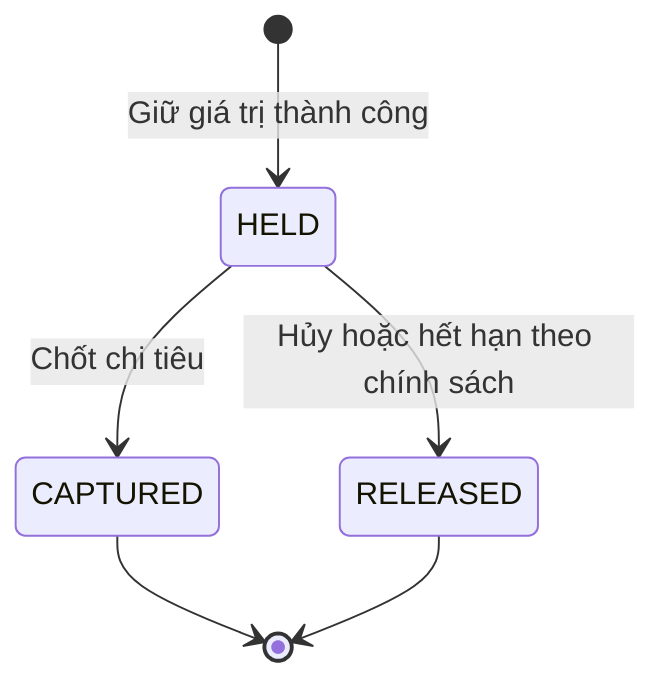

# Double spend race — Ngăn một nguồn giá trị bị sử dụng vượt mức

## 1. Double spend race là gì?

**Double spend race** là tình huống các thao tác cạnh tranh cùng sử dụng một nguồn giá trị hoặc quyền sử dụng, khiến tổng hiệu ứng đã chấp nhận vượt quá phần được phép.

Trong ứng dụng nghiệp vụ, nguồn đó có thể là số dư tín dụng nội bộ, điểm thưởng, thẻ quà tặng, khoản hoàn trả còn được phép hoặc một quyền đổi ưu đãi. Không cần có blockchain mới xuất hiện double spend.

Bài thuộc chương **Race Conditions** của module **Business Logic Security** (`SECURITY_APPLICATION_SECURITY_BUSINESS_LOGIC_SECURITY`). Trọng tâm là bảo vệ số dư, trạng thái đối tượng, quyền theo đối tượng và hiệu ứng duy nhất khi yêu cầu đến đồng thời hoặc được gửi lại.

Sau bài học, bạn có thể:

- Nhận ra khoảng trống giữa kiểm tra số dư và ghi nhận sử dụng.
- Phân biệt double spend, mất cập nhật và duplicate request.
- Xác định bất biến cần bảo vệ bằng transaction và thao tác nguyên tử.
- Kết hợp giới hạn số dư, khóa nghiệp vụ và idempotency.
- Thiết kế giữ, chốt và giải phóng giá trị mà không tạo hai hiệu ứng đối nghịch.
- Kiểm thử kết quả lưu trữ thực tế khi có cạnh tranh và timeout.

## 2. Tình huống: ví tín dụng thanh toán hai đơn hàng

Ứng dụng có một ví tín dụng nội bộ W với số dư khả dụng 100.000 đơn vị tiền. Hai đơn O-1 và O-2 đều cần 80.000, cùng loại tiền với ví.

Người dùng có quyền thanh toán cả hai đơn, mở hai cửa sổ và gửi yêu cầu gần như đồng thời.

Thiết kế sai có thể là:

```java
// Minh họa lỗi: kiểm tra và trừ tiền là hai thao tác không được bảo vệ.
Wallet wallet = wallets.find(walletId);
if (wallet.availableMinor() >= order.payableMinor()) {
    wallets.saveBalance(
            walletId,
            wallet.availableMinor() - order.payableMinor());
    orders.markPaid(order.id());
}
```

Lịch thực thi:

| Bước | Thanh toán O-1 | Thanh toán O-2 |
|---|---|---|
| 1 | Đọc số dư 100.000 | |
| 2 | | Đọc số dư 100.000 |
| 3 | Kiểm tra đủ 80.000 | |
| 4 | | Kiểm tra đủ 80.000 |
| 5 | Ghi số dư 20.000, đánh dấu O-1 đã trả | |
| 6 | | Ghi số dư 20.000, đánh dấu O-2 đã trả |

Cả hai đơn được chấp nhận với tổng 160.000, nhưng số dư chỉ giảm 80.000. Người dùng đã nhận hiệu ứng vượt giá trị được phép.

Điều đáng chú ý là số dư cuối vẫn không âm. Một kiểm tra chỉ nhìn `balance >= 0` có thể bỏ sót lỗi. Cần đối chiếu cả các khoản trừ và đơn đã được thanh toán.

## 3. Phân biệt ba lỗi thường bị gộp chung

### 3.1. Mất cập nhật

Hai thao tác đọc cùng số dư rồi ghi đè kết quả tính từ bản cũ. Ví dụ trên kết thúc ở 20.000 dù đã chấp nhận hai khoản 80.000.

Đổi sang phép trừ trực tiếp ở cơ sở dữ liệu tránh việc ghi một giá trị tính từ bản cũ:

```sql
UPDATE wallet_account
SET available_minor = available_minor - :amount
WHERE tenant_id = :tenantId AND id = :walletId;
```

Nhưng nếu thiếu điều kiện đủ tiền, câu lệnh có thể đưa số dư xuống âm. Tránh mất cập nhật chưa đồng nghĩa tránh double spend.

### 3.2. Duplicate request

Một lần thanh toán O-1 đã commit nhưng phản hồi bị mất. Client gửi lại cùng ý định.

Đây là trường hợp cần nhận diện command cũ để không trừ lần hai. Idempotency giúp trả lại kết quả đã có.

### 3.3. Hai ý định khác nhau dùng chung số dư

Thanh toán O-1 và O-2 là hai ý định khác nhau. Chúng có thể có hai idempotency key hoàn toàn hợp lệ.

Cả hai vẫn phải cạnh tranh phần giá trị dùng chung. Một bảng idempotency không thể quyết định ví có đủ tiền cho tổng hai đơn hay không.

| Lớp bảo vệ | Câu hỏi được giải quyết |
|---|---|
| Điều kiện số dư nguyên tử | Còn đủ giá trị cho thao tác mới này không? |
| Khóa nghiệp vụ theo đơn | Đơn này đã có thanh toán thành công chưa? |
| Idempotency | Cùng ý định này đã tạo hiệu ứng chưa? |
| Phân quyền | Chủ thể có được sử dụng ví và thanh toán đơn này không? |
| Version và state machine | Đây còn là nội dung và trạng thái được phép thanh toán không? |

Mỗi lớp có nhiệm vụ riêng. Một lớp thành công không cho phép bỏ các lớp còn lại.

## 4. Viết các bất biến trước khi sửa code

### 4.1. Bất biến số dư và sổ giao dịch

Mô hình thanh toán trực tiếp trong bài không có khoản giữ đang chờ:

```text
availableMinor >= 0

availableMinor
    = openingMinor
    + tổng credit đã commit
    - tổng debit đã commit
```

Mỗi khoản debit phải gắn với một hiệu ứng nghiệp vụ xác định, đúng ví, tenant và loại tiền.

Các giá trị số nguyên phải được kiểm tra miền, đơn vị và phép chuyển đổi. Số âm, số 0 không phù hợp chính sách, tràn số hoặc nhầm loại tiền có thể biến thao tác trừ thành hành vi sai ngay cả khi không có race.

### 4.2. Bất biến theo đơn hàng

Trong mô hình mỗi đơn chỉ có một thanh toán cuối cùng:

1. Chỉ đơn đang chờ thanh toán mới được chuyển sang PAID.
2. Giá phải lấy từ tổng tiền có thẩm quyền của đúng phiên bản đơn.
3. Một đơn chỉ có một bản ghi thanh toán thành công.
4. PAID phải có debit và bản ghi thanh toán tương ứng.
5. Không có debit thành công cho một thanh toán đã rollback.

Nếu sản phẩm hỗ trợ trả nhiều lần hoặc chia nhiều phương tiện thanh toán, khóa duy nhất phải đổi theo mô hình ấy, chẳng hạn theo nghĩa vụ thanh toán hoặc phần thanh toán. Không áp dụng mù quy tắc “một hàng cho mọi đơn” cho nghiệp vụ khác.

### 4.3. Bất biến quyền và ngữ cảnh

- Không được dùng ví của tenant hoặc người khác chỉ nhờ biết wallet ID.
- Có quyền dùng ví chưa chắc có quyền thanh toán một đơn bất kỳ.
- Client không được tự khai số tiền phải trừ, trạng thái PAID hoặc chủ sở hữu.
- Quyết định cần kiểm tra đúng đối tượng, loại tiền và phiên bản nội dung.

Các kiểm tra này phải áp dụng cho cả đường API, worker, import và công cụ quản trị có thể tạo cùng hiệu ứng.

## 5. Giới hạn số dư phải nằm ở điểm ghi nguyên tử

### 5.1. Cập nhật có điều kiện

Ví dụ dùng PostgreSQL; các tham số đặt tên là quy ước của lớp truy cập dữ liệu:

```sql
UPDATE wallet_account
SET available_minor = available_minor - :amount
WHERE tenant_id = :tenantId
  AND id = :walletId
  AND currency = :currency
  AND status = 'ACTIVE'
  AND :amount > 0
  AND available_minor >= :amount;
```

Số tiền và loại tiền lấy từ đơn đã được xác minh, không lấy từ field client tự chọn.

- Một dòng được cập nhật: thao tác trừ đã đạt trong transaction hiện tại.
- Không có dòng được cập nhật: không được đánh dấu đơn đã trả.
- Chỉ sau commit mới có kết quả thanh toán thành công.

Ở PostgreSQL READ COMMITTED, UPDATE cạnh tranh có thể chờ transaction trước rồi đánh giá lại điều kiện trên phiên bản dòng đã cập nhật. Với số dư 100.000 và hai khoản 80.000, khoản thứ hai không còn thỏa điều kiện nếu khoản thứ nhất commit. Nếu khoản thứ nhất rollback, giá trị của nó không bị tiêu dùng. Xem [PostgreSQL — Transaction Isolation](https://www.postgresql.org/docs/18/transaction-iso.html).

Đặc tính này bảo vệ điều kiện đơn giản trên dòng ví đang cập nhật. Không được suy ra nó tự bảo vệ mọi điều kiện tổng hợp qua nhiều ví hoặc nhiều bảng.

### 5.2. Ràng buộc cơ sở dữ liệu hỗ trợ phòng vệ

```sql
CREATE TABLE wallet_account (
    tenant_id        uuid NOT NULL,
    id               uuid NOT NULL,
    currency         text NOT NULL,
    status           text NOT NULL,
    available_minor  bigint NOT NULL CHECK (available_minor >= 0),
    PRIMARY KEY (tenant_id, id)
);
```

`CHECK` không thay cho điều kiện UPDATE và xử lý số dòng. Nó là rào chắn để một đường ghi sai không dễ tạo số âm.

Sự khớp nhau giữa ví, ledger và đơn là quan hệ nhiều hàng. PostgreSQL không hỗ trợ dùng CHECK như một bảo đảm tổng quát tham chiếu dữ liệu ở các hàng khác. Cần transaction, khóa và các ràng buộc phù hợp. Xem [PostgreSQL — Constraints](https://www.postgresql.org/docs/18/ddl-constraints.html).

### 5.3. Một transaction phải bao phủ toàn hiệu ứng

Các bước sau cần cùng commit:

```text
trừ ví
+ ghi debit
+ ghi thanh toán duy nhất của đơn
+ chuyển đơn sang PAID
+ ghi receipt của command
+ ghi audit nghiệp vụ và outbox
```

Nếu đơn bị xung đột version sau khi trừ ví, toàn transaction phải rollback. Nếu ghi ledger thất bại, không được giữ khoản trừ rồi trả lỗi cho client.

Không chia từng bước sang các transaction độc lập chỉ để giảm thời gian giữ khóa mà chưa thiết kế quy trình phục hồi.

## 6. Hai phạm vi duy nhất khác nhau

### 6.1. Duy nhất theo command

Một phạm vi idempotency có thể là:

```text
(tenantId, authenticatedActorId, operation, idempotencyKey)
```

Receipt ràng buộc với wallet ID, order ID, expected version và các tham số có ý nghĩa. Cùng key nhưng khác ý định phải bị từ chối.

Khóa do client gửi chỉ là định danh đề nghị cho ý định. Actor và tenant trong phạm vi khóa do máy chủ xác lập.

### 6.2. Duy nhất theo hiệu ứng nghiệp vụ

Ví dụ:

```sql
CREATE UNIQUE INDEX one_payment_per_order
ON order_payment (tenant_id, order_id);

CREATE UNIQUE INDEX one_debit_per_effect
ON wallet_entry (tenant_id, effect_id);
```

Các cột khóa cần có ràng buộc NOT NULL phù hợp. Schema đầy đủ còn cần khóa ngoại theo tenant, số tiền dương và các ràng buộc đối tượng tương ứng.

Ràng buộc theo đơn ngăn hai actor hoặc hai key khác nhau cùng trả hai lần cho một đơn trong mô hình này. Ràng buộc effect ID ngăn ghi lại cùng hiệu ứng ledger.

Ngược lại, một effect ID mới cho mỗi attempt không giúp chống trùng. Định danh hiệu ứng phải gắn với ý định hoặc nghĩa vụ nghiệp vụ ổn định, không đổi tùy tiện mỗi lần retry.

Khi có hoàn tiền hoặc hủy, giữ lịch sử và tạo bút toán nghiệp vụ phù hợp. Xóa receipt hoặc bản ghi thanh toán để “cho chạy lại” có thể mở lại đường sử dụng giá trị lần hai.

## 7. Minh họa dịch vụ thanh toán bằng Java

### 7.1. Hợp đồng và phạm vi

```java
public record PayWithCredit(
        UUID orderId,
        UUID walletId,
        long expectedOrderVersion,
        String idempotencyKey
) {}
```

Đoạn mã dưới minh họa thanh toán bằng tín dụng nội bộ trong một cơ sở dữ liệu PostgreSQL. Nó không gọi cổng thanh toán ngoài.

Các repository, kiểu domain và receipt là hợp đồng ứng dụng cần triển khai. Đây không phải chương trình độc lập có thể sao chép để chạy ngay.

```java
@Transactional(isolation = Isolation.READ_COMMITTED)
public PaymentResult pay(PayWithCredit command, AuthenticatedActor actor) {
    validation.requireValid(command);

    Order order = orders.lockByTenantAndId(
            actor.tenantId(), command.orderId())
            .orElseThrow(OrderNotAccessibleException::new);

    Wallet wallet = wallets.lockByTenantAndId(
            actor.tenantId(), command.walletId())
            .orElseThrow(WalletNotAccessibleException::new);

    access.requirePayOrderWithWallet(actor, order, wallet);

    CommandScope scope = new CommandScope(
            actor.tenantId(), actor.id(), "PAY_WITH_CREDIT");

    String intentDigest = fingerprints.forCreditPayment(scope, command);
    ReceiptClaim claim = receipts.claimOrLoad(
            scope, command.idempotencyKey(), intentDigest);

    if (claim.isReplay()) {
        claim.requireSameIntent(intentDigest);
        access.requireReadPaymentResult(actor, claim.resultId());
        return results.loadPayment(claim.resultId());
    }

    order.requireState(OrderState.AWAITING_PAYMENT);
    order.requireVersion(command.expectedOrderVersion());
    order.requirePayableQuote(clock.instant());
    order.requirePositivePayableAmount();
    wallet.requireSameCurrency(order.currency());

    long amount = order.payableMinor();
    UUID effectId = claim.effectId();

    int changed = wallets.debitIfSufficient(
            actor.tenantId(), wallet.id(), order.currency(), amount);

    if (changed != 1) {
        throw new CreditUnavailableException();
    }

    entries.appendDebitUnique(
            actor.tenantId(), wallet.id(), effectId,
            order.id(), order.currency(), amount);

    payments.insertUniqueForOrder(
            actor.tenantId(), order.id(), wallet.id(), effectId, amount);

    int paid = orders.markPaidIfVersionMatches(
            actor.tenantId(), order.id(),
            command.expectedOrderVersion(), effectId);

    if (paid != 1) {
        throw new PaymentConflictException();
    }

    PaymentResult result = results.createPayment(
            claim.commandId(), effectId, order.id(), amount);

    receipts.complete(claim, result.id());
    audit.appendCreditPayment(actor, order, wallet, effectId);
    outbox.appendOrderPaid(order.id(), effectId);

    return result;
}
```

### 7.2. Các điều kiện repository phải đáp ứng

- Các thao tác dùng cùng database transaction và connection theo transaction manager.
- Khóa dòng đơn ổn định trạng thái, số tiền và version trong khi quyết định.
- Khóa dòng ví trong ví dụ ổn định cả thuộc tính ví dùng cho phân quyền. UPDATE có điều kiện vẫn là nơi thực thi giới hạn số dư.
- `claimOrLoad` dựa trên unique constraint, không chỉ SELECT trước INSERT. Receipt mới chỉ được commit cùng kết quả thành công.
- Khi hai claim cạnh tranh, bên không tạo được claim đọc kết quả đã commit và đối chiếu digest; không ghi đè digest cũ.
- Khoản trừ, entry, payment, trạng thái đơn, receipt, audit trong DB và outbox cùng rollback khi thất bại.
- Lỗi unique hoặc xung đột sau khi trừ tiền không được bị bắt rồi bỏ qua để commit phần còn lại.
- Publisher chỉ phát outbox đã commit; API chỉ trả thành công sau commit.

Một implementation có thể dùng UPDATE có điều kiện mà không khóa ví riêng nếu các điều kiện phân quyền và thuộc tính liên quan được bảo vệ đúng bằng cơ chế khác. Không bỏ khóa chỉ vì phép trừ đã nguyên tử mà quên các dữ liệu khác tham gia quyết định.

### 7.3. Quyền và version không được bỏ qua khi retry

Receipt phải được đọc trong phạm vi đúng và chỉ trả dữ liệu sau khi kiểm tra quyền. Một người không được đọc kết quả của người khác chỉ nhờ biết idempotency key.

Giá và tổng tiền phải gắn với phiên bản đơn. Nếu giá, giảm giá hoặc nội dung thay đổi, version liên quan phải tăng và quyết định cũ phải được đánh giá lại theo hợp đồng.

Kết quả command cũ là lịch sử của một lần thanh toán. Nếu sau đó đã hoàn tiền, trả lại receipt cũ không có nghĩa trạng thái hiện tại vẫn là “chưa từng hoàn”.

### 7.4. Transaction phải thực sự hoạt động

Với Spring, lời gọi cần đi qua cơ chế quản lý transaction đã cấu hình. Self-invocation trong chế độ proxy không tự tạo transaction theo annotation; rollback cũng cần phù hợp kiểu ngoại lệ sử dụng. Xem [Spring — Using @Transactional](https://docs.spring.io/spring-framework/reference/data-access/transaction/declarative/annotations.html).

Không gọi mạng chậm hoặc chờ người dùng trong lúc giữ khóa ví. Giữ thứ tự khóa nhất quán giữa các đường ghi; với ví dụ là order rồi wallet, tiếp đến receipt và các bản ghi phụ thuộc. Command nhiều đối tượng cần một thứ tự đầy đủ, có xử lý deadlock và retry toàn transaction khi phù hợp.

## 8. Khi phải giữ giá trị trước rồi mới chốt

### 8.1. Mô hình hold

Một số nghiệp vụ cần giữ giá trị trước khi xác nhận cuối cùng. Khi đó có thể dùng:

```text
postedMinor = số dư đã ghi sổ
heldMinor = tổng khoản giữ đang hiệu lực
availableMinor = postedMinor - heldMinor

0 <= heldMinor <= postedMinor
```

Ví dụ số dư ghi sổ là 100.000, giữ 80.000:

```text
posted = 100.000
held = 80.000
available = 20.000
```

Việc giữ phải kiểm tra đủ khả dụng trong cùng thao tác nguyên tử. Không tạo nhiều hold rồi mới chạy job cộng tổng để xem có vượt số dư hay không.

### 8.2. Capture và release cạnh tranh



Trong mô hình thu gọn:

- Capture: giảm posted và held cùng một lượng.
- Release: chỉ giảm held.
- Một hold không được vừa CAPTURED vừa RELEASED.
- Callback trùng không capture hoặc release thêm lần nữa.

Hai command phải cạnh tranh trên cùng hold, bằng khóa dòng hoặc chuyển trạng thái có điều kiện. Cập nhật trạng thái hold, các bộ đếm và entry liên quan phải cùng transaction.

Đánh dấu RELEASED trước rồi mới hoàn khả dụng ở transaction khác, hoặc hoàn trước rồi mới kiểm tra trạng thái hold, đều có thể làm hỏng bất biến.

### 8.3. Không tự release khi kết quả bên ngoài chưa rõ

Nếu một hệ thống ngoài có thể đã capture nhưng callback chậm, timeout cục bộ không chứng minh capture chưa xảy ra.

Một thiết kế thực tế có thể cần trạng thái đang chốt hoặc đang đối soát, định danh thao tác ổn định và giao thức hủy/xác nhận với bên ngoài. Nếu release hold rồi nhận capture thành công đến muộn, ứng dụng có thể đã cho người dùng tiêu lại cùng giá trị.

Sơ đồ ba trạng thái trên chỉ phù hợp phạm vi chuyển đổi nội bộ đã xác định. Không coi nó là giao thức đầy đủ cho mọi cổng thanh toán.

## 9. Vì sao các biện pháp đơn lẻ thường thất bại?

| Biện pháp | Hạn chế |
|---|---|
| Tắt nút thanh toán sau lần bấm đầu | Không chặn hai cửa sổ, client khác hoặc request trực tiếp |
| Đọc số dư từ cache | Dữ liệu có thể cũ; cache không phải điểm ghi có thẩm quyền |
| Chỉ thêm @Transactional | Chưa bảo vệ điều kiện kiểm tra trước, cập nhật sau |
| Chỉ dùng idempotency key | Hai ý định khác nhau vẫn cạnh tranh cùng số dư |
| Chỉ dùng optimistic version trên đơn | Hai đơn khác nhau vẫn dùng chung ví |
| Chỉ kiểm tra số dư không âm | Có thể bỏ sót ledger và đơn đã ghi sai hoặc ghi thiếu |
| Chỉ khóa trong một JVM | Instance và worker khác không dùng chung khóa đó |
| Chỉ cho một consumer trên mỗi order | Nhiều order vẫn dùng chung wallet |
| Chỉ dùng Redis lease | Worker cũ có thể tiếp tục sau khi lease hết hạn nếu điểm ghi không chặn |
| Chỉ đối soát cuối ngày | Phát hiện sau khi đã cấp hàng hoặc quyền sử dụng |

Rate limit và cảnh báo có thể giảm lạm dụng, nhưng không thay điều kiện số dư nguyên tử. Không cần gửi hàng nghìn request mới khai thác được một khoảng trống mà hai request đã đủ làm sai.

Nếu dùng fencing token cho lease, nơi nhận ghi phải thực sự từ chối token cũ. Gắn token vào log không bảo vệ số dư.

## 10. Timeout, retry và hiệu ứng ngoài cơ sở dữ liệu

### 10.1. Đã commit nhưng mất phản hồi

```text
trừ ví + ghi payment + cập nhật order + ghi receipt
-> COMMIT
-> mất phản hồi
-> client retry cùng key
```

Kết quả mong đợi là trả receipt cũ, không tạo entry hoặc trừ tiền mới.

Đối chiếu bằng nguồn đọc có bảo đảm phù hợp, chẳng hạn primary của transaction. Replica chậm hoặc cache không thấy receipt chưa đủ để kết luận lần trước không commit.

Nếu attempt trước còn chạy, unique constraint và khóa liên quan phải phối hợp với attempt đó. Không thấy kết quả ngay không cho phép tự tạo một key mới và gọi lại hiệu ứng ngoài.

### 10.2. Retry lỗi kỹ thuật khác retry xung đột nghiệp vụ

- Deadlock hoặc serialization failure đã rollback: có thể thử lại toàn transaction, đọc và kiểm tra lại, với giới hạn.
- Phiên bản đơn cũ: cần xem lại ý định; không tự đổi expected version để buộc thanh toán.
- Không đủ tín dụng: là kết quả nghiệp vụ tại thời điểm đánh giá, không phải lý do bỏ kiểm tra.
- Lỗi không rõ commit: giữ identity và đối soát.

Không tiếp tục dùng một transaction đã lỗi. Retry cần mở transaction mới bên ngoài attempt cũ.

### 10.3. Outbox và bên nhận

Cấp quyền dùng dịch vụ hoặc gửi hàng thường diễn ra sau thanh toán. Ghi outbox cùng transaction để chỉ có sự kiện cho thanh toán đã commit.

Publisher có thể giao lại sự kiện; bên nhận cần chống hiệu ứng trùng theo payment effect ID hoặc định danh nghiệp vụ tương ứng. Một lần trừ ví không bảo đảm một hệ thống giao hàng thiếu idempotency sẽ chỉ giao một lần.

Nếu ví nằm ở dịch vụ riêng, transaction ở dịch vụ đơn hàng không tự bao phủ nó. Cần API debit/hold có identity ổn định, truy vấn trạng thái, đối soát và workflow phục hồi. Không giữ giả định “cùng rollback” khi ranh giới hệ thống đã thay đổi.

## 11. Kiểm thử dựa trên hiệu ứng đã commit

### 11.1. Hai đơn khác nhau cùng dùng ví

Chuẩn bị ví 100.000, hai đơn 80.000, hai command identity riêng và quyền hợp lệ. Chạy hai transaction cạnh tranh qua đúng dịch vụ.

Nếu không có lỗi kỹ thuật ngoài tình huống kiểm thử:

```text
payment thành công = 1
order PAID = 1
available = 20.000
tổng debit = 80.000
receipt thành công = 1
outbox payment thành công = 1
```

Thử với hai đơn 50.000 để kiểm tra trường hợp cả hai được phép thành công: số dư cuối là 0 và tổng debit là 100.000. Một giải pháp chặn mọi command thứ hai cũng không đúng yêu cầu nghiệp vụ.

### 11.2. Ma trận tình huống

| Tình huống | Kết quả mong đợi |
|---|---|
| Cùng ví, hai đơn vượt tổng số dư | Chỉ các khoản trong giới hạn được commit |
| Cùng ví, hai đơn có tổng đúng số dư | Cả hai có thể thành công, số dư cuối bằng 0 |
| Cùng đơn, cùng key gửi đồng thời | Một hiệu ứng, cùng kết quả đã lưu |
| Cùng đơn, hai key khác nhau | Không tạo hai payment thành công |
| Cùng đơn, dùng hai ví khác nhau | Ràng buộc theo đơn ngăn thanh toán trùng |
| Cùng key nhưng đổi đơn hoặc ví | Xung đột ý định |
| Client gửi amount âm hoặc tự giảm giá | Bị từ chối hoặc không dùng field đó làm giá có thẩm quyền |
| Ví khác tenant hoặc không thuộc phạm vi được cấp | Không trừ hoặc tiết lộ số dư |
| Giá đơn thay đổi trước khi thanh toán | Expected version hoặc điều kiện quote ngăn quyết định cũ |
| Ghi ledger lỗi sau khi đã trừ | Số dư và toàn hiệu ứng rollback |
| Mất phản hồi sau commit | Retry không trừ lần hai |
| Capture và release cùng hold | Chỉ một chuyển trạng thái cuối được commit |
| Callback capture hoặc release được giao lại | Không thay số dư thêm lần nữa |
| Worker cũ tiếp tục sau khi mất lease | Điều kiện tại điểm ghi chặn hiệu ứng không còn hợp lệ |
| Hai instance dùng cùng ví | Bất biến vẫn giữ, không phụ thuộc khóa JVM |

Bảng là tiêu chí cho triển khai, không khẳng định ví dụ trong bài đã được chạy kiểm thử.

### 11.3. Cách tạo kiểm thử cạnh tranh hữu ích

Dùng cơ sở dữ liệu cùng loại với triển khai và connection riêng cho các transaction. Đồng bộ điểm bắt đầu bằng latch hoặc barrier; tránh đặt barrier ở chỗ transaction này đã giữ khóa mà transaction kia cần để tới barrier.

Với mã lỗi cũ, có thể dùng điểm chèn kiểm soát trong môi trường kiểm thử để buộc hai luồng cùng đọc số dư trước khi ghi. Không thêm sleep vào production như một “cách sửa race”.

Đọc trạng thái sau khi các attempt kết thúc bằng transaction mới. Kiểm tra số dư, ledger, payment, order, receipt và outbox cùng nhau. Chỉ đếm HTTP 200 hoặc chỉ kiểm tra không âm chưa đủ.

Kịch bản mất phản hồi sau commit phải mô phỏng đúng ranh giới đó; ném exception trước commit chỉ chứng minh được rollback.

## 12. Audit và các quyết định cần chốt

Audit thành công nên gắn actor, tenant, wallet, order, command ID, effect ID, số tiền, loại tiền, phiên bản đơn và kết quả. Không đưa credential hoặc dữ liệu nhạy cảm không cần thiết vào log.

Theo dõi các dấu hiệu như nhiều lần chi vượt số dư, cùng key khác payload, nhiều attempt trên cùng đơn hoặc cạnh tranh bất thường ở cùng ví. Cảnh báo hỗ trợ điều tra; điểm ghi vẫn phải chặn bất biến bị phá.

Trước triển khai, cần trả lời:

- Nguồn giá trị có thẩm quyền nằm ở đâu?
- Số dư khả dụng đã trừ các khoản giữ chưa?
- Đâu là khóa command và đâu là khóa hiệu ứng nghiệp vụ?
- Giá phải trả được ràng buộc với phiên bản nào?
- Quyền với ví và với đơn được kiểm tra thế nào?
- Mọi debit, credit, hold, capture, release và refund có dùng giao thức tương thích không?
- Khi không biết commit hay capture đã thành công, hệ thống đối soát bằng bằng chứng nào?
- Hệ thống ngoài có chống hiệu ứng trùng và xử lý sự kiện đến muộn không?

Đối với ví dụ tín dụng nội bộ, bảo vệ double spend cần đồng thời giữ số dư đúng giới hạn, ghi đủ ledger và chỉ thanh toán mỗi nghĩa vụ theo mô hình cho phép. Idempotency, state machine và quyền theo đối tượng tiếp tục bảo vệ kết quả đó qua cả request đồng thời và retry.
