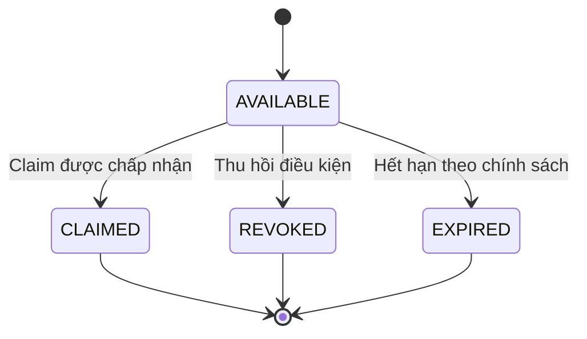
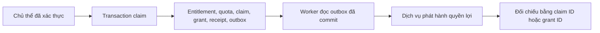

# Double claim race — Ngăn một quyền lợi bị nhận nhiều lần

## 1. Double claim race là gì?

**Double claim race** xảy ra khi các yêu cầu cạnh tranh cùng nhận một quyền lợi hoặc chiếm một tài nguyên chỉ được cấp theo giới hạn, nhưng hệ thống chấp nhận nhiều hiệu ứng trái quy tắc.

Ví dụ:

- Một người nhận hai phần thưởng của chiến dịch chỉ cho phép một lần.
- Hai người cùng được cấp quyền sở hữu một mã ưu đãi duy nhất.
- Hai yêu cầu cùng lấy “suất cuối cùng” của một chương trình.
- Một worker retry cấp thêm phần thưởng vì chưa thấy phản hồi lần trước.

Bài thuộc chương **Race Conditions** của module **Business Logic Security** (`SECURITY_APPLICATION_SECURITY_BUSINESS_LOGIC_SECURITY`). Trọng tâm là business invariants, định danh người hưởng, quyền theo đối tượng, state machine, transaction và idempotency.

Sau bài học, bạn có thể xác định đúng phạm vi “chỉ một lần”, bảo vệ thao tác claim tại điểm ghi, phối hợp giới hạn cá nhân với hạn mức toàn chiến dịch và kiểm thử cả hiệu ứng nội bộ lẫn việc cấp quyền lợi qua hệ thống ngoài.

Trong bài, **claim** là yêu cầu nhận hoặc xác lập một quyền lợi nghiệp vụ, không phải claim trong JWT.

## 2. Tình huống: mỗi nhân viên nhận một phần thưởng

Một doanh nghiệp có chiến dịch thưởng hoàn thành khóa học:

- Nhân viên đủ điều kiện được nhận một quyền lợi trong chiến dịch.
- Mỗi nhân viên chỉ nhận một lần, kể cả dùng nhiều phiên đăng nhập.
- Tổng số quyền lợi được nhận không vượt hạn mức chiến dịch.
- Điều kiện hoàn thành khóa học được máy chủ xác minh; người dùng không tự khai.
- Việc gửi lại sau mất kết nối phải trả về quyền lợi cũ, không tạo quyền lợi mới.

Ứng dụng lưu entitlement là bản ghi quyền được nhận, tạo từ quy trình xác minh điều kiện. Một cách triển khai sai:

```java
// Minh họa lỗi: không có điểm thực thi duy nhất chịu được cạnh tranh.
if (!claims.exists(campaignId, employeeId)) {
    Reward reward = rewards.createFor(employeeId);
    claims.insert(campaignId, employeeId, reward.id());
    return reward;
}
```

Lịch thực thi:

| Bước | Request A | Request B |
|---|---|---|
| 1 | Kiểm tra chưa có claim | |
| 2 | | Kiểm tra chưa có claim |
| 3 | Tạo quyền lợi G-1 | |
| 4 | | Tạo quyền lợi G-2 |
| 5 | Ghi claim cho G-1 | |
| 6 | | Ghi claim cho G-2 |

Một nhân viên nhận hai quyền lợi. Nếu tạo quyền lợi ở dịch vụ ngoài trước khi insert, việc thêm unique constraint vào bảng claim sau đó chưa tự thu hồi được G-2 đã cấp.

Cần bảo vệ cả **quyết định nhận** và **hiệu ứng cấp quyền lợi**.

## 3. Xác định đúng “một lần cho ai, cho cái gì?”

### 3.1. Ba phạm vi thường gặp

| Quy tắc nghiệp vụ | Khóa hoặc tài nguyên cần bảo vệ |
|---|---|
| Mỗi người hưởng nhận một lần mỗi chiến dịch | tenant + campaign + beneficiary |
| Một mã hoặc tài sản chỉ có một người nhận | tenant + resource ID |
| Cả chiến dịch chỉ cấp tối đa N quyền lợi | Dòng quota hoặc cơ chế tổng hợp có bảo vệ |

Một hệ thống có thể cần cả ba. Ràng buộc duy nhất theo người hưởng không ngăn 1.001 người khác nhau cùng vượt hạn mức 1.000 suất.

Ngược lại, quota toàn chiến dịch còn đủ cũng không cho phép một người nhận hai lần.

### 3.2. Account không luôn là người hưởng

Nếu chính sách nói “mỗi nhân viên”, khóa theo `userAccountId` có thể sai khi một nhân viên có hai tài khoản được liên kết hợp lệ.

Ví dụ dùng `beneficiaryId` là định danh nhân viên do hệ thống quản lý. Máy chủ ánh xạ chủ thể đăng nhập tới beneficiary trong tenant, theo quan hệ đã xác minh.

Client không được tự gửi `employeeId` rồi được tin rằng đang đại diện người đó. Biết entitlement ID cũng không đủ để claim entitlement ấy.

Nếu sản phẩm thực sự quy định “mỗi tài khoản”, khóa theo tài khoản có thể đúng. Việc một người tạo nhiều tài khoản để lạm dụng là vấn đề phạm vi định danh và chống lạm dụng, không chỉ là race condition. Cần chốt chính sách thay vì dùng một khóa kỹ thuật không rõ ý nghĩa.

### 3.3. Claim identity khác request identity

Hai tab có thể gửi hai request ID khác nhau cho cùng entitlement. Một người cũng có thể cố ý tạo hai idempotency key khác nhau.

Khóa nghiệp vụ `(tenant, campaign, beneficiary)` phải vẫn chặn quyền lợi thứ hai. Idempotency key chỉ hỗ trợ nhận diện cùng ý định vận chuyển lại; nó không thay phạm vi duy nhất của quyền lợi.

## 4. Các bất biến của ví dụ

### 4.1. Bất biến theo người hưởng

1. Mỗi tenant, campaign và beneficiary chỉ có tối đa một claim được chấp nhận.
2. Entitlement chỉ được claim khi điều kiện hiện tại cho phép.
3. Người claim phải có quyền đại diện beneficiary tương ứng.
4. Claim đã chấp nhận luôn trỏ tới một quyền lợi có định danh ổn định.
5. Retry không tạo thêm grant hoặc tiêu tốn thêm quota.

### 4.2. Bất biến theo chiến dịch

Trong mô hình mỗi claim dùng một suất:

```text
0 <= allocatedCount <= capacity

allocatedCount
    = số claim đã được chấp nhận trong chiến dịch
```

“Được chấp nhận” khác “đã gửi phần thưởng tới người nhận”. Một claim đã được phân bổ nhưng giao quyền lợi đang chờ vẫn giữ suất trong mô hình này.

Nếu mỗi loại quyền lợi tiêu thụ số đơn vị khác nhau, cần theo dõi allocated units và kiểm tra lượng sử dụng, không chỉ tăng bộ đếm mỗi claim lên 1.

### 4.3. Bất biến theo kết quả

```text
một claim đã commit
    -> một grant nghiệp vụ ổn định
    -> nhiều lần thử giao cùng grant nếu cần
    -> không tạo grant mới chỉ vì mất phản hồi.
```

Hai response HTTP thành công không tự chứng minh có lỗi double claim: cả hai có thể trả cùng claim ID và grant ID. Cần xem số hiệu ứng thực sự đã tạo.

## 5. State machine: quyền được nhận khác quá trình giao phần thưởng

### 5.1. Vòng đời entitlement



Đây là mô hình một lần của bài. CLAIMED không tự quay về AVAILABLE khi gửi email lỗi hoặc dịch vụ phát hành phần thưởng timeout.

Nếu cần hủy hoặc điều chỉnh sau claim, phải có command riêng với ngữ nghĩa về quota, quyền lợi và lịch sử. Không “reset cờ” như một thao tác retry.

### 5.2. Vòng đời fulfillment riêng

```text
PENDING -> DELIVERED
PENDING -> FAILED_RETRYABLE -> PENDING
PENDING -> UNKNOWN_REQUIRES_RECONCILIATION
```

Các trạng thái trên thuộc việc thực hiện hoặc giao quyền lợi đã cấp. Chúng không tạo lại entitlement.

Nếu dịch vụ ngoài có thể đã phát hành quyền lợi, trạng thái UNKNOWN cần đối soát theo claim hoặc grant ID. Không giải phóng suất rồi phát hành một quyền lợi khác mà chưa biết kết quả cũ.

### 5.3. Không dùng trạng thái UI làm bằng chứng

Một nút “Nhận thưởng” bị tắt sau lần bấm đầu không chặn request trực tiếp. UI có thể hiển thị dữ liệu cũ, người dùng mở nhiều tab hoặc mobile app gửi lại.

OWASP khuyến nghị giữ workflow ở máy chủ và dùng ràng buộc phù hợp cho quyền lợi một lần. Bài áp dụng nguyên tắc đó vào entitlement, claim và grant. Xem [OWASP Business Logic Security Cheat Sheet](https://cheatsheetseries.owasp.org/cheatsheets/Business_Logic_Security_Cheat_Sheet.html).

## 6. Ràng buộc duy nhất phải phản ánh chính sách

### 6.1. Schema claim thu gọn

```sql
CREATE TABLE reward_claim (
    tenant_id       uuid NOT NULL,
    id              uuid NOT NULL,
    campaign_id     uuid NOT NULL,
    beneficiary_id  uuid NOT NULL,
    entitlement_id  uuid NOT NULL,
    grant_id        uuid NOT NULL,
    claimed_at      timestamptz NOT NULL,
    PRIMARY KEY (tenant_id, id),
    UNIQUE (tenant_id, campaign_id, beneficiary_id),
    UNIQUE (tenant_id, entitlement_id),
    UNIQUE (tenant_id, grant_id)
);
```

Schema đầy đủ cần khóa ngoại tenant-scoped và các bảng liên quan. Ví dụ giả định entitlement đã được tạo trước, cũng duy nhất theo tenant, campaign và beneficiary.

Một claim ID ngẫu nhiên khác nhau cho mỗi lần gọi không ngăn double claim. Khóa duy nhất theo phạm vi nghiệp vụ mới là điều kiện cần giữ.

Các cột khóa không nên vô tình nullable. Với PostgreSQL, UNIQUE mặc định có cách xử lý NULL không tương đương việc mọi giá trị NULL đều là một chủ thể chung; NOT NULL làm rõ mô hình trong ví dụ. Xem [PostgreSQL — Constraints](https://www.postgresql.org/docs/18/ddl-constraints.html).

### 6.2. Kiểm tra tồn tại không khóa được “sự vắng mặt”

`SELECT` không thấy claim không có nghĩa transaction khác không thể insert. `SELECT FOR UPDATE` trên truy vấn không trả dòng cũng không tạo ra một dòng quyền lợi để mọi bên cùng khóa.

Hai lựa chọn thường gặp:

- Có entitlement sẵn: khóa entitlement đó, kiểm tra trạng thái, tạo claim trong cùng transaction.
- Tạo claim theo nhu cầu: dùng unique constraint để phân xử insert; các hiệu ứng còn lại phải cùng transaction và xử lý xung đột đúng.

Một INSERT minh họa lựa chọn thứ hai:

```sql
INSERT INTO reward_claim (
    tenant_id, id, campaign_id, beneficiary_id,
    entitlement_id, grant_id, claimed_at
)
VALUES (
    :tenantId, :claimId, :campaignId, :beneficiaryId,
    :entitlementId, :grantId, :serverTime
)
ON CONFLICT (tenant_id, campaign_id, beneficiary_id)
DO NOTHING
RETURNING id;
```

Đây chỉ là thao tác phân xử khóa, chưa phải toàn quy trình cấp thưởng. Nếu không insert được, không được tiếp tục phát hành grant mới.

Trong PostgreSQL READ COMMITTED, khi insert bị xung đột với transaction vừa commit, có thể cần câu SELECT tiếp theo để đọc bản ghi hiện có. Không giả định `DO NOTHING` tự trả lại dòng cũ. Xem [PostgreSQL — INSERT](https://www.postgresql.org/docs/18/sql-insert.html).

### 6.3. Các khóa dễ tạo lỗ hổng

- Chỉ unique theo idempotency key: đổi key là có thể nhận lại.
- Chỉ unique theo tài khoản khi chính sách theo nhân viên.
- Thêm ngày hiện tại vào khóa dù quy tắc là một lần cả chiến dịch.
- Chỉ unique các claim đang ACTIVE rồi soft-delete để retry.
- Xóa claim cũ khi giao quyền lợi lỗi.
- Bỏ tenant khỏi khóa hoặc tra đối tượng ngoài phạm vi tenant.

Unique partial index có thể phù hợp quy tắc “chỉ một quyền lợi đang hiệu lực”, nhưng khác quy tắc “chỉ nhận một lần trong lịch sử chiến dịch”. Cần chọn đúng ngữ nghĩa.

## 7. Quota chiến dịch cần một điểm ghi riêng

Một mẫu cập nhật có điều kiện:

```sql
UPDATE reward_campaign
SET allocated_count = allocated_count + 1
WHERE tenant_id = :tenantId
  AND id = :campaignId
  AND status = 'OPEN'
  AND policy_version = :expectedPolicyVersion
  AND opens_at <= :decisionTime
  AND :decisionTime < closes_at
  AND allocated_count < capacity;
```

Các tham số là binding của lớp truy cập dữ liệu. `decisionTime` do máy chủ xác lập theo hợp đồng thời gian, không do client cung cấp.

Cần ràng buộc `0 <= allocated_count <= capacity` và kiểm tra đúng một dòng được cập nhật. Khi không đạt, không tiếp tục claim như thể còn suất.

Việc tăng quota, tạo claim, tạo grant, đổi entitlement và ghi receipt phải cùng commit. Nếu unique claim bị vi phạm sau khi quota tăng, phải rollback phần tăng; không đơn giản trả “đã nhận” rồi commit bộ đếm sai.

Quy tắc thời gian cũng cần rõ: kiểm tra tại thời điểm tiếp nhận, tại quyết định phân bổ hay yêu cầu một deadline khác. Timestamp do server tạo từ đầu một job nằm lâu trong hàng đợi không mặc định là thời điểm quyết định claim hợp lệ. Khóa dòng không làm đồng hồ ngừng chạy.

## 8. Minh họa dịch vụ claim bằng Java

### 8.1. Đầu vào không tự khai người hưởng hoặc điều kiện

```java
public record ClaimCampaignReward(
        UUID campaignId,
        String idempotencyKey
) {}
```

Actor và tenant lấy từ ngữ cảnh xác thực. Beneficiary lấy từ quan hệ đã xác minh tại máy chủ. Giá trị phần thưởng, điều kiện và hạn mức lấy từ cấu hình chiến dịch, không từ body yêu cầu.

Đoạn mã sau giả định entitlement đã có sẵn. Grant là bản ghi quyền lợi nội bộ; phát hành hoặc gửi qua dịch vụ ngoài diễn ra qua outbox sau commit.

```java
@Transactional(isolation = Isolation.READ_COMMITTED)
public ClaimResult claim(
        ClaimCampaignReward command,
        AuthenticatedActor actor
) {
    validation.requireValid(command);

    BeneficiaryBinding binding =
            beneficiaries.lockVerifiedBinding(actor);

    CampaignSnapshot campaign = campaigns.loadCurrent(
            actor.tenantId(), command.campaignId());

    Entitlement entitlement = entitlements.lockByScope(
            actor.tenantId(),
            campaign.id(),
            binding.beneficiaryId())
            .orElseThrow(NotEligibleForClaimException::new);

    access.requireAccessEntitlement(
            actor, binding, campaign, entitlement);

    CommandScope scope = new CommandScope(
            actor.tenantId(), actor.id(), "CLAIM_CAMPAIGN_REWARD");

    String digest = fingerprints.forClaim(
            scope, command, binding.beneficiaryId());

    ReceiptClaim receipt = receipts.claimOrLoad(
            scope, command.idempotencyKey(), digest);

    if (receipt.isReplay()) {
        receipt.requireSameIntent(digest);
        access.requireReadClaimResult(actor, receipt.resultId());
        return results.loadClaim(receipt.resultId());
    }

    if (entitlement.isClaimed()) {
        ClaimResult existing =
                results.loadByClaimId(entitlement.claimId());

        access.requireReadClaimResult(actor, existing.id());
        receipts.complete(receipt, existing.id());
        audit.appendExistingClaimReturned(actor, entitlement);
        return existing;
    }

    entitlement.requireAvailable();
    entitlement.requireEligibleFor(campaign, binding);

    Instant decisionTime = clock.instant();

    int allocated = campaigns.allocateIfOpenAndCapacity(
            actor.tenantId(),
            campaign.id(),
            campaign.policyVersion(),
            decisionTime);

    if (allocated != 1) {
        throw new CampaignUnavailableException();
    }

    UUID claimId = receipt.effectId();

    RewardGrant grant = grants.createUniqueForClaim(
            actor.tenantId(), claimId,
            binding.beneficiaryId(), campaign.rewardDefinition());

    claims.insertUnique(
            actor.tenantId(), claimId, campaign.id(),
            binding.beneficiaryId(), entitlement.id(),
            grant.id(), decisionTime);

    int marked = entitlements.markClaimedIfAvailable(
            actor.tenantId(), entitlement.id(),
            entitlement.version(), claimId);

    if (marked != 1) {
        throw new ClaimConflictException();
    }

    ClaimResult result = results.createClaim(
            claimId, grant.id(), entitlement.id());

    receipts.complete(receipt, result.id());
    audit.appendClaimAccepted(actor, entitlement, claimId, grant.id());
    outbox.appendFulfillReward(claimId, grant.id());

    return result;
}
```

### 8.2. Những hợp đồng cần triển khai đúng

Các repository và kiểu domain là minh họa, không phải chương trình độc lập chạy được ngay.

- `lockVerifiedBinding` kiểm tra danh tính liên kết hiện tại. Các đường sửa hoặc thu hồi quan hệ phải dùng giao thức đồng bộ tương thích.
- Entitlement được khóa theo đúng tenant, campaign và beneficiary; không khóa một entitlement do client tự nhận là của mình.
- `requireAccessEntitlement` kiểm tra quyền truy cập đối tượng, tách khỏi điều kiện chỉ áp dụng cho claim mới.
- `requireEligibleFor` kiểm tra bằng chứng và phạm vi đủ điều kiện; không dựa vào field `eligible=true` từ client.
- `allocateIfOpenAndCapacity` thực hiện UPDATE có điều kiện, bao gồm version chính sách. Khi chính sách đã thay đổi, attempt phải đánh giá lại thay vì dùng reward definition cũ.
- Grant, claim, quota, trạng thái entitlement, receipt, audit trong DB và outbox dùng cùng transaction.
- `markClaimedIfAvailable` kiểm tra trạng thái và version, đồng thời phải kiểm tra số dòng cập nhật.
- Mọi lỗi làm mất điều kiện phải rollback toàn bộ transaction.
- Grant ID là định danh nội bộ trong ví dụ, không mặc định là bí mật đủ để đổi thưởng.

Nhánh “đã CLAIMED” cho phép một yêu cầu mới được cấp quyền nhận lại kết quả gốc. Nó không tăng quota, không tạo grant và không ghi thêm yêu cầu phát hành mới.

### 8.3. Idempotency vẫn cần unique constraint

`claimOrLoad` cần một khóa duy nhất theo phạm vi như:

```text
(tenantId, authenticatedActorId, operation, idempotencyKey)
```

Digest ràng buộc campaign và beneficiary đã xác lập. Không đưa request ID hoặc attempt ID thay đổi qua retry vào nội dung ý định.

Với mô hình này, receipt mới chỉ commit sau khi có kết quả. Nếu crash trước commit, receipt và hiệu ứng cùng rollback. Request cạnh tranh phải dùng unique constraint và đọc kết quả đã commit, không dùng một cache “đang xử lý” rồi tự suy ra đã thành công.

Việc trả receipt cũ vẫn phải kiểm tra quyền hiện tại. Hai tài khoản cùng beneficiary có thể có scope receipt khác nhau, nhưng unique claim theo beneficiary vẫn ngăn nhận thêm.

### 8.4. Transaction và thứ tự khóa

Trong ví dụ, thứ tự chính là binding, entitlement, receipt rồi campaign quota. Các đường claim, thu hồi và quản trị cần giao thức tương thích; command nhiều đối tượng cần thứ tự khóa ổn định và xử lý deadlock.

Không gọi dịch vụ phát hành ngoài hoặc chờ người dùng trong lúc giữ khóa. Nếu dùng Spring, bảo đảm lời gọi đi qua cơ chế transaction thực sự và cấu hình rollback phù hợp với ngoại lệ. Xem [Spring — Using @Transactional](https://docs.spring.io/spring-framework/reference/data-access/transaction/declarative/annotations.html).

Nếu bằng chứng đủ điều kiện nằm ở hệ thống ngoài, transaction cục bộ không tự khóa được nó. Cần chính sách về snapshot, version, thu hồi hoặc xác nhận có thẩm quyền; không giữ nguyên giả định “mọi điều kiện hiện tại đều được khóa”.

## 9. Thu hồi, hết hạn và thay chính sách cạnh tranh với claim

### 9.1. Thu hồi entitlement

Claim và Revoke phải cạnh tranh trên cùng quyền được nhận:

- Revoke commit khi entitlement còn AVAILABLE trước: claim không được cấp.
- Claim commit trước: entitlement đã CLAIMED; xử lý thu hồi quyền lợi sau đó phải theo một quy trình riêng.

Không để Revoke đặt trạng thái REVOKED rồi một worker dùng snapshot cũ ghi đè lại thành CLAIMED.

Nếu việc thu hồi và claim dùng hai bảng hoặc hai hệ thống không có điểm sắp thứ tự chung, chỉ đọc một cờ `eligible` trước khi tạo grant chưa tạo bảo đảm cạnh tranh.

### 9.2. Hết hạn không đồng nghĩa giao phần thưởng thất bại

Một claim được chấp nhận đúng thời hạn có thể còn đang chờ giao sau khi chiến dịch đóng. Sản phẩm cần quy định việc giao tiếp theo có được phép không.

Không mặc định hủy claim đã chấp nhận chỉ vì chiến dịch không còn mở cho claim mới. Ngược lại, một job claim mới nằm trong hàng đợi không được bỏ kiểm tra deadline hiện tại chỉ vì người dùng bấm nút trước đó.

Nếu yêu cầu là commit phải hoàn tất trước một thời điểm tuyệt đối, phải thiết kế và đánh giá đúng bảo đảm ấy. Một giá trị thời gian được tạo trước lúc chờ khóa không tự chứng minh điều kiện đó.

### 9.3. Thay phần thưởng hoặc quota

Khi campaign policy thay đổi, tăng version cho những thay đổi có ảnh hưởng: điều kiện, reward definition, phạm vi beneficiary hoặc cách tính suất.

Giảm capacity không được làm `allocatedCount > capacity`. Cập nhật quota và claim phải cạnh tranh qua cùng tài nguyên có thẩm quyền.

Không tự lấy reward definition mới sau khi đã giữ suất theo version cũ mà bỏ kiểm tra ngữ nghĩa. Grant đã chấp nhận cần lưu đủ thông tin để biết chính xác quyền lợi nào được cấp.

## 10. Giao quyền lợi qua hệ thống ngoài

### 10.1. Claim trong DB và phát hành bên ngoài là hai ranh giới



Worker phải dùng định danh hiệu ứng ổn định làm cơ sở chống trùng ở phía nhận. Không tạo một provider request identity mới cho mỗi lần thử giao cùng grant.

Một outbox được phát nhiều lần không được làm phát hành nhiều mã ưu đãi cho cùng claim. Bên nhận cần hỗ trợ idempotency hoặc có cơ chế đối soát thích hợp.

### 10.2. Kết quả chưa biết

Kịch bản:

1. Dịch vụ ngoài đã phát hành quyền lợi.
2. Phản hồi bị mất.
3. Worker chưa ghi được trạng thái DELIVERED.

Cách xử lý là tra cứu hoặc retry theo cùng identity và quy tắc của phía nhận. Không reset entitlement về AVAILABLE rồi tạo grant mới.

Nếu bên nhận không có idempotency, không có truy vấn kết quả và không có cách đối soát đáng tin cậy, ứng dụng không thể hứa chỉ một hiệu ứng ngoài chỉ nhờ unique claim trong DB. Cần thay giao thức hoặc quy trình phục hồi trước khi cam kết bảo đảm đó.

### 10.3. Nhận quyền lợi và sử dụng quyền lợi là hai hành động

Một claim hợp lệ tạo một grant chưa có nghĩa mã thưởng chỉ được dùng một lần khi đổi. Endpoint redemption cần bất biến riêng, như trạng thái UNUSED chuyển sang REDEEMED nguyên tử.

Ngăn double claim ở bước cấp không thay cho ngăn double redeem ở bước sử dụng. Hai bước nên liên kết bằng định danh có thẩm quyền và lịch sử đủ để đối soát.

## 11. Những cách sửa chưa đầy đủ

| Biện pháp | Vì sao chưa đủ? |
|---|---|
| Tắt nút “Nhận” sau lần bấm đầu | Không chặn nhiều tab, nhiều thiết bị hoặc request trực tiếp |
| SELECT chưa có claim rồi INSERT | Hai transaction cùng thấy chưa có |
| Chỉ unique idempotency key | Người dùng đổi key là thành ý định mới |
| Chỉ unique theo beneficiary | Không giữ quota toàn chiến dịch |
| Chỉ giữ quota toàn chiến dịch | Một người có thể dùng nhiều suất |
| Tạo mã ở provider rồi mới ghi claim | Mã thứ hai có thể đã được cấp trước lỗi unique |
| Khóa entitlement bằng synchronized | Instance và worker khác không dùng chung khóa JVM |
| Reset CLAIMED khi gửi email lỗi | Mở lại quyền nhận dù grant cũ đã tồn tại |
| Retry với claim ID mới | Bên nhận khó nhận ra cùng hiệu ứng |
| Dùng một consumer theo user | Nhiều user vẫn cạnh tranh suất cuối cùng |
| Xóa claim khi hết hạn receipt | Làm mất rào chắn theo lịch sử nghiệp vụ |

Rate limit, kiểm soát nhiều tài khoản và cảnh báo hữu ích cho chống lạm dụng. Chúng không thay một điểm thực thi nguyên tử cho quyền lợi và quota.

Nếu dùng lease để worker nhận job, lease là quyền xử lý tạm thời của worker, không phải entitlement của người dùng. Worker hết lease không làm người dùng được claim lại. Worker cũ cũng cần bị chặn tại điểm ghi nếu tiếp tục chạy sau khi mất quyền xử lý.

## 12. Kiểm thử double claim đúng phạm vi

### 12.1. Cùng beneficiary, hai key

Chuẩn bị một entitlement AVAILABLE, campaign còn suất và hai command identity khác nhau cùng beneficiary.

Chạy hai transaction cạnh tranh. Sau khi kết thúc:

```text
claim được chấp nhận cho beneficiary = 1
grant nghiệp vụ = 1
quota tăng = 1
entitlement = CLAIMED
outbox yêu cầu phát hành mới = 1
```

Response có thể là một thành công mới và một “đã nhận”, hoặc cả hai trả cùng kết quả theo hợp đồng. Điều cần ngăn là grant hoặc quota thứ hai, không phải mọi response thành công thứ hai.

### 12.2. Hai beneficiary, một suất

Chuẩn bị hai entitlement hợp lệ cho hai người và campaign chỉ còn một suất. Trong điều kiện không có lỗi kỹ thuật khác:

```text
claim mới thành công = 1
allocatedCount không vượt capacity
chỉ người được phân bổ có grant
entitlement của người không được phân bổ chưa bị đánh dấu CLAIMED
```

Thử thêm trường hợp còn đủ hai suất: cả hai phải có thể thành công. Một giải pháp vô tình khóa hoặc từ chối mọi người sau request đầu không đáp ứng nghiệp vụ.

### 12.3. Ma trận kiểm thử

| Tình huống | Kết quả mong đợi |
|---|---|
| Hai request cùng key, cùng beneficiary | Một hiệu ứng, cùng kết quả gốc |
| Hai key khác nhau, cùng beneficiary | Không cấp thêm grant |
| Hai tài khoản đã xác minh cùng một nhân viên | Vẫn một claim theo beneficiary |
| Client tự khai beneficiary của người khác | Bị từ chối hoặc không dùng field tự khai để xác lập quyền |
| Entitlement thuộc tenant khác | Không claim hoặc đọc kết quả được |
| Cùng key nhưng đổi campaign | Xung đột ý định |
| Hai người tranh suất cuối | Không vượt capacity |
| Cùng tài sản độc quyền được hai người claim | Chỉ một người sở hữu theo quy tắc tài nguyên |
| Insert claim lỗi sau khi quota đã tăng | Quota và các thay đổi rollback |
| Grant tạo lỗi trước khi commit | Không để entitlement CLAIMED thiếu kết quả |
| Mất phản hồi sau commit | Retry nhận grant cũ |
| Thu hồi entitlement commit trước claim | Không tạo grant mới |
| Policy thay đổi giữa lúc đọc và phân bổ | Version hoặc giao thức khóa ngăn dùng cấu hình không còn hợp lệ |
| Worker giao thưởng retry | Không phát hành thêm quyền lợi ở provider |
| Provider đã cấp nhưng timeout | Đối soát cùng identity; không mở lại entitlement |
| Receipt cũ bị dọn theo chính sách | Claim nghiệp vụ vẫn ngăn cấp lại |
| Worker cũ tiếp tục sau khi mất lease | Không tạo hoặc công bố kết quả không còn quyền xử lý |
| Đổi trạng thái giao thưởng sang lỗi | Không tự chuyển CLAIMED thành AVAILABLE |

Bảng mô tả tiêu chí cho một triển khai, không khẳng định ví dụ đã được chạy kiểm thử.

### 12.4. Tạo cạnh tranh trong môi trường kiểm thử

Dùng database cùng loại với triển khai, các connection riêng và đủ connection pool. Có thể dùng latch hoặc barrier trước khi gọi handler để bắt đầu gần nhau.

Tránh đặt barrier sau khi transaction A đã giữ khóa mà transaction B cần để đến barrier. Tình huống đó có thể làm kiểm thử tự treo.

Đọc lại bằng transaction mới sau khi các attempt kết thúc. Kiểm tra claim, grant, quota, entitlement, receipt và outbox cùng nhau; nếu có provider thử nghiệm, kiểm tra số hiệu ứng thực tế ở đó.

Lỗi “mất phản hồi sau commit” cần được mô phỏng đúng sau commit. Exception trước commit chỉ kiểm tra được rollback. Với claim và quota, cần cả trường hợp một attempt rollback để xác nhận attempt còn lại vẫn có thể nhận suất hợp lệ.

## 13. Audit, lưu lịch sử và các quyết định cần chốt

Audit nên gắn actor, beneficiary, tenant, campaign, entitlement, claim, grant, policy version và kết quả. Không log mã đổi thưởng bí mật hoặc toàn bộ dữ liệu nhân sự chỉ để thuận tiện điều tra.

Các dấu hiệu đáng theo dõi gồm cùng beneficiary có nhiều attempt, cùng key khác ý định, nhiều tài khoản liên kết bất thường, claim sau thu hồi và nhiều lần UNKNOWN ở phía phát hành.

Thời gian lưu receipt có thể khác thời gian cần giữ ràng buộc nghiệp vụ. Nếu quy tắc là một lần cả chiến dịch, việc dọn receipt không được xóa bằng chứng claim làm người dùng nhận lại. Giữ lịch sử hoặc một dấu vết có thẩm quyền phù hợp với chính sách dữ liệu.

Trước triển khai, cần xác định:

- “Một lần” áp dụng cho tài khoản, người hưởng, chiến dịch hay tài nguyên nào?
- Máy chủ xác lập beneficiary và quyền đại diện bằng cơ chế gì?
- Đâu là bằng chứng đủ điều kiện và cách thu hồi cạnh tranh với claim?
- Điểm nguyên tử nào bảo vệ uniqueness và quota?
- Khi giao quyền lợi lỗi, những trạng thái nào được retry?
- Khi provider có thể đã thực hiện, đối soát bằng định danh nào?
- Có được tái sử dụng suất sau hủy không, và điều đó có cho phép cùng người claim lại không?
- Những đường API, worker và quản trị nào cùng phải tuân thủ bất biến?
- Kết quả trả lại mô tả claim lịch sử hay trạng thái giao hiện tại?

Trong ví dụ nhân viên, một quyền được nhận dẫn đến một claim và một grant nghiệp vụ. Nhiều request hoặc nhiều lần giao lại chỉ được tiếp tục thực hiện quyền lợi đó; chúng không tạo thêm quyền nhận.
