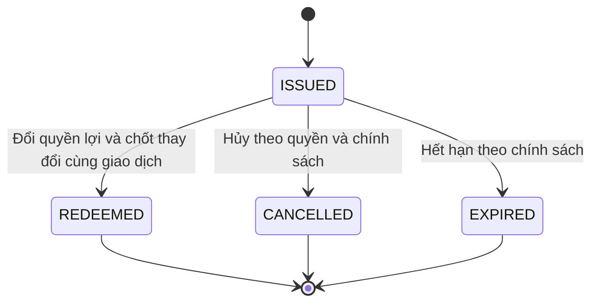

# Duplicate redemption race — ngăn đổi cùng một quyền lợi nhiều lần

Một voucher chỉ được dùng một lần vẫn có thể giảm giá cho hai đơn hàng nếu hai request cùng đọc được trạng thái “chưa sử dụng” trước khi một request kịp đánh dấu đã dùng. Cả hai request có thể được xác thực đúng, thuộc cùng một khách hàng hợp lệ và đi qua mọi kiểm tra định dạng. Lỗ hổng nằm ở cách ứng dụng phối hợp quyết định và thay đổi trạng thái khi xử lý đồng thời.

Trong chương **Race Conditions**, bài học này tập trung vào duplicate redemption race: cuộc đua khiến cùng một quyền lợi bị đổi hoặc sử dụng nhiều lần trái chính sách. Ví dụ dùng voucher giảm giá một lần, nhưng cách phân tích cũng áp dụng cho điểm thưởng, quà tặng, vé, mã nhận ưu đãi và quyền nhận thưởng.

Mục tiêu là bảo vệ invariant nghiệp vụ bằng state machine, quyền theo đối tượng, transaction, điều kiện cập nhật và idempotency. Hạn chế tốc độ request có thể hỗ trợ vận hành, nhưng không thay thế quy tắc “không được phát sinh quyền lợi thứ hai”.

## 1. Xác định chính xác cái gì chỉ được đổi một lần

Không phải mọi mã khuyến mãi đều có cùng ý nghĩa. Trước khi chọn khóa hoặc ràng buộc duy nhất, phải xác định đơn vị quyền lợi.

| Mô hình | Đơn vị cần chống sử dụng trùng |
|---|---|
| Voucher cá nhân dùng đúng một lần | Một `voucher_instance_id` đã cấp cho người nhận |
| Mã chiến dịch dùng một lần cho mỗi khách hàng | Cặp chiến dịch và người hưởng theo phạm vi tenant |
| Mã dùng tối đa N lần trên toàn chiến dịch | Bộ đếm hoặc ngân sách cấp quyền chung của chiến dịch |
| Một quyền lợi cho mỗi đơn hàng | Đơn hàng và loại quyền lợi theo chính sách |
| Mã dùng lại được nhưng mỗi lượt cấp là một quyền riêng | Từng entitlement hoặc lượt cấp có danh tính riêng |

Một chuỗi như `WELCOME` có thể được nhiều người sử dụng hợp lệ. Đặt unique toàn cục trên chuỗi đó sẽ làm sai nghiệp vụ. Ngược lại, chỉ đặt unique trên request ID không ngăn một voucher cá nhân bị dùng bằng hai request ID khác nhau.

### Mô hình dùng trong bài học

Giả sử hệ thống cấp cho Lan một voucher cá nhân trị giá tối đa 100.000 VND, dùng một lần cho đơn hàng đủ điều kiện. Mỗi đơn hàng trong ví dụ được dùng tối đa một voucher loại này.

```text
VoucherInstance
  id
  tenant_id
  beneficiary_id
  campaign_id
  state                 // ISSUED, REDEEMED, CANCELLED, EXPIRED
  valid_from
  expires_at
  value
  currency
  redeemed_order_id
  version

Redemption
  id
  tenant_id
  voucher_instance_id
  beneficiary_id
  actor_id
  order_id
  order_revision
  discount_amount
  currency
  committed_at
```

`beneficiary_id` là người hưởng quyền lợi; `actor_id` là người thực hiện lệnh. Hai giá trị có thể khác nhau nếu hệ thống cho phép thao tác thay mặt, nhưng việc đó phải được phân quyền rõ ràng. Máy chủ không chấp nhận một `beneficiary_id` tùy ý từ payload làm bằng chứng được sử dụng voucher.

Chuỗi mã người dùng nhập cần được ánh xạ sang đúng quyền lợi có thẩm quyền trong tenant. Nếu hỗ trợ chuẩn hóa hoa thường hoặc khoảng trắng, dùng cùng quy tắc cho tra cứu, nhận diện quyền lợi và fingerprint của request. Không để hai biểu diễn của một mã trở thành hai quyền lợi khác nhau trong các lớp xử lý.

## 2. Cuộc đua “kiểm tra rồi sử dụng”

Lan có hai đơn nháp O-101 và O-102. Hai request A và B cùng dùng voucher V-01, với hai khóa idempotency khác nhau.

```text
Ban đầu: V-01 = ISSUED

A đọc V-01: chưa dùng
B đọc V-01: chưa dùng

A kiểm tra O-101 đủ điều kiện và giảm 100.000 VND
B kiểm tra O-102 đủ điều kiện và giảm 100.000 VND

A ghi V-01 = REDEEMED
B ghi V-01 = REDEEMED

Cuối cùng:
  Voucher trông như đã dùng đúng một lần nếu chỉ nhìn trạng thái.
  Hai đơn hàng lại cùng nhận quyền lợi tổng cộng 200.000 VND.
```

Việc cả hai lần ghi cuối cùng đều đặt cùng giá trị `REDEEMED` không làm cho kết quả an toàn. Trạng thái cuối của voucher che mất việc đã có hai tác dụng nghiệp vụ.

Mẫu xử lý dễ bị lỗi:

```java
Voucher voucher = vouchers.find(tenantId, voucherId);
if (voucher.state() != ISSUED) {
    throw new VoucherUnavailableException();
}

orders.applyDiscount(orderId, voucher.value());
vouchers.markRedeemed(voucherId, orderId);
```

Thêm transaction nhưng không có cơ chế điều phối phù hợp chưa chắc ngăn được cuộc đua. Hành vi còn phụ thuộc mức cô lập, câu đọc, câu ghi và ràng buộc dữ liệu thực tế. Không mặc định mọi cơ sở dữ liệu đều tự biến chuỗi “đọc rồi ghi” thành một quyết định độc quyền.

Đổi thứ tự thành “đánh dấu dùng rồi giảm giá” cũng chưa đủ nếu hai thao tác commit riêng. Nếu thao tác giảm giá lỗi, voucher có thể bị tiêu thụ mà khách hàng chưa nhận được quyền lợi.

## 3. Invariants cần được kiểm chứng ở kết quả commit

Với mô hình voucher một lần, có thể định nghĩa:

```text
Số redemption đã commit cho một voucher_instance <= 1.

Mỗi redemption đã commit phải:
  thuộc đúng tenant và người hưởng hợp lệ,
  gắn với đúng đơn hàng và revision được chấp nhận,
  có mức giảm được máy chủ tính đúng,
  đi cùng thay đổi đơn hàng và trạng thái voucher trong cùng đơn vị commit.

Một voucher REDEEMED không được trở lại ISSUED
chỉ vì request hoặc callback được gửi lại.
```

Trong ví dụ còn có invariant mỗi đơn dùng tối đa một voucher loại này. Đây là ràng buộc độc lập với việc mỗi voucher chỉ dùng một lần.

Kiểm tra tổng quyền lợi đã cấp quan trọng hơn chỉ kiểm tra số response thành công. Hai response thành công có thể cùng trả một kết quả cũ hợp lệ khi idempotency hoạt động. Điều phải tránh là có hai lần giảm giá hoặc hai redemption nghiệp vụ cho cùng một quyền lợi.

### Tách xem trước và tiêu thụ quyền lợi

Một màn hình kiểm tra mã hoặc tính giá dự kiến không nên được coi là đã redeem. Preview có thể cho biết voucher đang có khả năng áp dụng, nhưng không bảo đảm nó còn khả dụng lúc chốt đơn.

Lệnh chốt phải kiểm tra lại quyền, điều kiện đơn hàng, thời hạn và trạng thái voucher tại điểm quyết định có thẩm quyền. Nếu preview có giữ chỗ thật, phải mô hình hóa reservation rõ ràng thay vì âm thầm giữ quyền lợi bằng một cờ trong session.

## 4. State machine cho redemption trực tiếp

Nếu voucher, đơn hàng và redemption cùng nằm trong một cơ sở dữ liệu, có thể thực hiện trực tiếp trong một transaction:



Trong mô hình này, trạng thái `REDEEMED` được commit cùng redemption và thay đổi đơn hàng. Bên ngoài không được thấy một bước commit trung gian chỉ mới đánh dấu voucher mà chưa áp dụng quyền lợi.

### Quy tắc chuyển trạng thái

| Chuyển tiếp | Điều kiện chính |
|---|---|
| `ISSUED → REDEEMED` | Đúng actor, tenant, người hưởng, đơn hàng, thời hạn và chính sách; quyền lợi còn khả dụng |
| `ISSUED → CANCELLED` | Người hoặc dịch vụ có quyền hủy; phối hợp với luồng redeem đồng thời |
| `ISSUED → EXPIRED` | Đúng điều kiện thời gian và trạng thái nguồn |
| `REDEEMED → ISSUED` | Không có trong mô hình mặc định của bài học |

Nếu hoàn tiền hoặc hủy đơn cho phép cấp lại quyền lợi, hãy định nghĩa lệnh và lịch sử riêng. Có thể cấp một voucher thay thế mang danh tính mới. Không đơn giản đặt lại trạng thái cũ rồi xóa lịch sử redemption, vì callback cũ hoặc request đang retry có thể tác động đến một quyền lợi đã được tái sử dụng.

Job đánh dấu hết hạn không phải căn cứ duy nhất kiểm soát thời hạn. Voucher có thể vẫn mang trạng thái `ISSUED` vì job chưa chạy; lệnh redeem vẫn phải kiểm tra thời gian.

## 5. Conditional update tạo một điểm tranh quyền rõ ràng

Một cách chống hai request cùng tiêu thụ voucher là chỉ cập nhật khi trạng thái nguồn và những điều kiện quan trọng vẫn khớp:

```sql
UPDATE voucher_instance
SET state = 'REDEEMED',
    redeemed_order_id = :order_id,
    version = version + 1
WHERE tenant_id = :tenant_id
  AND id = :voucher_instance_id
  AND beneficiary_id = :beneficiary_id
  AND state = 'ISSUED'
  AND version = :expected_version
  AND valid_from <= :decision_time
  AND expires_at > :decision_time;
```

Các giá trị được truyền bằng tham số. Tenant, người hưởng và thời điểm quyết định được máy chủ xác định từ ngữ cảnh hợp lệ, không lấy nguyên trạng từ các trường khách tùy ý gửi.

Với hai request cùng nhắm một voucher, chỉ request thỏa điều kiện tại điểm ghi được tiếp tục. Request còn lại không được bỏ điều kiện trạng thái hoặc phiên bản để thử lại bằng một UPDATE rộng hơn.

Ứng dụng phải xác nhận số hàng bị ảnh hưởng:

- Đúng 1 hàng: đã giành quyền chuyển tiếp trong giao dịch hiện tại.
- 0 hàng: voucher không còn phù hợp mọi điều kiện; không áp dụng quyền lợi mới.
- Nhiều hơn 1 hàng khi chỉ nhắm một voucher: lỗi truy vấn hoặc ràng buộc; rollback.

Một UPDATE thành công chưa đủ để báo thành công cho người dùng. Nếu bước ghi redemption hoặc đơn hàng sau đó lỗi, transaction phải rollback cả chuyển trạng thái voucher.

### Thời điểm hết hạn cần có ngữ nghĩa cụ thể

Ví dụ trong bài chọn chính sách: voucher phải còn hiệu lực tại điểm ra quyết định redeem sau khi đã lấy các khóa cần thiết. Transaction có thể commit sau thời điểm đó một khoảng ngắn.

Nếu request phải chờ khóa lâu, không dùng một timestamp cũ lấy trước khi chờ làm bằng chứng voucher còn hạn. Chọn nguồn thời gian có thẩm quyền và hiểu ngữ nghĩa của hàm thời gian trong engine đang dùng; không mặc định mọi hàm `now` đều trả thời gian mới của từng câu lệnh.

Request đến trước hạn nhưng chưa giành được quyền redeem không tự có quyền vượt hạn. Mốc hiệu lực phải được xác định theo hợp đồng sản phẩm, không theo timestamp do khách khai báo.

## 6. Ràng buộc duy nhất bảo vệ danh tính quyền lợi

Trạng thái voucher và conditional update nên đi cùng ràng buộc dữ liệu thể hiện đúng invariant:

```sql
UNIQUE (tenant_id, voucher_instance_id)
```

Đặt ràng buộc trên bảng redemption cho mô hình một voucher dùng một lần. Các cột khóa nghiệp vụ bắt buộc phải có giá trị; không để một nhánh ghi bỏ trống định danh quyền lợi rồi né ràng buộc.

Với chính sách một voucher loại này trên mỗi đơn trong ví dụ, có thêm:

```sql
UNIQUE (tenant_id, order_id)
```

Nếu sản phẩm hỗ trợ cộng dồn nhiều loại quyền lợi, phải thay khóa theo đúng phạm vi chính sách. Không giữ một ràng buộc ngăn cả các tổ hợp được phép chỉ vì nó dễ triển khai.

### Vì sao cần cả trạng thái và ledger?

- Trạng thái cho biết quyền lợi hiện có thể được dùng hay không.
- Conditional update phối hợp các request tranh cùng chuyển tiếp.
- Redemption là bằng chứng nghiệp vụ về lần đã đổi, gắn với người hưởng và đơn hàng.
- Unique constraint ngăn một đường ghi khác vô tình tạo thêm redemption cho cùng quyền lợi.

Không chỉ truy vấn `SELECT count(*)` để kiểm tra chưa có redemption rồi mới insert. Hai giao dịch có thể cùng thấy số 0. Việc chấp nhận bản ghi phải được bảo vệ tại điểm ghi bằng ràng buộc và transaction thích hợp.

Nếu gặp lỗi unique sau khi đã cập nhật voucher hoặc đơn hàng, phải rollback đơn vị giao dịch tương ứng. Không bỏ qua lỗi insert rồi vẫn commit các tác dụng đã thực hiện. Tương tự, `ON CONFLICT DO NOTHING` không tự biến toàn bộ quy trình thành an toàn nếu ứng dụng không kiểm tra kết quả và vẫn áp dụng giảm giá.

## 7. Idempotency key không thay thế khóa nghiệp vụ

Idempotency giúp nhận diện việc gửi lại **cùng một lệnh**. Ràng buộc redemption bảo vệ **cùng một quyền lợi** trước cả những lệnh khác nhau.

```text
Request A: key = K-A, voucher = V-01, order = O-101
Request B: key = K-B, voucher = V-01, order = O-102
```

Hai request có khóa khác nhau nên cơ chế dedup theo request không coi chúng là bản sao. Tuy vậy, cả hai cùng tranh quyền lợi V-01 và chỉ một request được tiêu thụ nó.

| Tình huống | Cơ chế cần có |
|---|---|
| Gửi lại cùng lệnh vì mất response | Idempotency và receipt của lệnh |
| Cùng voucher nhưng hai khóa idempotency khác nhau | State machine, conditional update hoặc khóa và unique nghiệp vụ |
| Hai voucher khác nhau trên một đơn chỉ cho phép một voucher | Khóa hoặc phiên bản đơn và ràng buộc đúng phạm vi đơn |
| Nhiều voucher cùng tranh ngân sách chiến dịch | Điều phối hạn mức chung trong giao dịch phù hợp |
| Sự kiện cấp quyền lợi được giao lại | Idempotency tại bên thực hiện tác dụng phụ |

### Phạm vi receipt của request

Một khóa duy nhất có thể có dạng:

```text
(tenant_id, actor_id, operation, idempotency_key)
```

Receipt lưu fingerprint của payload và kết quả lệnh đã commit. Fingerprint cần phản ánh các đầu vào có ý nghĩa như voucher, đơn hàng, revision đơn mà khách chấp nhận và loại thao tác.

Không đưa các giá trị hiện hành có thể đổi sau commit vào fingerprint thay cho đầu vào lệnh. Ví dụ, nếu fingerprint được tính từ revision đơn mới đọc ở mỗi lần retry, cùng request gốc có thể bị coi là payload khác chỉ vì lần đầu đã cập nhật đơn.

Cùng khóa nhưng khác payload phải báo xung đột. Khóa của actor hoặc tenant khác không được dùng để đọc kết quả của họ.

Claim lệnh, cập nhật nghiệp vụ và lưu receipt thành công cần được phối hợp nguyên tử. Chỉ “kiểm tra chưa có key, làm việc, rồi lưu key” vẫn tạo một cuộc đua trên chính cơ chế idempotency.

## 8. Ví dụ Java: redeem nguyên tử trong một cơ sở dữ liệu

Đoạn sau là mã minh họa kiến trúc, không phải chương trình độc lập. Transaction, repository và policy là abstraction của ứng dụng, không mô tả API của framework cụ thể.

Ví dụ khóa đơn hàng rồi khóa voucher theo một thứ tự thống nhất, lấy thời điểm quyết định sau khi có khóa, và dùng UPDATE có điều kiện như lớp bảo vệ tại điểm ghi. Tính đúng đắn yêu cầu mọi luồng liên quan tuân theo cùng giao thức.

```java
RedeemResult redeem(AuthenticatedContext requestContext,
                    RedeemCommand command) {
    commandRules.requireValidShape(command);
    String fingerprint = fingerprints.ofCanonicalCommand(command);

    return tx.required(() -> {
        AuthContext auth = authority.loadCurrentUnderProtocol(requestContext);
        policy.requireRedemptionFeature(auth);

        ReceiptClaim attempt = receipts.claimOrReplay(
            auth.tenantId(), auth.actorId(), Operation.REDEEM_VOUCHER,
            command.idempotencyKey(), fingerprint);

        if (attempt.isReplay()) {
            policy.requireReadResult(auth, attempt.result());
            return attempt.result();
        }

        Order order = orders.lockInTenant(auth.tenantId(), command.orderId())
            .orElseThrow(ResourceUnavailableException::new);
        VoucherInstance voucher = vouchers.lockInTenant(
            auth.tenantId(), command.voucherId())
            .orElseThrow(ResourceUnavailableException::new);

        policy.requireRedeemPermission(auth, voucher, order);
        orderRules.requireExpectedRevision(order, command.expectedOrderRevision());
        orderRules.requireRedeemableState(order);

        Instant decisionTime = decisionClock.nowAfterLocks();
        voucherRules.requireEligible(voucher, order, decisionTime);
        Money discount = pricing.computeAllowedDiscount(voucher, order);
        orderRules.requireValidTotalAfterDiscount(order, discount);

        int claimed = vouchers.redeemIfIssued(
            auth.tenantId(), voucher.id(), voucher.beneficiaryId(),
            voucher.version(), order.id(), decisionTime);
        if (claimed != 1) {
            throw new RedemptionConflictException();
        }

        Redemption redemption = redemptions.insert(
            auth, voucher, order, discount, decisionTime);
        int changed = orders.applyDiscountIfUnchanged(
            auth.tenantId(), order.id(), order.version(),
            redemption.id(), discount);
        if (changed != 1) {
            throw new OrderConflictException();
        }

        audit.recordRedemption(auth, redemption);
        outbox.appendVoucherRedeemed(auth.tenantId(), redemption.id());
        RedeemResult result = RedeemResult.committed(redemption.id(), order.id());
        attempt.complete(result);
        return result;
    });
}
```

### Hợp đồng bắt buộc phía sau ví dụ

- `requestContext` đến từ xác thực tin cậy. Tenant, actor và quyền thao tác thay mặt không được lấy tùy ý từ payload.
- `claimOrReplay` điều phối cùng khóa request bằng ràng buộc và cơ chế giao dịch mà engine hỗ trợ. Không bắt một lỗi unique rồi tiếp tục trong transaction đã không còn hợp lệ.
- Nhánh replay kiểm tra quyền xem kết quả hiện hành rồi trả receipt cũ. Nó không cố redeem lại, cũng không yêu cầu voucher vẫn ở trạng thái chưa dùng.
- Các truy vấn khóa giới hạn tenant ngay tại nguồn và dùng dữ liệu có thẩm quyền. Mọi luồng redeem, hủy đơn, hủy voucher và cấp lại quyền lợi phải dùng thứ tự khóa tương thích.
- `requireRedeemPermission` kiểm tra cả quyền trên voucher, người hưởng và đơn hàng. Được sửa đơn không tự cấp quyền dùng voucher của người khác.
- Những dữ liệu tính điều kiện đơn và mức giảm phải thuộc revision được bảo vệ. Nếu dòng hàng được sửa độc lập mà không cập nhật revision hoặc không tham gia giao thức, khóa hàng cha chưa đủ.
- `computeAllowedDiscount` tính từ dữ liệu máy chủ, kiểm tra loại tiền, mức tối thiểu và giới hạn chính sách; không tin số tiền giảm hoặc giá đơn do khách tự khai báo.
- Mọi thay đổi trong ví dụ, gồm receipt thành công, audit và outbox, nằm trong cùng giao dịch cơ sở dữ liệu. Ngoại lệ phải rollback toàn bộ.
- `loadCurrentUnderProtocol` phải đáp ứng hợp đồng hiệu lực quyền đã chọn. Phiên bản voucher không tự phát hiện thay đổi membership hoặc ACL ở nơi khác.

Kết quả chỉ được trả thành công khi transaction đã commit. Một outbox đã ghi trong transaction chưa có nghĩa thông điệp đã được xử lý ở nơi khác.

Khóa và phiên bản được dùng cùng nhau trong ví dụ để làm rõ điểm quyết định và điều kiện ghi. Có thể chọn thiết kế khác ít khóa hơn nếu vẫn chứng minh được tất cả invariants, thời hạn và điều kiện liên quan; không chỉ xóa khóa để giảm thời gian chờ.

## 9. Ngân sách và điều kiện chung cũng có thể bị tranh

Ngăn một voucher dùng hai lần chưa bảo vệ được toàn bộ chiến dịch. Hai voucher khác nhau có thể cùng tranh một suất cuối hoặc phần ngân sách còn lại.

Ví dụ, chiến dịch chỉ còn 100.000 VND ngân sách, hai voucher khác nhau đều đủ điều kiện giảm 80.000 VND. Mỗi voucher chỉ được dùng một lần, nhưng tổng quyền lợi vẫn có thể vượt ngân sách nếu cả hai đọc cùng số dư cũ.

Một phương án là cấp phần ngân sách bằng cập nhật nguyên tử có điều kiện trên bản ghi điều phối chung, cùng transaction với redemption:

```sql
UPDATE campaign_budget
SET remaining_amount = remaining_amount - :discount_amount,
    version = version + 1
WHERE tenant_id = :tenant_id
  AND campaign_id = :campaign_id
  AND remaining_amount >= :discount_amount;
```

Số tiền phải hợp lệ, không âm, đúng loại tiền và đơn vị kế toán; câu lệnh cũng phải được kiểm tra số hàng ảnh hưởng. Nếu không đủ ngân sách, rollback cả việc tiêu thụ voucher và sửa đơn theo mô hình transaction đã chọn.

Nếu policy giới hạn một lượt cho mỗi khách trong chiến dịch, cần ràng buộc hoặc điểm điều phối theo người hưởng. Nếu giới hạn N lượt, một unique đơn giản có thể không diễn đạt đủ. Không dùng `COUNT` rồi quyết định ngoài giao thức đồng thời.

Khi phải khóa nhiều tài nguyên như đơn, voucher, ngân sách và hạn mức khách hàng, định nghĩa thứ tự thống nhất cho mọi đường đi. Retry deadlock phải bắt đầu lại đơn vị giao dịch với việc đọc và đánh giá mới.

## 10. Khi redemption cần dịch vụ bên ngoài

Transaction ở cơ sở dữ liệu không bao trùm một cổng phát quà hoặc hệ thống điểm thưởng độc lập. Không nên giữ transaction DB mở trong lúc chờ một cuộc gọi mạng rồi mặc định cả hai bên sẽ cùng rollback khi có lỗi.

Có thể cần vòng đời có giữ chỗ:

```text
ISSUED -> RESERVED -> REDEEMED
              |
              +-> ISSUED, chỉ khi đã xác minh có thể giải phóng an toàn
```

Reservation cần có danh tính riêng:

```text
reservation_id
voucher_instance_id
tenant_id
order_id
generation
state
expires_at
external_operation_id
```

`generation` là số thế hệ tăng để phân biệt lần giữ chỗ mới với lần cũ. Mọi confirm hoặc release phải khớp voucher, reservation, thế hệ, đơn hàng và trạng thái nguồn hiện hành. Một callback cũ không được hoàn tất hoặc giải phóng reservation mới.

### TTL không đủ để kết luận được phép cấp lại

Xét tình huống:

```text
1. Reservation R1 gửi yêu cầu phát quyền lợi ra ngoài.
2. Request timeout; không biết bên ngoài đã phát hay chưa.
3. R1 hết TTL, hệ thống trả voucher về ISSUED.
4. Request mới tạo R2 và đổi thành công.
5. Bên ngoài xác nhận R1 thực ra cũng đã phát quyền lợi.
```

Kết quả là hai quyền lợi dù mọi cập nhật nội bộ có thể đã kiểm tra thế hệ đúng. Chặn callback cũ ở bước 5 không thu hồi được quà đã được phát ở bên ngoài.

Chỉ giải phóng khi có căn cứ an toàn, chẳng hạn thao tác bên ngoài chắc chắn chưa thực hiện và không còn có thể thực hiện muộn, hoặc đã được hủy theo hợp đồng được bảo đảm. Nếu trạng thái chưa rõ, tiếp tục giữ quyền lợi và đối soát theo một trạng thái chờ xác minh.

Token thế hệ chỉ ngăn tác dụng muộn ở nơi thực sự kiểm tra token đó. Nó không tự ràng buộc một nhà cung cấp không hiểu hoặc không thực thi cơ chế này.

### Phối hợp bằng danh tính thao tác ổn định

Nếu bên ngoài hỗ trợ idempotency, dùng định danh ổn định cho cùng một thao tác và có khả năng tra cứu kết quả. Không tạo operation ID mới ở mỗi lần retry rồi vô tình yêu cầu phát quà thêm lần nữa.

Outbox giúp không mất ý định gửi sau commit, nhưng bên nhận vẫn có thể nhận cùng sự kiện nhiều lần. Cần ràng buộc chống lặp theo redemption hoặc effect ID ở nơi thực sự tạo điểm, quà hoặc quyền lợi.

Nếu không có khả năng tra cứu, dedup hoặc hủy đáng tin ở bên ngoài, ứng dụng không thể chỉ dựa vào khóa nội bộ để khẳng định mọi tác dụng bên ngoài xảy ra đúng một lần. Cần chọn quy trình thận trọng như giữ reservation, đối soát hoặc xử lý thủ công theo chính sách.

## 11. Retry, hủy đơn và các kết quả đến muộn

| Điểm xảy ra lỗi | Cách xử lý theo mô hình |
|---|---|
| Lỗi trước khi transaction commit | Rollback voucher, đơn, redemption và receipt chưa hoàn tất; đánh giá lại khi retry |
| Commit thành công nhưng mất response | Dùng cùng khóa request để trả kết quả cũ sau kiểm tra quyền |
| Cùng voucher nhưng request mới khác khóa | Kiểm tra trạng thái và ràng buộc nghiệp vụ; không cấp thêm quyền lợi |
| Lỗi unique hoặc cập nhật 0 hàng | Không tiếp tục áp dụng tác dụng khác trong transaction lỗi |
| Outbox được gửi lại | Bên nhận chống lặp theo định danh tác dụng |
| Dịch vụ ngoài timeout, chưa rõ kết quả | Giữ trạng thái chờ và đối soát; không tự giải phóng chỉ vì timeout |
| Callback của reservation cũ | Không thay đổi reservation mới; đồng thời kiểm tra tác dụng bên ngoài đã xảy ra hay chưa |

### Hủy đơn không được làm mất dấu redemption

Hủy O-101 có thể cần hoàn một phần hoặc cấp lại quyền lợi theo chính sách. Không xóa redemption rồi coi voucher chưa từng được dùng.

Lệnh hủy và lệnh redeem đồng thời phải có thứ tự hiệu lực rõ ràng. Nếu redeem thắng trước, hủy xử lý trạng thái đã redeem theo quy trình hoàn. Nếu hủy thắng trước, redeem thấy đơn không còn phù hợp và không được áp dụng giảm giá.

Nếu tạo voucher thay thế, việc cấp lại cũng cần idempotency theo nguồn hủy hoặc redemption gốc. Hai callback hoàn tiền không được tạo hai voucher mới.

### Chỉ retry khi ý nghĩa lệnh còn hợp lệ

Một lệnh có thể ràng buộc vào revision đơn, giá hoặc điều kiện mà khách đã xác nhận. Không tự đọc revision mới rồi sửa lệnh để làm nó thành công sau xung đột. Hãy yêu cầu quy trình xác nhận lại nếu hợp đồng nghiệp vụ cần.

Lỗi phân quyền, voucher hết hạn hoặc đơn không đủ điều kiện không phải lỗi tạm thời để retry vô hạn. Giới hạn thời gian, số lần và nhịp retry cho các xung đột thực sự có thể phục hồi.

## 12. Phản hồi và audit phải phân biệt kết quả cũ với tác dụng mới

Một request gửi lại cùng khóa có thể nhận thành công vì quyền lợi đã được áp dụng ở lần đầu. Điều đó khác với việc hệ thống vừa áp dụng thêm một lần.

Phản hồi nên có redemption ID ổn định và liên kết với đơn hàng được phép xem. Không gửi toàn bộ thông tin người hưởng hoặc đơn hàng khác chỉ để giải thích voucher đã dùng ở đâu.

Đối với voucher không thuộc phạm vi truy cập, lỗi nên tránh xác nhận ai sở hữu mã hoặc mã đã dùng cho đơn nào. Mã không tồn tại, hết hiệu lực hoặc không được phép dùng có thể được nhóm theo chính sách phản hồi an toàn.

Audit phục vụ điều tra nên ghi:

- Tenant, actor và người hưởng quyền lợi theo ngữ cảnh đã xác thực.
- Voucher instance, chiến dịch, đơn hàng và revision liên quan.
- Redemption ID, reservation ID hoặc external operation ID nếu có.
- Trạng thái nguồn, trạng thái đích, thời điểm quyết định và kết quả commit.
- Request receipt và fingerprint hoặc định danh đối chiếu phù hợp.
- Lý do từ chối, xung đột, replay hoặc chờ đối soát.

Không ghi mã voucher bí mật nguyên văn, token hoặc dữ liệu thanh toán không cần thiết vào log thường. Hạn chế quyền đọc log có khả năng nối người hưởng với lịch sử đơn hàng.

Audit thành công có thể đi cùng transaction nghiệp vụ. Dấu vết lần thử bị từ chối cần đường lưu thích hợp nếu transaction đã rollback. Chỉ số nhiều request trên cùng voucher giúp phát hiện hành vi bất thường, nhưng cảnh báo và rate limit không phải căn cứ duy nhất ngăn sử dụng trùng.

## 13. Kiểm thử cuộc đua bằng lịch thực thi có điều khiển

Các bài kiểm thử phải xác nhận dữ liệu và tác dụng cuối cùng, không chỉ số mã HTTP thành công. Dùng các kết nối hoặc transaction độc lập, tránh để framework kiểm thử vô tình gói mọi thao tác trong một transaction chung.

### Hai khóa khác nhau, cùng một voucher

```text
Chuẩn bị:
  V-01 đang ISSUED, thuộc người hưởng hợp lệ và còn hạn.
  O-101, O-102 đều đủ điều kiện riêng lẻ.

1. Chuẩn bị A dùng V-01 cho O-101 với K-A.
2. Chuẩn bị B dùng V-01 cho O-102 với K-B.
3. Đồng bộ trước điểm tranh tài nguyên, rồi cho cả hai tiếp tục.
4. Chờ hai transaction kết thúc.

Kỳ vọng:
  Chỉ một redemption đã commit cho V-01.
  Chỉ một đơn nhận mức giảm tương ứng.
  Voucher liên kết đúng đơn thắng.
  Không có sự kiện hoặc lợi ích thứ hai từ request thua.
```

Với thiết kế khóa bi quan, không đặt barrier yêu cầu cả hai request đều đã giữ cùng khóa độc quyền rồi mới cho đi tiếp: đó là lịch không thể xảy ra và có thể làm bài kiểm thử treo. Đặt điểm đồng bộ trước khóa hoặc điều khiển rõ một request giữ khóa trong khi request kia chờ.

### Cùng khóa và mất response

Cho A commit thành công rồi mô phỏng mất response. Gửi lại đúng lệnh với cùng khóa. Kỳ vọng kết quả trỏ đến cùng redemption ID, không thêm dòng giảm giá và không trừ ngân sách lần hai. Thử thêm lần gọi sau thời hạn voucher để xác nhận hệ thống trả receipt cũ theo quyền, thay vì cố redeem mới.

### Ma trận kiểm thử bổ sung

| Tình huống | Bằng chứng cần xác nhận |
|---|---|
| Cùng khóa, khác voucher hoặc đơn hàng | Xung đột payload; không áp dụng nội dung mới |
| Hai voucher khác nhau cho một đơn chỉ cho phép một voucher | Không cộng dồn trái policy |
| Voucher cùng chuỗi mã nhưng khác mô hình cấp quyền | Khóa nghiệp vụ phản ánh đúng entitlement, không trộn quyền |
| Actor hợp lệ nhưng voucher thuộc tenant hoặc người hưởng khác | Không redeem và không tiết lộ thông tin ngoài quyền |
| Hai voucher tranh ngân sách cuối | Tổng đã cấp không vượt ngân sách |
| Voucher hết hạn khi request đang chờ khóa | Kết quả đúng mốc thời gian đã công bố, không dùng timestamp cũ để lách hạn |
| Hủy đơn hoặc hủy voucher chạy cùng redeem | Chỉ tồn tại kết quả phù hợp thứ tự hiệu lực |
| Cập nhật voucher thành công nhưng insert redemption lỗi | Không còn thay đổi đơn hoặc voucher sau rollback |
| Bỏ qua lỗi unique hoặc số hàng ảnh hưởng bằng 0 | Kiểm thử phát hiện mọi tác dụng vẫn bị rollback |
| Sự kiện outbox giao lại nhiều lần | Bên nhận chỉ tạo một tác dụng cho cùng effect ID |
| Reservation hết hạn nhưng bên ngoài chưa rõ kết quả | Không giải phóng thành quyền lợi mới một cách thiếu căn cứ |
| Callback confirm hoặc release của generation cũ | Không tác động reservation mới; có đối soát tác dụng bên ngoài |
| Hai callback hoàn cùng redemption | Không cấp hai voucher thay thế |
| Request retry sau khi quyền người dùng bị thu hồi | Không cấp quyền mới hoặc đọc lộ receipt ngoài phạm vi hiện hành |

Các thuộc tính hữu ích để mở rộng kiểm thử:

- Với mọi voucher một lần, có tối đa một redemption nghiệp vụ đã commit.
- Không có giảm giá đã commit mà thiếu redemption tương ứng, và ngược lại trong mô hình transaction trực tiếp.
- Tổng quyền lợi thực tế phải khớp những redemption được chấp nhận, không phụ thuộc số lần request hoặc sự kiện được giao.
- Callback cũ không thể phục hồi hoặc tiêu thụ một thế hệ quyền lợi mới.
- Mọi đường ghi, kể cả import, worker và công cụ quản trị, cùng duy trì các invariants này.

## 14. Checklist thiết kế

- Đơn vị một lần là voucher cá nhân, chiến dịch–khách hàng, đơn hàng hay một lượt cấp có danh tính riêng?
- Điểm nào thực sự quyết định một request được tiêu thụ quyền lợi?
- Kiểm tra trạng thái, thời hạn và phiên bản có nằm trong giao thức ghi an toàn không?
- Có unique nghiệp vụ độc lập với idempotency key không?
- Voucher, redemption, đơn hàng và ngân sách có commit hoặc rollback nhất quán không?
- Nhánh replay có trả kết quả cũ theo quyền mà không thực hiện lại không?
- Preview có bị nhầm với tiêu thụ hoặc reservation thật không?
- Timeout bên ngoài có dẫn đến giải phóng quyền lợi khi chưa biết kết quả không?
- Confirm, release, hủy và cấp lại có gắn đúng reservation, thế hệ và nguồn nghiệp vụ không?
- Kiểm thử có xác nhận số quyền lợi thực tế và lịch sử commit, thay vì chỉ nhìn trạng thái voucher không?

Ngăn duplicate redemption race đòi hỏi đặt giới hạn một lần ngay vào nơi chấp nhận quyền lợi. Khi danh tính quyền lợi, trạng thái, ràng buộc duy nhất, transaction và idempotency cùng phản ánh đúng chính sách, nhiều request hợp lệ chạy song song vẫn chỉ tạo ra số quyền lợi được phép.
