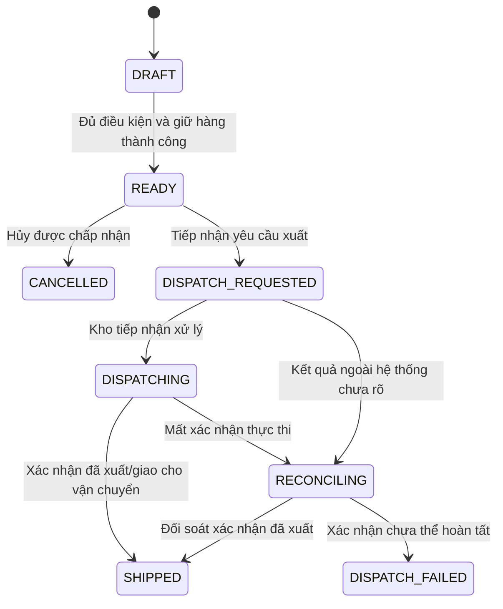

# Parallel state change race

## 1. Hai hành động hợp lệ riêng lẻ có thể tạo ra kết quả trái phép

Trong chương **Race Conditions** của module bảo vệ logic nghiệp vụ, *parallel state change race* là tình huống nhiều luồng cùng kiểm tra hoặc thay đổi trạng thái liên quan, khiến kết quả cuối cùng vi phạm quy tắc mà từng luồng tưởng rằng mình đã kiểm tra đúng.

Ví dụ, một đơn xuất kho đang ở `READY`. Khách hàng được hủy khi đơn chưa được tiếp nhận xuất; nhân viên kho được yêu cầu xuất khi đơn còn sẵn sàng. Hai hành động chạy đồng thời:

```text
Luồng A: đọc READY → chấp nhận hủy → hoàn lại phần giữ hàng.
Luồng B: đọc READY → chấp nhận xuất → gửi yêu cầu tới hệ thống kho.
```

Nếu cả hai đều hoàn tất, khách hàng có thể đã được hủy hoặc hoàn quyền lợi trong khi hàng vẫn được giao. Giá trị cuối của cột `state` có thể chỉ còn `CANCELLED`, nhưng hiệu ứng của luồng xuất kho đã thoát ra ngoài.

Đây là lỗ hổng nghiệp vụ dù cả hai người gọi đều có tài khoản hợp lệ. Vấn đề không chỉ là “ghi đè dữ liệu”; vấn đề là hai hành động loại trừ nhau cùng nhận được quyền tạo hiệu ứng.

Bài học tập trung vào invariant, state machine, transaction, quyền theo đối tượng, idempotency và kiểm thử các lịch chạy cạnh tranh. Các ví dụ dùng Java và database giao dịch ở mức minh họa, không phụ thuộc một framework cụ thể.

## 2. Phân biệt các lỗi đồng thời thường bị gom chung

| Hiện tượng | Ví dụ | Invariant cần bảo vệ |
|---|---|---|
| Lost update | Hai luồng lưu object cũ, bản lưu sau đè bản trước | Không mất thay đổi hợp lệ hoặc ghi đè trạng thái đã tiến xa hơn |
| Check-then-act | Hai luồng cùng thấy `READY`, đều thực hiện hành động | Chỉ hành động còn hợp lệ tại điểm phân xử được chấp nhận |
| TOCTOU | Quyền hoặc trạng thái đổi giữa lúc kiểm tra và lúc dùng | Dữ kiện kiểm tra phải còn hợp lệ trong ranh giới quyết định |
| Write skew | Hai request khác nhau cùng tiêu thụ một nguồn lực chung | Invariant chung không bị phá dù mỗi bản ghi riêng đều hợp lệ |
| ABA | Trạng thái đi từ `READY` sang trạng thái khác rồi về `READY` | Request cũ không được áp dụng vào một vòng đời mới chỉ vì tên trạng thái giống nhau |
| Callback đến muộn | Worker trả kết quả cho một tác vụ đã bị thay thế | Kết quả chỉ áp dụng cho đúng intent, phiên bản và vòng xử lý |

Một cơ chế có thể giải quyết một phần nhưng bỏ sót phần khác. Ví dụ, unique constraint cho idempotency key giúp chống gửi lại cùng command; nó không tự phân xử giữa một lệnh hủy và một lệnh xuất có hai key khác nhau.

## 3. Viết invariant và định nghĩa điểm phân xử

Với ví dụ đơn xuất kho, giả sử nghiệp vụ chọn quy tắc: từ cùng một trạng thái sẵn sàng và phiên bản, chỉ một nhánh hủy hoặc tiếp nhận xuất được chấp nhận.

| Mã | Invariant |
|---|---|
| R1 | Một đơn không được vừa chấp nhận hủy thông thường vừa chấp nhận xuất từ cùng một phiên bản `READY` |
| R2 | Mọi chuyển trạng thái phải đi theo cạnh hợp lệ và quyền phù hợp với đối tượng |
| R3 | Command cho phiên bản cũ không tự chuyển sang phiên bản mới |
| R4 | Trạng thái đơn, phần giữ hàng, kết quả command và intent/outbox liên quan phải commit nhất quán trong ranh giới đã chọn |
| R5 | Chỉ bên thắng quyết định mới được tạo intent tương ứng |
| R6 | Retry cùng ý định không tạo thêm hiệu ứng; command khác vẫn phải chịu điều kiện trạng thái |
| R7 | Worker cũ hoặc callback cũ không được ghi đè vòng xử lý hiện tại |
| R8 | Kết quả chưa rõ không được suy thành “chưa có hiệu ứng” để thực hiện lại mù quáng |
| R9 | Invariant trên tài nguyên chung vẫn đúng, kể cả khi các command nhắm tới hai đơn khác nhau |

### 3.1. Điểm quyết định phải có ý nghĩa thực tế

Có thể chọn transaction commit chuyển `READY → DISPATCH_REQUESTED` là điểm hệ thống chấp nhận yêu cầu xuất. Transaction commit chuyển `READY → CANCELLED` là điểm chấp nhận hủy thông thường.

Hai transaction phải được phân xử sao cho không thể cùng commit hai nhánh đó cho cùng phiên bản nguồn. Sau điểm chấp nhận xuất, hủy phải đi qua quy trình khác nếu nghiệp vụ cho phép; không ghi đè thẳng về `CANCELLED`.

“Request đến trước” cần được định nghĩa rõ nếu dùng trong yêu cầu sản phẩm. Người dùng bấm nút trước, HTTP đến proxy trước và transaction commit trước là ba thời điểm khác nhau. Nếu hệ thống dùng thứ tự phân xử tại database, phải mô tả kết quả theo thứ tự đó, không hứa ưu tiên theo thời điểm bấm nút mà kiến trúc không bảo đảm.

### 3.2. Trạng thái cuối chưa đủ chứng minh an toàn

Sau cuộc đua, chỉ kiểm tra `state IN ('CANCELLED', 'DISPATCH_REQUESTED')` chưa đủ. Cần kiểm tra cả lịch sử chuyển trạng thái, reservation, command receipt, intent và hiệu ứng bên ngoài.

Một trạng thái `CANCELLED` vẫn có thể che giấu một lệnh xuất đã gửi trước khi bị ghi đè. Quy tắc an toàn phải ngăn hoặc điều phối hiệu ứng, không chỉ chọn một nhãn cuối cùng.

## 4. Thiết kế state machine trước khi xử lý exception



Sơ đồ minh họa một phần vòng đời; việc sửa, thử lại hoặc yêu cầu dừng xuất cần các cạnh riêng theo nghiệp vụ. Không tạo đường tổng quát “mọi trạng thái → trạng thái client gửi”.

| Command | Trạng thái nguồn | Kết quả được chấp nhận | Điều kiện bổ sung |
|---|---|---|---|
| `CANCEL_READY_SHIPMENT` | `READY` | `CANCELLED` | Có quyền hủy; đúng phiên bản; chưa tiếp nhận xuất |
| `REQUEST_DISPATCH` | `READY` | `DISPATCH_REQUESTED` | Có quyền xuất; giữ hàng còn hợp lệ; đúng dữ liệu giao nhận |
| `CONFIRM_DISPATCH_ACCEPTED` | `DISPATCH_REQUESTED` | `DISPATCHING` | Kết quả từ nguồn tin cậy, đúng dispatch intent |
| `CONFIRM_SHIPPED` | Trạng thái chờ xác nhận phù hợp | `SHIPPED` | Đúng intent; kết quả đã được xác minh và chống lặp |
| `RECONCILE_DISPATCH` | `RECONCILING` | Kết quả theo bằng chứng | Không suy đoán từ timeout; có quyền/nguồn đối soát |

Các tên command giúp tách hành động và quyền rõ hơn một endpoint `PATCH /shipments/{id}` cho phép sửa trường `status` tùy ý.

## 5. Vì sao các cách bảo vệ đơn giản thường thất bại?

### 5.1. Kiểm tra rồi lưu một entity cũ

```java
// Ví dụ không an toàn khi thiếu cơ chế phân xử.
Shipment shipment = repository.find(id);
if (shipment.state() == READY) {
    warehouseClient.dispatch(shipment);
    shipment.setState(DISPATCH_REQUESTED);
    repository.save(shipment);
}
```

Luồng hủy có thể đổi trạng thái sau `find` nhưng trước `dispatch`. Lời gọi kho đã tạo hiệu ứng trước khi database quyết định bên nào được thắng. Một lần `save` thất bại phía sau không hoàn tác được lời gọi mạng.

### 5.2. Chỉ thêm `@Transactional`

Transaction có thể gom các thay đổi database thành một đơn vị commit, nhưng không mặc định làm mọi đoạn đọc-kiểm tra-ghi trở nên tuần tự. Cần cơ chế phân xử tương ứng với invariant và mức cô lập thực tế.

Hai transaction vẫn có thể cùng đọc một trạng thái cũ nếu không có khóa, cập nhật có điều kiện hoặc cơ chế tương đương. Lời gọi ngoài database cũng không tự rollback theo transaction Java.

### 5.3. Khóa trong bộ nhớ của một instance

`synchronized`, mutex hoặc map khóa trong một process chỉ điều phối các luồng đi qua đúng process đó. Instance khác, worker khác hoặc công cụ quản trị có thể không tham gia.

Cơ chế khóa phân tán cũng cần quy tắc hết hạn, chủ sở hữu và fencing phù hợp. Không thể coi việc “đã lấy một lock có TTL” là bảo đảm mọi nơi lưu dữ liệu sẽ từ chối worker cũ.

### 5.4. Chỉ tăng version lúc đổi tên trạng thái

Nếu địa chỉ giao hàng hoặc reservation bị sửa ở bảng con nhưng version nguồn không đổi, command cũ có thể vẫn vượt kiểm tra version. Phiên bản phải bao phủ những thay đổi ảnh hưởng tới ý nghĩa hoặc tiền điều kiện của hành động, hoặc các phụ thuộc đó phải có phiên bản/khóa riêng được kiểm tra.

## 6. Phương án A: khóa đối tượng rồi quyết định trong transaction

Một luồng dùng pessimistic locking có thể là:

1. Xác thực subject, tenant và command.
2. Bảo vệ dữ kiện quyền cần thiết theo cơ chế nhất quán của hệ thống.
3. Khóa shipment theo tenant và ID.
4. Nhận diện replay đã commit; không thực hiện lại hiệu ứng.
5. Với command mới, kiểm tra trạng thái nguồn, phiên bản và quyền theo đối tượng.
6. Khóa reservation và tài nguyên liên quan theo thứ tự thống nhất.
7. Kiểm tra invariant hiện hành, áp dụng chuyển trạng thái và thay đổi nội bộ.
8. Ghi command result, audit và outbox trong cùng transaction.
9. Commit rồi mới để worker thực hiện giao thức ngoài hệ thống.

Trong mô hình này, luồng thứ hai phải đợi bản ghi shipment. Khi có thể tiếp tục, nó đánh giá trạng thái đã được phân xử, thay vì dùng entity đã đọc từ trước.

Khóa cần được giữ trong transaction ngắn chứa quyết định và thay đổi, không phải trong thời gian gọi API kho hoặc chờ người dùng xác nhận. Các đường sửa/hủy/worker cập nhật cùng đối tượng phải tuân theo cơ chế và thứ tự khóa tương thích.

### 6.1. Quyền cũng có thể thay đổi đồng thời

Khóa shipment không tự khóa membership, ủy quyền hoặc policy. Nếu yêu cầu là thu hồi quyền đã commit phải chặn lần chấp nhận hành động tiếp theo, luồng đổi quyền và luồng hành động cần chung cơ chế phân xử thích hợp.

Có thể dùng guard quyền, khóa các dữ kiện liên quan hoặc một giao thức version có bảo đảm rõ. Guard chỉ đúng khi mọi đường thay đổi ảnh hưởng tới quyền đều tham gia; một kết quả role cũ lấy từ cache không trở thành quyền hiện hành chỉ vì shipment đã được khóa.

Không cho service account của worker tự mở rộng quyền thay cho người yêu cầu. Phân biệt quyền hạ tầng để thực thi công việc với quyền nghiệp vụ đã được cấp và còn hiệu lực theo policy.

## 7. Phương án B: cập nhật có điều kiện và compare-and-set

Với chuyển trạng thái đơn giản, có thể phân xử bằng một cập nhật có điều kiện. SQL minh họa, cần điều chỉnh theo schema và database thực tế:

```sql
UPDATE shipment
SET state = 'DISPATCH_REQUESTED',
    version = version + 1,
    active_dispatch_id = :dispatch_id
WHERE tenant_id = :tenant_id
  AND id = :shipment_id
  AND state = 'READY'
  AND version = :expected_version;
```

Luồng hủy cũng cập nhật với điều kiện nguồn `READY` và đúng phiên bản:

```sql
UPDATE shipment
SET state = 'CANCELLED',
    version = version + 1
WHERE tenant_id = :tenant_id
  AND id = :shipment_id
  AND state = 'READY'
  AND version = :expected_version;
```

Chỉ cập nhật đúng một dòng mới được coi là giành được chuyển trạng thái. Trong một cơ chế database phân xử cập nhật có điều kiện đúng, hai nhánh không thể cùng thắng cho cùng phiên bản nguồn.

Nếu số dòng cập nhật là 0, không được tự ghi đè trạng thái bằng một câu lệnh không có điều kiện. Phải xử lý như không giành được quyền chuyển: có thể đối tượng đã đổi, command đã cũ hoặc đối tượng không nhìn thấy trong tenant. Chỉ giải thích chi tiết sau khi kiểm tra quyền xem phù hợp.

### 7.1. Cập nhật state chưa phải toàn bộ transaction

Câu SQL trên chưa kiểm tra reservation, quyền, hạn sử dụng hoặc các điều kiện liên bảng. Nếu bên thắng cần đổi reservation và tạo outbox, tất cả phải nằm trong ranh giới transaction nhất quán. Nếu các bước sau thất bại trước commit, không để state đã đổi độc lập.

Bên thua không được tạo intent hay gọi kho. Có thể chuẩn bị một ID nội bộ trước khi tranh chấp, nhưng chỉ intent đã commit của bên thắng mới được thực thi.

### 7.2. ABA: cùng tên trạng thái, khác vòng đời

```text
Lúc đọc: READY, version 17.
Sau đó: READY → một bước xử lý khác → READY, version 19.
Command cũ: yêu cầu xuất dựa trên version 17.
```

Chỉ kiểm tra `state='READY'` có thể chấp nhận command cũ. Kiểm tra version hoặc một định danh vòng xử lý ngăn việc coi hai lần `READY` là cùng tiền điều kiện.

Version phải được cập nhật hoặc được kiểm tra cùng các tham chiếu bất biến khi dữ liệu ảnh hưởng quyết định thay đổi. Không tự động thay `expectedVersion=17` thành 19 để làm một ý định cũ thành công.

## 8. Mã giả Java: chuyển trạng thái và ghi ý định cùng commit

Ví dụ dưới đây chọn phương án khóa shipment. Đây là mã giả để thể hiện trách nhiệm, không phải mã có thể sao chép chạy ngay.

Giả định:

- Shipment, reservation, command ledger, audit và outbox ở cùng database giao dịch.
- Các luồng thay đổi quyền và dữ liệu liên quan tuân thủ cơ chế bảo vệ/thứ tự khóa tương thích.
- `command.kind()` là enum hành động đã được server cho phép, không phải tên state tùy ý từ client.
- Kiểm tra quyền hành động được tách khỏi kiểm tra trạng thái nguồn, để replay có thể trả receipt mà không thực hiện lại.
- Các thay đổi tồn kho bổ sung, nếu có, cũng được khóa và ghi trong transaction này theo invariant tương ứng.

```java
TransitionReceipt handle(
        AuthenticatedPrincipal principal,
        VerifiedTenantContext tenant,
        ShipmentCommand command) {

    return transactions.required(() -> {
        AuthorizationContext authority = authorization.protectCurrentFacts(
            principal, tenant, command.kind());

        Shipment shipment = shipments.lockByTenantAndId(
            tenant.id(), command.shipmentId())
            .orElseThrow(NotFoundException::new);

        access.requireActionPermission(principal, shipment, command.kind(), authority);

        CommandClaim claim = commandLedger.claimOrLoadWithinTransaction(
            tenant.id(), principal.id(), command.kind(),
            command.idempotencyKey(), fingerprints.forCommand(command));

        if (claim.alreadyCommitted()) {
            return claim.authorizedReceipt();
        }

        shipment.requireVersion(command.expectedVersion());
        transitions.requireAllowedSource(shipment.state(), command.kind());

        Reservation reservation = reservations.lockForShipment(shipment.id());
        businessRules.requireTransitionAllowedNow(
            shipment, reservation, command.kind(), serverClock.instant());

        ShipmentState before = shipment.state();
        ShipmentState target = transitions.targetFor(command.kind());

        reservation.applyAcceptedAction(command.kind());
        shipment.moveTo(target);
        shipment.incrementVersion();
        reservations.save(reservation);
        shipments.save(shipment);

        if (command.kind() == REQUEST_DISPATCH) {
            DispatchIntent intent = intents.recordUniqueDispatchEffect(
                shipment.fulfillmentOperationId(), shipment.id(),
                shipment.version(), claim.operationId());
            outbox.appendDispatchRequested(intent);
        }

        audit.appendTransitionCommitted(
            principal, tenant, shipment,
            before, target, claim.operationId());

        TransitionReceipt receipt = receipts.from(shipment, claim.operationId());
        commandLedger.complete(claim, receipt);
        return receipt;
    });
}
```

`protectCurrentFacts` là trách nhiệm miền giả định: bảo vệ dữ kiện quyền cần thiết trong ranh giới quyết định. Nó không phải tên một API Java tiêu chuẩn và không được triển khai bằng cách đọc một role cũ rồi coi như đã khóa quyền.

`claimOrLoadWithinTransaction` phải phân xử bằng cơ chế database phù hợp và phát hiện cùng key nhưng fingerprint khác. Nếu một lỗi constraint làm transaction không còn dùng được, rollback rồi xử lý bằng transaction hợp lệ; không tiếp tục ghi trong transaction đã thất bại.

`recordUniqueDispatchEffect` ràng buộc intent với định danh hiệu ứng xuất kho ổn định. Không chỉ unique theo số lần retry hoặc version kỹ thuật rồi mặc định đã ngăn mọi lần xuất lặp. Nếu nghiệp vụ cho phép nhiều đợt giao, mỗi đợt cần định danh thao tác riêng được kiểm soát.

Nếu transaction rollback, reservation, state, receipt và outbox cùng không có hiệu lực. Nếu commit thành công nhưng response bị mất, retry cùng command có thể nhận receipt đã lưu. Không có lời gọi kho trực tiếp trước khi transaction quyết định bên thắng.

## 9. Idempotency, xung đột và retry

### 9.1. Hai bài toán khác nhau

```text
Cùng command bị gửi lại:
  → idempotency để không tạo thêm hiệu ứng.

Hai command khác nhau cùng cạnh tranh trạng thái:
  → state machine + khóa/CAS để phân xử điều kiện chấp nhận.
```

Một lệnh hủy và một lệnh xuất có key khác nhau không phải duplicate. Cả hai vẫn phải tranh chấp cùng điều kiện nguồn. Ngược lại, khóa row mà không có idempotency có thể khiến client không biết lần trước đã commit hay chưa khi mất response.

Khóa idempotency nên được phân vùng theo tenant, chủ thể và hành động. Fingerprint phải chứa shipment ID, expected version và các trường thay đổi ý nghĩa. Cùng key nhưng đổi đối tượng, hành động hoặc payload là xung đột, không trả nhầm receipt của yêu cầu cũ.

### 9.2. Khi nào có thể retry tự động?

| Tình huống | Hành vi phù hợp |
|---|---|
| Transaction chắc chắn rollback do lỗi tạm thời | Có thể retry có giới hạn sau khi nạp và kiểm tra lại điều kiện |
| Bên khác đã chuyển sang nhánh loại trừ | Trả xung đột trạng thái; không tự ghi đè kết quả bên thắng |
| Nội dung hoặc version liên quan thay đổi | Yêu cầu xem lại hoặc áp dụng quy tắc retry đã được xác định rõ |
| Cùng command đã commit | Trả receipt theo quyền hiện tại, không lặp hiệu ứng |
| Cùng key nhưng payload khác | Từ chối xung đột idempotency |
| Timeout sau lệnh commit | Đối soát command ledger/state từ nguồn có thẩm quyền |
| Kết quả kho bên ngoài chưa rõ | Đối soát theo intent/effect ID trước khi quyết định gửi lại |

Retry kỹ thuật không được biến một ý định cũ thành ý định mới. Ví dụ, người dùng hủy đơn phiên bản 17 có thể chưa biết địa chỉ, phí hoặc điều kiện đã đổi ở phiên bản 18. Không thay version trong request một cách âm thầm.

### 9.3. Không đối soát bằng một lần đọc có thể cũ

Nếu database đã commit nhưng client mất phản hồi, đọc replica đang trễ có thể chưa thấy command result. Điều đó không chứng minh thao tác chưa xảy ra.

Đường đối soát cần bảo đảm đọc phù hợp với quyết định tiếp theo. Nếu chưa xác định được kết quả, giữ trạng thái chưa rõ hoặc trả thông tin đang đối soát; không yêu cầu người dùng tạo key mới để “thử lại cho chắc”.

Replay vẫn phải kiểm tra quyền xem kết quả hiện tại. Việc biết một key hoặc operation ID không phải bằng chứng được đọc thông tin đơn.

## 10. Nhiều đối tượng và invariant chung

### 10.1. Reservation phải đi cùng quyết định của shipment

Nếu hủy chỉ đổi shipment nhưng không trả phần giữ hàng, hệ thống có thể khóa hàng không cần thiết. Nếu trả phần giữ hàng commit trước khi quyết định hủy, luồng xuất có thể tiếp tục dựa trên một reservation không còn tồn tại.

Với dữ liệu cùng database, chuyển trạng thái shipment và reservation trong cùng transaction. Khóa các đối tượng theo thứ tự thống nhất trên mọi workflow, chẳng hạn guard quyền → shipment → reservation → các dòng tồn kho theo khóa đã sắp xếp.

Thứ tự cụ thể tùy mô hình, nhưng không để một luồng giữ stock rồi chờ shipment trong khi luồng khác giữ shipment rồi chờ stock mà không có chiến lược xử lý. Deadlock vẫn có thể xuất hiện ở hệ thống phức tạp; xử lý transaction bị hủy bằng retry toàn đơn vị khi còn hợp lệ.

### 10.2. Hai shipment khác nhau vẫn có thể đua trên cùng tồn kho

Mỗi shipment được khóa đúng nhưng cả hai cùng cần đơn vị hàng cuối. Khóa riêng từng shipment không bảo vệ số lượng chung.

Nếu khả năng xuất phụ thuộc một lượng tồn kho chung, phải phân xử tại nguồn lực đó bằng khóa, cập nhật có điều kiện hoặc cơ chế bảo vệ invariant tương ứng. Một câu kiểm tra `available > 0` trước transaction không đủ.

Nếu reservation đã thực sự giữ hàng trước khi đơn vào `READY`, cần chứng minh việc giữ đó được thực hiện nguyên tử và luồng hủy/xuất không thể dùng cùng phần giữ theo hai cách loại trừ. Chỉ đặt tên bảng là `reservation` không tạo ra bảo đảm này.

### 10.3. Phụ thuộc nằm ngoài aggregate

Địa chỉ giao hàng, trạng thái hồ sơ hoặc quyền sở hữu có thể nằm ở bảng khác. Có thể dùng snapshot bất biến được chấp nhận cho hành động, kiểm tra version của các phụ thuộc hoặc khóa chúng theo yêu cầu nghiệp vụ.

Không suy rằng version của root đã bao phủ mọi phụ thuộc nếu có đường cập nhật bảng con không đổi version root. Mức cô lập giao dịch mạnh hơn cũng không thay thế việc xác định rõ dữ kiện nào ảnh hưởng invariant và cách xử lý transaction xung đột.

## 11. Worker cũ, callback muộn và trạng thái bị hồi sinh

### 11.1. Worker không được lưu lại toàn bộ snapshot cũ

Worker đọc shipment ở version 17, thực hiện một tác vụ chậm rồi gọi `save` toàn entity có `state=READY`. Trong thời gian đó, đơn đã bị hủy hoặc chuyển sang một vòng xử lý mới. Lần lưu cũ có thể hồi sinh trạng thái hoặc ghi đè dữ liệu mới.

Worker cần gửi một command/kết quả cụ thể, gắn intent và version/vòng phù hợp. Backend kiểm tra cạnh chuyển trạng thái và các định danh trước khi áp dụng. Tránh cập nhật toàn bộ entity theo snapshot cũ.

### 11.2. Lease và fencing token

Lease hết hạn chỉ cho bộ điều phối biết có thể giao lại việc. Worker cũ có thể vẫn đang chạy. Fencing token hoặc epoch tăng đơn điệu giúp phân biệt lần xử lý hiện hành với lần cũ, nhưng nơi thực sự ghi dữ liệu phải kiểm tra token theo cơ chế nguyên tử phù hợp.

Ví dụ, cập nhật kết quả có thể yêu cầu cùng lúc đúng `active_dispatch_id`, `worker_epoch`, phiên bản và trạng thái nguồn. Một lần kiểm tra epoch lúc bắt đầu job không ngăn được worker cũ ghi sau khi quyền xử lý đã đổi.

Nếu hiệu ứng ở hệ thống ngoài, fencing chỉ có tác dụng ở đó khi hệ thống đích tham gia kiểm tra hoặc có một gateway thực thi bảo đảm tương ứng. Token nằm trong log của ứng dụng không tự ngăn kho thực hiện một lời gọi cũ.

### 11.3. Callback cũ có thể chứa bằng chứng hiệu ứng thật

Một callback không khớp vòng hiện tại không được phép đổi trạng thái hiện hành tùy ý. Tuy nhiên, nếu callback cho biết hàng thực sự đã được xuất, không nên chỉ bỏ qua và khẳng định chưa có hiệu ứng.

Có thể ghi nhận bằng chứng ngoài theo intent gốc, chống lặp callback và đưa vào quy trình đối soát. Tách việc “không cho ghi đè state hiện tại” khỏi việc “không quan tâm hiệu ứng cũ đã xảy ra”.

Callback phải được xác thực theo giao thức tích hợp và nội dung cần được kiểm tra. Chỉ có một `shipmentId` hoặc `success=true` trong payload không đủ để cập nhật `SHIPPED`.

## 12. Ranh giới giữa database và hệ thống bên ngoài

### 12.1. Outbox bảo vệ điều gì?

Outbox ghi cùng transaction với quyết định giúp không mất ý định gửi sau khi database commit. Nó cũng giúp bên thua cuộc đua không để lại lệnh ngoài transaction.

Nhưng relay có thể gửi lại nếu mất xác nhận. Hệ thống kho cần xử lý idempotent theo định danh hiệu ứng ổn định hoặc cung cấp cơ chế tra cứu/đối soát phù hợp.

Không thể kết luận “hàng chỉ được xuất một lần” chỉ từ việc bảng outbox có một dòng. Cần bảo vệ cả bước nhận, thực thi và phản hồi của hệ thống tạo hiệu ứng thực tế.

### 12.2. Hủy sau khi đã tiếp nhận xuất là nghiệp vụ khác

Khi `DISPATCH_REQUESTED` đã commit, endpoint hủy thông thường không được đổi thẳng đơn thành `CANCELLED` rồi trả reservation như thể chưa có intent.

Nếu nghiệp vụ cho phép dừng xuất, cần một quy trình yêu cầu dừng: xác định intent, gửi yêu cầu phù hợp, theo dõi phản hồi và xử lý khi không còn dừng được. Không hiển thị đã hủy hoàn tất trong lúc kho còn có thể xuất hàng.

Ngay cả khi worker kiểm tra trạng thái ngay trước lời gọi mạng, vẫn có khoảng thời gian giữa kiểm tra và hiệu ứng ngoài. Muốn bảo đảm mạnh hơn phải có giao thức phân xử ở hệ thống đích; không dùng một lần kiểm tra cuối như bằng chứng đã loại bỏ mọi cuộc đua phân tán.

### 12.3. Compensation không phải rollback quá khứ

Nếu hàng đã giao cho đơn vị vận chuyển, đổi state trong database không đưa hàng trở lại kho. Có thể cần thu hồi, trả hàng hoặc điều chỉnh khác theo nghiệp vụ, với quyền, invariant và định danh chống lặp riêng.

Không xóa command ledger hoặc sửa lịch sử để “chạy lại từ đầu”. Điều đó làm mất bằng chứng đã chấp nhận hiệu ứng và có thể mở đường thực hiện lặp.

## 13. Kiểm thử cuộc đua có kiểm soát

Thiết lập một shipment `READY`, version 17, một reservation hợp lệ và hai principal có quyền tương ứng. Kiểm thử qua cùng service/transaction thực tế mà sản phẩm sử dụng, không chỉ qua một object Java trong bộ nhớ.

### 13.1. Lịch chạy tối thiểu

| Bước | Luồng hủy | Luồng xuất |
|---|---|---|
| 1 | Chuẩn bị command version 17 | Chuẩn bị command version 17 |
| 2 | Cùng được cho phép đi vào vùng tranh chấp | Cùng được cho phép đi vào vùng tranh chấp |
| 3 | Cố giành chuyển trạng thái | Cố giành chuyển trạng thái |
| 4 | Một bên commit; bên kia chờ/thua theo cơ chế | Không được dùng snapshot cũ để vượt bên thắng |
| 5 | Kiểm tra kết quả, reservation, receipt, intent và outbox | Không chỉ kiểm tra state cuối |

Với CAS, có thể đặt barrier sau bước đọc dữ liệu cũ và trước cập nhật có điều kiện để chứng minh cả hai cùng thử trên version 17. Với khóa row, đặt điểm điều phối phù hợp để một bên giữ khóa còn bên kia đang chờ; không buộc cả hai cùng vượt qua barrier sau khi đã lấy cùng một khóa độc quyền, vì test có thể tự treo.

Cần hai transaction và kết nối thực sự độc lập. Một test vô tình dùng chung transaction hoặc pool chỉ có một kết nối có thể không tạo được lịch chạy cần kiểm tra. Tránh dựa vào `sleep` ngẫu nhiên làm bằng chứng chính.

### 13.2. Các thuộc tính phải khẳng định

- Chỉ một nhánh trực tiếp từ cùng `READY`/version được chấp nhận commit.
- Bên thua không tạo intent xuất và không giải phóng reservation trái kết quả bên thắng.
- Version và lịch sử chuyển trạng thái phản ánh đúng quyết định.
- Nếu hủy thắng, không có outbox xuất đã commit cho command thua.
- Nếu xuất thắng, hủy thông thường không trả kết quả đã hủy hoàn tất.
- Retry cùng command không tạo thêm quyết định hoặc hiệu ứng.

### 13.3. Ma trận tình huống

| Tình huống | Kết quả cần chứng minh |
|---|---|
| Hủy và xuất cùng nguồn/phiên bản | Không cùng được chấp nhận hai nhánh loại trừ |
| Đảo bên giành khóa/commit trước | Cả hai thứ tự đều tuân state machine |
| Hai request xuất cùng idempotency key | Một hiệu ứng được tiếp nhận, receipt phù hợp |
| Hai request xuất khác key | Không vượt điều kiện nguồn để tạo thêm xuất kho |
| Cùng key nhưng đổi shipment hoặc version | Phát hiện xung đột payload, không trả receipt nhầm |
| Sửa địa chỉ hoặc reservation đua với xuất | Phiên bản/phụ thuộc được kiểm tra theo policy |
| `READY` cũ và `READY` của vòng mới | Command cũ bị chặn bởi version/vòng tương ứng |
| Thu hồi quyền trước điểm chấp nhận | Hành động sau bị chặn theo cơ chế quyền đã cam kết |
| Hai instance xử lý cùng đơn | Cơ chế phân xử vẫn hiệu lực ngoài một process |
| Lỗi sau đổi state nhưng trước commit | State, reservation, receipt và outbox không lệch nhau |
| Mất response sau commit | Đối soát được kết quả; không dùng key mới để tạo lại hiệu ứng |
| Relay gửi message lặp | Hệ thống đích/đối soát không tạo hiệu ứng ngoài hợp đồng |
| Kho thực hiện nhưng response timeout | Giữ kết quả chưa rõ và đối soát theo effect ID |
| Worker cũ ghi sau đổi epoch | Nơi ghi từ chối kết quả không còn quyền áp dụng |
| Callback cũ báo hiệu ứng đã xảy ra | Không ghi đè sai state; có bằng chứng và luồng đối soát |
| Hai đơn cùng cần lượng hàng cuối | Invariant tồn kho chung vẫn được bảo vệ |
| Người khác tenant đổi shipment ID | Không đổi trạng thái hoặc nhận metadata vượt quyền |

Đặt lỗi trước commit, sau commit nhưng trước response, sau gửi message và sau hệ thống kho đã tạo hiệu ứng. Các điểm lỗi này dẫn đến quyết định retry khác nhau; một mock luôn lỗi trước khi tạo hiệu ứng không kiểm tra được tình huống kết quả chưa rõ.

## 14. Audit và quan sát kết quả tranh chấp

Audit nên có tenant, subject, action, shipment ID, trạng thái nguồn/đích, expected version, committed version, command/operation ID, effect ID và worker epoch khi liên quan.

Phân biệt rõ:

```text
TRANSITION_ATTEMPTED
TRANSITION_DENIED
TRANSITION_CONFLICT
TRANSITION_COMMITTED
DISPATCH_EFFECT_CONFIRMED
DISPATCH_OUTCOME_UNKNOWN
```

Một `TRANSITION_COMMITTED` không khẳng định hàng đã xuất. Một `TRANSITION_CONFLICT` không đồng nghĩa người gọi không có quyền. Lý do tranh chấp, thiếu quyền và lỗi hệ thống cần được phân biệt để điều tra và trả phản hồi đúng.

Sự kiện commit nên được ghi cùng transaction phù hợp. Các lần bị từ chối hoặc rollback cần đường ghi không biến mất theo transaction nghiệp vụ. Không ghi credential tích hợp, token hoặc toàn bộ dữ liệu người nhận hàng vào log.

Theo dõi số lần tranh chấp trên cùng đối tượng, retry liên tục với nhiều key, chuyển trạng thái sai cạnh, callback không khớp intent và độ trễ đối soát. Nhiều xung đột có thể là lỗi client hoặc dấu hiệu lạm dụng; một lần tạo hiệu ứng trái state machine cũng có thể cần xử lý nghiêm túc.

Khi điều tra, nối lịch sử state với command, reservation và intent. Timestamp từ nhiều service không tự tạo một thứ tự tuyệt đối; dùng version, ID liên kết và các điểm commit đã xác nhận để tái dựng kết quả.

## 15. Bài tập thiết kế

Một hệ thống cho phép khách hàng hủy đơn khi `READY`, còn nhân viên kho có thể nhấn “Xuất hàng”. Cả hai endpoint đều đọc entity, kiểm tra state rồi `save`. Endpoint xuất gọi kho ngay trước khi lưu; endpoint hủy trả reservation rồi gửi email thành công. Hệ thống có ba instance và worker tự retry khi timeout.

Hãy thiết kế lại để đáp ứng:

1. Hủy và xuất không cùng thắng từ cùng một phiên bản nguồn.
2. Cập nhật shipment, reservation, command result và intent/outbox không lệch nhau sau lỗi.
3. Command cũ không áp dụng vào nội dung hoặc vòng `READY` mới.
4. Retry và message lặp không tạo thêm hiệu ứng xuất hàng.
5. Hủy sau khi đã tiếp nhận xuất đi qua một quy trình có kết quả trung thực.
6. Worker/callback cũ không ghi đè trạng thái hiện hành, nhưng bằng chứng hiệu ứng thật vẫn được đối soát.
7. Hai đơn cùng tranh chấp hàng cuối vẫn giữ invariant tồn kho.

Một hướng giải phù hợp là chọn điểm chấp nhận tại transaction commit; khóa aggregate hoặc dùng CAS có điều kiện; bảo vệ các phụ thuộc liên quan; dùng command ledger và effect ID ổn định; ghi outbox cùng commit; đồng thời thiết kế giao thức đối soát với kho.

Thiết kế đạt yêu cầu phải trả lời được: **“Điều gì phân xử hai thay đổi loại trừ nhau, và vì sao bên thua không còn khả năng tạo hiệu ứng nghiệp vụ?”** Câu trả lời cần nằm trong điều kiện chuyển trạng thái, transaction và giao thức thực thi, không chỉ trong giá trị state cuối cùng.
