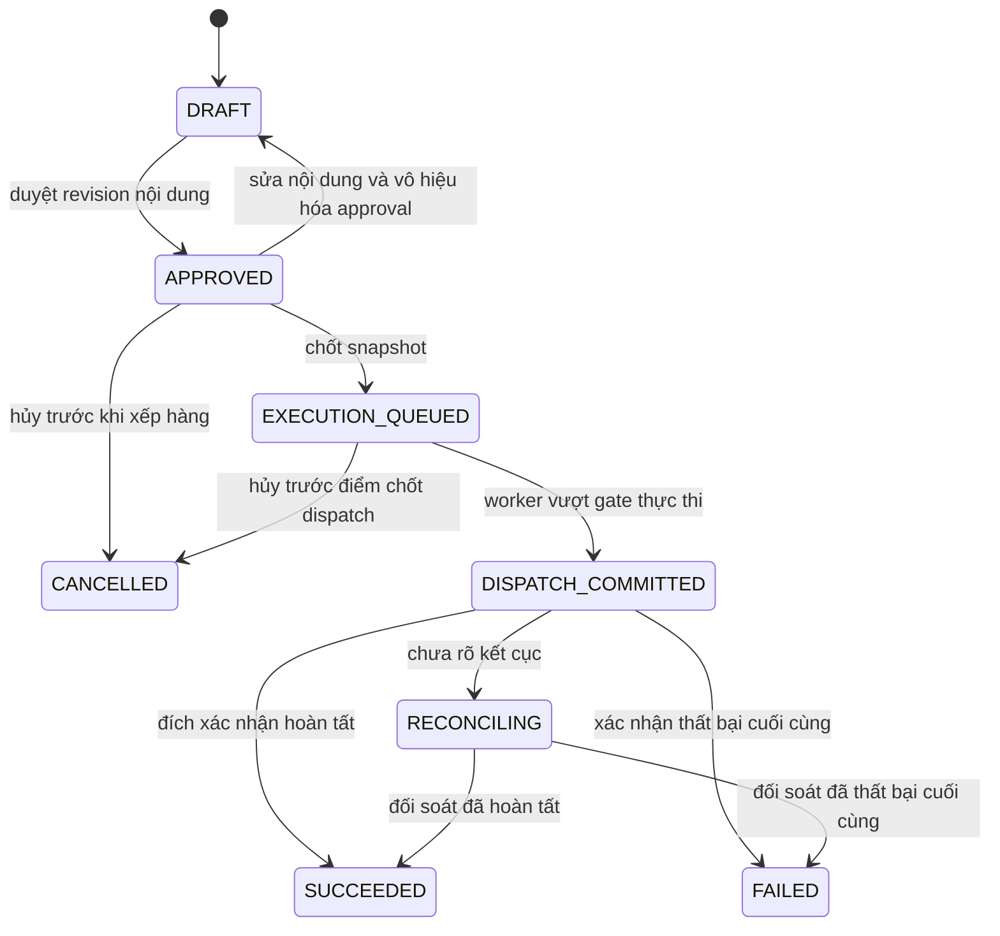

# Check use gap

## 1. Kết quả kiểm tra có thể hết đúng trước khi được sử dụng

Một ứng dụng kiểm tra phiếu hoàn tiền đã được phê duyệt, sau đó đọc số tiền và gửi lệnh thực thi. Giữa hai bước, request khác sửa số tiền hoặc hủy phê duyệt. Từng endpoint có thể đều kiểm tra quyền, nhưng chuỗi thực thi vẫn có thể sử dụng một kết luận không còn áp dụng cho dữ liệu đang dùng.

**Check use gap** là khoảng trống giữa thời điểm kiểm tra một điều kiện và thời điểm dựa vào điều kiện đó để tạo tác dụng. Nếu dữ liệu, danh tính đối tượng, quyền hoặc trạng thái có thể thay đổi trong khoảng này, kết quả kiểm tra có thể mất hiệu lực.

Đây là ý tưởng cốt lõi của **time-of-check to time-of-use**, thường viết là **TOCTOU**. MITRE mô tả CWE-367 là tình huống trạng thái tài nguyên thay đổi giữa lúc kiểm tra và lúc sử dụng, làm kết quả kiểm tra trước đó không còn hợp lệ. [MITRE CWE-367](https://cwe.mitre.org/data/definitions/367.html)

Trong bảo mật logic nghiệp vụ, vấn đề không chỉ xuất hiện ở các luồng dùng chung biến trong bộ nhớ. Nó có thể trải qua hai HTTP request, hai transaction, một hàng đợi, một worker hoặc một lần chờ phê duyệt kéo dài nhiều phút. Code Java không có data race trong bộ nhớ vẫn có thể có race ở cấp nghiệp vụ.

Điều cần bảo đảm không phải “đã gọi hàm kiểm tra”, mà là:

> Tác dụng được thực hiện trên đúng đối tượng, đúng nội dung và đúng điều kiện mà quyết định cho phép có hiệu lực bao phủ.

Điểm sử dụng cũng phải được xác định cụ thể. Trong một thiết kế, đó là commit một thay đổi database; trong thiết kế khác, đó là chốt một lệnh thực thi bền vững hoặc gửi tác vụ không thể thu hồi sang dịch vụ bên ngoài. Các điểm này không mặc nhiên là một.

## 2. Một lịch xen kẽ làm phê duyệt sai nội dung

Giả sử phiếu hoàn tiền `refund-81` có số tiền 100.000 đơn vị tiền nhỏ nhất, tiền tệ và tham chiếu giao dịch gốc xác định. Nội dung đó được quản lý duyệt ở revision 4. Một implementation không an toàn chỉ lưu `approved=true` mà không gắn phê duyệt với nội dung.

Luồng thực thi có thể có dạng:

```java
// Ví dụ không an toàn: các lần đọc không được ràng buộc với nhau.
if (approvalService.isApproved(refundId)) {
    Refund current = refundRepository.findById(refundId);
    gateway.executeRefund(
            current.originalPaymentRef(),
            current.amount(),
            current.currency());
}
```

Một lịch xen kẽ bất lợi:

| Thời điểm | Request A: thực thi | Request B: sửa phiếu |
|---|---|---|
| T1 | Kiểm tra `approved=true` cho nội dung revision 4 | |
| T2 | | Sửa số tiền, tạo revision 5 nhưng vẫn giữ cờ approved |
| T3 | Đọc số tiền hiện tại của revision 5 | |
| T4 | Gửi lệnh với revision 5 dựa trên phê duyệt revision 4 | |

Lỗi có hai mặt liên quan: đường sửa không vô hiệu hóa phê duyệt đúng cách, và đường thực thi không xác nhận nội dung đang dùng thuộc phê duyệt nào. Chỉ sửa một mặt mà để đường ghi khác bỏ qua quy tắc vẫn có thể để lại lỗ hổng.

Ngay cả khi cờ phê duyệt được xóa đúng ở T2, A vẫn có thể giữ kết luận đã đọc tại T1 rồi tiếp tục. Nếu A đã đọc toàn bộ phiếu trước T2, cần xác định nghiệp vụ có cho phép dùng bản đã chốt đó hay yêu cầu thay đổi mới phải chặn thực thi. Dùng bản cũ không tự đúng hoặc sai; nó phải phù hợp hợp đồng phiên bản, hủy và ủy quyền đã công bố.

Một biến thể khác không sửa số tiền mà hủy phiếu sau khi A kiểm tra. Một biến thể thay quan hệ tenant hoặc tham chiếu đối tượng. Điểm chung là A giả định một thuộc tính còn đúng mà chưa có cơ chế giữ hoặc xác nhận thuộc tính đó tại điểm sử dụng.

## 3. Xác định bất biến và các dữ kiện có thể thay đổi

### 3.1. Bất biến của ví dụ hoàn tiền

Để thảo luận rõ ràng, ví dụ dùng các bất biến sau:

- Chỉ thực thi trong tenant được cấp và trên một phiếu mà chủ thể có quyền thao tác.
- Nội dung thực thi phải khớp nội dung được duyệt: số tiền, tiền tệ, giao dịch gốc và các trường quan trọng khác.
- Phê duyệt phải còn hiệu lực tại điểm chốt thực thi do hệ thống định nghĩa.
- Một revision không được tạo nhiều tác dụng hoàn tiền logic do gửi trùng hoặc retry.
- Hủy hoặc thay đổi nội dung phải cạnh tranh với chốt thực thi theo một quy tắc rõ ràng.
- Chưa biết kết cục của một tác dụng từ xa không được diễn giải thành “chắc chắn chưa thực hiện”.

Nếu có bất biến tổng hợp như tổng hoàn tiền không vượt số tiền đã thu, cần bảo vệ thêm tài nguyên của giao dịch gốc hoặc sổ hạn mức tương ứng. Khóa một phiếu riêng không tự giữ tổng của nhiều phiếu. Các ví dụ dưới tập trung vào khoảng trống giữa kiểm tra và sử dụng, không giả định một khóa phiếu giải quyết mọi quy tắc hoàn tiền.

### 3.2. Lập bản đồ check và use

Một bảng phân tích giúp tìm đúng khoảng trống:

| Điều đã kiểm tra | Điểm sử dụng kết quả | Điều có thể thay đổi ở giữa |
|---|---|---|
| Phiếu đã được duyệt | Chốt lệnh thực thi | Nội dung, hiệu lực approval, trạng thái hủy |
| Chủ thể có quyền với phiếu | Cập nhật hoặc công bố dữ liệu | Thành viên nhóm, tenant đích, phạm vi ủy quyền |
| Số dư đủ | Ghi reservation hoặc trừ hạn mức | Request khác cùng sử dụng nguồn lực |
| Đối tượng thuộc một hồ sơ | Đọc, sửa hoặc xóa tài nguyên | Quan hệ đối tượng, phiên bản nội dung, tham chiếu |
| Mã dùng một lần chưa dùng | Ghi tác dụng và đánh dấu đã dùng | Request khác tiêu thụ cùng mã |
| Tệp đã được kiểm tra | Import, tải hoặc xử lý tệp | Nội dung tại cùng tên hoặc key bị thay thế |

Với mỗi hàng, cần xác định ai có thể thay đổi dữ kiện, qua endpoint nào, worker nào và nguồn dữ liệu nào. Thay đổi hợp lệ của người dùng khác cũng đủ tạo race; không cần có một endpoint hoàn toàn trái phép.

Khoảng trống không chỉ đo bằng mili giây. Cache giữ quyết định cũ, replica trễ hoặc message chờ trong queue có thể làm dữ liệu dùng để quyết định cũ hơn nhiều so với thời gian giữa hai dòng code.

## 4. Những cách vá tạo cảm giác an toàn nhưng chưa đóng khoảng trống

| Cách làm | Vì sao chưa đủ |
|---|---|
| Kiểm tra hai lần liên tiếp | Dữ kiện vẫn có thể đổi sau lần cuối nếu không có cơ chế phối hợp |
| Chuyển check sát use hơn | Thu hẹp cửa sổ, chưa loại bỏ lịch xen kẽ gây lỗi |
| Thêm `@Transactional` rồi giữ nguyên mọi truy vấn | Mức isolation và phạm vi tài nguyên có thể chưa bảo vệ điều kiện cần |
| Chỉ khóa khi bắt đầu ghi | Dữ liệu dùng để quyết định có thể đã cũ trước khi lấy khóa |
| Dùng `synchronized` trong service | Không tự phối hợp nhiều JVM, worker hoặc writer ngoài service |
| Dùng UUID khó đoán | Không giữ quyền, trạng thái hoặc phiên bản của đối tượng |
| Tắt nút hoặc debounce ở frontend | Client khác vẫn có thể gửi yêu cầu cạnh tranh |
| Giảm độ trễ mạng hoặc tăng cấu hình máy | Không phải bằng chứng rằng mọi lịch thực thi đều hợp lệ |
| Thêm audit sau tác dụng | Có thể hỗ trợ điều tra, không ngăn tác dụng trái phép đã xảy ra |
| Chỉ dùng idempotency key | Không tự ràng buộc quyền và nội dung được duyệt nếu lệnh ban đầu đã sai |

Một lần kiểm tra cuối có giá trị khi được gắn với bước thực thi bằng một cơ chế giữ điều kiện, so sánh phiên bản, tiêu thụ quyền một lần hoặc chốt lệnh bất biến. Nó không có tính nguyên tử chỉ nhờ được gọi là “final check”.

OWASP đề xuất một điểm kiểm soát cuối gắn với việc thực thi và yêu cầu xử lý lại authorization khi dữ liệu giao dịch quan trọng thay đổi. Cách áp dụng vào database hoặc dịch vụ bên ngoài vẫn phải được thiết kế theo ranh giới thực tế. [OWASP Transaction Authorization Cheat Sheet](https://cheatsheetseries.owasp.org/cheatsheets/Transaction_Authorization_Cheat_Sheet.html)

## 5. Gắn điều kiện với thao tác cập nhật

### 5.1. Dùng conditional update khi điều kiện nằm trên dữ liệu phù hợp

Với điều kiện trạng thái và phiên bản của một phiếu, có thể gắn kiểm tra vào lệnh chuyển trạng thái:

```sql
UPDATE refund_request
SET state = 'EXECUTION_QUEUED',
    execution_id = :execution_id,
    row_version = row_version + 1
WHERE tenant_id = :tenant_id
  AND id = :refund_id
  AND state = 'APPROVED'
  AND content_revision = :expected_content_revision
  AND approved_content_revision = content_revision
  AND row_version = :expected_row_version
RETURNING id, tenant_id, execution_id,
          content_revision, amount, currency, original_payment_ref;
```

Đây là ví dụ dùng cú pháp PostgreSQL với placeholder; implementation thực phải bind tham số. Một dòng được trả về biểu thị lệnh đã vượt qua các predicate đó trong transaction, chưa phải đã commit hay đã hoàn tiền ở dịch vụ đích.

Không có dòng trả về nghĩa là không được tiếp tục tạo tác dụng dựa trên giả định cũ. Có thể là version conflict, sai trạng thái hoặc không có đối tượng trong phạm vi; phản hồi cho caller phải tuân thủ chính sách tiết lộ thông tin, không tự truy vấn rộng để giải thích bằng dữ liệu tenant khác.

Lệnh trên chỉ bảo vệ các điều kiện được mã hóa trên dòng đó. Nó chưa chứng minh quyền hiện hành, approval chưa hết hạn, giao dịch gốc còn hạn mức hoặc không có điều kiện ngăn khác. Các dữ kiện đó cần predicate hoặc giao thức phối hợp tương ứng; không ghép thêm một lần đọc không được bảo vệ rồi tuyên bố toàn bộ quy trình đã nguyên tử.

### 5.2. Tách revision nội dung và version trạng thái

Trong ví dụ:

- `content_revision` tăng khi thay đổi nội dung có ý nghĩa phê duyệt, như số tiền, tiền tệ hoặc giao dịch gốc.
- `approved_content_revision` xác định revision được một approval hợp lệ bao phủ; client không được tự ghi trường này.
- `row_version` tăng theo các thay đổi mà giao thức cần phát hiện, gồm cả chuyển trạng thái.

Tách hai khái niệm tránh nhầm việc một lần chuyển `DRAFT -> APPROVED` làm tăng version kỹ thuật với việc nội dung đã bị thay. Có thể dùng một mô hình version khác, miễn định nghĩa rõ approval đang bao phủ cái gì và mọi đường sửa quan trọng đều tham gia.

Nếu có trường ảnh hưởng kết quả nhưng không tăng revision và không nằm trong snapshot, khoảng trống vẫn còn. Ví dụ, chỉ version số tiền nhưng để worker tra cứu lại một đích nhận có thể sửa được vẫn có thể thực thi sai ý định.

### 5.3. Chốt kết quả và lệnh tiếp theo trong cùng transaction

Sau khi conditional update thành công, các giá trị từ dòng đã được chuyển là nguồn để tạo execution snapshot và outbox. Chúng cần được lưu cùng transaction với chuyển trạng thái. Không commit `EXECUTION_QUEUED` trước, rồi ở transaction khác đọc lại dữ liệu hiện tại để dựng lệnh.

Nếu tạo snapshot hoặc ghi outbox bắt buộc thất bại, rollback chuyển trạng thái. Không gọi dịch vụ từ xa trước khi biết transaction chốt lệnh đã commit. Unique constraint theo miền thực thi, chẳng hạn tenant, phiếu và revision trong mô hình một lần thực thi mỗi revision, là lớp bảo vệ bổ sung trước tác dụng lặp.

Đối với cơ chế optimistic locking khác, cũng phải kiểm tra kết quả cập nhật và bảo đảm các phiên bản kiểm tra thuộc đúng dữ kiện. Version trên phiếu không phát hiện thay đổi quyền hoặc hạn mức nằm ở nơi khác nếu chúng không tham gia giao thức.

## 6. Giữ trạng thái được kiểm tra ổn định bằng khóa

### 6.1. Lấy khóa trước khi kiểm tra dữ liệu quyết định

Một cách khác để bảo vệ chuỗi quyết định là lấy khóa phù hợp, đọc trạng thái sau khi có khóa, kiểm tra rồi ghi trong cùng transaction:

```text
BEGIN
  khóa các tài nguyên cần phối hợp theo thứ tự chung
  đọc hoặc làm mới trạng thái được bảo vệ
  kiểm tra nội dung được duyệt, quyền và state machine
  chốt snapshot và lệnh thực thi
COMMIT
```

Tất cả writer có thể làm sai điều kiện phải tuân thủ giao thức hoặc bị một ràng buộc tương đương ngăn chặn. Chỉ khóa phiếu trong endpoint thực thi mà để endpoint sửa nội dung, hủy hoặc import cập nhật theo đường không phối hợp vẫn chưa giữ được bất biến.

Sau khi đợi khóa, không dùng kết luận cũ đã tính trước lúc chờ. Cần đọc/làm mới dữ liệu trong vùng được bảo vệ và đánh giá lại. Quy tắc isolation và cache của ORM cũng ảnh hưởng dữ liệu thực nhận được; tên phương thức `lock()` không tự thay thế mọi object cũ code đang giữ.

### 6.2. Khóa đúng phạm vi của điều kiện

Khóa root của phiếu có thể đủ để phối hợp sửa nội dung, duyệt và chốt lệnh nếu chúng cùng theo giao thức đó. Nếu phải kiểm tra tổng hoàn tiền của một giao dịch gốc, các phiếu khác cũng cạnh tranh cùng nguồn lực nên cần bảo vệ phần tổng hợp tương ứng.

Nếu quyền phụ thuộc bảng thành viên hoặc trạng thái của đối tượng cha, khóa phiếu không tự khóa những dữ kiện đó. Nếu điều kiện là “chưa tồn tại bản ghi nào”, một row lock không tìm được dòng không tự trở thành khóa của sự vắng mặt. Có thể cần unique constraint, guard row đã tồn tại, version của aggregate hoặc isolation phù hợp.

Phải tính cả insert, delete và thay đổi quan hệ, không chỉ update một dòng đã biết. Một kiểm tra tổng hợp dựa trên tập hiện tại có thể bị thay đổi bởi một bản ghi mới mà khóa trên các dòng cũ không bảo vệ.

### 6.3. Không kéo dài transaction qua tác dụng từ xa

Giữ khóa database trong lúc gọi gateway không làm hai hệ thống cùng commit. Gateway có thể thực thi thành công rồi database rollback; hoặc database hết thời gian chờ trong khi gateway vẫn xử lý.

Vùng khóa nên chốt quyết định và lệnh bền vững cần thiết, rồi kết thúc. Tác dụng từ xa được điều phối riêng bằng định danh ổn định, state machine, idempotency ở nơi tạo tác dụng và đối soát. Nếu dùng khóa bi quan, vẫn cần giới hạn chờ, thứ tự khóa nhất quán và xử lý rollback/deadlock; đây là chi phí của cơ chế, không phải lý do bỏ kiểm tra.

## 7. Tạo execution snapshot từ đúng dữ liệu đã được duyệt

### 7.1. Snapshot cần chốt những trường nào?

Một execution snapshot là biểu diễn bền vững của ý định thực thi đã được cho phép. Ví dụ:

```json
{
  "executionId": "execution-904",
  "tenantId": "tenant-17",
  "refundId": "refund-81",
  "contentRevision": 4,
  "approvalRef": "approval-233",
  "amountMinor": 100000,
  "currency": "VND",
  "originalPaymentRef": "payment-502",
  "policyVersion": "refund-policy-v6",
  "requestedBy": "user-42"
}
```

Đây là dữ liệu giả lập. Snapshot không chứa credential của gateway. Giá trị được lấy từ dữ liệu mà server đã kiểm tra, không sao chép nguyên payload client rồi đánh dấu là đã duyệt.

Khi snapshot được chốt, worker không được thay số tiền, tiền tệ hoặc giao dịch gốc bằng cách đọc một profile “hiện tại” có thể thay đổi. Nếu một tham chiếu trong snapshot vẫn trỏ tới dữ liệu có thể được thay thế, cần chốt đúng phiên bản hoặc định danh bất biến của đích thực tế.

Snapshot cũng cần được bảo vệ khỏi chỉnh sửa tùy ý. Digest giúp nhận diện thay đổi nếu được đối chiếu với nguồn tin cậy, nhưng không tự xác thực quyền hoặc chứng minh dữ liệu đã được duyệt. Không chấp nhận `approvalRef` hay digest do client tự gửi như bằng chứng đầy đủ.

### 7.2. Minh họa một điểm chốt trong Java

Mã giả dưới đây thể hiện ranh giới thiết kế; các dependency là hợp đồng cần triển khai. `tx.required` chỉ trả ra kết quả thành công sau khi commit.

```java
public QueueReply queueRefundExecution(
        VerifiedContext context,
        ExecuteRefundCommand command) {

    ValidatedCommand input = commands.validate(command);
    access.requireExecutionFunction(context);

    return tx.required(() -> {
        LockedExecutionContext locked = repository.lockExecutionContext(
                context.tenantId(), input.refundId());

        access.requireCanAccessExecutionWorkflow(context, locked);

        IdempotencySlot slot = idempotency.reserveOrLock(
                context.tenantId(), context.subjectId(),
                "QUEUE_REFUND_EXECUTION", input.idempotencyKey());
        String fingerprint = fingerprints.forExecutionIntent(input);

        if (slot.hasResult()) {
            slot.requireSameFingerprint(fingerprint);
            return slot.authorizedResultFor(context);
        }

        Instant decisionTime = clock.instant();
        ExecutionDecision decision = rules.evaluateQueueGate(
                context, locked, input, decisionTime);

        if (!decision.allowed()) {
            QueueReply denied = QueueReply.denied(decision.publicReason());
            slot.complete(fingerprint, denied);
            outbox.append(events.executionQueueDenied(
                    context, locked, decision));
            return denied;
        }

        ExecutionSnapshot snapshot = snapshots.fromLockedApprovedData(
                ids.newExecutionId(), locked, decision);

        executions.insertUnique(snapshot);
        locked.refund().queueExecution(snapshot.executionId());
        QueueReply queued = QueueReply.queued(snapshot.executionId());

        slot.complete(fingerprint, queued);
        outbox.append(events.refundExecutionRequested(snapshot));
        return queued;
    });
}
```

Các điều kiện làm cho ví dụ có ý nghĩa:

- `lockExecutionContext` bảo vệ các dòng mà quyết định cần, theo một thứ tự thống nhất với đường sửa, duyệt, hủy và các writer khác. Nếu thiếu tài nguyên hạn mức hay quyền có liên quan, code chưa giữ được bất biến đó.
- `evaluateQueueGate` kiểm tra tenant, quyền theo đối tượng, revision kỳ vọng, approval đúng nội dung, trạng thái và điều kiện thời gian theo hợp đồng. Nó không chỉ kiểm tra một boolean `approved`.
- Thời điểm quyết định được lấy sau khi hoàn tất bước đợi khóa cần thiết. Một timestamp từ đầu request có thể đã cũ khi đến lượt xử lý.
- Snapshot, chuyển trạng thái, kết quả idempotency và outbox cùng transaction của cùng tài nguyên database. Lỗi commit không được trả về như đã xếp hàng thành công.
- `insertUnique` có ràng buộc theo miền nghiệp vụ thực sự. Nếu mỗi phiếu chỉ được hoàn một lần trong toàn vòng đời, cần bảo vệ theo tenant và phiếu; chỉ unique theo revision không tự ngăn thực thi lần nữa ở revision khác.
- Idempotency xử lý cạnh tranh khi khóa chưa tồn tại, ràng buộc fingerprint và không cho replay đọc kết quả ngoài quyền hiện tại.
- Nhánh từ chối trả kết quả để audit trong transaction có thể commit. Nếu ném exception làm rollback, cần đường audit khác; không giả định bản ghi deny tự tồn tại.

Điểm chốt này bảo đảm lệnh đã xếp hàng khớp nội dung được chấp nhận. Nó không khẳng định gateway đã hoàn tiền, và cũng chưa tự đáp ứng chính sách cho phép hủy hoặc thu hồi phê duyệt trong thời gian chờ worker.

### 7.3. Mọi thay đổi quan trọng phải có tác động đến hiệu lực phê duyệt

Một chính sách dễ lý giải là chỉ cho sửa nội dung ở trạng thái nháp. Sửa nội dung đã duyệt phải mở một revision mới và vô hiệu hóa approval cũ trước khi revision đó có thể được xếp hàng.

Khi đã có execution đang chờ, không cho sửa trực tiếp snapshot. Nếu sản phẩm cần sửa hoặc hủy, phải xử lý execution cũ theo state machine, xác nhận nó chưa vượt ranh giới không thể hủy rồi tạo ý định mới theo hợp đồng. Không tái sử dụng execution ID cho payload khác.

Ngay cả trường không hiển thị trong màn hình duyệt cũng có thể quan trọng nếu nó ảnh hưởng tác dụng. Cần truy từ dữ liệu gateway thực dùng về dữ liệu đã được duyệt, thay vì chỉ version những trường giao diện đang có.

## 8. Đóng khoảng trống ở hàng đợi và dịch vụ bên ngoài

### 8.1. Một final gate tại API chưa bao phủ thời gian chờ worker

Một workflow minh họa:



Đây là mô hình rút gọn. `DISPATCH_COMMITTED` nghĩa là hệ thống đã chốt quyền gửi một execution cụ thể, không chứng minh request đã tới gateway. `FAILED` cuối cùng chỉ được dùng khi có căn cứ tương ứng, không gán từ một timeout chưa rõ kết cục.

Nếu chính sách cho phép hủy khi đang chờ, worker phải phối hợp với thao tác hủy trước khi chuyển `EXECUTION_QUEUED -> DISPATCH_COMMITTED`. Cả hai dùng cùng điểm điều phối hoặc conditional update để chỉ một quyết định thắng.

Nếu hủy thắng trước, worker không được gửi lệnh. Nếu dispatch đã thắng và vượt ranh giới hợp đồng không còn bảo đảm hủy, API không được hứa “đã hủy nên chắc chắn không hoàn tiền”. Có thể ghi nhận yêu cầu hủy muộn và xử lý theo khả năng thật của gateway.

### 8.2. Snapshot bất biến bảo vệ nội dung, không tự giữ mọi quyền hiện hành

Worker cần xác thực nguồn lệnh, execution ID, tenant và trạng thái. Nếu nghiệp vụ yêu cầu approval còn hiệu lực hoặc người yêu cầu còn quyền đến điểm dispatch, worker phải đánh giá điều kiện đó bằng dữ liệu và cơ chế phối hợp phù hợp tại điểm này.

Một lựa chọn khác là tạo một mandate nghiệp vụ bền vững sau khi duyệt. Mandate phải có phạm vi, thời hạn, cách tiêu thụ và điều kiện thu hồi rõ ràng; worker kiểm tra hiệu lực mandate. Một role được chụp lại hoặc một session cũ không tự trở thành mandate.

Nếu chỉ kiểm tra một dịch vụ quyền rồi sau đó mới gọi gateway, vẫn có thể có lần thu hồi ở giữa. Khi chính sách đòi hỏi thu hồi phải có hiệu lực tới một ranh giới cụ thể, cần thiết kế ranh giới đó với bên thực thi hoặc một giao thức đặt chỗ/chốt quyền phù hợp. Một database transaction cục bộ không tự bảo đảm tính nguyên tử với quyết định ở hệ thống từ xa.

### 8.3. Phía tạo tác dụng phải chống thực thi lặp

Outbox có thể giao lặp cùng message. Worker có thể dừng sau khi gateway hoàn tất nhưng trước khi lưu kết quả. Vì vậy, execution ID ổn định cần được sử dụng theo hợp đồng idempotency hoặc chống trùng mà đích thực thi hỗ trợ.

Phải biết đích giữ khóa chống trùng bao lâu, có ràng buộc payload hay không và có API đối soát nào. Đặt một header tên `Idempotency-Key` không chứng minh đích thực sự cung cấp các cam kết đó. Nếu đích không có khả năng cần thiết, không được tuyên bố tự có bảo đảm không lặp chỉ nhờ outbox ở nguồn.

Khi kết cục chưa rõ, giữ `RECONCILING`, tra cứu bằng định danh gốc và retry theo cùng hợp đồng an toàn. Không đổi execution ID để vượt qua một lần chờ hoặc để “chạy lại từ đầu”. Bù trừ, nếu có, là thao tác nghiệp vụ riêng có thể cần quyền và có thể thất bại; nó không làm tác dụng ban đầu biến thành chưa từng xảy ra.

## 9. Phải giữ cả danh tính đối tượng, không chỉ giá trị đã đọc

### 9.1. Cùng một ID bên ngoài có thể trỏ sang nội dung khác

Giả sử hệ thống quét một tệp tại object key K, rồi worker import lại đọc K. Nếu K bị ghi đè sau scan, worker dùng nội dung chưa được kiểm tra dù key không đổi. Tương tự, một alias người nhận có thể được đổi sang một đích khác giữa lúc duyệt và thực thi.

Cần dùng định danh/version bất biến hoặc handle mà nền tảng bảo đảm trỏ đúng tài nguyên, cùng kiểm soát không cho thay thế trái giao thức. Với tệp, có thể gắn kết quả scan với content version hoặc digest của nội dung và thực thi trên đúng phiên bản đó. Không xem `scanPassed=true` trên một record logic là bằng chứng mọi nội dung dưới cùng tên đều đã được quét.

Nếu chỉ so sánh digest trước khi dùng nhưng sau đó lại mở một key có thể bị thay thế, một khoảng trống mới vẫn tồn tại giữa so sánh và đọc. Cơ chế phải ràng buộc việc sử dụng với đúng phiên bản/handle đã kiểm tra, hoặc làm nội dung trở thành bất biến trong phạm vi cần thiết.

### 9.2. Trạng thái quay lại giống cũ không chứng minh chưa có thay đổi

Một đối tượng có thể chuyển `APPROVED -> CANCELLED -> APPROVED`. Chỉ kiểm tra chuỗi trạng thái cuối là `APPROVED` không cho biết đó còn là approval cũ hay đã qua một lần sửa, hủy và duyệt lại.

Revision/generation tăng đơn điệu và approval gắn đúng phiên bản giúp nhận diện lịch sử thay đổi có ý nghĩa. Không reset version hoặc tái sử dụng token thực thi của vòng cũ để làm dữ liệu nhìn như chưa từng đổi. Đây là dạng vấn đề thường được gọi là ABA khi giá trị nhìn thấy trở lại giống ban đầu nhưng ngữ cảnh đã khác.

### 9.3. Điều kiện theo thời gian cần một điểm đánh giá được định nghĩa

Quote hết hạn, approval hết hạn hoặc reservation được giải phóng có thể làm điều kiện thay đổi mà không có request sửa dữ liệu. Cần nói rõ phải còn hiệu lực khi xếp hàng, khi chốt dispatch hay khi đích tiếp nhận.

Dùng đồng hồ server tin cậy và hiểu thời điểm mà giá trị thời gian đại diện. Một mốc lấy từ client hoặc từ đầu transaction không mặc nhiên là thời gian sau khi đã chờ khóa. Nếu cam kết yêu cầu còn hiệu lực tại đích bên ngoài, đích cần tham gia kiểm tra hoặc hợp đồng chốt quyền phải bao phủ thời gian đó.

Tương tự, TTL ngắn chỉ thu hẹp thời gian dùng một capability cũ. Nó không tạo thu hồi tức thời và không tự làm capability chỉ dùng được một lần. Điều kiện tiêu thụ một lần cần được thực thi nguyên tử ở nơi có thẩm quyền tạo tác dụng.

## 10. Chọn cơ chế theo điều kiện cần giữ

Không phải mọi khoảng thời gian giữa check và use đều phải được loại bỏ bằng một khóa kéo dài. Có thể làm điều kiện không còn thay đổi, gắn use với version, hoặc định nghĩa một quyền thực thi đã được chốt có phạm vi rõ ràng. Quan trọng là cơ chế thực sự bảo đảm bất biến đã chọn.

| Điều cần giữ | Hướng thiết kế | Giới hạn cần nhớ |
|---|---|---|
| Trạng thái chỉ được chuyển một lần | Conditional update, state machine, unique constraint | Chỉ bảo vệ các predicate và miền khóa đã được định nghĩa |
| Nội dung thực thi đúng nội dung được duyệt | Revision gắn approval, snapshot bất biến | Mọi trường và tham chiếu ảnh hưởng tác dụng phải nằm trong phạm vi |
| Nguồn lực còn đủ khi chốt | Cập nhật có điều kiện, reservation hoặc khóa aggregate phù hợp | Khóa riêng từng yêu cầu không giữ tổng giữa nhiều yêu cầu |
| Điều kiện trên nhiều dòng ổn định trong quyết định ngắn | Giao thức khóa, version chung hoặc isolation phù hợp | Mọi writer cạnh tranh phải tham gia; phải phân tích insert và sự vắng mặt |
| Quyền còn hiệu lực đến một ranh giới xác định | Phối hợp quyền với commit/gate hoặc mandate có hiệu lực rõ | Cache role và một lần gọi dịch vụ quyền không tạo tính nguyên tử từ xa |
| Đối tượng không bị thay dưới cùng tên | Handle/content version bất biến, kiểm soát thay thế | So sánh xong rồi mở lại theo tên có thể tạo gap mới |
| Tác dụng không lặp khi retry | Execution ID ổn định và chống trùng tại nơi tạo tác dụng | Outbox hoặc khóa tại nguồn không tự bảo đảm đích chỉ làm một lần |
| Thay đổi mới phải hủy một lệnh đang chờ | State machine và điểm chốt cạnh tranh với dispatcher | Sau ranh giới không thể hủy, cần phản hồi đúng khả năng thật |

Một cách tự kiểm tra thiết kế là lần lượt trả lời:

1. Quyết định đang dựa trên các dữ kiện cụ thể nào?
2. Dữ kiện nào còn thay đổi được, và ai có quyền thay đổi?
3. Mỗi thay đổi cạnh tranh gặp khóa, predicate, version hoặc ràng buộc nào?
4. Sau khi chốt quyền, tác dụng dùng đúng dữ liệu nào; còn tra cứu lại gì có thể thay đổi không?
5. Nếu process dừng ngay sau chốt hoặc ngay sau tác dụng, lần xử lý tiếp theo biết kết cục bằng cách nào?

Nếu câu trả lời chỉ là “kiểm tra lại thêm lần nữa” hoặc “request thường chạy rất nhanh”, thiết kế chưa chỉ ra điều gì ngăn một lịch xen kẽ bất lợi. Ngược lại, một lệnh có thể chờ lâu mà vẫn giữ nội dung an toàn nếu snapshot và quyền thực thi bền vững thực sự được chính sách cho phép; thời gian chờ không tự là lỗ hổng.

## 11. Kiểm thử check use gap bằng lịch thực thi có chủ đích

Những tình huống dưới đây là đặc tả kiểm thử gợi ý cho hệ thống triển khai. Chúng không phải kết quả kiểm thử đã chạy trong bài học này.

### 11.1. Chọn một điểm dừng sau check

Với implementation dễ lỗi, có thể tạo hook trong môi trường test ngay sau khi đọc approval. Dùng hai luồng và các connection/transaction độc lập:

```text
Chuẩn bị: refund-81 ở revision 4, approval bao phủ revision 4.

T1: đọc điều kiện phê duyệt, báo hiệu đã tới điểm dừng.
T2: thực hiện một thay đổi nội dung hợp lệ theo đường được kiểm thử.
T2: commit rồi báo hiệu hoàn tất thay đổi.
T1: tiếp tục tới điểm sử dụng.

Quan sát: lệnh thực thi có dùng dữ liệu không thuộc approval hay không?
```

Không cần tạo tải lớn hoặc chờ ngẫu nhiên để tái hiện đúng khoảng trống. Một lịch có chủ đích giúp chứng minh vì sao hai thao tác riêng lẻ hợp lệ lại tạo được tác dụng không hợp lệ khi xen kẽ.

Hook chỉ là dụng cụ kiểm thử có kiểm soát, không phải một cơ chế trì hoãn bật trong production. Khi tái hiện trên môi trường thật, phải dùng đối tượng thử nghiệm và đích giả lập hoặc sandbox phù hợp, tránh tạo tác dụng nghiệp vụ thực.

### 11.2. Sau khi có khóa, phải điều khiển test theo hợp đồng mới

Không giữ T1 ở giữa vùng khóa rồi bắt T1 chờ T2 sửa xong một dòng mà chính T1 đang khóa. Test đó tự tạo chờ vòng, không chứng minh lỗi của giao thức mới.

Cần kiểm tra hai thứ tự riêng:

- **Thay đổi thắng trước**: T2 sửa, tạo revision mới hoặc vô hiệu hóa approval rồi commit. T1 phải từ chối chốt nội dung mới bằng approval cũ, hoặc xử lý xung đột theo hợp đồng.
- **Chốt thực thi thắng trước**: T1 chốt snapshot và trạng thái trước. T2 phải bị từ chối sửa trực tiếp execution đó, hoặc đi qua quy trình hủy/sửa được cho phép. Lệnh đã chốt không được âm thầm đổi payload.

Assertion chính là không có tác dụng vượt ngoài nội dung và quyền đã được cho phép, không phải luôn có một transaction cụ thể thắng. Trường hợp được phép thực thi snapshot cũ cần kiểm chứng rằng quyền chốt snapshot đó còn hợp lệ theo hợp đồng, không chỉ kiểm tra các byte giống nhau.

### 11.3. Ma trận tình huống quan trọng

| Tình huống | Kỳ vọng cần xác nhận |
|---|---|
| Đổi số tiền sau approval | Nội dung mới không thực thi bằng approval cũ |
| Đổi tiền tệ hoặc tham chiếu giao dịch gốc | Các trường này tham gia revision/snapshot và bị ràng buộc như số tiền |
| Sửa một trường ẩn nhưng gateway có sử dụng | Không có đầu vào ảnh hưởng tác dụng nằm ngoài phạm vi được duyệt |
| Phiếu bị hủy giữa check và queue gate | Không chốt lệnh dựa trên trạng thái trước hủy |
| Hủy cạnh tranh với worker dispatch | Một thứ tự có hiệu lực rõ ràng; không vừa xác nhận hủy chắc chắn vừa gửi lệnh trái cam kết |
| Approval hết hạn trong lúc đợi khóa | Đánh giá ở thời điểm đúng với chính sách, không dùng timestamp cũ thiếu căn cứ |
| Quyền bị thu hồi khi lệnh nằm trong queue | Tuân hợp đồng quyền hiện hành hoặc mandate đã được định nghĩa |
| Hai request cùng dùng một approval | Không tạo nhiều execution trái miền nghiệp vụ, kể cả khác idempotency key |
| Cùng key nhưng đổi expected revision | Trả conflict, không coi là retry cùng ý định |
| Snapshot đã chốt nhưng worker đọc lại profile mới | Tác dụng vẫn dùng đúng đích/phiên bản được snapshot bao phủ |
| Cùng object key nhưng nội dung tệp đã bị thay | Không sử dụng nội dung khác với phiên bản đã kiểm tra |
| Trạng thái quay về `APPROVED` sau một vòng hủy/sửa | Approval hoặc generation cũ không được tái sử dụng trái phép |
| Transaction chốt lệnh rollback | Không có queue command hợp lệ khẳng định phần đó đã commit |
| Ghi outbox bắt buộc thất bại | Không giữ trạng thái xếp hàng thành công thiếu lệnh bền vững |
| Relay giao lặp và worker chạy lại | Đích thực thi không tạo tác dụng mới ngoài hợp đồng chống trùng |
| Gateway thành công nhưng worker mất ACK | Giữ định danh gốc, đối soát; không lập tức tạo lệnh mới |
| Replica trả phiên bản cũ | Không dùng dữ liệu cũ làm bằng chứng trạng thái hiện hành tại điểm có thẩm quyền |
| Một worker hoặc import bỏ qua endpoint chính | Bất biến vẫn được ràng buộc hoặc đường ghi đó bị ngăn |

Kiểm thử các tình huống liên quan lock/isolation cần database và driver có ngữ nghĩa tương ứng; một repository mock không chứng minh được điều đó. Kiểm thử gateway nên kiểm tra payload thực nhận, execution ID, số tác dụng logic và trạng thái sau đối soát, không chỉ đếm số lần hàm được gọi.

Các test có latch/barrier cần deadline và cơ chế giải phóng trong nhánh lỗi. Test tải ngẫu nhiên có thể bổ sung, nhưng một lần chạy không thấy lỗi không chứng minh mọi khoảng trống đã được đóng.

## 12. Audit và báo cáo phải thể hiện đúng điểm chốt

### 12.1. Giữ bằng chứng về dữ liệu và quyết định

Các sự kiện có thể phân biệt:

| Sự kiện minh họa | Điều khẳng định |
|---|---|
| `REFUND_APPROVED` | Approval cho nội dung/revision xác định được commit |
| `REFUND_EXECUTION_QUEUED` | Snapshot và lệnh thực thi đã được lưu bền vững |
| `REFUND_QUEUE_DENIED` | Một lần yêu cầu không vượt qua queue gate |
| `REFUND_DISPATCH_COMMITTED` | Dispatcher đã chốt quyền gửi execution theo hợp đồng |
| `REFUND_CANCELLED_BEFORE_DISPATCH` | Hủy đã thắng trước ranh giới dispatch được định nghĩa |
| `REFUND_OUTCOME_UNRESOLVED` | Chưa xác định chắc kết cục tác dụng |
| `REFUND_SUCCEEDED` | Có xác nhận hoàn tất theo tiêu chí của dịch vụ và nghiệp vụ |

Các định danh hữu ích gồm tenant, refund ID, content revision, approval reference, execution ID, policy version, generation/row version, correlation ID và thời điểm quyết định. Ghi actor thực thi và initiator phù hợp để phân biệt người tạo ý định với worker có đặc quyền.

Không cần sao chép thông tin cá nhân, token hay toàn bộ dữ liệu gateway vào log. Nếu cần đối chiếu nội dung, dùng snapshot hoặc tham chiếu bằng chứng được phân quyền, cùng cách nhận diện phiên bản. Audit cũng phải có quyền đọc theo tenant và chức năng; biết execution ID không tự cấp quyền xem chi tiết.

### 12.2. Không dùng sự kiện trước làm bằng chứng cho bước sau

`QUEUED` không chứng minh đã gửi, `DISPATCH_COMMITTED` không chứng minh gateway đã nhận, và một timeout không chứng minh gateway đã từ chối. Giao diện cần diễn đạt đúng: “đã ghi nhận yêu cầu”, “đang xử lý” hoặc “đang xác minh kết quả” khi đó là mức bằng chứng đang có.

Tương tự, một revision được duyệt không có nghĩa mọi revision sau đều được duyệt. Audit cần cho phép nối đúng approval với snapshot và tác dụng, thay vì chỉ thấy một sự kiện approved bất kỳ cùng refund ID rồi coi chuỗi hợp lệ.

Các dấu hiệu cần đối chiếu gồm execution không có approval tương ứng, snapshot khác revision được duyệt, nhiều execution cho cùng miền chống trùng, tác dụng tới sau một lần hủy được báo chắc chắn, và số lệnh chờ đối soát tăng. Chúng có thể phản ánh lỗi logic, lỗi ghi nhận hoặc độ trễ ingest; cần kiểm tra nguồn bền vững trước khi kết luận.

## 13. Những câu hỏi cần trả lời trước khi coi khoảng trống đã được đóng

Một thiết kế có thể được giải thích rõ khi trả lời được:

1. Check xác nhận chính xác điều gì: quyền, nội dung, trạng thái, danh tính đối tượng, thời hạn hay nguồn lực?
2. Use xảy ra ở đâu: cập nhật database, chốt một lệnh bền vững hay tạo tác dụng ở hệ thống khác?
3. Dữ kiện nào có thể thay đổi giữa hai điểm, qua những writer nào?
4. Cơ chế nào giữ điều kiện hoặc phát hiện thay đổi ngay trong thao tác có thẩm quyền?
5. Approval có bao phủ đúng revision và mọi đầu vào thực sự ảnh hưởng tác dụng không?
6. Sau khi tạo snapshot, còn tra cứu lại một tên, alias hoặc bản ghi có thể bị thay không?
7. Hủy, hết hạn và thu hồi quyền có hiệu lực tới ranh giới nào; khi vượt ranh giới thì hệ thống hứa được gì?
8. Retry giữ định danh nào và đối soát bằng nguồn nào khi kết cục chưa rõ?
9. Kiểm thử đã điều khiển được các lịch xen kẽ gây lỗi và kiểm tra tác dụng thực, hay mới chỉ chạy happy path?

Check use gap được xử lý khi quyết định cho phép và tác dụng được nối bằng một cam kết thực thi cụ thể: thao tác nguyên tử, giao thức khóa, kiểm tra phiên bản, snapshot bất biến hoặc quyền đã chốt đúng phạm vi. Kiểm tra nhiều lần chỉ có ý nghĩa khi lần kiểm tra cần thiết thực sự ràng buộc được điều sẽ được sử dụng.
