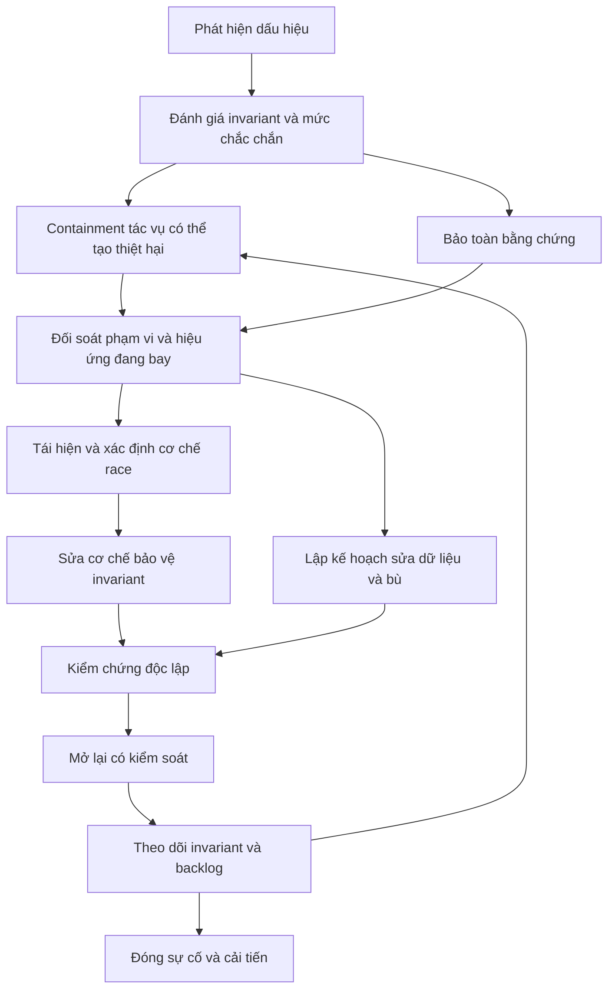

# Race incident response — Ứng phó sự cố do race condition

## 1. Mục tiêu và phạm vi

Một race condition trở thành sự cố nghiệp vụ khi các thao tác đồng thời làm hệ thống vi phạm quy tắc cần giữ: hoàn tiền vượt giới hạn, dùng mã ưu đãi nhiều lần, bán vượt tồn kho, vừa hủy vừa thực hiện đơn, hoặc cung cấp dữ liệu sau khi quyền đã bị thu hồi.

Trong chương **Race Conditions** của module `SECURITY_APPLICATION_SECURITY_BUSINESS_LOGIC_SECURITY`, bài học này tập trung vào **ứng phó khi đã có dấu hiệu hoặc bằng chứng race xảy ra**. Mục tiêu gồm ngăn thiệt hại tiếp diễn, bảo toàn bằng chứng, xác định phạm vi, sửa cơ chế đồng thời, khôi phục dữ liệu và mở lại tác vụ với điều kiện kiểm chứng được.

Sau bài học, người học có thể:

- Phân biệt tín hiệu cạnh tranh bình thường với vi phạm invariant đã được xác nhận.
- Chọn biện pháp containment phù hợp cho API, worker, queue và tác dụng phụ bên ngoài.
- Dựng lại chuỗi kiểm tra, quyết định và commit từ nhiều nguồn bằng chứng.
- Đối soát dữ liệu mà không xóa lịch sử hoặc tạo hiệu ứng bù trùng.
- Kiểm chứng bản sửa bằng lịch thực thi có điều khiển và tiêu chí mở lại rõ ràng.
- Viết báo cáo sự cố thể hiện điều đã biết, điều chưa biết và hành động tiếp theo.

NIST SP 800-61 Rev. 3 gắn ứng phó sự cố với quản trị rủi ro theo CSF 2.0, bao gồm chuẩn bị, phát hiện, ứng phó và khôi phục. Quy trình trong bài là cách áp dụng cho race trong logic nghiệp vụ, không phải một danh sách bước bắt buộc được chép từ NIST. [NIST SP 800-61 Rev. 3](https://csrc.nist.gov/pubs/sp/800/61/r3/final)

Các ví dụ, schema và mã trong bài là mô hình minh họa. Mọi thao tác sửa dữ liệu hoặc gọi dịch vụ ngoài trong một sự cố thật cần đi qua quy trình vận hành có quyền tương ứng; bài học không yêu cầu chạy các đoạn minh họa trên production.

## 2. Nhận diện đúng sự cố trước khi kết luận

Race có thể xuất phát từ người dùng bấm hai lần, client retry sau timeout, worker giao nhận trùng, callback đến sai thứ tự hoặc hành vi cố tình khai thác. Nguyên nhân chưa rõ không làm mất nhu cầu bảo vệ nghiệp vụ, nhưng cũng không đủ để quy kết người dùng tấn công.

| Dấu hiệu | Có thể suy ra | Chưa thể suy ra |
|---|---|---|
| Nhiều request tới cùng đối tượng trong thời gian ngắn | Có cạnh tranh hoặc retry | Invariant đã bị phá |
| Tăng HTTP 409 hoặc optimistic-lock failure | Hàng rào đang phát hiện xung đột hoặc hệ thống đang bất thường | Mọi request đó đã thành công |
| Hai response 200 cho cùng ý định | Cần kiểm tra idempotency và hiệu ứng | Có hai lần chuyển tiền hoặc cấp giá trị |
| Hai ledger entry khác nhau cho một grant dùng một lần | Có vi phạm tính duy nhất hoặc mô hình cần làm rõ | Hai tác dụng phụ ngoài đều đã thực hiện |
| Provider xác nhận hai hiệu ứng vượt ngân sách | Có tác động ngoài đã xác nhận theo dữ liệu đó | Toàn bộ phạm vi sự cố đã được tìm hết |
| DB chỉ còn một trạng thái “đúng” | Có thể là kết quả ghi cuối cùng | Không có hiệu ứng thừa đã xảy ra trước đó |

Cần tách bốn mức:

1. **Nghi vấn:** có lịch chạy hoặc mẫu request đáng kiểm tra.
2. **Lỗ hổng được tái hiện:** invariant có thể bị phá trong môi trường kiểm thử.
3. **Vi phạm dữ liệu đã xác nhận:** bằng chứng production cho thấy quy tắc đã bị phá.
4. **Tác động ngoài đã xác nhận:** đã giao hàng, chuyển giá trị, cấp quyền hoặc trả dữ liệu thực tế.

Ứng phó có thể bắt đầu trước khi có đủ cả bốn mức. Mức chắc chắn phải được ghi trong báo cáo thay vì trộn nghi vấn với thiệt hại đã chứng minh.

OWASP chỉ ra các critical section có dạng đọc giá trị, quyết định rồi ghi có thể tạo race ở những nghiệp vụ như trừ số dư, dùng coupon hoặc đặt chỗ. Tính nguyên tử phải bảo vệ chính quy tắc đó. [OWASP — Business Logic Security](https://cheatsheetseries.owasp.org/cheatsheets/Business_Logic_Security_Cheat_Sheet.html)

## 3. Tình huống xuyên suốt: hai lần hoàn tiền cùng thấy hạn mức cũ

Xét một capture C101, currency VND:

- Đã thu: 1.000.000.
- Đã hoàn thành công: 200.000.
- Hai request R1 và R2 cùng yêu cầu hoàn thêm 600.000.
- Cả hai đọc “còn được hoàn 800.000” trước khi ghi quyết định.

Đơn vị số tiền trong ví dụ là số nguyên theo cấu hình currency; với VND minh họa là đồng. Không dùng số thực nhị phân cho phép tính giới hạn, và không cộng các currency khác nhau.

Lịch nguy hiểm:

| Thứ tự | R1 | R2 |
|---|---|---|
| 1 | Đọc refunded = 200.000 | |
| 2 | | Đọc refunded = 200.000 |
| 3 | Kiểm tra 600.000 <= 800.000, cho phép | |
| 4 | | Kiểm tra 600.000 <= 800.000, cho phép |
| 5 | Tạo refund F1 và gửi effect | |
| 6 | | Tạo refund F2 và gửi effect |
| 7 | Ghi kết quả | Ghi kết quả |

Nếu cả hai effect đều được thực hiện, tổng đã hoàn là 1.400.000, vượt capture 400.000. Đây là số liệu giả định; provider có thể chặn hoàn vượt, nên phải đối soát kết quả thực tế thay vì suy từ hai request được nhận.

Invariant cần bảo vệ không chỉ là số đã thành công:

```text
tổng_đã_hoàn_thành_công
+ tổng_nghĩa_vụ_hoàn_đang_giữ_chỗ_hoặc_chưa_rõ
<= số_đã_thu_đủ_điều_kiện_hoàn
```

Một refund `UNKNOWN` sau timeout vẫn có thể thành công. Nếu trả hạn mức ngay rồi nhận refund mới, hệ thống có thể tiếp tục cấp vượt.

Các invariant liên quan:

- Actor chỉ yêu cầu hoàn trong đúng tenant, đối tượng và phạm vi được phép.
- Phê duyệt gắn với đúng giao dịch, giá trị và người nhận.
- Một ý định hoàn được thực hiện tối đa một hiệu ứng nghiệp vụ hợp lệ.
- Các ý định khác nhau vẫn phải cạnh tranh trên cùng ngân sách capture.
- Callback trùng hoặc đến muộn không thay đổi giá trị hai lần.
- Sửa dữ liệu không xóa bằng chứng hay ghi lại lịch sử như thể sự cố chưa xảy ra.

## 4. Tổ chức phản ứng theo invariant và phạm vi tác động

Luồng làm việc có thể tổ chức như sau:



Không cần chờ tìm đủ root cause mới containment nếu thiệt hại còn tiếp diễn. Ngược lại, containment không được làm mất nguồn chứng cứ hoặc khiến tác vụ đối soát không thể tiếp tục.

Một bảng điều phối tối thiểu:

| Trách nhiệm | Công việc |
|---|---|
| Điều phối sự cố | Chốt mục tiêu, quyết định phạm vi dừng/mở, ghi timeline và người chịu trách nhiệm |
| Phụ trách nghiệp vụ | Xác định invariant, nghĩa của trạng thái, căn cứ bù và tiêu chí dữ liệu đúng |
| Ứng dụng/worker | Khoanh các đường ghi, triển khai hàng rào và bản sửa |
| Dữ liệu/DB | Tạo nguồn điều tra nhất quán, đánh giá khóa/constraint và kế hoạch sửa |
| Đối soát dịch vụ ngoài | Ghép effect ID với kết quả thực tế, xử lý UNKNOWN |
| Kiểm chứng | Tái hiện lịch cũ, đánh giá bản sửa và kiểm tra kế hoạch recovery |

Một người có thể giữ nhiều vai trò trong nhóm nhỏ. Điều cần giữ là quyết định và bằng chứng đủ rõ để người khác kiểm tra được; người sửa dữ liệu không tự coi bản sửa của mình là bằng chứng đã đối soát xong.

## 5. Containment: chặn khả năng tạo hiệu ứng mới

### 5.1. Chọn phạm vi nhỏ nhất vẫn chặn được invariant bị phá

Có thể dừng action hoàn tiền trên các capture nghi vấn, một tenant, một loại nghiệp vụ hoặc toàn bộ tác vụ nếu chưa xác định được phạm vi. Mức dừng phải dựa trên bằng chứng về đường tạo hiệu ứng, không chỉ endpoint xuất hiện đầu tiên trong log.

| Biện pháp | Có ích khi | Giới hạn cần nhớ |
|---|---|---|
| Tắt nhận action mới | Chặn thêm ý định qua API | Worker, admin API và request đang bay có thể vẫn chạy |
| Dừng dispatch effect mới | Chặn outbox/worker gửi thêm lệnh | Intent đã gửi hoặc worker cũ chưa dừng vẫn cần theo dõi |
| Hold ở aggregate có thẩm quyền | Chặn mọi admission tham gia giao thức | Đường cũ không kiểm tra hold vẫn có thể vượt |
| Giới hạn đối tượng/tenant nghi vấn | Giảm ảnh hưởng dịch vụ | Chưa đủ nếu cùng bug có ở tenant khác |
| Rate limit | Giảm tốc độ khai thác và tải | Một cặp request đồng thời vẫn có thể phá quy tắc |
| Giảm concurrency | Tạm giảm xác suất trong một phần hệ thống | Nhiều instance, callback hoặc admin vẫn tạo cạnh tranh |
| Tạm dừng tự động bù | Ngăn tạo tác dụng phụ bù sai | Vẫn cần tiếp nhận kết quả và theo dõi nghĩa vụ đang tồn tại |

Không dùng “chạy một replica” hoặc “đặt delay” làm bằng chứng đã loại bỏ race. Đó chỉ có thể là giảm rủi ro tạm thời trong phạm vi xác định.

### 5.2. Liệt kê mọi đường có thể sửa cùng tài nguyên

Với capture C101, danh sách có thể gồm:

- API người dùng, API nội bộ và công cụ vận hành.
- Consumer, retry scheduler, outbox relay và dead-letter replay.
- Callback provider cùng job đối soát.
- Batch job và phiên bản ứng dụng cũ còn chạy.
- Script sửa dữ liệu hoặc quy trình bù thủ công.

Chặn frontend không chặn các đường này. Hàng rào bền vững nên nằm gần nơi cấp quyền thay đổi ngân sách hoặc chuyển trạng thái.

Nếu dùng `incident_hold`, việc kiểm tra hold phải tham gia cùng transaction/khóa với admission. Một boolean đọc từ cache trước khi chờ lock không tạo hàng rào nguyên tử.

### 5.3. Rollout containment cũng có race

Cần ghi phiên bản cấu hình/triển khai, thời điểm áp dụng và các tiến trình đã nhận cấu hình. Xác minh instance cũ, job đang lease và command đã dispatch.

Tăng epoch có thể chặn quyền ghi cũ nếu nơi nhận mutation thực sự kiểm tra epoch. Nó không tự thu hồi request provider đã gửi hoặc URL tải đã cấp. Những khả năng đó phải nằm trong danh sách cần đối soát.

Không dừng mọi consumer một cách máy móc: consumer nhận kết quả, cleanup hoặc job đối soát có thể cần tiếp tục để giảm trạng thái UNKNOWN. Tách chặn tác dụng phụ mới khỏi tiếp nhận sự thật đã xảy ra.

### 5.4. Không xóa backlog để làm dashboard sạch

Queue và outbox chứa ý định nghiệp vụ có thể đã một phần được thực hiện. Purge chúng có thể mất liên kết effect ID hoặc làm job không thể phục hồi.

Giữ backlog ở trạng thái có thể truy vết, phân loại và replay có kiểm soát. Chưa replay khi chưa biết message đó là ý định mới, retry cùng effect hay bản sao đã được xử lý.

## 6. Bảo toàn bằng chứng trước khi sửa lịch sử

### 6.1. Nguồn bằng chứng

| Nguồn | Giá trị điều tra |
|---|---|
| Request/audit log | Actor, tenant, action, đối tượng, kết quả và correlation |
| Trace | Các lần đọc, gọi service, retry và thời gian chờ |
| DB row và lịch sử phiên bản | Trạng thái hiện tại, giá trị được kiểm tra, mutation đã ghi nhận |
| Ledger và reservation | Ý định cấp giá trị, hạn mức đã giữ và hiệu ứng đã quyết toán |
| Outbox/inbox | Event ID, trạng thái dispatch, delivery và xử lý trùng |
| Provider | Operation reference và kết quả tác dụng phụ ngoài |
| Bản build/cấu hình | Phiên bản code, feature flag, isolation và routing khi sự cố xảy ra |
| Metadata DB/broker phù hợp | Mốc snapshot, vị trí stream hoặc partition/offset có thể đối chiếu |

OWASP khuyến nghị application log có ngữ cảnh ai, làm gì, ở đâu, khi nào và interaction identifier để liên kết sự kiện. Log ứng dụng cần bổ sung cho log hạ tầng, đồng thời loại bỏ bí mật không cần thiết. [OWASP — Logging Cheat Sheet](https://cheatsheetseries.owasp.org/cheatsheets/Logging_Cheat_Sheet.html)

Tạo bản điều tra nhất quán hoặc snapshot theo công cụ đang dùng. Ghi nguồn, người thu thập, thời điểm, mốc snapshot/replication nếu có và phạm vi truy cập. Một truy vấn trên replica trễ không mặc nhiên phản ánh dữ liệu tại lúc containment có hiệu lực.

Không cần chờ snapshot hoàn tất mới chặn thiệt hại. Ghi rõ thứ tự các hành động containment và thu thập để người điều tra hiểu thay đổi nào do phản ứng sự cố tạo ra.

### 6.2. Giữ bản gốc và bản phân tích tách biệt

Giữ bằng chứng gốc trong nơi được kiểm soát, hạn chế chỉnh sửa và truy cập. Bản dùng để chia sẻ hoặc tái hiện nên được giảm dữ liệu nhạy cảm.

Có thể tính checksum để phát hiện file thu thập bị thay đổi sau đó, nhưng checksum không tự chứng minh nguồn log ban đầu là thật hoặc đầy đủ. Cần cả nguồn gốc, quyền truy cập và lịch sử bàn giao phù hợp.

Không bật dump toàn bộ request body, token hoặc dữ liệu thanh toán để “có thêm log”. Chọn các trường cần cho invariant và mã hóa dữ liệu đầu vào khi ghi log để tránh log injection.

### 6.3. Một sự kiện audit có ích cho race

```json
{
  "event": "REFUND_ADMISSION_ATTEMPTED",
  "tenantId": "tenant-a",
  "captureId": "cap-101",
  "logicalOperationId": "refund-intent-12",
  "attemptId": "attempt-2",
  "interactionId": "interaction-8a",
  "actorId": "user-17",
  "amountMinor": 600000,
  "currency": "VND",
  "aggregateVersionRead": 7,
  "expectedVersion": 7,
  "decision": "RESERVATION_ACCEPTED",
  "applicationBuild": "build-example",
  "recordedAt": "2026-11-22T03:00:00.120Z"
}
```

Đây chỉ là dữ liệu minh họa. Một log “accepted” trước commit chưa chứng minh transaction đã commit; cần sự kiện hoặc bằng chứng tương ứng sau commit, kèm operation/transaction context mà hệ thống thực sự cung cấp.

Phân biệt logical operation, attempt, event và provider operation. Nhiều attempt không nhất thiết là nhiều effect; một attempt cũng có thể bị code lỗi gửi nhiều effect.

## 7. Dựng lại timeline mà không nhầm timestamp với quan hệ nhân quả

### 7.1. Tìm khoảng kiểm tra-rồi-thực hiện

Với mỗi operation nghi vấn, cần xác định:

1. Đã đọc dữ liệu từ primary, replica, cache hay projection?
2. Giá trị và version nào được dùng để quyết định?
3. Quyền, phê duyệt và hạn mức được kiểm tra ở thời điểm nào?
4. Mutation nào được commit và có điều kiện gì?
5. Effect được gửi trước hay sau commit?
6. Có retry, timeout, delivery trùng hoặc callback muộn không?
7. Hàng rào nào lẽ ra phải chặn lịch chạy này?

Một bảng bằng chứng:

| Sự kiện | Bằng chứng | Mức chắc chắn |
|---|---|---|
| R1 đọc refunded = 200.000 | Trace/test hook hoặc audit có giá trị đọc | Xác nhận nếu nguồn tin cậy có ghi |
| R2 đọc cùng version | Trace/DB history phù hợp | Xác nhận hoặc giả thuyết |
| F1 được commit | Ledger/transaction record | Xác nhận theo nguồn |
| F2 được commit | Ledger/transaction record | Xác nhận theo nguồn |
| Provider thực hiện F1 | Provider reference và kết quả đã đối soát | Xác nhận tác động ngoài |
| Provider thực hiện F2 | Chưa có kết quả chuẩn | Chưa biết, không tự coi thất bại |

Nếu không có log giá trị đọc, có thể tái hiện để chứng minh **cơ chế có thể xảy ra**, nhưng không được biến kết quả tái hiện thành khẳng định rằng production đã đi đúng từng bước đó.

### 7.2. Giới hạn của thứ tự thời gian

Clock skew, buffering và log async có thể làm sự kiện được ghi sau dù thực tế xảy ra trước. Ghi timezone, độ lệch/độ tin cậy biết được và phân biệt event time với thời điểm ghi nhận.

Một số mốc chỉ có ý nghĩa trong phạm vi riêng:

- Row version có thể chứng minh thứ tự mutation trên cùng aggregate.
- Broker offset chỉ tạo thứ tự trong partition/stream tương ứng.
- Transaction ID được cấp không mặc nhiên là thứ tự commit.
- Vị trí commit trong một DB log đã được công cụ tin cậy giải thích có thể giúp dựng thứ tự trong DB đó, không tự tạo đồng hồ chung cho mọi shard và provider.
- Trace cho thấy quan hệ gọi/chờ, nhưng span thiếu không chứng minh thao tác không tồn tại.

Mục tiêu là dựng **quan hệ trước-sau đủ chứng minh invariant bị phá**, không ép mọi log vào một thứ tự tuyệt đối giả tạo.

## 8. Khoanh phạm vi ảnh hưởng bằng dữ liệu có thể kiểm tra lại

### 8.1. Mở cửa sổ điều tra theo phiên bản và trạng thái đang bay

Không chỉ tìm các request trong vài phút quanh alert. Xem xét:

- Thời điểm code hoặc cấu hình lỗi bắt đầu có khả năng phục vụ.
- Mọi entry point dùng cùng quy tắc, gồm cả admin và batch.
- Backlog, retry và callback của ý định tạo trước containment nhưng hoàn tất sau đó.
- Các đối tượng có trạng thái bất thường dù log request đã hết thời hạn lưu.
- Các tenant/shard/region có phiên bản khác nhau.

Ghi riêng **cửa sổ quan sát**, **cửa sổ có khả năng bị ảnh hưởng** và **phạm vi đã đối soát**. Chưa tìm thấy ở một mẫu không chứng minh toàn bộ phần còn lại không bị ảnh hưởng.

### 8.2. Tìm ứng viên bằng truy vấn chỉ đọc

Ví dụ dưới đây dùng PostgreSQL và schema minh họa:

- `payment_capture`: một row cho mỗi capture có thẩm quyền, gồm tenant, ID, currency và số đã thu.
- `refund_operation`: một row trạng thái hiện hành cho mỗi logical refund.
- Các trạng thái `RESERVED`, `DISPATCHED`, `UNKNOWN`, `SUCCEEDED` còn chiếm ngân sách theo chính sách ví dụ.
- `FAILED_CONFIRMED` và `RELEASED` không còn chiếm ngân sách sau khi đủ điều kiện giải phóng.

```sql
WITH refund_totals AS (
    SELECT
        tenant_id,
        capture_id,
        currency,
        SUM(CASE
            WHEN state = 'SUCCEEDED' THEN amount_minor
            ELSE 0
        END) AS confirmed_refunded_minor,
        SUM(CASE
            WHEN state IN ('RESERVED', 'DISPATCHED', 'UNKNOWN', 'SUCCEEDED')
                THEN amount_minor
            ELSE 0
        END) AS exposure_minor,
        COUNT(*) FILTER (WHERE state = 'UNKNOWN') AS unknown_count
    FROM refund_operation
    GROUP BY tenant_id, capture_id, currency
)
SELECT
    capture.tenant_id,
    capture.capture_id,
    capture.currency AS capture_currency,
    refunds.currency AS refund_currency,
    capture.captured_minor,
    refunds.confirmed_refunded_minor,
    refunds.exposure_minor,
    refunds.unknown_count
FROM payment_capture AS capture
JOIN refund_totals AS refunds
  ON refunds.tenant_id = capture.tenant_id
 AND refunds.capture_id = capture.capture_id
WHERE refunds.currency <> capture.currency
   OR refunds.confirmed_refunded_minor > capture.captured_minor
   OR refunds.exposure_minor > capture.captured_minor
   OR refunds.unknown_count > 0;
```

Query giữ các currency thành nhóm riêng. Nếu currency không khớp, đó là ứng viên lỗi dữ liệu; không diễn giải phép so sánh số tiền khác currency như thiệt hại cùng đơn vị.

Đây là **danh sách ứng viên điều tra**, không phải lệnh kết luận mất tiền:

- Local state có thể thiếu callback hoặc ghi sai.
- Event table nhiều dòng cho một effect cần được quy về identity/version chuẩn trước; không cộng mọi event như các refund khác nhau.
- Các refund không tìm thấy capture, số tiền không hợp lệ, liên kết tenant sai và dữ liệu nguồn thiếu cần báo cáo riêng.
- Nếu state machine khác ví dụ, phải xác định lại tập trạng thái chiếm ngân sách.
- Query trên snapshot nhất quán cần ghi mốc nguồn; query trên dữ liệu đang đổi có thể cho các kết quả ở thời điểm khác nhau.

Dùng bản điều tra phù hợp và giới hạn truy vấn theo khả năng hệ thống. Không chạy quét lớn thiếu kế hoạch trên primary đang quá tải rồi làm mất thêm khả năng quan sát.

### 8.3. Phân loại kết quả đối soát

| Nhóm | Ý nghĩa | Hành động tiếp |
|---|---|---|
| Không vi phạm sau đối soát | Retry hoặc projection trễ, hiệu ứng thực tế hợp lệ | Ghi căn cứ và cải thiện quan sát nếu cần |
| Local ledger trùng, một effect ngoài | Dữ liệu biểu diễn sai | Sửa biểu diễn/ledger theo kế hoạch có truy vết |
| Hai effect ngoài vượt invariant | Tác động đã xác nhận | Lập phương án xử lý nghiệp vụ cho từng effect |
| Có effect UNKNOWN | Chưa biết nghĩa vụ cuối | Giữ ngân sách/hold phù hợp và đối soát |
| Dữ liệu không đủ | Không thể khẳng định sạch | Ghi khoảng trống và điều kiện cần thêm |
| Sai quyền/tenant đi kèm | Không chỉ là race về hạn mức | Mở phạm vi điều tra quyền truy cập tương ứng |

Không gộp “chưa biết” vào “không ảnh hưởng”. Báo cáo nên có số đã xác nhận và nhóm chưa phân giải riêng.

## 9. Tái hiện có kiểm soát, không tạo thêm sự cố

### 9.1. Dùng dữ liệu tổng hợp và dependency điều khiển được

Tạo môi trường cô lập có:

- Cùng loại DB, isolation và ràng buộc liên quan.
- Code/build hoặc đường logic nghi vấn.
- Dữ liệu tối thiểu giữ đúng invariant.
- Provider giả có thể nhận request, trì hoãn kết quả và phát callback trùng.
- Hai hoặc nhiều client/thread với barrier ở điểm cần kiểm tra.
- Ledger/audit đủ để quan sát kết quả.

Không dùng giao dịch thật để chứng minh lại thiệt hại đã có bằng chứng. Việc thử tải production, nếu tổ chức thật sự cần, phải là một hoạt động vận hành riêng có phạm vi và điều kiện rõ ràng.

Kịch bản tái hiện lỗi đọc-rồi-ghi:

```text
Given:
  captured = 1.000.000 VND
  confirmed_refunded = 200.000 VND
  không có reservation đang chờ

When:
  cho T1 đọc hạn mức rồi dừng trước quyết định ghi
  cho T2 đọc cùng hạn mức rồi dừng
  thả cả hai tiếp tục yêu cầu 600.000
  provider giả nhận những effect thực sự được dispatch

Then:
  ghi số reservation, refund operation và effect đã commit/gửi
  đánh giá tổng exposure so với captured
  không chỉ khẳng định hai HTTP response thành công
```

### 9.2. Đặt barrier đúng chỗ khi kiểm thử bản sửa

Bản lỗi có thể cho cả hai transaction tới barrier sau đọc. Bản sửa dùng row lock có thể khiến transaction thứ hai chưa bao giờ tới barrier đó, vì nó đang chờ transaction thứ nhất.

Nếu giữ nguyên barrier yêu cầu cả hai đã có lock mới cho chạy, test sẽ tự gây bế tắc. Với bản sửa, đồng bộ hai request **trước admission/giành lock**, rồi kiểm tra kết quả commit theo đúng cơ chế khóa. Dùng timeout có chủ ý để test không treo vô hạn.

Một lần stress không thấy lỗi chưa chứng minh đã sửa. Cần kiểm thử các lịch cụ thể: cùng key, khác key, commit mất phản hồi, callback trùng và tác dụng phụ chưa rõ.

## 10. Xác định cơ chế lỗi thay vì chỉ sửa triệu chứng

| Cơ chế | Câu hỏi điều tra | Cách bảo vệ thường phù hợp |
|---|---|---|
| Check-then-act | Kiểm tra điều kiện và mutation có nguyên tử không? | Conditional UPDATE hoặc khóa aggregate |
| Lost update | Save dữ liệu cũ có ghi đè giá trị mới không? | Version/CAS và mutation theo giá trị hiện tại |
| Write skew | Hai transaction sửa hai row khác nhau nhưng phá cùng quy tắc? | Guard row, constraint phù hợp hoặc serializable với retry |
| Duplicate execution | Một ý định được xử lý lại sau timeout/delivery trùng? | Idempotency và ledger identity |
| State transition race | Cancel, approve, complete có cùng nguồn phân xử không? | State machine và chuyển trạng thái có điều kiện |
| Stale authorization | Quyền thay đổi giữa kiểm tra và tác dụng phụ? | Kiểm tra tại điểm dùng, epoch và admission phù hợp |
| Cross-service gap | DB commit và effect ngoài không được điều phối bền vững? | Outbox, effect journal và reconciliation |
| Stale worker | Lease hết nhưng tiến trình vẫn ghi? | Fencing tại nơi nhận mutation |
| Read replica/cache | Quyết định dựa trên hạn mức hoặc quyền cũ? | Nguồn có thẩm quyền cho admission |

Cần giải thích được cả ba phần:

1. Invariant nào bị phá?
2. Lịch thực thi nào tạo ra vi phạm?
3. Vì sao cơ chế hiện có không chặn được lịch đó?

Ví dụ, root cause không nên dừng ở “người dùng gửi hai request”. Hệ thống phải chịu được retry và cạnh tranh trong hợp đồng của nó. Tương tự, “thiếu transaction” có thể chưa chính xác nếu code đã có transaction nhưng isolation/khóa không giữ được quy tắc.

## 11. Bản sửa phải bảo vệ cùng ngân sách trên mọi đường ghi

### 11.1. Tách chống request trùng khỏi chống vượt tổng hạn mức

Idempotency giải quyết cùng ý định lặp lại. Hai refund hợp lệ với hai key khác nhau vẫn phải cạnh tranh trên cùng capture.

Vì vậy, cần cả:

- Khóa/constraint cho identity nghiệp vụ của refund và idempotency request.
- Cơ chế nguyên tử cho ngân sách tổng.
- Quyền/approval trên đúng capture và giá trị.
- Điều phối effect bền vững, có định danh ổn định.

Nếu chỉ thêm idempotency key do client chọn, kẻ lạm dụng có thể gửi hai key khác nhau. Nếu chỉ khóa ngân sách nhưng không chống duplicate effect, crash sau provider success vẫn có thể tạo hiệu ứng trùng.

### 11.2. Ví dụ giữ chỗ nguyên tử

Sau khi các budget bị ảnh hưởng đã được cách ly và đối soát về baseline tin cậy, mô hình có thể dùng:

```text
captured_minor
refunded_minor
reserved_minor
incident_hold
version
```

`reserved_minor` bao gồm các refund chưa kết thúc, kể cả UNKNOWN theo chính sách. Các trường số tiền là số nguyên/decimal scale 0 có giới hạn được kiểm tra, cùng currency.

Một phần SQL minh họa:

```sql
UPDATE refund_budget
SET reserved_minor = reserved_minor + :amount_minor,
    version = version + 1
WHERE tenant_id = :trusted_tenant_id
  AND capture_id = :capture_id
  AND currency = :currency
  AND incident_hold = FALSE
  AND :amount_minor > 0
  AND refunded_minor + reserved_minor + :amount_minor <= captured_minor;
```

Chỉ cập nhật một row mới được tạo refund mới. Cập nhật budget, tạo operation `RESERVED`, lưu kết quả idempotency và ghi outbox phải cùng transaction. Nếu bất kỳ bước nào thất bại, toàn bộ rollback.

Câu SQL không tự kiểm tra quyền, approval hoặc tính đúng của baseline. Các kiểm tra đó phải nằm trong hợp đồng transaction và nguồn dữ liệu có thẩm quyền tương ứng.

Nếu chọn `SELECT FOR UPDATE`, mọi đường cấp refund phải khóa cùng budget/capture theo cùng giao thức. Serializable là một lựa chọn cho một số invariant nhưng phải xử lý serialization failure; nó không rollback một provider request đã thực hiện ngoài DB. [PostgreSQL — Transaction Isolation](https://www.postgresql.org/docs/current/transaction-iso.html)

### 11.3. Chuyển trạng thái kết quả không trả ngân sách sớm

- Thành công đã xác nhận: chuyển lượng từ reserved sang refunded trong cùng transaction với trạng thái operation và ledger.
- Thất bại được xác nhận đủ chắc chắn: giải phóng reservation đúng một lần.
- Timeout hoặc kết quả chưa rõ: giữ nghĩa vụ ở trạng thái chưa phân giải; không tự trả hạn mức.
- Callback trùng: không tác động budget lần hai.
- Callback cũ: ghi sự thật theo identity/source version, không cưỡng chế state trái workflow.

Khi dùng outbox, operation và ý định gửi effect cùng commit. Relay có thể gửi trùng nên consumer/provider adapter vẫn cần idempotency; outbox không tạo lời hứa exactly-once cho toàn luồng. [AWS — Transactional outbox pattern](https://docs.aws.amazon.com/prescriptive-guidance/latest/cloud-design-patterns/transactional-outbox.html)

### 11.4. Triển khai constraint cần xét dữ liệu cũ và writer cũ

Một unique constraint đúng không tự giải quyết các bản ghi trùng đã tồn tại. Không xóa tùy ý một row “thua” nếu cả hai row đã có effect ngoài thật.

Trước khi cưỡng chế constraint hoặc chuyển mô hình:

1. Xác định khóa nghiệp vụ cần duy nhất, không chỉ khóa kỹ thuật vốn đã unique.
2. Khoanh dữ liệu cũ vi phạm và lập phương án biểu diễn/điều chỉnh.
3. Xác định writer cũ có thể tiếp tục tạo dữ liệu trái mô hình không.
4. Chọn cách backfill/validate/migration theo khả năng DB và tải thật.
5. Kiểm chứng ràng buộc sau rollout và giữ containment đến khi mọi writer liên quan đáp ứng.
6. Giữ nguyên identity của các effect cũ khi tiếp tục xử lý.

Không bỏ hàng rào mới chỉ để binary cũ chạy lại. Nếu rollback code không tương thích schema hoặc dữ liệu đã sửa, có thể cần giữ tác vụ dừng và roll forward bằng bản tương thích.

## 12. Khóa đường tái diễn trong quá trình điều tra

Sự cố có thể tái phát ngay trong recovery:

- Replay queue bằng key mới tạo thêm refund.
- Callback đến muộn tăng/giảm budget lần nữa.
- Script “sửa số dư” chạy song song với worker cũ.
- Công cụ admin bỏ qua constraint ở service.
- Backfill từ snapshot cũ ghi đè mutation mới.
- Feature flag tắt ở API nhưng không áp dụng cho batch.
- Mở tenant khác trước khi biết tenant đó có cùng lịch sử lỗi.

Mỗi hành động recovery cần được xem như một nghiệp vụ có concurrent writer, quyền, idempotency và precondition. Tên “script vận hành” không làm nó miễn trừ business invariants.

## 13. Lập kế hoạch sửa dữ liệu và xử lý tác động

### 13.1. Tách ba loại công việc

| Loại | Mục tiêu | Ví dụ |
|---|---|---|
| Sửa biểu diễn dữ liệu | DB phản ánh đúng sự thật đã xác minh | Loại ảnh hưởng cộng trùng trong projection bằng adjustment có truy vết |
| Hoàn tất ý định hợp lệ | Giải quyết operation còn dở mà không tạo effect mới ngoài ý định | Đối soát UNKNOWN rồi cập nhật kết quả đúng |
| Xử lý tác động nghiệp vụ | Giải quyết hậu quả thật đã xảy ra | Phương án cho giá trị đã cấp vượt hoặc tài nguyên đã giao |

Không dùng một lệnh “đặt refunded về giá trị đúng” để thay cho cả ba. Counter đúng nhưng ledger hoặc provider vẫn khác thì sự cố chưa được giải quyết.

Nếu hệ thống có reversal, adjustment hoặc nghĩa vụ chuyển từ nguồn khác, việc tái dựng số dư phải theo mô hình ledger đầy đủ. Truy vấn ứng viên ở phần trước không tự bao gồm những khái niệm không có trong schema minh họa.

### 13.2. Một repair plan có thể kiểm tra trước khi chạy

Mỗi item nên lưu:

```text
incident_id
repair_plan_id
plan_revision
item_id
tenant_id
business_key
source_snapshot_or_checkpoint
expected_current_version
observed_state_digest
proposed_local_change
external_effect_if_any
stable_effect_id
idempotency_key
reason_and_evidence_refs
approval_reference
execution_state
verification_result
```

Dry run tạo danh sách thay đổi dự kiến, số đối tượng, tổng giá trị theo currency và các precondition. Người review phải thấy cụ thể item nào đổi từ đâu sang đâu, vì sao và có gọi dịch vụ ngoài hay không.

Dry run không khóa thế giới. Khi áp dụng, đọc lại dữ liệu có thẩm quyền và kiểm tra version/digest phù hợp. Nếu đã đổi, dừng item hoặc tái lập kế hoạch; không dùng `force` để giữ số lượng dự kiến cho đẹp.

### 13.3. Repair cũng cần transaction và idempotency

Ví dụ xử lý một item:

```text
BEGIN
  lấy quyền thực thi repair plan đã được duyệt
  khóa aggregate đúng tenant/business key
  kiểm tra repair item chưa được áp dụng
  kiểm tra version và precondition hiện tại
  ghi adjustment/quan hệ sửa theo mô hình nghiệp vụ
  cập nhật projection/budget tương ứng
  ghi repair_application với khóa duy nhất
  nếu cần effect ngoài:
      ghi intent/outbox với effect ID ổn định
  ghi audit và trạng thái item
COMMIT
```

Một ràng buộc có thể là:

```text
UNIQUE (incident_id, repair_plan_id, plan_revision, item_id)
```

Nếu cho tạo revision mới, còn cần liên kết với hiệu ứng đã áp dụng để revision sau không lặp lại cùng việc dưới item ID mới. Unique kỹ thuật chỉ bảo vệ đúng phạm vi đã thiết kế.

Nếu worker chết sau commit nhưng trước khi cập nhật tiến độ hiển thị, rerun phải đọc thấy item đã áp dụng. Không tính lại tác dụng phụ chỉ vì status ở công cụ điều phối chưa đổi.

Với external effect, `APPLIED_LOCAL` và `CONFIRMED_EXTERNAL` có thể là hai trạng thái khác nhau. Không coi commit outbox là provider đã thực hiện.

### 13.4. Một số quyết định đối soát mẫu

| Kết quả xác minh | Hướng xử lý |
|---|---|
| Hai row local cùng biểu diễn một effect ngoài | Giữ nguồn gốc, liên kết identity chuẩn và điều chỉnh projection/ledger theo model |
| Hai effect thật, tổng vẫn trong quyền hợp lệ | Xác định có phải hai ý định hợp lệ hay một lỗi duplicate cần xử lý |
| Hai effect thật vượt invariant | Giữ bằng chứng và lập phương án nghiệp vụ; sửa counter không xóa tác động |
| Một effect UNKNOWN | Giữ nghĩa vụ phù hợp, đối soát cùng effect/provider reference |
| Provider không tìm thấy nhưng sender cũ còn khả năng gửi | Chưa đủ để trả hạn mức; cần đóng khả năng gửi trễ hoặc có kết quả đủ chắc chắn |
| Dữ liệu thiếu nguồn chuẩn | Cách ly item, ghi căn cứ chưa đủ và người xử lý tiếp |

Không tự gửi thêm refund để “sửa hoàn tiền thừa”. Cũng không tự trừ giá trị của người dùng chỉ từ heuristic hai request trùng. Tác vụ thay đổi giá trị cần căn cứ nghiệp vụ và quyền rõ ràng.

### 13.5. Không xóa lịch sử và không restore toàn DB để giả lập chưa xảy ra

Ledger/audit cần giữ các sự kiện thật. Nếu phải điều chỉnh, dùng cơ chế adjustment hoặc superseding record theo mô hình của hệ thống.

Khôi phục toàn DB từ thời điểm trước race có thể mất các giao dịch tốt và vẫn không thu hồi tác dụng phụ ngoài. Snapshot phục vụ điều tra khác với một quyết định disaster recovery. Không chọn restore chỉ vì nó làm counter trở về số cũ.

Thực hiện repair theo batch nhỏ có kiểm soát, giữ hold trên đối tượng cần thiết và đo ảnh hưởng lên lock/latency. Với batch lỗi một phần, biết item nào đã commit, item nào chưa và item nào chưa rõ.

## 14. Kiểm chứng bản sửa và kế hoạch recovery

Bản sửa và dữ liệu phục hồi cần hai nhóm bằng chứng khác nhau:

- **Bản sửa đúng:** lịch thực thi nguy hiểm không còn phá invariant.
- **Dữ liệu đúng:** các đối tượng bị ảnh hưởng được đối soát theo nguồn chuẩn hoặc được giữ ở nhóm chưa phân giải có chủ sở hữu.

Một test pass không chứng minh dữ liệu cũ đã sạch. Một lần đối soát sạch cũng không chứng minh code mới đã chặn race.

| Kiểm thử | Điều cần xác minh |
|---|---|
| Cùng key, cùng payload | Một logical operation, một reservation và một effect hợp lệ |
| Cùng key, payload khác | Xung đột; không thay ý định đã ghi |
| Khác key, cùng capture | Ngân sách tổng vẫn không vượt |
| Cùng ý định, retry sau timeout | Không tạo provider key/effect mới |
| Nhiều instance | Hàng rào không chỉ nằm trong bộ nhớ một JVM |
| Request từ admin/batch | Dùng cùng cơ chế admission và quyền đúng |
| Hai transaction gần commit | Không có lost update hoặc ghi đè state |
| Provider thành công, phản hồi mất | UNKNOWN được đối soát, không trả budget sớm |
| Callback trùng/sai thứ tự | Ledger/budget chỉ thay đổi hợp lệ một lần |
| Worker cũ sau rollout | Bị chặn hoặc được xử lý theo cutover rõ ràng |
| Replay outbox/dead-letter | Giữ identity cũ và đọc trạng thái hiện hành |
| Repair chạy lại | Không áp dụng adjustment/effect lần hai |
| Repair gặp version khác dry run | Không cưỡng chế ghi đè dữ liệu mới |
| Crash ở giữa batch repair | Tiếp tục được theo item đã commit |
| Read replica trễ | Không dùng trạng thái cũ để cấp quyền mutation |
| Sai tenant/quyền | Không cho repair hay admission mở rộng phạm vi |

Khi kiểm thử lỗi DB, bao gồm deadlock/serialization failure và mất phản hồi commit. Khi kiểm thử provider, bao gồm “đã thực hiện nhưng response không về”, không chỉ lỗi trước khi gửi.

Assertion nên đọc trạng thái cuối và ledger từ nguồn chuẩn. Không chỉ đếm response thành công hoặc kiểm tra không còn exception.

## 15. Mở lại dịch vụ theo điều kiện, không theo cảm giác đã ổn

### 15.1. Điều kiện trước khi mở action mới

Một bộ tiêu chí có thể gồm:

1. Đã xác định invariant và đường tạo effect.
2. Bản sửa hoặc hàng rào đủ mạnh đã được triển khai cho mọi writer liên quan.
3. Đã kiểm chứng lịch race cũ, retry, các key khác nhau và đường vận hành.
4. Những aggregate có baseline chưa tin cậy vẫn được hold.
5. Command đang bay và UNKNOWN có danh sách theo dõi cùng người xử lý.
6. Idempotency/effect identity cũ còn dùng được qua cutover hoặc có kế hoạch đối soát thay thế.
7. Constraint/schema phù hợp và writer cũ không thể tạo dữ liệu trái mô hình.
8. Có chỉ số invariant và cách đóng lại action nếu xuất hiện vi phạm mới.
9. Backlog có kế hoạch replay theo trạng thái và mức rủi ro.
10. Quyết định mở lại được ghi cùng bằng chứng.

Không nhất thiết mọi UNKNOWN lịch sử phải biến mất trước khi mở phần hệ thống độc lập đã đủ an toàn. Nhưng không dùng các UNKNOWN đó làm hạn mức trống hoặc bỏ chúng khỏi báo cáo.

### 15.2. Mở từng phạm vi có thể quan sát

Có thể bắt đầu với phạm vi đủ nhỏ, ngân sách giới hạn và writer đã xác minh; theo dõi trước khi mở rộng. Nếu nhiều region cùng tác động một aggregate, canary ở một region không tự cách ly được cạnh tranh từ region khác.

Đo:

- Vi phạm invariant mới theo nguồn có thẩm quyền.
- Số admission bị từ chối vì ngân sách/quyền/hold.
- Số duplicate được xử lý idempotent.
- Tổng nghĩa vụ UNKNOWN và tuổi của chúng.
- Độ trễ outbox, callback và reconciliation.
- Lock wait, deadlock và tỷ lệ retry transaction.
- Chênh lệch ledger/projection/provider.
- Tiến độ repair và số item đổi precondition.

Tăng xung đột bị chặn có thể là hàng rào đang hoạt động. Giảm HTTP 500 không chứng minh invariant đã đúng. Chọn tín hiệu theo kết quả nghiệp vụ.

### 15.3. Replay backlog có admission lại theo đúng ý nghĩa

Mỗi message cần phân loại:

- Ý định hợp lệ chưa gửi.
- Retry của effect đã gửi nhưng chưa rõ.
- Bản sao của effect đã hoàn tất.
- Command cũ không còn được phép.
- Kết quả đến muộn cần ghi sự thật.

Không “gửi lại tất cả” và không thay key để vượt lỗi duplicate. Với effect đã gửi, kiểm tra trạng thái/provider identity trước khi quyết định có được gọi lại theo hợp đồng hay không.

Ghi checkpoint replay và xử lý theo batch có thể dừng/tiếp tục. Nếu một batch có lỗi, không đoán mọi mục đã rollback: từng operation có thể commit độc lập.

### 15.4. Cutover không làm biến mất lịch sử

Một callback nhận sau thời điểm mở lại có thể thuộc effect đã gửi trước containment. Không tự coi nó là lỗ hổng mới chỉ dựa vào thời điểm nhận.

Ngược lại, một admission trái invariant thật sự commit sau cutover là tín hiệu cần dừng/mở điều tra lại. Phân loại bằng logical operation, generation, mốc nguồn và effect ID, không chỉ timestamp của log thu nhận.

Nếu cần rollback bản triển khai, giữ hàng rào containment và tính tương thích dữ liệu. Không quay lại phiên bản dễ bị race chỉ vì phiên bản mới có nhiều 409 hoặc lock wait hơn dự kiến.

## 16. Giao tiếp sự cố với mức chắc chắn rõ ràng

Mẫu cập nhật nội bộ có thể là:

```text
Sự cố:
  IR-RACE-EXAMPLE

Quy tắc bị ảnh hưởng:
  Tổng nghĩa vụ refund trên một capture không được vượt số đủ điều kiện.

Đã xác nhận:
  Các operation cụ thể và tác động đã có bằng chứng nguồn chuẩn.

Chưa xác định:
  Số effect UNKNOWN, phạm vi chưa đối soát và các khoảng trống log.

Containment:
  Action/phạm vi đã chặn, phiên bản hàng rào, writer còn cần xác minh.

Recovery:
  Số item đã đối soát, đã sửa, còn hold hoặc cần xử lý.

Quyết định tiếp theo:
  Bằng chứng nào cần đạt, người phụ trách và thời điểm cập nhật dự kiến.
```

Không viết “đã xử lý hoàn toàn” chỉ vì code đã deploy. Không công bố số tiền thiệt hại bằng cách cộng cả exposure và phần đã xác nhận như hai khoản độc lập.

Nếu cần ước lượng:

- Ghi phần tác động đã xác nhận.
- Ghi tập chưa biết và giả định của cận trên.
- Tách theo currency và đơn vị.
- Nêu coverage của dữ liệu, tránh dùng từ “toàn bộ” khi còn phần chưa kiểm tra.

Các thông báo cho người dùng hoặc bên liên quan phải đi qua quy trình tổ chức phù hợp, dùng thông tin đã xác minh và tránh đưa dữ liệu khách hàng vào kênh không được phép. Mẫu trong bài chỉ là nội dung để chuẩn bị, không phải một hành động gửi thông báo.

## 17. Post-incident review phải tạo thay đổi có thể kiểm chứng

Một báo cáo tốt không kết thúc ở “đã thêm lock”. Nó cần trả lời vì sao thiết kế, kiểm thử và quan sát trước đó chưa giữ được invariant.

Đề cương:

1. **Tác động:** ai/đối tượng nào bị ảnh hưởng, tác động xác nhận, phần chưa biết.
2. **Invariant:** quy tắc chính xác và phạm vi đồng thời cần bảo vệ.
3. **Timeline:** phát hiện, containment, sự kiện nguồn, repair và mở lại; ghi mức chắc chắn.
4. **Cơ chế lỗi:** lịch race tối thiểu, nguồn đọc, điểm commit và effect ngoài.
5. **Hàng rào thiếu:** quyền, state transition, transaction, uniqueness, idempotency hoặc fencing.
6. **Phát hiện:** tín hiệu có/thiếu, vì sao cảnh báo hoặc đối soát chưa phát hiện sớm.
7. **Recovery:** thay đổi dữ liệu/effect, item chưa kết thúc và căn cứ xác nhận.
8. **Cải tiến:** việc cụ thể, người sở hữu, hạn hoàn thành và cách kiểm chứng.
9. **Rủi ro còn lại:** read model trễ, idempotency retention, provider không hỗ trợ fencing hoặc writer chưa hợp nhất.

Ví dụ hành động cải tiến có thể kiểm chứng:

| Hành động | Bằng chứng hoàn thành |
|---|---|
| Tất cả đường refund dùng admission chung | Danh sách writer được đối chiếu và test API/admin/batch |
| Thêm test hai key khác nhau dùng cùng ngân sách | Test có barrier trước admission, kiểm tra ledger/budget cuối |
| Theo dõi UNKNOWN như nghĩa vụ còn tồn tại | Dashboard và test timeout sau provider success |
| Repair dùng stable item/effect ID | Rerun và crash test không tạo adjustment trùng |
| Alert invariant thay vì chỉ request rate | Thử nghiệm dữ liệu tổng hợp kích hoạt đúng cảnh báo |
| Runbook dừng dispatch nhưng giữ callback intake | Diễn tập chứng minh không mất kết quả đang bay |

Không đổ nguyên nhân cho “khách bấm nhanh” hoặc “worker chạy quá nhanh”. Cạnh tranh là điều hệ thống phải xử lý trong phạm vi đã cam kết.

## 18. Những phản ứng dễ làm sự cố nặng hơn

| Phản ứng | Rủi ro | Hướng xử lý phù hợp |
|---|---|---|
| Restart ngay mọi thành phần | Mất ngữ cảnh, request ngoài vẫn chạy, retry tăng | Ghi containment có mục tiêu và bảo toàn bằng chứng cần thiết |
| Purge queue/outbox | Mất identity, ý định và khả năng đối soát | Giữ và phân loại backlog |
| Đặt mọi timeout thành FAILED | Trả hạn mức khi effect có thể đã thành công | UNKNOWN cùng reconciliation |
| Gửi lại với key mới | Tạo tác dụng phụ thứ hai | Giữ identity nghiệp vụ |
| Chỉ bật WAF/rate limit | Giảm tốc nhưng không giữ invariant | Admission nguyên tử và quyền đúng |
| Dùng một mutex trong JVM | Các instance khác vẫn cạnh tranh | Hàng rào tại nguồn trạng thái có thẩm quyền |
| Chỉ sửa counter | Ledger/provider vẫn lệch | Đối soát nguồn chuẩn, adjustment có truy vết |
| Xóa row “trùng” tùy ý | Mất bằng chứng hoặc bỏ quên effect thật | Phân loại theo logical operation và provider reference |
| Chạy repair không version guard | Ghi đè mutation mới | Precondition, khóa và kiểm tra lại |
| Mở lại vì không còn alert | Alert có thể mất dữ liệu hoặc tác vụ vẫn bị dừng | Tiêu chí correctness, coverage và canary có quan sát |
| Chỉ kiểm thử cùng key | Bỏ sót hai ý định cạnh tranh cùng hạn mức | Kiểm thử cả khác key và nhiều entry point |

## 19. Diễn tập áp dụng

Giả sử một hệ thống cấp credit học tập có quy tắc mỗi hóa đơn chỉ nhận một lần credit. Alert cho thấy một số hóa đơn có hai grant.

Thông tin được cung cấp cho nhóm diễn tập:

- API và admin tool cùng có chức năng cấp credit.
- Consumer xử lý message theo mô hình có thể giao lại.
- Một số response timeout sau khi DB đã commit.
- Ledger có lịch sử đầy đủ, nhưng log HTTP chỉ còn một phần.
- Một batch đang chờ retry và có worker phiên bản cũ còn chạy.

Hãy tạo:

1. Invariant và bảng phân biệt nghi vấn, vi phạm đã xác nhận, tác động đã xác nhận.
2. Danh sách containment cho API, admin, consumer, retry và worker cũ.
3. Danh mục bằng chứng cùng giới hạn về timestamp/coverage.
4. Truy vấn chỉ đọc hoặc thuật toán tìm ứng viên theo hóa đơn và logical grant.
5. Lịch tái hiện cùng key và khác key.
6. Repair plan có dry run, version guard, idempotency và audit.
7. Tiêu chí mở lại cùng kế hoạch replay backlog.
8. Mẫu cập nhật sự cố nêu rõ dữ liệu đã xác minh và phần còn thiếu.

Tiêu chí đánh giá: kế hoạch phải ngăn tạo thêm credit sai, giữ được lịch sử, không cấp lại trùng trong recovery và không tuyên bố dữ liệu sạch khi chưa đủ bằng chứng.

## 20. Những điểm cần ghi nhớ

Ứng phó race bắt đầu từ invariant bị đe dọa và mọi đường có thể tạo hiệu ứng, không chỉ endpoint có nhiều request. Containment cần chặn tác vụ mới trong khi vẫn giữ khả năng tiếp nhận kết quả và phục hồi trạng thái đang bay.

Điều tra phải phân biệt request, logical operation, mutation đã commit và tác dụng phụ ngoài. Timestamp, response thành công hoặc trạng thái DB hiện tại riêng lẻ không đủ chứng minh toàn bộ lịch sử.

Bản sửa giữ quy tắc trong tương lai; đối soát và repair xử lý dữ liệu/tác động đã có. Cả hai cần bằng chứng, idempotency và kiểm soát cạnh tranh trước khi mở lại và đóng sự cố.
