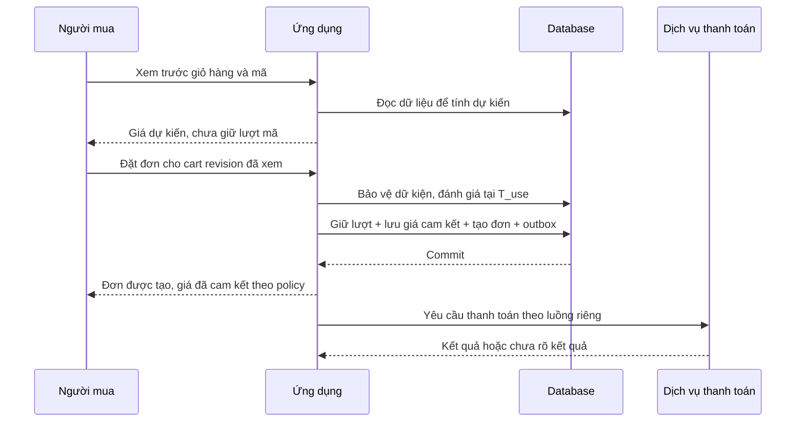

# Use time definition

## 1. “Use time” là thời điểm nào?

Trong chương **TOCTOU Defense** của module bảo vệ logic nghiệp vụ, *use time* là điểm trong luồng xử lý mà hệ thống thực sự dựa vào một quyền, dữ kiện hoặc kết quả kiểm tra để chấp nhận một hành động có ý nghĩa nghiệp vụ.

TOCTOU là khoảng cách giữa **time of check** và **time of use**: dữ kiện được kiểm tra ở một thời điểm, nhưng được dùng sau khi trạng thái liên quan đã có thể thay đổi. Muốn bảo vệ khoảng cách này, trước hết phải xác định chính xác “dùng” nghĩa là gì.

Ví dụ, giao diện kiểm tra mã giảm giá lúc 10:00 và báo hợp lệ. Người dùng tạo đơn lúc 10:10, khi mã đã hết hạn hoặc hết lượt. Nếu hệ thống dùng kết quả kiểm tra lúc 10:00 để tạo giá cuối cùng mà không có một cam kết giá hợp lệ tương ứng, điều kiện nghiệp vụ bị bỏ qua.

Nhưng cũng không thể luôn kết luận rằng phải kiểm tra lại mã ở mọi bước sau đó. Nếu lúc đặt đơn hệ thống đã giữ một lượt mã và cam kết mức giá cho đơn, mã hết hạn trước khi thanh toán có thể không làm mất giá đã được cam kết. Điều này phụ thuộc vào **điểm dùng và hợp đồng nghiệp vụ đã chọn**, không chỉ vào khoảng thời gian đã trôi qua.

“Use time” trước hết là một **sự kiện có ý nghĩa**, không chỉ là một timestamp. Ghi thêm `usedAt` không giải quyết TOCTOU nếu hệ thống chưa biết sự kiện nào được phép tạo ra giá trị đó.

## 2. Tách các mốc thường bị đánh đồng

| Mốc | Ý nghĩa | Chưa chứng minh được |
|---|---|---|
| Nhận request | Thành phần đã nhận một yêu cầu | Người gọi còn quyền lúc hành động có hiệu lực |
| Kiểm tra sơ bộ | Dữ kiện đáp ứng điều kiện tại điểm kiểm tra | Điều kiện vẫn đúng ở bước quyết định sau |
| Chấp nhận có điều kiện | Hệ thống nhận công việc để xét tiếp | Công việc đã được phép thực thi hoặc đã tạo hiệu ứng |
| Điểm quyết định sử dụng | Hệ thống phân xử điều kiện để áp dụng quyền/tài nguyên theo hợp đồng | Mọi hiệu ứng bên ngoài đã hoàn tất |
| Commit cục bộ | Thay đổi trong transaction trở nên có hiệu lực theo database | Dịch vụ ngoài đã hoàn tất tác động |
| Hiệu ứng bên ngoài | Kho giao hàng, cổng thanh toán hoặc storage thực hiện thao tác | Mọi bước khác của workflow đều thành công |
| Phản hồi cho người dùng | Client nhận kết quả | Đây là lúc thao tác thực sự xảy ra |

Có thể ký hiệu:

```text
T_check       : kiểm tra một tập điều kiện.
T_decision    : quyết định sử dụng trong ranh giới được bảo vệ.
T_commit      : commit thay đổi cục bộ.
T_effect      : hiệu ứng thực tế ở thành phần khác, nếu có.
T_response    : phía gọi quan sát được phản hồi.
```

Không mặc định các mốc này bằng nhau. Một transaction có thể commit nhưng response bị mất. Một request có thể được xếp hàng rất lâu sau khi kiểm tra sơ bộ. Một dịch vụ ngoài có thể đã thực hiện nhưng hệ thống nội bộ chưa biết kết quả.

Khi định nghĩa `T_use`, cần nói rõ nó ứng với mốc nào và cho **quyền hoặc tài nguyên nào**. “Dùng mã giảm giá” và “thực hiện thanh toán” không nhất thiết có cùng điểm dùng.

## 3. Viết định nghĩa sử dụng có thể kiểm chứng

Một định nghĩa hữu ích cần trả lời ít nhất các câu hỏi sau:

| Thành phần | Câu hỏi |
|---|---|
| Chủ thể | Ai đang hành động, thay mặt ai, trong tenant nào? |
| Đối tượng | Đúng đối tượng và phiên bản dữ liệu nào được sử dụng? |
| Hành động | Đang xem trước, giữ tài nguyên, cam kết giá hay thực thi? |
| Điều kiện | Quyền, trạng thái, hạn dùng, quota và phê duyệt nào cần đúng? |
| Điểm phân xử | Thành phần/câu lệnh/transaction nào chấp nhận sử dụng? |
| Hiệu lực | Thay đổi nào trở nên có hiệu lực nếu quyết định được commit? |
| Sau quyết định | Điều kiện nào còn phải được kiểm tra ở các bước sau? |
| Khi không rõ kết quả | Dữ kiện nào dùng để đối soát thay vì thực hiện lại? |

Ví dụ định nghĩa còn mơ hồ:

> Mã phải hợp lệ khi người dùng sử dụng.

Định nghĩa cụ thể hơn:

> Với hành động đặt đơn, mã được xét tại điểm admission được bảo vệ sau khi đã nạp và khóa các dữ kiện liên quan. Một lượt mã được giữ cùng với giá đã cam kết và bản ghi đơn trong cùng transaction. Nếu transaction rollback thì không có lượt sử dụng thành công. Hạn mã được đánh giá tại điểm admission này; không cam kết rằng transaction phải commit trước thời điểm hết hạn.

Ở đây, *admission* là quyết định chấp nhận thao tác trong ranh giới kiểm soát, không phải việc HTTP request vừa tới server. Định nghĩa trên chủ động phân biệt thời điểm đánh giá hạn với thời điểm commit. Nếu sản phẩm yêu cầu “commit trước hạn” hoặc “thanh toán trước hạn”, phải chọn và triển khai một hợp đồng khác.

### 3.1. Các invariant nền tảng

| Mã | Invariant |
|---|---|
| U1 | Điều kiện được kiểm tra phải thuộc đúng chủ thể, tenant, đối tượng, phiên bản và hành động đang dùng |
| U2 | Quyết định tại `T_use` dựa trên dữ kiện có bảo đảm nhất quán phù hợp, không mặc định tin kết quả sơ bộ cũ |
| U3 | Quyết định sử dụng và hiệu ứng cục bộ liên quan phải commit nhất quán trong ranh giới đã chọn |
| U4 | Quyền hoặc tài nguyên đã được giữ/cam kết chỉ có phạm vi và thời hạn mà policy thực sự cấp |
| U5 | Thay đổi nội dung làm mất hiệu lực chứng cứ cũ phải bị phát hiện trước khi dùng chứng cứ đó |
| U6 | Retry không tạo thêm một lần sử dụng vì không nhận được phản hồi lần trước |
| U7 | Hệ thống không mô tả điểm kiểm tra cục bộ như bằng chứng đã kiểm soát hiệu ứng ở dịch vụ khác |

## 4. Ví dụ xuyên suốt: mã giảm giá từ preview đến thanh toán

Giả sử mã `PROMO-100` có số lượt giới hạn, thời gian áp dụng và phạm vi sản phẩm. Người mua chỉ được tạo đơn từ giỏ hàng thuộc tenant và tài khoản của mình.



Preview giúp người dùng hiểu kết quả dự kiến. Nếu không giữ tài nguyên hoặc cấp cam kết có hiệu lực, preview không phải bằng chứng còn lượt mã ở lúc đặt đơn.

### 4.1. Những gì có thể thay đổi sau preview

- Người dùng sửa giỏ hàng, địa chỉ hoặc số lượng.
- Giá sản phẩm hoặc điều kiện khuyến mại thay đổi.
- Người khác dùng hết quota của mã.
- Mã hết hạn hoặc bị thu hồi.
- Tài khoản bị khóa hoặc mất quyền trên giỏ hàng.

Server cần nạp dữ kiện đáng tin cậy và áp dụng đúng hợp đồng tại điểm đặt đơn. Không chỉ nhận lại `discountAmount` hoặc `validated=true` từ client.

### 4.2. Giữ giá và kiểm tra lại giá là hai hợp đồng khác nhau

**Giá dự kiến:** preview không cam kết. Khi đặt đơn, server tính lại từ dữ kiện hợp lệ hiện tại; nếu khác nội dung người dùng đã xác nhận, yêu cầu xác nhận lại theo policy.

**Giá được bảo đảm:** server phát quote có phiên bản, đối tượng, phạm vi, thời hạn và điều kiện rõ ràng. Nếu quote cần giữ quota, việc giữ đó phải có cơ chế thực sự. Lúc dùng quote, kiểm tra quote còn hiệu lực và đúng giỏ hàng/hành động; không suy từ chữ ký rằng mọi tài nguyên liên quan đã được giữ.

Hai mô hình đều có thể hợp lệ. Lỗi xuất hiện khi giao diện hứa giá được bảo đảm nhưng backend chỉ lưu một kết quả tính thử, hoặc khi một quote cho giỏ cũ được dùng để đặt giỏ mới.

## 5. Một workflow thường có nhiều use time

Không nhất thiết tìm một `T_use` duy nhất cho cả hệ thống. Hãy liệt kê từng bước tạo nghĩa vụ hoặc trao quyền mới.

| Workflow | Điểm dùng cần phân biệt | Câu hỏi policy |
|---|---|---|
| Đơn dùng mã giảm giá | Giữ lượt mã, cam kết giá, chấp nhận thanh toán | Mã cần còn hạn ở bước nào? Giữ lượt được bao lâu? |
| Duyệt chi | Ghi phiếu, chốt đủ phiếu, tiếp nhận thực thi, chuyển tiền | Điều kiện nào cố định sau duyệt, điều kiện nào phải kiểm tra lại? |
| Tải tài liệu | Cấp grant, cấp URL, bắt đầu request nội dung, resume | Mất quyền sau cấp grant có chặn lượt tải mới không? |
| Import | Upload, preview, duyệt revision, apply từng đơn vị | Quyền ở lúc upload có đủ cho lúc apply không? |
| Tệp đính kèm | Gắn hồ sơ, duyệt phiên bản, dùng hồ sơ trong quyết định | Nội dung thay đổi có làm phê duyệt cũ mất hiệu lực không? |
| Xóa tệp | Chấp nhận yêu cầu, thu hồi đọc, xóa object/version | Điều kiện giữ tệp phải đúng tại bước nào? |

Một bước có thể chỉ cấp quyền cho bước tiếp theo trong phạm vi hẹp. Quyền tạo job không tự cấp quyền nhận dữ liệu sau đó. Phê duyệt một phiên bản không tự phê duyệt nội dung được thay dưới cùng ID.

### 5.1. Admission không luôn là hiệu ứng cuối

Nếu `T_use` của một dịch vụ là lúc nhận một intent bền vững, bảo đảm của dịch vụ đó có thể chỉ là “intent đã được chấp nhận hợp lệ”. Nó không tự chứng minh một hệ thống bên ngoài sẽ dùng quyền hiện hành khi thực thi nhiều phút sau.

Muốn bảo vệ bước ngoài, phải định nghĩa thêm điểm dùng tại thành phần thực thi hoặc cấp một ủy quyền bền vững có điều kiện rõ ràng. Việc này là lựa chọn nghiệp vụ và giao thức, không phải chỉ đổi tên một timestamp.

## 6. Chọn mô hình hiệu lực sau kiểm tra

### 6.1. Kiểm tra quyền hiện hành tại mỗi lần dùng mới

Mô hình này phù hợp khi quyền phải phản ánh thay đổi hiện tại. Ví dụ, mỗi request mới tải một phần tài liệu phải kiểm tra quyền theo policy, kể cả grant đã được cấp trước đó.

Phải làm rõ “lần dùng mới” là từng HTTP request, từng download session hay từng đợt xử lý. Một stream đang gửi byte và một request Range mới có thể có bảo đảm thu hồi khác nhau.

### 6.2. Snapshot hoặc ủy quyền đã cam kết

Một quyết định hợp lệ có thể tạo ra quyền hoặc nghĩa vụ được giữ trong một phạm vi xác định. Ví dụ, một reservation đã commit cho phép đơn giữ lượt mã trong thời hạn thanh toán, dù mã ngừng nhận đơn mới.

Để dùng mô hình này, cần đối tượng ủy quyền/reservation đáng tin cậy, gắn đúng người nhận, tài nguyên, phiên bản, thao tác, thời hạn và quy tắc thu hồi. Không thể coi một boolean `wasChecked=true` là một cam kết nghiệp vụ đầy đủ.

Thu hồi mã cho đơn mới và hủy các reservation đang có là hai hành động khác nhau. Nếu policy cho phép thu hồi cả reservation, các bước sau phải tham gia kiểm tra trạng thái đó.

### 6.3. Xác thực liên tục hoặc kiểm tra theo giai đoạn

Một số tác vụ dài cần kiểm tra ở các điểm tiếp tục được xác định, chẳng hạn trước mỗi đơn vị import hoặc trước mỗi request tải mới. Không nhất thiết giữ khóa database suốt nhiều phút để đạt điều này.

Nếu cần dừng cả tác vụ đang chạy, phải có cơ chế hủy/fencing/gateway phù hợp. Dữ liệu đã gửi hoặc hiệu ứng đã thực hiện không thể được thu hồi chỉ bằng lần kiểm tra tiếp theo.

### 6.4. Không trộn mô hình một cách vô tình

Không tuyên bố “mất quyền chặn ngay mọi lượt dùng mới” trong khi điểm phân phối chấp nhận signed URL bearer còn sống mà không kiểm tra lại. Không tuyên bố “giá đã được giữ” trong khi lúc thanh toán tự đổi mức giảm theo mã hiện tại.

Tên endpoint, thông báo giao diện, trạng thái miền và kiểm thử phải cùng phản ánh hợp đồng đã chọn. Một ngoại lệ có chủ đích cần được mô hình hóa rõ; ngoại lệ phát sinh do cache hoặc queue trễ là nguồn lỗ hổng.

## 7. Thời gian đồng hồ và thứ tự nghiệp vụ

### 7.1. Chọn nguồn thời gian có thẩm quyền

Client có thể gửi `checkedAt` hoặc `requestedAt`, nhưng không được tự quyết định thời điểm hợp lệ của mã. Server cần nguồn thời gian được policy chấp nhận, với độ chính xác và cách xử lý sai lệch phù hợp.

Trong một transaction có tranh chấp, lấy `now` trước khi đợi khóa có thể khiến giá trị đã cũ khi đến điểm quyết định. Nếu hợp đồng yêu cầu xét tại admission sau khi bảo vệ dữ kiện, lấy thời gian ở đúng điểm đó, không tái sử dụng thời gian từ controller hoặc từ message được tạo trước.

Một số cơ chế thời gian của database trả mốc gắn với đầu transaction hoặc đầu câu lệnh, thay vì thời gian thực ở mọi lần gọi. Khi triển khai phải xác minh semantics của nguồn thời gian đang dùng; không giả định mọi hàm mang nghĩa “now” đều giống nhau.

### 7.2. Quy ước biên hết hạn

Ví dụ có thể quy định:

```text
validFrom <= decisionTime < expiresAt
```

Tại đúng `expiresAt`, quyền không còn được nhận cho lần admission mới. Chọn độ chính xác lưu trữ và so sánh thống nhất; không so sánh giây ở một nơi nhưng mili giây ở nơi khác rồi tạo cửa sổ khó giải thích.

Dùng biểu diễn thời gian có quy ước timezone rõ. Nếu nghiệp vụ nói “đến hết ngày tại một địa phương”, phải chuyển quy tắc đó thành biên thời gian theo timezone đã xác định; không trông đợi ngày từ máy người dùng tạo ra cùng một kết quả.

### 7.3. Kiểm tra trước hạn không tự bảo đảm commit trước hạn

Giả sử admission kiểm tra lúc 09:59:59.900, mã hết hạn lúc 10:00:00 và transaction commit lúc 10:00:00.100. Với hợp đồng xét tại admission đã nêu, đơn vẫn có thể hợp lệ nếu transaction hoàn tất; policy không yêu cầu commit trước hạn.

Nếu yêu cầu thực sự là “commit phải xảy ra trước hạn”, một lần so sánh thời gian trong code trước commit không chứng minh điều đó. Cần cơ chế và semantics commit/deadline phù hợp ở hệ thống có thẩm quyền hoặc thay đổi hợp đồng. Không gán timestamp kiểm tra thành timestamp commit để che khoảng cách.

Tương tự, thanh toán được gửi trước hạn không chứng minh cổng thanh toán thực hiện trước hạn. Phải xác định bên nào xét hạn và sự kiện nào được bên đó công nhận.

### 7.4. Thứ tự xác nhận khác thứ tự timestamp

Thu hồi và sử dụng có thể được phân xử bằng cùng khóa hoặc cơ chế nguyên tử. Thứ tự quyết định khi đó đáng tin hơn việc so hai timestamp từ hai service có thể lệch đồng hồ.

Clock đơn điệu hữu ích để đo khoảng chờ trong một process, nhưng không tự là đồng hồ xác thực thời hạn dùng chung giữa nhiều máy. Đừng dùng thời gian đo latency thay cho thời gian hiệu lực nghiệp vụ.

## 8. Gắn kiểm tra với điểm dùng bằng cơ chế thực thi

Định nghĩa đúng `T_use` mới là bước đầu. Phải bảo đảm những thay đổi làm điều kiện sai không thể lọt vào giữa kiểm tra và quyết định sử dụng theo cách trái hợp đồng.

| Cơ chế | Điều có thể bảo vệ | Giới hạn cần chú ý |
|---|---|---|
| Khóa dữ kiện liên quan | Giữ trạng thái được kiểm tra ổn định trong transaction | Không dừng thời gian trôi; không tự khóa dịch vụ ngoài |
| Cập nhật có điều kiện/CAS | Chỉ một bên dùng đúng trạng thái hoặc version nguồn | Không bao phủ điều kiện nằm ngoài predicate/giao thức |
| Snapshot bất biến | Ràng buộc sử dụng với đúng nội dung đã cam kết | Không tự chứng minh quyền hiện tại hoặc tài nguyên còn sẵn |
| Reservation | Giữ quota/tài nguyên theo đối tượng và thời hạn | Phải thực sự phân xử tài nguyên, có quy tắc hết hạn/giải phóng |
| Grant/ủy quyền có phạm vi | Chuyển một quyền xác định tới bước dùng sau | Hiệu lực thu hồi tùy cơ chế kiểm tra tại điểm thực thi |
| Idempotency và ledger | Nhận diện lần dùng đã commit khi retry | Không thay thế authorization hoặc điều kiện dùng mới |

### 8.1. Ví dụ cập nhật quota có điều kiện

Sau khi bảo vệ đúng dữ kiện và xác định mốc admission theo policy, một cập nhật có thể mang các điều kiện như sau:

```sql
UPDATE promotion_budget
SET reserved_uses = reserved_uses + 1,
    version = version + 1
WHERE tenant_id = :verified_tenant_id
  AND promotion_id = :promotion_id
  AND enabled = TRUE
  AND version = :expected_version
  AND reserved_uses < total_quota
  AND valid_from <= :admission_time
  AND :admission_time < expires_at;
```

SQL chỉ minh họa phần ngân sách khuyến mại, không phải toàn bộ checkout. `admission_time` do hệ thống có thẩm quyền xác định theo hợp đồng đã chọn, không phải thời gian client gửi. Nếu đã đợi khóa, không dùng lại thời gian lấy trước lúc chờ.

Chỉ khi cập nhật đúng một dòng mới được coi là giành được lượt theo những predicate trên. Giới hạn theo khách hàng, điều kiện sản phẩm, quyền trên giỏ và giá cam kết vẫn cần được bảo vệ trong cùng đơn vị quyết định. Không đọc riêng quota của khách hàng rồi cho nhiều transaction cùng vượt giới hạn đó.

Nếu tạo đơn hoặc ghi reservation thất bại, cập nhật quota cũng phải rollback. Nếu kết quả cập nhật là 0, không bỏ điều kiện version/thời hạn rồi chạy lại một câu tăng không kiểm soát.

### 8.2. Nội dung đã kiểm tra phải là nội dung được dùng

Khóa quota không ngăn client tráo giỏ hàng. Kiểm tra cart revision, quote reference và các phạm vi được policy yêu cầu. Nếu một phụ thuộc như giá hoặc nhóm sản phẩm thay đổi mà version gốc không đổi, cần version/khóa/snapshot của phụ thuộc đó.

Một dấu `approved=true` hoặc chữ ký trên một ID không đủ nếu nội dung dưới ID còn thay đổi. Ràng buộc phải bao phủ đúng dữ kiện làm nên quyết định nghiệp vụ.

## 9. Mã giả Java cho điểm dùng tại admission

Đoạn dưới là mã giả, không phải implementation chạy ngay. Nó chọn hợp đồng: **hạn mã được xét bằng thời gian có thẩm quyền tại admission được bảo vệ; lượt mã và giá cam kết chỉ có hiệu lực nếu transaction commit**. Đây không phải bảo đảm commit hoặc thanh toán trước khi mã hết hạn.

Giả định:

- Giỏ hàng, quota, reservation, đơn hàng, ledger và outbox cùng database.
- Dữ kiện quyền, điều kiện khuyến mại và giá được bảo vệ bằng khóa/version/snapshot phù hợp.
- Luồng đổi quyền, đổi policy và giải phóng reservation tham gia cơ chế đồng bộ tương ứng.
- Không gọi dịch vụ thanh toán trong transaction này.

```java
OrderReceipt placeOrder(
        AuthenticatedPrincipal principal,
        VerifiedTenantContext tenant,
        PlaceOrderCommand command) {

    return transactions.required(() -> {
        AuthorizationContext authority = access.protectCurrentCheckoutFacts(
            principal, tenant);
        Cart cart = carts.lockByTenantAndId(tenant.id(), command.cartId());
        access.requireCanCheckout(principal, cart, authority);

        CommandClaim claim = commands.claimOrLoadWithinTransaction(
            tenant.id(), principal.id(), "PLACE_ORDER",
            command.idempotencyKey(), fingerprints.forCheckout(command));

        if (claim.alreadyCommitted()) {
            return claim.authorizedReceipt();
        }

        cart.requireOpenAtRevision(command.cartRevision());
        Promotion promotion = promotions.lockByTenantAndId(
            tenant.id(), command.promotionId());
        promotion.requireVersion(command.promotionRevision());
        CustomerUsage usage = usages.lockOrCreateWithinTransaction(
            tenant.id(), principal.id(), promotion.id());

        AgreedTerms terms = pricing.buildFromProtectedData(cart, promotion);
        pricing.requireMatchesConfirmedTerms(command.confirmedTermsReference(), terms);
        eligibility.requireProtectedNonTemporalConditions(
            principal, cart, promotion, usage, authority);

        // Mốc xét hạn theo policy, lấy sau các bước chờ khóa liên quan.
        Instant admissionTime = timeAuthority.readForAdmission();

        boolean reserved = promotions.reserveOneIfEligibleAt(
            promotion, usage, admissionTime);
        if (!reserved) {
            throw new PromotionNotApplicable();
        }

        Reservation reservation = reservations.createForOrderAttempt(
            cart.id(), claim.operationId(), promotion.id(),
            admissionTime, terms.reservationDeadline());
        usage.recordReservedUse(reservation.id());
        usages.save(usage);

        Order order = orders.createAtAgreedTerms(
            principal.id(), tenant.id(), cart, terms, reservation);
        cart.markOrdered(order.id());
        carts.save(cart);

        audit.appendOrderAdmitted(order, admissionTime, promotion, reservation);
        outbox.appendOrderAccepted(order.id(), claim.operationId());
        OrderReceipt receipt = receipts.from(order);
        commands.complete(claim, receipt);
        return receipt;
    });
}
```

`readForAdmission` phải có semantics đã xác định và được triển khai đúng với nguồn thời gian thực tế. Trong ví dụ, timestamp đó biểu diễn mốc mà policy chọn để xét hạn; nó không được ghi nhãn thành thời gian commit. Các bước sau admission không được mở khóa rồi đổi nội dung quyết định trước khi cùng transaction kết thúc.

`reserveOneIfEligibleAt` phải bảo vệ quota tổng và những điều kiện thời gian/trạng thái tương ứng. Quota theo khách hàng được kiểm tra trên bản ghi usage đã phân xử, không phải một phép đếm ngoài transaction. Các phương thức lock/claim phải có ràng buộc và xử lý tranh chấp database thực sự.

Giá trong đơn lấy từ `AgreedTerms` đáng tin cậy, không từ số tiền client tự khai. Một terms reference từ preview chỉ được dùng nếu còn đúng nội dung và mô hình giá đã xác nhận; bản preview không tự giữ quota.

Nếu code không lấy được thời gian phù hợp, không bảo vệ được phụ thuộc quyền hoặc không lưu được reservation, không được báo đã dùng mã thành công. Nếu transaction rollback, không có lượt giữ thành công; nếu commit rồi mất response, đối soát ledger thay vì giữ thêm lượt.

## 10. Điểm dùng khi có queue hoặc dịch vụ ngoài

### 10.1. Thời gian nằm trong message không phải quyền hiện tại

Một message có `validatedAt` chỉ mô tả lần kiểm tra trước. Worker cần biết nó đang nhận:

- Một yêu cầu cần được kiểm tra lại tại lúc thực thi.
- Hay một nghĩa vụ/ủy quyền đã được cấp bền vững, có phạm vi và điều kiện sử dụng cụ thể.

Không suy ra loại thứ hai chỉ vì message được gửi từ một service nội bộ. Credential của worker cho phép nó truy cập hạ tầng; quyền thực hiện nghiệp vụ vẫn phải có căn cứ đúng.

### 10.2. Kiểm tra sát lời gọi mạng vẫn có khoảng cách

```text
Service A kiểm tra quyền còn hợp lệ.
Quyền bị thu hồi.
Service A gửi yêu cầu tới service B.
Service B thực hiện bằng quyền hạ tầng của A.
```

Chỉ thêm một lần `checkPermission()` ngay trước lời gọi không tạo ra tính nguyên tử xuyên hai service. Nếu yêu cầu là quyền hiện hành tại B, B hoặc gateway có thẩm quyền phải tham gia cơ chế kiểm tra/phân xử thích hợp.

Nếu thiết kế dùng ủy quyền đã cam kết, B phải kiểm tra đúng ủy quyền, hành động, đối tượng, phiên bản, thời hạn và khả năng dùng lại. Khi đó cần công bố cửa sổ hiệu lực/thu hồi thực tế; không gọi nó là kiểm tra quyền tức thời nếu không đáp ứng.

### 10.3. Hiệu ứng ngoài phải có điểm xác nhận riêng

Outbox giúp nối commit cục bộ với ý định gửi, nhưng không chứng minh hiệu ứng ở đích. Dùng operation ID ổn định, idempotency ở đích khi có, và trạng thái chưa rõ khi mất phản hồi.

Với thanh toán cho đơn đã có giá cam kết, policy phải nói rõ dùng reservation còn hiệu lực là đủ hay cần thêm điều kiện tại lúc tiếp nhận thanh toán. Không tự áp dụng lại mọi điều kiện của mã rồi làm sai một cam kết giá đã được cấp hợp lệ.

## 11. Thu hồi, hết hạn và điểm tiếp tục

### 11.1. Thu hồi trước điểm dùng

Nếu hợp đồng yêu cầu quyền hiện hành, một lần thu hồi đã có hiệu lực trước điểm dùng được phân xử phải làm hành động bị chặn. Để chứng minh điều này, thu hồi và sử dụng cần chung cơ chế thứ tự thích hợp.

Ví dụ, cả hai khóa guard liên quan, rồi thay đổi quyền hoặc chấp nhận hành động trong transaction. Nếu chỉ luồng sử dụng khóa đối tượng còn luồng thu hồi sửa bảng quyền tự do, bảo đảm vẫn có thể bị phá.

### 11.2. Thu hồi sau điểm dùng

Sau khi một nghĩa vụ đã được chấp nhận hợp lệ, thu hồi có thể chỉ chặn các lần admission mới hoặc có thể vô hiệu cả nghĩa vụ đang chờ, tùy policy.

Với đơn đã giữ giá, có thể cần hành động hủy reservation riêng. Với file đã gửi byte, không thể thu hồi những byte người dùng đã nhận. Với tác vụ ngoài đã được đích tiếp nhận, có thể cần quy trình yêu cầu dừng hoặc compensation.

Không đổi state thành `REVOKED` rồi kết luận mọi hiệu ứng trước đã được hoàn tác. Ghi rõ phạm vi mà thay đổi đó thực sự kiểm soát.

### 11.3. Hết hạn không phải một khóa dữ liệu

Thời gian tiếp tục trôi khi transaction giữ khóa. Một lock bảo vệ record khỏi thay đổi không giữ cho một grant luôn còn hạn.

Vì vậy, cần lấy và xét thời gian ở điểm policy đã chọn. Nếu tác vụ có nhiều điểm dùng mới, mỗi điểm phải có điều kiện tương ứng. Nếu policy cho phép tiếp tục một phiên đã admission trước hạn, đó là quyền được định nghĩa; không phải do expiry vô tình bị bỏ qua.

## 12. Retry không được định nghĩa lại use time tùy tiện

### 12.1. Replay một lần dùng đã commit

Nếu đặt đơn đã commit, retry cùng command trả receipt theo quyền hiện tại và không giữ thêm lượt mã. Timestamp admission gốc vẫn mô tả quyết định gốc; không thay bằng thời gian retry để làm lịch sử trông như một lần dùng mới.

Quyền xem receipt và quyền thực hiện thao tác mới là hai quyết định khác nhau. Không vì đã có receipt mà bỏ qua việc tài khoản hiện tại bị khóa hoặc không còn được xem đơn.

### 12.2. Thử lại một transaction đã rollback

Nếu chắc chắn transaction chưa có hiệu lực và policy cho phép thử lại, đó là lần đánh giá mới. Nó cần dữ kiện và thời gian phù hợp tại điểm admission mới; mã có thể đã hết hạn trong lúc chờ retry.

Không dùng lại `admissionTime` từ transaction đã rollback để tiếp tục nhận mã sau hạn. Nếu nghiệp vụ muốn bảo lưu quyền thử lại, phải có một reservation hoặc quyền được cấp bền vững thực sự, không chỉ một biến thời gian trong bộ nhớ.

### 12.3. Kết quả chưa rõ

Timeout sau commit có thể che giấu một đơn và reservation đã tồn tại. Tra cứu command/operation từ nguồn có thẩm quyền trước khi quyết định nhận lượt mới. Một lần đọc replica trễ không đủ để kết luận chưa xảy ra hiệu ứng.

Khóa idempotency cũng chưa đủ nếu người gọi đổi key để đặt lại cùng giỏ. Trạng thái giỏ, định danh thao tác nghiệp vụ và ràng buộc liên quan cần ngăn hai lần chấp nhận cho cùng một ý định mà hệ thống chỉ cho phép một lần.

## 13. Kiểm thử định nghĩa điểm dùng

Kiểm thử phải chứng minh đúng hợp đồng đã viết, không chỉ chứng minh “có gọi lại hàm kiểm tra”. Chuẩn bị đồng hồ có thể điều khiển tại lớp thẩm quyền thời gian, dữ liệu nhiều version và các điểm dừng ở ranh giới transaction.

| Tình huống | Kết quả theo mô hình admission của bài |
|---|---|
| Preview hợp lệ, đặt đơn sau khi hết hạn | Không dùng preview để bỏ qua điều kiện admission mới |
| Còn hạn lúc nhận request, hết hạn trong lúc chờ khóa | Dùng thời gian sau khi bảo vệ dữ kiện; không dùng `now` cũ |
| Thời điểm admission đúng `expiresAt` | Không nhận lượt mới theo khoảng thời gian đã định nghĩa |
| Admission trước hạn, commit sau hạn | Có thể được chấp nhận nếu transaction commit, đúng hợp đồng xét tại admission |
| Transaction rollback sau khi tăng quota | Không có reservation/đơn/lượt dùng thành công tồn tại lệch nhau |
| Retry transaction đã rollback sau hạn | Đánh giá admission mới; không tái sử dụng thời gian cũ |
| Mất response sau commit rồi retry sau hạn | Không tạo thêm lượt; receipt gốc theo quyền xem hiện tại |
| Giỏ thay đổi sau preview | Phát hiện revision/terms không còn khớp; không dùng mức giảm của giỏ cũ |
| Giá hoặc nhóm sản phẩm đổi | Khóa/version/snapshot bảo vệ đúng các phụ thuộc mà policy yêu cầu |
| Hai người tranh lượt mã cuối | Chỉ số lượt được phép được nhận; không dựa vào hai preview hợp lệ |
| Cùng khách hàng tranh hạn mức riêng | Quota cá nhân không bị vượt dù quota tổng còn nhiều |
| Thu hồi quyền trước admission được phân xử | Không tạo đơn bằng quyền cũ |
| Thu hồi sau khi đã tạo reservation | Hành vi đúng policy về reservation đang có, không suy đoán |
| Queue giữ công việc quá lâu | Worker không coi thời gian kiểm tra trong message là quyền hiện tại |
| Grant hết hạn giữa hai request nội dung | Request mới tuân theo điểm dùng đã chọn cho mô hình tải |
| Dịch vụ ngoài đã thực hiện nhưng response timeout | Giữ/đối soát kết quả chưa rõ, không thực hiện lại bằng key mới |
| Client giả `requestedAt` hoặc `validatedAt` | Không thay đổi nguồn thời gian và quyết định hiệu lực |

### 13.1. Điều khiển đúng cả thời gian và đồng thời

Đặt barrier để request chờ khóa, dịch đồng hồ qua hạn rồi cho nó tiếp tục. Nếu implementation lấy `now` ở controller, test sẽ phát hiện việc nhận một admission mới bằng thời gian cũ.

Với quota, dùng hai transaction/kết nối độc lập để tranh cùng lượt. Với thu hồi, chạy cả hai thứ tự: thu hồi được phân xử trước, và admission được phân xử trước. Kết quả phải theo hợp đồng, không theo việc thread nào được log trước.

Không dùng `sleep` ngẫu nhiên làm bằng chứng chính. Nếu chỉ fake đồng hồ Java nhưng điều kiện thật dùng đồng hồ database, test chưa điều khiển được nguồn thời gian có thẩm quyền.

### 13.2. Kiểm tra cả phần được phép tiếp tục

TOCTOU defense không có nghĩa mọi thay đổi sau đó đều phải làm tác vụ thất bại. Cần test cả việc một giá đã cam kết hợp lệ tiếp tục được tôn trọng, hoặc một phiên được phép tiếp tục theo policy không bị đổi quyền một cách ngoài hợp đồng.

Điều cần bảo vệ là ranh giới quyền và nghĩa vụ đã định nghĩa. Kiểm tra lại quá muộn, sai đối tượng hoặc theo policy khác cũng có thể làm hệ thống sai nghiệp vụ.

## 14. Audit để chứng minh đúng điểm sử dụng

Một bản ghi quyết định có thể cần:

```text
subjectId, tenantId, action
objectId, objectRevision, policyRevision
operationId, reservationId hoặc grantId
usePointKind = CHECKOUT_ADMISSION
decisionTime, timeAuthority
conditionsEvaluated, decisionOutcome
committedResultReference
```

Ghi thời gian theo đúng semantics. `decisionTime` không được đổi tên thành `committedAt` nếu đó chỉ là thời gian xét điều kiện. Nếu ghi thời điểm quan sát commit hoặc thu nhận audit, đặt tên phản ánh phạm vi quan sát và không coi nó là thời gian hiệu ứng ngoài.

Phân biệt quyết định sơ bộ, admission đã có hiệu lực qua commit, hiệu ứng được đích xác nhận và kết quả chưa rõ. Một log “coupon valid” từ preview không phải bằng chứng mã đã được dùng hợp lệ để tạo đơn.

Khi điều tra, nối bằng version, operation và reservation, không chỉ so timestamp. Không ghi token, cookie, signed URL hoặc toàn bộ dữ liệu nhạy cảm để chứng minh một điều kiện đã được xét.

Các tín hiệu đáng theo dõi gồm nhiều lần dùng preview cũ, command cố dùng revision không khớp, thời gian chờ trước admission dài, retry sau hạn, quote bị dùng ngoài phạm vi và hiệu ứng ngoài chưa được đối soát. Chúng giúp tìm chỗ định nghĩa hoặc thực thi điểm dùng còn sai.

## 15. Bài tập: chuyển một yêu cầu mơ hồ thành hợp đồng thực thi

Một hệ thống hiện có quy tắc “mã giảm giá phải còn hiệu lực khi dùng”. API preview trả `valid=true`; client lưu kết quả đó. API đặt đơn có thể chờ khóa vài giây, còn thanh toán được worker thực hiện sau vài phút. Khi timeout, client gửi lại bằng key mới.

Hãy trả lời và thiết kế:

1. Preview có cam kết gì hay chỉ là tính dự kiến?
2. Sự kiện nào là điểm dùng mã: giữ lượt, tạo đơn, tiếp nhận thanh toán hay một sự kiện khác?
3. Điều kiện nào phải hiện hành, điều kiện nào đã được cố định trong quote/reservation?
4. Nguồn thời gian nào xét hạn, khoảng hiệu lực có bao gồm đúng thời điểm hết hạn không?
5. Nếu hết hạn trong lúc chờ khóa hoặc sau admission trước commit, kết quả nào được phép?
6. Lượt mã, reservation, giá và đơn được commit nhất quán như thế nào?
7. Retry sau rollback khác retry sau commit chưa nhận response ra sao?
8. Hệ thống chứng minh điều gì ở bước thanh toán ngoài, và còn cần đối soát điều gì?

Sau khi chọn câu trả lời, viết invariant, state transition, predicate thời gian và các kiểm thử tương ứng. Không bắt đầu bằng cách thêm một trường `checkedAt` rồi coi yêu cầu đã rõ.

Thiết kế đạt yêu cầu phải trả lời được: **“Tại sự kiện nào hệ thống thực sự dùng quyền hoặc điều kiện này, và cơ chế nào bảo đảm quyết định đó đúng với nội dung, thời gian và phạm vi đã cam kết?”** Câu trả lời cần thể hiện trong hợp đồng nghiệp vụ và ranh giới thực thi, không chỉ trong một timestamp.
