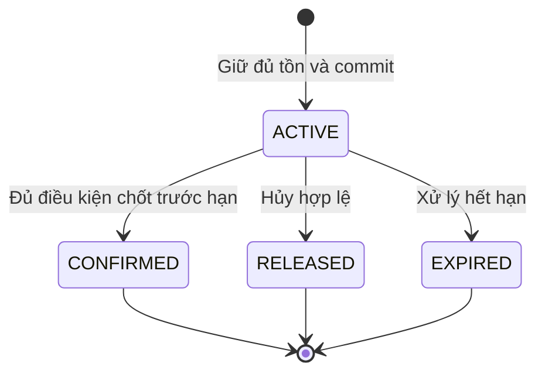

# Inventory recheck: kiểm tra lại tồn kho tại điểm giữ hàng

## 1. Mục tiêu và phạm vi

Trong chương **TOCTOU Defense**, inventory recheck là việc xác minh lại điều kiện tồn kho ngay tại thao tác có hiệu lực nghiệp vụ, chẳng hạn giữ hàng cho checkout. TOCTOU, viết đầy đủ là *time of check to time of use*, xuất hiện khi trạng thái có thể thay đổi giữa lúc kiểm tra và lúc sử dụng kết quả kiểm tra.

Một trang sản phẩm hiển thị “còn 1 sản phẩm” chỉ phản ánh dữ liệu ở một thời điểm. Khi người mua bấm đặt hàng, một yêu cầu khác có thể đã giữ sản phẩm đó. Lặp lại câu lệnh đọc tồn kho ở đầu API vẫn chưa đủ: khoảng trống giữa lần đọc mới và lần ghi tiếp theo vẫn có thể bị khai thác.

Trong phạm vi bảo vệ logic nghiệp vụ của module `SECURITY_APPLICATION_SECURITY_BUSINESS_LOGIC_SECURITY`, bài học tập trung vào ba việc:

- Biến quy tắc “không giữ hoặc bán vượt tồn” thành điều kiện được thực thi nguyên tử.
- Gắn thay đổi tồn kho với đúng đơn hàng, chủ thể có quyền, trạng thái và giao dịch.
- Ngăn yêu cầu trùng, callback lặp hoặc cuộc đua hết hạn làm giữ, trừ hay hoàn tồn nhiều lần.

Ví dụ xuyên suốt là một dịch vụ checkout dùng một cơ sở dữ liệu quan hệ làm nguồn tồn kho có thẩm quyền. Các câu SQL minh họa dùng tham số có tên cho dễ đọc; ví dụ JDBC dùng dấu `?`. Khi triển khai, cần dùng cú pháp, kiểu thời gian và quy tắc xử lý xung đột đúng với hệ quản trị đang sử dụng.

## 2. Xác định bất biến trước khi viết mã

Với mỗi cặp `(warehouse_id, sku_id)`, quy ước:

| Đại lượng | Ý nghĩa trong bài |
| --- | --- |
| `on_hand` | Tổng tồn đang được hệ thống quản lý cho luồng bán, bao gồm phần đang giữ |
| `reserved` | Tổng số lượng đang được các reservation ở trạng thái `ACTIVE` giữ |
| `available` | Lượng có thể giữ thêm, tính bằng `on_hand - reserved` |

Bài này quy ước trừ `on_hand` khi chốt bán. Nếu doanh nghiệp chỉ trừ tồn khi xuất kho, cần thêm trạng thái hoặc đại lượng cho hàng đã chốt nhưng chưa xuất; không dùng nguyên mô hình đơn giản này để biểu diễn toàn bộ kho vật lý.

Các bất biến cần bảo vệ tại ranh giới giao dịch đã commit:

```text
0 <= reserved <= on_hand
available = on_hand - reserved
reserved = tổng quantity của các reservation item thuộc reservation ACTIVE

Giữ q:       reserved := reserved + q, chỉ khi q > 0 và available >= q
Chốt bán q:  on_hand := on_hand - q; reserved := reserved - q
Nhả giữ q:   reserved := reserved - q
```

Đẳng thức tổng reservation áp dụng trong cùng phạm vi kho và SKU, với giả định mọi luồng giữ hàng đều đi qua mô hình này. Reservation đã quá `expires_at` nhưng vẫn mang trạng thái `ACTIVE` tiếp tục chiếm `reserved` cho đến khi giao dịch hết hạn thực sự commit. Chỉ đổi cách tính trên màn hình theo thời gian mà chưa cập nhật sổ giữ hàng sẽ khiến các đại lượng lệch nhau.

Bất biến còn bao gồm danh tính và trạng thái:

- Một reservation chỉ được giữ tồn một lần, dù client gửi lại nhiều yêu cầu.
- Một reservation chỉ có một kết quả kết thúc: `CONFIRMED`, `RELEASED` hoặc `EXPIRED`.
- Số lượng dùng để chốt hoặc nhả phải lấy từ reservation item đã lưu, không lấy lại từ body của callback.
- Người gọi phải có quyền trên đơn hàng và tenant tương ứng; biết `order_id` hoặc `reservation_id` không tạo ra quyền thao tác.

## 3. Vì sao đọc lại rồi cập nhật vẫn có lỗi?

Đoạn mã sau có vẻ đã “kiểm tra lại tồn” nhưng vẫn hở cửa sổ TOCTOU:

```java
long available = repository.readAvailable(warehouseId, skuId);
if (available >= quantity) {
    repository.increaseReserved(warehouseId, skuId, quantity);
    return ACCEPTED;
}
return OUT_OF_STOCK;
```

Giả sử `on_hand = 1`, `reserved = 0`, hai request cùng muốn giữ một sản phẩm:

| Thứ tự | Request A | Request B |
| --- | --- | --- |
| 1 | Đọc `available = 1` | |
| 2 | | Đọc `available = 1` |
| 3 | Giữ 1 sản phẩm | |
| 4 | | Tiếp tục giữ 1 theo kết quả đọc cũ |

Nếu hai lần tăng đều được ghi nhận, tổng giữ thành 2 trong khi chỉ có 1 sản phẩm. Nếu ứng dụng ghi đè một giá trị `reserved` đã tính từ snapshot cũ, có thể xuất hiện mất cập nhật: bộ đếm vẫn là 1 nhưng đã chấp nhận hai reservation. Cả hai đều vi phạm quy tắc nghiệp vụ.

Những thay đổi sau không tự khắc phục lỗi:

- Đưa hai câu lệnh vào transaction nhưng vẫn dùng phép đọc thường ở mức cô lập cho phép cuộc đua này.
- Đọc thêm một lần từ cache hoặc replica trước khi ghi.
- Vô hiệu hóa nút đặt hàng sau lần bấm đầu tiên.
- Dùng `synchronized` hoặc khóa trong bộ nhớ của một instance khi dịch vụ có nhiều instance.

Điều cần bảo vệ là quyết định **kiểm tra và chiếm tồn**, không chỉ số lần đọc dữ liệu.

## 4. Đưa điều kiện tồn kho vào chính câu lệnh cập nhật

Với mô hình bộ đếm đơn giản, thao tác giữ hàng có thể biểu diễn bằng một câu lệnh có điều kiện:

```sql
UPDATE inventory
SET reserved = reserved + :quantity
WHERE warehouse_id = :warehouse_id
  AND sku_id = :sku_id
  AND :quantity > 0
  AND on_hand - reserved >= :quantity;
```

Ứng dụng chỉ chấp nhận giữ hàng khi đúng một dòng được cập nhật. Khóa chính của bảng bảo đảm cặp kho và SKU xác định duy nhất một dòng.

| Kết quả | Cách hiểu |
| --- | --- |
| Cập nhật 1 dòng | Đã chiếm được lượng tồn trong giao dịch hiện tại; còn phải commit toàn bộ giao dịch |
| Cập nhật 0 dòng | Không có dòng tồn phù hợp hoặc điều kiện tồn không thỏa; không được tạo kết quả giữ thành công |
| Lỗi khóa, deadlock hoặc serialization | Giao dịch gặp xung đột; xử lý rollback và chính sách retry, không tự diễn giải thành hết hàng |

Mẫu này dựa vào cơ chế ghi của cơ sở dữ liệu: các phép sửa cùng dòng phải được điều phối, và điều kiện phải được xét trên phiên bản dòng mà phép cập nhật có quyền sửa. Tùy mức cô lập và engine, một giao dịch cạnh tranh có thể chờ, cập nhật 0 dòng hoặc bị hủy vì xung đột. Cần xử lý đầy đủ các kết quả đó.

Điểm quyết định tồn nằm trong câu `UPDATE` có điều kiện. Quyền giữ hàng chỉ được công bố sau khi transaction chứa câu lệnh đó commit thành công. Không trả “đã giữ hàng” ngay sau một lần đọc `available` hoặc trước khi commit.

Điều kiện phải dùng khóa kho và SKU do máy chủ xác định theo quy tắc phân bổ. Client không được tự chọn một kho bất kỳ để đi vòng hạn mức hay quyền bán hàng.

## 5. Mô hình dữ liệu tối thiểu cho vòng đời giữ hàng

Bộ đếm giúp chiếm tồn nguyên tử; sổ reservation giúp biết ai đang giữ và mỗi lần chuyển trạng thái phải cập nhật lượng nào.

```sql
CREATE TABLE inventory (
    warehouse_id VARCHAR(64) NOT NULL,
    sku_id VARCHAR(64) NOT NULL,
    on_hand BIGINT NOT NULL,
    reserved BIGINT NOT NULL DEFAULT 0,
    PRIMARY KEY (warehouse_id, sku_id),
    CHECK (on_hand >= 0),
    CHECK (reserved >= 0 AND reserved <= on_hand)
);

CREATE TABLE stock_reservation (
    reservation_id VARCHAR(64) PRIMARY KEY,
    tenant_id VARCHAR(64) NOT NULL,
    actor_id VARCHAR(64) NOT NULL,
    order_id VARCHAR(64) NOT NULL,
    idempotency_key VARCHAR(128) NOT NULL,
    request_fingerprint VARCHAR(128) NOT NULL,
    status VARCHAR(16) NOT NULL,
    created_at TIMESTAMP NOT NULL,
    expires_at TIMESTAMP NOT NULL,
    UNIQUE (tenant_id, actor_id, idempotency_key),
    UNIQUE (tenant_id, order_id),
    CHECK (status IN ('ACTIVE', 'CONFIRMED', 'RELEASED', 'EXPIRED')),
    CHECK (expires_at > created_at)
);

CREATE TABLE stock_reservation_item (
    reservation_id VARCHAR(64) NOT NULL,
    warehouse_id VARCHAR(64) NOT NULL,
    sku_id VARCHAR(64) NOT NULL,
    quantity BIGINT NOT NULL,
    PRIMARY KEY (reservation_id, warehouse_id, sku_id),
    FOREIGN KEY (reservation_id)
        REFERENCES stock_reservation (reservation_id),
    FOREIGN KEY (warehouse_id, sku_id)
        REFERENCES inventory (warehouse_id, sku_id),
    CHECK (quantity > 0)
);
```

Các mốc thời gian cần được biểu diễn nhất quán, chẳng hạn theo UTC; kiểu cột cụ thể tùy hệ quản trị. `actor_id` được lấy từ danh tính đã xác thực và `tenant_id` từ ngữ cảnh đã được kiểm chứng, không tin trực tiếp các trường cùng tên do client gửi.

Thiết kế này chọn **một vòng đời reservation cho mỗi đơn checkout**: ràng buộc `(tenant_id, order_id)` chặn việc dùng khóa idempotency khác để giữ thêm cho cùng đơn. Khi reservation đã kết thúc, một lần mua lại phải đi qua quy trình tạo phiên checkout mới hợp lệ. Nếu sản phẩm cho phép nhiều lần giữ liên tiếp trên cùng đơn, cần mô hình hóa `checkout_attempt` hoặc phiên bản đơn và ràng buộc tương ứng; không bỏ ràng buộc rồi hy vọng idempotency key xử lý mọi trường hợp.

`request_fingerprint` đại diện cho nội dung có ý nghĩa của yêu cầu sau chuẩn hóa, ví dụ mã đơn, phiên bản giỏ hàng và danh sách SKU với số lượng đã gộp. Không hash nguyên JSON khi thứ tự field hoặc thứ tự dòng không mang ý nghĩa. Cùng khóa nhưng khác nội dung phải bị từ chối, không được âm thầm áp dụng nội dung mới.

Các `CHECK` bảo vệ giới hạn cục bộ của dòng. Chúng không tự bảo đảm `reserved` bằng tổng reservation item, không kiểm tra quyền theo đối tượng và không thay thế giao dịch ứng dụng.

## 6. Quy trình giữ hàng trong một transaction

Trước khi mở transaction, dịch vụ xác thực người gọi, giới hạn kích thước request và chuẩn hóa số lượng. Các kiểm tra đó chưa cấp quyền giữ hàng; quyền và trạng thái có thể thay đổi vẫn phải được kiểm chứng tại thao tác có hiệu lực.

Luồng dưới đây là mã giả, biểu diễn ranh giới giao dịch và thứ tự tác động:

```text
validate_and_normalize(request)
derive_actor_and_tenant_from_authenticated_context()

BEGIN TRANSACTION

  lock_and_load_order(tenant_id, order_id)
  verify_object_permission(actor_id, order)

  existing = find_reservation_by_scoped_idempotency_key()
  if existing exists:
      verify_same_request_fingerprint(existing, request)
      COMMIT
      return persisted_result(existing)

  verify_order_is_open_and_cart_version_matches()
  verify_order_has_no_existing_reservation()
  choose_warehouse_and_build_authoritative_item_list()

  INSERT stock_reservation(status = ACTIVE, expires_at = server_policy)

  for item in items_sorted_by(warehouse_id, sku_id):
      affected = conditional_inventory_reserve(item)
      if affected != 1:
          ROLLBACK
          return reservation_not_created
      INSERT stock_reservation_item(item)

  update_order_to_reserved_with_expected_state_and_version()
  verify_order_update_affected_exactly_one_row()
  append_outbox_event_if_downstream_notification_is_required()

COMMIT
return persisted_reservation_result
```

Khóa đơn hàng trong ví dụ dùng để giữ ổn định quyền sở hữu, trạng thái và phiên bản đơn trong giao dịch. Đây là điều kiện của mô hình: mọi luồng sửa cùng đơn phải tuân thủ cơ chế khóa hoặc cập nhật có phiên bản tương ứng. Nếu quyền nằm ở một bản ghi ACL có thể bị thu hồi độc lập, cần bảo vệ cả nguồn quyền đó theo chính sách của hệ thống; khóa mỗi dòng đơn không tự khóa mọi nguồn phân quyền.

Việc kiểm tra reservation đã tồn tại đứng trước điều kiện “đơn phải còn mở” để một lần gửi lại có thể nhận kết quả cũ dù lần đầu đã đưa đơn sang trạng thái được giữ. Mọi đường trả kết quả cũ vẫn phải kiểm tra quyền truy cập đối tượng ở hiện tại.

Tra cứu trước không loại bỏ cuộc đua tạo trùng. Nếu hai request chưa nhìn thấy reservation của nhau, unique constraint vẫn là chốt cuối. Khi gặp xung đột unique, rollback transaction hiện tại rồi đọc kết quả đã commit trong một giao dịch mới, xác minh tenant, actor, đơn và fingerprint trước khi trả. Nếu xung đột đến từ mã đơn đã có reservation với khóa khác, xử lý theo quy tắc “đơn đã được giữ”, không coi đó là một lần giữ mới.

Mọi dòng inventory, reservation, item và trạng thái đơn trong ví dụ phải nằm trong cùng giao dịch cục bộ. Không chèn reservation ở transaction thứ nhất rồi tăng `reserved` ở transaction thứ hai. Tiến trình chết giữa hai lần commit sẽ để lại trạng thái không thể suy luận an toàn.

Nếu một mặt hàng không đủ tồn, phải rollback cả giao dịch, kể cả những mặt hàng đã cập nhật trước đó. Một outbox, nếu dùng, cũng được ghi trong giao dịch này; việc gửi sự kiện diễn ra sau commit và phía nhận cần xử lý trùng.

## 7. Ví dụ Java: phép giữ một dòng tồn có điều kiện

Helper JDBC sau chỉ thực hiện bước chiếm tồn cho một SKU. Nó yêu cầu một transaction do tầng điều phối ở trên quản lý; tự gọi helper không tạo ra đầy đủ vòng đời reservation.

```java
import java.sql.Connection;
import java.sql.PreparedStatement;
import java.sql.SQLException;

public final class InventoryRepository {
    private InventoryRepository() {}

    public static boolean tryReserve(
            Connection transaction,
            String warehouseId,
            String skuId,
            long quantity) throws SQLException {

        if (quantity <= 0) {
            throw new IllegalArgumentException("quantity must be positive");
        }
        if (transaction.getAutoCommit()) {
            throw new IllegalStateException("an explicit transaction is required");
        }

        String sql = """
            UPDATE inventory
            SET reserved = reserved + ?
            WHERE warehouse_id = ?
              AND sku_id = ?
              AND ? > 0
              AND on_hand - reserved >= ?
            """;

        try (PreparedStatement statement = transaction.prepareStatement(sql)) {
            statement.setLong(1, quantity);
            statement.setString(2, warehouseId);
            statement.setString(3, skuId);
            statement.setLong(4, quantity);
            statement.setLong(5, quantity);

            int affected = statement.executeUpdate();
            if (affected > 1) {
                throw new IllegalStateException("inventory key is not unique");
            }
            return affected == 1;
        }
    }
}
```

Ví dụ dùng text block của Java 17+. Tầng gọi phải kiểm tra SKU hợp lệ, giới hạn số lượng theo chính sách, quyền trên đơn và kho phân bổ. Khi helper trả `false`, tầng gọi rollback toàn bộ lần giữ. Khi có ngoại lệ SQL, cũng phải rollback trước khi trả lỗi hoặc retry theo chính sách.

Không bắt mọi ngoại lệ rồi trả `true`, không bỏ qua kết quả `executeUpdate()`, và không tiếp tục commit các SKU đã thành công nếu hợp đồng checkout yêu cầu giữ đủ tất cả mặt hàng.

## 8. Giỏ hàng nhiều SKU và lựa chọn cơ chế đồng thời

### 8.1. Chuẩn hóa trước khi chiếm tồn

Client có thể gửi cùng một SKU ở nhiều dòng, chẳng hạn hai dòng đều có `quantity = 3`. Nếu giới hạn mỗi đơn là 5 nhưng chỉ kiểm tra từng dòng, yêu cầu tổng 6 có thể vượt chính sách.

Trình tự chuẩn hóa cần rõ ràng:

1. Kiểm tra kiểu dữ liệu và từ chối số lượng không nguyên, bằng 0 hoặc âm.
2. Gộp các dòng cùng SKU và cùng phạm vi phân bổ bằng phép cộng có kiểm tra tràn số.
3. Áp dụng hạn mức trên tổng đã gộp, gồm hạn mức SKU, đơn, người mua hoặc chương trình nếu có.
4. Máy chủ chọn kho theo chính sách, tạo danh sách phân bổ cuối cùng rồi sắp xếp theo khóa thống nhất.
5. Chiếm tồn cho toàn bộ danh sách trong một transaction và chỉ chấp nhận khi mọi dòng thành công.

Không dùng số thực để đếm sản phẩm nguyên chiếc. Nếu đơn vị hàng hóa cho phép phần lẻ, cần dùng kiểu số chính xác và định nghĩa đơn vị, bước lượng cùng cách làm tròn nhất quán.

### 8.2. Giảm deadlock bằng thứ tự khóa thống nhất

Hai checkout có thể chứa cùng hai SKU nhưng thứ tự khác nhau. Nếu giao dịch A cập nhật X rồi Y, còn B cập nhật Y rồi X, mỗi giao dịch có thể giữ khóa mà giao dịch kia cần.

Sắp xếp theo `(warehouse_id, sku_id)` trước khi cập nhật làm giảm nguy cơ này. Các luồng xác nhận, hủy và hết hạn cũng nên dùng cùng thứ tự cho inventory. Hệ thống còn khóa đơn và reservation nên cần quy ước thứ tự cho các loại bản ghi đó nữa; sắp xếp SKU không loại bỏ mọi deadlock.

Khi engine hủy giao dịch vì deadlock hoặc serialization failure, retry có giới hạn **toàn bộ giao dịch**, với một transaction mới và thời gian chờ phù hợp. Không chạy lại riêng câu SQL cuối trong một giao dịch đã lỗi. Mỗi lần retry phải đọc lại trạng thái có thẩm quyền và đi qua cơ chế idempotency.

### 8.3. Khi nào dùng khóa bi quan hoặc phiên bản?

| Cơ chế | Cách áp dụng | Điều kiện để đúng |
| --- | --- | --- |
| `UPDATE` có điều kiện | Kiểm tra đủ tồn ngay trong phép tăng `reserved` | Kiểm tra số dòng, xử lý xung đột, commit cùng sổ reservation |
| Khóa dòng trước khi đọc | Khóa inventory bằng cơ chế như `SELECT ... FOR UPDATE`, đọc rồi quyết định và ghi | Giữ khóa đến commit, dùng cùng transaction và bảo vệ đúng những dòng liên quan |
| Optimistic locking | Đọc `version`, cập nhật với điều kiện phiên bản chưa đổi, tăng phiên bản khi thành công | Khi không cập nhật được phải đọc và đánh giá lại, không tái sử dụng quyết định từ snapshot cũ |
| Serializable | Để engine phát hiện hoặc ngăn lịch thực thi không hợp lệ | Vẫn phải diễn đạt đủ quy tắc, xử lý transaction bị hủy và giữ tác động ngoài DB ngoài lần retry |

Ví dụ cập nhật có phiên bản vẫn phải ràng buộc lượng tồn:

```sql
UPDATE inventory
SET reserved = reserved + :quantity,
    version = version + 1
WHERE warehouse_id = :warehouse_id
  AND sku_id = :sku_id
  AND version = :expected_version
  AND :quantity > 0
  AND on_hand - reserved >= :quantity;
```

Câu này giả định schema được mở rộng thêm cột `version` và mọi luồng cập nhật inventory đều tăng phiên bản theo cùng quy ước. Đây là lựa chọn thay thế, không phải cột đã có trong schema tối thiểu ở trên.

Nếu một quy tắc trải trên nhiều dòng, chẳng hạn “tổng số hàng khuyến mại của khách trong ngày không vượt 2”, khóa một dòng inventory không đủ bảo vệ quy tắc đó. Cần thêm bản ghi hạn mức được cập nhật nguyên tử, khóa phù hợp hoặc mức cô lập bảo vệ đúng tập dữ liệu liên quan.

## 9. Xác nhận, hủy và hết hạn phải cạnh tranh trên cùng trạng thái

Vòng đời đơn giản của reservation:



Trong vòng đời này không có cạnh từ `EXPIRED` về `CONFIRMED`, hoặc từ `CONFIRMED` về `RELEASED`. Hoàn trả hàng sau một giao dịch mua đã hoàn tất là một nghiệp vụ khác, cần bất biến và idempotency riêng.

### 9.1. Chốt bán

Sau khi kiểm tra quyền gọi và các điều kiện nghiệp vụ, luồng xác nhận phải giành quyền chuyển trạng thái bằng một phép cập nhật có điều kiện:

```sql
UPDATE stock_reservation
SET status = 'CONFIRMED'
WHERE reservation_id = :reservation_id
  AND tenant_id = :tenant_id
  AND status = 'ACTIVE'
  AND expires_at > :db_now;
```

`:db_now` trong các ví dụ là thời điểm có thẩm quyền dùng để quyết định chuyển trạng thái, lấy theo cơ chế thời gian của cơ sở dữ liệu. Không dùng đồng hồ client hoặc thời điểm từ đầu một job chạy lâu. Phải xác định rõ hàm thời gian của engine trả thời gian đầu transaction hay thời gian hiện tại tại câu lệnh để triển khai đúng chính sách hết hạn.

Chỉ luồng cập nhật được một dòng mới được tiếp tục chuyển lượng hàng của reservation đó từ đang giữ sang đã bán:

```sql
UPDATE inventory
SET on_hand = on_hand - :quantity,
    reserved = reserved - :quantity
WHERE warehouse_id = :warehouse_id
  AND sku_id = :sku_id
  AND :quantity > 0
  AND reserved >= :quantity
  AND on_hand >= :quantity;
```

`quantity`, kho và SKU phải lấy từ các item bất biến đã lưu của reservation. Tất cả phép chuyển trạng thái, cập nhật inventory và cập nhật đơn hàng nằm trong cùng transaction. Nếu một phép cập nhật inventory không được đúng một dòng, rollback toàn bộ, ghi nhận sự cố bất biến và điều tra; không chốt đơn một phần.

Không cần kiểm tra `available >= quantity` một lần nữa ở đây: phần hàng của đơn đã nằm trong `reserved`. Ví dụ `on_hand = 1`, `reserved = 1`, `available = 0` vẫn cho phép reservation đang giữ 1 sản phẩm chốt bán. Điều cần kiểm tra là quyền sở hữu phần giữ, trạng thái và các bất biến của phần giữ đó.

Một request xác nhận trùng thấy trạng thái đã là `CONFIRMED` có thể nhận lại kết quả đã lưu sau khi xác minh đúng thao tác và quyền. Nó không được chạy lại phép giảm tồn. Nếu trạng thái là `RELEASED` hoặc `EXPIRED`, không trả kết quả như thể vừa xác nhận thành công.

### 9.2. Nhả giữ khi hủy hoặc hết hạn

Luồng hết hạn dùng điều kiện đối xứng:

```sql
UPDATE stock_reservation
SET status = 'EXPIRED'
WHERE reservation_id = :reservation_id
  AND tenant_id = :tenant_id
  AND status = 'ACTIVE'
  AND expires_at <= :db_now;
```

Luồng hủy hợp lệ chuyển `ACTIVE` sang `RELEASED` bằng một câu lệnh có điều kiện tương tự, sau khi kiểm tra quyền và chính sách hủy. Chỉ bên chuyển trạng thái thành công mới nhả lượng giữ của từng item:

```sql
UPDATE inventory
SET reserved = reserved - :quantity
WHERE warehouse_id = :warehouse_id
  AND sku_id = :sku_id
  AND :quantity > 0
  AND reserved >= :quantity;
```

Nhả giữ không tăng `on_hand`, vì khi tạo reservation chưa trừ đại lượng đó. Tăng `on_hand` ở bước này sẽ tạo thêm hàng không có thật trong mô hình.

Phép chuyển trạng thái và toàn bộ phép nhả cũng phải cùng transaction. Nếu job chết trước commit, cả hai được rollback. Nếu job chết sau commit, lần chạy lại thấy reservation đã kết thúc và không nhả lần nữa.

### 9.3. Cuộc đua xác nhận và hết hạn

Giả sử callback xác nhận và job hết hạn cùng nhắm vào một reservation:

| Kết quả giành trạng thái | Hành vi hợp lệ |
| --- | --- |
| Xác nhận thỏa điều kiện và thắng | Chốt bán một lần; job hết hạn không nhả |
| Hết hạn thắng | Nhả giữ một lần; callback không được lấy hàng từ reservation đã hết hạn |
| Một giao dịch rollback | Giao dịch khác có thể tiếp tục theo trạng thái đã commit và điều kiện thời gian khi được thực thi |

Không xử lý theo chuỗi “đọc `ACTIVE`, gọi dịch vụ ngoài, rồi ghi trạng thái mới không có điều kiện”. Cả hai bên có thể đã đọc `ACTIVE`; phép chuyển trạng thái có điều kiện là bước phân định bên nào có quyền tác động tồn.

Ví dụ chọn chính sách kiểm tra hạn tại bước giành trạng thái. Một lần xác nhận đã giành quyền hợp lệ trước hạn có thể commit sau hạn do thời gian xử lý. Nếu nghiệp vụ yêu cầu một mốc khác, cần mô tả và thiết kế rõ; không mặc nhiên coi thời gian trả HTTP là thời điểm cấp quyền giữ hoặc chốt.

## 10. Idempotency và ranh giới với thanh toán

### 10.1. Gửi lại yêu cầu không được tạo thêm tác động

Tình huống thường gặp là DB đã commit nhưng kết nối HTTP bị ngắt trước khi client nhận phản hồi. Client gửi lại cùng yêu cầu; dịch vụ phải tìm reservation đã lưu và trả kết quả tương ứng.

Các quy tắc cần giữ:

- Khóa idempotency được giới hạn theo tenant và chủ thể, không dùng một không gian khóa chung để lộ kết quả của người khác.
- Cùng khóa và cùng nội dung chuẩn hóa trả về cùng reservation cùng thời hạn đã cấp; không kéo dài TTL chỉ vì replay.
- Cùng khóa nhưng khác fingerprint bị từ chối như xung đột yêu cầu.
- Khóa khác nhưng cùng đơn vẫn chịu quy tắc duy nhất của vòng đời checkout.
- Kết quả lỗi hoặc mất kết nối lúc commit phải được tra cứu bằng cùng danh tính thao tác; không mặc định rằng giao dịch chưa từng xảy ra.

Trong schema tối thiểu, reservation và inventory cùng rollback khi giữ thất bại, nên không có bản ghi bền vững cho lỗi thiếu tồn. Nếu hợp đồng API yêu cầu replay cả kết quả lỗi ban đầu, cần thêm mô hình lưu kết quả idempotency và định nghĩa rõ trạng thái của nó. Không đánh dấu reservation đã giữ thành công chỉ để lưu một phản hồi lỗi.

Idempotency chặn tác động lặp của cùng thao tác, nhưng một người có thể tạo nhiều checkout mới hợp lệ về mặt khóa. Hành vi chiếm hàng bằng hàng loạt đơn cần được kiểm soát bằng hạn mức số reservation đang giữ, số lượng theo người mua, thời hạn và chính sách chống lạm dụng. Các hạn mức có thể bị cạnh tranh cũng phải được bảo vệ nguyên tử.

### 10.2. Thanh toán và cơ sở dữ liệu không cùng một transaction

Không giữ khóa DB trong lúc chờ người dùng nhập mã xác nhận hoặc chờ một lời gọi thanh toán qua mạng. Transaction cục bộ không thể tự rollback tác động đã xảy ra ở dịch vụ thanh toán.

Một hướng triển khai là:

1. Tạo reservation trong transaction ngắn, trả thời hạn thực tế sau commit.
2. Thực hiện bước thanh toán với mã thao tác ổn định để phía thanh toán có thể xử lý trùng.
3. Khi có bằng chứng thanh toán hoặc ủy quyền hợp lệ, thử chuyển reservation còn hiệu lực sang `CONFIRMED` trong transaction ngắn.
4. Nếu reservation đã hết hạn hoặc bị hủy, áp dụng luồng bù phù hợp, chẳng hạn hủy ủy quyền hay hoàn khoản đã thu, với idempotency riêng và cơ chế theo dõi lỗi.

Thứ tự thu tiền, chốt tồn và xác nhận đơn phụ thuộc hợp đồng của cổng thanh toán cùng chính sách sản phẩm. Dù chọn thứ tự nào, thanh toán thành công không tự chứng minh còn quyền sử dụng một reservation đã hết hạn. Không “cứ giảm tồn trước” để chiều theo callback đến muộn.

Nếu đơn hàng và tồn kho nằm ở các cơ sở dữ liệu khác nhau, phạm vi transaction ở phần trước không còn bao phủ cả hai. Khi đó cần giao thức reservation giữa các dịch vụ, trạng thái trung gian, sự kiện bền vững và bù trừ. Mỗi bên vẫn phải xử lý nguyên tử các bất biến thuộc dữ liệu của mình; gọi hai API liên tiếp không tạo ra một giao dịch chung.

## 11. Các đường đi khác cũng phải giữ cùng bất biến

### 11.1. Cache, replica và màn hình sản phẩm

Cache hoặc read replica có thể phục vụ hiển thị và giúp từ chối sớm một số yêu cầu chắc chắn không phù hợp. Chúng không được cấp quyền giữ hàng dựa trên một con số có thể đã cũ. Quyết định cuối phải đi qua nguồn có thẩm quyền và cơ chế chiếm tồn nguyên tử.

Khi mất kết nối sau commit, một lần đọc ngay từ replica chậm có thể chưa thấy reservation vừa tạo. Luồng khôi phục idempotency cần dùng nguồn đọc có bảo đảm nhất quán phù hợp; “không tìm thấy trên replica” chưa đủ để kết luận chưa từng có tác động.

Nếu tồn hiển thị khác kết quả checkout, phản hồi nên cho biết không thể giữ đủ số lượng và yêu cầu người dùng cập nhật lựa chọn. Không tự đổi SKU, đổi kho ngoài chính sách hoặc tăng giá mà thiếu một quy trình được cho phép.

### 11.2. Điều chỉnh kho, nhập hàng và hủy đơn

Inventory recheck mất ý nghĩa nếu một API quản trị có thể ghi đè `on_hand` mà bỏ qua lượng đang giữ. Một điều chỉnh theo chênh lệch cần có điều kiện phù hợp, ví dụ:

```sql
UPDATE inventory
SET on_hand = on_hand + :delta
WHERE warehouse_id = :warehouse_id
  AND sku_id = :sku_id
  AND on_hand + :delta >= reserved;
```

Đây chỉ là minh họa cho giới hạn `on_hand` sau điều chỉnh; luồng điều chỉnh còn phải kiểm tra quyền, giới hạn kiểu số, phê duyệt và idempotency của chứng từ. Nếu kiểm kê cho thấy thực tế thấp hơn số đã giữ, cần quy trình xử lý thiếu hàng và các reservation bị ảnh hưởng. Không tắt constraint hoặc âm thầm xóa lượng giữ để ép cập nhật thành công.

Các đường nhập hàng, hoàn hàng, hủy và migration dữ liệu đều phải thống nhất ý nghĩa của các bộ đếm. Đặc biệt, hủy một reservation `ACTIVE` chỉ nhả `reserved`, còn hoàn hàng của đơn `CONFIRMED` là nghiệp vụ khác; dùng chung một phép “cộng lại tồn” dễ tạo hàng hai lần.

### 11.3. Quyền theo đối tượng và dữ liệu đầu vào

| Dữ liệu hoặc thao tác | Kiểm tra bắt buộc |
| --- | --- |
| `order_id`, `reservation_id` | Thuộc đúng tenant, người gọi có quyền thao tác đối tượng và trạng thái cho phép |
| `warehouse_id`, `sku_id` | Thuộc phạm vi bán hợp lệ; kế hoạch phân bổ do máy chủ xác định |
| `quantity` | Kiểu số phù hợp, dương, không tràn, nằm trong hạn mức sau khi gộp dòng |
| `expires_at` | Do chính sách máy chủ cấp; client không được tự kéo dài |
| Callback thanh toán | Xác thực nguồn, khớp giao dịch, đơn, số tiền và đơn vị tiền từ dữ liệu có thẩm quyền |
| Nhả hoặc chốt tồn | Dùng lượng đã lưu; không nhận tùy ý một lượng mới từ người gọi |

Trong schema minh họa, mã kho được giả định định danh toàn cục. Nếu hệ thống chỉ bảo đảm mã kho hoặc SKU duy nhất trong tenant, phải bổ sung tenant vào khóa, foreign key và mọi điều kiện truy vấn tương ứng.

Một kiểm tra `quantity > 0` là quy tắc bảo mật nghiệp vụ, không chỉ là yêu cầu nhập liệu. Nếu cho phép số âm, thao tác `reserved = reserved + quantity` có thể nhả hàng của người khác mà vẫn giữ bộ đếm không âm. Constraint trên tổng không tự phát hiện mọi yêu cầu sai ý nghĩa.

Tương tự, chiếm được tồn không chứng minh giá hợp lệ hay đã qua phê duyệt. Giá, chiết khấu, phiên bản đơn và bước duyệt phải lấy từ nguồn tin cậy, được kiểm chứng theo trạng thái của chính nghiệp vụ đó trước khi chốt.

## 12. Kiểm thử các cuộc đua và tình huống lạm dụng

Mục tiêu kiểm thử là chứng minh trạng thái dữ liệu sau commit giữ đúng bất biến. Chỉ đếm số phản hồi HTTP thành công sẽ bỏ sót trường hợp đã trả lỗi nhưng vẫn giữ tồn, hoặc trả thành công hai lần cho hai tác động khác nhau.

### 12.1. Ma trận tình huống

| Tình huống | Thiết lập và tác động | Kết quả cần kiểm tra |
| --- | --- | --- |
| Tranh sản phẩm cuối | Tồn 1, hai đơn độc lập cùng giữ 1 | Chỉ một reservation được tạo thành công; `reserved = 1` |
| Nhiều request trên tồn nhỏ | Tồn 5, hai mươi đơn độc lập cùng giữ 1 | Không quá 5 lần giữ; nếu mọi giao dịch đi đến kết quả và không còn lỗi hạ tầng thì đúng 5 lần giữ |
| Replay đồng thời | Cùng actor, đơn, key và fingerprint | Một reservation, một lần tăng bộ đếm; các kết quả hợp lệ cùng tham chiếu reservation đó |
| Đổi nội dung khi replay | Cùng key nhưng đổi số lượng | Bị từ chối; reservation và bộ đếm cũ không đổi |
| Đổi key trên cùng đơn | Hai key khác nhau cùng giữ một order | Không tạo thêm vòng đời giữ hàng cho đơn đó |
| Sai chủ thể | Dùng ID đơn hoặc reservation của người khác | Không đọc kết quả nhạy cảm và không thay đổi tồn |
| Dòng trùng và số lượng xấu | SKU lặp, số âm, số quá lớn, tổng bị tràn | Gộp và kiểm tra đúng hoặc từ chối; không giảm giữ của đơn khác |
| Giỏ nhiều SKU thiếu một món | A đủ, B thiếu; A đã cập nhật trước khi B thất bại | Rollback toàn bộ; không còn reservation hay lượng giữ của lần thử |
| Xác nhận lặp | Gửi lại cùng callback hợp lệ | Chỉ giảm `on_hand` và `reserved` một lần |
| Hết hạn lặp | Hai worker xử lý cùng reservation | Chỉ một lần nhả giữ; không âm bộ đếm |
| Xác nhận đua với hết hạn | Hai giao dịch cạnh tranh tại ranh giới hạn | Chỉ một trạng thái kết thúc được commit; tác động tồn khớp trạng thái đó |
| Lỗi trước commit | Ngắt xử lý sau khi sửa inventory nhưng trước commit | Khi giao dịch đã rollback, không còn thay đổi một phần |
| Mất phản hồi sau commit | Ngắt kết nối HTTP sau commit, gửi lại cùng key | Nhận lại kết quả đã lưu; không giữ lần hai |
| Điều chỉnh kho cạnh tranh | Giảm tồn đồng thời với một lần giữ | Không commit trạng thái `reserved > on_hand` |
| Deadlock hoặc serialization failure | Tạo xung đột có kiểm soát rồi retry | Rollback giao dịch thua; retry không gây tác động trùng |

### 12.2. Tổ chức bài kiểm thử đồng thời có ý nghĩa

Với bài “tranh sản phẩm cuối”, chuẩn bị một dòng inventory `on_hand = 1`, `reserved = 0` và hai đơn hợp lệ độc lập. Mỗi worker phải dùng kết nối và transaction riêng đến cùng cơ sở dữ liệu mà hệ thống thực tế sử dụng.

```text
chuẩn bị dữ liệu đã commit
khởi chạy worker A và worker B bằng hai transaction riêng
đưa cả hai đến barrier ngay trước phép chiếm tồn
mở barrier cho cả hai cùng tiếp tục
chờ cả hai transaction hoàn tất hoặc retry theo chính sách

đọc lại dữ liệu đã commit từ nguồn có thẩm quyền
assert số reservation ACTIVE = 1
assert on_hand = 1
assert reserved = 1
assert tổng item của reservation ACTIVE = 1
assert không có đơn thất bại nhưng vẫn được ghi là đã giữ
```

Mỗi đơn trong bài này dùng idempotency key riêng để thực sự kiểm tra tranh tồn. Bài replay dùng cùng key là một bài khác, kiểm tra ràng buộc một thao tác chỉ tạo một tác động.

Không dùng `sleep` làm cơ chế duy nhất để hy vọng hai request gặp nhau. Barrier hoặc latch giúp ép lịch thực thi; timeout giúp phát hiện bị treo. Cần đủ kết nối đồng thời, vì một connection pool chỉ cấp một kết nối có thể vô tình tuần tự hóa bài kiểm thử.

Đối với cuộc đua hết hạn, kiểm soát thời gian bằng fixture hoặc cơ chế đồng hồ dành cho kiểm thử. Kiểm tra nhiều thứ tự giành trạng thái và chờ xử lý đến một trạng thái kết thúc. Không ép mọi lịch chạy phải có cùng bên thắng; điều phải luôn đúng là không vừa bán vừa nhả cùng phần hàng.

### 12.3. Kiểm tra số học sau từng kết quả

Với một SKU có tồn ban đầu `H`, tổng lượng đã chốt là `C`, tổng lượng còn giữ là `R`, và không có nhập hay điều chỉnh trong bài kiểm thử:

```text
on_hand = H - C
reserved = R
available = H - C - R
available >= 0
```

Với riêng một reservation giữ `q`, tác động ròng lên inventory phải là:

| Trạng thái cuối | Thay đổi `on_hand` | Thay đổi `reserved` so với trước khi tạo |
| --- | --- | --- |
| `ACTIVE` | 0 | `+q` |
| `CONFIRMED` | `-q` | 0 |
| `RELEASED` | 0 | 0 |
| `EXPIRED` | 0 | 0 |
| Không tạo được và đã rollback | 0 | 0 |

Bảng này giúp bắt lỗi “nhả hai lần”, “hủy làm tăng tồn” hoặc “chốt xong vẫn còn lượng giữ”, ngay cả khi mã HTTP trông đúng.

## 13. Theo dõi và đối soát khi vận hành

Nhật ký nghiệp vụ nên liên kết được tenant, đơn, reservation, mã tương quan, trạng thái cũ và mới, SKU, kho, số lượng, kết quả cập nhật và lần retry. Không ghi token thanh toán hay dữ liệu xác thực vào log.

Các chỉ số hữu ích gồm:

- Tỷ lệ giữ thất bại do không thỏa điều kiện tồn, tách khỏi lỗi transaction và lỗi hạ tầng.
- Số deadlock, serialization failure, số lần retry và thời gian chờ khóa.
- Số replay, xung đột fingerprint và yêu cầu vượt hạn mức giữ hàng.
- Số reservation còn `ACTIVE` đã quá hạn cùng độ trễ xử lý hết hạn.
- Số trường hợp callback đến khi reservation đã kết thúc hoặc bước cập nhật inventory vi phạm kỳ vọng.

Đối soát định kỳ so sánh bộ đếm `reserved` với tổng item thuộc reservation có trạng thái `ACTIVE`, bao gồm các bản ghi quá hạn chưa được nhả. Phép so sánh cần dùng snapshot nhất quán; đọc bộ đếm và đọc sổ ở hai thời điểm khác nhau có thể tạo cảnh báo lệch giả trong lúc giao dịch khác commit.

Phát hiện lệch cần dẫn đến điều tra nguyên nhân và quy trình sửa có kiểm soát. Một job đặt lại `reserved = 0` không phải biện pháp khắc phục an toàn: nó có thể xóa quyền giữ của các đơn hợp lệ và mở đường bán trùng lượng hàng đó.

## 14. Checklist áp dụng

- [ ] Đã định nghĩa rõ `on_hand`, `reserved`, thời điểm trừ tồn và phạm vi kho/SKU.
- [ ] Điều kiện đủ tồn được thực thi cùng phép chiếm tồn, thay vì dùng một kết quả đọc rời rạc.
- [ ] Mọi đường tạo giữ hàng đều kiểm tra số dòng cập nhật và chỉ báo thành công sau commit.
- [ ] Quyền theo đối tượng, trạng thái đơn và phiên bản giỏ được bảo vệ tại điểm có hiệu lực.
- [ ] Toàn bộ SKU, sổ reservation và trạng thái đơn cùng commit hoặc cùng rollback trong phạm vi đã thiết kế.
- [ ] Replay, khóa khác trên cùng đơn và lỗi mất phản hồi sau commit đều có cách xử lý xác định.
- [ ] Xác nhận, hủy và hết hạn cạnh tranh bằng chuyển trạng thái có điều kiện, với lượng lấy từ dữ liệu đã lưu.
- [ ] TTL, hạn mức và các điều chỉnh kho đều đi qua chính sách của máy chủ.
- [ ] Có bài kiểm thử đồng thời và lỗi giữa chừng, kiểm tra cả bộ đếm lẫn sổ reservation.
- [ ] Có đối soát bằng snapshot nhất quán và quy trình xử lý sai lệch.

Inventory recheck chỉ bảo vệ được nghiệp vụ khi lần kiểm tra quyết định gắn với thao tác chiếm tồn nguyên tử. Reservation, state machine và idempotency tiếp tục bảo vệ quyền sử dụng phần hàng đó cho đến lúc chốt hoặc nhả, kể cả khi có yêu cầu đồng thời, replay và lỗi kết nối.
