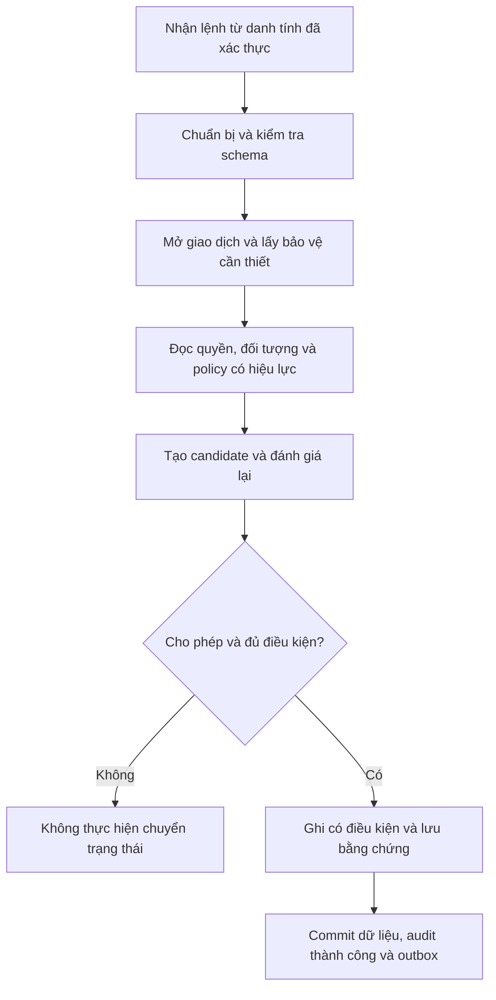

# Policy recheck — đánh giá lại chính sách trước quyết định nghiệp vụ

Một người dùng được phép thao tác lúc mở màn hình chưa chắc còn được phép khi bấm lưu. Một đề nghị được phép phê duyệt lúc đưa vào hàng đợi chưa chắc còn thỏa chính sách lúc worker thực thi. Trong khoảng đó, quyền có thể bị thu hồi, hạn mức thay đổi, nội dung tăng giá trị hoặc một quy tắc mới bắt đầu có hiệu lực.

**Policy recheck** là đánh giá lại chính sách và các căn cứ liên quan tại một ranh giới thực thi đã được xác định. Nó không chỉ là gọi lại cùng hàm với dữ liệu cũ, cũng không chỉ là tải số phiên bản chính sách mới rồi giữ nguyên kết quả `allowed=true` từ lần trước.

Trong chương **TOCTOU Defense**, bài học này trình bày cách dùng policy recheck để bảo vệ quyền theo đối tượng, state machine và business invariants. Trọng tâm là gắn kết quả đánh giá mới với đúng hành động, nội dung và điểm ghi, kể cả khi có transaction, retry hoặc worker chạy nền.

## 1. Một quyết định từng đúng có thể không còn đủ căn cứ

Giả sử Mai được phê duyệt đề nghị mua hàng tối đa 100 triệu đồng. Mai mở đề nghị PR-101 trị giá 80 triệu; giao diện hiện nút Phê duyệt.

Sau đó có thể xảy ra hai thay đổi độc lập:

```text
Trường hợp A:
  Nội dung PR-101 không đổi.
  Chính sách hạ hạn mức phê duyệt của Mai xuống 50 triệu.

Trường hợp B:
  Chính sách vẫn giữ hạn mức 100 triệu.
  Nội dung đề nghị được sửa thành 150 triệu và có revision mới.
```

Trong cả hai trường hợp, kết quả cho phép trước đó không đủ để phê duyệt nội dung hiện tại. Chỉ kiểm tra version của đề nghị phát hiện được một phần trường hợp B, nhưng không tự phát hiện thay đổi chính sách ở A. Chỉ kiểm tra version của chính sách cũng không phát hiện nội dung đề nghị đã đổi ở B.

Một quyết định đánh giá lại phải dùng đúng cả quy tắc lẫn dữ liệu áp dụng quy tắc:

```text
Decision = Evaluate(
    effective_policy,
    current_subject_facts,
    action,
    current_object,
    proposed_change,
    related_facts,
    decision_context
)
```

Nếu thiếu một đầu vào quan trọng, kết quả có thể mang nhãn “mới” nhưng vẫn dựa trên căn cứ cũ hoặc sai ngữ cảnh.

## 2. Recheck gồm những gì?

Policy trong bài học là tập quy tắc quyết định ai được thực hiện hành động nào trên đối tượng và trong điều kiện nào. Các kiểm tra trạng thái, tính hợp lệ nghiệp vụ và ràng buộc dữ liệu vẫn cần được xác định rõ, dù được cài đặt chung hay riêng với bộ máy policy.

| Nhóm căn cứ | Ví dụ | Khi nào quyết định cũ có thể mất hiệu lực? |
|---|---|---|
| Danh tính và quyền hiện hành | Tài khoản, membership, vai trò, phạm vi bộ phận | Tài khoản bị khóa, quyền bị thu hồi hoặc phạm vi đổi |
| Chính sách có hiệu lực | Hạn mức, phân tách nhiệm vụ, số cấp phê duyệt | Có bản công bố mới hoặc đến thời điểm áp dụng quy tắc khác |
| Đối tượng hiện tại | Tenant, chủ sở hữu, số tiền, trạng thái, revision | Đối tượng bị chuyển bộ phận, sửa nội dung, hủy hoặc xử lý bởi người khác |
| Thay đổi dự kiến | Trường muốn sửa, phạm vi đích, trạng thái đích | Payload khác preview hoặc tạo kết quả ngoài quyền |
| Đối tượng liên quan | Nhà cung cấp, chứng từ, reservation, ngân sách | Quan hệ hoặc quyền sử dụng không còn hợp lệ |
| Ngữ cảnh quyết định | Thời hạn, mục đích, điều kiện xác thực bổ sung | Hết hạn hoặc điều kiện yêu cầu không còn được đáp ứng |

Đánh giá lại không có nghĩa phải tải lại mọi bảng trong hệ thống. Phải xác định tập dependency thực sự ảnh hưởng tới quyết định, rồi có cách đọc, xác minh và bảo vệ tập đó theo hợp đồng.

### Chính sách không đổi vẫn cần căn cứ mới

Ví dụ, quy tắc “không tự phê duyệt đề nghị do mình tạo” có thể không thay đổi trong nhiều tháng. Nhưng nếu người yêu cầu hoặc quan hệ ủy quyền của đối tượng thay đổi, kết quả vẫn cần tính lại.

Ngược lại, dữ liệu đối tượng không đổi không có nghĩa kết quả cũ còn đúng: một chính sách mới có thể yêu cầu thêm cấp phê duyệt hoặc cấm một loại giao dịch.

## 3. Chọn ranh giới phải đánh giá lại

Một bước kiểm tra sớm hữu ích cho trải nghiệm và phát hiện lỗi nhanh. Nó không tự cấp quyền cho mọi bước sau đó.

| Ranh giới | Việc cần làm ở phía thực thi |
|---|---|
| Mở màn hình → gửi lệnh ghi | Kiểm tra quyền và điều kiện của lệnh, không tin trạng thái nút trên giao diện |
| Preview → áp dụng import | Đánh giá từng đối tượng và candidate thực tế tại đơn vị commit |
| Enqueue → worker thực hiện | Dùng actor, tenant đã ràng buộc và đánh giá điều kiện cần hiện hành |
| Lần thử lỗi → retry | Đọc và tính lại các căn cứ cần thiết; không giữ cờ cho phép cũ |
| Giữ chỗ → tiêu thụ reservation | Kiểm tra đúng reservation, chủ thể, thế hệ, thời hạn và điều kiện sử dụng |
| Xem nội dung → phê duyệt | Gắn quyết định với đúng revision đã xem và quy tắc áp dụng |
| Commit ý định → tạo tác dụng bên ngoài | Xác định tác dụng được bảo lưu từ quyết định cũ hay cần kiểm tra mới |

Ranh giới cần thiết phụ thuộc ý nghĩa lệnh. Không cần thêm một lời gọi recheck ở mọi dòng mã. Mục tiêu là không dùng kết quả ngoài phạm vi hiệu lực mà hệ thống đã bảo đảm.

### Chọn rõ chính sách hiện hành hay snapshot được bảo lưu

Mặc định của ví dụ phê duyệt trong bài là dùng chính sách đang có hiệu lực tại điểm quyết định. Nếu sản phẩm chủ ý bảo lưu một phiên bản, như quy tắc của báo giá đã được chấp nhận, phải có hợp đồng cụ thể về phạm vi, thời hạn và trường hợp mất hiệu lực.

Bảo lưu giá hoặc quy tắc báo giá không tự bảo lưu mọi quyền của người dùng. Một lệnh có thể được dùng giá đã chốt nhưng vẫn phải kiểm tra tài khoản còn hoạt động, quyền trên đối tượng và trạng thái hiện hành.

Không dùng kết quả cache như một snapshot được bảo lưu nếu nghiệp vụ chưa hề cấp quyền bảo lưu đó.

## 4. Recheck phải đúng hành động, đối tượng và candidate

Một quyết định cho phép đọc PR-101 không cho phép phê duyệt PR-101. Một quyết định cho phép sửa PR-101 không cho phép sửa PR-202. Những khác biệt này phải được giữ qua các lớp UI, API và worker.

Một kết quả có thể được mô tả cùng căn cứ:

```text
PolicyDecision
  subject_id
  tenant_id
  action
  object_id
  object_version
  reviewed_content_revision
  candidate_fingerprint
  effective_policy_revision
  relevant_authority_revisions
  evaluated_at
  outcome
  required_conditions
```

Đây là mô hình dữ liệu minh họa, không phải cam kết rằng ghi đủ các trường sẽ tự bảo vệ quyết định. Những phiên bản và điều kiện đó phải được kiểm tra hoặc bảo vệ tại điểm sử dụng.

### Kiểm tra cả trước và sau thay đổi

Giả sử người dùng chỉ có quyền sửa đề nghị ở bộ phận A. Payload sửa `department_id` thành B. Nếu recheck chỉ kiểm tra quyền trên bản ghi trước thay đổi, người dùng có thể chuyển dữ liệu sang phạm vi không được phép. Nếu chỉ kiểm tra candidate ở B, họ có thể chiếm một bản ghi từ phạm vi nguồn vốn không có quyền.

Vì vậy, policy có thể cần đồng thời:

- Quyền trên đối tượng và phạm vi nguồn hiện tại.
- Quyền thay đổi các trường được yêu cầu.
- Quyền sử dụng phạm vi đích và các tham chiếu mới.
- Quyền thực hiện hành động và chuyển trạng thái dự kiến.

Candidate phải được máy chủ tạo từ schema và danh sách trường cho phép. Không dùng một entity đã bị payload ghi đè làm căn cứ duy nhất để phân quyền.

### Kết quả cho phép có thể đi kèm điều kiện

Một policy có thể yêu cầu xác thực bổ sung, người duyệt thứ hai hoặc một bước kiểm soát khác. Không rút gọn kết quả thành `allowed=true` rồi bỏ phần điều kiện.

Nếu đang yêu cầu phê duyệt cuối mà thiếu cấp duyệt bắt buộc, không được chuyển `APPROVED`. Hệ thống phải giữ hoặc chuyển sang trạng thái chờ phù hợp theo state machine và thông báo hành động tiếp theo trong phạm vi người dùng được biết.

## 5. Recheck một mình vẫn có khoảng TOCTOU

Xét luồng sau:

```text
T1: Tải policy mới và kiểm tra Mai được phép phê duyệt.
T2: Quản trị viên thu hồi quyền hoặc công bố policy chặt hơn, rồi commit.
T3: Request của Mai ghi APPROVED bằng ID, không bảo vệ căn cứ quyền.
```

T1 là một recheck thực sự, nhưng không bảo vệ được T1–T3. Cần đặt recheck trong một giao thức giữ hoặc xác minh hiệu lực tới điểm quyết định.



### Giao thức bảo vệ phải bao phủ đúng dependency

Một phương án là dùng guard, tức bản ghi hoặc cơ chế điều phối mà giao dịch quyết định và giao dịch thay đổi policy/quyền đều phải tham gia:

1. Luồng thực hiện hành động lấy khóa bảo vệ phù hợp trước khi đọc các căn cứ cần bảo vệ.
2. Luồng đổi policy, membership hoặc phạm vi quyền lấy khóa xung đột trên cùng phạm vi.
3. Cả hai giữ bảo vệ đến khi transaction kết thúc.
4. Mọi đường cập nhật liên quan, kể cả công cụ quản trị và worker, phải tuân theo giao thức.

Guard ở cấp tenant có thể đơn giản nhưng gây tranh chấp lớn. Hệ thống có thể dùng phạm vi nhỏ hơn nếu chứng minh bao phủ đủ mọi dependency và có thứ tự khóa nhất quán. Hành vi khóa cụ thể phải được xác minh theo cơ sở dữ liệu đang dùng.

Phiên bản đối tượng và điều kiện trạng thái vẫn cần bảo vệ dữ liệu nghiệp vụ. Guard quyền không thay thế kiểm soát việc một người khác sửa số tiền hoặc hủy đề nghị.

### Chỉ so sánh policy version trước commit chưa đủ

Nếu ứng dụng đọc `policyRevision`, thấy không đổi rồi thực hiện một câu UPDATE độc lập, policy vẫn có thể đổi sau phép so sánh. Cần cơ chế xác minh nguyên tử hoặc giao thức xung đột tương ứng, không chỉ hai phép đọc đặt gần nhau.

Tương tự, thêm một subquery đọc revision vào câu ghi không tự chứng minh giao dịch đổi policy sẽ bị điều phối theo cách mong muốn. Phải hiểu bảo đảm thật của engine và toàn bộ giao thức đọc–ghi.

## 6. Policy revision, policy epoch và thời điểm hiệu lực

Policy revision thường nhận diện một bản quy tắc. Một policy epoch có thể dùng để đánh dấu rằng tập căn cứ quyền trong phạm vi đã thay đổi. Hai khái niệm này không mặc nhiên bao phủ mọi đầu vào quyết định.

Ví dụ:

```text
policy_revision = 18
authority_epoch = 42
object_version = 7
```

Nếu membership đổi mà `authority_epoch` không tăng, cache dựa trên epoch có thể vẫn trả kết quả sai. Nếu object đổi mà chỉ kiểm tra epoch quyền, vấn đề tương tự vẫn tồn tại.

Muốn dùng revision hoặc epoch để tái sử dụng kết quả, phải xác định:

- Những thay đổi nào bắt buộc làm token thay đổi.
- Các token có được đọc và xác minh theo một giao thức nhất quán không.
- Candidate, action và ngữ cảnh có được gắn đúng vào khóa quyết định không.
- Điều kiện theo thời gian có thể mất hiệu lực dù không có bản ghi nào được cập nhật không.

### Bản mới nhất chưa chắc là bản đang có hiệu lực

Một policy có thể đã được công bố để áp dụng từ ngày mai; một bản nháp chưa được phê duyệt không được dùng như quy tắc hiện hành. Việc chọn policy phải dựa trên trạng thái công bố, phạm vi tenant và thời điểm hiệu lực đúng hợp đồng.

Khóa các hàng policy ngăn thay đổi dữ liệu cạnh tranh theo giao thức, nhưng thời gian vẫn tiếp tục trôi. Quy tắc được đặt lịch có thể bắt đầu hiệu lực mà không cần một transaction mới sửa hàng ngay lúc đó.

Do đó, chọn mốc `decisionTime` thích hợp sau những lần chờ cần thiết, rồi chọn policy có hiệu lực tại mốc đó. Nếu policy quy định hiệu lực ở một mốc khác như lúc tạo tác dụng bên ngoài, thiết kế phải bảo vệ mốc đó riêng. Không gắn nhãn “đúng lúc commit” cho một timestamp lấy từ rất sớm.

### Thứ tự với thu hồi quyền cần được công bố rõ

Với giao thức khóa, có thể chấp nhận hai thứ tự:

- Thu hồi hoặc cập nhật policy commit trước: lệnh sau đọc căn cứ mới và có thể bị từ chối.
- Lệnh nghiệp vụ giành bảo vệ trước: cập nhật quyền/policy phải chờ; lệnh có thể hoàn tất theo căn cứ được bảo vệ rồi thay đổi mới có hiệu lực với lệnh sau.

Điều đó không có nghĩa một yêu cầu thu hồi vừa được gửi sẽ hủy tức thì mọi hành động đang chạy. Nếu cần khả năng chặn tác dụng chưa hoàn tất, phải có cơ chế ở giai đoạn thích hợp và định nghĩa thứ tự với hành động đó.

## 7. Ví dụ Java: đánh giá lại trước phê duyệt cuối

Đoạn sau là mã minh họa kiến trúc, không phải chương trình độc lập. Các abstraction về transaction, guard, repository và policy thuộc ứng dụng; không mô tả API của framework cụ thể.

Ví dụ dùng guard ở cấp tenant để dễ thấy giao thức. Nó giả định mọi thay đổi căn cứ quyền mà ví dụ sử dụng trong tenant đều tham gia guard. Hệ thống có trạng thái tài khoản toàn cục hoặc nguồn quyền bên ngoài phải mở rộng giao thức cho những dependency đó; khóa tenant đơn thuần không tự bảo vệ nguồn độc lập.

```java
ApprovalResult finalApprove(AuthenticatedContext requestContext,
                            ApproveCommand command) {
    schema.requireValid(command);

    return tx.required(() -> {
        PolicyGuard guard = guards.lockTenantDecision(
            requestContext.verifiedTenantId());
        AuthContext auth = principals.loadCurrentInScope(requestContext, guard);

        PurchaseRequest current = requests.lockInTenant(
            auth.tenantId(), command.requestId())
            .orElseThrow(ResourceUnavailableException::new);
        RelatedFacts related = references.loadUnderDecisionProtocol(
            auth, current, guard);

        Instant decisionTime = decisionClock.nowAfterRequiredWaits();
        EffectivePolicy rules = policies.loadEffective(guard, decisionTime);
        revisions.requireReviewedContent(
            current.contentRevision(), command.reviewedContentRevision());
        ApprovalCandidate candidate = transitions.planFinalApproval(current);

        PolicyDecision decision = engine.evaluate(
            auth, Action.FINAL_APPROVE, current, candidate,
            related, rules, decisionTime);
        decision.requireAllowWithoutUnmetConditions();
        workflow.requireAllowedTransition(current, candidate);
        invariants.requireValidApproval(auth, current, candidate, related);

        int changed = requests.applyApprovalIfUnchanged(
            auth.tenantId(), current.id(), current.metadataVersion(),
            current.contentRevision(), current.status(), candidate);
        if (changed != 1) {
            throw new ApprovalConflictException();
        }

        ApprovalRecord record = approvals.insert(
            auth, current, candidate, rules.revision(), decisionTime);
        audit.recordApprovalDecision(record, decision);
        outbox.appendApprovalCommitted(record.id());
        return ApprovalResult.accepted(record.id());
    });
}
```

### Hợp đồng bắt buộc của ví dụ

- Danh tính và tenant trong `requestContext` đã được xác thực và xác minh tại đầu vào. Quyền thực hiện cụ thể vẫn được tải lại trong giao thức quyết định.
- Giao dịch thay đổi policy hoặc căn cứ quyền phải lấy khóa xung đột với `lockTenantDecision`; không có đường quản trị ghi trực tiếp bỏ qua guard.
- `loadCurrentInScope` không chỉ đọc vai trò cũ từ token rồi đổi tên thành quyền hiện hành.
- `loadUnderDecisionProtocol` đọc và bảo vệ các tham chiếu cần thiết, hoặc dùng phiên bản bất biến đã được ràng buộc. Một read tùy ý ngoài giao thức không đủ.
- Candidate được lập từ dữ liệu có thẩm quyền và hành động được hỗ trợ, không chứa trạng thái đích do khách tùy ý ép vào.
- Policy được chọn theo mốc hiệu lực đã định nghĩa. Mọi điều kiện kèm kết quả cho phép phải được thực thi.
- `applyApprovalIfUnchanged` kiểm tra tenant, đối tượng, phiên bản, revision và trạng thái nguồn; số hàng khác 1 không được coi là thành công.
- Những thay đổi dòng chi tiết hoặc chứng từ phải cập nhật revision hoặc tham gia cơ chế bảo vệ nội dung tương ứng. Khóa hàng cha không tự bao phủ mọi đường ghi con.
- Thay đổi trạng thái, approval record, audit thành công và outbox cùng commit hoặc rollback. Không phát thông báo thành công trước commit.

Mốc `decisionTime` trong ví dụ là mốc đánh giá được bảo vệ, không phải thời điểm một dịch vụ ngoài xử lý sự kiện. Nếu transaction rollback, không có phê duyệt thành công chỉ vì `engine.evaluate()` đã từng trả cho phép.

## 8. Khi kết quả recheck khác lần trước

Hệ thống cần xử lý sự khác biệt theo ý nghĩa nghiệp vụ, thay vì cố làm cho request thành công bằng mọi giá.

| Kết quả mới | Cách xử lý phù hợp |
|---|---|
| Không còn quyền | Không áp dụng hành động; trả lỗi trong phạm vi thông tin được phép tiết lộ |
| Nội dung không còn đúng revision đã xem | Báo xung đột và yêu cầu xem/xác nhận nội dung mới |
| Cần thêm cấp duyệt hoặc xác thực bổ sung | Đi qua bước bắt buộc; không chuyển thẳng sang trạng thái cuối |
| Trạng thái nguồn đã đổi | Xử lý theo state machine hoặc trả xung đột |
| Hết thời hạn hoặc thiếu tài nguyên | Không dùng kết quả preview để vượt điều kiện hiện hành |
| Không lấy được căn cứ policy tin cậy | Chặn hành động nhạy cảm, retry có kiểm soát hoặc chuyển chờ xác minh |

Không lấy được policy là chưa đủ căn cứ cho phép, nhưng cũng không đồng nghĩa người dùng chắc chắn bị cấm vĩnh viễn. Nên phân biệt lỗi không xác định hoặc hạ tầng với một quyết định từ chối thực sự, tránh lưu nhầm thành kết luận nghiệp vụ cuối.

### Không hợp thức hóa nội dung mới bằng xác nhận cũ

Nếu đề nghị tăng từ 80 lên 150 triệu, một policy mới có thể vẫn cho Mai duyệt 150 triệu. Điều đó không chứng minh Mai đã xem và đồng ý nội dung 150 triệu. Recheck quyền và kiểm tra revision người dùng đã xác nhận giải quyết hai yêu cầu khác nhau.

Tương tự, việc policy nới lỏng không tự biến một lệnh đã thất bại thành lệnh mới được thực hiện. Cách retry và trạng thái receipt phải tuân theo hợp đồng endpoint.

### Không tự đảo ngược quyết định đã commit

Policy mới thường áp dụng cho các quyết định theo phạm vi hiệu lực của nó. Nếu cần xem xét lại những phê duyệt đã hoàn tất, phải có quy trình riêng với quyền, trạng thái và lịch sử rõ ràng. Recheck ở request mới không phải thao tác âm thầm sửa quá khứ.

## 9. Worker, retry và idempotency

Một job chạy nền nên lưu actor, tenant, hành động, đối tượng và payload hoặc revision đã được máy chủ ràng buộc. Worker phải biết nó đang thay mặt ai và thực hiện ý định nào.

### Khi job bắt đầu thực hiện

- Đọc trạng thái job và đối tượng có thẩm quyền.
- Đánh giá quyền và policy cần hiện hành tại đơn vị commit.
- Kiểm tra nội dung hoặc revision mà người dùng đã xác nhận.
- Không dùng quyền quản trị của worker để bỏ qua quyền nghiệp vụ của người yêu cầu.
- Nếu cần xác thực bổ sung mà job không đáp ứng, chuyển về quy trình phù hợp; không tự coi quyền dịch vụ là sự thay thế.

Một kết quả `authorized=true` lưu lúc enqueue không tự sống qua nhiều giờ. Nếu job thực sự được phép dùng một quyết định đã được bảo lưu, phải lưu căn cứ và phạm vi bảo lưu thay vì một boolean không có ngữ cảnh.

### Khi retry một lần chưa commit

Rollback lần thử lỗi rồi mở lại đơn vị giao dịch theo cơ chế đang dùng. Đọc và đánh giá lại những căn cứ có thể đổi. Không mang candidate đã gắn `allowed=true` từ transaction trước sang rồi chỉ chạy lại UPDATE.

Retry không được tự thay `reviewedContentRevision` bằng bản mới nhất hoặc bỏ điều kiện policy chỉ để tránh xung đột. Ý định người dùng và điều kiện cần xác nhận vẫn phải được giữ.

### Khi lệnh đã commit nhưng response bị mất

Đây là đọc kết quả cũ theo idempotency, không phải yêu cầu thực hiện lại hành động. Có thể trả receipt đã commit sau khi kiểm tra quyền xem kết quả hiện hành, mà không cố phê duyệt lần nữa trên trạng thái mới.

Cùng khóa nhưng khác payload phải được phát hiện. Receipt không được dùng để đọc dữ liệu của actor hoặc tenant khác. Nếu endpoint lưu kết quả từ chối như một kết quả cuối của khóa, cách gửi lại sau khi policy đổi phải được định nghĩa rõ, thay vì tùy tiện thay ý nghĩa của cùng khóa.

## 10. Cache, policy engine bên ngoài và bằng chứng quyết định

### Cache quy tắc khác cache kết quả cho phép

Một bản policy bất biến đã biên dịch có thể được cache theo tenant và revision. Tuy nhiên, vẫn cần chọn đúng revision đang được phép áp dụng và dùng facts phù hợp ở điểm quyết định.

Cache kết quả `canApprove(user, request)` khó hơn vì kết quả có thể phụ thuộc action, candidate, nội dung, quyền, policy, tham chiếu và thời gian. Khóa cache thiếu một dependency có thể trả quyết định của ngữ cảnh khác.

TTL ngắn hoặc sự kiện invalidation giúp giảm độ cũ, nhưng không tự tạo bảo đảm thu hồi quyền nguyên tử. Nếu cơ chế dùng epoch, mọi thay đổi liên quan phải cập nhật epoch đúng giao thức; nếu dùng giới hạn độ trễ, phải công bố đó là giới hạn độ trễ được chấp nhận.

### Đánh giá theo tập nhưng quyết định theo từng đối tượng

Import có thể tải policy và facts theo batch, rồi đánh giá từng candidate. Một đối tượng được phép không cấp quyền cho những dòng khác. Kết quả của toàn tệp ở preview không thay thế recheck tại từng đơn vị commit khi policy hoặc dữ liệu có thể đổi.

Chuẩn bị schema và parse trước transaction giúp giảm thời gian giữ khóa. Không giảm thời gian giữ khóa bằng cách chuyển quyết định quyền ra ngoài giao thức rồi dùng kết quả đó như thể nó vẫn được bảo vệ.

### Nếu bộ máy quyết định ở dịch vụ khác

Một dịch vụ quyết định policy có thể trả revision, kết quả và điều kiện kèm theo. Lời gọi vừa trả về không tự chứng minh policy của dịch vụ đó không đổi trước khi ứng dụng ghi.

Nếu dịch vụ ngoài không tham gia giao thức bảo vệ chung, ứng dụng cần một hợp đồng khác đáp ứng yêu cầu: chẳng hạn quyết định được ràng buộc và bảo lưu trong phạm vi xác định, snapshot được chấp nhận hoặc cơ chế xác minh tại nơi tạo tác dụng. Không tự tuyên bố thu hồi tức thì chỉ vì đã gọi dịch vụ đó hai lần.

Bằng chứng có chữ ký cần gắn subject, tenant, action, object, nội dung hoặc fingerprint, policy và khoảng hiệu lực tương ứng. Chữ ký bảo vệ tính toàn vẹn; nó không tự xử lý thu hồi hoặc việc dữ liệu đối tượng đã đổi.

Khi dịch vụ quyết định không sẵn sàng, không âm thầm dùng một quyết định cho phép cũ vô thời hạn. Chọn cơ chế từ chối thực thi, chờ hoặc retry theo yêu cầu nghiệp vụ và mức bảo đảm đã định nghĩa.

## 11. Audit phải nối được quyết định với căn cứ

Audit hữu ích cần giúp trả lời: ai thực hiện, trên nội dung nào, theo quy tắc nào và vì sao kết quả được chấp nhận hoặc từ chối.

Có thể ghi:

- Subject, tenant, hành động và thông tin ủy quyền cần thiết.
- Đối tượng, phiên bản, revision đã xem và fingerprint candidate.
- Policy revision, các revision quyền liên quan và mốc đánh giá.
- Kết quả cùng mã lý do, điều kiện bổ sung hoặc lỗi không xác định.
- Request/job ID, khóa đối chiếu idempotency và định danh quyết định.
- Kết quả transaction hoặc liên kết tới bản ghi nghiệp vụ đã commit.

Không gắn nhãn “đã phê duyệt” cho một lần policy trả cho phép nhưng transaction chưa commit. Bản audit thành công có thể nằm cùng transaction dữ liệu; dấu vết từ chối hoặc rollback cần đường ghi phù hợp để không biến mất theo transaction thất bại.

Không ghi token, bí mật, toàn bộ chứng từ hoặc dữ liệu cá nhân không cần thiết. Mã lý do nội bộ không nhất thiết được trả nguyên văn cho người ngoài quyền xem đối tượng.

Theo dõi tỷ lệ recheck đổi từ cho phép sang từ chối, policy không sẵn sàng, revision xung đột và số job bị chặn giúp phát hiện cả lỗi thiết kế lẫn hành vi cố tình tạo khoảng đua.

## 12. Kiểm thử policy recheck bằng thứ tự có điều khiển

Kiểm thử phải xác nhận thay đổi dữ liệu, audit thành công và tác dụng phụ, thay vì chỉ chứng minh một hàm policy đã được gọi hai lần. Dùng transaction hoặc kết nối độc lập cùng điểm đồng bộ rõ ràng.

### Policy thay đổi trước điểm quyết định

```text
1. Preview PR-101 trị giá 80 triệu theo hạn mức 100 triệu: được phép.
2. Cho giao dịch B công bố policy có hiệu lực hạ hạn mức xuống 50 triệu.
3. B commit theo cùng giao thức guard.
4. Cho A tiếp tục vào điểm quyết định phê duyệt.

Kỳ vọng:
  A dùng policy có hiệu lực mới và không phê duyệt cuối.
  Không có trạng thái APPROVED hoặc sự kiện thành công từ lệnh bị chặn.
```

### Lệnh giành bảo vệ trước thay đổi policy

```text
1. A lấy guard và đọc các căn cứ đang có hiệu lực.
2. B bắt đầu đổi policy nhưng phải chờ ở điểm xung đột.
3. A hoàn tất giao dịch theo hợp đồng hiện tại.
4. B tiếp tục và commit policy mới.
5. Lệnh mới sau đó phải dùng policy mới.
```

Kịch bản này kiểm tra thứ tự hiệu lực đã chọn. Không đặt barrier yêu cầu cả A và B cùng giữ một khóa độc quyền rồi mới đi tiếp; đó là lịch không thể xảy ra.

### Ma trận tình huống bổ sung

| Tình huống | Kết quả cần chứng minh |
|---|---|
| Quyền đổi nhưng object version giữ nguyên | Recheck vẫn phát hiện đúng căn cứ quyền mới |
| Object hoặc candidate đổi nhưng policy revision giữ nguyên | Không tái sử dụng quyết định cho dữ liệu khác |
| Đề nghị chuyển bộ phận hoặc thay tham chiếu | Kiểm tra đủ phạm vi nguồn, đích và đối tượng liên quan |
| Policy mới yêu cầu thêm cấp duyệt | Không bỏ điều kiện để chuyển trạng thái cuối |
| Bản policy tương lai đã công bố nhưng chưa có hiệu lực | Không dùng nhầm bản chỉ vì revision lớn hơn |
| Thời điểm hiệu lực thay đổi khi chờ khóa | Chọn đúng policy theo mốc quyết định đã định nghĩa |
| Job chạy sau khi actor bị thu hồi quyền | Không dùng quyền worker để vượt policy |
| Policy engine không sẵn sàng | Không dùng allow cũ vô hạn hoặc ghi thành từ chối nghiệp vụ sai nghĩa |
| Kết quả cho phép có chữ ký nhưng sai action, object hoặc payload | Không áp dụng cho lệnh hiện tại |
| Xung đột dẫn đến retry | Đọc và đánh giá lại; không thay ngầm revision người dùng đã xem |
| Response mất sau commit | Trả receipt đúng quyền, không thực hiện lại hành động |
| Công cụ quản trị thay quyền hoặc policy | Cùng tham gia giao thức, không tạo đường ghi bỏ qua bảo vệ |

Các thuộc tính hữu ích để mở rộng kiểm thử:

- Mỗi hành động đã commit có căn cứ quyết định gắn với đúng subject, tenant, action và nội dung.
- Một quyết định cũ không được áp dụng cho candidate hoặc đối tượng khác.
- Điều kiện bổ sung của policy được thực hiện hoặc hành động cuối không được chấp nhận.
- Mọi đường thay đổi dependency quan trọng đều xung đột hoặc được phát hiện theo giao thức đã chọn.
- Replay kết quả cũ không tạo một tác dụng nghiệp vụ mới.

## 13. Checklist thiết kế

- Policy và facts nào thật sự ảnh hưởng tới lệnh này?
- Điều kiện cần hiện hành tại ranh giới nào, và điều gì được bảo lưu có chủ ý?
- Recheck có dùng đúng actor, tenant, action, object và candidate thực tế không?
- Policy được chọn là bản có hiệu lực hay chỉ là bản mới nhất trong nơi lưu cấu hình?
- Kết quả cho phép có điều kiện đi kèm, và điều kiện đó được thực thi ở đâu?
- Cơ chế nào bảo vệ các căn cứ giữa recheck và ghi?
- Những cập nhật quyền toàn cục, quan hệ đối tượng và policy bên ngoài có nằm trong phạm vi bảo đảm không?
- Worker và retry có đánh giá lại mà vẫn giữ đúng ý định người dùng không?
- Lỗi hạ tầng policy có được phân biệt với từ chối nghiệp vụ không?
- Audit và kiểm thử có nối được kết quả với phiên bản căn cứ và transaction thực sự đã commit không?

Policy recheck có giá trị khi nó tạo ra một quyết định mới trên đúng căn cứ, rồi quyết định đó được giữ hiệu lực hoặc xác minh đến điểm thực hiện. Việc gọi lại hàm kiểm tra chỉ là một bước; bảo vệ mối liên hệ giữa policy, dữ liệu và hành động mới duy trì được quy tắc nghiệp vụ trước TOCTOU.
