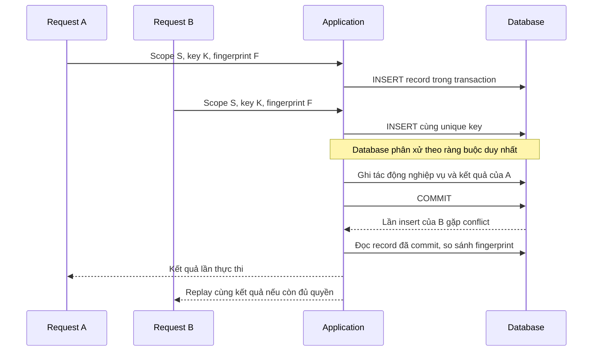

# Idempotency key scope

## 1. Mục tiêu của bài học

Trong chương **Idempotency** của module bảo vệ logic nghiệp vụ, idempotency key giúp máy chủ nhận ra những lần gửi lại của **cùng một ý định thực hiện thao tác**. Tuy nhiên, một chuỗi khóa ngẫu nhiên chưa đủ để xác định hai yêu cầu có thực sự thuộc cùng thao tác hay không. Máy chủ còn phải biết khóa đó được sử dụng trong phạm vi nào.

**Idempotency key scope** là không gian mà trong đó một khóa được coi là duy nhất. Thiết kế scope trả lời câu hỏi:

> Khi nhận lại khóa `K`, máy chủ được phép coi yêu cầu này là lần gửi lại của yêu cầu trước trong những điều kiện nào?

Một scope sai có thể khiến yêu cầu của người này nhận kết quả của người khác, chặn nhầm các thao tác hợp lệ, hoặc cho phép cùng tác động nghiệp vụ xảy ra nhiều lần khi đổi endpoint hay danh tính gọi.

Sau bài học, bạn có thể:

- Xác định những thành phần cần tham gia định danh một idempotency record.
- Phân biệt scope, fingerprint của yêu cầu và ràng buộc chống trùng ở cấp nghiệp vụ.
- Chọn phạm vi tenant, chủ thể, thao tác và tài nguyên theo ý nghĩa nghiệp vụ.
- Thiết kế kiểm tra quyền, xử lý đồng thời và lưu kết quả mà không làm lộ dữ liệu.
- Xây dựng tình huống kiểm thử tấn công nhắm vào ranh giới scope.

## 2. Một khóa chỉ có ý nghĩa khi đi cùng phạm vi

Giả sử client gọi:

```http
POST /orders/ord-27/payments
Authorization: Bearer <access-token>
Idempotency-Key: 8fd7f4c2-5dc2-44dc-a142-5794e3544077
Content-Type: application/json

{
  "amountMinor": 125000,
  "currency": "VND",
  "paymentMethodId": "pm-8"
}
```

Nếu kết nối bị ngắt sau khi máy chủ đã thu tiền, client không biết thao tác thành công hay chưa. Client gửi lại cùng khóa, cùng yêu cầu. Máy chủ cần trả lại kết quả đã ghi nhận thay vì thu tiền lần nữa.

Nhưng điều gì xảy ra nếu cùng chuỗi khóa xuất hiện trong một tenant khác, tại thao tác hoàn tiền, hoặc đối với đơn hàng khác? Không có câu trả lời chung cho mọi API. Đó là hợp đồng scope mà hệ thống phải xác định rõ.

Một mô hình khái niệm:

```text
record identity = (scope, idempotency_key)

scope = các chiều định danh được lựa chọn theo hợp đồng API

request fingerprint = dấu vân tay của nội dung có ý nghĩa nghiệp vụ
```

Ví dụ, với phạm vi theo tenant, chủ thể nghiệp vụ và thao tác:

```text
scope = (tenant_id, subject_id, operation_code)

record identity =
    (tenant_id, subject_id, operation_code, idempotency_key)
```

Hai yêu cầu chỉ được coi là ứng viên của cùng một lần thực hiện khi `record identity` giống nhau. Sau đó máy chủ vẫn phải so sánh fingerprint và kiểm tra trạng thái xử lý.

**Scope quyết định tìm bản ghi nào. Fingerprint quyết định yêu cầu hiện tại có tương thích với bản ghi đó hay không.**

## 3. Ba lớp bảo vệ cần phân biệt

| Lớp | Câu hỏi cần trả lời | Ví dụ |
| --- | --- | --- |
| Scope | Ai và thao tác nào được chia sẻ không gian khóa? | Một khách hàng trong một tenant, tại thao tác `payment.capture:v1` |
| Request fingerprint | Cùng khóa có đang được gửi lại với cùng nội dung nghiệp vụ không? | Cùng đơn hàng, số tiền, loại tiền, phương thức thanh toán |
| Business invariant | Dù đổi khóa, điều gì vẫn không được xảy ra? | Một payment attempt chỉ được capture một lần |

Ví dụ:

```text
K1 + capture(payment_attempt_17) -> thành công
K1 + capture(payment_attempt_17) -> trả lại kết quả
K1 + capture(payment_attempt_99) -> xung đột nếu cùng scope
K2 + capture(payment_attempt_17) -> vẫn phải tuân thủ invariant của attempt_17
```

Trường hợp cuối rất quan trọng: kẻ lạm dụng có thể tự tạo khóa mới. Idempotency key không ngăn được việc đó. Quy tắc như “không chi vượt số dư”, “không hoàn quá số tiền đã thanh toán”, “không duyệt lại một quyết định đã chốt” phải nằm trong logic nghiệp vụ, state machine và ràng buộc dữ liệu phù hợp.

Với một đơn hàng cho phép thanh toán nhiều đợt, invariant không phải “mỗi đơn chỉ có một giao dịch”. Hệ thống có thể cần bảo đảm tổng tiền capture không vượt số tiền được phép và mỗi payment attempt chỉ được xử lý một lần. Phạm vi khóa phải được thiết kế trên mô hình nghiệp vụ thực tế đó.

## 4. Chọn các chiều của scope

### 4.1. Tenant hoặc tổ chức

Trong hệ thống nhiều tenant, `tenant_id` thường là ranh giới bắt buộc của namespace. Hai tenant có thể vô tình dùng cùng chuỗi khóa mà không liên quan đến nhau.

```text
(tenant_A, subject_7, payment.capture:v1, K)
(tenant_B, subject_7, payment.capture:v1, K)
```

Đây là hai định danh khác nhau. Máy chủ phải lấy tenant từ ngữ cảnh đã xác thực và được kiểm tra quyền, không tin trực tiếp giá trị tenant do client tự khai trong body hoặc header.

Nếu API cho phép người dùng chọn tenant bằng header, header chỉ là yêu cầu chọn ngữ cảnh. Máy chủ vẫn phải xác minh người dùng có quyền hoạt động trong tenant đó trước khi dùng tenant để truy xuất idempotency record.

Việc tách idempotency record theo tenant cũng không thay thế kiểm tra đối tượng. Một người thuộc tenant A vẫn có thể gửi ID của đơn hàng thuộc tenant B; thao tác phải bị từ chối khi kiểm tra quyền trên đơn hàng.

### 4.2. Chủ thể: người dùng, tài khoản hay ứng dụng gọi?

Không nên mặc định `subject_id` luôn là user đang đăng nhập. Nó phải phản ánh chủ thể sở hữu ý định nghiệp vụ.

| Lựa chọn | Hữu ích khi | Điều cần chú ý |
| --- | --- | --- |
| Người dùng ổn định | Ý định chỉ thuộc một người dùng | Nhân viên khác gửi lại sẽ không dùng chung record |
| Tài khoản khách hàng hoặc merchant | Nhiều nhân viên, job hoặc dịch vụ cùng thực hiện một ý định của tài khoản | Mọi caller vẫn phải có quyền trên tài khoản và tài nguyên |
| Ứng dụng tích hợp | Mỗi đối tác có namespace riêng theo hợp đồng | Không dùng ID của từng API key nếu đổi credential vẫn phải retry được |
| Workflow hoặc payment attempt do server cấp | Ý định được điều phối qua nhiều actor | Cần kiểm tra quyền truy cập workflow và invariant của workflow |

Ví dụ, hai nhân viên cùng đại diện merchant M gửi một yêu cầu hoàn tiền cho cùng `refund_request_id`. Nếu scope theo từng nhân viên, hệ thống sẽ thấy hai namespace riêng. Khi yêu cầu là cùng một ý định của merchant, scope theo merchant hoặc theo refund request có thể phù hợp hơn.

Ngược lại, gom tất cả người dùng của tenant vào một namespace mà không có hợp đồng rõ ràng làm tăng khả năng va chạm và gây nhiễu giữa người dùng. Khi thực sự cần scope dùng chung, phải có đủ thông tin fingerprint, kiểm tra quyền và cơ chế cấp khóa để kiểm soát rủi ro đó.

Không đưa access token, session ID hoặc credential bí mật vào định danh scope. Chúng có thể thay đổi khi đăng nhập lại hoặc xoay vòng khóa, khiến lần gửi lại trở thành yêu cầu mới. Sử dụng ID ổn định của chủ thể đã xác thực.

### 4.3. Thao tác nghiệp vụ

Cùng một khóa dùng ở thao tác thanh toán và hoàn tiền không nên vô tình trỏ vào cùng record nếu hai thao tác có namespace riêng.

Nên dùng mã thao tác ổn định do máy chủ gán:

```text
order.submit:v1
approval.decide:v1
payment.capture:v1
payment.refund:v1
```

Không nhận `operation_code` tùy ý từ body. Router hoặc application service phải quyết định mã thao tác đang được thực thi.

Chỉ dùng HTTP method và đường dẫn thô làm thao tác dễ tạo ranh giới không đúng:

- `/orders/27/pay` và `/payments/capture` có thể cùng thực hiện một nghiệp vụ.
- Một endpoint có nhiều loại lệnh không nên gom mọi lệnh thành một thao tác nếu hợp đồng phân biệt chúng.
- Thay đổi alias, dấu gạch chéo cuối đường dẫn hoặc cấu trúc routing không nên tự tạo namespace mới.

Nếu hai endpoint là hai cách gọi tương đương của cùng nghiệp vụ và cần hỗ trợ retry qua lại, hãy ánh xạ chúng về cùng mã thao tác và cùng mô hình command chuẩn hóa.

### 4.4. Tài nguyên: đặt trong scope hay fingerprint?

Đây là quyết định có ảnh hưởng trực tiếp đến hành vi khi client dùng lại khóa cho tài nguyên khác.

**Phương án A — khóa duy nhất trong phạm vi chủ thể và thao tác**:

```text
scope = (tenant, subject, operation)
fingerprint = H(resource_id, các trường nghiệp vụ khác)
```

Khi dùng cùng khóa để thanh toán hai đơn hàng khác nhau, máy chủ tìm cùng record và phát hiện fingerprint không khớp. Yêu cầu thứ hai bị từ chối như một lần tái sử dụng khóa sai nội dung. Cách này giúp phát hiện lỗi client tái dùng khóa ở nhiều tài nguyên.

**Phương án B — khóa duy nhất cho từng tài nguyên và thao tác**:

```text
scope = (tenant, subject, operation, resource_id)
fingerprint = H(các trường nghiệp vụ của yêu cầu)
```

Cùng khóa có thể được sử dụng độc lập cho hai tài nguyên. Phù hợp khi hợp đồng API quy định namespace theo tài nguyên, nhưng không phát hiện việc client nhầm dùng một khóa cho nhiều tài nguyên khác nhau.

| Tình huống | Phương án A | Phương án B |
| --- | --- | --- |
| Cùng khóa, cùng tài nguyên, cùng nội dung | Có thể replay | Có thể replay |
| Cùng khóa, cùng tài nguyên, khác số tiền | Xung đột fingerprint | Xung đột fingerprint |
| Cùng khóa, khác tài nguyên | Xung đột fingerprint | Là thao tác độc lập |
| Client tái dùng khóa do lỗi vòng lặp qua nhiều đơn | Dễ phát hiện | Có thể không phát hiện |

Không có phương án đúng tuyệt đối. Cần ghi rõ lựa chọn trong hợp đồng và kiểm thử đúng hành vi đã chọn. Các phần triển khai bên dưới dùng **phương án A**.

### 4.5. Môi trường, vùng triển khai và phiên bản

| Chiều | Cách xử lý |
| --- | --- |
| Sandbox và production | Tách namespace hoặc hạ tầng lưu trữ để dữ liệu thử không va vào dữ liệu thật |
| Nhiều instance cùng dịch vụ | Dùng kho dữ liệu và ràng buộc duy nhất chung cho cùng namespace |
| Nhiều region | Định tuyến cùng scope về một nơi có thẩm quyền ghi, hoặc dùng cơ chế phối hợp đáp ứng tính duy nhất cần thiết |
| Phiên bản API | Giữ namespace khi vẫn là cùng ý định và còn cam kết retry; đổi khi ngữ nghĩa thay đổi có chủ đích |

Nếu mỗi region có một bảng riêng và chỉ đồng bộ bất đồng bộ, hai yêu cầu đồng thời có thể cùng được chấp nhận trước khi dữ liệu hội tụ. Thêm `region_id` vào scope thường chỉ làm hai yêu cầu thành hai thao tác hợp lệ theo thiết kế mới; nó không giải quyết invariant “chỉ thực hiện một lần” trên toàn hệ thống.

Tương tự, không dùng release number, pod name hoặc server hostname làm scope cho một tác động nghiệp vụ dùng chung. Việc triển khai phiên bản mới hay đổi instance không nên khiến yêu cầu retry được thực thi lại.

## 5. Chọn scope bằng cách xác định ý định nghiệp vụ

Trước khi thiết kế schema, hãy đi qua các câu hỏi sau:

1. **Tác động nào cần được chống thực thi trùng?** Ví dụ: capture một payment attempt, tạo một yêu cầu hoàn tiền hoặc ghi nhận một quyết định phê duyệt.
2. **Ai sở hữu ý định đó?** Một người dùng, merchant, tài khoản hay workflow dùng chung?
3. **Những caller nào được phép gửi lại cùng ý định?** Chỉ phiên hiện tại hay cả job nền, nhân viên khác và ứng dụng tích hợp?
4. **Hai endpoint nào có thể dẫn đến cùng tác động?** Chúng cần chia sẻ scope hay được bảo vệ chung bằng invariant nào?
5. **Cùng khóa ở hai tài nguyên phải bị từ chối hay được coi là độc lập?** Chọn vị trí của resource ID dựa trên câu trả lời.
6. **Phải nhận diện lần gửi lại trong bao lâu, kể cả sau failover?** Từ đó chọn lưu trữ, retention và định tuyến phù hợp.

Ví dụ cho một API capture:

```text
Tác động: capture một payment attempt của merchant.
Chủ thể: merchant ổn định, không phải từng API key.
Caller: các integration credential được ủy quyền cho merchant.
Scope: tenant + merchant + payment.capture:v1.
Resource: payment_attempt_id nằm trong fingerprint.
Invariant: payment attempt đã capture không được capture thêm lần nữa.
```

Thiết kế này cho phép retry sau khi đổi credential nhưng vẫn yêu cầu kiểm tra credential mới có quyền capture payment attempt đó. Một khóa đúng không phải bằng chứng được phép thao tác.

## 6. Fingerprint ràng buộc khóa với nội dung

Trong cùng scope, nếu client dùng lại khóa với nội dung khác, máy chủ không được âm thầm trả kết quả cũ như thể nội dung mới đã được thực thi.

Ví dụ:

```text
Lần 1: K + order=27 + amount=125000 + currency=VND -> thành công
Lần 2: K + order=27 + amount=225000 + currency=VND -> xung đột
```

Nếu chỉ tra khóa rồi trả kết quả cũ, client có thể hiểu nhầm rằng lần thanh toán 225000 đã thành công. Nếu xử lý lại nội dung mới dưới cùng khóa, cam kết idempotency bị phá vỡ.

Fingerprint nên bao gồm mọi đầu vào do caller cung cấp có thể làm thay đổi tác động hoặc kết quả nghiệp vụ được cam kết, chẳng hạn:

- ID của order hoặc payment attempt nếu resource ID không nằm trong scope.
- Số tiền theo đơn vị nhỏ nhất, loại tiền và phương thức thanh toán.
- Người nhận, tài khoản đích hoặc lựa chọn giao hàng có ảnh hưởng đến tác động.
- Phiên bản tài nguyên kỳ vọng nếu command có kiểm soát đồng thời bằng phiên bản.
- Tùy chọn có ảnh hưởng đến kết quả trả về cần phân biệt trong hợp đồng API.

Không đưa trace ID, request ID mới của mỗi lần gọi, access token hoặc timestamp chỉ phục vụ truyền tải vào fingerprint. Những giá trị đó có thể thay đổi trong một lần retry hợp lệ.

### 6.1. Chuẩn hóa trước khi băm

Hai JSON khác thứ tự thuộc tính có thể có cùng ý nghĩa. Băm trực tiếp chuỗi body thô dễ tạo xung đột giả.

Một cách tiếp cận rõ ràng là parse và kiểm tra command, sau đó tuần tự hóa các trường đã chọn theo quy tắc xác định:

```text
fingerprint_schema = capture-command-v1

canonical command:
    orderId = ord-27
    amountMinor = 125000
    currency = VND
    paymentMethodId = pm-8
```

Cần quy định rõ:

- Trường bị thiếu có tương đương giá trị mặc định hay không.
- `null` và chuỗi rỗng có khác nhau không.
- Danh sách có thứ tự hay mang ý nghĩa tập hợp.
- Tiền được biểu diễn bằng số nguyên đơn vị nhỏ nhất hoặc kiểu thập phân có quy tắc chính xác.
- Những trường được phép chuẩn hóa chữ hoa/chữ thường theo hợp đồng.

Không tự ý trim, viết thường hoặc bỏ trường khi quy tắc nghiệp vụ chưa cho phép. Ví dụ, chuẩn hóa mã tiền tệ có thể hợp lý; chuẩn hóa tùy tiện một định danh phân biệt hoa thường có thể gộp hai tài nguyên khác nhau.

Hash như SHA-256 là cách lưu dấu vân tay gọn, không phải cơ chế xác thực người gọi hay mã hóa dữ liệu. Với đầu vào nhạy cảm hoặc miền giá trị dễ đoán, phải cân nhắc giảm dữ liệu lưu, bảo vệ kho record và dùng cơ chế bảo vệ bổ sung phù hợp. Không ghi body thanh toán đầy đủ vào log chỉ để phục vụ idempotency.

### 6.2. Giá và điều kiện do máy chủ quyết định

Với đơn hàng, client không nên được quyền quyết định giá hợp lệ chỉ vì đã gửi giá đó cùng một idempotency key. Lần thực thi đầu phải lấy giá và kiểm tra quy tắc từ nguồn có thẩm quyền hoặc từ báo giá còn hiệu lực.

Nếu API nhận `quoteId` hoặc `expectedOrderVersion`, đưa chúng vào fingerprint. Giá đã được máy chủ chấp nhận được lưu trong kết quả nghiệp vụ của lần thực thi. Khi replay một kết quả đã hoàn tất, không tính lại giá hiện tại rồi tạo tác động mới.

Nếu cùng body nhưng giá trị bên ngoài thay đổi theo thời gian, hệ thống vẫn cần quyết định rõ: đang replay một kết quả đã có, đang kiểm tra trạng thái một lần xử lý chưa chắc chắn, hay đang bắt đầu một ý định mới. Idempotency record giúp phân biệt các trường hợp đó; nó không thay thế hợp đồng về giá hay phiên bản dữ liệu.

## 7. Kiểm tra quyền phải bao quanh việc replay

Một lỗi nguy hiểm là xem idempotency key như vé truy cập kết quả:

```text
Nhận key -> tìm record toàn cục -> trả response đã lưu
```

Kẻ tấn công đoán được hoặc lấy được khóa của người khác có thể đọc response, kể cả khi không được thực hiện nghiệp vụ ban đầu. Khóa có độ ngẫu nhiên cao chỉ làm việc đoán khó hơn, không tạo ra quyền truy cập.

Luồng an toàn cần bảo đảm:

1. Xác thực caller và xác định tenant cùng chủ thể ổn định mà caller được đại diện.
2. Xác định thao tác từ phía server, kiểm tra quyền trên đối tượng hoặc workflow liên quan.
3. Tra idempotency record trong đúng scope.
4. So sánh fingerprint và xử lý theo trạng thái record.
5. Trước khi trả kết quả đã lưu, bảo đảm caller hiện tại còn quyền xem kết quả đó.

Khi quyền thay đổi sau lần gọi đầu, một retry không tự động được miễn kiểm tra quyền. Tùy hợp đồng, quyền thực hiện thao tác và quyền xem kết quả có thể là hai quyền riêng; replay cần đáp ứng chính sách truy cập hiện tại cho kết quả được trả.

Đối với record đã hoàn tất, không áp dụng lại các điều kiện chỉ dành cho một lần thực thi mới. Ví dụ, trạng thái `CAPTURED` khiến thao tác capture mới không hợp lệ nhưng không phải lý do để thực thi lại hoặc từ chối một replay được phép. Phải tách kiểm tra quyền hiện tại khỏi kiểm tra state machine của tác động mới.

Nếu tài nguyên đã bị xóa, quyền của chủ thể bị thu hồi hoặc kết quả chứa dữ liệu đã hết quyền truy cập, hệ thống cần chính sách rõ về từ chối, trả trạng thái tối thiểu hoặc yêu cầu tra cứu qua kênh phù hợp. Tránh trả response cũ chỉ vì record còn tồn tại.

## 8. Lưu trữ scope bằng ràng buộc duy nhất

Ví dụ schema PostgreSQL dưới đây dùng scope theo tenant, chủ thể và thao tác. `subject_id` là ID ổn định do mô hình xác thực của hệ thống cung cấp; nếu nhiều loại chủ thể có thể trùng ID, cần thêm `subject_type` hoặc namespace ID thống nhất.

```sql
CREATE TABLE idempotency_record (
    tenant_id             uuid        NOT NULL,
    subject_id            uuid        NOT NULL,
    operation_code        varchar(100) NOT NULL,
    idempotency_key        varchar(200) COLLATE "C" NOT NULL,
    request_fingerprint   char(64)    NOT NULL,
    fingerprint_version   smallint    NOT NULL,
    state                 varchar(20) NOT NULL,
    result_resource_id    uuid,
    response_status       integer,
    response_body         jsonb,
    created_at            timestamptz NOT NULL DEFAULT now(),
    expires_at            timestamptz NOT NULL,
    PRIMARY KEY (
        tenant_id,
        subject_id,
        operation_code,
        idempotency_key
    ),
    CHECK (state IN ('PROCESSING', 'COMPLETED', 'REJECTED', 'UNKNOWN')),
    CHECK (expires_at > created_at)
);
```

Đây là schema minh họa, chưa phải một hệ thống điều phối thanh toán hoàn chỉnh. Các trường cần thiết cho lease, fencing, mã tham chiếu nhà cung cấp hoặc quản lý mã hóa phải được bổ sung nếu luồng thực tế cần chúng.

Những điểm cốt lõi:

- Ràng buộc duy nhất phải trùng với scope đã công bố.
- Các chiều scope không được tùy ý để `NULL`; ngữ nghĩa uniqueness với `NULL` có thể làm lọt bản ghi trùng tùy cơ sở dữ liệu và cấu hình.
- Quy tắc so sánh khóa phải rõ ràng. Ví dụ này dùng collation `C` của PostgreSQL cho khóa; hệ thống vẫn cần kiểm tra tập ký tự và độ dài đầu vào.
- Không dùng quy trình “SELECT không thấy rồi INSERT” làm bằng chứng duy nhất rằng chỉ có một caller được xử lý. Hai request có thể cùng không thấy record.
- Hash map trong bộ nhớ của một instance không tạo uniqueness trên nhiều instance.

Khóa do client cung cấp cần được kiểm tra độ dài, định dạng được hỗ trợ và phạm vi ký tự. Có thể khuyến nghị UUID ngẫu nhiên hoặc một chuỗi có đủ độ ngẫu nhiên. Không nên đặt email, số điện thoại hoặc thông tin bí mật trong khóa vì khóa thường đi qua log và hạ tầng quan sát.

## 9. Xử lý đồng thời và transaction theo đúng scope

### 9.1. Cùng khóa, hai yêu cầu đến gần như đồng thời



Sơ đồ mô tả hướng xử lý transaction ngắn, với tác động nằm trong cùng cơ sở dữ liệu. Nếu A rollback, B có thể giành quyền thực hiện thay vì gặp conflict cuối cùng. Timeout và mức cô lập cũng phải được xử lý theo cơ sở dữ liệu thực tế.

Ví dụ giành quyền thực hiện bằng PostgreSQL:

```sql
INSERT INTO idempotency_record (
    tenant_id, subject_id, operation_code, idempotency_key,
    request_fingerprint, fingerprint_version,
    state, expires_at
) VALUES (
    :tenantId, :subjectId, :operationCode, :key,
    :fingerprint, :fingerprintVersion,
    'PROCESSING', :expiresAt
)
ON CONFLICT (
    tenant_id, subject_id, operation_code, idempotency_key
) DO NOTHING
RETURNING tenant_id;
```

Có dòng được trả về nghĩa là transaction hiện tại đã chèn được record. Không có dòng nghĩa là phải xử lý record đang tồn tại theo scope; không được chuyển sang thực thi nghiệp vụ ngay.

### 9.2. Pseudocode cho một tác động chỉ nằm trong database

```text
handleCapture(request, authenticatedContext):
    command = parseAndValidateStructure(request)
    scope = scopeFromAuthorizedContext(
        authenticatedContext,
        serverOperation = "payment.capture:v1"
    )
    key = validateIdempotencyKey(request.header)
    authorizeAccessToCommandTarget(authenticatedContext, command)

    begin transaction
        fingerprint = fingerprintUsingSupportedVersion(command)
        inserted = insertRecordIfAbsent(scope, key, fingerprint)

        if not inserted:
            existing = loadExistingRecord(scope, key)
            compareUsingStoredFingerprintVersion(existing, command)
            if fingerprintDoesNotMatch:
                return conflictWithoutBusinessMutation

            if existing.state is COMPLETED or REJECTED:
                authorizeResultRead(authenticatedContext, existing)
                return storedResult

            return inProgressOrReconciliationRequired

        lockTargetForBusinessTransition(command)
        recheckAuthorizationWhereConcurrentChangesMatter()
        checkBusinessInvariantsAndExpectedVersion(command)
        applyBusinessTransition(command)
        saveDurableBusinessResult()
        markRecordCompletedWithReplayableResult()
    commit transaction

    return committedResult
```

Đây là pseudocode về thứ tự trách nhiệm. Khi triển khai thật, nhánh trả kết quả phải đóng transaction đúng cách; các lỗi hoặc conflict từ database cần được chuyển thành hành vi API nhất quán.

Việc ghi tác động và ghi kết quả trong cùng transaction giúp tránh trạng thái đã thay đổi nghiệp vụ nhưng chưa lưu được kết quả replay. Nếu transaction rollback thì cả hai phải rollback. Nếu mất kết nối sau commit, lần retry dùng record đã commit.

Với kiểm tra quyền phụ thuộc dữ liệu có thể thay đổi đồng thời, kiểm tra trước transaction chưa chắc đủ. Hệ thống cần đọc lại, khóa hoặc dùng điều kiện cập nhật phù hợp ở nơi chuyển trạng thái nghiệp vụ.

Không dùng idempotency record để thay thế khóa hoặc cập nhật có điều kiện trên tài nguyên nghiệp vụ. Hai yêu cầu dùng **hai khóa khác nhau** vẫn có thể tranh chấp cùng số dư hoặc payment attempt.

### 9.3. Khi có dịch vụ thanh toán bên ngoài

Transaction của database nội bộ không thể tự rollback một tác động đã xảy ra ở nhà cung cấp bên ngoài. Nếu nhà cung cấp đã capture nhưng response bị mất, máy chủ đang có kết quả chưa xác định, không phải bằng chứng rằng capture thất bại.

Trong luồng này:

- Lưu định danh ý định hoặc command bền vững trước khi điều phối tác động.
- Dùng outbox hoặc cơ chế điều phối bền vững để không làm mất công việc sau commit nội bộ.
- Nếu nhà cung cấp hỗ trợ idempotency, sử dụng khóa ổn định được ánh xạ từ ý định nội bộ, đồng thời hiểu scope và thời hạn của họ.
- Tách trạng thái chưa xác định và thực hiện reconciliation qua mã tham chiếu hoặc API tra cứu được hỗ trợ.
- Không tự tạo khóa mới chỉ vì timeout hoặc hết thời gian chờ của worker.

Không chuyển nguyên khóa client sang mọi hệ thống phía sau nếu namespace của chúng khác namespace nội bộ. Hai tenant cùng dùng `K` có thể hợp lệ ở hệ thống của bạn nhưng va chạm khi đi qua cùng một tài khoản nhà cung cấp. Khóa downstream phải phân biệt được các ý định nội bộ khác nhau và vẫn ổn định cho các lần retry của cùng ý định.

Outbox có thể giao lại một thông điệp nhiều lần. Vì vậy, consumer và nơi tạo tác động cuối vẫn cần cơ chế chống trùng theo định danh ý định. Scope đúng ở tầng HTTP không tự tạo bảo đảm “exactly once” cho toàn chuỗi xử lý.

## 10. Hành vi API khi gặp record cũ

Một hợp đồng minh họa:

| Tình trạng | Hành vi |
| --- | --- |
| Chưa có record trong scope | Giành quyền thực hiện bằng cơ chế nguyên tử, rồi kiểm tra invariant và thực thi |
| Cùng scope, cùng khóa, fingerprint khác | Trả lỗi xung đột; không thay body cũ và không thực thi lại |
| Record `COMPLETED`, fingerprint giống | Kiểm tra quyền đọc hiện tại, trả kết quả đã lưu theo hợp đồng |
| Record `REJECTED`, fingerprint giống | Trả lại quyết định nghiệp vụ đã được lưu nếu đó là chính sách của API |
| Record đang xử lý | Trả trạng thái đang xử lý hoặc cơ chế polling theo hợp đồng; không khởi chạy song song |
| Record `UNKNOWN` | Đối soát kết quả; không mặc định coi là chưa thực thi |
| Không đủ quyền trong scope hoặc với kết quả | Từ chối theo chính sách truy cập; không lộ response của record khác |

Ví dụ API có thể dùng `409 Conflict` cho cùng khóa nhưng khác nội dung và một mã lỗi rõ ràng như `IDEMPOTENCY_PAYLOAD_MISMATCH`. Với xử lý bất đồng bộ, có thể dùng `202 Accepted` kèm URL theo dõi trạng thái. Đây là lựa chọn hợp đồng của ví dụ, không phải mã trạng thái bắt buộc cho mọi hệ thống.

Không nhất thiết lưu mọi lỗi vào cùng một loại record:

- Lỗi cú pháp, không có quyền hoặc thiếu khóa thường được xử lý trước khi giành quyền thực thi.
- Một quyết định nghiệp vụ đã kết thúc, chẳng hạn từ chối vì điều kiện không thỏa, có thể được lưu để lần retry nhận cùng quyết định.
- Lỗi hạ tầng trước khi có bất kỳ commit hay tác động nào có thể cho phép thử lại theo quy trình đã thiết kế.
- Lỗi sau khi một tác động bên ngoài có thể đã xảy ra cần được xem là chưa xác định cho đến khi có bằng chứng.

Nếu một quyết định từ chối đã được lưu và người dùng muốn thử một **ý định mới** sau khi thay đổi điều kiện, client cần tạo khóa mới. Dù vậy, máy chủ vẫn áp dụng invariant như bình thường.

Kết quả replay cũng phải được chọn lọc. Chỉ lưu hoặc tái tạo các header thích hợp; không phát lại `Set-Cookie`, access token, thông tin phiên hoặc URL tạm thời đã hết hạn như một phần response chung. Nếu chỉ lưu `result_resource_id`, cần định nghĩa rõ response được dựng lại có phải snapshot của kết quả ban đầu hay là trạng thái hiện tại của tài nguyên.

## 11. Retention: giới hạn theo thời gian của cam kết

Scope thường được nói đến theo các chiều định danh, nhưng thời gian lưu record quyết định hệ thống có còn nhận diện được một khóa cũ hay không.

```text
t0: K thực hiện capture thành công
t1: Client mất kết nối và chưa nhận được kết quả
t2: Record của K bị xóa theo retention
t3: Client gửi lại K
```

Ở `t3`, kho idempotency có thể không còn phân biệt được yêu cầu này với yêu cầu mới. Nếu chỉ dựa vào sự tồn tại của record, tác động có thể bị thực hiện lại.

Vì vậy cần công bố:

- Thời gian tối thiểu giữ record, tính từ sự kiện nào.
- Client được phép retry trong khoảng nào và dùng cách tra cứu nào khi quá hạn.
- Hành vi với khóa đã quá hạn nhưng record chưa được dọn.
- Chính sách đối với thao tác đang xử lý hoặc chưa xác định kết quả.

Không xóa record `PROCESSING` hoặc `UNKNOWN` chỉ vì đã đến `expires_at`. Cần kiểm tra trạng thái công việc, cơ chế phục hồi và kết quả bên ngoài trước khi cho phép một caller khác tiếp quản.

Nếu dùng lease để phát hiện worker chết, lease hết hạn không chứng minh tác động chưa xảy ra. Cần bảo vệ việc tiếp quản bằng cơ chế phù hợp, chẳng hạn fencing cho cập nhật nội bộ và idempotency hoặc reconciliation cho tác động bên ngoài.

Với tác động không được phép lặp lại lâu dài, hãy giữ định danh nghiệp vụ bền vững và ràng buộc tương ứng ngay cả khi đã dọn response cache. Ví dụ, payment attempt đã capture vẫn phải được đánh dấu trong sổ giao dịch dù idempotency response đã hết retention.

Không suy ra rằng một con số retention cố định như 24 giờ phù hợp cho mọi nghiệp vụ. Khoảng này phụ thuộc thời gian retry, hàng đợi, tích hợp, đối soát và mức độ rủi ro của tác động.

## 12. Những cách lạm dụng scope và cách xử lý

### 12.1. Tra khóa trên toàn hệ thống làm lộ kết quả

```text
Tenant A thực hiện giao dịch với K.
Tenant B gửi K đến cùng endpoint.
Server tìm record chỉ bằng K và trả response của A.
```

Sai lầm nằm ở định danh record thiếu tenant và thiếu kiểm tra quyền kết quả. Cần truy vấn bằng toàn bộ scope từ ngữ cảnh được phép, đồng thời kiểm tra quyền đọc tài nguyên.

### 12.2. Đổi danh tính hoặc endpoint để đi vòng chống trùng

```text
Nhân viên U1 capture attempt P bằng K1.
Nhân viên U2 capture cùng attempt P bằng K2.
```

Ngay cả khi scope từng người dùng là chủ đích, attempt P vẫn không được capture hai lần. Dùng invariant và cập nhật trạng thái nguyên tử trên attempt, thay vì kỳ vọng mọi caller sẽ chia sẻ một khóa.

Tương tự, nếu `/pay` và `/capture` cùng tạo một tác động, cần ánh xạ đúng thao tác hoặc có hàng rào nghiệp vụ dùng chung. Chỉ chống trùng ở từng controller tạo khoảng trống để lạm dụng luồng thay thế.

### 12.3. Dùng cùng khóa nhưng đổi tài khoản đích

```text
K + transfer(to=A, amount=100000)
K + transfer(to=B, amount=100000)
```

Trong cùng scope, hai command phải có fingerprint khác nhau. Không chỉ so sánh số tiền rồi bỏ qua tài khoản nhận. Mọi trường làm thay đổi tác động cần được xét trong fingerprint.

### 12.4. Chiếm khóa dự đoán được trong namespace dùng chung

Nếu mọi nhân viên trong một merchant dùng chung namespace và client dùng khóa tuần tự dễ đoán, một caller có quyền truy cập có thể cố ý dùng khóa đó trước để gây xung đột cho caller khác.

Khóa đủ ngẫu nhiên, ID ý định do server quản lý, quyền hạn rõ ràng và giám sát hành vi bất thường giúp giảm rủi ro. Không giải quyết bằng cách bỏ kiểm tra mismatch rồi thực thi nội dung thứ hai dưới cùng khóa.

### 12.5. Tạo nhiều khóa mới để gây tác động lặp hoặc làm đầy kho

Một attacker gửi mỗi yêu cầu với một UUID mới sẽ vượt qua mọi cơ chế chỉ nhận diện khóa trùng. Cần kết hợp invariant, giới hạn theo chủ thể và tài nguyên, quota, kiểm soát trạng thái và dọn dữ liệu có chính sách.

Rate limit cũng không thay thế invariant: một giao dịch sai vẫn sai dù chỉ được thực hiện một lần trong một phút. Mỗi lớp giải quyết một vấn đề khác nhau.

## 13. Ma trận kiểm thử ranh giới scope

Ma trận dưới đây giả định hợp đồng:

```text
scope = (tenant_id, merchant_id, operation_code)
resource_id thuộc fingerprint
khóa được so sánh chính xác, phân biệt hoa thường
```

| Ca kiểm thử | Kết quả cần quan sát |
| --- | --- |
| Cùng scope, khóa và command; gửi lại sau khi hoàn tất | Cùng kết quả đã cam kết, chỉ một tác động |
| Cùng scope và khóa; thay thứ tự thuộc tính JSON | Replay nếu ý nghĩa command không đổi |
| Cùng scope và khóa; đổi số tiền hoặc tài khoản nhận | Xung đột fingerprint, không phát sinh tác động mới |
| Cùng scope và khóa; đổi resource ID | Xung đột theo phương án scope đã chọn |
| Cùng khóa và thao tác; tenant khác | Record độc lập, không lộ dữ liệu tenant trước |
| Cùng tenant và khóa; merchant khác có quyền hợp lệ | Namespace độc lập theo hợp đồng |
| Cùng merchant và khóa; credential khác cùng được ủy quyền | Dùng cùng record; vẫn kiểm tra quyền caller hiện tại |
| Cùng tenant và khóa; capture rồi refund | Namespace thao tác độc lập; refund vẫn phải qua invariant riêng |
| Cùng ý định đi qua endpoint alias | Cùng scope và command nếu hợp đồng coi hai endpoint tương đương |
| Đổi access token sau lần đầu | Retry vẫn nhận diện được nếu chủ thể ổn định và còn quyền |
| Caller mất quyền trước khi retry | Không nhận dữ liệu vượt quyền từ response đã lưu |
| Nhiều request đồng thời cùng khóa và cùng command trên nhiều instance | Chỉ một tác động; caller còn lại replay hoặc nhận trạng thái đang xử lý |
| Hai request đồng thời cùng khóa nhưng khác command | Chỉ command giành quyền hợp lệ được xử lý; command còn lại xung đột |
| Cùng tác động nghiệp vụ nhưng hai khóa khác nhau | Invariant chặn việc thực hiện trùng không hợp lệ |
| Process chết trước commit của transaction nội bộ | Không có tác động đã commit; retry có thể giành quyền theo cơ chế phục hồi |
| Database commit xong nhưng HTTP response bị mất | Retry đọc kết quả bền vững, không thực thi lại |
| Nhà cung cấp xử lý xong nhưng client nội bộ timeout | Đi vào đối soát, không tạo tác động mới bằng khóa khác |
| Retry sau retention | Hành vi đúng hợp đồng; invariant bền vững vẫn giữ |
| Gửi cùng khóa qua hai region đồng thời | Không có hai tác động nếu hệ thống cam kết phạm vi toàn vùng |
| Khóa `ABC` và `abc` | Là hai khóa khác nhau theo hợp đồng ví dụ |
| Khóa quá dài hoặc chứa ký tự không được hỗ trợ | Bị từ chối trước khi gây tải lưu trữ không cần thiết |

Đừng chỉ kiểm tra response HTTP. Cần quan sát số bản ghi nghiệp vụ, số lần trừ tiền hoặc giữ chỗ, số command được giao xuống và trạng thái cuối của tài nguyên.

Với bài kiểm thử đồng thời, dùng điểm đồng bộ để các request cạnh tranh tại bước giành quyền thực hiện. Gửi tuần tự nhiều request có thể chứng minh replay cơ bản nhưng không phát hiện lỗi “check rồi insert” hoặc lỗi uniqueness giữa các instance.

## 14. Quan sát vận hành mà không làm lộ dữ liệu

Những tín hiệu có ích:

- Số lần tạo record, replay, mismatch và gặp trạng thái đang xử lý theo thao tác.
- Tuổi của record `PROCESSING` hoặc `UNKNOWN` và số lượng cần đối soát.
- Xung đột bất thường theo tenant hoặc chủ thể, kết hợp giới hạn cardinality của hệ thống metric.
- Số lần invariant chặn một tác động lặp qua các khóa khác nhau.
- Sai lệch giữa kết quả nội bộ và mã tham chiếu bên cung cấp.

Log cần liên kết được request với ý định nghiệp vụ nhưng không chứa token, dữ liệu thanh toán nhạy cảm hoặc toàn bộ response. Có thể dùng record ID nội bộ hoặc dấu vân tay khóa đã được bảo vệ để tra cứu.

Không đặt từng idempotency key làm metric label: số lượng giá trị có thể tăng không giới hạn. Scope cũng không phải lý do để ghi toàn bộ danh tính người dùng vào mọi log; chỉ lưu dữ liệu cần thiết theo chính sách truy cập và retention của hệ thống.

## 15. Mẫu hợp đồng để áp dụng

Với một API capture cụ thể, hợp đồng có thể được viết như sau:

```text
Operation: payment.capture:v1

Namespace:
  tenant được xác thực + merchant được phép đại diện + operation

Key:
  client tạo cho một ý định mới
  dùng lại chính xác cho retry của ý định đó
  không phụ thuộc access token, instance hoặc region

Fingerprint:
  payment_attempt_id
  amount_minor
  currency
  payment_method_id
  expected_version, nếu command có dùng

Replay:
  cùng namespace + key + fingerprint
  caller hiện tại có quyền đọc kết quả
  trả kết quả đã cam kết mà không tạo tác động mới

Mismatch:
  cùng namespace + key nhưng fingerprint khác
  từ chối với mã lỗi đã công bố

Concurrency:
  unique constraint chung cho namespace
  transaction hoặc điều phối bền vững tùy loại tác động

Retention:
  công bố thời hạn nhận diện retry
  xử lý riêng record chưa xác định kết quả
  giữ invariant của payment attempt sau khi dọn response

Business invariant:
  mỗi payment attempt chỉ capture thành công một lần
  số tiền và quyền thao tác được kiểm tra từ nguồn có thẩm quyền
```

Điểm cần nhớ là một idempotency key chỉ đại diện cho ý định khi máy chủ gắn nó với **đúng namespace, đúng nội dung và đúng quyền**. Tính nguyên tử giúp các request cùng scope không cùng giành quyền thực thi; invariant bảo vệ nghiệp vụ ngay cả khi caller đổi khóa, đổi danh tính hoặc thử một đường đi khác.
