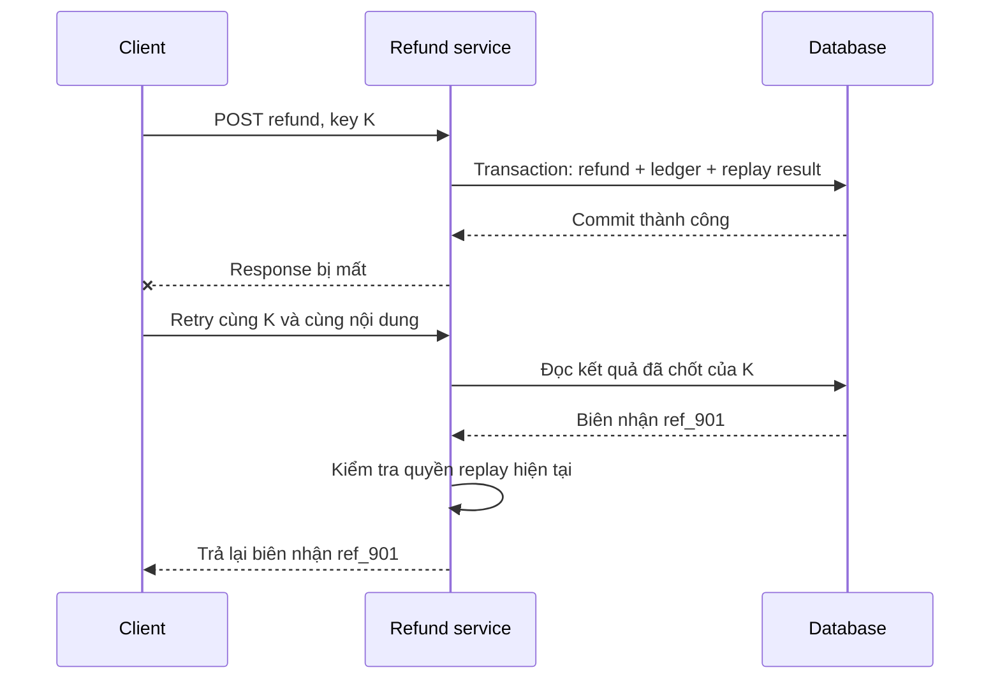

# Idempotency response replay: trả lại kết quả mà không thực thi lại nghiệp vụ

## 1. Response replay giải quyết khoảng không chắc chắn nào?

Một yêu cầu có thể đã tạo tác động nghiệp vụ dù client chưa nhận được phản hồi. Ví dụ, service hoàn tiền đã ghi nhận giao dịch và cộng tiền vào ví, nhưng kết nối bị ngắt trước khi response đến ứng dụng. Nếu lần gửi lại tiếp tục chạy toàn bộ luồng hoàn tiền, hệ thống có thể cộng tiền hai lần.

**Idempotency response replay là việc nhận diện request lặp lại và trả lại kết quả đã được chốt cho cùng thao tác, thay vì thực thi lại tác động nghiệp vụ.** Kết quả đó có thể là một biên nhận đã hoàn tất, một kết quả từ chối được lưu, hoặc thông tin đã tiếp nhận một công việc bất đồng bộ.

Trong bảo mật logic nghiệp vụ, cơ chế này cần đồng thời bảo vệ hai điều:

- Không tạo thêm tác động như hoàn tiền, đổi trạng thái phê duyệt hoặc phát lệnh thanh toán khi client retry.
- Không làm lộ kết quả đã lưu cho người không còn quyền truy cập đối tượng.

Response replay nằm trong chủ đề Idempotency của Business Logic Security. Nó phối hợp với transaction, business invariants, state machine và quyền theo đối tượng; một bản sao response không tự bảo vệ được toàn bộ những quy tắc ấy.

Bài này tập trung vào hợp đồng phản hồi, cách lưu kết quả có thể replay, thứ tự xử lý và các tình huống lạm dụng. Mục tiêu là thiết kế được nhánh replay rõ ràng, không vô tình gọi lại nhánh thực thi mới.

## 2. Ví dụ xuyên suốt: hoàn tiền về ví nội bộ

Giả sử hệ thống có một yêu cầu hoàn tiền đã được phê duyệt mang mã `rr_17`. Nhân viên có quyền gửi lệnh thực hiện hoàn tiền 50.000 đồng về ví của khách hàng. Trong ví dụ này, bản ghi hoàn tiền, số dư ví, sổ cái và dữ liệu idempotency cùng nằm trong một cơ sở dữ liệu.

```http
POST /v1/payments/pay_42/refunds
Authorization: Bearer <access-token>
Idempotency-Key: 8d65542e-3be2-471b-8b85-727acbb86386
Content-Type: application/json

{
  "refundRequestId": "rr_17",
  "amountMinor": 50000,
  "currency": "VND"
}
```

Server không chỉ tin số tiền trong request. Server phải kiểm tra số tiền đã được phê duyệt, quyền thực hiện hoàn tiền, trạng thái thanh toán và phần tiền còn được phép hoàn. Idempotency không hợp thức hóa một request sửa giá hoặc vượt hạn mức.

Lần thực thi đầu tiên thành công:

```http
HTTP/1.1 201 Created
Content-Type: application/json
Location: /v1/refunds/ref_901
Cache-Control: no-store

{
  "refundId": "ref_901",
  "refundRequestId": "rr_17",
  "paymentId": "pay_42",
  "amountMinor": 50000,
  "currency": "VND",
  "status": "SUCCEEDED"
}
```

Transaction đã commit nhưng response bị mất. Client gửi lại cùng key và cùng ý định. Sau khi kiểm tra người gọi còn quyền nhận kết quả, server trả lại biên nhận `ref_901`; không tạo `ref_902`, không cộng tiền thêm và không phát thêm sự kiện hoàn tiền mới.



Việc tìm được bản ghi chỉ cung cấp dữ liệu để xử lý. Server chưa được gửi nội dung nhạy cảm cho client trước khi hoàn thành kiểm tra quyền.

## 3. Phân biệt ba hành vi: replay, tra cứu và thực thi mới

| Hành vi | Câu hỏi được trả lời | Có thực thi tác động nghiệp vụ mới không? |
|---|---|---|
| Replay kết quả | Lần gửi trước của cùng ý định đã được ghi nhận với kết quả nào? | Không |
| Tra cứu trạng thái hiện tại | Tài nguyên hoặc công việc hiện giờ đang ở trạng thái nào? | Không |
| Thực thi một ý định mới | Yêu cầu mới này có được phép tạo thêm tác động không? | Có thể, sau mọi kiểm tra nghiệp vụ |

Ba hành vi có thể trả dữ liệu trông giống nhau, nhưng không được trộn đường xử lý.

Ví dụ, response ban đầu xác nhận đã tạo một yêu cầu hoàn tiền đang chờ xử lý. Khi client retry sau vài phút, hệ thống có thể đã hoàn tiền xong. Nếu hợp đồng là replay biên nhận tiếp nhận, server vẫn trả biên nhận đó và cùng mã thao tác. Trạng thái hiện tại được lấy qua endpoint tra cứu riêng.

Một API cũng có thể công bố rằng retry trả biểu diễn hiện tại của cùng thao tác. Đây là một lựa chọn khác hợp lệ nếu được mô tả rõ, vẫn kiểm tra quyền và tuyệt đối không thực thi lại tác động. Không nên vừa hứa “trả lại response gốc”, vừa âm thầm dựng response từ trạng thái hiện tại có ý nghĩa khác.

Trong phần còn lại, thiết kế chính là **lưu kết quả đã chốt và replay kết quả đó**, với một lớp HTTP có thể thêm metadata mới cho từng lần gọi.

## 4. Hợp đồng replay phải xác định những gì?

Không phải toàn bộ byte trên đường truyền đều nên được sao chép từ lần gọi đầu. Cần tách kết quả nghiệp vụ ổn định khỏi metadata của từng lần truyền tải.

### 4.1. Phần ổn định của kết quả

Thông thường cần giữ:

- Mã thao tác hoặc tài nguyên đã được tạo.
- Kết quả nghiệp vụ tại thời điểm được chốt.
- Số tiền, tiền tệ và các thông tin biên nhận liên quan.
- Mã HTTP được hợp đồng chọn để replay.
- Kiểu nội dung và phiên bản biểu diễn đã dùng.
- Một số header đã được kiểm soát, nếu cần để hiểu hoặc theo dõi kết quả.

Trong ví dụ, replay có thể tiếp tục trả `201 Created` cùng `refundId` đã tồn tại. Mã này đang trả lại kết quả tạo tài nguyên của thao tác gốc; nó không có nghĩa server vừa tạo thêm một refund. Một hợp đồng khác có thể chọn mã phản hồi khác, nhưng phải thống nhất với client.

### 4.2. Phần thuộc lần gọi hiện tại

Thông tin như request ID, thời điểm phục vụ response và trace của lần retry nên phản ánh lần gọi hiện tại. Hệ thống có thể liên kết thêm mã thao tác hoặc request gốc để truy vết.

Nếu muốn báo rằng phản hồi được replay, API có thể định nghĩa header riêng, chẳng hạn:

```http
Idempotency-Replayed: true
```

Đây là tên header minh họa do API tự quy định. Client không được dựa vào một header chưa được công bố trong hợp đồng để quyết định có cần gửi lại thao tác hay không.

### 4.3. Không sao chép mù toàn bộ header

| Thành phần | Chính sách thích hợp |
|---|---|
| Body biên nhận | Lưu snapshot ổn định hoặc dựng từ dữ liệu bất biến theo hợp đồng |
| HTTP status | Replay theo chính sách đã công bố cho kết quả được lưu |
| `Content-Type` | Giữ tương thích với biểu diễn đã lưu |
| `Location` | Chỉ lưu hoặc dựng lại từ định tuyến tin cậy, trỏ về cùng tài nguyên |
| `Date`, request ID | Tạo theo lần phục vụ hiện tại |
| `Set-Cookie`, token xác thực | Không lưu rồi phát lại như một phần biên nhận nghiệp vụ |
| URL truy cập có chữ ký ngắn hạn | Không xem URL cũ là kết quả ổn định; cần luồng cấp quyền và URL phù hợp |
| `Content-Length`, nén, header truyền tải | Để lớp HTTP tính theo nội dung thực sự được gửi |

Không dựng `Location` từ host hoặc URL tùy ý do client gửi mà chưa kiểm soát. Không phát lại header hết hạn hoặc làm thay đổi phiên đăng nhập chỉ vì chúng từng xuất hiện trong response gốc.

`Cache-Control: no-store` trong ví dụ hạn chế việc lưu response nhạy cảm ở các HTTP cache. Nó không ngăn server lưu một bản ghi idempotency trong kho dữ liệu nội bộ được kiểm soát. Hai loại lưu trữ có trách nhiệm và chính sách truy cập khác nhau.

## 5. Snapshot và tham chiếu kết quả: chọn cách nào để lưu?

### 5.1. Lưu snapshot phản hồi

Server lưu status, phần body và danh sách header được phép replay ngay khi chốt kết quả.

Ưu điểm là không phải tính lại kết quả, không bị thay đổi bởi dữ liệu hiện tại và có thể giữ đúng biểu diễn đã trả ban đầu. Nhược điểm là tăng dung lượng lưu trữ, có thể nhân bản dữ liệu nhạy cảm và cần quản lý tương thích khi triển khai phiên bản mới.

Nếu hợp đồng yêu cầu body giống hệt ở mức byte, cần lưu byte hoặc một biểu diễn có thể tái tạo đúng byte. Deserialize rồi serialize bằng cấu hình mới có thể thay đổi thứ tự thuộc tính, định dạng số hoặc cách thể hiện thời gian dù ý nghĩa tương đương.

Không cần cam kết byte giống hệt nếu sản phẩm chỉ cần cùng biên nhận và cùng ý nghĩa. Hãy cam kết đúng mức mà client thực sự cần.

### 5.2. Lưu tham chiếu đến dữ liệu kết quả bất biến

Server lưu `refundId` và đủ dữ liệu phiên bản để dựng lại biên nhận từ một bản ghi kết quả bất biến.

Cách này giảm sao chép body, nhưng chỉ đúng khi dữ liệu được tham chiếu thực sự đủ ổn định. Nếu hàm dựng response đọc số dư ví hiện tại, thông tin khách hàng vừa sửa hoặc trạng thái mới nhất của payment, nó không còn tái tạo kết quả gốc.

Việc lưu `refundId` rồi đọc một bảng có thể bị ghi đè hoặc xóa theo vòng đời khác cũng có thể làm mất khả năng replay. Cần thống nhất vòng đời và ý nghĩa của dữ liệu kết quả với hợp đồng idempotency.

### 5.3. Không tính lại các quyết định nghiệp vụ khi replay

Không chạy lại tính phí, tính giá, chọn chính sách giảm giá, chọn người phê duyệt hoặc gọi nhà cung cấp chỉ để dựng response cũ. Dữ liệu và cấu hình có thể đã thay đổi; tính lại sẽ biến retry thành một lần ra quyết định khác.

Trong ví dụ hoàn tiền, biên nhận giữ số tiền đã được hoàn của thao tác `ref_901`. Số dư ví hiện tại, nếu cần hiển thị, nên được tra cứu theo một hợp đồng riêng thay vì được gắn nhãn là số dư của response gốc.

## 6. Nhận diện đúng bản ghi được phép replay

Một key không nên được tra cứu như một định danh toàn cục không có ngữ cảnh. Thiết kế ví dụ dùng:

```text
identity = (
    trusted_tenant_id,
    authenticated_subject_id,
    operation_name,
    idempotency_key
)
```

Trong đó `operation_name` có thể là `payment.refund.v1`. Tenant và subject đến từ ngữ cảnh xác thực đã được kiểm chứng. Nếu luồng nghiệp vụ cần nhiều chủ thể cùng tiếp tục một thao tác, phải chọn scope phù hợp và vẫn kiểm tra quyền của từng người gọi.

Bản ghi còn cần fingerprint của ý định:

```text
fingerprint = HASH(canonicalize({
    operation: "payment.refund.v1",
    paymentId: "pay_42",
    refundRequestId: "rr_17",
    amountMinor: 50000,
    currency: "VND"
}))
```

Fingerprint phải bao gồm các trường quyết định tác động và được tạo từ dữ liệu đã chuẩn hóa theo schema. Không băm access token hoặc trace ID để định nghĩa thao tác, vì chúng có thể thay đổi qua các lần retry. Quy tắc mặc định và chuẩn hóa cũng cần nhất quán trong phiên bản hợp đồng được hỗ trợ.

Khi key khớp nhưng fingerprint khác, server phải trả lỗi xung đột theo hợp đồng. Không được trả body cũ rồi coi request mới đã thành công, không ghi đè fingerprint và không dùng cùng key để chạy nội dung mới.

Trong ví dụ, cùng key nhưng thay `amountMinor` từ `50000` thành `100000` là xung đột, dù người gọi vẫn có quyền trên payment.

## 7. Mô hình dữ liệu phục vụ replay an toàn

Một bản ghi minh họa:

```text
IdempotencyRecord
  tenant_id
  subject_id
  operation_name
  idempotency_key
  request_fingerprint
  target_id
  business_operation_id
  processing_state
  response_status
  response_content_type
  response_schema_version
  response_body_or_immutable_reference
  replayable_headers
  created_at
  expires_at
```

Cần ràng buộc duy nhất cho bộ định danh, với các cột định danh được quy định không rỗng phù hợp. `target_id` và `business_operation_id` giúp kiểm tra quyền, liên kết audit và phân giải kết quả; chúng không thay thế fingerprint.

Các trạng thái cần được định nghĩa theo mô hình xử lý cụ thể:

| Trạng thái minh họa | Ý nghĩa | Cách đáp ứng retry |
|---|---|---|
| `IN_PROGRESS` | Đã có chủ thể xử lý hoặc đã tiếp nhận công việc nhưng chưa có kết quả chốt của request | Chờ có giới hạn hoặc báo đang xử lý; không khởi tạo tác động song song |
| `COMPLETED` | Đã có kết quả ổn định để replay | Kiểm tra fingerprint, quyền và chính sách lưu trước khi trả kết quả |
| `UNKNOWN` | Chưa đủ bằng chứng xác định tác động, thường liên quan hệ thống bên ngoài | Tra cứu hoặc đối soát; không tự mở lại như request mới |

Đây là các tên trạng thái minh họa, không phải yêu cầu phải có đúng ba giá trị. Một mô hình transaction nội bộ đồng bộ có thể chỉ làm lộ bản ghi `COMPLETED` sau commit. Một hệ thống bất đồng bộ có thể công bố trạng thái đã tiếp nhận từ trước.

Đặc biệt, `COMPLETED` của request không nhất thiết là “hoàn tiền thành công”. Nếu response đã chốt là `202 Accepted`, request tiếp nhận đã hoàn tất nhưng công việc hoàn tiền có thể còn chạy. Tương tự, kết quả bị từ chối được lưu cũng có thể là một kết quả hoàn tất để replay.

## 8. Thứ tự xử lý để nhánh replay không tạo tác động

### 8.1. Mã giả cho tác động trong cùng cơ sở dữ liệu

Ví dụ dưới đây dùng transaction để chốt đồng thời khoản hoàn tiền về ví và biên nhận. Đây là mã giả mô tả thiết kế, không phải mã Java hoặc SQL có thể chạy trực tiếp.

```text
actor = authenticate(request)
requireEndpointAccess(actor)
input = parseAndNormalize(request, apiContractVersion)
key = validateKey(request.idempotencyKey)
scope = trustedScope(actor, "payment.refund.v1")
digest = fingerprint(route.paymentId, input)

outcome = inDatabaseTransaction:
    claim = reserveOrFindWithUniqueConstraint(scope, key, digest)

    if claim refers to an existing committed record:
        record = claim.metadata
        requireCurrentAccessToRequestedTarget(actor, route.paymentId)

        if record.requestFingerprint != digest:
            return KEY_CONFLICT_WITHOUT_CHANGING_ORIGINAL_RECORD

        requireCurrentReplayPermission(actor, record.targetId)
        requireReplayStillSupported(record)

        if record.processingState == COMPLETED:
            snapshot = loadAndValidateSavedResult(record)
            return REPLAY(snapshot)

        return EXISTING_OPERATION_STATUS(record)

    payment = loadPaymentForUpdate(route.paymentId)
    refundRequest = loadApprovedRefundRequestForUpdate(input.refundRequestId)

    requireCurrentExecutionPermission(actor, payment, refundRequest)
    requireRefundRequestBelongsToPayment(refundRequest, payment)
    requireApprovedAmountAndCurrencyMatch(refundRequest, input)
    requireRefundRequestNotAlreadyExecuted(refundRequest)
    requireRemainingRefundableAmount(payment, input.amountMinor)

    refund = createRefundWithBusinessUniqueness(refundRequest, payment, input)
    creditCustomerWalletAndWriteLedger(refund)
    updateRefundTotalsAndRequestState(payment, refundRequest, refund)

    snapshot = buildStableRefundReceipt(refund)
    saveCompletedIdempotencyResult(scope, key, digest, snapshot)
    return ORIGINAL(snapshot)

# Chỉ đến đây khi transaction đã commit thành công.
return renderHttpOutcomeWithCurrentRequestMetadata(outcome)
```

Nếu một bước nghiệp vụ thất bại, transaction phải rollback các thay đổi chưa commit, hoặc đi qua nhánh lưu kết quả từ chối được thiết kế rõ ràng. Không được bắt lỗi rồi commit một phần khoản hoàn tiền hoặc một response thành công không có tác động tương ứng.

`reserveOrFindWithUniqueConstraint` phải xử lý tranh chấp bằng ràng buộc nguyên tử tại nơi ghi. Nếu một transaction khác đang sở hữu cùng định danh chưa commit, request sau có thể phải chờ, nhận lỗi có thể retry, hoặc thực hiện lại bước tra cứu sau khi transaction kia kết thúc. Không thể hiện thực hàm này bằng một phép đọc “chưa thấy key” rồi cho mọi request cùng thực thi.

### 8.2. Điểm phân tách quan trọng

Nhánh `REPLAY` không đi qua các hàm tạo refund, cộng ví, cập nhật tổng hoàn tiền hoặc phát sự kiện nghiệp vụ mới. Nó chỉ đọc kết quả đã chốt và dựng phản hồi theo hợp đồng.

Audit cho lần truy cập replay có thể được ghi để theo dõi bảo mật, nhưng phải phân biệt với sự kiện “một khoản hoàn tiền mới đã được thực hiện”. Consumer không được hiểu log replay là lệnh hoàn tiền hoặc sự kiện hoàn tiền thành công mới.

Việc đọc rồi replay phải kiểm tra quyền theo chính sách hiện tại. Tuy nhiên, không chạy lại điều kiện chỉ đúng trước lần thực thi đầu: yêu cầu hoàn tiền `rr_17` đã thực hiện xong thì không còn ở trạng thái “chưa thực hiện”. Nếu áp dụng điều kiện đó cho replay, client sẽ không lấy lại được biên nhận của chính thao tác thành công.

### 8.3. Phân biệt quyền xem kết quả và quyền thực thi mới

Tùy chính sách sản phẩm, replay có thể yêu cầu quyền gọi endpoint và quyền xem biên nhận hiện tại; một hệ thống nhạy cảm hơn có thể yêu cầu thêm quyền cụ thể. Cần mô tả rõ chính sách này thay vì tự động lấy response trong cache làm câu trả lời cuối.

Nếu quyền đã bị thu hồi, trả lỗi truy cập theo chính sách che giấu tài nguyên của API. Không ghi đè kết quả gốc bằng lỗi truy cập của lần retry. Quyền của một lần gọi hiện tại và kết quả bền vững của thao tác gốc là hai dữ kiện khác nhau.

## 9. Đồng thời và sự cố: kết quả nào được phép replay?

### 9.1. Hai request cùng key đến đồng thời

Hai request có thể đến hai instance khác nhau. Một instance thực thi; instance còn lại phải phối hợp qua kho dữ liệu dùng chung hoặc cơ chế nguyên tử tương đương.

Nếu chọn một transaction cho toàn bộ tác động nội bộ và kết quả idempotency, bản ghi đang đăng ký chưa commit thường chưa đọc được như một bản ghi hoàn tất. Request sau phải giải quyết tranh chấp trước khi quyết định trả kết quả. Không được trả body thành công được dựng tạm khi transaction đầu còn có thể rollback.

Nếu thiết kế có bản ghi `IN_PROGRESS` đã commit riêng, phải có cơ chế sở hữu, phục hồi và quản lý tác động phù hợp. Một cờ “đang xử lý” không tự giải quyết tình huống worker chết hoặc chạy quá thời hạn thuê quyền xử lý.

### 9.2. Dừng tiến trình tại các thời điểm khác nhau

| Điểm xảy ra lỗi | Cách xử lý an toàn |
|---|---|
| Trước khi tạo tác động và transaction đã rollback | Có thể thực thi lại cùng key theo điều kiện nghiệp vụ lúc thực thi mới |
| Trong transaction nội bộ, trước commit và rollback đã được xác nhận | Không có kết quả thành công để replay; tác động chưa commit phải bị hủy |
| Sau commit, trước khi gửi response | Replay snapshot đã commit, không thực thi lại |
| Mất kết nối đúng lúc xác nhận commit | Giữ cùng key để phân giải; exception không chứng minh rollback |
| Sau khi bên ngoài đã nhận lệnh nhưng trước khi lưu kết quả nội bộ | Giữ mã thao tác ổn định và tra cứu hoặc đối soát |
| Đọc được bản ghi hoàn tất nhưng body bị mất hoặc hỏng | Báo lỗi phục hồi kết quả; không tự chạy lại nghiệp vụ |

Điểm cuối rất dễ bị xử lý sai: “không dựng được response” khác với “nghiệp vụ chưa xảy ra”. Nếu bản ghi refund và sổ cái đã tồn tại, khởi tạo lại refund để có một response mới sẽ tạo thêm rủi ro.

Chỉ có thể dựng lại từ dữ liệu bền vững khi dữ liệu đó đủ để bảo đảm cùng kết quả theo hợp đồng. Quá trình sửa hoặc phục hồi snapshot phải được kiểm soát, không âm thầm sửa ý nghĩa của thao tác đã commit.

## 10. Replay lỗi và kết quả chưa xác định

Không nên có quy tắc đơn giản “lưu mọi lỗi” hoặc “chỉ lưu mọi response 2xx”. Cần xét kết quả đã được chốt chưa và tác động có thể đã xảy ra chưa.

| Loại phản hồi hoặc tình huống | Chính sách minh họa |
|---|---|
| JSON sai cú pháp, key sai định dạng | Từ chối trước khi tiếp nhận thao tác; thường không tạo kết quả idempotency |
| Không xác thực hoặc không có quyền | Từ chối theo ngữ cảnh hiện tại; không phát lại response nhạy cảm đã lưu |
| Rate limit trước khi tiếp nhận | Trả lỗi giới hạn; không coi đó là bằng chứng thao tác đã được chốt |
| Key trùng nhưng fingerprint khác | Trả xung đột; giữ nguyên kết quả của ý định gốc |
| Kết quả nghiệp vụ bị từ chối và được lưu như kết quả cuối | Replay cùng kết quả từ chối theo hợp đồng |
| Hạ tầng lỗi trước khi tạo tác động, đã xác nhận không có commit | Có thể cho retry thực thi bằng cùng key theo chính sách |
| Lỗi mạng hoặc `5xx` nhưng kết quả tác động chưa rõ | Tra cứu trạng thái bền vững, giữ liên kết với thao tác cũ |
| Thành công đã commit nhưng proxy trả lỗi cho client | Replay thành công từ dữ liệu đã commit |

Ví dụ, nếu hệ thống đã lưu kết quả từ chối “yêu cầu hoàn tiền chưa được phê duyệt”, retry cùng key có thể tiếp tục nhận kết quả đó dù sau này có người phê duyệt. Người dùng muốn thực hiện một ý định mới phải đi theo luồng được sản phẩm cho phép, không sửa nội dung dưới cùng key.

Mã HTTP do proxy hoặc tầng truyền tải tạo ra không nhất thiết là kết quả nghiệp vụ đã được lưu. Vì vậy, “response đầu tiên client nhìn thấy” không luôn là thứ server phải chốt để replay. Nguồn quyết định là trạng thái bền vững và hợp đồng xử lý của thao tác.

## 11. Response replay với xử lý bất đồng bộ và hệ thống ngoài

Giả sử hoàn tiền được gửi đến cổng thanh toán. Transaction nội bộ thông thường không bao trùm lời gọi HTTP ra ngoài, nên không thể dùng cách lưu body và tác động cùng một transaction như ví nội bộ cho toàn bộ luồng.

Một hợp đồng phổ biến là chốt kết quả tiếp nhận:

```http
HTTP/1.1 202 Accepted
Content-Type: application/json
Location: /v1/refund-operations/rop_901
Cache-Control: no-store

{
  "operationId": "rop_901",
  "accepted": true,
  "statusUrl": "/v1/refund-operations/rop_901"
}
```

Server lưu đồng thời thao tác `rop_901`, công việc outbox và kết quả tiếp nhận trong transaction nội bộ. Retry cùng key nhận lại cùng thao tác, không tạo công việc hoàn tiền mới. Client tra cứu trạng thái hiện tại qua `statusUrl`.

Worker gửi lệnh ra ngoài cần dùng định danh ổn định cho cùng thao tác, bao gồm key phía nhà cung cấp nếu họ hỗ trợ, và tuân thủ phạm vi cùng thời hạn lưu của nhà cung cấp. Outbox có thể được giao lại; nó không tự làm cho cổng thanh toán chỉ thực thi một lần.

Nếu kết quả gọi ngoài chưa rõ, không replay một response “đã hoàn tiền thành công” chỉ vì request đã được tiếp nhận. Cũng không xóa key rồi gửi lệnh mới. Cần tra cứu, nhận kết quả hoặc đối soát để cập nhật trạng thái công việc.

Webhook và message kết quả cũng có thể đến lặp hoặc sai thứ tự. Việc ghi kết quả phải có chống trùng và điều kiện chuyển trạng thái phù hợp. Không phát lại sự kiện nghiệp vụ thành công mỗi lần client yêu cầu replay response.

## 12. Các rủi ro bảo mật đặc thù của replay

### 12.1. Rò rỉ chéo người dùng hoặc tenant

Tra cứu chỉ theo chuỗi key có thể lấy nhầm response của người khác. Scope phải được xây từ ngữ cảnh tin cậy, đồng thời kiểm tra quyền trên đối tượng được tham chiếu. Độ khó đoán của key không biến nó thành thông tin cấp quyền.

Nếu nhân viên A mất quyền truy cập payment sau khi thực hiện refund, việc biết key cũ không cho phép A tiếp tục lấy biên nhận có dữ liệu nhạy cảm. Nếu chính sách cho phép truy cập lịch sử riêng, quyền đó cũng phải được kiểm tra rõ ràng.

### 12.2. Replay response chứa quyền hoặc thông tin truy cập đã hết hạn

Không đưa token, cookie phiên hoặc URL truy cập ngắn hạn vào phần snapshot được phát lại tự động. Nếu cần cấp lại khả năng truy cập tài liệu, hãy dùng luồng kiểm tra quyền hiện tại rồi tạo thông tin truy cập phù hợp, tách khỏi biên nhận bất biến.

Nếu phạm vi dữ liệu người dùng được xem đã hẹp hơn lần đầu, không được tự động phát lại toàn bộ snapshot cũ. Với hợp đồng replay snapshot nguyên vẹn, có thể phải từ chối replay và cung cấp luồng tra cứu được phép riêng. Nếu chọn trả biểu diễn được lọc theo quyền hiện tại, phải công bố rằng đây là cùng kết quả theo ý nghĩa, không phải bản sao nguyên vẹn response gốc.

### 12.3. Cache poisoning và sửa kết quả đã chốt

Không cho client cung cấp response, `Location`, trạng thái thành công hoặc fingerprint được coi là đáng tin mà server không tự kiểm chứng. Kết quả replay phải xuất phát từ lần xử lý phía server được chốt đúng quy tắc.

Key trùng với nội dung khác không được phép ghi đè bản ghi. Quyền ghi vào kho idempotency cần bị giới hạn như các dữ liệu nghiệp vụ liên quan; sửa một biên nhận có thể làm hệ thống hoặc người vận hành hiểu sai tác động đã xảy ra.

### 12.4. Lạm dụng kho lưu và đường replay

Giới hạn độ dài key, kích thước request và response được lưu, số thao tác đang xử lý, tốc độ tạo key mới và tần suất tra cứu. Replay không trừ tiền thêm nhưng vẫn có thể gây tải lên cơ sở dữ liệu hoặc làm đầy kho dữ liệu.

Không ghi toàn bộ body nhạy cảm vào log cho mỗi lần replay. Log nên chứa mã thao tác, kết quả nhánh xử lý và định danh truy vết được bảo vệ phù hợp. Không dùng key có số lượng giá trị rất lớn trực tiếp làm nhãn metric.

## 13. Phiên bản response, thời hạn lưu và phục hồi

### 13.1. Phiên bản hợp đồng

Một lần triển khai mới không được làm bản ghi cũ trở thành lệnh thực thi mới chỉ vì serializer đã thay đổi. Cần giữ khả năng đọc phiên bản snapshot còn trong cửa sổ hỗ trợ, hoặc dùng biểu diễn bất biến đã lưu.

Nếu endpoint hỗ trợ nhiều phiên bản hoặc kiểu nội dung, phải quyết định retry có bắt buộc dùng cùng hợp đồng biểu diễn hay không. Có thể ràng buộc phiên bản vào loại thao tác, hoặc từ chối yêu cầu biểu diễn không tương thích. Không lấy một body thuộc hợp đồng cũ rồi gắn nhãn kiểu nội dung hay phiên bản mới.

Không đưa một phiên bản phần mềm triển khai thay đổi liên tục vào scope rồi mặc nhiên xem key cũ là chưa tồn tại sau mỗi lần deploy. Phiên bản hợp đồng nghiệp vụ và phiên bản tiến trình chạy là hai thứ khác nhau.

### 13.2. Thời hạn replay không đồng nghĩa thời hạn tồn tại tác động

Sau khi snapshot hết hạn, khoản hoàn tiền và sổ cái vẫn còn hiệu lực. Không được kết luận “body đã hết hạn nên có thể hoàn tiền lại”.

Một thiết kế có thể giữ bản ghi đánh dấu thao tác đã tồn tại và tham chiếu nghiệp vụ lâu hơn body. Khi không còn replay được nguyên vẹn, API trả thông tin theo chính sách đã công bố, chẳng hạn yêu cầu tra cứu thao tác; không giả vờ vừa xử lý mới thành công.

Với ví dụ `rr_17`, ràng buộc nghiệp vụ “một yêu cầu hoàn tiền đã phê duyệt chỉ được thực hiện một lần” vẫn phải tồn tại độc lập với TTL của idempotency. Với nhiều yêu cầu hoàn tiền hợp lệ khác nhau, invariant tổng tiền hoàn không vượt tiền đã thu cũng phải chịu được cập nhật đồng thời.

Nếu sản phẩm cho phép nhiều thao tác có nội dung giống nhau, không dùng việc trùng nội dung để cấm vĩnh viễn mọi thao tác tương lai. Cần mã ý định hoặc yêu cầu nghiệp vụ phù hợp và chính sách retry muộn rõ ràng.

### 13.3. Dữ liệu bị xóa, hỏng hoặc chưa phục hồi đủ

Nếu snapshot không còn nhưng vẫn có bằng chứng thao tác đã thực hiện, cần trả trạng thái không thể replay hoặc dùng luồng phục hồi có kiểm soát. Không fallback sang gọi hàm nghiệp vụ mới.

Sao lưu và phục hồi cũng phải bảo toàn mối liên kết giữa sổ cái, bản ghi nghiệp vụ và kết quả idempotency. Nếu khôi phục kho key và cơ sở dữ liệu tác động về những thời điểm khác nhau, trạng thái “không thấy key” có thể không phản ánh tác động thật. Khi chưa phân giải được, phải dựa vào dữ liệu nghiệp vụ và đối soát trước khi cho thực thi lại.

## 14. Ma trận kiểm thử cho response replay

Kiểm thử cần quan sát cả response và số tác động thực tế. Một body có cùng `refundId` chưa đủ chứng minh server không vô tình cộng ví hoặc phát lệnh ngoài thêm lần nữa.

| Tình huống | Khẳng định về response | Khẳng định về nghiệp vụ và bảo mật |
|---|---|---|
| Retry tuần tự cùng scope, key và fingerprint | Cùng biên nhận theo hợp đồng | Một khoản hoàn tiền, một tác động cộng ví tương ứng |
| Nhiều request cùng key đến nhiều instance | Replay hoặc trạng thái chờ đúng hợp đồng | Không có hai chủ thể cùng commit tác động |
| Commit thành công nhưng mất response đầu | Lấy lại được kết quả đã chốt | Không tạo refund hoặc outbox mới |
| Cùng key, đổi số tiền hoặc mã payment | Lỗi xung đột, không trả thành công cho nội dung mới | Kết quả gốc không bị ghi đè |
| Access token thay mới, cùng người và quyền hợp lệ | Vẫn nhận diện cùng thao tác | Token không tham gia định nghĩa ý định |
| Key giống nhau ở tenant khác | Không nhận response của tenant cũ | Không rò rỉ dữ liệu chéo tenant |
| Người gọi mất quyền sau lần đầu | Lỗi truy cập theo chính sách | Không trả body nhạy cảm đã lưu |
| Trạng thái nghiệp vụ đã thay đổi sau thành công | Replay biên nhận gốc theo hợp đồng | Không chạy lại điều kiện chuyển trạng thái của lần thực thi đầu |
| Quyền xem dữ liệu bị thu hẹp | Từ chối hoặc trả biểu diễn được phép theo hợp đồng | Không lộ trường nhạy cảm từ snapshot cũ |
| Lỗi nghiệp vụ đã được chốt và lưu | Replay đúng kết quả từ chối | Không tự đổi ý định để thử lại |
| Snapshot thiếu hoặc lỗi deserialize | Lỗi hoặc luồng phục hồi rõ ràng | Không thực thi lại tác động để tạo response mới |
| Deploy phiên bản mới | Đọc đúng snapshot còn được hỗ trợ | Không xem key cũ là mới vì đổi bản build |
| Snapshot hết hạn nhưng thao tác cũ còn | Phản hồi đúng chính sách request muộn | Invariant và mã yêu cầu nghiệp vụ vẫn chặn tác động trùng |
| Response gốc có cookie hoặc URL ngắn hạn | Không phát lại thông tin truy cập cũ ngoài chính sách | Không tạo quyền truy cập trái ngữ cảnh hiện tại |
| Công việc ngoài hệ thống chưa rõ kết quả | Trả cùng mã thao tác hoặc trạng thái chưa rõ | Không phát lệnh hoàn tiền mới bằng định danh khác |

Trong ví dụ ví nội bộ, cần kiểm chứng tổng cộng ví đúng 50.000 đồng, chỉ một refund gắn với `rr_17`, tổng tiền hoàn không vượt tiền đã thu và biên nhận replay trỏ đúng thao tác đã commit. Đồng thời, sự kiện “hoàn tiền thành công” không được phát sinh thêm chỉ vì có một lượt replay.

## 15. Câu hỏi tự kiểm tra

1. Vì sao dựng lại response bằng cách gọi lại hàm hoàn tiền là sai dù response cuối cùng trông giống nhau?
2. Những phần nào của HTTP response nên ổn định, phần nào nên thuộc lần gọi hiện tại?
3. Vì sao một snapshot đã lưu vẫn cần kiểm tra quyền trước khi gửi?
4. Khi snapshot không còn nhưng refund đã tồn tại, server có được chạy lại thao tác không?
5. Một response `202 Accepted` được replay có chứng minh tác động bên ngoài đã hoàn tất không?
6. Nếu cùng key nhưng số tiền khác, bản ghi gốc cần được xử lý thế nào?
7. Khi deploy hoặc TTL thay đổi, điều gì tiếp tục ngăn tác động trùng?

Một thiết kế replay đầy đủ phải trả lời được cả ba câu hỏi: đây có đúng là cùng ý định không, người gọi hiện tại có được nhận kết quả này không, và kết quả đã được chốt cùng tác động bằng cơ chế nào. Chỉ khi các câu trả lời rõ ràng, nhánh replay mới giúp client phục hồi sau lỗi mạng mà vẫn giữ đúng quy tắc nghiệp vụ.
