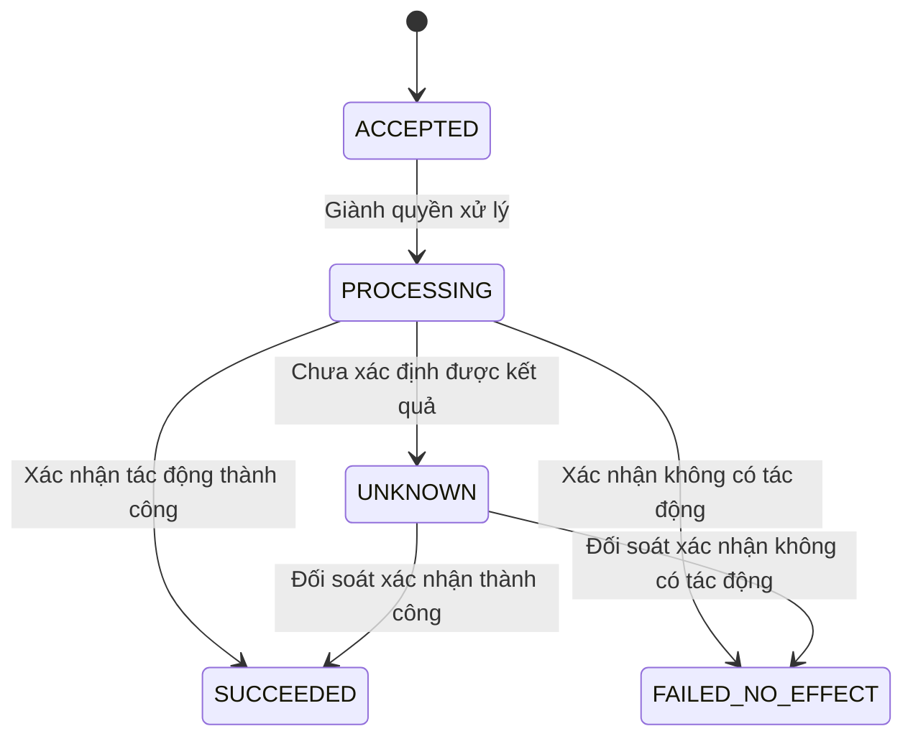

# Idempotency expiration

## 1. Khóa hết hạn có thể làm nghiệp vụ chạy lại như thế nào?

Idempotency cho phép client gửi lại cùng một thao tác mà không tạo thêm tác động nghiệp vụ ngoài ý muốn. Nhưng hệ thống thường không lưu khóa chống trùng và toàn bộ phản hồi mãi mãi. **Idempotency expiration** là chính sách xác định một bản ghi chống trùng được giữ bao lâu và hệ thống xử lý yêu cầu đến sau thời hạn đó như thế nào.

Đây là một quyết định về tính đúng đắn và bảo mật logic nghiệp vụ. Nếu bản ghi bị xóa nhưng thao tác gốc vẫn có tác động, hệ thống có thể nhầm một lần retry thành yêu cầu mới. Kẻ tấn công không cần sửa nội dung: chỉ cần giữ lại yêu cầu cũ và gửi lại sau khi cơ chế chống trùng hết hiệu lực.

Ví dụ xuyên suốt: người dùng đổi 1.000 điểm thưởng lấy một phiếu ưu đãi. Máy chủ đã trừ điểm và cấp phiếu, nhưng phản hồi bị mất. Ứng dụng lưu yêu cầu để gửi lại sau. Nếu bản ghi idempotency đã bị dọn và API không có định danh đổi thưởng bền vững, yêu cầu cũ có thể tiếp tục trừ điểm và cấp thêm phiếu.

Mục tiêu của bài là thiết kế thời hạn lưu để tiết kiệm tài nguyên mà vẫn giữ các invariant: không thực hiện trùng một ý định nghiệp vụ, không vượt quyền khi phát lại kết quả, không lấy việc hết hạn làm bằng chứng một thao tác chưa từng xảy ra.

## 2. Phân biệt các loại thời hạn

Một hệ thống có thể có nhiều đồng hồ cùng tồn tại. Chúng phục vụ các mục đích khác nhau và không nên dùng chung một trường `expires_at` không rõ nghĩa.

| Thời hạn | Câu hỏi được trả lời | Khi hết hạn không được tự suy ra điều gì? |
|---|---|---|
| Thời hạn tiếp nhận thao tác | Đến khi nào một ý định chưa thực hiện còn được phép bắt đầu? | Không có nghĩa một thao tác đã hoàn tất bị hủy |
| Thời gian lưu bản ghi chống trùng | Hệ thống còn nhận diện và xử lý retry dựa trên bản ghi này đến khi nào? | Không chứng minh nghiệp vụ gốc chưa diễn ra |
| Thời gian lưu toàn bộ phản hồi | Đến khi nào có thể phát lại nguyên phản hồi đã lưu? | Không bắt buộc xóa bằng chứng về thao tác |
| Lease của worker | Worker nào được quyền tiếp tục xử lý ở thời điểm hiện tại? | Không chứng minh worker cũ đã dừng hoặc chưa gây tác động |
| Thời hạn nghiệp vụ | Ưu đãi, báo giá hoặc phê duyệt còn hợp lệ đến khi nào? | Không cho phép xóa kết quả của nghiệp vụ đã commit |
| Thời gian lưu dấu vết nghiệp vụ | Đến khi nào còn tra cứu được ý định, kết quả và bằng chứng thực hiện? | Không mặc nhiên là cùng TTL với cache phản hồi |
| Thời hạn chống trùng của hệ thống nhận | Dịch vụ bên ngoài còn bảo vệ định danh đã gửi đến khi nào? | Không kéo dài chỉ vì hệ thống cục bộ còn giữ bản ghi |

Một bản ghi phản hồi có thể được xóa sớm vì chứa dữ liệu cá nhân hoặc chiếm nhiều dung lượng, trong khi bằng chứng tối thiểu về định danh thao tác vẫn cần được giữ lâu hơn. Ngược lại, giữ cache phản hồi lâu không tự bảo vệ được tác động bên ngoài nếu dịch vụ nhận đã quên định danh chống trùng của nó.

Không lấy TTL của cache hoặc thời gian lease làm chính sách hoàn tất nghiệp vụ. Cache bị loại bỏ sớm do áp lực bộ nhớ cũng phải được xem xét: nếu cache là nơi duy nhất lưu bằng chứng chống trùng, thời hạn bảo đảm thực tế có thể ngắn hơn TTL cấu hình.

## 3. Invariants, phạm vi khóa và định danh nghiệp vụ

### 3.1. Những quy tắc phải tồn tại độc lập với cache

Với chức năng đổi thưởng, có thể đặt ra các invariant sau:

1. Một ý định đổi thưởng chỉ có tối đa một kết quả thực hiện có hiệu lực theo mô hình nghiệp vụ.
2. Tổng điểm bị trừ phải khớp với các bút toán đổi thưởng hợp lệ; retry không được tạo thêm bút toán.
3. Một khóa đã gắn với nội dung A không được dùng để lén thực hiện nội dung B trong khoảng bảo đảm của khóa.
4. Người gọi chỉ được đọc kết quả hoặc tiếp tục thao tác thuộc phạm vi họ được phép truy cập.
5. Trạng thái chưa rõ kết quả phải được đối soát, không được coi như chưa thực hiện.
6. Dọn dữ liệu tạm không được xóa rào chắn cuối cùng đang bảo vệ một thao tác còn có thể bị phát lại.

### 3.2. Khóa HTTP không thay thế định danh ý định nghiệp vụ

Có thể phân biệt:

- `idempotency_key`: định danh một lần gửi thao tác có thể được retry qua API.
- `redemption_intent_id`: định danh ý định đổi thưởng đã được máy chủ cấp hoặc xác lập theo quy trình tin cậy.
- `operation_id`: định danh thao tác xử lý nội bộ gắn với ý định đó.
- `effect_id`: định danh tác động như bút toán trừ điểm hoặc lần cấp phiếu.

Khóa idempotency giúp nhận diện các request lặp. Định danh ý định và các ràng buộc nghiệp vụ giúp bảo vệ ngay cả khi request dùng khóa mới hoặc bản ghi khóa đã hết hạn.

Ví dụ ràng buộc logic có thể là một thao tác hoàn tất cho mỗi `(tenant_id, redemption_intent_id, operation_type)`. Từng bút toán cũng có định danh duy nhất tương ứng với vai trò của nó trong thao tác. Cách hiện thực cụ thể phải cho phép đối soát hoặc tiếp tục thao tác dở dang, thay vì cấm mọi lần thử bằng cách tạo một bản ghi rồi bỏ mặc nó.

Không đặt duy nhất theo `(user_id, reward_id)` nếu nghiệp vụ cho phép một người đổi cùng phần thưởng nhiều lần. Ranh giới duy nhất phải biểu diễn **một ý định**, không vô tình cấm những ý định mới hợp lệ. Đồng thời, nếu client được tùy ý tạo ý định mới, cần các quy tắc riêng về điểm còn lại, hạn mức và điều kiện đổi thưởng; idempotency không ngăn việc gửi nhiều yêu cầu mới có chủ ý.

### 3.3. Phạm vi khóa và fingerprint

Một phạm vi khóa thường bao gồm tenant, loại thao tác và khóa do client cung cấp. Nếu khóa chỉ có ý nghĩa trong phạm vi một người dùng hoặc một đối tượng, thiết kế phải thể hiện phạm vi đó rõ ràng và áp dụng thống nhất.

Fingerprint là dấu vết của nội dung có ý nghĩa đối với thao tác: định danh ý định, phần thưởng, số lượng và các tham số ảnh hưởng đến kết quả. Cần chuẩn hóa dữ liệu để những khác biệt định dạng không làm sai nhận diện. Không đưa thời điểm gửi lại hoặc thông tin theo từng lần truyền vào fingerprint nếu chúng không làm thay đổi ý nghĩa yêu cầu.

Hash nội dung không phải bằng chứng quyền truy cập và không thay thế chữ ký xác thực. Người có khóa hoặc biết hash vẫn phải được kiểm tra quyền. Không lưu nguyên token, thông tin bí mật hoặc toàn bộ dữ liệu nhạy cảm trong khóa; giới hạn độ dài và định dạng khóa để tránh lạm dụng tài nguyên lưu trữ.

## 4. Phân tích một lần retry đến sau thời hạn

Giả sử một hệ thống minh họa giữ phản hồi và bản ghi khóa trong 24 giờ. Đây là giả định để phân tích, không phải thời hạn khuyến nghị cho mọi API.

```text
Ngày 1, 09:00  Nhận khóa K cho ý định đổi thưởng R.
Ngày 1, 09:01  Commit trừ điểm, cấp phiếu, ghi kết quả.
Ngày 1, 09:01  Phản hồi đến client bị mất.
Ngày 2, 09:00  Bản ghi khóa K đủ điều kiện dọn theo TTL.
Ngày 2, 10:30  Client hoặc kẻ tấn công gửi lại K và cùng nội dung.
```

Nếu máy chủ chỉ kiểm tra “không tìm thấy K thì chạy”, yêu cầu cuối có thể thực hiện lại nghiệp vụ. Việc hệ thống từng bảo vệ chống trùng trong 24 giờ không giữ được invariant của ý định R sau thời hạn đó.

Một luồng an toàn hơn cần tra cứu bằng chứng nghiệp vụ hoặc kiểm tra một ranh giới tiếp nhận tin cậy:

| Bằng chứng còn lại | Cách xử lý có thể áp dụng |
|---|---|
| Bản ghi khóa và phản hồi còn hiệu lực | Kiểm tra quyền, đối chiếu fingerprint, phát lại kết quả |
| Phản hồi đã dọn nhưng sổ thao tác xác nhận R hoàn tất | Trả trạng thái hoặc dựng lại phần kết quả được phép từ bằng chứng đã lưu |
| Còn bản ghi tối thiểu xác nhận K đã dùng | Không coi K là khóa mới; trả kết quả tra cứu được hoặc thông báo không còn phản hồi chi tiết |
| Thao tác R đang xử lý hoặc chưa rõ kết quả | Trả định danh thao tác, yêu cầu tra cứu hoặc đưa vào đối soát theo hợp đồng |
| Không còn bằng chứng nhưng hạn tiếp nhận tin cậy của R đã qua | Từ chối bắt đầu lại; hướng dẫn tra cứu hoặc tạo ý định mới theo quy trình |
| Không còn bằng chứng và không có ranh giới tiếp nhận đáng tin | Không thể chỉ từ chuỗi khóa phân biệt một khóa mới với khóa cũ đã bị quên |

Dòng cuối là giới hạn thông tin của thiết kế. Nếu xóa mọi bằng chứng rồi chấp nhận một chuỗi bất kỳ làm khóa mới, hệ thống không thể đồng thời cam kết rằng chuỗi đó chưa từng được sử dụng.

## 5. Xác định thời gian lưu từ đường đi của retry

Không chọn thời hạn chỉ bằng câu hỏi “cache đủ lớn để giữ bao lâu”. Cần liệt kê những đường có thể đưa một yêu cầu cũ quay lại:

- Retry đồng bộ sau timeout và backoff của SDK.
- Ứng dụng di động hoặc thiết bị có hàng đợi khi mất mạng.
- Proxy, cổng tích hợp hoặc đối tác có chính sách retry riêng.
- Message broker, retry topic và dead-letter queue được phát lại.
- Người vận hành chạy lại một lô xử lý hoặc phục hồi từ sự cố.
- Callback bên ngoài đến muộn và các bước đối soát tự động.

Có thể dùng mô hình định tính:

```text
Thời gian nhận diện retry cần thiết
    >= thời điểm yêu cầu cũ có thể được chấp nhận muộn nhất
       tính từ mốc bắt đầu được định nghĩa rõ
       + biên cho sai lệch thời gian và vận hành
```

Với các đường độc lập, lấy đường có thời điểm đến muộn nhất. Với các giai đoạn nối tiếp, phải tính cả chuỗi độ trễ; lấy giá trị lớn nhất của từng TTL riêng lẻ có thể bị thiếu.

Ví dụ giả định: ứng dụng gửi lại trong 18 giờ từ lần tiếp nhận đầu. Một nhánh khác đưa công việc vào hàng đợi ở giờ thứ 6, rồi cho phép phát lại từ đó thêm 30 giờ. Nhánh sau có thể quay lại ở giờ thứ 36 tính từ mốc đầu, nên giữ 24 giờ là không bao phủ được đường đi này. Nếu chọn một thời hạn dài hơn để có biên vận hành, vẫn phải kiểm tra tất cả đường phát lại và giới hạn thực tế; phép tính này không tạo ra một con số mặc định cho mọi hệ thống.

Nếu người vận hành có thể phát lại dead-letter queue bất kỳ lúc nào hoặc client có thể gửi lại không giới hạn, không TTL hữu hạn nào tự bao phủ được mọi retry. Cần hạn tiếp nhận, định danh nghiệp vụ bền vững hoặc quy trình phát lại phải tra cứu thao tác gốc trước khi thực thi.

Mỗi chính sách cần ghi rõ mốc tính: lần tiếp nhận đầu tiên, lúc thao tác hoàn tất hay lúc client truy cập gần nhất. Bảo đảm “giữ ít nhất một khoảng sau khi hoàn tất” có thể cần thiết với công việc chạy lâu; không xóa rào chắn chỉ vì TTL tính từ lúc tạo đã trôi qua trong khi công việc vẫn chạy.

## 6. TTL cố định, TTL gia hạn và giới hạn tài nguyên

### 6.1. TTL cố định

Với TTL cố định, thời điểm hết hạn được tính từ một mốc đã chọn và không thay đổi sau mỗi lần đọc. Ưu điểm là thời gian giữ dữ liệu có giới hạn dự đoán được. Hạn chế là một request đến sát cuối thời hạn không tự được thêm một khoảng chống trùng mới.

Hợp đồng API phải nói rõ hệ thống còn bảo vệ đến thời điểm nào. Nếu yêu cầu đến trước hạn nhưng xử lý tiếp qua thời điểm hết hạn, việc dọn dữ liệu không được tước quyền sở hữu thao tác hoặc cho phép một worker khác thực hiện đồng thời.

### 6.2. TTL gia hạn khi truy cập

TTL gia hạn có thể giữ kết quả lâu hơn khi client tiếp tục retry, nhưng cũng mở ra cách lạm dụng: gửi lặp định kỳ để giữ hàng triệu bản ghi không bao giờ được dọn. Nếu mỗi request đều ghi lại thời điểm hết hạn, một khóa bị gọi dồn dập còn tạo tranh chấp ghi.

Nếu dùng cách này, có thể cần:

- Một giới hạn lưu tuyệt đối không bị kéo dài vô hạn bởi lượt đọc.
- Chính sách gia hạn riêng cho trạng thái đang chạy và trạng thái đã kết thúc.
- Giới hạn tần suất, quota số thao tác mới và ngân sách dung lượng theo tenant.
- Cơ chế giữ bằng chứng nghiệp vụ độc lập với việc cache được gia hạn hay bị dọn.

TTL do client gửi không được tự quyết định thời hạn bảo vệ. Đặc biệt, không cho client đặt TTL bằng 0 để loại bỏ rào chắn của thao tác đang xử lý, hoặc đặt TTL vô hạn để chiếm dụng tài nguyên. Các giá trị cấu hình phải thuộc chính sách phía máy chủ.

### 6.3. Hết hạn logic khác với đã xóa vật lý

Một job dọn nền có thể chạy chậm. Dòng có `expires_at` đã qua vẫn có thể còn tồn tại. Ngược lại, cache có thể mất dòng sớm do eviction hoặc sự cố.

Do đó phải định nghĩa rõ:

- Máy chủ xử lý một dòng đã hết hạn nhưng còn hiện diện như thế nào.
- Việc dọn có phải chỉ xóa phản hồi hay xóa cả dấu vết chống trùng.
- Ràng buộc nghiệp vụ nào vẫn tồn tại khi dòng khóa biến mất.
- Chính sách có thay đổi khi truy cập qua các nút máy chủ hoặc vùng triển khai khác nhau không.

Không để hành vi sau thời hạn phụ thuộc ngẫu nhiên vào việc job dọn đã chạy hay chưa. Nếu API cho phép dùng lại khóa sau một khoảng nhất định, giao thức phải thực thi chính sách đó nhất quán và vẫn bảo vệ định danh nghiệp vụ tương ứng.

## 7. Mô hình lưu trữ theo nhiều lớp

Một cách thiết kế là chia dữ liệu theo vai trò thay vì gắn toàn bộ vào một bản ghi cache.

| Lớp dữ liệu | Nội dung điển hình | Mục đích |
|---|---|---|
| Cache phản hồi | Mã phản hồi, phần thân có thể phát lại, định danh thao tác | Tăng tốc retry và giữ hợp đồng phản hồi trong một khoảng xác định |
| Bản ghi khóa tối thiểu | Phạm vi khóa, fingerprint, `operation_id`, trạng thái hoặc mốc đã sử dụng | Nhận diện khóa đã dùng khi phản hồi chi tiết đã dọn |
| Sổ thao tác nghiệp vụ | Ý định, trạng thái, định danh tác động, kết quả cần đối soát | Giữ invariant và hỗ trợ phục hồi sau sự cố |
| Dấu vết kiểm toán | Người thực hiện, tenant, thời điểm, chuyển trạng thái | Điều tra và chứng minh diễn biến thao tác |

Bản ghi khóa tối thiểu thường được gọi là **tombstone**: phản hồi lớn đã xóa nhưng vẫn còn dấu vết cho biết khóa hoặc thao tác đã tồn tại. Tombstone không nhất thiết phải được lưu trong một bảng riêng; đây là vai trò của dữ liệu, không phải bắt buộc về sơ đồ cơ sở dữ liệu.

Các trường minh họa:

```text
request_dedup
    tenant_id
    operation_type
    key_digest
    request_fingerprint
    operation_id
    accepted_at
    response_expires_at
    dedup_retain_until

business_operation
    tenant_id
    operation_id
    business_intent_id
    state
    revision
    owner_epoch
    lease_until
    result_reference
```

`response_expires_at` điều khiển việc phát lại phản hồi đã lưu. `dedup_retain_until` thể hiện thời hạn giữ dấu vết khóa theo hợp đồng. `lease_until` điều khiển quyền xử lý tạm thời. Không dùng một cột thay cả ba.

Có thể giữ digest của khóa thay vì khóa thô để giảm dữ liệu lộ ra khi tra cứu hoặc ghi log. Tuy nhiên, digest không tự làm dữ liệu vô danh nếu vẫn liên kết được với người dùng, và vẫn cần xử lý rủi ro va chạm theo thiết kế đã chọn.

Khi xóa tombstone, phải xác nhận còn một cơ chế khác đủ để bảo vệ yêu cầu muộn: sổ thao tác với định danh tin cậy, hạn tiếp nhận không thể bị client sửa hoặc một giới hạn rõ trong hợp đồng đối với nghiệp vụ cho phép làm lại. Nếu mọi bằng chứng đều bị xóa, bảo đảm nhận diện khóa cũ cũng chấm dứt.

Không nhất thiết lưu mọi chi tiết mãi mãi. Có thể giảm dữ liệu từng lớp, giữ tham chiếu và bằng chứng tối thiểu theo thời hạn phù hợp, đồng thời từ chối thực thi những thao tác quá cũ mà không còn đủ dữ liệu để xác minh.

## 8. State machine: không biến hết hạn thành quyền chạy lại

Vòng đời thực thi và vòng đời dữ liệu lưu có thể được mô hình hóa riêng.



Sơ đồ trên chỉ minh họa trạng thái thực thi. Hết thời gian lưu phản hồi không phải một cạnh từ `SUCCEEDED` trở lại `ACCEPTED`. Hết lease cũng không phải một cạnh từ `UNKNOWN` sang `FAILED_NO_EFFECT`.

Trong từng trạng thái:

- `ACCEPTED`: đã xác lập thao tác nhưng chưa bắt đầu tác động; nếu hủy cần phối hợp với việc worker giành quyền.
- `PROCESSING`: không dọn rào chắn chỉ vì thao tác chạy lâu hơn TTL dự kiến.
- `SUCCEEDED`: phản hồi có thể được dọn, nhưng kết quả nghiệp vụ vẫn tồn tại.
- `FAILED_NO_EFFECT`: chỉ dùng khi có bằng chứng không còn tác động theo phạm vi thao tác. Chính sách retry có thể giữ nguyên kết quả hoặc cho phép một lần thử mới được kiểm soát; cần quy định rõ.
- `UNKNOWN`: cần đối soát hoặc phục hồi có điều kiện; không được chạy lại mù quáng.

Nếu dữ liệu được lưu trữ dài hạn hoặc chuyển sang kho lưu trữ khác, việc tra cứu retry phải hiểu cách tìm kết quả đó hoặc từ chối theo chính sách. “Không thấy ở bảng nóng” không đủ để kết luận chưa từng thực hiện.

### 8.1. Lease hết hạn và worker cũ còn sống

Giả sử worker A gọi dịch vụ cấp phiếu rồi bị ngắt mạng. Lease hết hạn, worker B nhận lại việc. Worker A vẫn có thể đang chạy hoặc dịch vụ nhận đã cấp phiếu.

Một số thứ tự quyền xử lý tăng dần, chẳng hạn `owner_epoch`, có thể ngăn worker A ghi kết quả cục bộ sau khi đã mất quyền, nếu mọi điểm ghi cần thiết kiểm tra số thứ tự đó. Nó không tự thu hồi một lời gọi bên ngoài đã gửi. Muốn bảo vệ tác động bên ngoài, cần định danh thao tác bền vững, khả năng chống trùng của bên nhận và quy trình đối soát phù hợp.

### 8.2. Retry của lỗi không rõ kết quả

Timeout, mất kết nối hoặc lỗi sau commit có thể làm client không biết thao tác đã hoàn tất hay chưa. Không phân loại mọi lỗi máy chủ thành “không có tác động”. Nếu tác động không được bao trùm trong một transaction cục bộ đã xác nhận rollback, hệ thống phải xem xét kết quả chưa xác định và các tác động đã xảy ra ở nơi khác.

## 9. Luồng tiếp nhận và xử lý hết hạn

Đoạn sau là mã giả mô tả quyết định, không phải một triển khai hoàn chỉnh cho mọi loại cơ sở dữ liệu:

```text
handle(request, authenticatedContext):
    kiểm tra xác thực và quyền hiện tại
    xác định tenant, loại thao tác, ý định nghiệp vụ
    chuẩn hóa nội dung và tính fingerprint

    transaction:
        đọc hoặc tạo bản ghi theo phạm vi khóa bằng giao thức đồng thời an toàn

        nếu khóa đã có:
            kiểm tra quyền trên thao tác được tham chiếu
            nếu fingerprint không khớp:
                trả xung đột; không thực hiện nội dung mới
            nếu phản hồi còn được phép phát lại:
                trả phản hồi thuộc thao tác cũ
            nếu có bằng chứng hoặc định danh thao tác:
                trả trạng thái/kết quả tra cứu được của thao tác cũ
                hoặc yêu cầu đối soát; không tự thực hiện lại

        nếu không còn bản ghi khóa:
            kiểm tra hạn tiếp nhận từ nguồn tin cậy
            tra cứu hoặc tạo thao tác theo định danh ý định nghiệp vụ
            nếu ý định đã có thao tác:
                gắn request với thao tác đó nếu chính sách cho phép
                trả kết quả hoặc tiến độ; không tạo tác động lần hai
            nếu quá hạn tiếp nhận hoặc không đủ bằng chứng cần thiết:
                từ chối bắt đầu lại
            kiểm tra invariant hiện tại và xác lập thao tác mới

        lưu liên kết khóa, fingerprint và thao tác theo chính sách
    commit

    worker tiếp tục thao tác theo giao thức thực thi của hệ thống
```

“Đọc rồi tạo” trong mã giả phải được hiện thực bằng ràng buộc duy nhất, transaction và cơ chế đồng bộ phù hợp. Hai request đồng thời có thể đều không thấy bản ghi; một câu kiểm tra tồn tại trong mã Java không đủ phân xử.

Ví dụ một ràng buộc duy nhất cho ý định có thể là:

```sql
UNIQUE (tenant_id, operation_type, business_intent_id)
```

Ràng buộc này ngăn hai bản ghi thao tác cho cùng ý định, nhưng chưa tự ngăn cùng một bản ghi thao tác gây tác động hai lần. Còn cần quyền sở hữu xử lý, định danh tác động, ràng buộc duy nhất tương ứng và transaction cho thay đổi cục bộ. Với tác động bên ngoài, cần cơ chế riêng ở ranh giới đó.

Trong Java, có thể truyền một `Clock` được kiểm soát để tính thời hạn trong logic ứng dụng và kiểm thử. Tuy nhiên, điều đó không làm các nút tự có cùng thời gian. Cần chọn nguồn thời gian có thẩm quyền cho quyết định hết hạn và điều kiện ghi, tránh một nút coi bản ghi còn hiệu lực trong khi nút khác đã tái sử dụng nó.

## 10. Dọn dữ liệu mà không mở cửa cho request cũ

### 10.1. Dọn phản hồi trước, giữ bằng chứng đủ lâu

Một quy trình dọn theo giai đoạn có thể là:

1. Chọn các phản hồi đã đến hạn dọn theo chính sách và trạng thái phù hợp.
2. Xóa hoặc rút gọn phần thân phản hồi, giữ liên kết tới thao tác và fingerprint cần thiết.
3. Sau thời gian giữ dấu vết khóa, đánh giá điều kiện dọn tombstone.
4. Chỉ dọn bằng chứng sâu hơn khi còn ranh giới tiếp nhận hoặc cơ chế lưu trữ khác đáp ứng cam kết.

Không xóa các thao tác `PROCESSING` hoặc `UNKNOWN` chỉ vì chúng đã tồn tại quá lâu. Tuổi cao có thể là tín hiệu cần đối soát, không phải bằng chứng được phép bắt đầu lại.

### 10.2. Race giữa cleanup và request retry

Ví dụ lịch chạy nguy hiểm:

```text
Cleanup đọc thấy K đủ điều kiện xóa.
Request retry đọc K và bắt đầu gia hạn hoặc chuyển trạng thái.
Cleanup xóa K dựa trên dữ liệu đã đọc cũ.
Request khác không thấy K và tạo thao tác mới.
```

Cleanup phải dùng điều kiện cập nhật/xóa kiểm tra lại phiên bản, thời hạn và trạng thái trong cùng giao thức đồng bộ với request. Việc đọc danh sách ứng viên trước không cho phép xóa vô điều kiện sau đó. Nếu có nhiều bảng, cần giữ tính nhất quán của các liên kết và bằng chứng dùng để chống trùng.

Có thể dùng cập nhật có điều kiện dựa trên revision hoặc khóa bản ghi theo mô hình cơ sở dữ liệu. Nhưng ngay cả khi việc xóa một dòng đã được đồng bộ đúng, request mới xuất hiện sau khi xóa vẫn cần được bảo vệ bằng định danh nghiệp vụ hoặc chính sách tiếp nhận. Khóa dòng không thay thế việc thiết kế hành vi sau hết hạn.

### 10.3. Backup, phục hồi và triển khai nhiều vùng

Phục hồi một bản sao cũ có thể làm mất bản ghi idempotency trong khi tác động ở hệ thống khác vẫn tồn tại. Di chuyển dữ liệu hoặc chuyển vùng cũng có thể tạo tình huống tương tự nếu chỉ sao chép dữ liệu nghiệp vụ mà bỏ sổ thao tác.

Kế hoạch phục hồi cần giữ hoặc đối soát được định danh thao tác, tác động và các hàng đợi liên quan. Sau phục hồi, không phát lại mọi yêu cầu chỉ vì bảng chống trùng đang trống. Với nhiều vùng nhận ghi, nếu hai vùng đều có thể chấp nhận cùng ý định trước khi thấy dữ liệu của nhau, TTL không giải quyết được xung đột đó; cần cơ chế phân xử phù hợp với cam kết của hệ thống.

## 11. Hết hạn ở hệ thống bên ngoài và hàng đợi

Giả sử dịch vụ đổi thưởng còn lưu thao tác trong nhiều ngày, nhưng dịch vụ cấp phiếu chỉ giữ khóa chống trùng trong một khoảng ngắn hơn. Một lần retry muộn qua ranh giới đó có thể tạo thêm phiếu, dù cùng khóa nội bộ vẫn tồn tại.

Mỗi ranh giới cần trả lời:

- Định danh nào được truyền cho bên nhận, và có ổn định qua mọi lần thử không?
- Bên nhận còn bảo vệ định danh đó đến khi nào, tính từ mốc nào?
- Nếu kết quả chưa rõ và thời hạn của bên nhận đã qua, có API tra cứu bằng tham chiếu nghiệp vụ không?
- Có thể đối soát trước khi gửi lại hay phải chuyển xử lý thủ công?
- Tác động nào không thể đảo ngược hoặc phải bù trừ bằng một nghiệp vụ mới?

Khi không còn bằng chứng đủ tin cậy về kết quả bên ngoài, không tự tạo khóa mới để né một khóa đã hết hạn. Khóa mới có thể khiến bên nhận thực hiện một tác động mới. Nếu bên nhận không hỗ trợ tra cứu hoặc định danh bền vững cần thiết, hệ thống phải thừa nhận giới hạn đó trong quy trình đối soát, thay vì hứa một bảo đảm không thể thực hiện.

Transactional outbox giúp lưu ý định gửi cùng transaction với dữ liệu cục bộ. Nó không kéo dài thời hạn chống trùng của consumer và không biến việc gửi thành đúng một lần. Consumer vẫn cần chính sách nhận diện sự kiện trùng phù hợp với cửa sổ phát lại thực tế.

Việc chuyển thông điệp từ retry topic sang dead-letter queue rồi phát lại có thể làm cửa sổ đến muộn kéo dài hơn dự kiến. Nếu quy trình phát lại tạo `message_id` mới, cần vẫn giữ `operation_id` hoặc định danh nghiệp vụ gốc. Định danh lần truyền và định danh tác động có mục đích khác nhau.

Một thao tác bù trừ cũng cần định danh và chính sách chống trùng riêng. Không dùng việc khóa gốc hết hạn làm lý do tự hoàn điểm hoặc hủy phiếu; các hành động đó phải đi qua state machine và quyền nghiệp vụ tương ứng.

## 12. Hạn tiếp nhận tin cậy và quyền theo đối tượng

### 12.1. Không tin thời điểm do client tự khai

Nếu client được tự gửi `created_at` để xác định khóa còn mới, kẻ tấn công có thể thay trường đó bằng thời gian hiện tại rồi phát lại yêu cầu cũ. Cách này không tạo một ranh giới tiếp nhận đáng tin cậy.

Một lựa chọn là máy chủ tạo ý định trước khi cho phép xác nhận đổi thưởng. Ý định gắn với tenant, chủ thể, loại thao tác, dữ liệu cần thiết và `accept_until`. Đến bước xác nhận, máy chủ kiểm tra ý định đó qua bản ghi được bảo vệ hoặc thông tin được xác thực bằng mật mã theo thiết kế của hệ thống.

Nếu dùng thông tin có chữ ký, cần kiểm tra chữ ký, phạm vi, nội dung được ràng buộc và thời hạn bằng nguồn thời gian có thẩm quyền. Client không được sửa định danh ý định hoặc thời hạn rồi vẫn được chấp nhận. Chữ ký bảo vệ nội dung, nhưng tự nó không ghi nhớ rằng một ý định đã được dùng; trong cửa sổ còn được chấp nhận vẫn cần rào chắn chống thực hiện trùng.

Định danh được trả về sau khi tác động đã xảy ra có thể bị mất cùng phản hồi. Vì vậy, nếu quy trình dựa vào một ý định do máy chủ cấp, client cần nhận định danh đó trước bước gây tác động hoặc có một cách truy xuất đáng tin cậy khác. Không thiết kế khả năng phục hồi chỉ dựa vào dữ liệu mà client có thể chưa từng nhận được.

Khi `now >= accept_until`, hệ thống có thể từ chối bắt đầu một thao tác mới theo hợp đồng đã chọn. Nếu ý định đã được thực hiện, vẫn có thể cho phép tra cứu kết quả theo quyền và chính sách lưu trữ. Hạn tiếp nhận không phải hạn tồn tại của kết quả.

Cũng cần nói rõ hạn tiếp nhận chỉ giới hạn lúc chấp nhận yêu cầu hay cả lúc worker bắt đầu thực thi. Nếu điều kiện ưu đãi có thể hết hiệu lực trong hàng đợi, cần kiểm tra lại tại ranh giới nghiệp vụ hoặc có cơ chế giữ chỗ được định nghĩa rõ; idempotency không tự giữ giá hay kéo dài phê duyệt.

### 12.2. Phát lại kết quả vẫn cần kiểm tra quyền

Một khóa khó đoán không phải quyền đọc dữ liệu. Nếu người dùng đã mất quyền đối với tenant hoặc đối tượng, máy chủ không được phát lại một phản hồi nhạy cảm chỉ vì tìm thấy cache.

Việc kiểm tra quyền cần xảy ra trước khi trả chi tiết của thao tác cũ. Một khóa cùng tên trong tenant khác không được dẫn tới kết quả của tenant ban đầu. Sau khi quyền được thu hồi, hành vi trả lỗi hoặc che giấu sự tồn tại phải phù hợp chính sách truy cập của ứng dụng.

Phát lại kết quả đã hoàn tất khác với thực hiện nghiệp vụ mới. Với một đổi thưởng đã thành công, ưu đãi hiện đã hết hạn không có nghĩa phải đổi thưởng lần nữa để “tạo phản hồi mới”. Ngược lại, nếu sau hết hạn hệ thống cho phép tạo ý định mới, yêu cầu đó phải qua đầy đủ kiểm tra số dư, hạn mức, quyền, điều kiện ưu đãi và phê duyệt hiện tại.

## 13. Hợp đồng API sau thời hạn

Hợp đồng nên mô tả rõ các trường hợp sau thay vì chỉ ghi “khóa có TTL”.

| Trường hợp | Hành vi cần quy định |
|---|---|
| Retry trong cửa sổ bảo đảm | Phát lại kết quả, trả tiến độ hoặc phản ánh trạng thái thao tác theo thiết kế |
| Cùng khóa nhưng nội dung khác | Từ chối trong khoảng khóa còn bị ràng buộc với nội dung cũ |
| Phản hồi đã dọn nhưng thao tác còn được lưu | Trả tham chiếu, trạng thái hoặc dữ liệu có thể dựng lại đúng nghĩa |
| Khóa đã hết hạn nhưng ý định đã hoàn tất | Không gây tác động lần hai; tra cứu hoặc từ chối theo hợp đồng |
| Ý định chưa thực hiện nhưng quá hạn tiếp nhận | Từ chối bắt đầu; tạo ý định mới phải theo quy trình bình thường |
| Chưa xác định kết quả thao tác gốc | Trả trạng thái chờ đối soát; không hướng dẫn client đổi khóa để thử lại mù quáng |
| Không còn khả năng xác minh | Thông báo giới hạn phục hồi và quy trình hỗ trợ, không báo chắc rằng thao tác chưa từng xảy ra |

Có thể dùng các mã HTTP như `202` cho thao tác đang xử lý, `409` cho xung đột hoặc `410` cho một tài nguyên/tham chiếu đã hết thời hạn sử dụng nếu phù hợp với hợp đồng API. Đây là lựa chọn thiết kế cho từng trường hợp, không phải một bộ mã bắt buộc của mọi API idempotency. Quan trọng hơn là mã lỗi có cấu trúc, định danh thao tác và chỉ dẫn retry không gây lặp tác động.

Nếu trước đây cam kết phát lại nguyên phản hồi, việc dựng lại từ dữ liệu hiện tại có thể làm sai cam kết: tên phần thưởng, trạng thái phiếu hoặc quyền hiển thị đã thay đổi. Cần phân biệt phản hồi gốc được lưu với trạng thái tài nguyên hiện tại và nói rõ khoảng thời gian mỗi loại được hỗ trợ.

Dùng lại cùng khóa sau hết hạn chỉ phù hợp khi hợp đồng công khai cho phép và invariant nghiệp vụ vẫn được bảo vệ. Với thao tác có tác động đáng kể, thường dễ hiểu hơn khi ý định mới dùng định danh và khóa mới, còn ý định cũ được tra cứu riêng. Không coi “TTL đã qua” là sự đồng ý của người dùng cho một lần đổi thưởng mới.

## 14. Những cách lạm dụng cần phòng ngừa

| Cách làm hoặc giả định sai | Tình huống lạm dụng | Biện pháp bảo vệ |
|---|---|---|
| Cache miss đồng nghĩa chưa từng thực hiện | Chờ hết TTL rồi phát lại yêu cầu đổi thưởng | Dùng sổ thao tác, định danh ý định hoặc hạn tiếp nhận tin cậy |
| Lease hết hạn đồng nghĩa worker cũ không còn tác động | Hai worker cùng tiếp tục sau gián đoạn | Phân xử quyền ghi và bảo vệ tác động ở từng ranh giới |
| Mỗi lần retry gia hạn vô hạn | Gửi định kỳ để giữ lượng lớn dữ liệu | Giới hạn lưu tuyệt đối, quota và chính sách gia hạn có kiểm soát |
| Client chọn TTL hoặc thời gian tạo | Đặt TTL ngắn để chạy lại, sửa thời gian để làm yêu cầu cũ thành mới | Chính sách và mốc thời gian do phía máy chủ xác định |
| Khóa là đủ để đọc kết quả | Dùng khóa rò rỉ sau khi mất quyền truy cập | Kiểm tra quyền theo tenant và đối tượng trước khi phát lại |
| Tạo khóa mới khi chưa biết kết quả | Một ý định gây nhiều tác động với các khóa khác nhau | Định danh nghiệp vụ bền vững và đối soát trước khi thử lại |
| Cleanup xóa theo danh sách đọc cũ | Dòng đã được gia hạn hoặc nhận xử lý vẫn bị xóa | Xóa có điều kiện theo phiên bản, trạng thái và thời hạn |
| Mọi lỗi đều được coi là không có tác động | Retry một yêu cầu đã commit nhưng mất phản hồi | Giữ trạng thái chưa xác định và tra cứu bằng chứng |
| Xóa dấu vết cục bộ khi dịch vụ ngoài vẫn giữ tác động | Phục hồi backup rồi phát lại hàng loạt | Đối soát sổ thao tác và tham chiếu bên ngoài trước khi thực thi |
| Dùng lại phê duyệt sau khi TTL hết | Biến retry thành thao tác mới với quyền hoặc ưu đãi cũ | Kiểm tra điều kiện hiện tại nếu thực sự tạo thao tác mới |

Idempotency cũng không thay thế giới hạn tần suất. Kẻ tấn công có thể gửi rất nhiều khóa mới hợp lệ về định dạng để làm đầy bảng lưu. Cần quota và kiểm tra quyền tạo thao tác trước khi cấp phát tài nguyên tốn kém, đồng thời giữ khả năng tra cứu hợp lý cho các retry hợp lệ.

## 15. Kiểm thử expiration và các lịch chạy cạnh tranh

Nên kiểm thử bằng nguồn thời gian điều khiển được, thay vì chờ thực tế nhiều giờ. Với mã Java dùng `Clock`, có thể thay đổi thời gian trong kiểm thử logic. Những phần phụ thuộc thời gian của cơ sở dữ liệu hoặc cache cần được kiểm tra theo cơ chế tương ứng, không giả định chúng tự tuân theo `Clock` của ứng dụng.

Quy ước ranh giới phải được chọn rõ: ví dụ một ý định mới chỉ được tiếp nhận khi `now < accept_until`; tại đúng thời điểm bằng nhau thì hết hạn. Việc tra cứu kết quả của ý định đã có có thể theo một chính sách lưu khác.

| Kịch bản | Cách tạo tình huống | Invariant cần xác nhận |
|---|---|---|
| Retry ngay trước hạn | Dịch thời gian đến sát mốc hết hạn | Không tạo tác động mới; hành vi đúng hợp đồng thời gian |
| Yêu cầu đúng tại hạn | Đặt `now` bằng mốc tiếp nhận hoặc mốc lưu tương ứng | Áp dụng quy ước ranh giới nhất quán, không phụ thuộc nút xử lý |
| Retry sau khi đã dọn phản hồi | Xóa phần thân, giữ thao tác và dấu vết khóa | Không đổi thưởng lần hai; trả trạng thái hoặc tham chiếu phù hợp |
| Retry sau khi dọn khóa | Giữ ý định và sổ thao tác, xóa bản ghi khóa | Ràng buộc nghiệp vụ vẫn ngăn tác động trùng |
| Cùng khóa, khác nội dung | Thay phần thưởng hoặc số lượng | Không dùng kết quả cũ cho nội dung mới hoặc thực hiện lén nội dung mới |
| Khác khóa, cùng ý định | Gửi đồng thời hai khóa cho một ý định | Chỉ một thao tác/tập tác động hợp lệ theo mô hình |
| Thao tác chạy qua TTL | Dừng worker trong lúc xử lý rồi tăng thời gian | Cleanup không mở đường tạo tác động lần hai |
| Lease hết hạn nhưng worker cũ còn chạy | Cho worker mới giành quyền trước khi worker cũ ghi | Worker cũ không ghi trái quyền; tác động bên ngoài được xử lý theo giao thức |
| Mất phản hồi sau commit | Commit rồi ngắt kết nối, sau đó retry qua mốc hết hạn | Tra cứu được bằng chứng hoặc chuyển đối soát; không thực hiện lại mù quáng |
| Cleanup cạnh tranh retry | Chèn điểm dừng giữa đọc ứng viên và xóa | Không xóa dựa trên phiên bản cũ sau khi điều kiện đã thay đổi |
| TTL gia hạn bị lạm dụng | Gửi retry liên tục vào một tập khóa lớn | Giới hạn lưu và quota có hiệu lực, không phá retry hợp lệ |
| Đồng hồ các nút lệch nhau | Cho hai nút nhận định khác nhau về mốc thời gian | Nguồn quyết định có thẩm quyền giữ hành vi nhất quán |
| Hàng đợi phát lại rất muộn | Phát lại dead-letter message sau thời hạn cache | Giữ định danh nghiệp vụ và không lặp tác động |
| Bên nhận đã quên khóa | Cho thời hạn của dịch vụ ngoài hết trước retry | Tra cứu/đối soát hoặc dừng, không tự gửi lại bằng khóa mới |
| Quyền bị thu hồi | Hoàn tất thao tác, thu hồi quyền rồi retry | Không lộ phản hồi cũ cho người không còn quyền |
| Thay thời điểm do client gửi | Sửa `created_at` hoặc thời hạn trong request | Không kéo dài hạn tiếp nhận tin cậy |
| Phục hồi từ bản sao cũ | Khôi phục nơi lưu khóa về trước thời điểm tác động | Phát hiện nhu cầu đối soát, không coi dữ liệu thiếu là chưa thực hiện |
| Ý định hợp lệ mới sau lần đổi trước | Tạo ý định mới đúng quy trình, đủ điều kiện | Không bị chặn nhầm chỉ vì cùng người dùng và phần thưởng |

Kiểm tra số bút toán trừ điểm, số phiếu được cấp, liên kết đến ý định, trạng thái thao tác và bằng chứng đối soát. Chỉ kiểm tra rằng hai request trả cùng mã HTTP không chứng minh được chống trùng.

## 16. Câu hỏi thiết kế cần trả lời rõ

- TTL áp dụng cho phản hồi, dấu vết khóa hay cả bằng chứng nghiệp vụ?
- Thời hạn tính từ mốc nào và có gia hạn theo retry không?
- Yêu cầu cũ có thể quay lại muộn nhất qua những đường nào?
- Khi mọi bằng chứng về một khóa đã dọn, cơ chế nào còn ngăn phát lại ý định cũ?
- Thao tác đang xử lý hoặc chưa rõ kết quả được giữ và đối soát ra sao?
- Điều gì ngăn một worker đã mất lease tiếp tục gây tác động?
- Dịch vụ bên ngoài và consumer giữ định danh chống trùng trong khoảng nào?
- Người mất quyền có còn đọc được phản hồi cache không?
- Cleanup có phối hợp với retry, gia hạn và chuyển trạng thái không?
- Khi hết dữ liệu để xác minh, API có từ chối an toàn và nêu đúng giới hạn phục hồi không?

Thiết kế expiration cần chỉ rõ khi nào hệ thống còn nhận diện retry, khi nào không tiếp nhận ý định cũ và bằng chứng nào bảo vệ tác động đã xảy ra. Hết hạn dữ liệu lưu tạm chỉ được thay đổi cách tra cứu hoặc lưu trữ; quyền thực hiện một nghiệp vụ mới phải đến từ quy trình và invariant nghiệp vụ tương ứng.
