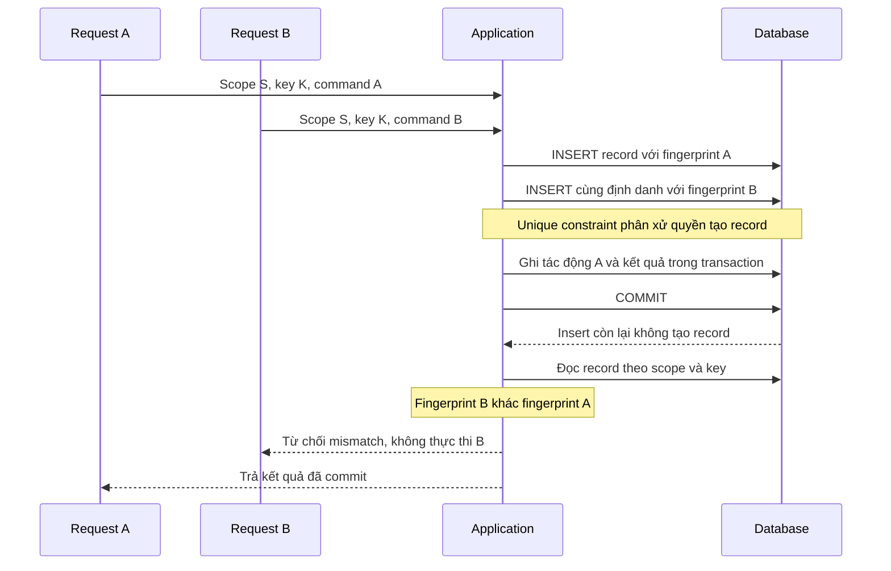

# Idempotency collision

## 1. Va chạm idempotency là vấn đề gì?

Trong chương **Idempotency** của module bảo vệ logic nghiệp vụ, một idempotency key đại diện cho một ý định thực hiện thao tác. Client giữ nguyên khóa khi gửi lại yêu cầu vì timeout, mất kết nối hoặc chưa nhận được kết quả. Máy chủ nhận diện lần gửi lại để tránh thực hiện tác động một lần nữa.

**Idempotency collision** xảy ra khi hai yêu cầu có ý định hoặc nội dung khác nhau bị ánh xạ vào cùng định danh mà hệ thống dùng để chống trùng. Nếu máy chủ không phát hiện được sự khác biệt, nó có thể trả kết quả sai, chặn một thao tác hợp lệ, làm lộ dữ liệu hoặc thực hiện thêm một tác động trái với quy tắc nghiệp vụ.

Ví dụ:

```text
Yêu cầu A: key=K, chuyển 100000 VND đến tài khoản X
Yêu cầu B: key=K, chuyển 100000 VND đến tài khoản Y
```

Nếu hai yêu cầu ở cùng phạm vi khóa, B không phải retry hợp lệ của A. Chỉ so sánh khóa và số tiền sẽ bỏ sót việc tài khoản nhận đã thay đổi.

Bài học này giúp bạn:

- Phân biệt retry hợp lệ, va chạm khóa, va chạm do ánh xạ dữ liệu và va chạm hash.
- Phát hiện cùng khóa nhưng khác nội dung mà không tạo tác động mới.
- Thiết kế ràng buộc dữ liệu và xử lý đồng thời để không ghi đè record gốc.
- Phân tích tình huống client lỗi hoặc caller cố ý chiếm khóa, thay payload và thử lại.
- Kiểm thử bằng các trường hợp va chạm chủ động thay vì chờ va chạm ngẫu nhiên.

## 2. Mô hình tối thiểu để phân tích va chạm

Một hệ thống thường sử dụng ba khái niệm:

```text
scope       = phạm vi mà khóa phải duy nhất
record_id   = (scope, idempotency_key)
fingerprint = dấu vân tay của nội dung command có ý nghĩa nghiệp vụ
```

Ví dụ trong bài này:

```text
scope = (tenant_id, account_id, operation_code)

operation_code = transfer.create:v1

fingerprint = H(
    from_account_id,
    to_account_id,
    amount_minor,
    currency,
    transfer_intent_id
)
```

Các giá trị trong scope được suy ra từ ngữ cảnh đã xác thực và được kiểm tra quyền. Mã thao tác do máy chủ xác định. Resource ID và các trường ảnh hưởng đến chuyển tiền được ràng buộc vào fingerprint.

Giả sử cùng khóa ở hai tài khoản khác nhau được coi là hai namespace độc lập. Hành vi mong muốn là:

| Scope | Khóa | Nội dung | Ý nghĩa |
| --- | --- | --- | --- |
| Giống nhau | Giống nhau | Giống nhau | Ứng viên retry hợp lệ; xử lý tiếp theo trạng thái record |
| Giống nhau | Giống nhau | Khác nhau | Xung đột nội dung; không thực thi yêu cầu mới |
| Khác nhau | Giống nhau | Bất kỳ | Hai định danh độc lập theo hợp đồng scope |
| Giống nhau | Khác nhau | Cùng tác động nghiệp vụ | Hai khóa khác nhau; vẫn phải kiểm tra business invariant |

Việc hai request cùng mang chuỗi `K` chưa đủ để kết luận có lỗi. Phải xác định chúng có cùng scope hay không và có cùng ý nghĩa nghiệp vụ hay không.

Ngược lại, hai payload khác nhau ở mức chuỗi JSON có thể là cùng một command. Thứ tự thuộc tính hoặc khoảng trắng không nhất thiết làm thay đổi ý nghĩa.

## 3. Các loại va chạm cần phân biệt

### 3.1. Va chạm khóa do client tái sử dụng

Hai ý định khác nhau dùng cùng khóa trong cùng scope:

```text
K + refund(payment_17, 50000)
K + refund(payment_23, 50000)
```

Nguyên nhân thường gặp:

- Dùng một hằng số như `payment-request` cho mọi thao tác.
- Tạo khóa ngoài vòng lặp rồi dùng lại cho nhiều đơn hàng.
- Giữ khóa trong biến dùng chung giữa nhiều luồng.
- Sao chép một request mẫu nhưng quên thay khóa.
- Dùng timestamp có độ phân giải thấp trong một hệ thống nhiều worker.
- Phát lại công việc từ hàng đợi nhưng gắn nhầm khóa của công việc khác.

Trường hợp này không cần có lỗi trong thuật toán hash. Chỉ riêng việc tái sử dụng khóa đã đủ gây xung đột.

### 3.2. Va chạm namespace do thiếu scope

Tenant A và tenant B tình cờ dùng cùng khóa. Hợp đồng cho phép điều này, nhưng máy chủ lại tìm record chỉ bằng khóa:

```sql
-- Thiếu các chiều scope, có thể tìm nhầm record.
SELECT *
FROM idempotency_record
WHERE idempotency_key = :key;
```

Đây là lỗi định danh: hệ thống đã gộp những namespace đáng lẽ tách biệt. Khóa ngẫu nhiên dài hơn không sửa được thiếu sót về phân quyền hoặc mô hình tenant.

### 3.3. Va chạm do ghép, cắt hoặc chuẩn hóa dữ liệu

Nếu tự ghép các chiều thành một chuỗi mà không có quy tắc phân tách rõ ràng:

```text
encode("ab", "c") = "abc"
encode("a", "bc") = "abc"
```

Hai bộ giá trị khác nhau trở thành cùng đầu vào. Băm chuỗi `abc` bằng SHA-256 cũng không sửa được lỗi này: đầu vào trước khi băm đã giống nhau.

Những nguồn lỗi tương tự:

- Chỉ giữ 8 ký tự đầu của khóa để tạo cache key.
- Viết thường khóa trong khi hợp đồng phân biệt hoa thường.
- Trim khoảng trắng hoặc giải mã ký tự nhiều lần không theo cùng quy tắc.
- Lưu bằng kiểu hoặc collation coi hai chuỗi khác nhau là bằng nhau.
- Dùng chuyển đổi số khiến `00017` và `17` bị gộp dù chúng là định danh khác nhau.
- Ghép `tenant:key` nhưng không quy định escape khi thành phần chứa dấu `:`.

Ưu tiên cột riêng và unique constraint trên bộ cột. Nếu phải tạo chuỗi tổng hợp cho cache hoặc hệ thống khác, dùng một encoding có cấu trúc, có phiên bản và không nhập nhằng.

### 3.4. Va chạm fingerprint

Hai command khác nhau có cùng fingerprint có thể xuất phát từ hai vấn đề khác nhau:

1. **Thiết kế đầu vào sai:** bỏ sót trường, chuẩn hóa quá mức hoặc encoding không phân biệt được các command.
2. **Va chạm của hàm băm:** hai đầu vào đã được biểu diễn khác nhau nhưng cho cùng digest.

Trong ứng dụng nghiệp vụ, bỏ sót tài khoản nhận hoặc ID tài nguyên thường thực tế hơn nhiều so với tìm được va chạm của một hàm băm mật mã phù hợp. Tuy nhiên, không nên dùng checksum yếu hoặc `hashCode()` của ngôn ngữ để làm fingerprint an ninh.

Nếu chỉ so sánh digest, hệ thống không thể phân biệt hai command thực sự có cùng digest. Có thể giảm rủi ro bằng một hàm băm mật mã đủ mạnh và, khi yêu cầu bảo đảm cao hơn, đối chiếu thêm các trường nghiệp vụ hoặc biểu diễn chuẩn đã lưu với biện pháp bảo vệ dữ liệu phù hợp.

### 3.5. Tranh chấp đồng thời không tự động là va chạm nội dung

Hai request giống hệt nhau đến đồng thời không phải hai ý định khác nhau. Đây là cạnh tranh khi cùng cố giành quyền thực hiện một record.

```text
Request A: (scope=S, key=K, fingerprint=F)
Request B: (scope=S, key=K, fingerprint=F)
```

Máy chủ phải cho tối đa một lần thực thi tác động và hướng request còn lại đến kết quả hoặc trạng thái đang xử lý. Lỗi unique constraint ở đây là một tín hiệu để phân xử, chưa phải bằng chứng rằng client dùng khóa sai.

Nếu fingerprint khác nhau, cạnh tranh đồng thời đồng thời là xung đột nội dung. Cần kiểm tra record thắng tranh chấp trước khi kết luận request còn lại là retry hay collision.

## 4. Xác suất va chạm khóa và giới hạn của khóa ngẫu nhiên

Với khóa ngẫu nhiên độc lập, phân bố đều trên không gian `b` bit, xác suất có ít nhất một cặp va chạm trong `n` khóa xấp xỉ:

```text
p ≈ 1 - exp(-n(n - 1) / (2 × 2^b))

Khi p rất nhỏ:
p ≈ n(n - 1) / 2^(b + 1)
```

`n` là số khóa cần phân biệt trong cùng namespace và khoảng thời gian liên quan, không mặc định là tổng số request của mọi tenant. Retry cố ý dùng lại khóa không phải một khóa ngẫu nhiên mới trong phép tính này.

Ví dụ với khoảng một tỷ khóa được sinh độc lập trong cùng namespace:

| Số bit ngẫu nhiên | Xác suất va chạm xấp xỉ |
| --- | --- |
| 64 bit | Khoảng 2,7% |
| 122 bit | Khoảng 9,4 × 10^-20 |
| 128 bit | Khoảng 1,5 × 10^-21 |

UUID phiên bản 4 có 122 bit dành cho phần ngẫu nhiên; kết quả trên giả định bộ sinh thực sự cung cấp độ ngẫu nhiên phù hợp. Việc dùng cùng seed, bộ sinh kém hoặc rút ngắn khóa sẽ làm các giả định không còn đúng.

Điều quan trọng đối với bảo mật nghiệp vụ: xác suất va chạm ngẫu nhiên thấp không ngăn một caller **cố ý gửi lại một khóa đã biết với payload khác**. Vì vậy vẫn phải có kiểm tra fingerprint, phân quyền và ràng buộc duy nhất.

Với client Java, một cách tạo khóa mới cho ý định mới là:

```java
import java.util.UUID;

String idempotencyKey = UUID.randomUUID().toString();
```

Khóa cần được giữ cùng command hoặc công việc bền vững nếu client phải retry sau khi process khởi động lại. Tạo UUID mới ở mỗi lần thử gửi chỉ giảm khả năng va chạm khóa; nó làm mất khả năng nhận diện các lần gửi lại của cùng ý định.

## 5. Fingerprint phải phản ánh đầy đủ ý nghĩa nghiệp vụ

Giả sử command chuyển tiền có cấu trúc:

```json
{
  "fromAccountId": "acc-17",
  "toAccountId": "acc-23",
  "amountMinor": 100000,
  "currency": "VND",
  "transferIntentId": "intent-801"
}
```

Một fingerprint chỉ gồm `amountMinor` và `currency` sẽ coi việc chuyển đến `acc-23` và `acc-99` là giống nhau. Đây là va chạm do mất thông tin, dù dùng SHA-256 hay một hàm băm mạnh khác.

### 5.1. Những trường thường phải xét

| Nhóm trường | Lý do cần ràng buộc |
| --- | --- |
| Tài nguyên hoặc ý định đích | Phân biệt hai order, payment attempt, refund request hoặc workflow |
| Số tiền, loại tiền, số lượng | Thay đổi quy mô tác động |
| Tài khoản gửi, nhận, người thụ hưởng | Thay đổi đối tượng chịu hoặc nhận tác động |
| Lựa chọn sản phẩm, phương thức, chính sách | Có thể làm thay đổi giá, quyền hoặc kết quả |
| Phiên bản tài nguyên kỳ vọng | Có thể làm thay đổi điều kiện chuyển trạng thái |
| Tham số ảnh hưởng đến kết quả cam kết | Tránh trả kết quả của một command không tương thích |

Không đưa access token, trace ID hoặc timestamp chỉ phục vụ truyền tải vào fingerprint. Những trường này có thể thay đổi trong một retry hợp lệ.

Thông tin do máy chủ quyết định như giá được phê chuẩn hoặc quyền hiện tại không trở nên hợp lệ chỉ vì xuất hiện trong fingerprint. Lần thực thi đầu vẫn phải xác minh chúng từ nguồn có thẩm quyền. Kết quả đã chốt được lưu để replay; không dùng retry như cơ hội tính lại rồi thực thi thêm tác động.

### 5.2. Chuẩn hóa đúng, không chuẩn hóa quá mức

Hai JSON sau có thể biểu diễn cùng command:

```json
{"amountMinor":100000,"currency":"VND"}
```

```json
{"currency":"VND", "amountMinor":100000}
```

Băm body thô sẽ tạo fingerprint khác nhau. Một cách phù hợp hơn là:

1. Parse và kiểm tra cấu trúc request theo schema xác định.
2. Tạo command có kiểu dữ liệu rõ ràng.
3. Áp dụng các giá trị mặc định theo đúng hợp đồng.
4. Tuần tự hóa các trường đã chọn bằng một quy tắc xác định, không nhập nhằng.
5. Băm biểu diễn đó và lưu phiên bản fingerprint.

Cần quy định rõ `null` khác trường bị thiếu hay không, danh sách có thứ tự hay không, đơn vị của tiền và quy tắc chữ hoa/chữ thường của từng trường. Với JSON có thuộc tính trùng tên, nên từ chối hoặc bảo đảm toàn bộ đường xử lý dùng một chính sách thống nhất; tránh để bộ tính fingerprint và bộ thực thi hiểu hai giá trị khác nhau.

Không viết thường toàn bộ payload hoặc sắp xếp mọi danh sách chỉ để dễ so sánh. Nếu thứ tự người phê duyệt hoặc thứ tự phân bổ tiền có ý nghĩa, các phép biến đổi đó có thể gộp hai command khác nhau.

### 5.3. Đổi phiên bản fingerprint khi triển khai

Giả sử record cũ được tạo bằng `fingerprint_version=1`, còn bản triển khai mới dùng phiên bản 2. Nếu tính hash theo v2 rồi so với hash v1, một retry hợp lệ có thể bị báo collision giả.

Khi gặp record cũ:

- Đọc phiên bản fingerprint đã lưu.
- Diễn giải command và tính fingerprint bằng quy tắc tương thích với phiên bản đó.
- Nếu không thể so sánh an toàn, trả trạng thái có kiểm soát hoặc chuyển sang tra cứu, đối soát; không coi đó là quyền thực thi một tác động mới.

Nếu v1 từng bỏ sót một trường quan trọng, chỉ giữ v1 để tương thích chưa giải quyết lỗ hổng. Cần đối chiếu các trường đã lưu trong command hoặc bản ghi nghiệp vụ. Nếu không còn đủ dữ liệu để phân biệt, phải xử lý bảo thủ thay vì khẳng định hai yêu cầu giống nhau.

## 6. Hợp đồng xử lý collision

Với cùng scope và key, quy tắc cốt lõi là:

> Một khi record đã ràng buộc khóa với command, request khác nội dung không được thay command, kết quả hoặc quyền sở hữu của record đó.

Một hợp đồng API minh họa:

| Trạng thái record | Fingerprint của request mới | Hành vi |
| --- | --- | --- |
| Chưa tồn tại | Chưa áp dụng | Giành quyền tạo record nguyên tử |
| `COMPLETED` | Giống | Kiểm tra quyền hiện tại và replay kết quả |
| `COMPLETED` | Khác | Trả lỗi xung đột, không thực thi |
| `PROCESSING` | Giống | Trả trạng thái đang xử lý hoặc chờ có giới hạn theo hợp đồng |
| `PROCESSING` | Khác | Trả lỗi xung đột, không ghi đè công việc đang chạy |
| `REJECTED` | Giống | Trả lại quyết định đã lưu nếu API cam kết giữ quyết định đó |
| `REJECTED` | Khác | Trả lỗi xung đột; không biến record cũ thành command mới |
| `UNKNOWN` | Giống | Tra cứu, đối soát kết quả; không thực thi mù |
| `UNKNOWN` | Khác | Từ chối nội dung khác và giữ nguyên quá trình đối soát |

Ví dụ lỗi cho caller đã được phép truy cập scope:

```http
HTTP/1.1 409 Conflict
Content-Type: application/json

{
  "code": "IDEMPOTENCY_PAYLOAD_MISMATCH",
  "message": "Khóa đã được sử dụng cho một yêu cầu khác.",
  "requestId": "req-802"
}
```

`409 Conflict` là lựa chọn hợp đồng trong ví dụ này. Cần công bố mã lỗi để client phân biệt mismatch với timeout hoặc trạng thái đang xử lý.

Không trả payload gốc, hash gốc, tài khoản nhận gốc hay thông tin tenant khác trong thông báo lỗi. Caller không đủ quyền nên nhận phản hồi theo chính sách phân quyền của API, không được dùng collision như một kênh dò sự tồn tại của giao dịch.

Client có thể tạo khóa mới cho một ý định mới được người dùng xác nhận. Máy chủ không nên tự thay khóa rồi thực thi ngay khi phát hiện mismatch: như vậy một lỗi đáng lẽ bị chặn lại trở thành một tác động mới.

## 7. Ràng buộc lưu trữ để không ghi đè record gốc

Schema PostgreSQL minh họa:

```sql
CREATE TABLE idempotency_record (
    tenant_id             uuid        NOT NULL,
    account_id            uuid        NOT NULL,
    operation_code        varchar(100) NOT NULL,
    idempotency_key        varchar(200) COLLATE "C" NOT NULL,
    fingerprint_version   smallint    NOT NULL,
    request_fingerprint   bytea       NOT NULL,
    state                 varchar(20) NOT NULL,
    result_id             uuid,
    created_at            timestamptz NOT NULL DEFAULT now(),
    expires_at            timestamptz NOT NULL,
    PRIMARY KEY (
        tenant_id,
        account_id,
        operation_code,
        idempotency_key
    ),
    CHECK (octet_length(request_fingerprint) = 32),
    CHECK (state IN ('PROCESSING', 'COMPLETED', 'REJECTED', 'UNKNOWN')),
    CHECK (expires_at > created_at)
);
```

Ví dụ này giả định fingerprint SHA-256 được lưu dưới dạng 32 byte và khóa có tập ký tự, độ dài được API kiểm tra rõ ràng. Các trường scope không được tùy ý để `NULL`. Cần dùng quy tắc so sánh chuỗi nhất quán với hợp đồng trên database, cache và ứng dụng.

`result_id` trỏ đến kết quả bền vững; hệ thống có thể cần lưu thêm snapshot response hoặc dữ liệu tối thiểu để replay. Schema chưa mô tả toàn bộ cơ chế phân quyền, mã hóa dữ liệu, xử lý lease hoặc điều phối hệ thống bên ngoài.

### 7.1. Không đưa fingerprint vào unique key

Thiết kế sau có thể khiến cùng một khóa được dùng cho nhiều command:

```text
UNIQUE(scope, idempotency_key, request_fingerprint)
```

Khi payload đổi, fingerprint đổi và database cho chèn một record mới. Hệ thống mất khả năng phát hiện “cùng khóa nhưng khác nội dung”.

Ràng buộc duy nhất cần nằm trên `(scope, key)`. Fingerprint là dữ liệu để so sánh sau khi tìm đúng record, không phải một chiều để né xung đột.

### 7.2. Không cập nhật command khi xảy ra conflict

Mẫu nguy hiểm:

```sql
-- Sai đối với hợp đồng khóa đã gắn với một command bất biến.
INSERT INTO idempotency_record (...)
VALUES (...)
ON CONFLICT (...)
DO UPDATE SET request_fingerprint = EXCLUDED.request_fingerprint;
```

Một request mới có thể ghi đè fingerprint của request đang chạy hoặc đã hoàn tất. Từ đó kết quả A có thể bị gắn nhãn như thuộc command B.

Khi có conflict, hãy đọc record hiện hữu và phân loại theo fingerprint, trạng thái, quyền. Chỉ các chuyển trạng thái hợp lệ của cùng công việc mới được phép cập nhật record.

## 8. Phân xử khi hai request cạnh tranh

### 8.1. Giành quyền bằng thao tác nguyên tử

```sql
INSERT INTO idempotency_record (
    tenant_id, account_id, operation_code, idempotency_key,
    fingerprint_version, request_fingerprint,
    state, expires_at
) VALUES (
    :tenantId, :accountId, :operationCode, :key,
    :fingerprintVersion, :fingerprint,
    'PROCESSING', :expiresAt
)
ON CONFLICT (
    tenant_id, account_id, operation_code, idempotency_key
) DO NOTHING
RETURNING tenant_id;
```

Nếu chèn được record, transaction hiện tại có thể tiến tới kiểm tra invariant và thực thi command. Nếu không chèn được, không thực thi; đọc record theo toàn bộ scope rồi phân loại.

Không dùng “SELECT chưa thấy rồi INSERT” làm cơ chế chống trùng duy nhất. Hai request có thể cùng đọc thấy chưa có record.

Trong PostgreSQL ở mức cô lập `READ COMMITTED`, sau khi lệnh insert có conflict đã hoàn tất, có thể dùng một câu lệnh SELECT tiếp theo để đọc record đã commit. Cần xử lý timeout, lỗi tuần tự hóa ở mức cô lập khác và tình huống record không còn tồn tại do cơ chế dọn dữ liệu. Không mặc định một câu truy vấn ghép phức tạp luôn nhìn thấy record cạnh tranh trong cùng snapshot.

### 8.2. Sơ đồ hai command khác nhau dùng cùng khóa



Sơ đồ giả định A giành được record và tác động nằm trong cùng database. Không có bảo đảm request đến mạng trước luôn thắng. Nếu transaction A rollback hoàn toàn trước khi có tác động bền vững, request khác có thể giành quyền theo quy trình của hệ thống.

### 8.3. Pseudocode phân loại an toàn

```text
handle(request, authenticatedContext):
    command = parseAndValidateCommand(request)
    scope = deriveScopeFromAuthorizedContext(authenticatedContext)
    key = validateKey(request)
    authorizeCommandTarget(authenticatedContext, command)

    begin transaction
        inserted = insertIfAbsent(
            scope,
            key,
            currentFingerprintVersion,
            fingerprint(command, currentFingerprintVersion)
        )

        if not inserted:
            record = loadByFullScopeAndKey(scope, key)
            candidate = fingerprint(command, record.fingerprintVersion)

            if candidate != record.requestFingerprint:
                return mismatchWithoutChangingRecord

            if additionalExactComparisonRequired:
                comparePersistedBusinessFieldsOrCanonicalCommand()

            authorizeResultAccess(authenticatedContext, record)
            return responseForExistingState(record)

        lockOrConditionallyUpdateBusinessResource()
        recheckMutableAuthorizationAndBusinessInvariants()
        executeLocalBusinessChange()
        persistBusinessResultAndMarkCompleted()
    commit transaction

    return committedResult
```

Đây là pseudocode, không phải mã chạy trực tiếp. Khi triển khai cần đóng transaction đúng trên mọi nhánh, xử lý record không còn tồn tại, phiên bản fingerprint không hỗ trợ và các lỗi database.

Với tác động thuần database, giữ thay đổi nghiệp vụ và kết quả idempotency trong cùng transaction giúp không có khoảng trống “đã trừ tiền nhưng chưa lưu kết quả”. Unique constraint xử lý tranh chấp cùng khóa; khóa hoặc cập nhật có điều kiện trên tài nguyên nghiệp vụ xử lý tranh chấp giữa **các khóa khác nhau**.

Nếu tách bước tạo record và bước thực thi thành hai transaction cho một job dài, `PROCESSING` phải có cơ chế phục hồi chủ sở hữu công việc. Collision không phải lý do được phép ghi đè command đang chờ.

## 9. Phân quyền và invariant khi có collision

### 9.1. Khóa không phải quyền truy cập

Caller biết khóa của giao dịch khác không được quyền đọc response của giao dịch đó. Trước khi tra và trả record cần có ngữ cảnh xác thực, scope được phép và quyền trên đối tượng hoặc kết quả tương ứng.

Nếu caller đổi tenant hoặc account trong body, máy chủ không được dùng giá trị đó làm scope khi chưa kiểm tra quyền đại diện. Nếu caller đã mất quyền sau lần gọi đầu, retry không tự động nhận lại dữ liệu nhạy cảm chỉ vì fingerprint trùng.

Kiểm tra quyền hiện tại khác với kiểm tra điều kiện thực thi mới. Một giao dịch đã hoàn tất có thể được replay cho người còn quyền đọc, dù trạng thái tài nguyên không cho phép tạo thêm giao dịch.

### 9.2. Đổi khóa vẫn không được phá quy tắc nghiệp vụ

```text
K1 + refund_request R -> thành công
K2 + refund_request R -> không được hoàn tiền lần nữa
```

Một attacker không cần va chạm nếu có thể thay khóa tùy ý. Cần bảo vệ các invariant như:

- Một refund request chỉ tạo một tác động hoàn tiền thành công.
- Tổng số tiền đã hoàn và đang được giữ chỗ để hoàn không vượt phần được phép.
- Một quyết định phê duyệt đã chốt không bị áp dụng lại qua đường đi khác.
- Một payment attempt không bị capture hai lần.
- Số dư và hạn mức được kiểm tra bằng cập nhật nguyên tử phù hợp.

Một mô hình minh họa cho thao tác chỉ được thành công một lần:

```text
Business identity: refund_request_id
Constraint: một giao dịch hoàn tiền thành công cho mỗi refund_request_id
State machine: REQUESTED -> PROCESSING -> COMPLETED
```

Ràng buộc cụ thể phụ thuộc mô hình: có thể là unique constraint, trạng thái chuyển có điều kiện, khóa hàng hoặc sổ cái. Không được suy rộng thành “mỗi payment chỉ được hoàn một lần” nếu nghiệp vụ cho phép hoàn từng phần nhiều lần.

## 10. Collision qua cache, downstream và nhiều region

### 10.1. Cache phải giữ nguyên ngữ nghĩa namespace

Ví dụ database dùng `(tenant, account, operation, key)` nhưng Redis chỉ dùng `idem:key`. Hai request hợp lệ ở hai tenant có thể va vào cùng cache entry trước khi tới database.

Cache key phải biểu diễn đầy đủ định danh mà database dùng. Không rút ngắn hoặc chuẩn hóa tùy tiện. Nếu dùng hash của định danh để làm cache key, cần giữ đủ digest và có cách kiểm tra lại định danh gốc trước khi trả kết quả nhạy cảm.

Cache miss không chứng minh thao tác chưa xảy ra. Sau khi cache hết hạn hoặc khởi động lại, phải đọc nguồn dữ liệu có thẩm quyền. Một lock tạm thời trong Redis hết TTL cũng không chứng minh worker trước chưa tạo tác động.

### 10.2. Namespace của nhà cung cấp có thể khác namespace nội bộ

Hai tenant đều dùng khóa `K`, nhưng tất cả lệnh đi qua cùng một tài khoản thanh toán bên ngoài. Nếu chuyển nguyên `K` xuống nhà cung cấp, hai ý định nội bộ có thể va vào một namespace downstream dùng chung.

Có thể tạo một khóa downstream ổn định từ định danh ý định nội bộ:

```text
downstream key = stableMapping(
    provider_account_id,
    operation,
    internal_intent_id
)
```

Mapping phải không nhập nhằng, đáp ứng giới hạn chiều dài, tập ký tự và ổn định qua các lần retry. Nếu dùng băm hoặc HMAC, phải quản lý phiên bản, khóa bí mật khi có và không tự ý thay đầu ra cho ý định đang xử lý. Một phương án khác là cấp một downstream key ngẫu nhiên rồi lưu bền vững cùng ý định.

Nếu nhà cung cấp trả lỗi mismatch cho downstream key, không tự đổi khóa và gửi lại. Cần xác minh mapping, nội dung đã gửi và trạng thái giao dịch trước. Đổi khóa có thể khiến một tác động chưa xác định được thực hiện lần thứ hai.

### 10.3. Nhiều region và đồng bộ chậm

Nếu mỗi region độc lập chấp nhận cùng `(scope, key)` rồi đồng bộ bất đồng bộ, hai region có thể cùng thực thi trước khi phát hiện record trùng.

Một chiến lược như “last write wins” chỉ chọn record còn lại sau đồng bộ; nó không hoàn tác lần trừ tiền hoặc gửi hàng đã xảy ra ở region kia.

Cần một nơi có thẩm quyền ghi cho cùng scope, cơ chế phối hợp tính duy nhất phù hợp, hoặc một hàng rào nghiệp vụ tại nơi tạo tác động cuối. Thêm `region_id` vào scope chỉ biến hai request thành hai namespace khác nhau và có thể làm mất mục tiêu chống thực thi trùng toàn hệ thống.

## 11. Các tình huống tấn công và xử lý sai thường gặp

### 11.1. Thay payload dưới một khóa đã thành công

```text
1. Tạo đơn giá 100000 bằng K.
2. Gửi lại K nhưng đổi số lượng hoặc người nhận.
3. Quan sát server có trả thành công như thể payload mới đã được áp dụng không.
```

Nếu server chỉ replay theo khóa, client có thể nhận một kết quả không thuộc ý định mới. Nếu server ghi đè payload rồi thực thi, có thể tạo thêm tác động. Cách xử lý đúng là phát hiện mismatch và giữ nguyên record ban đầu.

### 11.2. Chiếm khóa dự đoán được

Trong namespace merchant dùng chung, caller được cấp quyền hạn chế có thể đoán khóa tuần tự mà một job khác sắp dùng, rồi gửi một command trước.

Unique constraint chỉ bảo đảm một record thắng, không bảo đảm record đó đại diện cho ý định hợp lệ của người dùng mong muốn. Cần kiểm tra quyền trên tài nguyên, dùng khóa khó đoán khi thích hợp và gắn tác động với ý định do server quản lý.

Không tách scope theo caller một cách máy móc nếu cùng ý định được phép đi qua nhiều caller. Điều đó có thể giảm va chạm nhưng lại cho phép thực thi trùng qua các namespace. Quyết định scope phải đi cùng invariant.

### 11.3. Sửa payload để né trạng thái đang xử lý

Một client gặp `PROCESSING` rồi thử tăng một trường không liên quan hoặc đổi số tiền để tìm cách được tiếp tục. Với cùng khóa, server phải phân loại mismatch chứ không coi payload mới là công việc thay thế.

Không đưa fingerprint vào unique key và không xóa record đang chạy khi phát hiện request khác nội dung.

### 11.4. Va chạm ở lớp tiền xử lý

Giả sử gateway viết thường khóa, application giữ nguyên khóa, còn database dùng một quy tắc so sánh khác. Hệ thống có thể replay nhầm tại một lớp nhưng tạo record khác ở lớp còn lại.

Cần một hợp đồng biểu diễn khóa nhất quán từ gateway đến kho dữ liệu. Chỉ chấp nhận định dạng đã quy định, tránh âm thầm sửa khóa để “hợp lệ hóa” đầu vào sai.

### 11.5. Xóa record khi có mismatch

Một cách sửa lỗi nguy hiểm là xóa record cũ để yêu cầu mới có thể chạy:

```text
Nếu hash khác -> xóa record của K -> thử insert và thực thi lại
```

Nếu tác động cũ đã hoàn tất hoặc đang diễn ra, việc xóa chỉ loại bỏ bằng chứng chống trùng. Collision phải được coi là xung đột cần giải quyết, không phải tín hiệu làm mới namespace.

## 12. Hết retention và sự nhập nhằng của khóa cũ

```text
t0: key K được dùng cho command A và hoàn tất
t1: record của K bị dọn theo retention
t2: K xuất hiện với command B hoặc một retry muộn của A
```

Ở `t2`, nếu không còn record hoặc dấu vết nhận diện phù hợp, hệ thống có thể không biết K đã được dùng. Đây là giới hạn theo thời gian của khả năng phát hiện va chạm và retry, không phải lý do để tuyên bố thao tác chưa từng xảy ra.

Hợp đồng cần nói rõ:

- Thời gian giữ mapping `(scope, key) -> command/result`.
- Cách client xử lý retry quá hạn và tra cứu kết quả cũ.
- Hành vi với record đã quá hạn nhưng chưa dọn.
- Cách bảo vệ invariant sau khi response cache hoặc idempotency record được dọn.

Không giải phóng khóa của `PROCESSING` hoặc `UNKNOWN` chỉ vì đến hạn. Lease hết hạn không chứng minh tác động chưa xảy ra. Với dịch vụ bên ngoài, cần đối soát bằng định danh ý định hoặc mã tham chiếu bền vững.

Nếu muốn giữ tombstone tối thiểu để nhận diện khóa đã dùng sau khi xóa response, cần xác định dữ liệu giữ lại, phạm vi và thời hạn. Tombstone không có đủ dữ liệu để replay đầy đủ vẫn có thể giúp chặn một yêu cầu nhập nhằng, nhưng không tự tái tạo được kết quả đã xóa.

## 13. Quy trình điều tra một collision trong vận hành

Khi có cảnh báo mismatch, không thực thi thêm tác động chỉ để “thử lại cho chắc”. Quy trình điều tra có thể là:

1. **Xác định record trong đúng scope.** Dùng record ID nội bộ và thông tin quyền phù hợp, tránh tìm theo khóa toàn cục rồi lộ dữ liệu tenant khác.
2. **Kiểm tra trạng thái bền vững.** Phân biệt chưa thực thi, đã hoàn tất, đang chạy và chưa xác định kết quả.
3. **So sánh đầu vào có kiểm soát.** Xác định trường khác nhau, phiên bản fingerprint và các bước chuẩn hóa; chỉ truy cập dữ liệu cần thiết.
4. **Kiểm tra lịch sử tạo khóa.** Tìm lỗi vòng lặp, biến dùng chung, hàng đợi phát lại hoặc cùng seed.
5. **Kiểm tra ánh xạ qua các lớp.** Đối chiếu gateway, cache, database và downstream key nếu có.
6. **Đối chiếu tác động nghiệp vụ.** Kiểm tra sổ giao dịch, state machine hoặc nhà cung cấp thay vì chỉ dựa vào HTTP response.
7. **Chọn hành động phục hồi.** Replay, tiếp tục đối soát, từ chối hoặc tạo ý định mới được phép; giữ audit trail cho quyết định.

Nếu chưa biết A đã tác động hay chưa, việc gửi B bằng một khóa khác không giải quyết sự không chắc chắn đó. Chỉ thực hiện ý định mới khi có đủ căn cứ nghiệp vụ và các ràng buộc cần thiết.

## 14. Ma trận kiểm thử collision

Giả định scope theo `(tenant, account, operation)` và resource ID nằm trong fingerprint:

| Ca kiểm thử | Kết quả cần có |
| --- | --- |
| Cùng scope, key và command sau khi hoàn tất | Replay, chỉ một tác động |
| Cùng key; đổi thứ tự thuộc tính JSON | Không mismatch nếu command không đổi |
| Cùng key; đổi số tiền | Mismatch, record gốc không đổi |
| Cùng key; đổi người nhận nhưng giữ số tiền | Mismatch, không chuyển đến người nhận mới |
| Cùng key; đổi resource hoặc intent ID | Mismatch theo hợp đồng ví dụ |
| Cùng key; đổi trace ID hoặc access token nhưng giữ chủ thể và command | Vẫn nhận diện retry nếu caller còn quyền |
| Cùng chuỗi key ở hai tenant hợp lệ | Hai record độc lập, không lộ dữ liệu |
| Cùng chuỗi key ở hai account hợp lệ | Hai namespace độc lập theo hợp đồng |
| Cùng key; caller cố khai tenant không được phép | Từ chối trước khi truy cập hoặc tạo record trái quyền |
| Hai request đồng thời cùng key, cùng command | Một tác động; request còn lại replay hoặc nhận trạng thái đang xử lý |
| Hai request đồng thời cùng key, khác command | Chỉ một command giành quyền; command còn lại không được ghi đè |
| `PROCESSING` hoặc `UNKNOWN` rồi nhận payload khác | Mismatch, không xóa hoặc thay công việc gốc |
| Database collation và cache xử lý `ABC`/`abc` | Hành vi thống nhất với hợp đồng phân biệt hoa thường đã chọn |
| Hai tuple có thể nhập nhằng khi nối chuỗi | Không tạo cùng cache key hoặc downstream key sau encoding đúng |
| Fingerprint cố tình bị rút ngắn trong môi trường thử | Có thể tái hiện rủi ro; cấu hình sản xuất không dùng digest rút ngắn tùy tiện |
| Hai command bị mock cho cùng digest | Nếu có exact comparison, phải phát hiện; nếu chỉ dùng digest, ghi nhận giới hạn của thiết kế |
| Record v1 được retry qua bản triển khai v2 | So sánh tương thích, không thực thi lại vì đổi phiên bản |
| V1 bỏ sót trường quan trọng | Đối chiếu dữ liệu đã lưu hoặc xử lý bảo thủ, không replay mù |
| Hai khóa khác nhau cho cùng một tác động chỉ được phép một lần | Invariant chặn tác động thứ hai |
| Commit xong nhưng mất HTTP response | Retry tìm kết quả đã lưu, không tạo giao dịch mới |
| Downstream trả mismatch hoặc timeout | Đối soát, không tự cấp khóa khác và thực thi lại |
| Cùng record đi qua hai region đồng thời | Không tạo hai tác động nếu cam kết uniqueness toàn vùng |
| Retry hoặc tái dùng khóa sau retention | Đúng hợp đồng thời gian; invariant bền vững vẫn được giữ |

Trong test concurrency, cần đồng bộ các request để chúng thực sự cạnh tranh tại bước tạo record. Kiểm tra số tác động bền vững, số lần gọi nhà cung cấp và tính bất biến của command gốc, không chỉ kiểm tra status code.

Không cần tìm một va chạm SHA-256 thực để kiểm thử đường xử lý giới hạn của hash. Có thể thay bộ fingerprint bằng test double trả cùng digest cho hai command và xem exact comparison, nếu được thiết kế, có chặn đúng hay không. Test double chỉ dùng trong môi trường kiểm thử.

## 15. Quan sát collision và tiêu chí thiết kế

Những tín hiệu nên theo dõi:

- Số lần replay hợp lệ so với số lần payload mismatch theo thao tác.
- Mismatch tăng sau một phiên bản client hoặc bản triển khai mới.
- Nhiều request khác nội dung nhắm vào một record đang chạy.
- Record `UNKNOWN` kéo dài hoặc lỗi mapping khóa downstream.
- Invariant chặn cùng tác động qua nhiều khóa khác nhau.
- Mức tăng record và quota theo chủ thể để phát hiện việc gửi nhiều khóa mới.

Không dùng từng idempotency key làm metric label vì cardinality có thể tăng không giới hạn. Log nên liên kết qua record ID hoặc tham chiếu đã được bảo vệ; tránh ghi token, payload chuyển tiền đầy đủ và nội dung response nhạy cảm. Fingerprint cũng không mặc nhiên là dữ liệu vô hại: hash của miền đầu vào dễ đoán có thể bị thử đoán ngoại tuyến.

Một thiết kế xử lý collision tốt cần đáp ứng các tiêu chí:

1. Định danh record dùng đúng scope và quy tắc so sánh nhất quán ở mọi lớp.
2. Cùng khóa được ràng buộc bất biến với command; nội dung khác bị từ chối.
3. Fingerprint bao phủ đầy đủ trường nghiệp vụ và có quy tắc biểu diễn, phiên bản rõ ràng.
4. Unique constraint hoặc cơ chế tương đương phân xử cạnh tranh tại nơi có thẩm quyền.
5. Replay luôn tuân thủ quyền hiện tại, không biến khóa thành vé truy cập dữ liệu.
6. Trạng thái chưa xác định được đối soát; mismatch không tự kích hoạt đổi khóa hoặc xóa record.
7. Business invariant vẫn chặn tác động sai khi caller dùng khóa mới hoặc đi qua luồng khác.

Nguyên tắc cuối cùng: **cùng khóa không chứng minh cùng ý định; cùng fingerprint không thay thế quyền và invariant**. Phát hiện collision là khả năng giữ nguyên ràng buộc giữa khóa, command và kết quả, đồng thời từ chối biến một yêu cầu nhập nhằng thành tác động nghiệp vụ mới.
