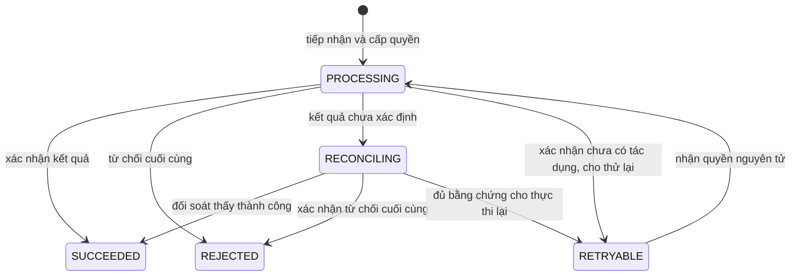

# Idempotency failure handling

## 1. Vì sao xử lý lỗi là phần cốt lõi của idempotency?

Một API hoàn tiền có thể đã ghi nhận giao dịch thành công nhưng kết nối bị ngắt trước khi client nhận response. Nếu client hiểu timeout là thất bại rồi gửi lại bằng key mới, hệ thống có thể hoàn tiền thêm lần nữa. Ở chiều ngược lại, server có thể lưu trạng thái “đang xử lý”, gặp sự cố trước khi làm nghiệp vụ và khiến request bị treo mãi nếu không có cơ chế phục hồi.

Idempotency giúp các lần gửi lại của cùng một ý định không tạo thêm tác dụng nghiệp vụ trong phạm vi bảo đảm đã thiết kế. Khi có lỗi, hệ thống phải xác định điều gì đã xảy ra, điều gì còn chưa rõ và hành động tiếp theo nào vẫn giữ được các bất biến.

Trong bảo mật logic nghiệp vụ, các bất biến điển hình là:

- Một ý định thanh toán hoặc hoàn tiền không tạo ra hai giao dịch.
- Tổng tiền hoàn không vượt số tiền được phép hoàn.
- Retry không bỏ qua phê duyệt, trạng thái hợp lệ hoặc quyền theo đối tượng.
- Cùng key nhưng khác nội dung không được biến thành một lệnh mới.
- Phát lại response không tiết lộ dữ liệu cho người đã mất quyền truy cập.
- Hệ thống không báo thành công khi chưa có bằng chứng nghiệp vụ tương ứng.

Kẻ tấn công có thể cố tình ngắt kết nối, gửi yêu cầu đồng thời, đổi payload hoặc chờ bản ghi hết hạn để khai thác các nhánh phục hồi. Vì vậy, xử lý lỗi cần được xem là một phần của cơ chế bảo vệ nghiệp vụ, không chỉ là việc bắt exception.

## 2. Ba câu hỏi phải tách biệt khi request gặp lỗi

Trước khi quyết định retry, cần trả lời riêng ba câu hỏi:

1. **Client đã nhận được gì?** Response thành công, lỗi HTTP, timeout hay mất kết nối?
2. **Nghiệp vụ đã xảy ra chưa?** Chưa thực hiện, đã commit, hay chưa xác định?
3. **Ai được phép làm tiếp?** Request hiện tại, worker đang giữ quyền xử lý, worker phục hồi hay nhân sự đối soát?

Ba câu trả lời không nhất thiết trùng nhau. Client có thể nhận HTTP 500 trong khi giao dịch đã commit, hoặc nhận HTTP 202 trong khi lệnh mới chỉ được tiếp nhận bền vững và chưa hoàn tất.

### 2.1. Phân loại theo bằng chứng về tác dụng

| Nhóm | Bằng chứng cần có | Hướng xử lý |
|---|---|---|
| Chắc chắn chưa có tác dụng | Transaction đã rollback và không có tác dụng bên ngoài; hoặc có bảo đảm tương đương | Có thể cho thực thi lại sau khi nhận quyền và kiểm tra điều kiện |
| Đã có kết quả xác định | Giao dịch đã commit, hoặc bên nhận xác nhận kết quả với định danh ổn định | Phát lại hoặc phục dựng kết quả; không thực thi lại lệnh |
| Chưa xác định | Không biết commit đã xảy ra chưa, mất phản hồi từ nhà cung cấp, worker mất liên lạc | Tra cứu và đối soát; không suy đoán thất bại để gửi lệnh mới |

Mã HTTP và tên exception chỉ là tín hiệu đầu vào. Một `SocketTimeoutException` không chứng minh nhà cung cấp chưa thu tiền. Một lỗi mất kết nối database trong lúc commit cũng không đủ để kết luận transaction đã rollback.

### 2.2. “Có thể retry” cần nói rõ retry cái gì

Retry có thể là gửi lại request cùng key, đọc trạng thái, chạy lại transaction nội bộ, gửi lại thông điệp hoặc phát lệnh ra nhà cung cấp. Mỗi hành động có mức rủi ro khác nhau.

Ví dụ, gửi lại cùng request đến API có cơ chế nhận quyền đúng có thể chỉ phát lại kết quả cũ. Nhưng gửi một lệnh thanh toán mới với định danh nhà cung cấp mới có thể tạo thêm giao dịch. Hợp đồng API và mã xử lý cần chỉ rõ hành động nào được phép thử lại.

## 3. Danh tính request phải ổn định xuyên suốt quá trình phục hồi

Để xử lý lỗi nhất quán, tối thiểu cần nhận diện được:

```text
scope               = tenant + chủ thể hoặc phạm vi nghiệp vụ + thao tác
idempotency_key     = định danh client giữ nguyên cho cùng ý định
request_fingerprint = dấu vết nội dung có ảnh hưởng đến ý nghĩa lệnh
operation_id        = định danh nghiệp vụ nội bộ ổn định để tra cứu/đối soát
```

Phạm vi phải được suy ra từ ngữ cảnh xác thực và quy tắc server. Không cho client tự khai tenant để quyết định bản ghi cần truy cập.

Với cùng scope và key:

- Fingerprint khớp: xử lý theo trạng thái đã biết của lần trước.
- Fingerprint khác: từ chối xung đột và giữ nguyên request ban đầu.
- Không có bản ghi: chỉ thực thi sau khi nhận quyền nguyên tử và kiểm tra các ràng buộc nghiệp vụ.

Không đổi key chỉ vì timeout. Một key mới thường biểu thị một yêu cầu mới ở tầng API, không phải cơ chế tiếp tục yêu cầu cũ.

Đồng thời, key ở tầng request không thay được ràng buộc nghiệp vụ. Nếu hai nhân viên gửi cùng ý định hoàn tiền với hai key khác nhau, cần một định danh ý định được server kiểm tra và ràng buộc duy nhất phù hợp, chẳng hạn `UNIQUE(tenant_id, refund_intent_id)`. Nếu cho phép hoàn từng phần nhiều lần, không đặt quy tắc “mỗi đơn chỉ được hoàn một lần” một cách tùy tiện.

Nếu toàn bộ transaction chứa bản ghi nhận quyền bị rollback, hệ thống có thể không còn dấu vết fingerprint của lần thử đó. Khả năng phát hiện việc đổi payload dựa trên một bản ghi đã lưu; nếu cần ràng buộc danh tính xuyên cả các lần thử rollback, phải thiết kế nơi lưu ý định bền vững riêng thay vì giả định dữ liệu rollback vẫn còn.

## 4. Phân biệt hai mô hình để xử lý lỗi đúng

### 4.1. Bản ghi và tác dụng nội bộ trong cùng transaction

Nếu toàn bộ tác dụng cần bảo vệ nằm trong một database, có thể dùng luồng:

```text
BEGIN
  INSERT bản ghi nhận quyền bằng unique constraint
  Kiểm tra và cập nhật nghiệp vụ
  Lưu kết quả để phát lại
COMMIT
Gửi response
```

Trước commit, lỗi làm transaction bị hủy sẽ rollback cả bản ghi và nghiệp vụ. Sau commit, mất response chỉ làm client thiếu thông tin, không làm giao dịch biến mất.

Trong mô hình này, trạng thái đang xử lý thường nằm trong transaction chưa commit. Request khác có thể chờ unique constraint thay vì nhìn thấy một bản ghi đang xử lý đã lưu bền vững. Không tự đặt lease cho phép người khác tiếp quản khi transaction đầu vẫn có thể commit.

### 4.2. Tiếp nhận bền vững rồi worker xử lý sau

Với công việc dài hoặc có tác dụng bên ngoài:

```text
Transaction 1: lưu ý định, quyền xử lý hoặc outbox; commit
Worker:       thực hiện các bước
Transaction 2: lưu kết quả hoặc chuyển sang đối soát
```

Lỗi worker không tự xóa bản ghi tiếp nhận. Hệ thống cần biết ai đang có quyền xử lý, việc gì có thể đã xảy ra và ai được phục hồi tiếp.

Response của bước tiếp nhận có thể là `202 Accepted` kèm `operation_id`. Khi đó bản ghi idempotency của API có thể phát lại response tiếp nhận, còn kết quả thực thi nằm ở tài nguyên operation riêng. Không dùng một field “completed” vừa có nghĩa “đã trả response tiếp nhận” vừa có nghĩa “đã hoàn tiền thành công”.

## 5. Ma trận lỗi theo thời điểm

| Điểm xảy ra lỗi | Điều đã biết | Hành vi cần đạt |
|---|---|---|
| Trước xác thực hoặc trước kiểm tra định dạng | Chưa cấp quyền thực thi | Từ chối; thường chưa tạo bản ghi idempotency lâu dài |
| Trước nhận quyền nguyên tử | Chưa được phép thực thi | Không gây tác dụng; có thể retry cùng key theo hợp đồng |
| Sau nhận quyền nhưng trước commit trong transaction chung | Bản ghi và nghiệp vụ vẫn chưa commit | Rollback cả hai nếu transaction bị hủy |
| Trong lệnh commit khi mất kết nối | Kết quả commit có thể chưa rõ | Tra cứu lại và xử lý như trạng thái chưa xác định cho đến khi có bằng chứng |
| Sau commit nhưng trước gửi response | Tác dụng đã tồn tại | Phát lại kết quả đã commit |
| Trong lúc tuần tự hóa response trước commit | Có thể chưa commit nếu luồng được thiết kế đúng | Rollback khi không tạo được kết quả cần lưu; tránh gọi tác dụng ngoài transaction |
| Trong lúc gửi response sau commit | Không thể rollback giao dịch chỉ bằng lỗi ghi socket | Giữ kết quả; retry sẽ tra cứu/phát lại |
| Sau khi bên ngoài nhận lệnh nhưng trước khi server nhận xác nhận | Tác dụng ngoài database chưa xác định | Dùng định danh ổn định để tra cứu hoặc retry có chống lặp, rồi đối soát |
| Worker ngừng sau khi tiếp nhận đã commit | Bản ghi có thể còn đang xử lý | Phục hồi có kiểm soát, không suy ra chưa có tác dụng từ việc worker mất liên lạc |

Ma trận này cần được áp dụng theo ranh giới transaction thực tế của ứng dụng. Một annotation trong Java không tự bảo đảm các lời gọi HTTP bên trong method được rollback cùng database.

## 6. Xử lý các nhóm lỗi thường gặp

### 6.1. Request sai định dạng, chưa xác thực hoặc sai quyền

Kiểm tra kích thước, định dạng key, cấu trúc payload và xác thực trước khi tiêu thụ tài nguyên lưu trữ dài hạn. Điều này hạn chế việc gửi hàng loạt key rác để làm đầy kho.

Quyền truy cập đối tượng và quyền nhận thông tin phải được kiểm tra trước khi phát lại dữ liệu nhạy cảm. Biết key không chứng minh quyền xem giao dịch.

Nếu một người đã được phép hoàn tiền ở lần đầu nhưng sau đó bị thu hồi quyền đọc, lần retry không được phát lại toàn bộ response cũ chỉ vì fingerprint khớp. Hành vi từ chối cũng cần tránh tiết lộ không cần thiết rằng một key hoặc giao dịch của người khác tồn tại.

Các kiểm tra quyền và điều kiện thay đổi dữ liệu vẫn phải được bố trí để tránh cuộc đua, chẳng hạn kiểm tra lại điều kiện trong transaction hoặc dùng cập nhật có điều kiện. Kiểm tra quyền ở đầu request không luôn đủ cho một tác vụ được worker thực hiện rất lâu sau đó; cần quy tắc rõ về ủy quyền bền vững hoặc việc kiểm tra lại quyền ở thời điểm thực thi.

### 6.2. Từ chối nghiệp vụ đã xác định

Ví dụ: một ý định hoàn tiền không có phê duyệt bắt buộc hoặc số tiền yêu cầu vượt hạn mức. Nếu chưa tạo tác dụng và server quyết định đây là kết quả cuối của ý định hiện tại, có thể lưu một kết quả từ chối để cùng key nhận lại cùng kết quả.

Cần công bố chính sách: lỗi nào được lưu, khi nào key được ràng buộc và client phải làm gì sau khi điều kiện thay đổi. Không tự sửa bản ghi cũ từ từ chối thành thành công chỉ vì người dùng gửi lại cùng key sau khi bổ sung phê duyệt.

Một yêu cầu mới sau khi điều kiện thay đổi có thể cần key mới và vẫn phải tuân thủ các ràng buộc nghiệp vụ. Không cho phép key mới trở thành cách bỏ qua hạn mức, quyền hoặc lịch sử phê duyệt.

### 6.3. Lỗi hạ tầng với rollback đã xác nhận

Nếu database xác nhận transaction đã bị hủy và toàn bộ tác dụng nằm trong transaction đó, có thể thử lại toàn bộ transaction với giới hạn rõ ràng. Mỗi lần thử phải nhận quyền đúng và kiểm tra lại dữ liệu nghiệp vụ hiện tại.

Các lỗi như deadlock hoặc serialization failure có thể phù hợp với retry transaction, nhưng chỉ khi biết tác dụng nào thuộc transaction và framework đã kết thúc transaction cũ. Không tiếp tục dùng một transaction đã lỗi để chạy thêm câu lệnh như thể nó còn hợp lệ.

Không retry nguyên method chứa cả cập nhật database và gửi lệnh thanh toán ngoài database nếu không có bảo đảm chống lặp tương ứng. Database rollback không thu hồi được lệnh đã gửi ra ngoài.

### 6.4. Mất kết nối trong lúc commit

Đây là tình huống dễ bị xử lý sai:

```text
Ứng dụng gửi COMMIT
Database có thể đã commit
Kết nối bị đứt trước khi ứng dụng nhận xác nhận
```

Ứng dụng không được kết luận “commit lỗi nên chưa có giao dịch”. Hướng xử lý là tra cứu lại bằng định danh ổn định trên nguồn có thẩm quyền, tìm bản ghi kết quả và dữ liệu nghiệp vụ liên quan.

Nếu chưa thể tra cứu hoặc chưa phân biệt được transaction còn chạy với đã kết thúc, trả trạng thái chưa xác định hoặc lỗi có thể retry cùng key. Khi gửi lại qua cùng cơ chế nhận quyền nguyên tử, transaction mới phải chờ hoặc giải quyết xung đột với transaction cũ; không dùng một nhánh bỏ qua idempotency.

Một lần đọc không thấy bản ghi trên replica có độ trễ không đủ để cấp quyền thực thi mới. Quyết định cuối cùng phải dựa trên cơ chế nhận quyền và ràng buộc dữ liệu đúng, không dựa trên cache miss.

### 6.5. Mất response sau khi đã thành công

Đây là tình huống idempotency cần xử lý trực tiếp nhất. Server đã có kết quả bền vững nên lần retry chỉ cần xác thực, so khớp request, kiểm tra quyền nhận kết quả và phát lại theo hợp đồng.

Không kiểm tra lại điều kiện “chưa hoàn tiền” rồi từ chối một lần phát lại hợp lệ: chính lần thực thi thành công đã làm điều kiện đó thay đổi. Cần tách quyền xem kết quả hiện tại khỏi điều kiện cho phép thực thi một lệnh mới.

Nếu kết quả đã lưu bị thiếu hoặc hỏng nhưng dữ liệu nghiệp vụ chứng minh giao dịch đã thành công, phục dựng từ nguồn nghiệp vụ đáng tin cậy hoặc đưa vào đối soát. Không thực hiện lại chỉ để tạo một response mới.

## 7. Thiết kế trạng thái phục hồi có ý nghĩa rõ ràng

Với mô hình xử lý bất đồng bộ, có thể dùng các trạng thái thực thi logic sau. Đây là một thiết kế minh họa, không phải tên trạng thái bắt buộc cho mọi hệ thống.

| Trạng thái | Ý nghĩa | Có được tạo tác dụng mới ngay không? |
|---|---|---|
| `PROCESSING` | Một chủ thể đang được giao xử lý; tác vụ chưa có kết quả cuối | Chỉ chủ thể có quyền, theo các điều kiện đồng bộ và chống lặp |
| `SUCCEEDED` | Có bằng chứng tác dụng đã hoàn tất | Không; chỉ trả kết quả hoặc trạng thái |
| `REJECTED` | Đã có quyết định từ chối cuối cùng cho ý định đó | Không tự chuyển lại sang chạy chỉ vì client retry |
| `RECONCILING` | Chưa biết chắc tác dụng đã xảy ra chưa hoặc còn dữ liệu mâu thuẫn | Không tạo lệnh mới khi chưa giải quyết điều kiện an toàn |
| `RETRYABLE` | Có bằng chứng và chính sách cho phép thử thực thi lại | Phải nhận quyền mới, kiểm tra quyền và bất biến trước khi chạy |



Trong một thiết kế cụ thể, việc từ chối trước khi tiếp nhận có thể không tạo bản ghi nào. Một giao dịch ngoài hệ thống đang chờ xử lý cũng chưa thuộc `SUCCEEDED` hoặc `REJECTED`; nó cần tiếp tục theo dõi hoặc đối soát.

Không tạo một trạng thái chung `FAILED` rồi cho mọi worker chạy lại khi thấy trạng thái đó. Lỗi có thể là từ chối nghiệp vụ, rollback chắc chắn hoặc kết quả chưa xác định; ba trường hợp không có cùng hành động tiếp theo.

### 7.1. Chuyển trạng thái phải có điều kiện

Một cập nhật kết quả nên kiểm tra danh tính bản ghi, trạng thái hiện tại và quyền sở hữu. Ví dụ khái niệm cho schema có lease và thế hệ xử lý:

```sql
UPDATE operation_execution
SET state = 'SUCCEEDED',
    result_reference = :result_reference,
    completed_at = :completed_at
WHERE operation_id = :operation_id
  AND state = 'PROCESSING'
  AND owner_token = :owner_token
  AND generation = :generation;
```

Phải kiểm tra số dòng cập nhật. Không có dòng nào được cập nhật có thể nghĩa là worker đã mất quyền hoặc tác vụ đã chuyển trạng thái. Không ghi đè trạng thái cuối bằng một kết quả đến muộn mà không đối chiếu.

Đối với callback hoặc webhook từ nhà cung cấp, cần xác thực nguồn, so khớp định danh nghiệp vụ và chống xử lý lặp. Một thông báo cũ không được làm trạng thái `SUCCEEDED` quay lại “đang xử lý” chỉ vì thứ tự nhận thông điệp khác thứ tự phát.

## 8. Lease hết hạn và worker cũ quay lại

Giả sử worker A nhận tác vụ, gửi lệnh thanh toán rồi bị tạm dừng. Lease hết hạn nên worker B nhận tác vụ. Sau đó A hoạt động trở lại.

Lease hết hạn chỉ cho biết hệ thống không còn xem A là chủ thể đang giữ quyền theo thời hạn đã định. Nó không chứng minh lệnh A gửi đã thất bại, và không bảo đảm process A đã dừng.

Một cơ chế phục hồi cần phối hợp:

- Nhận quyền bằng thao tác nguyên tử và tăng thế hệ xử lý.
- Chỉ cho worker đúng token/thế hệ cập nhật trạng thái trong kho điều phối.
- Bảo vệ tác dụng tại nơi nhận bằng ràng buộc nghiệp vụ, fencing được thực thi hoặc key chống lặp ổn định.
- Đối soát trước khi tiếp tục nếu lần xử lý trước có thể đã tạo tác dụng.

Fencing token chỉ hữu ích khi thành phần nhận thay đổi thực sự kiểm tra token. Ngăn A cập nhật bảng trạng thái không tự ngăn A gọi API ngoài hệ thống lần nữa.

Nếu bản ghi bị xóa rồi tạo lại với cùng key, worker cũ còn có thể cập nhật nhầm một thế hệ mới. Vì vậy, điều kiện cập nhật cần dựa vào định danh bản ghi hoặc operation ổn định và thế hệ phù hợp, không chỉ chuỗi key do client gửi.

## 9. Tác dụng bên ngoài: timeout cần đối soát

### 9.1. Giữ định danh ổn định ở phía nhận

Giả sử một lệnh hoàn tiền nội bộ có `operation_id = refund-op-42`. Khi gọi nhà cung cấp, server có thể dùng một key dẫn xuất ổn định từ operation này theo hợp đồng phía nhận:

```text
Client key:             client-request-91
Internal operation_id:  refund-op-42
Provider request key:   refund-op-42
```

Một lần retry truyền tải vẫn giữ nguyên provider request key và nội dung có ý nghĩa. Không sinh UUID nhà cung cấp mới cho mỗi lần gửi HTTP.

Phải biết phía nhận ràng buộc key theo tài khoản và thao tác nào, lưu key bao lâu, trả gì khi cùng key khác payload và cách tra cứu sau timeout. Thời hạn chống lặp của phía nhận có thể ngắn hơn thời hạn giữ bản ghi nội bộ.

### 9.2. Quy trình khi mất xác nhận

1. Đánh dấu hoặc giữ tác vụ trong trạng thái cần theo dõi/đối soát bền vững.
2. Tra cứu bằng định danh mà phía nhận hỗ trợ và liên kết chắc chắn với operation nội bộ.
3. Nếu đã thành công, ghi nhận kết quả đó; không tạo lệnh khác.
4. Nếu vẫn đang xử lý, tiếp tục theo dõi với giới hạn tốc độ.
5. Nếu đã từ chối cuối cùng và không còn khả năng phát sinh tác dụng, áp dụng chính sách kết thúc hoặc thử lại phù hợp.
6. Nếu chưa có bằng chứng đủ mạnh, giữ trạng thái chưa xác định và chuyển sang xử lý vận hành khi vượt ngưỡng.

Một response “không tìm thấy” không luôn chứng minh lệnh chưa thực hiện: dữ liệu tra cứu có thể trễ, request cũ còn đang truyền hoặc đang nằm trong hàng đợi. Chỉ cho phép một lần thực thi mới khi hợp đồng phía nhận và trạng thái xử lý cũ cho phép kết luận an toàn; nếu phía nhận hỗ trợ chống lặp, việc gửi lại cùng định danh có thể là lựa chọn an toàn hơn gửi một lệnh mới.

### 9.3. Outbox và inbox giải quyết phần nào?

Transactional outbox ghi thay đổi nghiệp vụ và ý định phát thông điệp trong cùng transaction. Khi process chết sau commit, worker vẫn có thể tìm và phát thông điệp. Tuy nhiên, worker có thể phát xong rồi chết trước khi đánh dấu đã phát, nên thông điệp có thể được gửi lại.

Inbox hoặc bảng chống lặp tại consumer giúp consumer nhận diện một thông điệp đã xử lý. Nếu tác dụng của consumer nằm trong database của nó, cần gắn việc đánh dấu inbox với thay đổi nghiệp vụ trong cùng transaction. Nếu consumer còn gọi hệ thống khác, ranh giới chống lặp lại phải được giải quyết ở bước đó.

Outbox không tự biến mọi tác dụng trong chuỗi dịch vụ thành đúng một lần. Mỗi ranh giới cần biết cách nhận diện lệnh, ghi nhận kết quả và phục hồi khi xác nhận bị mất.

## 10. Mã giả cho quyết định đối soát

Mã giả sau minh họa quyết định phục hồi một tác vụ bên ngoài. Các hàm ghi trạng thái phải dùng điều kiện quyền sở hữu hoặc phiên bản phù hợp; đoạn mã không thay thế thiết kế transaction.

```java
void reconcile(Operation operation, RecoveryClaim claim) {
    if (operation.isTerminal()) {
        return;
    }

    ProviderObservation observation = provider.lookup(
        operation.stableProviderReference()
    );

    switch (observation.kind()) {
        case SUCCEEDED -> operations.confirmSuccessIfOwned(
            operation.id(), claim, observation.result()
        );

        case FINAL_REJECTION -> operations.confirmRejectionIfOwned(
            operation.id(), claim, observation.reason()
        );

        case CONFIRMED_NOT_EXECUTED -> {
            // Phải tính cả khả năng request/worker cũ còn tiếp tục.
            recoveryPolicy.requireSafeToResume(operation, observation);
            operations.makeRetryableIfOwned(operation.id(), claim);
        }

        case PENDING, NOT_FOUND, UNAVAILABLE ->
            operations.scheduleAnotherReconciliationIfOwned(
                operation.id(), claim
            );
    }
}
```

`CONFIRMED_NOT_EXECUTED` là kết luận mạnh dựa trên hợp đồng và bằng chứng, không phải tên mới cho “lookup trả 404”. Nếu không có loại bằng chứng đó, hệ thống không nên tự tạo ra kết luận tương ứng.

Quy trình phục hồi phải kiểm tra quyền theo chính sách đã xác định, giới hạn nghiệp vụ và khả năng xử lý cũ còn tiếp tục. Không cho worker đối soát quyền vượt qua yêu cầu phê duyệt chỉ vì tác vụ được xem là “retry kỹ thuật”.

## 11. Hợp đồng lỗi với client

Client cần hiểu một lỗi có nghĩa là đổi request, chờ, gửi lại cùng key hay đọc trạng thái. Response nên có mã lỗi máy đọc được và định danh đối chiếu an toàn khi người gọi có quyền nhận chúng.

| Tình huống | Ví dụ hành vi API | Hành động client |
|---|---|---|
| Cùng key nhưng khác fingerprint | `409 Conflict`, mã `IDEMPOTENCY_KEY_REUSED` | Kiểm tra lỗi sử dụng key; không tự lặp cùng payload sai |
| Đã có kết quả cuối | Phát lại kết quả theo hợp đồng | Dùng kết quả; không tạo lệnh khác |
| Đang xử lý | `202 Accepted` kèm tài nguyên trạng thái, hoặc `409` với mã riêng theo hợp đồng | Chờ/poll hoặc retry cùng key có backoff |
| Kho nhận quyền không khả dụng | `503 Service Unavailable` | Retry cùng key theo giới hạn đã công bố |
| Kết quả ngoài hệ thống chưa xác định | Trả trạng thái operation nếu đã tiếp nhận, hoặc lỗi tạm thời với mã riêng | Tra cứu hoặc retry cùng key; không suy ra giao dịch thất bại |
| Không đủ quyền hiện tại | Lỗi quyền phù hợp chính sách tiết lộ thông tin | Không phát lại dữ liệu nhạy cảm |

Đây là các lựa chọn thiết kế, không phải một chuẩn ánh xạ HTTP duy nhất cho mọi API. Nếu đã có hợp đồng với client, cần giữ ý nghĩa nhất quán.

Ví dụ response tạm thời cho một operation mà người gọi có quyền xem:

```http
HTTP/1.1 202 Accepted
Content-Type: application/json
Location: /operations/refund-op-42
Retry-After: 3

{
  "operation_id": "refund-op-42",
  "state": "RECONCILING",
  "code": "RESULT_NOT_YET_CONFIRMED"
}
```

`Retry-After` là hướng dẫn thời điểm thử lại, không phải cam kết tác vụ sẽ kết thúc sau số giây đó. Không trả `202` như thể đã tiếp nhận bền vững nếu thực tế server chưa lưu được ý định và cũng không có cơ chế bảo đảm tiếp tục xử lý.

Lỗi ở gateway, proxy hoặc trình duyệt có thể xảy ra ngoài phạm vi handler. Vì vậy, client không nên chỉ dựa vào việc response có body lỗi của ứng dụng hay không để kết luận tác dụng đã xảy ra.

## 12. Backoff, giới hạn retry và chống bão yêu cầu

Retry liên tục ngay khi gặp timeout có thể làm tăng thời gian chờ khóa, cạn connection và khiến hệ thống vốn chậm trở nên khó phục hồi hơn.

Một chiến lược thường dùng là exponential backoff có jitter và giới hạn:

```text
upper_bound(n) = min(max_delay, base_delay * 2^n)
delay(n)       = random(0, upper_bound(n))
```

Trong đó `n` là số lần thử lại và phép tính phải được chặn để không tràn số. Client cần tôn trọng hướng dẫn thời gian của server theo hợp đồng, đồng thời có tổng thời gian chờ hoặc deadline phù hợp.

Các giới hạn nên bao gồm số lần thử tự động, thời gian tổng, số request đồng thời theo tenant/thao tác và ngân sách dành cho đối soát. Deadline hết không đồng nghĩa với giao dịch đã thất bại; tác vụ có thể vẫn cần được theo dõi sau khi client ngừng chờ.

Không lồng nhiều lớp retry vô tình: SDK nhà cung cấp thử lại nhiều lần, worker thử lại nhiều lần và endpoint cũng thử lại toàn bộ method có thể nhân số lần gửi ra ngoài. Cần xác định lớp nào chịu trách nhiệm cho loại lỗi nào và bảo đảm chúng giữ nguyên định danh chống lặp.

Không ngủ giữ một transaction database đang mở chỉ để chờ lần retry tiếp theo. Hãy kết thúc transaction lỗi, giải phóng tài nguyên và lên lịch lần xử lý sau theo mô hình đã chọn.

## 13. TTL, xóa bản ghi và thao tác hỗ trợ vận hành

### 13.1. Không xóa key để “gỡ lỗi” khi kết quả chưa rõ

Xóa bản ghi đang đối soát có thể làm request kế tiếp trông như mới. Nếu lần đầu thực tế đã thành công, hành động hỗ trợ này mở lại khả năng tạo tác dụng lặp.

Công cụ vận hành nên có các hành động mang ý nghĩa cụ thể: yêu cầu đối soát, ghi nhận kết quả có bằng chứng, tiếp tục theo chính sách hoặc tạo một lệnh bù. Mỗi hành động cần kiểm tra quyền, điều kiện trạng thái, lưu dấu vết và chống thao tác lặp tương ứng.

Không cho người vận hành chỉnh trực tiếp từ `SUCCEEDED` về `PROCESSING` để chạy lại mà không xét dữ liệu nghiệp vụ và hệ thống bên ngoài.

### 13.2. Hết TTL không chứng minh ý định đã mất hiệu lực

Sau khi bản ghi bị xóa, API có thể không còn nhận ra request cũ. Các ý định quan trọng cần ràng buộc ở dữ liệu nghiệp vụ tồn tại đủ lâu để bảo vệ quy tắc thật sự cần giữ.

Không tự dọn bản ghi chưa có kết quả xác định chỉ vì đã quá một khoảng thời gian cố định. Nếu cần giảm dữ liệu nhạy cảm, có thể giữ dấu vết tối thiểu và liên kết đối soát theo chính sách thay vì xóa danh tính của tác vụ.

Khi đã xóa body phản hồi nhưng còn bằng chứng thành công, hệ thống cần phát lại từ ảnh chụp còn hợp lệ, trả tài nguyên được phép xem hoặc báo không thể phát lại đầy đủ. Không chạy lại nghiệp vụ để tái tạo body.

### 13.3. Sao lưu và khôi phục

Khôi phục database về thời điểm cũ có thể làm mất bản ghi idempotency, trong khi một giao dịch ở nhà cung cấp ngoài hệ thống vẫn tồn tại. Trước khi mở lại retry cho các ý định bị ảnh hưởng, cần đối soát bằng định danh nghiệp vụ ổn định.

Nếu bản ghi idempotency và dữ liệu nghiệp vụ được lưu ở hai nơi có mốc khôi phục khác nhau, phải kiểm tra tính nhất quán giữa chúng. Không suy ra chưa thực thi chỉ từ việc kho idempotency sau khôi phục không còn key.

## 14. Lệnh bù là một nghiệp vụ riêng

Giả sử thanh toán đã thành công nhưng giao hàng thất bại. Quyết định hoàn tiền là một lệnh bù với quyền, phê duyệt, hạn mức và định danh riêng. Nó không phải việc xóa trạng thái thành công của lệnh thanh toán.

Lệnh bù cần tham chiếu giao dịch gốc, có quy tắc chống bù lặp và lưu kết quả riêng. Nếu lệnh bù cũng timeout, áp dụng quy trình xác định tác dụng và đối soát cho chính lệnh bù đó.

Một saga có thể có bước đã thành công, bước chưa rõ kết quả và bước bù đang chờ. Không gộp tất cả thành một field “failed” rồi chạy lại toàn bộ chuỗi, vì các bước đã hoàn tất có thể bị thực hiện thêm lần nữa.

## 15. Những nhánh lỗi có thể bị khai thác

| Hành vi hoặc điểm yếu | Cách gây sai lệch nghiệp vụ | Biện pháp trực tiếp |
|---|---|---|
| Client ngắt kết nối sau khi gửi lệnh | Lợi dụng server hiểu mất kết nối là hủy giao dịch | Gắn quyết định với commit/tác dụng thực tế, không với socket |
| Gửi nhiều request cùng key đồng thời | Tìm cuộc đua giữa kiểm tra và ghi | Nhận quyền bằng unique constraint hoặc conditional write |
| Đổi số tiền nhưng giữ key | Lợi dụng bản ghi cũ để bỏ qua kiểm tra nội dung | So fingerprint và từ chối mismatch |
| Đổi key cho cùng ý định hoàn tiền | Vượt cơ chế chống lặp ở tầng request | Ràng buộc ý định nghiệp vụ và kiểm tra tổng tiền hoàn nguyên tử |
| Chờ hết lease rồi kích hoạt nhiều worker | Khiến worker cũ và mới cùng tạo tác dụng | Quyền sở hữu có phiên bản kết hợp chống lặp tại nơi gây tác dụng |
| Gửi key thuộc người khác | Thăm dò hoặc đọc response trái phép | Scope đáng tin cậy và kiểm tra quyền hiện tại |
| Gây nhiều lỗi để tạo bản ghi treo | Làm đầy kho và hàng đợi đối soát | Hạn mức, kiểm tra đầu vào, giới hạn đồng thời và giám sát backlog |
| Lợi dụng đường hỗ trợ xóa key | Biến tác vụ cũ thành yêu cầu mới | Hành động vận hành có điều kiện, bằng chứng và audit |

Các biện pháp này bổ trợ lẫn nhau. Một unique constraint trên key không kiểm tra quyền hoàn tiền, và một bước kiểm tra quyền đúng không tự ngăn hoàn tiền hai lần do cuộc đua.

## 16. Kiểm thử lỗi theo bất biến

### 16.1. Kiểm thử đồng thời

Gửi nhiều request cùng scope, key và fingerprint qua các connection độc lập. Tùy hợp đồng, request nhận kết quả cuối hoặc trạng thái đang xử lý, nhưng số tác dụng nghiệp vụ đã commit phải đúng.

Tiếp tục thử cùng key với payload khác và hai key khác nhau cho cùng ý định nghiệp vụ. Hai kịch bản kiểm tra hai lớp bảo vệ khác nhau: danh tính request và quy tắc nghiệp vụ.

### 16.2. Kiểm thử điểm lỗi của transaction

| Điểm chèn sự cố | Điều cần xác nhận |
|---|---|
| Sau nhận quyền, trước cập nhật nghiệp vụ | Không tồn tại tác dụng ngoài dự kiến; phục hồi đúng mô hình |
| Sau cập nhật, trước lưu response | Với transaction chung, không commit một nửa |
| Sau lưu response, trước commit | Rollback không để lại một kết quả thành công giả |
| Trong lúc commit, mất xác nhận | Không tự kết luận rollback; tra cứu và nhận quyền lại an toàn |
| Sau commit, trước gửi response | Retry phát lại, không thực thi thêm |

Với lỗi commit chưa xác định, cần một kịch bản kiểm soát việc mất xác nhận commit thật sự hoặc một mô phỏng có hợp đồng rõ. Một exception được ném trước khi gửi `COMMIT` chỉ kiểm tra rollback trước commit, không đại diện đầy đủ cho tình huống mất xác nhận.

### 16.3. Kiểm thử nhà cung cấp và worker

Mô phỏng nhà cung cấp đã nhận lệnh nhưng response bị mất; tra cứu bị trễ; provider trả “không tìm thấy” tạm thời; cùng key được gửi lại; thời hạn chống lặp của provider hết. Xác nhận hệ thống không tạo key mới chỉ vì chưa tìm được kết quả.

Tạm dừng worker A đến khi lease hết, để B tiếp quản rồi cho A chạy tiếp. Kiểm tra cả quyền ghi trạng thái lẫn số tác dụng tại nơi nhận; chỉ thấy A không cập nhật được bảng điều phối chưa đủ chứng minh an toàn.

### 16.4. Kiểm thử quyền và vận hành

Thu hồi quyền đọc giữa lần đầu và lần retry; thay đổi quyền thực thi trong lúc tác vụ chờ; thử dùng key ở tenant khác; chạy cleanup đồng thời với retry; phục hồi dữ liệu từ một mốc cũ; yêu cầu đối soát thủ công hai lần.

Các kiểm tra cần xác nhận không rò rỉ kết quả, không bỏ qua phê duyệt và không tạo thêm tác dụng khi công cụ hỗ trợ hoặc worker cũng gặp lỗi.

### 16.5. Đo kết quả ở nơi tác dụng xảy ra

Không chỉ đếm response HTTP hoặc số bản ghi idempotency. Cần kiểm tra số giao dịch trong sổ nghiệp vụ, tổng số tiền đã hoàn, trạng thái phê duyệt, số lần phía nhận thực sự tạo giao dịch và liên kết đối soát.

Một hệ thống có thể chỉ lưu một bản ghi idempotency nhưng đã gửi hai lệnh ngoài hệ thống. Thử nghiệm phải quan sát được sai lệch đó.

## 17. Quan sát và quy trình xử lý sự cố

Các tín hiệu hữu ích gồm tỷ lệ phát lại, xung đột fingerprint, timeout chờ nhận quyền, lỗi commit chưa xác định, số operation đang đối soát và tuổi của operation chưa kết thúc. Kết hợp với số lần gọi nhà cung cấp, lượng retry và thời gian hoàn tất để tìm nguồn gây nghẽn.

Không dùng key, operation ID hoặc user ID làm nhãn metric có số lượng giá trị không giới hạn. Trong log và trace, ưu tiên định danh nội bộ hoặc dẫn xuất phù hợp; không log token, dữ liệu thanh toán nhạy cảm hay toàn bộ body phản hồi theo mặc định.

Một quy trình xử lý operation bị treo nên thực hiện theo thứ tự:

1. Xác định scope, operation và các lần thử liên quan.
2. Kiểm tra transaction hoặc worker cũ còn khả năng tiếp tục hay không.
3. Thu thập bằng chứng từ dữ liệu nghiệp vụ, outbox/inbox và nhà cung cấp.
4. Chọn phát lại, xác nhận kết quả, tiếp tục đối soát hoặc cấp quyền thử lại có điều kiện.
5. Nếu cần thay đổi nghiệp vụ đã xảy ra, tạo lệnh bù đúng quyền và có định danh riêng.
6. Lưu dấu vết quyết định, nguồn bằng chứng và người hoặc tiến trình thực hiện.

Khi số operation chưa xác định tăng nhanh, cần bảo vệ năng lực đối soát và giảm áp lực retry. Việc báo tạm thời chưa có kết quả có thể chấp nhận được trong khi tìm bằng chứng; việc mở lại quyền thực thi không có căn cứ có thể làm hỏng bất biến tài chính.

## 18. Câu hỏi tự kiểm tra

1. Với mỗi loại lỗi, bằng chứng nào cho biết chưa có tác dụng, đã có kết quả hay chưa xác định?
2. Nếu mất xác nhận commit, hệ thống tìm kết quả ở đâu và nhận quyền lại bằng cách nào?
3. Một lần retry giữ nguyên danh tính nào ở client, server và nhà cung cấp?
4. Khi worker cũ quay lại sau khi mất lease, thành phần nào ngăn nó tạo thêm tác dụng?
5. Từ chối nghiệp vụ nào được lưu, và client phải làm gì khi muốn gửi một ý định mới?
6. Nếu quyền thay đổi, retry được xem kết quả hoặc tiếp tục thực thi theo quy tắc nào?
7. Sau TTL hoặc khôi phục backup, ràng buộc nghiệp vụ nào vẫn ngăn tác dụng lặp?
8. Công cụ vận hành có thể vô tình biến trạng thái chưa xác định thành quyền thực thi mới không?

Xử lý lỗi idempotency cần giữ được sự khác biệt giữa chưa thực hiện, đã hoàn tất và chưa biết kết quả. Quyết định retry, phát lại, đối soát hoặc bù phải dựa trên bằng chứng về tác dụng và quyền thực thi, đồng thời tiếp tục bảo vệ các bất biến nghiệp vụ ở mọi nhánh phục hồi.
