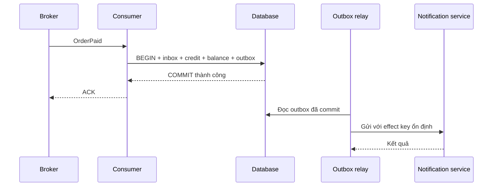

# Event replay scenario: sự kiện hợp lệ bị áp dụng nhiều lần

## 1. Tình huống: một lần thanh toán, hai lần cộng điểm

Trong chương **Replay Protection**, event replay là tình huống một sự kiện đã được phát hoặc xử lý trước đó lại xuất hiện ở đầu vào của hệ thống. Sự kiện có thể còn nguyên chữ ký, đúng schema và đến qua một kênh đã xác thực, nhưng việc áp dụng tác động nghiệp vụ lần nữa vẫn có thể sai.

Xét một chương trình thưởng điểm: đơn `ORD-2048` thanh toán thành công và đủ điều kiện nhận 100 điểm. Dịch vụ đơn hàng phát sự kiện `OrderPaid`. Consumer phần thưởng cộng điểm rồi xác nhận đã nhận message với broker.

| Bước | Diễn biến | Hệ quả nếu thiếu bảo vệ |
| --- | --- | --- |
| 1 | Broker chuyển sự kiện `evt-pay-2048` cho consumer A | Consumer bắt đầu xử lý |
| 2 | A cộng 100 điểm và commit DB | Tác động nghiệp vụ đã tồn tại |
| 3 | A mất kết nối trước khi broker ghi nhận acknowledgment | Broker chưa biết đã xử lý xong |
| 4 | Broker giao lại message cho consumer B | B gặp lại cùng sự kiện |
| 5 | B tiếp tục cộng 100 điểm | Một đơn tạo ra 200 điểm |

Không cần kẻ tấn công sửa dữ liệu để gây lỗi này. Một lỗi mạng bình thường đã đủ tạo replay. Người có quyền phát lại message hoặc một tài khoản tích hợp bị lạm dụng có thể chủ động làm tình huống xảy ra nhiều lần hơn.

Trong phạm vi module `SECURITY_APPLICATION_SECURITY_BUSINESS_LOGIC_SECURITY`, mục tiêu là bảo vệ quy tắc **mỗi đơn đủ điều kiện chỉ tạo một khoản thưởng cho lần mua đó**. Cơ chế phải bao phủ giao dịch, quyền theo đối tượng, trạng thái đơn và sự kiện đến sai thứ tự, thay vì chỉ kiểm tra sự kiện có định dạng hợp lệ.

Ví dụ trong bài chỉ mô phỏng luồng cộng điểm. Hoàn điểm, tiêu điểm hoặc sửa thưởng là các nghiệp vụ khác cần mã thao tác và quy tắc riêng. Các câu SQL minh họa dùng tham số có tên và một cơ sở dữ liệu quan hệ có transaction cùng unique constraint; cú pháp khóa dòng, thời gian và cách xử lý xung đột cần phù hợp với engine thực tế.

## 2. Phân biệt replay, sự kiện mới và lệnh mới

Ba thông điệp sau trông khác nhau ở tầng truyền tải nhưng có thể cùng nhắm đến một tác động:

```text
Message A: eventId = evt-101, orderId = ORD-2048, paymentOperationId = pay-701
Message B: eventId = evt-101, orderId = ORD-2048, paymentOperationId = pay-701
Message C: eventId = evt-999, orderId = ORD-2048, paymentOperationId = pay-701
```

A và B là cùng danh tính sự kiện. C có `eventId` mới nhưng vẫn muốn thưởng cho cùng đơn và cùng giao dịch thanh toán. Chỉ lưu `eventId` đã xử lý sẽ chặn B nhưng chưa chắc chặn C.

| Khái niệm | Câu hỏi cần trả lời | Ví dụ |
| --- | --- | --- |
| Danh tính sự kiện | Consumer đã xử lý thông điệp logic này chưa? | `(consumer_scope, producer_scope, tenant_id, event_id)` |
| Danh tính tác động nghiệp vụ | Khoản thưởng cho đơn này đã tồn tại chưa? | `(tenant_id, order_id)` trong luồng thưởng một lần mỗi đơn |
| Phiên bản dữ liệu | Sự kiện đang mô tả trạng thái nào của nguồn? | `orderVersion = 7` |
| Mã truy vết | Các bước xử lý có liên quan đến nhau thế nào? | `traceId`, `correlationId` |

`traceId`, số lần broker giao lại hoặc mã của một lần gửi qua mạng không thay thế được danh tính nghiệp vụ. Một lần retry có thể có trace mới trong khi vẫn là cùng tác động.

Replay cũng khác một yêu cầu điều chỉnh hợp lệ. Nếu quản trị viên muốn thưởng bổ sung sau khi sửa chính sách, đó phải là một thao tác điều chỉnh mới có lý do, quyền và khóa nghiệp vụ riêng. Không đổi `eventId` của sự kiện cũ để ép hệ thống cộng thêm.

## 3. Những con đường tạo ra replay

| Nguồn | Tình huống thực tế | Yêu cầu bảo vệ |
| --- | --- | --- |
| Giao lại từ broker | Consumer xử lý xong nhưng chưa ack, bị timeout hoặc khởi động lại | Xử lý cùng sự kiện không tạo thêm tác động |
| Producer gửi lại | Producer không chắc lần publish trước thành công | Producer giữ danh tính logic ổn định; consumer vẫn kiểm tra trùng |
| Webhook lặp | Bên tích hợp gửi lại callback đến khi nhận được phản hồi | Chặn trùng ở nơi ghi tác động, không chỉ ở HTTP gateway |
| Phát lại từ DLQ | Người vận hành đưa message lỗi về luồng chính | Vẫn đi qua xác thực, inbox và quy tắc nghiệp vụ |
| Backfill lịch sử | Phát lại một dải sự kiện để khôi phục dữ liệu | Tách mục đích tái dựng khỏi việc thực hiện lại tác động thật |
| Lạm dụng nội bộ | Chủ thể có quyền publish đưa lại sự kiện đã biết | Quyền theo nguồn, tenant và tác động vẫn được kiểm tra |
| Sự kiện cũ đến muộn | `OrderPaid` đến sau khi đơn đã hoàn tiền | State machine và phiên bản phải chặn tác động không còn hợp lệ |

Hạ tầng giao nhận ít nhất một lần có thể chủ động giao trùng để tránh bỏ sót message. Ứng dụng cần thiết kế cho đặc tính đó. Một tùy chọn “khử trùng” ở producer hoặc broker không tự bảo đảm các thay đổi trong DB ứng dụng hay tác động ở một dịch vụ ngoài chỉ xảy ra một lần.

## 4. Envelope hợp lệ chưa chứng minh được phép áp dụng

Một envelope minh họa:

```json
{
  "eventId": "evt-pay-2048",
  "eventType": "OrderPaid",
  "schemaVersion": 1,
  "tenantId": "tenant-a",
  "orderId": "ORD-2048",
  "paymentOperationId": "pay-701",
  "orderVersion": 7,
  "occurredAt": "2026-11-22T02:30:00Z"
}
```

`eventId` phải ổn định cho cùng một sự kiện logic. Nếu producer sinh ID mới ở mỗi lần gửi lại, inbox theo ID mất khả năng nhận diện những lần gửi đó là trùng; ràng buộc nghiệp vụ vẫn phải là chốt bảo vệ tiếp theo.

Trước khi tiếp cận dữ liệu nghiệp vụ, consumer cần:

1. Xác thực nguồn phát theo cơ chế của kênh hoặc chữ ký đã thống nhất.
2. Kiểm tra nguồn đó được phép phát `OrderPaid` cho phạm vi tenant tương ứng.
3. Kiểm tra schema, kiểu dữ liệu, độ dài ID và phiên bản schema được hỗ trợ.
4. Ánh xạ `producer_scope` từ danh tính đã xác thực; không tin một trường `producer` tùy ý trong body.
5. Chuẩn hóa các trường có ý nghĩa để tính fingerprint phục vụ phát hiện cùng ID nhưng khác nội dung.

Chữ ký giúp chứng minh nguồn và tính toàn vẹn theo giao thức; chữ ký cũ vẫn có thể hợp lệ khi message được phát lại. Timestamp giới hạn độ cũ theo một chính sách cụ thể, nhưng không ngăn hai lần giao cùng message trong khoảng thời gian được chấp nhận. Một nonce chỉ chặn phát lại nếu việc ghi nhận đã dùng nonce được thực hiện nguyên tử và có phạm vi đúng.

Fingerprint như SHA-256 của envelope nghiệp vụ đã chuẩn hóa giúp so sánh nội dung. Nó không thay thế chữ ký hay quyền. Không đưa các trường thay đổi theo mỗi lần giao như retry count hoặc trace mới vào fingerprint nếu chúng không phải một phần bất biến của sự kiện.

Quy trình chuẩn hóa phải được định nghĩa rõ: field nào được bao gồm, cách biểu diễn số và thời gian, cách xử lý field không hỗ trợ. Nếu giao thức ký byte nguyên gốc, phải xác minh đúng byte theo giao thức đó trước khi chuẩn hóa cho mục đích so sánh nghiệp vụ.

## 5. Hai cách chống trùng có khoảng trống

### 5.1. Kiểm tra đã xử lý rồi ghi ở cuối

```text
if not exists(processed_event[event_id]):
    add_points(account, 100)
    insert(processed_event[event_id])
```

Hai consumer có thể cùng đọc “chưa tồn tại”, rồi đều cộng điểm. Đây là TOCTOU: kết quả kiểm tra không được gắn nguyên tử với quyết định giành quyền xử lý.

Nếu cộng điểm đã commit nhưng consumer chết trước khi ghi dấu, lần giao lại sẽ cộng lần nữa. Nếu ghi dấu trước bằng một transaction riêng, tiến trình có thể chết trước khi cộng điểm; lần giao lại bị bỏ qua và khách không nhận được điểm.

| Cách chia commit | Cửa sổ lỗi |
| --- | --- |
| Commit cộng điểm, sau đó commit dấu đã xử lý | Có thể cộng nhiều lần |
| Commit dấu đã xử lý, sau đó commit cộng điểm | Có thể bỏ mất tác động |
| Dấu và điểm cùng commit, nhưng thiếu khóa duy nhất để giành danh tính | Hai transaction cạnh tranh vẫn có thể cùng xử lý |

### 5.2. Khử trùng bằng bộ nhớ hoặc cache riêng

Một `Set` trong Java không được chia sẻ giữa các instance và mất khi tiến trình khởi động lại. Lệnh “ghi key nếu chưa có” trong cache có thể giành quyền theo key, nhưng không tự tạo một transaction chung với cơ sở dữ liệu điểm.

Nếu cache ghi thành công rồi tiến trình chết trước khi ghi DB, có thể mất thưởng. Nếu cache hết TTL hoặc bị mất dữ liệu trong khi ledger còn tồn tại, replay lại được đi qua. Cache có thể giảm tải hoặc hỗ trợ điều phối, nhưng ví dụ này đặt bảo đảm cuối ở DB chứa tác động nghiệp vụ.

## 6. Bất biến và mô hình dữ liệu cục bộ

Các bất biến của ví dụ:

```text
Một danh tính sự kiện chỉ có một receipt đã commit cho cùng consumer nghiệp vụ.
Một đơn chỉ có một bản ghi thưởng OrderPaid trong order_reward_credit.
Tạo credit và tăng balance phải cùng commit hoặc cùng rollback.
Điểm và tài khoản nhận lấy từ dữ liệu có thẩm quyền, không lấy tùy ý từ message.
Sự kiện cũ không được đưa đơn từ trạng thái kết thúc trở lại trạng thái đã trả tiền.
```

`consumer_scope` đại diện cho chức năng nghiệp vụ ổn định, ví dụ `rewards.order-paid`. Nó không phải tên pod, hostname hoặc phiên bản triển khai; đổi scope ở mỗi lần deploy sẽ làm mọi receipt cũ như chưa tồn tại.

```sql
CREATE TABLE reward_account (
    tenant_id VARCHAR(64) NOT NULL,
    account_id VARCHAR(64) NOT NULL,
    balance BIGINT NOT NULL DEFAULT 0,
    PRIMARY KEY (tenant_id, account_id),
    CHECK (balance >= 0)
);

CREATE TABLE reward_order_state (
    tenant_id VARCHAR(64) NOT NULL,
    order_id VARCHAR(64) NOT NULL,
    account_id VARCHAR(64) NOT NULL,
    payment_operation_id VARCHAR(128),
    source_version BIGINT NOT NULL,
    status VARCHAR(16) NOT NULL,
    eligible_points BIGINT NOT NULL,
    PRIMARY KEY (tenant_id, order_id),
    FOREIGN KEY (tenant_id, account_id)
        REFERENCES reward_account (tenant_id, account_id),
    CHECK (source_version >= 0),
    CHECK (eligible_points >= 0),
    CHECK (status IN ('PENDING', 'PAID', 'REFUNDED', 'CANCELLED'))
);

CREATE TABLE consumer_inbox (
    consumer_scope VARCHAR(64) NOT NULL,
    producer_scope VARCHAR(64) NOT NULL,
    tenant_id VARCHAR(64) NOT NULL,
    event_id VARCHAR(128) NOT NULL,
    payload_hash VARCHAR(64) NOT NULL,
    recorded_at TIMESTAMP NOT NULL,
    PRIMARY KEY (consumer_scope, producer_scope, tenant_id, event_id)
);

CREATE TABLE order_reward_credit (
    credit_id VARCHAR(64) PRIMARY KEY,
    tenant_id VARCHAR(64) NOT NULL,
    order_id VARCHAR(64) NOT NULL,
    account_id VARCHAR(64) NOT NULL,
    payment_operation_id VARCHAR(128) NOT NULL,
    points BIGINT NOT NULL,
    source_event_id VARCHAR(128) NOT NULL,
    created_at TIMESTAMP NOT NULL,
    UNIQUE (tenant_id, order_id),
    FOREIGN KEY (tenant_id, order_id)
        REFERENCES reward_order_state (tenant_id, order_id),
    FOREIGN KEY (tenant_id, account_id)
        REFERENCES reward_account (tenant_id, account_id),
    CHECK (points > 0)
);
```

`reward_order_state` là trạng thái đủ điều kiện có thẩm quyền cho miền thưởng trong ví dụ, được cập nhật theo một luồng đã xác thực và có quản lý phiên bản. Đây không phải bảng mà người gọi có thể ghi tùy ý. Nếu nó là projection từ dịch vụ đơn hàng, độ trễ và thứ tự cập nhật phải được đưa vào quyết định xử lý ở phần tiếp theo.

Inbox ghi nhận một sự kiện đã được xử lý đến kết quả bền vững; credit ghi nhận tác động nghiệp vụ. Hai khóa duy nhất giải quyết hai bài toán khác nhau. Receipt có thể tồn tại mà không có credit mới, chẳng hạn khi sự kiện bị bỏ qua do trạng thái không còn phù hợp hoặc khi một envelope khác đã tạo khoản thưởng cho đơn đó.

Ràng buộc một credit trên mỗi đơn là lựa chọn của bài. Với nghiệp vụ cho phép nhiều kỳ thưởng trên cùng đơn, khóa phải bao gồm kỳ hoặc mã tác động do hệ thống quản lý. Không thêm `event_id` vào khóa này để hợp thức hóa mọi lần phát lại dưới ID mới.

## 7. Handler nguyên tử và acknowledgment sau commit

### 7.1. Luồng xử lý chính

Handler dưới đây là mã giả, diễn tả một giao dịch cục bộ. Việc đọc dữ liệu sau khi giữ khóa cần tuân theo semantics của mức cô lập đã chọn; khi engine báo xung đột, rollback và đánh giá lại bằng một transaction mới.

```text
event = authenticate_authorize_and_validate(message)
fingerprint = hash_canonical_business_envelope(event)

BEGIN TRANSACTION

  INSERT consumer_inbox(scoped_event_identity, fingerprint, db_time)
  -- Unique constraint là bước giành quyền xử lý danh tính sự kiện.

  order = lock_reward_order_state(event.tenant_id, event.order_id)

  if order missing or order.source_version < event.order_version:
      ROLLBACK
      return RETRY_LATER

  if order.status in [REFUNDED, CANCELLED]:
      COMMIT
      return IGNORED_STALE

  if order.status != PAID:
      ROLLBACK
      return QUARANTINE_REQUIRED

  if order.payment_operation_id != event.payment_operation_id:
      ROLLBACK
      return QUARANTINE_REQUIRED

  existing_credit = find_credit(event.tenant_id, event.order_id)
  if existing_credit exists:
      verify_same_business_effect(existing_credit, order)
      COMMIT
      return BUSINESS_DUPLICATE

  points = order.eligible_points
  if points == 0:
      COMMIT
      return NO_REWARD

  INSERT order_reward_credit(
      new_credit_id, order.tenant_id, order.order_id,
      order.account_id, order.payment_operation_id,
      points, event.event_id, db_time
  )

  affected = UPDATE reward_account
             SET balance = balance + points
             WHERE account_identity_matches
               AND addition_is_within_allowed_range

  if affected != 1:
      ROLLBACK
      return ERROR_REQUIRING_CLASSIFICATION

  INSERT notification_outbox_if_required(effect_key = new_credit_id)

COMMIT
return APPLIED
```

Chỉ sau kết quả đã bền vững như `APPLIED`, `BUSINESS_DUPLICATE`, `IGNORED_STALE`, `NO_REWARD` hoặc một receipt trùng đã được xác minh, adapter mới ack message. Với `QUARANTINE_REQUIRED`, chỉ ack sau khi message đã được bàn giao bền vững cho luồng xử lý lỗi theo chính sách. Nếu việc bàn giao thất bại, không ack như thể đã xử lý xong.

`eligible_points` trong ví dụ là kết quả đã xác lập của chính sách thưởng cho đơn, không phải giá trị do message yêu cầu và không được tính lại tùy tiện theo chính sách mới mỗi khi replay. Tài khoản nhận được lấy từ trạng thái đơn có thẩm quyền. Khóa nghiệp vụ chặn thưởng trùng chưa đủ bảo vệ nếu lần đầu tiên có thể ghi điểm vào tài khoản do người phát message tùy ý chọn.

Khóa dòng trạng thái đơn giữ ổn định điều kiện trong lúc quyết định thưởng. Luồng cập nhật trạng thái hoàn tiền hoặc hủy đơn phải phối hợp qua cùng dữ liệu và cơ chế đồng thời. Nếu bên hoàn tiền thay đổi một kho dữ liệu khác mà chưa đồng bộ về đây, transaction cục bộ không thể tự biết điều đó.

### 7.2. Phân loại độ trễ và sự kiện cũ

Không được coi mọi trường hợp “chưa thấy đơn đã thanh toán” là sự kiện xấu rồi ghi receipt để bỏ qua mãi mãi.

| Trạng thái có thẩm quyền tại consumer | Hành động |
| --- | --- |
| Chưa có projection hoặc phiên bản thấp hơn sự kiện | Rollback, trì hoãn hoặc retry có giới hạn; chưa ghi receipt hoàn tất |
| Phiên bản đủ mới, đơn vẫn hợp lệ cho đúng giao dịch thanh toán | Tiếp tục kiểm tra credit và áp dụng nếu chưa có |
| Phiên bản đủ mới, đơn đã `REFUNDED` hoặc `CANCELLED` | Không cộng điểm; có thể commit receipt cho quyết định bỏ qua |
| Phiên bản đủ mới nhưng trạng thái hoặc mã thanh toán mâu thuẫn | Không tự sửa đơn theo message; chuyển xử lý lỗi có bằng chứng |

Ví dụ `OrderPaid` phiên bản 7 đến khi trạng thái cục bộ đã là `REFUNDED` phiên bản 9: không đưa trạng thái về `PAID`, không phát thưởng mới. Nếu `OrderPaid` được áp dụng trước rồi hoàn tiền mới xảy ra, luồng hoàn tiền cần một nghiệp vụ đảo thưởng riêng có idempotency; inbox không tự thực hiện đảo thưởng.

Với một projection chậm, hệ thống chỉ có thể quyết định theo bảo đảm nhất quán đã thiết kế. Nếu sản phẩm yêu cầu tuyệt đối không cấp thưởng khi đơn ở nguồn đã hoàn tiền, cần giao thức hoặc điểm điều phối bảo vệ quy tắc đó, hoặc một mô hình thưởng chờ xác nhận và bù trừ. Không mô tả projection bất đồng bộ như dữ liệu đồng bộ tức thời.

### 7.3. Tăng số dư bằng phép cập nhật có điều kiện

Ví dụ cho bước cộng điểm:

```sql
UPDATE reward_account
SET balance = balance + :points
WHERE tenant_id = :tenant_id
  AND account_id = :account_id
  AND :points > 0
  AND balance <= :max_balance - :points;
```

Giới hạn `max_balance` do hệ thống quy định, nằm trong khả năng biểu diễn của kiểu dữ liệu. Tầng gọi kiểm tra `points` hợp lệ trước khi bind. Phép cộng tại DB tránh việc hai đơn khác nhau cùng đọc số dư cũ rồi ghi đè kết quả của nhau.

Nếu không cập nhật được đúng một dòng, không được commit credit và inbox. Cần phân loại thiếu tài khoản, vượt giới hạn hay lỗi dữ liệu để retry hoặc xử lý lỗi phù hợp; tăng số lần retry vô hạn không chữa được một giới hạn nghiệp vụ đã bị vượt.

### 7.4. Sự cố quanh thời điểm commit

| Điểm xảy ra lỗi | Dữ liệu bền vững | Lần giao lại cần làm gì? |
| --- | --- | --- |
| Trước khi bắt đầu transaction | Chưa có tác động | Thực hiện xử lý bình thường |
| Sau khi insert inbox nhưng trước commit | Khi transaction rollback, không còn receipt hay điểm của lần thử | Thử lại trong transaction mới |
| Sau khi insert credit, trước khi cộng số dư | Khi rollback, credit cũng bị hủy | Không bỏ qua chỉ vì đã từng chạy câu insert |
| Sau commit, trước ack | Receipt, credit và số dư cùng tồn tại | Xác minh receipt trùng, không cộng lại |
| Mất kết nối trong lúc commit, chưa rõ kết quả | Có thể đã commit hoặc chưa | Tra cứu/giành lại cùng danh tính; không tự giả định thất bại hoàn toàn |

Trong trường hợp chưa rõ kết quả commit, retry vẫn dùng cùng danh tính sự kiện và nghiệp vụ. Nếu lần đầu đã commit, unique constraint và dữ liệu đã lưu đưa lần sau vào đường trùng. Nếu lần đầu rollback, lần sau có thể xử lý bình thường.

## 8. Xử lý xung đột unique mà không che lỗi

### 8.1. Trùng khóa inbox

Khi insert inbox gặp đúng xung đột trên khóa danh tính sự kiện:

1. Rollback transaction đang xử lý; không giả định vẫn có thể tiếp tục dùng nó sau ngoại lệ constraint.
2. Đọc receipt đã commit trong một transaction mới, từ nguồn có bảo đảm nhất quán phù hợp.
3. So sánh fingerprint với nội dung vừa xác thực.
4. Nếu cùng fingerprint, xem là cùng sự kiện đã có kết quả bền vững và không áp dụng tác động lần nữa.
5. Nếu fingerprint khác, coi là xung đột danh tính sự kiện; ghi bằng chứng và chuyển xử lý lỗi, không trả về như một duplicate bình thường.

Nếu chưa đọc được receipt đã commit, không kết luận “đã xử lý” chỉ vì vừa gặp lỗi. Cần kiểm tra phân loại lỗi, trạng thái giao dịch cạnh tranh và nguồn đọc, rồi retry hoặc báo lỗi theo chính sách.

Chỉ ngoại lệ từ đúng constraint đã dự kiến mới đi vào nhánh này. Một lỗi foreign key, lỗi kết nối, lỗi kiểu dữ liệu hoặc unique constraint khác không đồng nghĩa với “message đã được xử lý”.

### 8.2. Trùng khóa khoản thưởng

Khi cùng một đơn được gửi dưới `eventId` mới, insert inbox có thể thành công. Handler vẫn phải tìm credit bằng khóa `(tenant_id, order_id)`.

Nếu credit đã tồn tại, kiểm tra nó khớp tài khoản, mã thanh toán và khoản thưởng đã xác lập, rồi commit receipt mới mà không tăng số dư. Nếu các dữ liệu xung đột, không gộp chúng thành cùng tác động chỉ vì trùng mã đơn.

Khóa dòng trạng thái đơn giúp các handler tuân thủ cùng giao thức lần lượt kiểm tra credit. Unique constraint vẫn là chốt cuối với đường ghi khác hoặc tình huống cạnh tranh. Nếu insert credit thực sự gặp xung đột, rollback toàn bộ rồi retry bằng transaction mới để đọc credit đã commit. Không tiếp tục cộng điểm sau lỗi unique và không ack dựa trên một receipt vừa bị rollback.

### 8.3. Nhiều instance và lỗi khóa

Mọi instance phải dùng cùng không gian inbox và ràng buộc nghiệp vụ. Hai kho inbox độc lập cho cùng một chức năng nhưng cùng ghi vào một nguồn số dư không tạo được bảo đảm khử trùng chung.

Giữ thứ tự khóa thống nhất, ví dụ trạng thái đơn rồi tài khoản; với batch nhiều đơn hoặc tài khoản, sắp xếp khóa theo quy ước. Deadlock và serialization failure cần rollback, retry toàn bộ transaction với giới hạn và thời gian chờ phù hợp. Không tạo một vòng retry vô hạn khiến message xấu giữ tài nguyên mãi mãi.

## 9. Tác động ngoài DB cần một ranh giới riêng

Giả sử sau khi cộng điểm, dịch vụ còn gửi thông báo. Gửi ngay trong transaction tạo ra tình huống thông báo đã đến nhưng DB rollback; gửi sau commit mà không có bản ghi bền vững lại có thể mất thông báo nếu tiến trình chết.

Outbox có thể giữ ý định gửi cùng transaction với credit:



Bảng outbox là phần mở rộng khi cần tác động ngoài DB, không nằm trong bốn bảng tối thiểu ở phần trước. Khóa tác động thông báo nên được dẫn xuất từ credit đã tạo, chẳng hạn `credit_id` cùng loại thông báo. Không dùng một `eventId` mới để tạo thông báo mới cho một credit cũ.

Relay có thể gửi trùng nếu đã gửi thành công nhưng chưa ghi nhận kết quả. Phía nhận cần cơ chế idempotency tương ứng nếu yêu cầu là chỉ tạo một thông báo logic. Với dịch vụ ngoài không hỗ trợ idempotency, cần nêu rõ giới hạn và thiết kế đối soát; outbox không tự biến mọi lời gọi mạng thành đúng một lần.

Nguyên tắc tương tự áp dụng cho hoàn tiền, cấp voucher hoặc gọi API đối tác. Inbox ở consumer chỉ bảo vệ phần tác động đã nằm trong cùng transaction của nó; không tự bao phủ một hệ thống khác.

## 10. Replay có chủ đích: DLQ, backfill và thời gian lưu receipt

### 10.1. Đưa message từ DLQ về xử lý

Việc sửa cấu hình hoặc triển khai bản vá không làm sự kiện cũ trở thành một nghiệp vụ mới. Công cụ replay cần giữ danh tính sự kiện ban đầu và vẫn đi qua cùng đường xác thực, kiểm tra fingerprint, inbox và credit.

Người vận hành cần có quyền trên đúng nguồn và tenant, có lý do cùng phạm vi replay được ghi nhận. Một cờ `force=true` bỏ qua tất cả kiểm tra trùng sẽ phá vỡ bất biến. Khi thật sự cần thay đổi kết quả cũ, dùng nghiệp vụ điều chỉnh được phê duyệt thay vì xóa receipt và gửi lại hàng loạt.

Message sai schema hoặc mâu thuẫn danh tính phải có đường xử lý lỗi bền vững, cùng giới hạn retry. Ack bỏ luôn sẽ làm mất khả năng điều tra; retry vô hạn sẽ tạo vòng lặp message lỗi. Chính sách quarantine phải xác định ai được xem, sửa, phát lại và điều kiện nào cho phép đi tiếp.

### 10.2. Tái dựng projection không đồng nghĩa với phát thưởng lại

Một backfill có thể muốn đọc lại mọi sự kiện để dựng màn hình báo cáo. Nên dùng đích dữ liệu hoặc consumer nghiệp vụ riêng cho việc tái dựng, với tác động được giới hạn rõ ràng. Consumer báo cáo không nên đồng thời gọi luồng cộng điểm, phát voucher hoặc gửi thông báo thật.

Nếu cần thay scope để tái dựng, scope mới chỉ phù hợp với một đích và mục đích đã được tách có chủ đích. Đổi tên `consumer_scope` của consumer đang cộng vào cùng số dư không phải cách an toàn để chạy lại lịch sử. Ràng buộc credit giúp chặn trùng trong mô hình này, nhưng không nên dùng nó để biện minh cho một quy trình replay thiếu kiểm soát.

### 10.3. Receipt hết hạn không làm lịch sử nghiệp vụ biến mất

Thời gian giữ inbox cần xét cả thời gian broker lưu message, thời gian có thể phát lại từ DLQ, bản sao lưu và nhu cầu backfill. TTL tùy ý ngắn hơn khoảng replay được phép sẽ mở lại cửa cho các sự kiện cũ.

Trong ví dụ, nếu inbox đã được dọn nhưng credit và unique constraint nghiệp vụ còn tồn tại, một `OrderPaid` cũ vẫn không được cộng điểm thêm. Nếu cả credit hoặc dấu chống trùng nghiệp vụ cũng bị xóa mà sự kiện cũ còn được chấp nhận, bảo đảm không lặp có thể mất.

Muốn lưu trữ hoặc xóa dữ liệu lịch sử cần một thiết kế giữ được bằng chứng tác động đã xảy ra, chẳng hạn dấu nghiệp vụ bền vững phù hợp với chính sách lưu dữ liệu, hoặc một ranh giới lịch sử mà hệ thống thực sự từ chối xử lý lại. Không thể vừa xóa mọi dấu vết chống trùng vừa hứa chấp nhận replay vô hạn mà không tạo lại tác động.

Timestamp và cửa sổ freshness có thể bổ sung bảo vệ cho kênh trực tiếp. Sự kiện backfill hợp lệ có thể đã rất cũ, nên cần một chế độ có quyền và mục đích riêng; không tắt toàn bộ replay protection chỉ để bỏ qua giới hạn thời gian.

## 11. Phác thảo adapter Java: tách quyết định nghiệp vụ khỏi ack

Đoạn Java sau mô tả ranh giới điều phối, không phải một implementation hoàn chỉnh cho thư viện broker cụ thể. `applyInLocalTransaction` chỉ trả kết quả thành công sau khi transaction đã commit hoặc sau khi xác minh receipt trùng đã commit.

```java
public void onMessage(BrokerMessage message) {
    VerifiedEvent event = verifier.authenticateAndValidate(message);
    ProcessingResult result = handler.applyInLocalTransaction(event);

    switch (result) {
        case APPLIED, EVENT_DUPLICATE, BUSINESS_DUPLICATE,
             IGNORED_STALE, NO_REWARD -> message.ack();

        case RETRY_LATER -> message.retryAccordingToPolicy();

        case QUARANTINE_REQUIRED -> {
            quarantine.storeDurably(message);
            message.ack();
        }
    }
}
```

Các kiểu trong đoạn mã là giao diện minh họa. Adapter thực tế còn phải phân loại lỗi xác thực, lỗi DB và ngoại lệ khác để quyết định retry hay quarantine; khi lưu quarantine thất bại không được ack. Không đặt `ack()` trong khối `finally`, vì khối đó chạy cả khi transaction thất bại.

Cũng cần kiểm tra thư viện và cấu hình runtime có tự động ack trước khi handler hoàn thành hay không. Ranh giới method Java không tự chứng minh ranh giới commit, nhất là khi transaction được quản lý qua interceptor hoặc cơ chế bất đồng bộ. Quy tắc cần bảo đảm là **kết quả DB bền vững trước, ack sau**.

Với API dựa trên offset, phải ánh xạ nguyên tắc tương ứng sang việc commit offset và thứ tự xử lý. Commit một mốc bao phủ cả message chưa có kết quả bền vững có thể làm bỏ mất message đó sau khi khởi động lại.

## 12. Kiểm thử replay bằng dữ liệu và điểm gây lỗi có kiểm soát

### 12.1. Ma trận kiểm thử

| Tình huống | Đầu vào hoặc điểm lỗi | Kết quả cần kiểm tra |
| --- | --- | --- |
| Replay tuần tự | Gửi cùng sự kiện hợp lệ ba lần | Một inbox receipt, một credit, tăng đúng 100 điểm |
| Replay đồng thời | Hai instance nhận cùng sự kiện | Chỉ một tác động được commit; instance còn lại đi vào nhánh trùng hoặc retry hợp lệ |
| ID mới, nghiệp vụ cũ | Hai `eventId` cho cùng đơn và giao dịch thanh toán | Có thể có hai receipt, nhưng chỉ một credit và tăng 100 điểm |
| ID cũ, payload khác | Cùng danh tính sự kiện nhưng đổi đơn hoặc mã thanh toán | Xung đột fingerprint, không cộng thêm và có bằng chứng xử lý lỗi |
| Lỗi trước commit | Gây lỗi sau insert inbox hoặc credit | Không còn receipt, credit hay thay đổi số dư của transaction đã rollback |
| Lỗi sau commit, trước ack | DB commit rồi ngắt consumer | Giao lại không cộng lần hai; receipt đã commit vẫn được nhận diện |
| Kết quả commit chưa rõ | Mất kết nối tại ranh giới commit | Lần thử sau hội tụ về một credit, không đoán kết quả bằng lỗi mạng |
| Projection đến chậm | Phiên bản cục bộ thấp hơn sự kiện | Chưa ghi receipt hoàn tất; xử lý được sau khi dữ liệu theo kịp |
| Sự kiện đến sai thứ tự | Trạng thái `REFUNDED` phiên bản 9 trước `OrderPaid` phiên bản 7 | Không đưa đơn về `PAID`, không thưởng mới |
| Sai tenant hoặc nguồn | Nguồn không có quyền phát cho tenant của đơn | Không ghi tác động dù body đúng schema |
| Sai tài khoản nhận | Message bổ sung một account khác với đơn | Không dùng account do message tùy ý yêu cầu |
| Hai đơn cùng tài khoản | Hai sự kiện độc lập, mỗi đơn được 100 điểm | Hai credit, tổng tăng 200, không mất cập nhật số dư |
| Vượt giới hạn số dư | Phép cộng không thỏa điều kiện cho phép | Rollback cả inbox và credit; phân loại lỗi đúng |
| Xóa inbox theo retention | Credit còn, phát lại sự kiện cũ | Không tạo thêm credit, không tăng số dư |
| Replay từ DLQ | Đưa lại cùng message sau khi sửa lỗi triển khai | Vẫn đi qua đầy đủ chốt chống trùng |
| Tác động ngoài DB bị giao lại | Relay gửi lại cùng outbox effect key | Kết quả phía nhận phù hợp bảo đảm idempotency đã công bố |

Trường hợp “ID mới, nghiệp vụ cũ” dùng một nguồn phát được phép để mô phỏng producer retry sai hoặc thao tác replay sai. Không giả định một người ngoài có thể tùy ý sửa `eventId` mà vẫn vượt qua cơ chế xác thực và chữ ký đúng.

### 12.2. Ép cuộc đua ở đúng chỗ

Với bài replay đồng thời, dùng hai kết nối DB và hai handler độc lập. Barrier đặt ngay trước bước insert inbox giúp cả hai cùng tranh danh tính sự kiện. Không để connection pool chỉ có một kết nối rồi kết luận handler an toàn khi toàn bộ bài đã bị tuần tự hóa.

```text
chuẩn bị account balance = 0 và đơn đủ điều kiện nhận 100 điểm
commit dữ liệu chuẩn bị

worker A: xác thực event, chờ barrier
worker B: xác thực cùng event, chờ barrier
mở barrier
chờ cả hai worker hoàn tất theo chính sách retry

đọc dữ liệu đã commit từ nguồn có thẩm quyền
assert số inbox receipt theo danh tính sự kiện = 1
assert số credit của đơn = 1
assert balance = 100
```

Chạy thêm bài với hai ID khác nhau cho cùng đơn. Bài đó kiểm tra chốt nghiệp vụ thay vì chỉ kiểm tra inbox. Các assertion cần xác minh cả tài khoản nhận, tenant, số điểm và mã thanh toán; đếm một dòng credit chưa đủ nếu dòng duy nhất đó ghi vào sai đối tượng.

### 12.3. Mô phỏng crash và mất ack

Đặt điểm gây lỗi sau khi transaction trả về thành công nhưng trước ack, rồi cho message được giao lại. Kết quả đúng là số dư không tăng thêm, không phải “không thấy exception”.

Với lỗi trước commit, chờ DB xác định transaction đã rollback trước khi kiểm tra. Một tiến trình đang mất kết nối có thể còn giữ transaction trong lúc engine xử lý; đọc quá sớm hoặc chỉ kiểm tra bộ nhớ ứng dụng không chứng minh dữ liệu đã được phục hồi.

Không dùng thời gian ngủ làm cơ chế duy nhất để tạo cuộc đua. Dùng barrier, latch, điểm gây lỗi và timeout có kiểm soát. Cơ chế kiểm thử có thể tạo điều kiện lỗi nhưng không được cung cấp cho client sản xuất một cờ bỏ qua inbox hay unique constraint.

### 12.4. Bất biến số học của fixture

Với tài khoản ban đầu có số dư 0, chỉ có luồng cộng thưởng trong phạm vi bài, và không có thao tác khác:

```text
balance = tổng points của các order_reward_credit thuộc tài khoản
mỗi (tenant_id, order_id) có không quá một credit
receipt trùng không làm thay đổi tổng points
```

Trong hệ thống có tiêu điểm hoặc đảo thưởng, phải đối soát theo toàn bộ sổ tác động tương ứng. Không áp dụng công thức chỉ cộng credit cho một số dư đã bao gồm cả nghiệp vụ trừ điểm.

## 13. Quan sát và điều tra sự kiện replay

Một bản ghi xử lý nên liên kết được `consumer_scope`, nguồn đã xác thực, tenant, `eventId`, mã đơn, mã thanh toán, credit ID, fingerprint, kết quả nghiệp vụ và mã tương quan. Không ghi secret ký, token truy cập hoặc dữ liệu thanh toán nhạy cảm vào log.

Các kết quả nên được phân biệt:

- **Trùng sự kiện bình thường:** cùng danh tính và cùng fingerprint; thường xuất hiện quanh retry hoặc lỗi ack.
- **Trùng nghiệp vụ:** ID khác nhưng khoản thưởng đã tồn tại; cần quan sát producer hoặc công cụ replay.
- **Xung đột danh tính:** cùng ID nhưng nội dung khác; cần điều tra, không hòa lẫn với duplicate bình thường.
- **Sự kiện cũ:** trạng thái mới hơn đã loại bỏ quyền áp dụng tác động.
- **Chưa đủ dữ liệu:** projection chưa theo kịp; cần theo dõi độ trễ và thời gian chờ.
- **Lỗi xử lý:** deadlock, lỗi kết nối, vượt giới hạn hoặc vi phạm dữ liệu cần chính sách khác nhau.

Theo dõi tỷ lệ từng nhóm, độ tuổi message, số lần retry, lượng quarantine, độ trễ projection và các lần replay do người vận hành khởi tạo. Một đợt tăng duplicate sau restart có thể là hành vi dự kiến của hạ tầng; tăng xung đột fingerprint hoặc một đơn bị gửi dưới hàng nghìn ID cần được điều tra khác.

Đối soát ledger và số dư phải dùng một snapshot nhất quán để tránh nhìn hai phía ở hai thời điểm commit khác nhau. Khi có chênh lệch, giữ bằng chứng và sửa bằng nghiệp vụ có kiểm soát. Xóa inbox rồi phát lại toàn bộ không phải cách sửa mặc định cho một số dư bị sai.

## 14. Checklist cho event replay scenario

- [ ] Đã định nghĩa sự kiện logic và tác động nghiệp vụ nào chỉ được xảy ra một lần.
- [ ] Nguồn, loại sự kiện, tenant và đối tượng được xác thực, phân quyền đúng phạm vi.
- [ ] `eventId` ổn định và `consumer_scope` không thay đổi theo instance hoặc lần deploy.
- [ ] Cùng danh tính nhưng khác payload được phát hiện bằng fingerprint theo quy tắc rõ ràng.
- [ ] Inbox có ràng buộc duy nhất; tác động nghiệp vụ cũng có khóa duy nhất độc lập với envelope.
- [ ] Receipt, credit, số dư và outbox cần thiết cùng commit hoặc cùng rollback.
- [ ] Ack chỉ xảy ra sau kết quả bền vững hoặc bàn giao lỗi bền vững.
- [ ] Lỗi unique được nhận diện đúng constraint; retry luôn dùng transaction mới khi cần.
- [ ] Sự kiện cũ và projection chậm có cách xử lý khác nhau.
- [ ] Replay từ DLQ, backfill, retention và đổi scope đã được thiết kế theo mục đích.
- [ ] Có kiểm thử đồng thời, mất ack, kết quả commit chưa rõ và ID mới cho cùng nghiệp vụ.
- [ ] Tác động ở dịch vụ ngoài có bảo đảm idempotency và cơ chế đối soát riêng.

Với các điều kiện của mô hình, nhiều lần giao một sự kiện sẽ hội tụ về một tác động thưởng cục bộ. Bảo đảm đó đến từ danh tính nghiệp vụ, ràng buộc dữ liệu và transaction, được duy trì qua replay, trạng thái thay đổi và lỗi xử lý.
