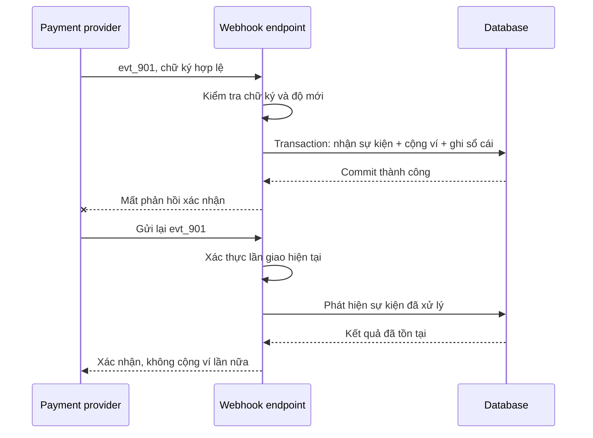

# Kịch bản webhook bị phát lại và cách bảo vệ logic nghiệp vụ

## 1. Tình huống: một webhook hợp lệ làm ví được cộng tiền nhiều lần

Một hệ thống cho phép khách hàng nạp 500.000 đồng vào ví thông qua nhà cung cấp thanh toán. Backend tạo yêu cầu nạp tiền `tu_42`, lưu số tiền và tiền tệ được phép, rồi liên kết yêu cầu đó với mã thanh toán bên ngoài `ptx_42`.

Sau khi thu tiền thành công, nhà cung cấp gửi sự kiện `payment.succeeded`. Backend xác thực webhook, cập nhật trạng thái nạp tiền và cộng 500.000 đồng vào ví.

Rủi ro xuất hiện nếu cùng thông điệp được gửi lại:

1. Nhà cung cấp không nhận được phản hồi xác nhận nên retry.
2. Hệ thống hàng đợi giao lại công việc sau khi worker bị dừng.
3. Nhân viên thao tác gửi lại một sự kiện để phục hồi sự cố.
4. Kẻ tấn công có được một request hợp lệ rồi phát lại request đó.

Nếu handler cứ thấy `payment.succeeded` là cộng tiền, một khoản thu thật có thể dẫn tới nhiều khoản cộng ví. Đây là lỗi bảo mật logic nghiệp vụ: thông điệp có thể hoàn toàn hợp lệ về chữ ký, nhưng tác động lặp lại vi phạm quy tắc của sản phẩm.

**Mục tiêu của replay protection là bảo đảm thông điệp cũ không thể tạo thêm tác động trái phép, đồng thời vẫn cho phép retry hợp lệ giúp hệ thống phục hồi.** Trong module Business Logic Security, việc này cần phối hợp business invariants, state machine, transaction, quyền trên đối tượng và xử lý idempotent.

## 2. Webhook minh họa và phạm vi tin cậy

Ví dụ sau là một hợp đồng webhook giả định để học thiết kế, không phải định dạng của một nhà cung cấp cụ thể:

```http
POST /integrations/payments/webhooks
Content-Type: application/json
X-Webhook-Signed-At: <unix-seconds>
X-Webhook-Signature: v1=<signature>

{
  "id": "evt_901",
  "type": "payment.succeeded",
  "merchantAccountId": "ma_A",
  "environment": "LIVE",
  "paymentId": "ptx_42",
  "amountMinor": 500000,
  "currency": "VND",
  "occurredAt": "2026-11-22T02:00:00Z"
}
```

`occurredAt` là thời điểm nghiệp vụ phát sinh theo nội dung sự kiện. `X-Webhook-Signed-At` là thời điểm của lần ký giao thông điệp, nếu hợp đồng nhà cung cấp có hỗ trợ. Hai thời điểm này có thể khác nhau đáng kể khi có retry hoặc hàng đợi bị chậm.

Backend phải xác định được cấu hình tích hợp và phạm vi tài khoản được phép từ ngữ cảnh tin cậy. Một chữ ký hợp lệ không có nghĩa mọi `merchantAccountId`, môi trường hoặc đối tượng trong body đều tự động thuộc tenant hiện tại.

Trong ví dụ, backend chỉ chấp nhận sự kiện cho tài khoản `ma_A` và môi trường `LIVE` theo cấu hình đã quản lý. Sau đó backend tra cứu `ptx_42` trong liên kết thanh toán do chính server tạo để tìm `tu_42` và ví thụ hưởng. Không lấy một `walletId` tùy ý từ metadata webhook rồi cộng tiền trực tiếp vào ví đó.

Một nhà cung cấp có thể ký cả dữ liệu vốn do khách hàng nhập trước đó, chẳng hạn metadata đơn hàng. Chữ ký chứng minh nguồn gửi đã ký dữ liệu; nó không tự chứng minh mọi giá trị trong metadata là quyết định nghiệp vụ đáng tin của backend.

## 3. Phân tích cuộc phát lại theo từng bước

### 3.1. Lần giao đầu đã commit nhưng mất phản hồi



Việc nhà cung cấp retry trong trường hợp này là bình thường. Hệ thống cần tiếp nhận request lặp lại một cách an toàn, không coi mọi bản sao là hành vi xấu rồi bỏ luôn cơ chế phục hồi.

### 3.2. Kẻ tấn công gửi lại request đã bắt được

Giả sử kẻ tấn công lấy được bản sao request qua log bị lộ hoặc một thành phần tích hợp bị xâm nhập. Nếu gửi lại nguyên body và chữ ký trong thời gian còn được chấp nhận, việc xác minh chữ ký vẫn có thể thành công.

Kẻ tấn công cũng có thể gửi đồng thời nhiều bản sao đến các instance khác nhau. Một biến `seenEvents` trong bộ nhớ của một instance hoặc phép kiểm tra “chưa thấy event ID” không có tính nguyên tử sẽ không đủ bảo vệ.

Không cần chứng minh được ai gửi bản sao để bảo vệ số dư. Handler phải giữ invariant ngay cả khi bản sao đến từ retry hợp lệ, thao tác vận hành hoặc kẻ tấn công.

### 3.3. Request cũ và sự kiện cũ không phải một trường hợp

- Request cũ giữ nguyên chữ ký cùng thời điểm ký cũ: có thể bị từ chối khi vượt cửa sổ độ mới.
- Sự kiện cũ được nhà cung cấp giao lại với chữ ký và thời điểm ký mới: có thể vượt qua kiểm tra độ mới một cách hợp lệ.
- Hai event ID khác nhau mô tả cùng một thanh toán: có thể vượt qua chống trùng theo event ID nhưng vẫn không được cộng tiền hai lần cho cùng tác động.

Ba trường hợp này cần những lớp bảo vệ khác nhau.

## 4. Chữ ký hợp lệ chưa chứng minh thông điệp chưa được dùng

Xác minh chữ ký trả lời câu hỏi: dữ liệu có phù hợp với chữ ký của một nguồn được tin cậy không? Nó không tự trả lời: thông điệp này đã từng gây tác động chưa?

Trong một thiết kế HMAC minh họa, hợp đồng có thể định nghĩa dữ liệu ký như sau:

```text
signed_message = ASCII("v1\n")
                 || ASCII(signed_at_as_transmitted)
                 || ASCII("\n")
                 || raw_body_bytes

signature = HMAC(configured_secret, signed_message)
```

Đây chỉ là ví dụ về việc ràng buộc phiên bản, thời điểm ký và body. Khi tích hợp thực tế, phải dùng đúng thuật toán, cách mã hóa và định dạng đã được nhà cung cấp quy định; không tự áp dụng công thức minh họa cho một giao thức khác.

Các yêu cầu quan trọng:

1. Giữ body theo đúng chuỗi byte mà hợp đồng yêu cầu để xác minh trước khi parse nghiệp vụ. Không parse JSON rồi serialize lại để kiểm tra chữ ký của body gốc.
2. Thời điểm dùng để kiểm tra độ mới phải nằm trong dữ liệu được ký. Một header thời gian không được ký có thể bị thay đổi khi phát lại.
3. Kiểm tra đúng cấu hình tích hợp, tài khoản và môi trường. Không dùng một khóa mặc định chung rồi bỏ qua phạm vi được phép.
4. Sử dụng thư viện xác minh phù hợp, bao gồm cách so sánh chữ ký an toàn; không tự viết cơ chế mật mã tùy tiện.
5. Nếu có key ID, chỉ coi đó là gợi ý tra cứu trong tập khóa đã được quản lý. Không tải khóa từ một URL tùy ý trong request.

Giới hạn kích thước request và việc kiểm tra định dạng header phải diễn ra đủ sớm để tránh lạm dụng tài nguyên. Tuy nhiên, không ghi một event ID chưa xác thực vào kho chống trùng có thẩm quyền: kẻ tấn công có thể chiếm trước ID của sự kiện thật.

HTTPS, giới hạn nguồn mạng và quản lý secret vẫn quan trọng. Chúng hỗ trợ bảo vệ kênh và nguồn gửi, nhưng không thay thế chống tác động lặp lại tại tầng nghiệp vụ.

## 5. Độ mới của lần giao và tuổi của sự kiện

Nếu nhà cung cấp có thời điểm ký được bảo vệ bởi chữ ký, endpoint có thể kiểm tra một khoảng chấp nhận:

```text
server_now - allowed_past_window <= signed_at
signed_at <= server_now + allowed_future_skew
```

`allowed_past_window` giới hạn độ cũ của lần giao. `allowed_future_skew` giới hạn độ lệch về tương lai do đồng hồ. Các giá trị phải xuất phát từ hợp đồng giao nhận và khả năng vận hành; không có một con số đúng cho mọi hệ thống.

Ví dụ học tập có thể dùng cửa sổ quá khứ vài phút và độ lệch tương lai nhỏ hơn, nhưng không nên sao chép giá trị đó nếu nhà cung cấp ký một lần rồi giao lại nguyên chữ ký trong nhiều giờ. Cần hiểu họ ký theo từng lần giao hay theo sự kiện, và có thể thay đổi chữ ký khi retry hay không.

Không dùng đồng hồ client hoặc header `Date` không được bảo vệ để quyết định freshness. Đồng hồ server cần được đồng bộ và có giám sát độ lệch; một cấu hình sai có thể từ chối hàng loạt webhook hợp lệ hoặc mở rộng cửa sổ phát lại.

Không mặc định từ chối mọi sự kiện có `occurredAt` cũ. Một giao dịch đã xảy ra từ lâu có thể được giao lại hợp lệ để khôi phục dữ liệu còn thiếu. Freshness của lần giao và tính mới của sự kiện nghiệp vụ phải được xét riêng.

Nếu giao thức không có thời điểm lần giao được xác thực, không thể tạo ra bảo đảm đó bằng cách tin một timestamp không được ký. Khi ấy cần dựa vào những cơ chế giao thức thực sự cung cấp, chống trùng bền vững, ràng buộc nghiệp vụ và đối soát. Timestamp cũng không thay thế kho chống trùng, vì bản sao vẫn có thể đến trong cửa sổ còn hợp lệ.

## 6. Chọn đúng định danh để chống trùng

### 6.1. Event ID và delivery ID phục vụ mục đích khác nhau

| Định danh | Ý nghĩa thường gặp | Cách dùng |
|---|---|---|
| Event ID | Một sự kiện logic do nhà cung cấp phát hành | Là ứng viên chống trùng nếu ổn định qua các lần giao theo hợp đồng |
| Delivery ID | Một lần giao hoặc một lần thử gửi | Dùng truy vết; có thể thay đổi qua retry nên thường không đủ để chống trùng nghiệp vụ |
| Provider payment ID | Một khoản thanh toán hoặc đối tượng thanh toán bên ngoài | Liên kết với đối tượng nội bộ và bảo vệ tác động liên quan |
| Internal top-up ID | Ý định nạp tiền do backend tạo | Xác định quy tắc và trạng thái nghiệp vụ cần bảo vệ |

Cần kiểm tra ý nghĩa của từng ID trong hợp đồng tích hợp. Tên trường `id` tự nó không cho biết đó là ID sự kiện hay ID lần giao.

### 6.2. Scope của bản ghi nhận sự kiện

Một khóa chống trùng minh họa:

```text
event_identity = (
    provider,
    authenticated_merchant_account,
    verified_environment,
    event_id
)
```

Tài khoản và môi trường phải phù hợp với cấu hình tích hợp đã xác minh. Việc body có chữ ký là một điều kiện cần, nhưng backend còn phải kiểm tra tài khoản trong body thuộc tập được cấu hình cho endpoint hoặc khóa đó.

Scope tránh việc cùng chuỗi `evt_901` ở hai nhà cung cấp, hai tài khoản hoặc môi trường thử nghiệm và môi trường thật bị hiểu nhầm là cùng sự kiện. Dữ liệu sandbox không được phép kích hoạt cộng tiền thật.

### 6.3. Cùng event ID nhưng nội dung khác

Kho nhận sự kiện nên giữ một fingerprint của những trường có ý nghĩa nghiệp vụ, chẳng hạn loại sự kiện, payment ID, tài khoản, môi trường, số tiền và tiền tệ.

Nếu cùng định danh mà các trường bất biến có ý nghĩa khác nhau, không được ghi đè sự kiện cũ hoặc thực thi nội dung mới. Cần ghi nhận xung đột và đưa vào quy trình điều tra hoặc đối soát phù hợp.

Có thể lưu thêm hash của raw body để kiểm tra toàn vẹn và hỗ trợ audit. Tuy nhiên, không mặc định mọi khác biệt byte đều là xung đột nghiệp vụ: nhà cung cấp có thể serialize lại JSON hoặc thay metadata giao nhận mà vẫn giữ cùng sự kiện. Việc so sánh raw body hay fingerprint chuẩn hóa phải theo đúng cam kết bất biến của giao thức.

## 7. Hai lớp duy nhất: nhận sự kiện và tạo tác động

Chống trùng event ID chưa đủ. Ví dụ nhà cung cấp phát `evt_901` và `evt_902` cùng thông báo `ptx_42` đã thành công. Hai bản ghi inbox là khác nhau, nhưng việc cộng tiền cho cùng khoản nạp vẫn chỉ được xảy ra một lần.

Với ví dụ mỗi yêu cầu nạp tiền có một khoản funding được phép, hai ràng buộc minh họa là:

```sql
-- Một sự kiện logic chỉ được đăng ký một lần trong đúng phạm vi.
UNIQUE (provider, merchant_account, environment, event_id)

-- Một yêu cầu nạp tiền chỉ có một bút toán cộng funding hợp lệ.
UNIQUE (topup_id, ledger_effect_type)
```

Các cột định danh cần có quy tắc không rỗng phù hợp. `ledger_effect_type` ở đây là loại tác động như `FUNDING_CREDIT`, không phải chuỗi tùy ý do webhook quyết định.

Ngoài ràng buộc này, liên kết giữa provider payment ID và yêu cầu nạp tiền phải được kiểm soát để cùng khoản thu không bị gán sang một yêu cầu khác. Nếu sản phẩm cho phép nhiều khoản nạp hoặc thanh toán từng phần, invariant phải được thiết kế theo đúng đơn vị tác động đó, không áp dụng máy móc “mỗi đối tượng một bút toán”.

Nếu có bằng chứng hai khoản thu thực sự khác nhau cho một ý định chỉ cho phép một khoản thu, không được che giấu khoản thu dư bằng cách coi mọi thứ là duplicate bình thường. Cần ghi nhận sai lệch và đối soát hoặc hoàn tiền theo quy trình. Chống trùng không được làm mất dấu nghĩa vụ tài chính thực tế.

## 8. Xử lý đồng bộ bằng inbox và transaction

Inbox là dữ liệu bền vững ghi nhận sự kiện đã nhận cùng trạng thái xử lý. Với tác động nằm trong cùng cơ sở dữ liệu, có thể ghi inbox, sổ cái, số dư, trạng thái nạp tiền và outbox trong một transaction.

### 8.1. Luồng xử lý minh họa

Đoạn sau là mã giả thể hiện trình tự, không phải Java hay SQL có thể chạy trực tiếp:

```text
config = resolveTrustedIntegrationConfiguration(request)
rawBody = readBodyWithSizeLimit(request)
verified = verifySignatureUsingProviderContract(config, request.headers, rawBody)
requireVerifiedDeliveryFreshnessWhenSupported(verified, serverClock)

event = parseAndValidateSupportedSchema(rawBody)
scope = requireAccountAndEnvironmentAllowed(config, event)
identity = eventIdentity(scope, event.id)
digest = businessFingerprint(event)

outcome = inDatabaseTransaction:
    inbox = reserveOrFindEventAtomically(identity, digest)

    if inbox refers to an existing committed record:
        requireSameBusinessFingerprint(inbox, digest)
        return ALREADY_RECORDED

    topup = loadTopupByTrustedProviderMappingForUpdate(scope, event.paymentId)
    requireEventBelongsToTopup(event, topup)
    requireExpectedAmountAndCurrency(event, topup)
    requireEventTypeAndTransitionAllowed(event, topup)

    if matchingFundingEffectAlreadyExists(topup, event):
        markInboxProcessedWithoutNewEffect(inbox, topup)
        return BUSINESS_EFFECT_ALREADY_EXISTS

    requireTopupEligibleForFunding(topup)
    ledger = insertFundingCreditWithBusinessUniqueness(topup, event)
    updateWalletBalanceAtomically(topup.walletId, ledger)
    transitionTopupToFunded(topup)
    writeOutboxEventWithStableIdentity(ledger)
    markInboxProcessed(inbox, ledger.id)
    return APPLIED

# Chỉ xác nhận sau khi transaction đã commit thành công.
return acknowledgementAccordingToProviderContract(outcome)
```

`requireEventTypeAndTransitionAllowed` cần phân biệt một sự kiện thành công lặp lại tương đương với một chuyển trạng thái mới. Nó không được loại bỏ nhánh nhận diện tác động đã có chỉ vì trạng thái hiện tại đã là `FUNDED`.

`reserveOrFindEventAtomically` phải dựa vào ràng buộc duy nhất hoặc cơ chế nguyên tử tương đương ở kho dữ liệu dùng chung. Khi các request cùng ID cạnh tranh, một request có thể phải chờ transaction kia kết thúc hoặc retry bước đọc theo giới hạn. Không dùng khóa trong bộ nhớ của một instance để thay thế.

### 8.2. Những thay đổi phải cùng commit

Nếu cộng ví thành công nhưng chưa ghi inbox thì tiến trình dừng, lần giao lại có thể cộng thêm. Nếu đánh dấu inbox đã xử lý trước khi cộng ví, một sự cố có thể khiến tiền chưa được cộng nhưng mọi retry đều bị bỏ qua.

Transaction cần bảo đảm hoặc toàn bộ tác động liên quan được ghi nhận, hoặc toàn bộ thay đổi chưa commit bị rollback. Lỗi ghi sổ cái, lỗi ràng buộc duy nhất hay lỗi cập nhật số dư không được bị nuốt rồi tiếp tục commit trạng thái thành công.

Nếu kết nối bị mất lúc xác nhận commit, ứng dụng có thể chưa biết transaction đã thành công hay chưa. Giữ nguyên định danh sự kiện và tác động khi retry giúp phân giải kết quả. Exception từ kết nối không phải bằng chứng chắc chắn rằng rollback đã xảy ra.

### 8.3. ACK không được đến trước dữ liệu bền vững

Trong hợp đồng minh họa, endpoint trả một phản hồi thành công như `204 No Content` sau commit cho sự kiện đã áp dụng hoặc duplicate hợp lệ đã được ghi nhận. Cần dùng đúng quy tắc ACK và retry của nhà cung cấp thực tế.

Nếu trả thành công trước khi lưu bền, tiến trình có thể chết và sự kiện bị mất vì nhà cung cấp cho rằng đã giao xong. Nếu cơ sở dữ liệu không sẵn sàng, không được chuyển sang cộng ví mà bỏ qua kho chống trùng.

Sự kiện sai chữ ký hoặc không thuộc phạm vi tích hợp không được coi là duplicate hợp lệ. Sự kiện có chữ ký hợp lệ nhưng sai số tiền hoặc chưa ánh xạ được đối tượng cần được xử lý theo chính sách lỗi và đối soát rõ ràng, không cộng tiền cho xong rồi mới kiểm tra.

## 9. Xử lý bất đồng bộ và khôi phục worker

Endpoint không nhất thiết phải hoàn thành nghiệp vụ trong thời gian xử lý HTTP. Một mô hình khác:

1. Xác minh request và phạm vi tích hợp.
2. Trong transaction, lưu inbox ở trạng thái `RECEIVED` và dữ liệu công việc hoặc outbox cần thiết.
3. Commit rồi ACK theo hợp đồng: hệ thống đã tiếp nhận bền vững, chưa nhất thiết đã cộng ví.
4. Worker đọc inbox và xử lý tác động nghiệp vụ bằng transaction riêng.
5. Trong transaction xử lý, ghi sổ cái, số dư, trạng thái, outbox và trạng thái `PROCESSED` của inbox cùng nhau.

Khi nhận lại cùng sự kiện ở trạng thái `RECEIVED`, endpoint không cần tạo một công việc logic mới. Tuy nhiên, hệ thống phải có cơ chế để công việc đã tiếp nhận thực sự được chạy hoặc được phục hồi; ACK chỉ an toàn khi việc tiếp nhận bền vững có đường xử lý tiếp.

Nếu worker dừng sau commit nhưng trước khi xác nhận công việc với hàng đợi, lần giao lại phải thấy tác động đã tồn tại và kết thúc không có tác động mới. Nếu worker dừng trước commit, các thay đổi chưa commit phải rollback.

Lease hết hạn không chứng minh worker cũ đã ngừng. Worker mới và worker cũ có thể cùng tồn tại. Cần khóa, cập nhật có điều kiện, token sở hữu hoặc fencing phù hợp với thiết kế, cùng các ràng buộc duy nhất nghiệp vụ. Không chỉ dựa vào một cờ `PROCESSING` trong cache.

Nếu worker gọi dịch vụ bên ngoài, transaction nội bộ không bao trùm lời gọi đó. Mỗi tác động bên ngoài cần mã thao tác ổn định, idempotency phía nhận nếu được hỗ trợ, cùng tra cứu hoặc đối soát khi kết quả chưa rõ. Outbox có thể được gửi lại; không được tuyên bố “exactly once” cho toàn luồng chỉ vì đã có inbox và outbox.

## 10. Replay sự kiện cũ không được làm lùi state machine

Chống trùng event ID chỉ ngăn cùng một sự kiện. Nó không giải quyết mọi sự kiện khác nhau hoặc mọi thứ tự giao nhận.

Giả sử hệ thống đã ghi nhận khoản funding rồi xử lý một sự kiện đảo tiền. Sau đó một sự kiện thành công cũ xuất hiện lại với chữ ký giao nhận mới. Handler không được cộng funding lần nữa hoặc đổi trạng thái từ `REVERSED` về `FUNDED` chỉ vì event type là `payment.succeeded`.

| Trạng thái nội bộ và sự kiện đến | Cách xử lý cần có |
|---|---|
| Chưa funding, thành công hợp lệ cho đúng khoản thanh toán | Kiểm tra điều kiện rồi tạo tác động funding một lần |
| Đã funding, cùng sự kiện thành công | Duplicate sự kiện, không tạo tác động mới |
| Đã funding, event ID khác nhưng cùng khoản thành công | Nhận diện tác động đã tồn tại, không cộng thêm |
| Đã đảo tiền, sự kiện thành công cũ | Không tái cấp funding; giữ lịch sử và đối soát nếu có mâu thuẫn |
| Đã funding, sự kiện thất bại cũ | Không tùy tiện làm lùi trạng thái đã xác nhận |
| Nhận hoàn tiền hoặc chargeback hợp lệ | Xử lý như loại tác động riêng với điều kiện và định danh riêng |
| Sự kiện chưa đủ thông tin hoặc mâu thuẫn trạng thái | Tra cứu nguồn tin cậy hoặc đưa vào quy trình đối soát |

Không mặc định thứ tự đến là thứ tự nghiệp vụ. `occurredAt` cũng không tự là một số thứ tự toàn cục đáng tin cho mọi chuyển trạng thái. Nếu nhà cung cấp có revision hoặc sequence với bảo đảm cụ thể, có thể dùng theo hợp đồng đó; nếu không, cần thiết kế chuyển trạng thái và đối soát phù hợp.

Khi cần truy vấn nhà cung cấp, dùng endpoint và thông tin tài khoản đã cấu hình, cùng định danh đã kiểm chứng. Không truy cập một URL tùy ý từ webhook để “xác minh” sự kiện, vì việc đó có thể mở thêm đường lạm dụng hệ thống.

## 11. Phân biệt retry, duplicate và bất thường bảo mật

| Quan sát | Diễn giải | Hành động bảo vệ |
|---|---|---|
| Cùng event ID, cùng nội dung nghiệp vụ, chữ ký hiện tại hợp lệ | Có thể là retry bình thường hoặc phát lại có chủ đích | Không tạo tác động mới; ACK theo trạng thái tiếp nhận bền vững |
| Request nguyên vẹn có thời điểm ký đã quá cũ | Lần giao không còn thỏa freshness nếu giao thức có bảo đảm này | Từ chối theo hợp đồng; không cập nhật nghiệp vụ |
| Chữ ký hợp lệ mới cho một sự kiện đã xử lý | Nhà cung cấp có thể đang giao lại sự kiện cũ | Chống trùng vẫn phải chặn tác động lặp |
| Cùng ID nhưng khác số tiền hoặc đối tượng bất biến | Bất thường nội dung hoặc hiểu sai hợp đồng | Không ghi đè; ghi nhận xung đột và điều tra |
| Event ID khác nhau cho cùng tác động funding | Chống trùng sự kiện không đủ | Dùng invariant và ràng buộc duy nhất nghiệp vụ |
| Chữ ký hợp lệ nhưng thuộc tài khoản hoặc môi trường khác | Sai phạm vi tích hợp | Không tác động tới tenant hoặc số dư hiện tại |
| Nhiều key hoặc ID mới từ request không hợp lệ | Có thể là lạm dụng tài nguyên | Giới hạn đầu vào và tốc độ, không để chiếm kho chống trùng |

Với xung đột đã được xác thực, chỉ ACK nếu hệ thống đã lưu bền trạng thái cách ly cùng quy trình xử lý tiếp theo phù hợp. Không trả thành công rồi âm thầm bỏ sự kiện quan trọng. Ngược lại, retry liên tục cũng không tự chữa được một xung đột dữ liệu; cần vận hành và đối soát.

Mục tiêu không phải suy đoán ý đồ từ mỗi request, mà là giữ đúng tác động và để lại đủ bằng chứng khi có bất thường.

## 12. Thời hạn lưu, cache và sự kiện phát lại rất muộn

Timestamp và kho chống trùng có vòng đời khác nhau. Một request cũ có thể hết cửa sổ ký, nhưng nhà cung cấp có thể ký lại cùng sự kiện sau nhiều ngày. Vì vậy, thời gian giữ inbox không thể chỉ lấy bằng vài phút của cửa sổ freshness.

Chính sách lưu cần xét khoảng retry của nhà cung cấp, công việc nằm trong hàng đợi, thao tác gửi lại thủ công, phục hồi sau sự cố và yêu cầu đối soát. Không có một TTL chung đúng cho mọi loại sự kiện.

**Xóa inbox không xóa khoản funding đã ghi vào sổ cái.** Khi event ID cũ không còn trong inbox, ràng buộc nghiệp vụ và dữ liệu liên kết còn giữ phải tiếp tục ngăn cộng lại cùng khoản tiền. Có thể giữ dữ liệu đánh dấu hoặc tham chiếu gọn hơn lâu hơn phần payload đầy đủ.

Cache có thể giảm tải tra cứu, nhưng một cache bị mất, bị xóa hoặc chưa đồng bộ giữa các instance không được làm mất lớp bảo vệ cuối cùng cho số dư. Dùng cache làm bằng chứng duy nhất rằng một sự kiện “chưa từng được xử lý” là rủi ro.

Sao lưu và phục hồi cũng phải giữ nhất quán giữa inbox, sổ cái, số dư và trạng thái nghiệp vụ. Nếu khôi phục inbox về thời điểm cũ hơn dữ liệu tài chính, sự kiện đã xử lý có thể trông như mới. Invariant bền vững cùng đối soát phải giúp phân giải, không chạy lại hàng loạt chỉ vì thiếu event ID.

## 13. Kiểm thử kịch bản tấn công logic

Kiểm thử nên gửi request qua nhiều instance hoặc worker khi môi trường cho phép, đồng thời quan sát số bút toán, biến động số dư và trạng thái cuối. Chỉ kiểm tra response `2xx` hay `4xx` chưa đủ.

| Tình huống kiểm thử | Kết quả cần khẳng định |
|---|---|
| Giao webhook hợp lệ lần đầu | Tạo đúng một funding credit, cộng đúng 500.000 đồng |
| Gửi lại tuần tự cùng sự kiện | Không có bút toán hoặc tác động cộng ví mới |
| Gửi đồng thời nhiều bản sao đến nhiều instance | Chỉ một transaction commit tác động funding |
| Làm mất ACK sau commit rồi để nhà cung cấp retry | Không mất kết quả và không cộng thêm tiền |
| Dừng tiến trình trước commit | Không có cập nhật số dư dở dang từ transaction đã rollback |
| Dừng worker sau commit nhưng trước ACK hàng đợi | Giao lại công việc không tạo tác động mới |
| Phát lại nguyên request sau cửa sổ freshness | Bị từ chối nếu giao thức có timestamp lần giao được xác thực |
| Sửa timestamp để request cũ trông mới | Xác minh chữ ký thất bại khi timestamp thuộc dữ liệu ký |
| Nhà cung cấp ký mới cho event ID đã xử lý | Freshness có thể hợp lệ, nhưng không có funding mới |
| Đổi delivery ID nhưng giữ event ID | Vẫn nhận diện cùng sự kiện logic |
| Event ID khác cho cùng khoản funding | Ràng buộc nghiệp vụ chặn tác động lần hai |
| Cùng event ID nhưng khác số tiền với chữ ký hợp lệ trong môi trường kiểm thử | Không ghi đè nội dung cũ; ghi nhận xung đột |
| Đổi khoảng trắng JSON mà không ký lại raw body | Thất bại xác minh nếu hợp đồng ký body gốc |
| Giao cùng sự kiện được ký lại với cách serialize khác được hợp đồng cho phép | Không báo xung đột chỉ do byte khác khi ý nghĩa bất biến không đổi |
| Chữ ký sandbox hoặc tài khoản khác | Không cộng vào số dư thật của tenant hiện tại |
| Metadata có wallet ID của người khác | Không vượt qua liên kết và quyền theo đối tượng phía server |
| Số tiền, tiền tệ hoặc payment ID không khớp yêu cầu nạp | Không tạo funding; có đường xử lý sai lệch rõ ràng |
| Sự kiện thành công cũ đến sau đảo tiền | Không khôi phục funding hoặc làm lùi state machine trái quy tắc |
| Xóa cache chống trùng rồi gửi lại | Lớp bảo vệ bền vững vẫn giữ số dư đúng |
| Inbox hết hạn rồi nhà cung cấp giao lại sự kiện | Không cộng lại tác động đã có trong sổ cái |
| Kho dữ liệu không sẵn sàng | Không ACK như đã xử lý nếu chưa tiếp nhận bền vững; không bỏ qua chống trùng |

Các khẳng định trọng tâm của ví dụ: tổng funding cho `tu_42` đúng 500.000 đồng; liên kết với `ptx_42` không bị chuyển sang ví khác; chỉ có một bút toán funding hợp lệ; và một sự kiện cũ không làm vô hiệu chuyển trạng thái đảo tiền đã được xử lý đúng.

## 14. Vận hành và giới hạn của mô hình đe dọa

Log nên liên kết được sự kiện, tài khoản tích hợp, đối tượng nghiệp vụ và bút toán, đồng thời tránh ghi secret hoặc dữ liệu thanh toán nhạy cảm. Chỉ số hữu ích gồm tỷ lệ duplicate, chữ ký sai, timestamp ngoài cửa sổ, xung đột nội dung, sự kiện chưa ánh xạ được đối tượng và công việc inbox tồn đọng.

Không dùng event ID có số lượng giá trị rất lớn làm nhãn metric. Giới hạn kích thước body, số công việc chờ và tốc độ request để đường webhook không trở thành điểm làm cạn tài nguyên. Giám sát khóa tích hợp, đồng hồ server và công việc đối soát giúp phát hiện sai lệch trước khi ảnh hưởng lan rộng.

Khi xoay khóa, tập khóa được chấp nhận phải gắn với đúng cấu hình và chính sách thời gian của giao thức. Không giữ khóa cũ vô thời hạn chỉ để mọi request cũ tiếp tục hợp lệ. Các sự kiện đã xử lý vẫn phải chống trùng dù được ký bằng một khóa còn được chấp nhận khác.

Mô hình phát lại giả định kẻ tấn công có bản sao thông điệp, chưa có khả năng tự ký mọi nội dung. Nếu secret ký đã bị lộ, kẻ tấn công có thể tạo event ID và timestamp mới; replay protection không tự phát hiện mọi sự kiện giả đó. Khi ấy cần xử lý sự cố khóa, kiểm tra dữ liệu nguồn và đối soát, bên cạnh các invariant vốn đã bảo vệ tác động.

## 15. Câu hỏi tự kiểm tra

1. Vì sao một webhook có chữ ký hợp lệ vẫn có thể là bản phát lại nguy hiểm?
2. Event ID, delivery ID và provider payment ID khác nhau ở trách nhiệm nào?
3. Vì sao thời điểm ký được xác thực không thay thế chống trùng sự kiện?
4. Nếu ACK bị mất sau commit, lần giao lại cần làm gì?
5. Vì sao chỉ chống trùng event ID vẫn có thể cộng tiền hai lần?
6. Điều gì ngăn một sự kiện thành công cũ tái cấp funding sau đảo tiền?
7. Khi inbox hết hạn hoặc cache mất dữ liệu, lớp bảo vệ nào tiếp tục giữ số dư đúng?

Một handler webhook an toàn cần xác thực đúng thông điệp và phạm vi, nhận diện lần giao lặp, bảo vệ tác động bằng transaction cùng invariant, rồi ACK theo dữ liệu đã được lưu bền. Các lớp đó cho phép hệ thống phục hồi từ retry hợp lệ mà không biến một thông điệp cũ thành một lần cấp quyền hoặc cộng tiền mới.
