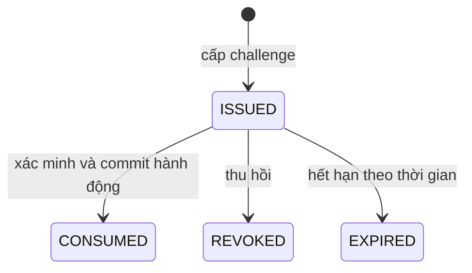

# Nonce validation

## 1. Nonce bảo vệ điều gì trong logic nghiệp vụ?

Nonce là một giá trị được dùng một lần trong phạm vi mà giao thức quy định. Trong bảo vệ replay, nonce giúp server nhận ra một bằng chứng hoặc một lệnh hợp lệ đang bị gửi lại để tạo thêm tác dụng.

Ví dụ, người dùng xác nhận hoàn tiền 150.000 VND cho một đơn hàng. Nếu hệ thống chỉ kiểm tra chữ ký hoặc phiên đăng nhập, một request đã từng hợp lệ có thể bị phát lại để yêu cầu hoàn tiền lần nữa. Nonce được ràng buộc đúng với người dùng, ý định hoàn tiền và thao tác sẽ giúp server từ chối việc sử dụng lại bằng chứng đó.

**Kiểm tra nonce không chỉ là kiểm tra chuỗi ngẫu nhiên có tồn tại.** Server cần xác định nonce có đúng nguồn, đúng phạm vi, còn hiệu lực, chưa bị sử dụng hoặc thu hồi, và có thể được tiêu thụ nguyên tử cùng quyền thực thi nghiệp vụ hay không.

Trong phạm vi bảo mật logic nghiệp vụ, các bất biến cần giữ gồm:

- Một nonce không cho phép hai lần chuyển trạng thái nghiệp vụ đã commit.
- Nonce cấp cho một người hoặc tenant không dùng được ở phạm vi khác.
- Nonce cho một ý định không xác nhận được số tiền, đối tượng hoặc thao tác khác.
- Nonce hợp lệ không thay thế phê duyệt, quyền theo đối tượng và kiểm tra giới hạn nghiệp vụ.
- Timeout hoặc retry không mở lại quyền thực thi đã được tiêu thụ.

## 2. Phân biệt nonce với các cơ chế liên quan

| Cơ chế | Câu hỏi chính được giải quyết | Điều không tự bảo đảm |
|---|---|---|
| Xác thực | Ai đang gửi request? | Request hợp lệ chưa từng được phát lại |
| Chữ ký hoặc MAC | Dữ liệu được bảo vệ có bị sửa, có đến từ bên giữ khóa không? | Một bản sao nguyên vẹn chưa từng được chấp nhận |
| Timestamp | Request có nằm trong khoảng thời gian được chấp nhận không? | Không bị gửi nhiều lần trong chính khoảng đó |
| Nonce chống replay | Giá trị dùng một lần này còn được phép sử dụng không? | Người gọi có quyền thực hiện nghiệp vụ |
| Idempotency | Các lần gửi lại của cùng ý định được xử lý thế nào để tránh tác dụng lặp? | Bằng chứng xác nhận còn mới hoặc chỉ được dùng một lần theo giao thức |
| Ràng buộc nghiệp vụ | Hệ thống có giữ đúng quy tắc về tiền, trạng thái, phê duyệt và đối tượng không? | Mọi request phát lại đều được nhận diện ở tầng giao thức |

TLS bảo vệ dữ liệu trên đường truyền nhưng không tự ngăn một bên đã có request hợp lệ gửi lại request đó. Chữ ký đúng cũng chưa đủ: bản sao giữ nguyên chữ ký vẫn có thể xác minh thành công.

Một token tự chứa có trường nonce và chữ ký hợp lệ không tự trở thành token dùng một lần. Hệ thống vẫn cần trạng thái tiêu thụ hoặc một ràng buộc có hiệu lực tương đương tại nơi thực hiện hành động.

## 3. Hai mô hình nonce cần phân biệt

### 3.1. Nonce do server cấp

Server tạo challenge, lưu trạng thái và đưa nonce cho client. Khi thực hiện hành động, client gửi nonce trở lại. Server tìm challenge đã cấp, kiểm tra các ràng buộc rồi tiêu thụ nó.

```text
Client yêu cầu xác nhận một ý định
    → Server kiểm tra sơ bộ, tạo challenge và nonce
    → Client hoàn thành bước xác nhận cần thiết
    → Client gửi lệnh cùng nonce và bằng chứng tương ứng
    → Server xác minh, tiêu thụ nonce và thực hiện nghiệp vụ
```

Với mô hình này, nonce không có trong kho challenge phải bị từ chối. Không tự tạo một bản ghi mới từ nonce client vừa gửi rồi coi đó là challenge hợp lệ.

### 3.2. Nonce do client tạo trong request có bảo vệ toàn vẹn

Một client đã được cấp thông tin xác thực có thể tạo nonce riêng, đặt nó trong phần dữ liệu được ký hoặc MAC, rồi gửi request. Server xác minh request và ghi nhận nonce đã thấy bằng thao tác nguyên tử.

Ở đây, nonce chưa xuất hiện có thể là điều kiện cho lần sử dụng đầu tiên. Nhưng nonce chỉ có ý nghĩa nếu được bảo vệ cùng nội dung lệnh, định danh bên gửi và ngữ cảnh nhận. Một trường nonce không được ký có thể bị thay tùy ý trên bản sao request.

| Điểm kiểm tra | Server cấp challenge | Client tạo nonce có chữ ký/MAC |
|---|---|---|
| Nguồn hợp lệ | Có bản ghi challenge đã cấp hoặc token hợp lệ kèm cơ chế tiêu thụ | Request được xác minh bằng khóa phù hợp |
| Lần dùng đầu | Challenge tồn tại, còn hiệu lực và chưa tiêu thụ | Chưa có nonce trong phạm vi chống replay |
| Cách lưu | Chuyển trạng thái challenge đã có | Insert dấu vết nonce đã thấy với unique constraint |
| Khi không có bản ghi | Từ chối challenge không tồn tại | Có thể tiếp nhận nếu mọi kiểm tra khác đạt |

Không trộn hai mô hình. Quy tắc “không thấy thì insert và chấp nhận” của mô hình thứ hai là lỗi nghiêm trọng nếu áp dụng cho challenge do server cấp.

## 4. Các ràng buộc của một nonce hợp lệ

Một challenge cho hành động nhạy cảm có thể gắn với các thuộc tính sau:

| Thuộc tính | Ý nghĩa |
|---|---|
| `tenant_id` | Tenant được phép sử dụng challenge |
| `subject_id` | Chủ thể được cấp challenge |
| `session_binding` | Liên kết với phiên hoặc ngữ cảnh xác thực nếu chính sách yêu cầu |
| `action` | Lệnh cụ thể, ví dụ `refund.confirm.v1` |
| `resource_id` | Đối tượng đích, ví dụ mã đơn hàng |
| `intent_id` | Ý định nghiệp vụ đã được server nhận diện |
| `intent_digest` | Dấu vết những dữ liệu có ý nghĩa của ý định |
| `resource_version` | Phiên bản đối tượng hoặc ý định cần giữ nếu nghiệp vụ yêu cầu |
| `issued_at`, `expires_at` | Thời điểm cấp và hết hiệu lực do server quyết định |
| `state`, `consumed_at` | Trạng thái và thời điểm đã tiêu thụ |
| `proof_reference` | Liên kết bằng chứng xác nhận hoặc phê duyệt khi có |

Không phải mọi hệ thống đều cần mọi trường. Mỗi ràng buộc phải tương ứng với một yêu cầu thực tế, ví dụ challenge có còn dùng được sau khi đăng nhập lại hoặc sau khi phiên bị thu hồi không.

### 4.1. Gắn với ý nghĩa hành động

Giả sử server tạo ý định:

```json
{
  "action": "refund.confirm.v1",
  "intent_id": "refund-intent-42",
  "order_id": "order-125",
  "amount_minor": 150000,
  "currency": "VND",
  "intent_version": 7
}
```

Nonce cấp cho ý định này không được dùng sau khi đổi số tiền thành 900.000 VND, đổi đơn hàng hoặc đổi loại tiền. Server nên ràng buộc challenge với ý định đã lưu hoặc tính digest từ biểu diễn chuẩn hóa có hợp đồng rõ ràng.

Digest không bao gồm chính nonce theo cách gây vòng lặp tự tham chiếu. Các trường truyền tải như trace ID không cần quyết định ý nghĩa nghiệp vụ. Phải chuẩn hóa số tiền, giá trị mặc định, trường bị bỏ qua và thứ tự dữ liệu theo quy tắc nhất quán.

Server phải tính hoặc kiểm tra digest từ dữ liệu đáng tin cậy. Không chỉ so sánh với một digest do client tự cung cấp rồi bỏ qua việc body thực tế đã thay đổi.

Các giá trị như giá bán hoặc hạn mức vẫn phải do nghiệp vụ xác định. Việc nonce ràng buộc với số tiền client gửi không biến số tiền đó thành giá hợp lệ.

### 4.2. Không suy ra quyền từ việc sở hữu nonce

Với challenge cấp cho người dùng đã xác thực, nonce là một thành phần bằng chứng, không phải giấy phép độc lập. Server vẫn phải kiểm tra người gửi hiện tại có đúng chủ thể, còn quyền trên đối tượng và đáp ứng phê duyệt yêu cầu hay không.

Nếu một luồng được thiết kế cố ý dùng token như capability, ví dụ một đường dẫn hành động có quyền hạn hẹp, phải coi việc sở hữu token là một mô hình ủy quyền riêng: phạm vi, bí mật, thời hạn, thu hồi và tác dụng được phép cần được xác định rõ. Không vô tình biến nonce thành capability chỉ vì thiếu kiểm tra quyền.

## 5. Sinh nonce và kiểm tra định dạng trong Java

Nonce do server cấp cho challenge thường nên khó đoán để bên khác không thể dự đoán và chiếm dụng challenge. Một lựa chọn thực tế là 32 byte ngẫu nhiên từ bộ sinh phù hợp cho bảo mật, mã hóa Base64 URL-safe không padding.

```java
import java.security.SecureRandom;
import java.util.Base64;

public final class Nonces {
    private static final SecureRandom RANDOM = new SecureRandom();
    private static final Base64.Encoder ENCODER =
        Base64.getUrlEncoder().withoutPadding();
    private static final Base64.Decoder DECODER =
        Base64.getUrlDecoder();

    private Nonces() {}

    public static String create() {
        byte[] bytes = new byte[32];
        RANDOM.nextBytes(bytes);
        return ENCODER.encodeToString(bytes);
    }

    public static byte[] decodeStrict(String value) {
        if (value == null
                || !value.matches("[A-Za-z0-9_-]{43}")) {
            throw new IllegalArgumentException("Invalid nonce format");
        }

        byte[] decoded = DECODER.decode(value);
        if (decoded.length != 32
                || !ENCODER.encodeToString(decoded).equals(value)) {
            throw new IllegalArgumentException("Non-canonical nonce");
        }
        return decoded;
    }
}
```

Ví dụ này kiểm tra cả độ dài, alphabet, số byte và biểu diễn chuẩn. Mã hóa 32 byte không padding tạo chuỗi dài 43 ký tự. Bước mã hóa lại giúp từ chối các biểu diễn khác nhau có thể giải mã về cùng bytes.

Không tự động cắt khoảng trắng, đổi chữ hoa/thường hoặc chấp nhận nhiều dạng encoding nếu hợp đồng chỉ cho một dạng. Các lớp proxy, framework và ứng dụng cần thống nhất nonce là một giá trị đơn; header hoặc tham số bị lặp phải được xử lý rõ ràng để tránh mỗi lớp chọn một giá trị khác nhau.

Không dùng timestamp, số tăng dần có thể đoán hoặc bộ sinh phục vụ mô phỏng làm bí mật challenge. Trong một số giao thức có bảo vệ toàn vẹn, tính duy nhất của nonce do client tạo có thể quan trọng hơn tính bí mật; yêu cầu cụ thể phải theo mô hình đe dọa, không suy ra rằng mọi nonce đều có cùng mục đích.

Không trả stack trace từ lỗi giải mã cho client. Chuyển lỗi thành phản hồi đầu vào không hợp lệ theo hợp đồng API, đồng thời giới hạn kích thước trước khi thực hiện xử lý tốn tài nguyên.

## 6. Lưu challenge và vòng đời

Một vòng đời đơn giản cho challenge do server cấp là:



`EXPIRED` có thể được suy ra từ `expires_at` mà không cần worker cập nhật field trạng thái. Không được chấp nhận challenge chỉ vì trạng thái vẫn là `ISSUED` nếu thời hạn đã qua.

Trong mô hình transaction chung, `CONSUMED` trở nên bền vững cùng thay đổi nghiệp vụ. Nếu transaction rollback trước commit, việc tiêu thụ cũng rollback. Điều này cho phép thử lại một lần thực thi chưa commit, nếu challenge vẫn còn hạn và các điều kiện khác còn đúng.

Nếu giao thức yêu cầu challenge bị đốt ngay ở lần thử, kể cả khi bước sau thất bại, đó là một chính sách khác. Cần cơ chế cấp lại an toàn và xử lý mất response; không trộn với giả định “rollback sẽ trả nonce về chưa dùng”.

### 6.1. Dữ liệu tối thiểu minh họa

```text
challenge_id
nonce_digest                 UNIQUE
tenant_id
subject_id
action
resource_id
intent_id
intent_digest
intent_version
issued_at
expires_at
state                        ISSUED | CONSUMED | REVOKED
consumed_at
operation_id                 kết quả hoặc operation được liên kết
```

Với nonce ngẫu nhiên có entropy cao, có thể lưu SHA-256 của bytes nonce thay vì lưu giá trị thô để giảm việc lộ token khi kho bị đọc. Đây không phải mã hóa và không thay thế bảo vệ database. Nếu dùng HMAC làm dẫn xuất tra cứu, cần có chính sách quản lý và chuyển phiên bản khóa.

Unique constraint bảo vệ việc cấp trùng trong kho; khi một lần sinh ngẫu nhiên hiếm hoi gặp xung đột, sinh giá trị mới thay vì ghi đè challenge cũ. Không dùng upsert để thay đổi chủ thể, ý định hoặc thời hạn của nonce đã tồn tại.

## 7. Trình tự kiểm tra trước khi chấp nhận

Luồng sau áp dụng cho một challenge do server cấp, có tác dụng nằm trong cùng database:

1. Giới hạn kích thước request và kiểm tra định dạng nonce.
2. Xác thực người gửi; xác minh chữ ký/MAC hoặc bằng chứng xác nhận bổ sung nếu giao thức yêu cầu.
3. Suy ra tenant, chủ thể và thao tác từ nguồn đáng tin cậy.
4. Tra cứu challenge trong phạm vi đó; không tạo challenge khi không thấy.
5. Khóa hoặc dùng điều kiện cập nhật nguyên tử để kiểm tra trạng thái và thời hạn.
6. Kiểm tra đối tượng đích, ý định, digest, phiên bản và liên kết phiên nếu có.
7. Kiểm tra quyền hiện tại, phê duyệt và bất biến nghiệp vụ trong ranh giới đồng bộ phù hợp.
8. Tiêu thụ nonce và chuyển trạng thái nghiệp vụ trong cùng transaction.
9. Chỉ trả thành công sau khi commit thành công; nếu mất xác nhận, tra cứu bằng định danh ổn định.

Không tiêu thụ nonce chỉ để biết nó có hợp lệ hay không trong một endpoint kiểm tra trước. Một lệnh xem trước có tác dụng đốt nonce có thể bị sử dụng để gây từ chối dịch vụ cho người dùng hợp lệ.

Thông tin lỗi trả ra ngoài có thể được gộp để hạn chế thăm dò, nhưng log nội bộ vẫn nên phân biệt sai phạm vi, hết hạn, đã dùng, sai ý định và thiếu quyền. Không đưa nonce thô hoặc dữ liệu nhạy cảm vào log.

## 8. Tiêu thụ nguyên tử trong transaction

### 8.1. Vì sao đọc rồi cập nhật không đủ?

Mẫu dưới đây có cuộc đua nếu các thao tác không được đồng bộ đúng:

```text
Request A: đọc nonce chưa dùng
Request B: đọc nonce chưa dùng
Request A: thực hiện hoàn tiền
Request B: thực hiện hoàn tiền
Request A/B: đánh dấu nonce đã dùng
```

Chỉ có một cờ `used` trong database không bảo đảm một lần sử dụng. Điều quan trọng là cách request giành quyền thay đổi cờ và cách quyền đó gắn với tác dụng nghiệp vụ.

### 8.2. Ví dụ khóa dòng và cập nhật có điều kiện

Trong PostgreSQL, ứng dụng có thể bắt đầu transaction rồi đọc challenge có khóa:

```sql
SELECT challenge_id,
       action,
       resource_id,
       intent_id,
       intent_digest,
       intent_version,
       expires_at,
       state
FROM action_challenges
WHERE nonce_digest = :nonce_digest
  AND tenant_id = :tenant_id
  AND subject_id = :subject_id
FOR UPDATE;
```

Nếu không có dòng, từ chối. Nếu có dòng, so sánh action và các ràng buộc ý định; sau đó khóa hoặc cập nhật có điều kiện trên dữ liệu nghiệp vụ theo quy ước thứ tự khóa nhất quán.

Sau khi các kiểm tra cần thiết đạt, tiêu thụ challenge bằng điều kiện cuối cùng:

```sql
UPDATE action_challenges
SET state = 'CONSUMED',
    consumed_at = clock_timestamp(),
    operation_id = :operation_id
WHERE challenge_id = :challenge_id
  AND tenant_id = :tenant_id
  AND subject_id = :subject_id
  AND state = 'ISSUED'
  AND expires_at > clock_timestamp();
```

Phải yêu cầu đúng một dòng được cập nhật. Không có dòng cập nhật nghĩa là chưa có quyền tiếp tục thực thi trong transaction này.

Tiếp theo thực hiện thay đổi nghiệp vụ và ghi kết quả trong **chính transaction đó**, rồi commit. Nếu bất kỳ điều kiện nghiệp vụ hoặc thao tác lưu nào thất bại và cần hủy, rollback cả tiêu thụ nonce và thay đổi nghiệp vụ.

Request thứ hai chờ khóa sẽ nhìn thấy trạng thái đã tiêu thụ sau khi request thứ nhất commit, hoặc có thể tiếp tục kiểm tra nếu request thứ nhất rollback. Như vậy chỉ một lần sử dụng dẫn đến tác dụng đã commit theo mô hình này.

Các truy vấn là minh họa ranh giới đồng bộ, không phải một schema hoàn chỉnh. Có thể dùng compare-and-set thay cho đọc có khóa, nhưng việc tiêu thụ, kiểm tra ý định và thay đổi nghiệp vụ vẫn phải có bảo đảm tương ứng.

### 8.3. Thời gian được kiểm tra tại thời điểm nào?

Trong PostgreSQL, `CURRENT_TIMESTAMP` phản ánh thời điểm bắt đầu transaction. Nếu transaction chờ khóa lâu, dùng nó cho thời điểm hết hạn có thể cho kết quả khác với thời gian thực lúc tiêu thụ. Ví dụ dùng `clock_timestamp()` ở trên để kiểm tra bằng đồng hồ database khi chạy điều kiện.

Hợp đồng cần nói rõ challenge phải còn hạn ở thời điểm nhận request, thời điểm tiêu thụ hay một mốc khác. Ví dụ này kiểm tra tại lúc tiêu thụ; nó không tuyên bố mọi thay đổi sau đó đều hoàn tất trước `expires_at`.

Giữ transaction ngắn và đặt giới hạn chờ phù hợp. Nếu nghiệp vụ yêu cầu bằng chứng còn mới sát thời điểm một bước nhạy cảm diễn ra, phải kiểm tra tại ranh giới đó và thiết kế luồng tương ứng, không dựa vào một lần kiểm tra từ rất lâu trước đó.

## 9. Mã giả Java cho luồng xác nhận

```java
Response confirmRefund(Request request, AuthContext auth) {
    byte[] nonce = Nonces.decodeStrict(request.nonce());
    TrustedScope scope = scopes.fromAuthenticatedContext(auth);

    return transactions.runAndCommit(() -> {
        Challenge challenge = challenges.findForUpdate(
            scope, digests.sha256(nonce)
        );
        requireIssuedChallenge(challenge);

        RefundIntent intent = intents.findForUpdate(
            scope.tenantId(), request.intentId()
        );

        requireMatchingActionAndIntent(challenge, intent, request);
        authorization.requireCanConfirmRefund(auth, intent);
        approvals.requireValidFor(intent);
        refunds.requireBusinessInvariants(intent);

        OperationId operationId = operations.newId();
        int consumed = challenges.consumeIfStillValid(
            challenge.id(), scope, operationId
        );
        if (consumed != 1) {
            throw new ChallengeNotUsable();
        }

        RefundResult result = refunds.applyInSameDatabaseTransaction(
            operationId, intent
        );
        return responses.from(result);
    });
}
```

Đây là mã giả để thể hiện ranh giới transaction, không phải mã có thể chạy độc lập. `requireMatchingActionAndIntent` phải kiểm tra đầy đủ đối tượng, digest, phiên bản và các liên kết theo chính sách. Cách khóa phải nhất quán trên các đường xử lý cùng dữ liệu để tránh tạo deadlock không cần thiết.

`runAndCommit` chỉ trả response cho tầng HTTP sau khi commit thành công. Nếu không biết commit đã xảy ra chưa, không lập tức tạo một operation mới. Cần tra cứu operation, challenge và kết quả nghiệp vụ bằng định danh ổn định.

Luồng này dành cho tác dụng nội bộ trong cùng database. Không thay `applyInSameDatabaseTransaction` bằng lời gọi nhà cung cấp thanh toán rồi giả định lỗi có thể rollback cả hai hệ thống.

## 10. Nonce hợp lệ vẫn cần kiểm tra trạng thái nghiệp vụ

Một người dùng có thể xin hai challenge khác nhau cho cùng một ý định. Nếu mỗi challenge được dùng đúng một lần nhưng cả hai đều tạo hoàn tiền, quy tắc nghiệp vụ vẫn bị phá vỡ.

Cần kiểm tra và bảo vệ ý định, ví dụ:

- Ý định phải còn ở trạng thái cho phép xác nhận.
- Một ý định đã hoàn tất không được thực thi lại bằng challenge mới.
- Số tiền hoàn tích lũy không vượt giới hạn cho phép.
- Phê duyệt phải ràng buộc đúng số tiền, đối tượng và phiên bản ý định.
- Quyền trên đối tượng phải còn hợp lệ theo chính sách lúc thực thi.

Nếu dữ liệu ý định thay đổi sau khi cấp challenge, có thể từ chối challenge cũ bằng kiểm tra phiên bản/digest và yêu cầu xác nhận lại. Không âm thầm áp dụng challenge cũ cho nội dung mới.

Ràng buộc duy nhất trên định danh ý định, khóa dòng hoặc cập nhật có điều kiện trên số dư/hạn mức có thể là những công cụ cần thiết. Nonce kiểm soát việc dùng lại bằng chứng; state machine và ràng buộc dữ liệu kiểm soát việc nghiệp vụ được phép xảy ra.

## 11. Phối hợp nonce với idempotency và retry

Nonce một lần thường yêu cầu từ chối sử dụng lại để thực thi. Idempotency lại cần giúp client lấy kết quả sau khi request đã thành công nhưng mất response. Hai nhu cầu có thể phối hợp nếu tách rõ **thực thi lại** và **đọc lại kết quả**.

Một thiết kế khả thi:

1. Request mới có idempotency key, nội dung ý định và nonce xác nhận.
2. Server xác thực, nhận diện cùng ý định và nhận quyền xử lý nguyên tử.
3. Trong transaction, kiểm tra và tiêu thụ nonce, thay đổi nghiệp vụ, lưu kết quả idempotency hoặc liên kết operation.
4. Khi retry cùng request, server kiểm tra scope, fingerprint và quyền hiện tại rồi trả kết quả đã có; không tiêu thụ nonce lần nữa và không thực thi lệnh mới.

Nhánh trả kết quả cũ có thể xảy ra trước bước yêu cầu nonce còn dùng được, vì nó không cấp quyền tạo tác dụng mới. Nhưng nhánh này chỉ được dùng khi đã xác định chắc chắn đó là kết quả của cùng ý định đã tiếp nhận và người gọi được phép nhận thông tin.

Cần quy định rõ challenge được liên kết thế nào với request ban đầu. Không cho client giữ idempotency key nhưng thay nonce hoặc thay ý định để được nhận quyền xử lý mới. Có thể lưu challenge ID liên quan và fingerprint của lệnh theo hợp đồng; mọi so khớp phải nhất quán.

Nếu không có hợp đồng phát lại kết quả, request dùng lại nonce đã tiêu thụ có thể bị từ chối và client dùng endpoint trạng thái được bảo vệ quyền để tra cứu. Không yêu cầu người dùng xin nonce mới rồi gửi lại cùng hành động chỉ vì server không tìm được response.

## 12. Tác dụng bên ngoài và hàng đợi

Nếu sau xác nhận cần gửi tiền hoặc gọi nhà cung cấp ngoài database, nên tách tiếp nhận được ủy quyền khỏi thực thi bên ngoài:

```text
Transaction nội bộ:
  kiểm tra challenge và nghiệp vụ
  tiêu thụ nonce
  ghi operation/ý định đã xác nhận
  ghi outbox event
  commit

Worker:
  gửi lệnh với định danh operation ổn định
  nhận kết quả hoặc đối soát khi chưa rõ
```

Trong thiết kế này, nonce được dùng để cho phép tiếp nhận một operation cụ thể. Retry của worker không cần và không được xin thêm quyền bằng cách tiêu thụ lại challenge; nó tiếp tục operation đã được ghi nhận theo chính sách thực thi.

Tuy nhiên, outbox có thể phát thông điệp lặp. Worker và phía nhận vẫn cần idempotency, inbox hoặc ràng buộc nghiệp vụ phù hợp để tránh tác dụng lặp. Nonce tại endpoint ban đầu không tự ngăn một consumer xử lý cùng event hai lần.

Nếu nhà cung cấp timeout, không trả nonce về trạng thái chưa dùng rồi phát một lệnh mới. Có thể tác dụng đã xảy ra; phải tra cứu bằng định danh ổn định và đối soát. Tương tự, lease worker hết hạn không chứng minh worker cũ đã dừng hoặc chưa gọi nhà cung cấp.

## 13. Nonce do client tạo: xác minh trước khi ghi nhận

Với request được ký hoặc MAC, nonce phải nằm trong phần được bảo vệ toàn vẹn cùng những thành phần xác định ý nghĩa lệnh. Tùy giao thức, chúng có thể gồm:

```text
credential/key identifier
recipient hoặc audience
HTTP method
đường dẫn và query đã chuẩn hóa
digest của body thực tế
timestamp
nonce
```

Không tự ghép chuỗi tùy ý giữa các hệ thống nếu chưa thống nhất canonicalization. Việc hiểu khác nhau về đường dẫn, query lặp, header lặp hoặc body có thể làm chữ ký xác nhận một ý nghĩa khác với handler thực thi.

Phạm vi chống replay thường gắn với định danh credential đã được xác minh, ví dụ:

```text
UNIQUE(credential_id, nonce_digest)
```

Nếu chia phạm vi theo thao tác, phiên bản hoặc vùng, phải chứng minh cách chia không mở lại cùng bằng chứng ở một ngữ cảnh khác. Không lấy `credential_id` chưa xác minh từ body làm nguồn thẩm quyền.

Trình tự cơ bản là kiểm tra định dạng, xác minh bên gửi và tính toàn vẹn, kiểm tra timestamp/ngữ cảnh, rồi nhận quyền bằng insert nguyên tử. Không ghi một lượng không giới hạn nonce chưa xác minh vào kho vì đối tượng không có credential hợp lệ cũng có thể làm đầy hệ thống.

Nếu tác dụng nằm trong cùng database, gắn việc insert dấu vết nonce với transaction nghiệp vụ. Nếu nonce bị đốt trước ở một hệ thống riêng, phải có quy trình phục hồi khi bước nghiệp vụ lỗi và cách lấy lại kết quả; hai thao tác riêng không tạo ra bảo đảm nguyên tử.

## 14. Hết hạn, clock skew và thời gian giữ dấu vết

### 14.1. Challenge do server cấp

Thời điểm cấp và hết hạn phải do server quyết định. Không chấp nhận `expires_at` dài hơn chỉ vì client gửi giá trị đó. Cần có đồng hồ đáng tin cậy và chính sách thống nhất giữa các instance.

Nếu cho phép grace period để xử lý sai lệch đồng hồ, đó là phần mở rộng thật của cửa sổ sử dụng. Không cộng nhiều mức dung sai ở gateway, ứng dụng và database mà không biết cửa sổ cuối cùng đã dài bao nhiêu.

Sau khi xóa challenge hết hạn, request tương ứng vẫn bị từ chối vì challenge không tồn tại. Điều này chỉ đúng nếu handler không tự tạo lại challenge từ giá trị client đưa vào.

### 14.2. Nonce client trong request có timestamp

Giả sử hợp đồng chấp nhận timestamp `t_req` khi:

```text
server_now - W_past <= t_req <= server_now + W_future
```

Một request có timestamp đó có thể còn được chấp nhận đến `t_req + W_past`. Vì vậy, dấu vết nonce đã thấy phải được giữ ít nhất đến mốc đó, cộng biên an toàn cho cleanup và sai lệch đồng hồ đã thiết kế.

Ví dụ, lúc 12:00 server chấp nhận request có timestamp 12:02 với `W_past = 5 phút` và `W_future = 2 phút`. Bản sao có thể vẫn nằm trong cửa sổ timestamp đến khoảng 12:07. Nếu xóa dấu vết sau 5 phút kể từ lần nhận lúc 12:00, khoảng còn lại có thể cho replay được chấp nhận.

TTL cố định tính từ lần nhận đầu phải bao phủ trường hợp xấu nhất của cửa sổ đã cho phép. Nếu request có timestamp cũ được nhận sát cuối cửa sổ, thời gian còn lại có thể ngắn hơn; cách tính cần nhất quán và không xóa sớm.

Nếu không có giới hạn độ cũ, không thể xóa dấu vết sau một khoảng tùy ý rồi vẫn tuyên bố chống replay cho mọi request quá khứ. Cần thay đổi giao thức, dùng cửa sổ hữu hạn hoặc duy trì trạng thái thích hợp lâu hơn.

## 15. Triển khai trên nhiều instance và nhiều vùng

Bộ nhớ cục bộ của một process không đủ nếu request có thể sang instance khác. Hai instance phải cùng chịu một quyết định tiêu thụ có hiệu lực cho phạm vi nonce.

Không đọc replica có độ trễ rồi coi “chưa dùng” là quyền thực thi. Cache miss cũng không chứng minh nonce chưa được tiêu thụ. Quyền phải được cấp bằng thao tác nguyên tử trên nguồn có bảo đảm phù hợp.

Trong nhiều vùng cùng nhận ghi, hai kho nonce độc lập có thể cùng chấp nhận một request. Cần định tuyến cùng phạm vi về một nơi quyết định có failover an toàn, hoặc dùng cơ chế nhất quán xuyên vùng đáp ứng yêu cầu. Không coi unique constraint cục bộ là ràng buộc toàn hệ thống.

Một lệnh xóa hoặc ghi cờ trên cache có thể nguyên tử trong cache nhưng vẫn không nguyên tử với database nghiệp vụ. Phải phân tích cả lỗi eviction, failover và trường hợp một bên thành công còn bên kia thất bại.

Khi kho tiêu thụ không khả dụng, một hành động nhạy cảm chưa có kết quả xác định nên bị trì hoãn hoặc trả lỗi có thể retry theo hợp đồng. Không bỏ qua validation để duy trì khả dụng, trừ khi có một cơ chế thay thế đã được thiết kế và kiểm chứng trong cùng phạm vi bảo đảm.

Sao lưu và khôi phục cũng cần được xét: nếu trạng thái nonce quay về trước lúc tiêu thụ nhưng tác dụng bên ngoài vẫn tồn tại, replay có thể quay lại. Định danh operation và ràng buộc nghiệp vụ phải hỗ trợ đối soát sau khôi phục.

## 16. Phản hồi lỗi và giới hạn tài nguyên

| Tình huống | Xử lý bên trong | Phản hồi bên ngoài có thể áp dụng |
|---|---|---|
| Sai định dạng hoặc giá trị quá dài | Từ chối sớm, không tra cứu tốn kém | Lỗi đầu vào theo hợp đồng |
| Không có challenge hoặc sai phạm vi | Không cấp quyền, không tạo bản ghi thay thế | Lỗi challenge không hợp lệ, hạn chế tiết lộ |
| Challenge hết hạn hoặc bị thu hồi | Không thực thi; yêu cầu luồng cấp lại phù hợp | Lỗi có mã máy đọc được nếu không gây lộ thông tin |
| Challenge đã tiêu thụ | Không thực thi lại | Từ chối replay hoặc trả kết quả đã xác định qua nhánh idempotency |
| Sai digest, action hoặc phiên bản | Không sửa challenge để cho khớp | Từ chối; có thể yêu cầu xác nhận lại ý định mới |
| Không đủ quyền/phê duyệt | Không tạo tác dụng | Lỗi quyền hoặc nghiệp vụ theo chính sách |
| Kho trạng thái lỗi | Không suy ra nonce còn dùng được | Lỗi tạm thời; retry theo hợp đồng |

Không cần trả một mã HTTP cố định cho mọi lỗi nonce. Điều cần giữ là ý nghĩa nhất quán và không để client hiểu lỗi tạm thời thành lý do tự động tạo một hành động mới.

Endpoint cấp challenge và endpoint xác nhận đều cần hạn mức theo chủ thể, tenant và loại hành động. Giới hạn số challenge còn hiệu lực, số lần thử sai và số request chờ khóa để tránh chiếm tài nguyên.

Một lần thử sai không nên tự động tiêu thụ challenge của người khác. Nếu có chính sách khóa sau nhiều lần thất bại, phải cân nhắc việc kẻ tấn công dùng nó để gây từ chối dịch vụ và cung cấp cách khôi phục phù hợp.

Không đưa nonce vào URL khi không cần thiết vì URL có thể đi vào log, lịch sử hoặc các kênh chia sẻ ngoài dự kiến. Bảo vệ nonce như dữ liệu nhạy cảm theo vai trò của nó; tránh ghi raw nonce, token xác thực hoặc toàn bộ request vào telemetry.

## 17. Kiểm thử tình huống tấn công và sự cố

### 17.1. Kiểm thử ràng buộc ngữ cảnh

Lấy một challenge hợp lệ rồi lần lượt đổi tenant, chủ thể, phiên, action, đối tượng, số tiền, currency và phiên bản ý định. Chỉ những thay đổi được hợp đồng cho phép mới có thể tiếp tục; không được có tác dụng nghiệp vụ ngoài phạm vi đã xác nhận.

Thử gửi nonce không có trong kho challenge. Kỳ vọng là bị từ chối, không xuất hiện một đường “tự đăng ký nonce” trong handler xác nhận.

### 17.2. Kiểm thử đồng thời

Gửi nhiều request cùng nonce qua các connection hoặc instance độc lập. Xác nhận tối đa một lần thực thi dẫn đến thay đổi nghiệp vụ đã commit theo mô hình đã chọn.

Không chỉ kiểm tra số dòng trạng thái `CONSUMED`. Cần đếm giao dịch thực tế, tổng số tiền và trạng thái ý định. Một nonce có thể chỉ được đánh dấu một lần trong khi tác dụng đã bị tạo hai lần ở nơi khác.

Tiếp tục thử hai nonce khác nhau cho cùng ý định. Kịch bản này xác minh state machine và ràng buộc nghiệp vụ, không chỉ kho nonce.

### 17.3. Kiểm thử ranh giới thời gian

Kiểm tra ngay trước, đúng tại và sau thời điểm hết hạn theo điều kiện so sánh đã công bố. Chèn thời gian chờ khóa để xác minh server không chỉ kiểm tra thời hạn từ lúc bắt đầu request.

Với request client có timestamp, thử timestamp tương lai trong giới hạn, rồi replay sát cuối cửa sổ sau khi cleanup chạy. Dấu vết chống replay phải còn tồn tại trong toàn bộ khoảng request vẫn có thể được chấp nhận.

### 17.4. Kiểm thử lỗi transaction và retry

| Điểm lỗi | Điều cần quan sát |
|---|---|
| Sau kiểm tra, trước tiêu thụ | Chưa có quyền dùng lần thứ hai do cuộc đua |
| Sau tiêu thụ, trước cập nhật nghiệp vụ | Trong transaction chung, rollback không để nonce bị tiêu thụ một nửa |
| Sau cập nhật nghiệp vụ, trước commit | Không có tác dụng nội bộ bị commit tách rời khỏi trạng thái nonce |
| Sau commit, trước response | Retry không tạo thêm tác dụng; có đường lấy kết quả phù hợp |
| Mất xác nhận commit | Tra cứu/đối soát, không mở một lệnh mới dựa trên suy đoán |
| Nhà cung cấp timeout | Nonce không bị trả về chưa dùng để gửi giao dịch mới |

Nếu giao thức cố ý đốt nonce ngay khi thử, kỳ vọng rollback ở bảng trên phải được thay bằng chính sách đó và kiểm tra luồng cấp lại. Bài kiểm thử cần phản ánh mô hình thực tế, không ghép hai chính sách trái nhau.

### 17.5. Kiểm thử vận hành và đầu vào

Thử encoding không chuẩn, padding không được phép, nonce quá dài, header lặp, thay đổi chữ hoa/thường và nonce trùng trong các phạm vi khác nhau. Thử kho trạng thái mất kết nối, failover, cleanup đồng thời và khôi phục bản sao lưu.

Đồng thời kiểm tra quyền bị thu hồi giữa lúc cấp và lúc dùng challenge, ý định thay đổi sau khi phê duyệt, và các endpoint khác có thể gây cùng tác dụng mà không đi qua validation. Chặn replay ở một route không đủ nếu còn một đường thực thi khác bỏ qua điều kiện tương đương.

## 18. Quan sát và câu hỏi tự kiểm tra

Theo dõi số challenge được cấp, tiêu thụ, hết hạn, thu hồi và bị từ chối vì sai ngữ cảnh. Kết hợp với thời gian chờ khóa, lỗi kho trạng thái và số operation chưa rõ kết quả để phát hiện vấn đề thực tế.

Không dùng nonce thô làm nhãn metric hoặc ghi nó vào log theo mặc định. Nếu cần tương quan, dùng challenge ID nội bộ hoặc một dẫn xuất phù hợp và chỉ cung cấp quyền truy cập cần thiết. Tỷ lệ nonce đã dùng tăng có thể là retry hợp lệ hoặc replay có chủ đích; cần xem cùng ngữ cảnh thay vì kết luận chỉ từ một bộ đếm.

Trước khi hoàn tất thiết kế, cần trả lời được:

1. Nonce do ai cấp, và điều gì chứng minh nguồn đó hợp lệ?
2. Nó được ràng buộc với tenant, chủ thể, ý định và nội dung nào?
3. Tại thời điểm nào server yêu cầu nonce còn hạn?
4. Thao tác nào quyết định nguyên tử rằng một request được phép tiêu thụ nonce?
5. Tiêu thụ nonce có commit cùng tác dụng nghiệp vụ hoặc operation được tiếp nhận không?
6. Nếu response bị mất, client lấy kết quả thế nào mà không thực thi lại?
7. Hai nonce khác nhau có thể phá cùng một bất biến nghiệp vụ không?
8. Khi kho lỗi, hết TTL, failover hoặc khôi phục dữ liệu, điều gì vẫn ngăn tác dụng lặp?

Nonce validation có hiệu lực khi bằng chứng một lần được kiểm tra đúng ngữ cảnh, tiêu thụ bằng cơ chế nguyên tử và gắn với ranh giới thực thi nghiệp vụ. Khả năng chống replay cần được giữ xuyên suốt xác thực, quyền theo đối tượng, transaction, retry và các bước xử lý sau đó.
